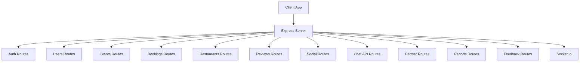
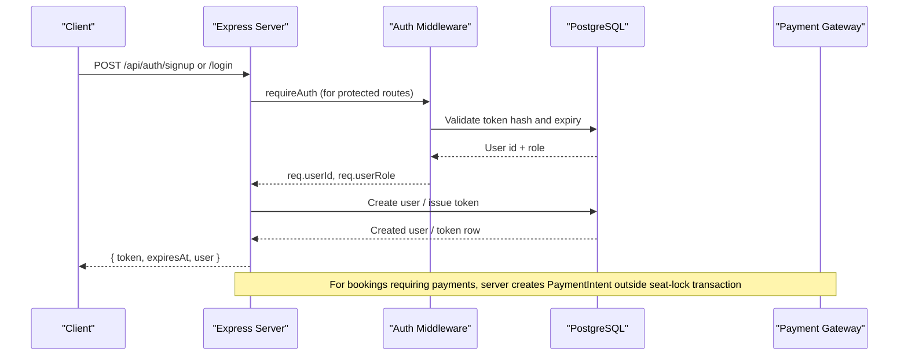
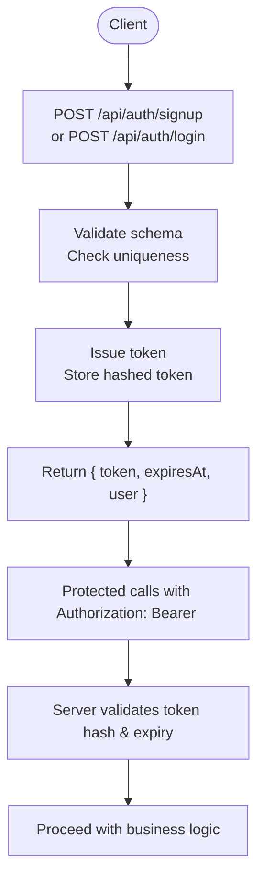
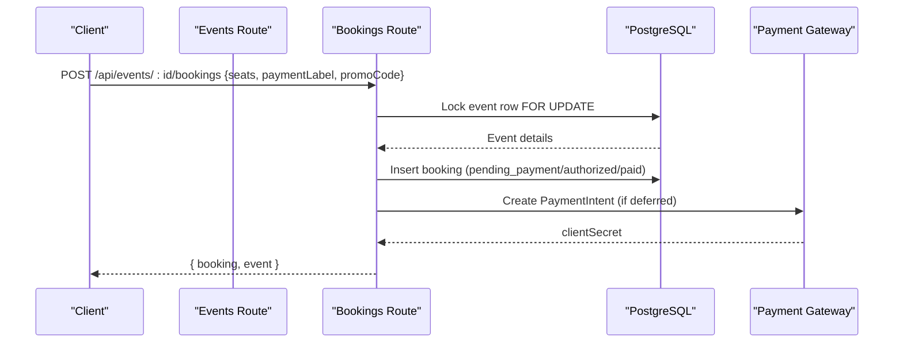
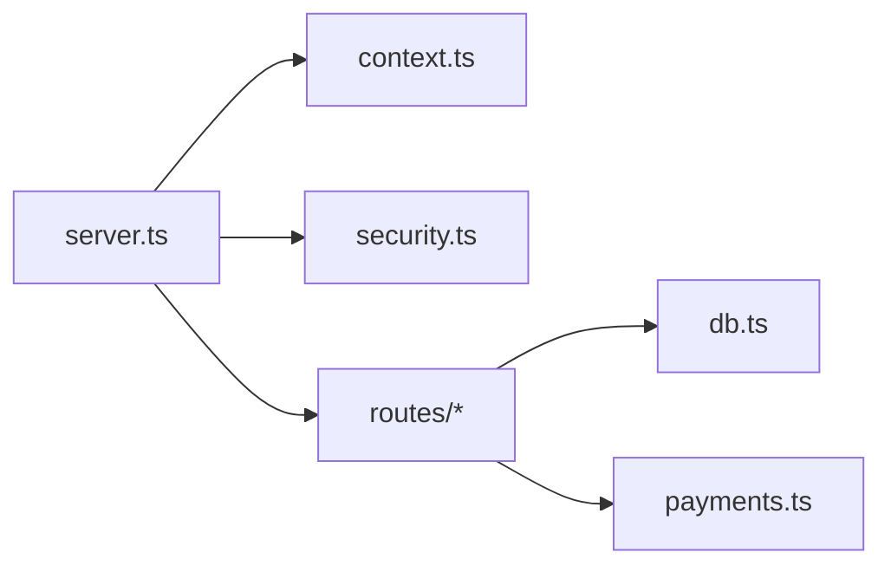

# API Reference Documentation

<cite>
**Referenced Files in This Document**   
- [server.ts](file://server/src/server.ts)
- [context.ts](file://server/src/context.ts)
- [security.ts](file://server/src/security.ts)
- [auth.ts](file://server/src/routes/auth.ts)
- [users.ts](file://server/src/routes/users.ts)
- [events.ts](file://server/src/routes/events.ts)
- [bookings.ts](file://server/src/routes/bookings.ts)
- [restaurants.ts](file://server/src/routes/restaurants.ts)
- [reviews.ts](file://server/src/routes/reviews.ts)
- [social.ts](file://server/src/routes/social.ts)
- [chat.ts](file://server/src/routes/chat.ts)
- [partner.ts](file://server/src/routes/partner.ts)
- [reports.ts](file://server/src/routes/reports.ts)
- [feedback.ts](file://server/src/routes/feedback.ts)
</cite>

## Table of Contents
1. [Introduction](#introduction)
2. [Project Structure](#project-structure)
3. [Core Components](#core-components)
4. [Architecture Overview](#architecture-overview)
5. [Detailed Component Analysis](#detailed-component-analysis)
6. [Dependency Analysis](#dependency-analysis)
7. [Performance Considerations](#performance-considerations)
8. [Troubleshooting Guide](#troubleshooting-guide)
9. [Conclusion](#conclusion)

## Introduction
This document provides a comprehensive API reference for the DineCircle backend REST endpoints and WebSocket channels. It covers authentication, authorization, rate limiting, request/response schemas, validation rules, error handling, and real-time communication patterns. The server is an Express application with Socket.io for live event chat and notifications. Authentication uses opaque bearer tokens stored as hashed values in the database; role-based access control (RBAC) restricts sensitive operations to hosts, influencers, partner admins, and super admins.

## Project Structure
The backend is organized by feature routes under `server/src/routes`, with shared middleware and utilities in `server/src`. Key responsibilities:
- Application bootstrap, security headers, CORS, rate limiting, audit logging, and global error handling are defined in the server entrypoint.
- Authentication flows and token management are implemented in the auth route module.
- Domain modules cover users, events, bookings, restaurants, reviews, social features, chat, partner admin tools, reports, and feedback.

**Diagram sources**
- [server.ts:27-300](file://server/src/server.ts#L27-L300)
- [auth.ts:10-528](file://server/src/routes/auth.ts#L10-L528)
- [users.ts:11-739](file://server/src/routes/users.ts#L11-L739)
- [events.ts:8-636](file://server/src/routes/events.ts#L8-L636)
- [bookings.ts:15-888](file://server/src/routes/bookings.ts#L15-L888)
- [restaurants.ts:5-210](file://server/src/routes/restaurants.ts#L5-L210)
- [reviews.ts:6-151](file://server/src/routes/reviews.ts#L6-L151)
- [social.ts:6-355](file://server/src/routes/social.ts#L6-L355)
- [chat.ts:7-134](file://server/src/routes/chat.ts#L7-L134)
- [partner.ts:6-536](file://server/src/routes/partner.ts#L6-L536)
- [reports.ts:8-283](file://server/src/routes/reports.ts#L8-L283)
- [feedback.ts:8-152](file://server/src/routes/feedback.ts#L8-L152)

**Section sources**
- [server.ts:27-300](file://server/src/server.ts#L27-L300)

## Core Components
- Authentication: Bearer token-based session management with hashed storage and 30-day TTL. Endpoints support phone sign-in, email/password signup/login, account changes, and session termination.
- Authorization: Role-based checks via `requireAuth` and `requireRole`. Roles include user, host, influencer, partner_admin, super_admin.
- Rate Limiting: Global API limiter, stricter auth limiter, report limiter, and feedback limiter.
- Audit Logging: Mutating requests are recorded with redacted secrets.
- Payments Integration: Deferred payment intents and webhooks managed through a gateway abstraction.
- Real-time Channels: Socket.io rooms per event and restaurant for live chat and notifications.

**Section sources**
- [context.ts:5-147](file://server/src/context.ts#L5-L147)
- [security.ts:1-148](file://server/src/security.ts#L1-L148)
- [server.ts:88-277](file://server/src/server.ts#L88-L277)

## Architecture Overview
The server mounts routers under `/api`, applies global middleware (CORS, helmet, JSON parsing, rate limiters), and enforces authentication on all protected routes. Stripe webhook traffic bypasses JSON parsing and rate limiting to preserve raw payload integrity.

**Diagram sources**
- [server.ts:60-85](file://server/src/server.ts#L60-L85)
- [context.ts:60-85](file://server/src/context.ts#L60-L85)
- [auth.ts:217-280](file://server/src/routes/auth.ts#L217-L280)
- [bookings.ts:337-379](file://server/src/routes/bookings.ts#L337-L379)

**Section sources**
- [server.ts:60-119](file://server/src/server.ts#L60-L119)
- [context.ts:60-98](file://server/src/context.ts#L60-L98)

## Detailed Component Analysis

### Authentication API
Base path: `/api/auth`

- POST `/api/auth/signin`
  - Purpose: Phone-based sign-in; auto-creates user if missing.
  - Request body: `{ phone: string }` (E.164-like digits, spaces, dashes allowed).
  - Response: `{ token, expiresAt, user }`.
  - Notes: Token TTL is 30 days; token stored hashed.

- POST `/api/auth/signup`
  - Purpose: Email/password registration and immediate login.
  - Request body: `{ name, email, password, city? }`.
  - Validation: email format, password length, name length, city default.
  - Response: `{ token, expiresAt, user }`.
  - Status codes: 201 on success, 409 if email exists.

- POST `/api/auth/login`
  - Purpose: Email/password login.
  - Request body: `{ email, password }`.
  - Response: `{ token, expiresAt, user }`.
  - Status codes: 401 on invalid credentials.

- GET `/api/auth/me`
  - Purpose: Retrieve current user profile.
  - Auth: Required.
  - Response: `{ user }`.

- POST `/api/auth/signout`
  - Purpose: Revoke current device token.
  - Auth: Required.
  - Response: `{ signedOut: true }`.

- POST `/api/auth/change-password`
  - Purpose: Change password and revoke other sessions.
  - Auth: Required.
  - Request body: `{ currentPassword, newPassword }`.
  - Response: `{ changed: true, user }`.

- POST `/api/auth/change-email`
  - Purpose: Start verified email change flow.
  - Auth: Required.
  - Request body: `{ email, password }`.
  - Response: `{ sent: true, email, expiresAt }` (dev may include `devCode`).
  - Status codes: 400 if same email, 409 if email taken.

- POST `/api/auth/change-email/confirm`
  - Purpose: Confirm email change with 6-digit code.
  - Auth: Required.
  - Request body: `{ code }`.
  - Response: `{ email, user }`.
  - Status codes: 400 no pending change, 401 wrong/expired code, 409 email taken.

- POST `/api/auth/change-phone`
  - Purpose: Update phone number after password confirmation.
  - Auth: Required.
  - Request body: `{ phone, password }`.
  - Response: `{ phone, user }`.
  - Status codes: 409 if phone taken.

- POST `/api/auth/logout-all`
  - Purpose: Revoke all sessions including current.
  - Auth: Required.
  - Response: `{ signedOutEverywhere: true }`.

- Legacy OTP endpoints (backward compatibility):
  - POST `/api/auth/otp/request`
    - Request: `{ phone }`.
    - Response: `{ sent: true, phone, expiresAt }` (dev includes `devCode`).
  - POST `/api/auth/otp/verify`
    - Request: `{ phone, code }`.
    - Response: `{ token, expiresAt, user }`.
    - Status codes: 401 invalid/expired code.

Authentication Flow Diagram:

**Diagram sources**
- [auth.ts:217-280](file://server/src/routes/auth.ts#L217-L280)
- [context.ts:60-85](file://server/src/context.ts#L60-L85)

**Section sources**
- [auth.ts:14-528](file://server/src/routes/auth.ts#L14-L528)
- [context.ts:60-85](file://server/src/context.ts#L60-L85)

### Users API
Base path: `/api/users`

- PATCH `/api/users/me`
  - Purpose: Edit profile/settings (partial update).
  - Auth: Required.
  - Request fields (optional): `name`, `city`, `bio`, `tastes[]`, `homeArea`, `showFollowList`, `showActivity`, `dmFromFollowersOnly`, `allowTagging`, `dietary[]`, `allergies[]`.
  - Response: `{ user }`.

- DELETE `/api/users/me`
  - Purpose: Delete account (anonymize in place, settle money, cancel events/tickets).
  - Auth: Required.
  - Request body: `{ password }`.
  - Response: `{ deleted: true, refundedSeats, eventsTouched, gatewaySettlements }`.
  - Status codes: 409 no password set, 401 wrong password.

- GET `/api/users`
  - Purpose: Discovery list with search and pagination.
  - Query params: `q?`, `limit?`, `offset?`.
  - Response: `{ users[], count, offset }`.

- POST `/api/users/me/host`
  - Purpose: Self-promote to host role.
  - Auth: Required.
  - Response: `{ role: 'host', user }`.

- GET `/api/users/me/tier`
  - Purpose: Current tier and influencer eligibility progress.
  - Auth: Required.
  - Response: `{ tier, thresholds, progress, eligible }`.

- POST `/api/users/me/influencer`
  - Purpose: Claim influencer status if eligible.
  - Auth: Required.
  - Response: `{ role: 'influencer', user }`.
  - Status codes: 403 not eligible yet or already has publishing role.

- GET `/api/users/:id/followers`
  - Purpose: List followers of a user (privacy-gated).
  - Query params: `limit?`, `offset?`.
  - Response: `{ users[], count, offset }`.

- GET `/api/users/:id/following`
  - Purpose: List following of a user (privacy-gated).
  - Query params: `limit?`, `offset?`.
  - Response: `{ users[], count, offset }`.

- GET `/api/users/:id`
  - Purpose: Profile card with upcoming hosted events and reviews.
  - Response: `{ user, viewerFollows, hostedUpcoming[], reviews[] }`.

**Section sources**
- [users.ts:121-739](file://server/src/routes/users.ts#L121-L739)

### Events API
Base path: `/api/events`

- GET `/api/events`
  - Purpose: Filterable event feed with audience visibility rules.
  - Query params: `type?`, `audience?`, `featured?`, `hostId?`, `venueId?`, `upcoming?`, `q?`, `maxPrice?`, `from?`, `to?`, `city?`, `neighborhood?`, `limit?`, `offset?`.
  - Response: `{ events[], count }`.

- GET `/api/events/mine`
  - Purpose: Host’s own events (including drafts).
  - Auth: Required.
  - Response: `{ events[], count }`.

- GET `/api/events/:id`
  - Purpose: Event detail with menu, venue, attendees.
  - Response: `{ event }`.

- POST `/api/events`
  - Purpose: Create event (draft or published).
  - Auth: Required (host capabilities).
  - Request body: Full event schema (title, tagline, description, restaurantId, coverImage, gallery, startAt, durationMinutes, seatsTotal, pricePerSeat, type, audience, menuStyle, included, tags, isFeatured, hostNote, requiresApproval, menu[]).
  - Response: `{ event }`.
  - Status codes: 403 unauthorized, 422 unknown restaurant.

- PATCH `/api/events/:id`
  - Purpose: Edit draft or publish it.
  - Auth: Required (event owner).
  - Request body: Partial fields plus optional `status: 'published'`.
  - Response: `{ event }`.
  - Status codes: 400 invalid publish attempt, 403 not owner.

- DELETE `/api/events/:id`
  - Purpose: Cancel/delete event (guarded against captured payments/accrued earnings).
  - Auth: Required (event owner).
  - Response: `{ deleted: true, eventId }`.
  - Status codes: 409 financial history guard.

**Section sources**
- [events.ts:140-636](file://server/src/routes/events.ts#L140-L636)

### Bookings API
Base path: `/api/bookings`

- GET `/api/bookings`
  - Purpose: My tickets; optionally host guest list for an event.
  - Query params: `eventId?`.
  - Response: `{ bookings[], upcoming[], past[], cancelled[], count }`.

- POST `/api/events/:id/bookings`
  - Purpose: Join event and pay (seat reservation and payment intent creation).
  - Auth: Required.
  - Request body: `{ seats?, paymentLabel?, promoCode? }`.
  - Response: `{ booking, event }`.
  - Status codes: 409 sold out/already started/duplicate hold, 400 invalid promo, 502 payment setup failed.

- POST `/api/bookings/:id/cancel`
  - Purpose: Cancel booking and refund/release funds.
  - Auth: Required (booking owner).
  - Response: `{ booking, refund, event }`.
  - Status codes: 409 already cancelled/completed.

- POST `/api/bookings/:id/approve`
  - Purpose: Host approves pending seat request (capture payment if needed).
  - Auth: Required (event host).
  - Response: `{ booking, eventId, guestUserId }`.
  - Status codes: 502 capture failed.

- POST `/api/bookings/:id/decline`
  - Purpose: Host declines pending request (release hold).
  - Auth: Required (event host).
  - Response: `{ booking, event, guestUserId }`.

- POST `/api/bookings/:id/checkin`
  - Purpose: Mark ticket used and finalize attendance.
  - Auth: Required (guest or host).
  - Response: `{ booking }`.
  - Status codes: 409 already checked in/cancelled.

Booking Creation Sequence:

**Diagram sources**
- [bookings.ts:153-405](file://server/src/routes/bookings.ts#L153-L405)

**Section sources**
- [bookings.ts:79-888](file://server/src/routes/bookings.ts#L79-L888)

### Restaurants API
Base path: `/api/restaurants`

- GET `/api/restaurants`
  - Purpose: Partner venues with filters.
  - Query params: `partner?`, `q?`, `city?`, `tag?`, `priceMax?`, `limit?`.
  - Response: `{ restaurants[], count }`.

- GET `/api/restaurants/nearby`
  - Purpose: Nearby venues within radius.
  - Query params: `lat`, `lng`, `radiusKm?`, `limit?`.
  - Response: `{ restaurants[], count, radiusKm }`.
  - Status codes: 400 missing lat/lng.

- GET `/api/restaurants/:id`
  - Purpose: Venue profile with upcoming events.
  - Response: `{ restaurant, upcomingEvents[] }`.

- POST `/api/restaurants/:id/follow`
  - Purpose: Follow venue (idempotent).
  - Auth: Required.
  - Response: `{ ok: true, isFollowing: true }`.

- DELETE `/api/restaurants/:id/follow`
  - Purpose: Unfollow venue.
  - Auth: Required.
  - Response: `{ ok: true, isFollowing: false }`.

**Section sources**
- [restaurants.ts:47-210](file://server/src/routes/restaurants.ts#L47-L210)

### Reviews API
Base path: `/api/reviews`

- GET `/api/reviews`
  - Purpose: Filterable reviews by host/event/author.
  - Query params: `hostId?`, `eventId?`, `authorId?`, `limit?`.
  - Response: `{ reviews[], count }`.

- POST `/api/events/:id/reviews`
  - Purpose: Submit review for attended event.
  - Auth: Required.
  - Request body: `{ rating, text }`.
  - Response: `{ review }`.
  - Status codes: 403 host cannot review own event/not attended, 409 duplicate review.

**Section sources**
- [reviews.ts:21-151](file://server/src/routes/reviews.ts#L21-L151)

### Social API
Base path: `/api` (mounted under social router)

- GET `/api/activity`
  - Purpose: Signed-in user’s activity feed.
  - Auth: Required.
  - Response: `{ activity[], unreadCount }`.

- POST `/api/activity/read`
  - Purpose: Mark all items read.
  - Auth: Required.
  - Response: `{ read: true }`.

- GET `/api/me/saved`
  - Purpose: Saved events.
  - Auth: Required.
  - Response: `{ saved[] }`.

- POST `/api/events/:id/save`
  - Purpose: Bookmark event.
  - Auth: Required.
  - Response: `{ saved: true, eventId }`.

- DELETE `/api/events/:id/save`
  - Purpose: Unbookmark event.
  - Auth: Required.
  - Response: `{ saved: false, eventId }`.

- GET `/api/social/follow-status`
  - Purpose: Batch follow statuses for a list of user IDs.
  - Query param: `ids` (comma-separated UUIDs).
  - Response: `{ statuses }`.

- POST `/api/users/:id/follow`
  - Purpose: Follow a user.
  - Auth: Required.
  - Response: `{ following: true, userId, followers }`.

- DELETE `/api/users/:id/follow`
  - Purpose: Unfollow a user.
  - Auth: Required.
  - Response: `{ following: false, userId, followers }`.

- POST `/api/users/:id/block`
  - Purpose: Block a user (removes mutual follows).
  - Auth: Required.
  - Response: `{ blocked: true, userId, removedFollows }`.

- DELETE `/api/users/:id/block`
  - Purpose: Unblock a user.
  - Auth: Required.
  - Response: `{ blocked: false, userId }`.

- GET `/api/users/me/blocked`
  - Purpose: Viewer’s block list.
  - Auth: Required.
  - Response: `{ blocked[], count }`.

**Section sources**
- [social.ts:29-355](file://server/src/routes/social.ts#L29-L355)

### Chat API (REST)
Base path: `/api/events/:id/messages`

- GET `/api/events/:id/messages`
  - Purpose: Load event chat thread (oldest first).
  - Auth: Required (member only: host, attendee, or active booking).
  - Response: `{ messages[], count }`.

- POST `/api/events/:id/messages`
  - Purpose: Send message to event chat.
  - Auth: Required (member only; blocked pairs cannot send).
  - Request body: `{ text }`.
  - Response: `{ message }`.

**Section sources**
- [chat.ts:55-134](file://server/src/routes/chat.ts#L55-L134)

### Partner Admin API
Base path: `/api/partner`
All routes require `partner_admin` or `super_admin`.

- GET `/api/partner/restaurants`
  - Purpose: Partner’s restaurants.
  - Response: `{ restaurants[], count }`.

- GET `/api/partner/restaurants/:id`
  - Purpose: Restaurant detail owned by partner.
  - Response: `{ restaurant }`.

- POST `/api/partner/events`
  - Purpose: Create event for partner restaurant.
  - Request body: `{ restaurantId, title, tagline, description, startAt, endAt, seatsTotal, pricePerSeat, type, audience, menuStyle, coverImage, tags }`.
  - Response: `{ event }`.

- PUT `/api/partner/events/:id`
  - Purpose: Update partner-owned event.
  - Request body: Partial fields including optional `status`.
  - Response: `{ updated: true, event }`.

- GET `/api/partner/events`
  - Purpose: Partner’s events with optional status filter.
  - Response: `{ events[], count }`.

- GET `/api/partner/bookings`
  - Purpose: Partner’s bookings with optional eventId/status filters.
  - Response: `{ bookings[], count }`.

- POST `/api/partner/bookings/:id/checkin`
  - Purpose: Check in a guest for partner event.
  - Response: `{ booking }`.

- POST `/api/partner/menus`
  - Purpose: Create special menu for partner restaurant.
  - Request body: `{ restaurantId, name, description, pricePerGuest, minGuests, tags, coverImage }`.
  - Response: `{ menu }`.

- GET `/api/partner/menus`
  - Purpose: Partner’s special menus.
  - Response: `{ menus[], count }`.

- GET `/api/partner/analytics`
  - Purpose: Business insights across partner restaurants.
  - Response: `{ analytics, recentBookings[] }`.

- GET `/api/partner/notifications`
  - Purpose: Notifications for partner’s restaurants.
  - Query params: `unreadOnly?`, `limit?`.
  - Response: `{ notifications[], count }`.

**Section sources**
- [partner.ts:8-536](file://server/src/routes/partner.ts#L8-L536)

### Reports API
Base path: `/api` (mounted under reports router)

- POST `/api/reports`
  - Purpose: File a report (user, event, review, message).
  - Auth: Required.
  - Request body: `{ targetType, targetId, reason, description? }`.
  - Response: `{ report }`.
  - Status codes: 400 self-report, 409 open duplicate, 404 target not found.

- GET `/api/users/me/reports`
  - Purpose: Viewer’s own reports.
  - Auth: Required.
  - Response: `{ reports[], count }`.

- GET `/api/reports`
  - Purpose: Moderator queue (super_admin only).
  - Query params: `status?`.
  - Response: `{ reports[], count }`.

- PATCH `/api/reports/:id`
  - Purpose: Advance report status (super_admin only).
  - Request body: `{ status }`.
  - Response: `{ report }`.

**Section sources**
- [reports.ts:117-283](file://server/src/routes/reports.ts#L117-L283)

### Feedback API
Base path: `/api` (mounted under feedback router)

- POST `/api/feedback`
  - Purpose: Submit help/feedback ticket.
  - Auth: Required.
  - Request body: `{ category, subject, description, relatedRef? }`.
  - Response: `{ feedback }`.

- GET `/api/users/me/feedback`
  - Purpose: Viewer’s own tickets.
  - Auth: Required.
  - Response: `{ feedback[], count }`.

- GET `/api/feedback`
  - Purpose: Admin support queue (super_admin only).
  - Query params: `status?`.
  - Response: `{ feedback[], count }`.

- PATCH `/api/feedback/:id`
  - Purpose: Advance ticket status (super_admin only).
  - Request body: `{ status }`.
  - Response: `{ feedback }`.

**Section sources**
- [feedback.ts:63-152](file://server/src/routes/feedback.ts#L63-L152)

### Health Endpoint
- GET `/api/health`
  - Purpose: Liveness check with DB latency.
  - Response: `{ status, database, latencyMs, time }`.

**Section sources**
- [server.ts:224-233](file://server/src/server.ts#L224-L233)

## Dependency Analysis
Key dependencies between components:
- `server.ts` wires routers, applies global middleware (`helmet`, `cors`, `express.json`, rate limiters), and mounts Socket.io.
- `context.ts` defines roles, `requireAuth`, `requireRole`, and helper errors.
- `security.ts` implements token hashing, rate limiters, and audit logging.
- Route modules depend on `db.ts` for queries and transactions, and on `payments.ts` for gateway interactions.

**Diagram sources**
- [server.ts:1-26](file://server/src/server.ts#L1-L26)
- [context.ts:1-147](file://server/src/context.ts#L1-L147)
- [security.ts:1-148](file://server/src/security.ts#L1-L148)

**Section sources**
- [server.ts:1-26](file://server/src/server.ts#L1-L26)
- [context.ts:1-147](file://server/src/context.ts#L1-L147)
- [security.ts:1-148](file://server/src/security.ts#L1-L148)

## Performance Considerations
- Rate Limiting:
  - Global API: 100 requests per minute per IP (configurable via `API_RATE_LIMIT_MAX`).
  - Auth endpoints: 10 requests per minute per IP (configurable via `AUTH_RATE_LIMIT_MAX`).
  - Reports: 15 per 15 minutes per IP (configurable via `REPORT_RATE_LIMIT_MAX`).
  - Feedback: 10 per hour per IP (configurable via `FEEDBACK_RATE_LIMIT_MAX`).
- Database Access:
  - Startup waits for Postgres readiness with retries.
  - Transactional operations use row locks (`FOR UPDATE`) to prevent race conditions during bookings and cancellations.
- Payment Gateway:
  - Intent creation occurs outside seat-lock transactions to avoid holding database rows during external calls.
  - Abandoned pending payments are swept opportunistically on reads and periodically.

[No sources needed since this section provides general guidance]

## Troubleshooting Guide
Common error responses:
- 400 Bad Request: Invalid request body (Zod validation issues).
- 401 Unauthorized: Missing or invalid token; incorrect credentials.
- 403 Forbidden: Insufficient permissions or privacy-blocked access.
- 404 Not Found: Resource does not exist.
- 409 Conflict: Duplicate resource, already started event, sold out, or financial history guard.
- 422 Unprocessable Entity: Unknown restaurant or validation failure during publish.
- 500 Internal Server Error: Unexpected failures.
- 502 Bad Gateway: Payment gateway call failures.

Global error handler:
- Converts `ApiError` to structured JSON with status.
- Converts `ZodError` to 400 with issues array.
- Logs unhandled errors and returns 500.

Audit logging:
- Records mutating requests with redacted secrets in `audit_log`.

WebSocket troubleshooting:
- Connections without valid token are disconnected.
- Room join events verify membership before allowing access.
- Errors emitted to clients when authorization fails.

**Section sources**
- [server.ts:259-277](file://server/src/server.ts#L259-L277)
- [security.ts:103-147](file://server/src/security.ts#L103-L147)
- [server.ts:146-202](file://server/src/server.ts#L146-L202)

## Conclusion
The DineCircle backend exposes a robust set of REST endpoints covering authentication, user profiles, events, bookings, restaurants, reviews, social graph, chat, partner administration, reports, and feedback. Security is enforced via hashed bearer tokens, role-based access control, and strict rate limiting. Real-time communication is provided through Socket.io rooms for event and restaurant contexts. Consumers should handle standard HTTP error codes, respect rate limits, and implement proper retry/backoff strategies for transient failures.

[No sources needed since this section summarizes without analyzing specific files]