# Authentication API

<cite>
**Referenced Files in This Document**
- [auth.ts](file://server/src/routes/auth.ts)
- [passwords.ts](file://server/src/passwords.ts)
- [security.ts](file://server/src/security.ts)
- [context.ts](file://server/src/context.ts)
- [server.ts](file://server/src/server.ts)
- [schema.sql](file://server/src/schema.sql)
</cite>

## Table of Contents
1. [Introduction](#introduction)
2. [Project Structure](#project-structure)
3. [Core Components](#core-components)
4. [Architecture Overview](#architecture-overview)
5. [Detailed Component Analysis](#detailed-component-analysis)
6. [Dependency Analysis](#dependency-analysis)
7. [Performance Considerations](#performance-considerations)
8. [Troubleshooting Guide](#troubleshooting-guide)
9. [Conclusion](#conclusion)

## Introduction
This document describes the DineCircle authentication API. It covers phone-based sign-in, email/password registration and login, OTP verification, session management, and account credential changes. The API uses:
- Opaque bearer tokens stored as SHA-256 digests with a 30-day expiry.
- scrypt-based password hashing for email/password accounts.
- Zod schema validation for request bodies.
- Rate limiting for both general API traffic and authentication endpoints.
- A soft-delete model for users; credential mutations are blocked on deleted accounts.

The authentication routes live under `/api/auth`. Public flows (`/signin`, `/signup`, `/login`, `/otp/request`, `/otp/verify`) do not require a token. Protected flows (`/me`, `/signout`, `/change-password`, `/change-email`, `/change-email/confirm`, `/change-phone`, `/logout-all`) require a valid Bearer token.

## Project Structure
The authentication implementation is primarily in the server-side Express application:
- Route definitions and business logic: `server/src/routes/auth.ts`
- Password hashing and verification: `server/src/passwords.ts`
- Security middleware (rate limiters, audit redaction, token hashing): `server/src/security.ts`
- Authentication middleware and user serialization: `server/src/context.ts`
- Application bootstrap, global middleware, and route mounting: `server/src/server.ts`
- Database schema including auth-related tables: `server/src/schema.sql`

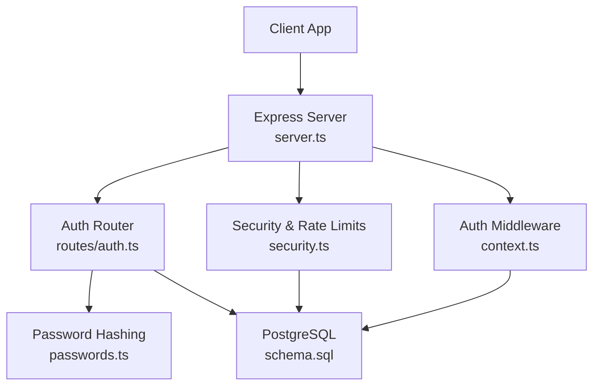

**Diagram sources**
- [server.ts:221-239](file://server/src/server.ts#L221-L239)
- [auth.ts:1-10](file://server/src/routes/auth.ts#L1-L10)
- [context.ts:60-85](file://server/src/context.ts#L60-L85)
- [security.ts:28-46](file://server/src/security.ts#L28-L46)
- [passwords.ts:15-40](file://server/src/passwords.ts#L15-L40)
- [schema.sql:389-424](file://server/src/schema.sql#L389-L424)

**Section sources**
- [server.ts:27-90](file://server/src/server.ts#L27-L90)
- [auth.ts:1-12](file://server/src/routes/auth.ts#L1-L12)
- [schema.sql:389-424](file://server/src/schema.sql#L389-L424)

## Core Components
- **Bearer token model**: Tokens are generated as opaque strings prefixed with `dc_`, hashed with SHA-256 before storage, and expire after 30 days. Clients send the plaintext token in the `Authorization: Bearer <token>` header.
- **Phone sign-in**: Accepts a normalized phone number, finds or creates a user, and issues a token.
- **OTP flow**: Generates a 6-digit code, stores it with an expiration, verifies it once, then signs the user in.
- **Email/password flow**: Registers a new account with a scrypt-hashed password and logs the user in; also supports login by email and password.
- **Session management**: `/me` returns the current user, `/signout` revokes one session, and `/logout-all` revokes every session for the account.
- **Credential changes**: Password, email, and phone updates require current password confirmation and revoke other sessions while keeping the current device signed in.

**Section sources**
- [auth.ts:12-61](file://server/src/routes/auth.ts#L12-L61)
- [auth.ts:65-157](file://server/src/routes/auth.ts#L65-L157)
- [auth.ts:186-280](file://server/src/routes/auth.ts#L186-L280)
- [auth.ts:282-314](file://server/src/routes/auth.ts#L282-L314)
- [auth.ts:357-525](file://server/src/routes/auth.ts#L357-L525)
- [security.ts:12-14](file://server/src/security.ts#L12-L14)
- [context.ts:60-85](file://server/src/context.ts#L60-L85)

## Architecture Overview
The authentication architecture combines HTTP routes, middleware, database persistence, and security utilities.

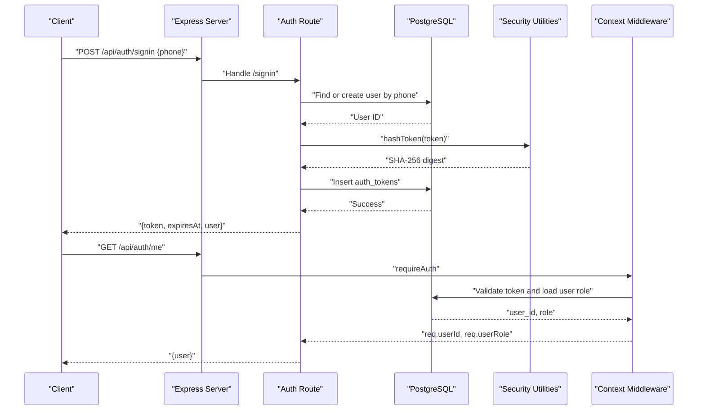

**Diagram sources**
- [auth.ts:22-61](file://server/src/routes/auth.ts#L22-L61)
- [auth.ts:282-285](file://server/src/routes/auth.ts#L282-L285)
- [context.ts:60-85](file://server/src/context.ts#L60-L85)
- [security.ts:12-14](file://server/src/security.ts#L12-L14)
- [schema.sql:417-424](file://server/src/schema.sql#L417-L424)

## Detailed Component Analysis

### Phone Sign-In: POST `/api/auth/signin`
Sign-in accepts a phone number. If no user exists, a minimal profile is created. A bearer token is issued and returned along with the user object.

- **Method**: `POST`
- **Path**: `/api/auth/signin`
- **Authentication**: None
- **Rate limiting**: Global API rate limiter applies; auth-specific stricter limits apply to `/api/auth`.
- **Request body**:
  - `phone`: string, trimmed, matching a phone-like pattern.
- **Response**:
  - `token`: string, plaintext secret to include in `Authorization: Bearer`.
  - `expiresAt`: timestamp when the token expires.
  - `user`: serialized user object.
- **Validation rules**:
  - Phone must match the configured regex and be non-empty after trimming.
- **Error responses**:
  - `400`: Invalid request body (Zod validation).
  - `500`: Account creation failure.
- **Behavior notes**:
  - Phone normalization removes spaces and dashes before lookup and storage.
  - New users receive default city, bio, joined year, and accent color.

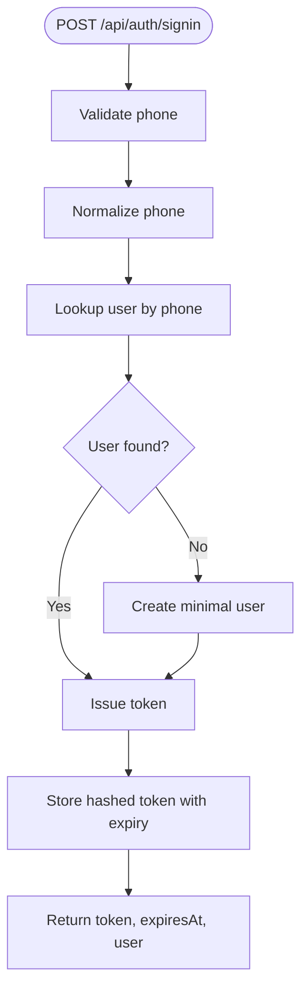

**Diagram sources**
- [auth.ts:22-61](file://server/src/routes/auth.ts#L22-L61)
- [schema.sql:417-424](file://server/src/schema.sql#L417-L424)

**Section sources**
- [auth.ts:14-61](file://server/src/routes/auth.ts#L14-L61)
- [schema.sql:16-37](file://server/src/schema.sql#L16-L37)

### Email/Password Registration: POST `/api/auth/signup`
Creates a new account with email and password, hashes the password using scrypt, and signs the user in.

- **Method**: `POST`
- **Path**: `/api/auth/signup`
- **Authentication**: None
- **Request body**:
  - `name`: string, trimmed, minimum 2 characters, maximum 60.
  - `email`: string, trimmed, validated email format, lowercase, minimum 3, maximum 320.
  - `password`: string, minimum 8 characters, maximum 200.
  - `city`: optional string, trimmed, minimum 2, maximum 60; defaults to the app’s home market if omitted.
- **Response**:
  - `token`: string.
  - `expiresAt`: timestamp.
  - `user`: serialized user object.
- **Status codes**:
  - `201`: Created successfully.
  - `400`: Invalid request body.
  - `409`: Email already exists.
  - `500`: Account creation failure.
- **Security**:
  - Password is hashed with scrypt before storage.
  - Unique handle generation avoids collisions.

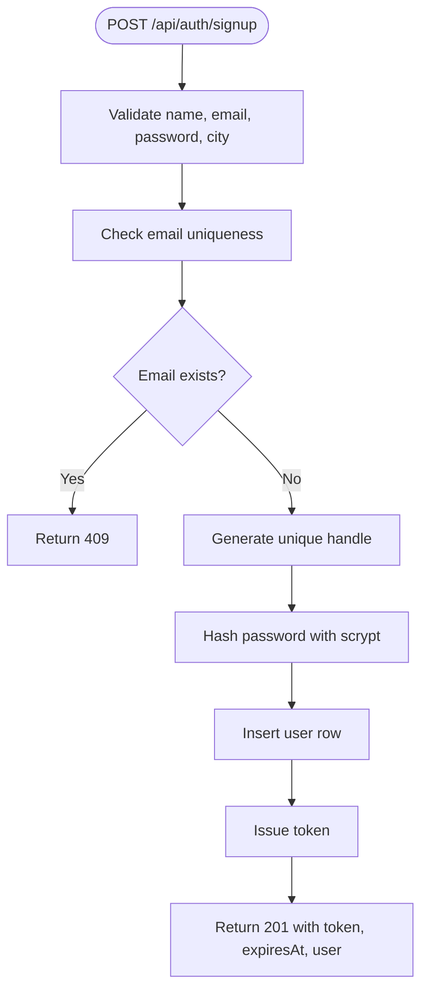

**Diagram sources**
- [auth.ts:160-258](file://server/src/routes/auth.ts#L160-L258)
- [passwords.ts:15-19](file://server/src/passwords.ts#L15-L19)
- [schema.sql:39-43](file://server/src/schema.sql#L39-L43)

**Section sources**
- [auth.ts:160-258](file://server/src/routes/auth.ts#L160-L258)
- [passwords.ts:15-19](file://server/src/passwords.ts#L15-L19)
- [schema.sql:39-43](file://server/src/schema.sql#L39-L43)

### Email/Password Login: POST `/api/auth/login`
Logs in an existing account by verifying the email and password.

- **Method**: `POST`
- **Path**: `/api/auth/login`
- **Authentication**: None
- **Request body**:
  - `email`: string, trimmed, validated email format, lowercase.
  - `password`: string, minimum 1 character, maximum 200.
- **Response**:
  - `token`: string.
  - `expiresAt`: timestamp.
  - `user`: serialized user object.
- **Status codes**:
  - `200`: Success.
  - `400`: Invalid request body.
  - `401`: Incorrect email or password.
- **Security**:
  - Uses timing-safe password comparison via scrypt verification.

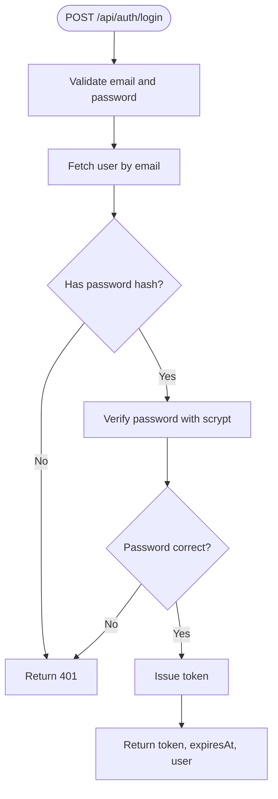

**Diagram sources**
- [auth.ts:260-280](file://server/src/routes/auth.ts#L260-L280)
- [passwords.ts:26-40](file://server/src/passwords.ts#L26-L40)

**Section sources**
- [auth.ts:181-280](file://server/src/routes/auth.ts#L181-L280)
- [passwords.ts:26-40](file://server/src/passwords.ts#L26-L40)

### OTP Request: POST `/api/otp/request`
Generates a 6-digit OTP tied to a phone number and stores it with a short TTL.

- **Method**: `POST`
- **Path**: `/api/otp/request`
- **Authentication**: None
- **Request body**:
  - `phone`: string, trimmed, phone-like pattern.
- **Response**:
  - `sent`: boolean indicating whether the OTP was prepared.
  - `phone`: normalized phone number.
  - `expiresAt`: timestamp when the OTP expires.
  - `devCode`: only present in development builds; contains the plaintext OTP for testing.
- **Status codes**:
  - `200`: Success.
  - `400`: Invalid request body.
- **Behavior notes**:
  - In development, the OTP is logged and returned in `devCode`.
  - In production, the OTP is sent via SMS integration (not implemented here); the response shape remains consistent.

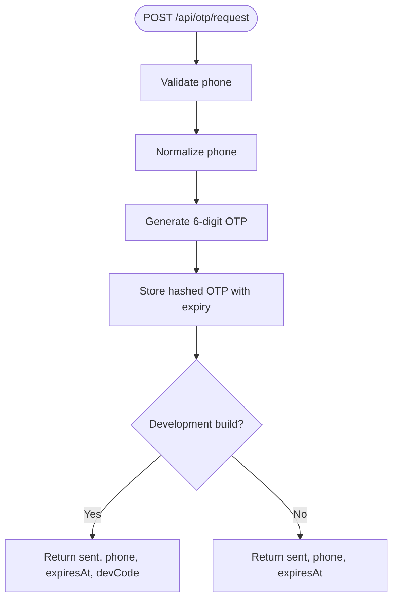

**Diagram sources**
- [auth.ts:65-102](file://server/src/routes/auth.ts#L65-L102)
- [schema.sql:389-395](file://server/src/schema.sql#L389-L395)

**Section sources**
- [auth.ts:65-102](file://server/src/routes/auth.ts#L65-L102)
- [schema.sql:389-395](file://server/src/schema.sql#L389-L395)

### OTP Verification: POST `/api/otp/verify`
Verifies the OTP for a phone number and signs the user in.

- **Method**: `POST`
- **Path**: `/api/otp/verify`
- **Authentication**: None
- **Request body**:
  - `phone`: string, trimmed, phone-like pattern.
  - `code`: string, exactly 6 digits.
- **Response**:
  - `token`: string.
  - `expiresAt`: timestamp.
  - `user`: serialized user object.
- **Status codes**:
  - `200`: Success.
  - `400`: Invalid request body.
  - `401`: Wrong or expired OTP.
  - `500`: Account creation failure.
- **Behavior notes**:
  - On success, the OTP record is consumed (deleted).
  - If no user exists, a minimal user is created automatically.

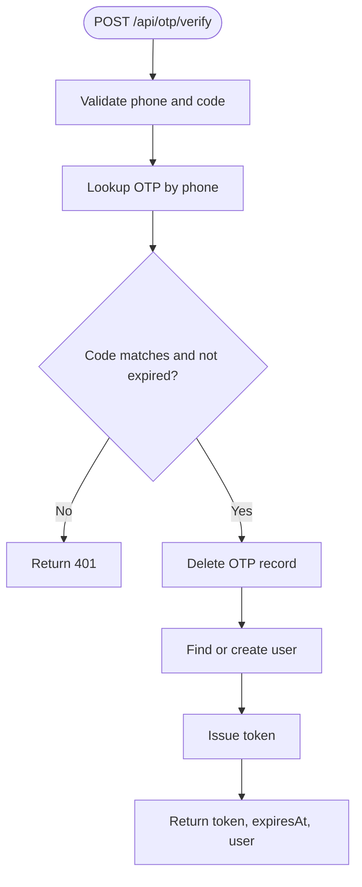

**Diagram sources**
- [auth.ts:104-157](file://server/src/routes/auth.ts#L104-L157)
- [schema.sql:389-395](file://server/src/schema.sql#L389-L395)

**Section sources**
- [auth.ts:104-157](file://server/src/routes/auth.ts#L104-L157)
- [schema.sql:389-395](file://server/src/schema.sql#L389-L395)

### Current User: GET `/api/auth/me`
Returns the authenticated user’s profile.

- **Method**: `GET`
- **Path**: `/api/auth/me`
- **Authentication**: Required (`Authorization: Bearer <token>`)
- **Response**:
  - `user`: serialized user object containing identity, settings, and derived fields such as follower counts and verification status.
- **Status codes**:
  - `200`: Success.
  - `401`: Missing or invalid token.
- **Notes**:
  - Used by clients to restore state at app start.

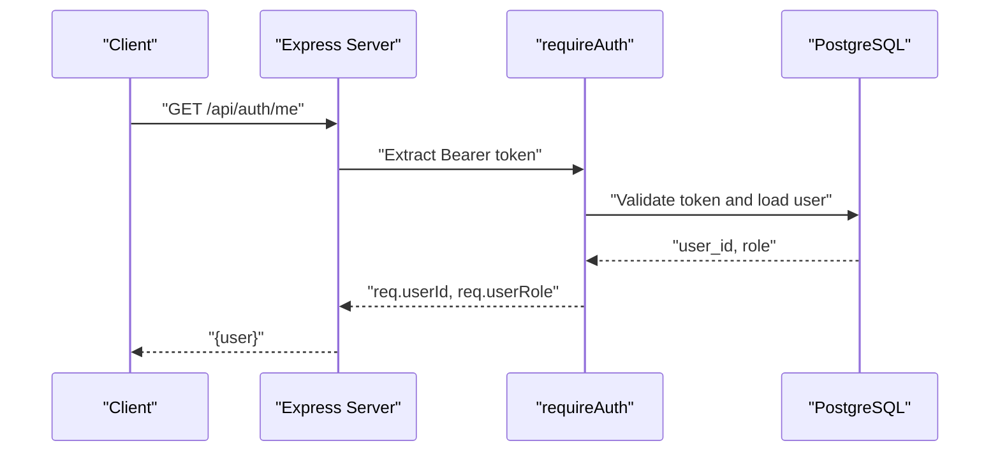

**Diagram sources**
- [auth.ts:282-285](file://server/src/routes/auth.ts#L282-L285)
- [context.ts:60-85](file://server/src/context.ts#L60-L85)

**Section sources**
- [auth.ts:282-285](file://server/src/routes/auth.ts#L282-L285)
- [context.ts:60-85](file://server/src/context.ts#L60-L85)

### Sign Out: POST `/api/auth/signout`
Revokes the current session by deleting its token row.

- **Method**: `POST`
- **Path**: `/api/auth/signout`
- **Authentication**: Required
- **Request body**: None
- **Response**:
  - `signedOut`: boolean.
- **Status codes**:
  - `200`: Success.
  - `401`: Missing or invalid token.
- **Behavior notes**:
  - Only the token from the current request is removed; other sessions remain active.

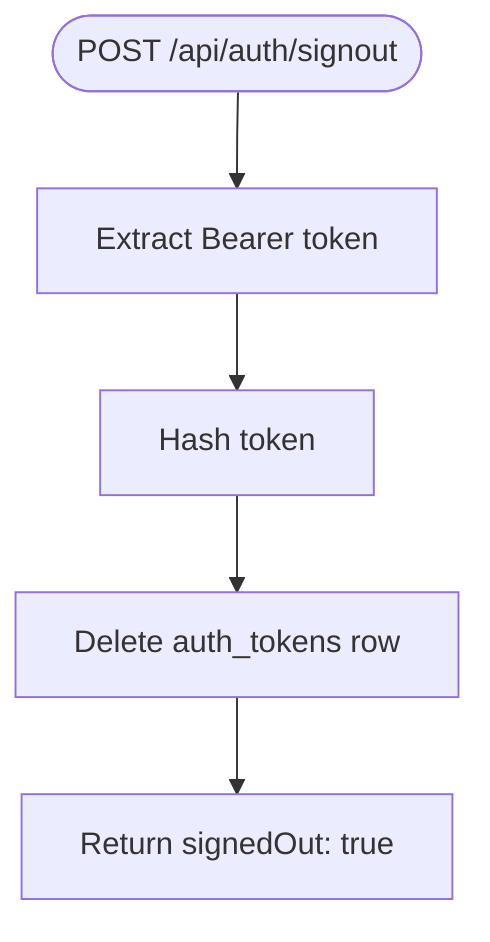

**Diagram sources**
- [auth.ts:287-293](file://server/src/routes/auth.ts#L287-L293)
- [schema.sql:417-424](file://server/src/schema.sql#L417-L424)

**Section sources**
- [auth.ts:287-293](file://server/src/routes/auth.ts#L287-L293)

### Change Password: POST `/api/auth/change-password`
Changes the account password after confirming the current password. Other sessions are revoked.

- **Method**: `POST`
- **Path**: `/api/auth/change-password`
- **Authentication**: Required
- **Request body**:
  - `currentPassword`: string, minimum 1 character, maximum 200.
  - `newPassword`: string, minimum 8 characters, maximum 200.
- **Response**:
  - `changed`: boolean.
  - `user`: updated user object.
- **Status codes**:
  - `200`: Success.
  - `400`: Invalid request body.
  - `401`: Incorrect current password.
  - `409`: Account has no password yet.
  - `404`: User not found or soft-deleted.
- **Security**:
  - Requires current password confirmation.
  - New password is hashed with scrypt.
  - Other sessions are revoked; current session survives.

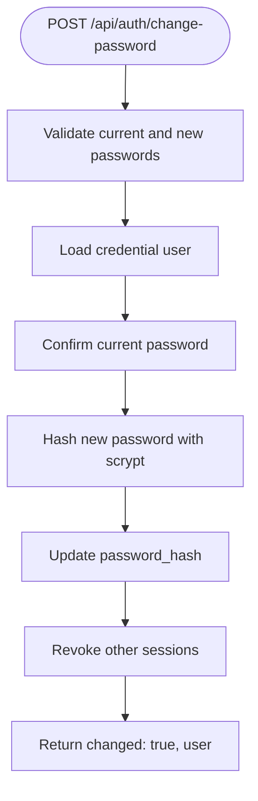

**Diagram sources**
- [auth.ts:357-382](file://server/src/routes/auth.ts#L357-L382)
- [passwords.ts:15-19](file://server/src/passwords.ts#L15-L19)

**Section sources**
- [auth.ts:357-382](file://server/src/routes/auth.ts#L357-L382)
- [passwords.ts:15-19](file://server/src/passwords.ts#L15-L19)

### Change Email: POST `/api/auth/change-email`
Initiates a verified email change. Requires current password confirmation and generates a 6-digit challenge code.

- **Method**: `POST`
- **Path**: `/api/auth/change-email`
- **Authentication**: Required
- **Request body**:
  - `email`: string, trimmed, validated email format, lowercase.
  - `password`: string, minimum 1 character, maximum 200.
- **Response**:
  - `sent`: boolean.
  - `email`: proposed new email.
  - `expiresAt`: timestamp when the challenge expires.
  - `devCode`: only present in development builds; contains the plaintext challenge code.
- **Status codes**:
  - `200`: Challenge created.
  - `400`: Invalid request body or same email as current.
  - `401`: Incorrect password.
  - `409`: Email already belongs to another account.
  - `404`: User not found or soft-deleted.
- **Behavior notes**:
  - The new email is not applied until `/change-email/confirm` succeeds.
  - The challenge code is stored as a hashed value with a 15-minute TTL.

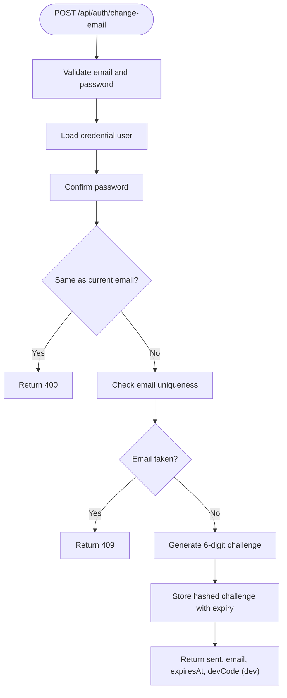

**Diagram sources**
- [auth.ts:384-433](file://server/src/routes/auth.ts#L384-L433)
- [schema.sql:397-407](file://server/src/schema.sql#L397-L407)

**Section sources**
- [auth.ts:384-433](file://server/src/routes/auth.ts#L384-L433)
- [schema.sql:397-407](file://server/src/schema.sql#L397-L407)

### Change Email Confirm: POST `/api/auth/change-email/confirm`
Completes the email change after validating the challenge code.

- **Method**: `POST`
- **Path**: `/api/auth/change-email/confirm`
- **Authentication**: Required
- **Request body**:
  - `code`: string, exactly 6 digits.
- **Response**:
  - `email`: confirmed new email.
  - `user`: updated user object.
- **Status codes**:
  - `200`: Success.
  - `400`: No pending email change.
  - `401`: Wrong or expired code.
  - `409`: Email claimed by another account during flight.
  - `404`: User not found or soft-deleted.
- **Behavior notes**:
  - On success, the challenge is consumed and the address is applied.
  - Other sessions are revoked; current session remains active.

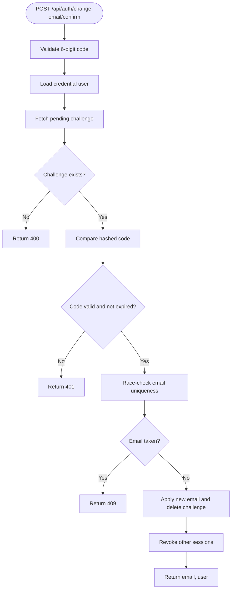

**Diagram sources**
- [auth.ts:435-490](file://server/src/routes/auth.ts#L435-L490)
- [schema.sql:397-407](file://server/src/schema.sql#L397-L407)

**Section sources**
- [auth.ts:435-490](file://server/src/routes/auth.ts#L435-L490)
- [schema.sql:397-407](file://server/src/schema.sql#L397-L407)

### Change Phone: POST `/api/auth/change-phone`
Updates the phone number after password confirmation. The new number is recorded without SMS verification in this prototype.

- **Method**: `POST`
- **Path**: `/api/auth/change-phone`
- **Authentication**: Required
- **Request body**:
  - `phone`: string, trimmed, phone-like pattern.
  - `password`: string, minimum 1 character, maximum 200.
- **Response**:
  - `phone`: normalized phone number.
  - `user`: updated user object.
- **Status codes**:
  - `200`: Success.
  - `400`: Invalid request body.
  - `401`: Incorrect password.
  - `409`: Phone already belongs to another account.
  - `404`: User not found or soft-deleted.
- **Behavior notes**:
  - Phone normalization removes spaces and dashes.
  - Other sessions are revoked; current session survives.

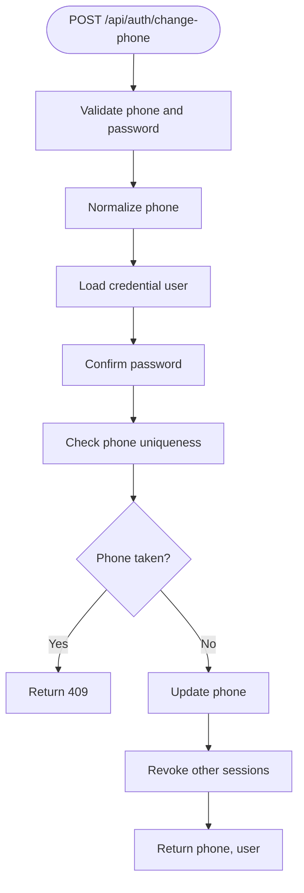

**Diagram sources**
- [auth.ts:492-516](file://server/src/routes/auth.ts#L492-L516)

**Section sources**
- [auth.ts:492-516](file://server/src/routes/auth.ts#L492-L516)

### Logout All: POST `/api/auth/logout-all`
Revokes every session for the account, including the caller’s own token.

- **Method**: `POST`
- **Path**: `/api/auth/logout-all`
- **Authentication**: Required
- **Request body**: None
- **Response**:
  - `signedOutEverywhere`: boolean.
- **Status codes**:
  - `200`: Success.
  - `401`: Missing or invalid token.
- **Behavior notes**:
  - Immediately invalidates all tokens for the user.
  - Clients should clear local tokens on success.

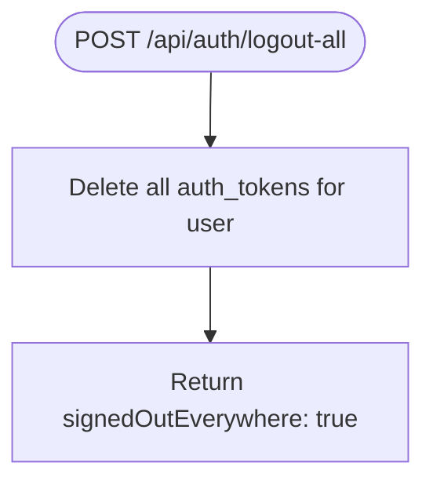

**Diagram sources**
- [auth.ts:518-525](file://server/src/routes/auth.ts#L518-L525)
- [schema.sql:417-424](file://server/src/schema.sql#L417-L424)

**Section sources**
- [auth.ts:518-525](file://server/src/routes/auth.ts#L518-L525)
- [schema.sql:417-424](file://server/src/schema.sql#L417-L424)

## Dependency Analysis
Authentication depends on several modules:
- Routes depend on context middleware for authentication and user loading.
- Password operations depend on the scrypt-based hashing module.
- Token storage and validation depend on security utilities and the database schema.
- Global rate limiting and audit logging are applied at the server level.

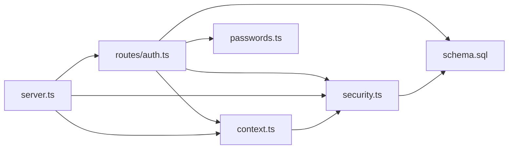

**Diagram sources**
- [auth.ts:1-8](file://server/src/routes/auth.ts#L1-L8)
- [context.ts:1-4](file://server/src/context.ts#L1-L4)
- [security.ts:1-5](file://server/src/security.ts#L1-L5)
- [server.ts:1-25](file://server/src/server.ts#L1-L25)
- [schema.sql:389-424](file://server/src/schema.sql#L389-L424)

**Section sources**
- [auth.ts:1-8](file://server/src/routes/auth.ts#L1-L8)
- [context.ts:1-4](file://server/src/context.ts#L1-L4)
- [security.ts:1-5](file://server/src/security.ts#L1-L5)
- [server.ts:1-25](file://server/src/server.ts#L1-L25)

## Performance Considerations
- **Rate limiting**:
  - General API requests are limited to 100 per minute per IP by default.
  - Authentication endpoints have a stricter limit of 10 per minute per IP.
  - These limits can be overridden via environment variables for tests.
- **Password hashing**:
  - scrypt is CPU-intensive; ensure appropriate server resources for signup and login.
- **Token lookups**:
  - Tokens are hashed before database queries; indexes on `auth_tokens(user_id)` improve performance for logout operations.
- **Audit logging**:
  - Audit middleware records mutating requests; sensitive fields are redacted to avoid leaking secrets.

[No sources needed since this section provides general guidance]

## Troubleshooting Guide
Common issues and their likely causes:
- **Invalid request body errors**:
  - Occur when Zod validation fails; check field types, lengths, and formats.
- **Incorrect credentials**:
  - For login and credential changes, incorrect email/password or wrong current password results in `401`.
- **Email or phone conflicts**:
  - Attempting to register or update to an email/phone already associated with another account returns `409`.
- **Expired OTP or challenge codes**:
  - OTP and email-change challenge codes expire quickly; request a new code if expired.
- **Soft-deleted accounts**:
  - Credential mutations are blocked on deleted accounts; treat them as gone.
- **Rate limit exceeded**:
  - Too many authentication attempts trigger a stricter rate limiter; wait before retrying.

**Section sources**
- [server.ts:263-277](file://server/src/server.ts#L263-L277)
- [auth.ts:104-157](file://server/src/routes/auth.ts#L104-L157)
- [auth.ts:384-490](file://server/src/routes/auth.ts#L384-L490)
- [security.ts:28-46](file://server/src/security.ts#L28-L46)

## Conclusion
DineCircle’s authentication API provides secure, flexible sign-in flows for phone and email/password users, with robust session management and credential change workflows. Security is enforced through token hashing, scrypt password hashing, strict input validation, rate limiting, and audit logging. Clients should store the returned token securely, include it in the `Authorization` header for protected endpoints, and handle error responses gracefully.

[No sources needed since this section summarizes without analyzing specific files]