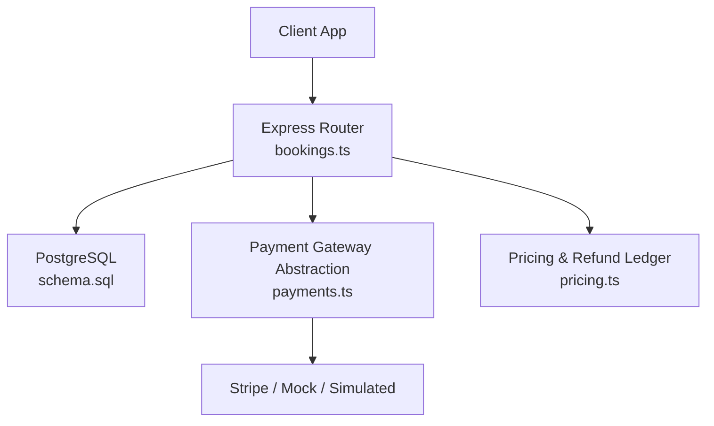
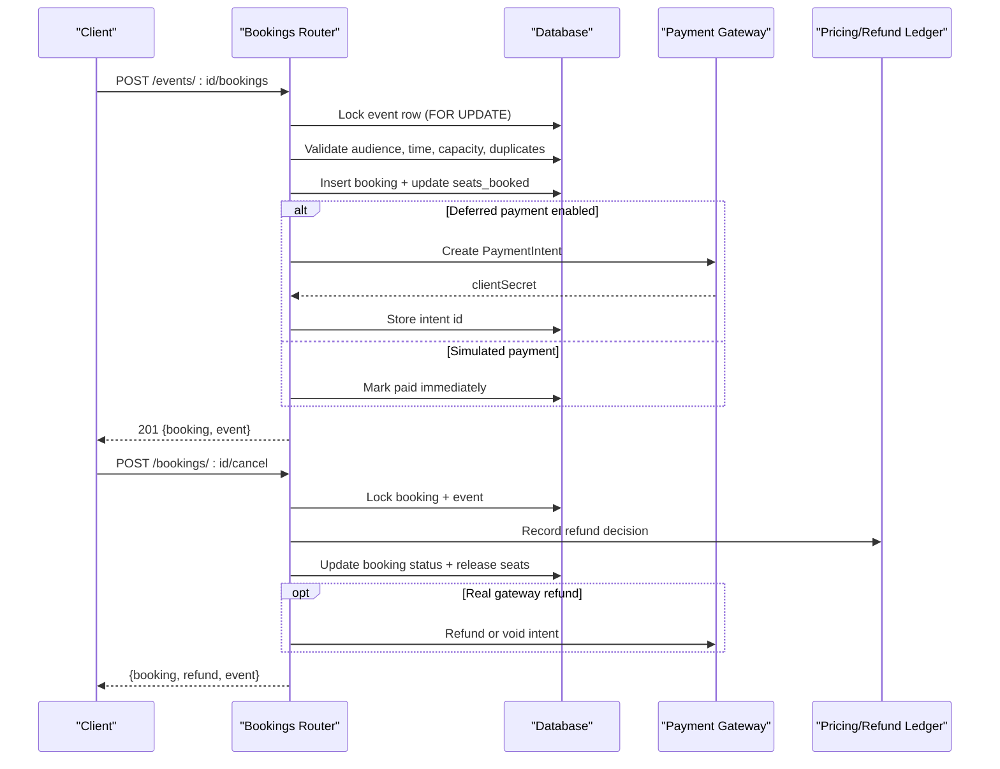
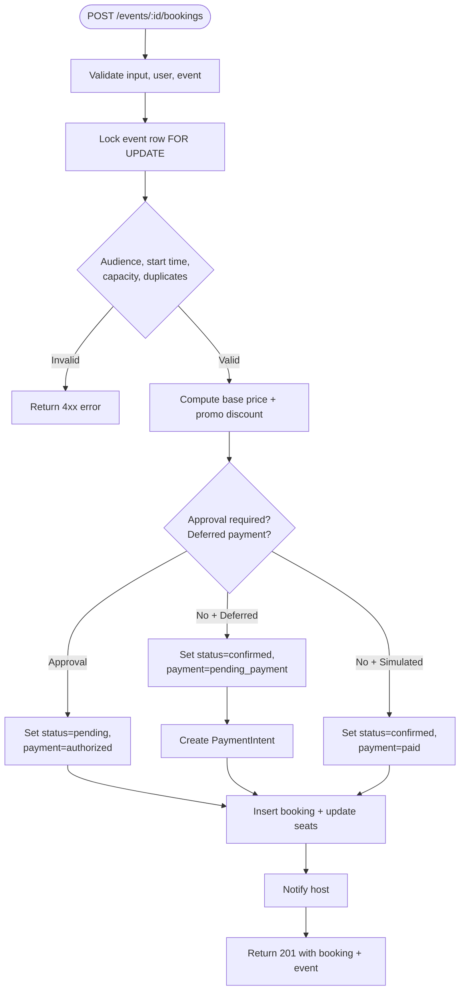
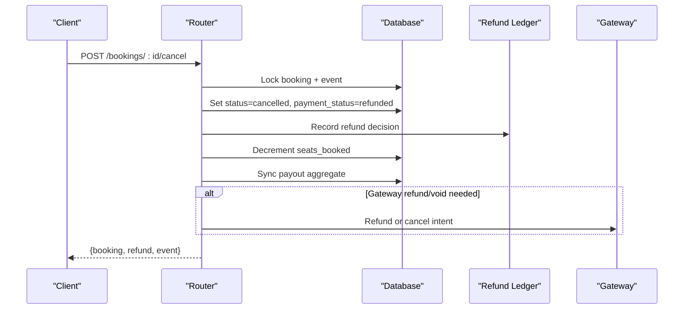
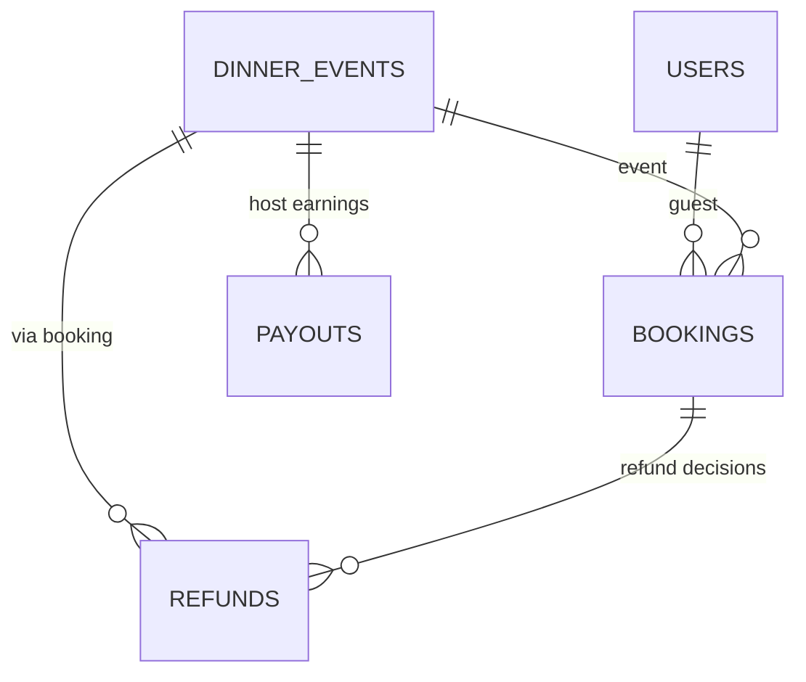
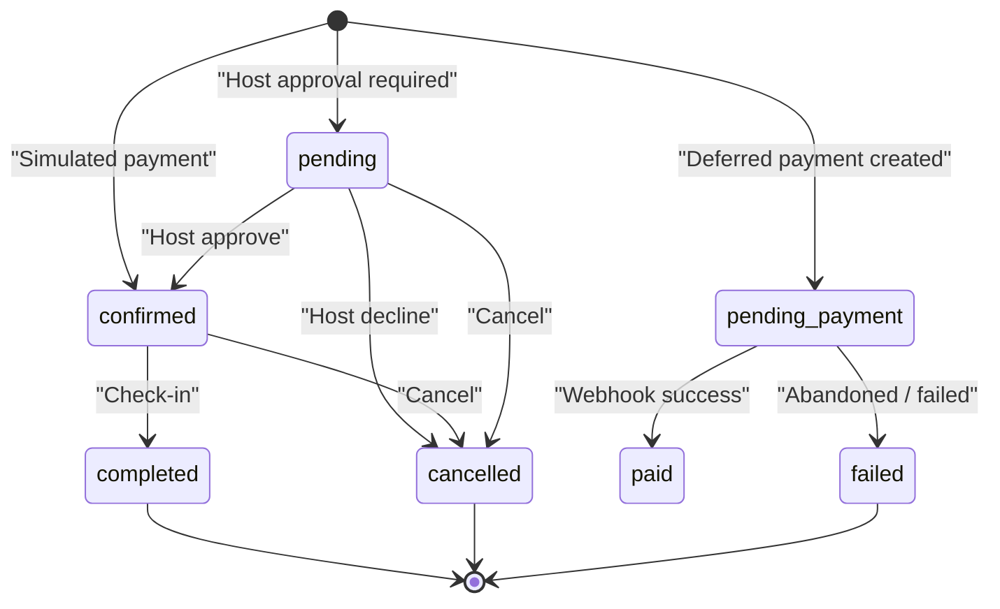
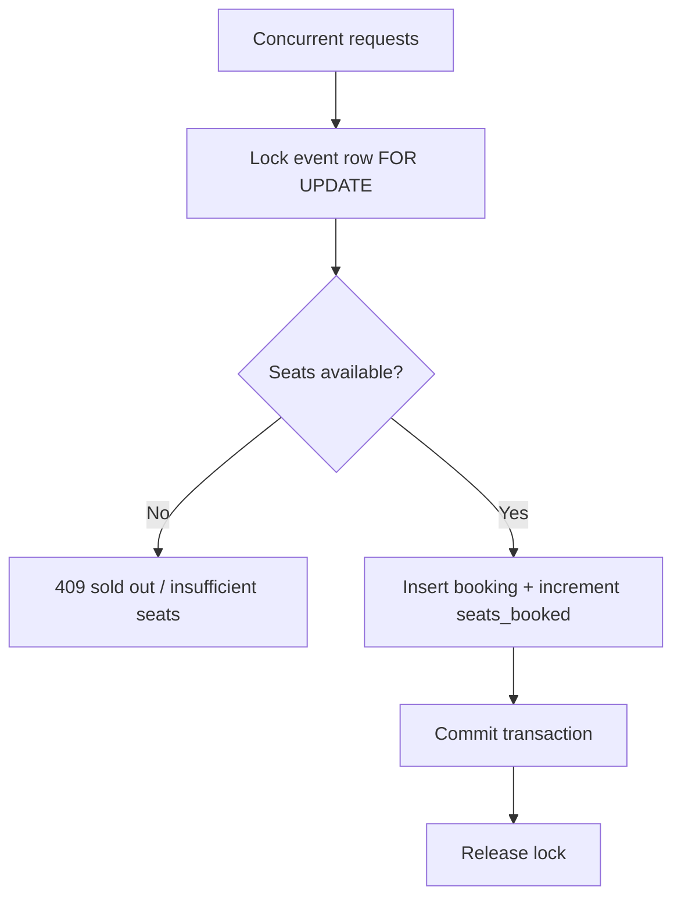
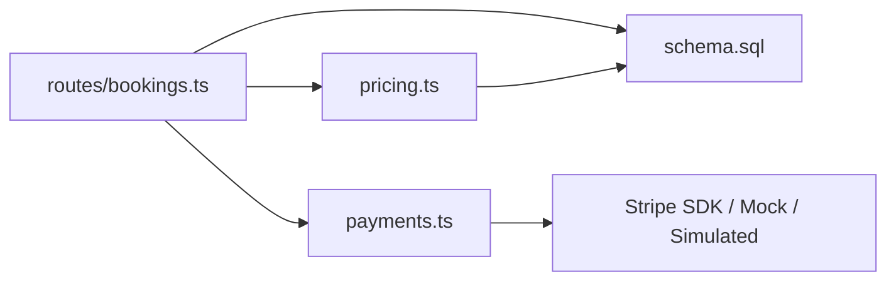

# Bookings and Reservations API

<cite>
**Referenced Files in This Document**   
- [bookings.ts](file://server/src/routes/bookings.ts)
- [schema.sql](file://server/src/schema.sql)
- [payments.ts](file://server/src/payments.ts)
- [pricing.ts](file://server/src/pricing.ts)
</cite>

## Table of Contents
1. [Introduction](#introduction)
2. [Project Structure](#project-structure)
3. [Core Components](#core-components)
4. [Architecture Overview](#architecture-overview)
5. [Detailed Component Analysis](#detailed-component-analysis)
6. [Dependency Analysis](#dependency-analysis)
7. [Performance Considerations](#performance-considerations)
8. [Troubleshooting Guide](#troubleshooting-guide)
9. [Conclusion](#conclusion)

## Introduction
This document describes the DineCircle bookings and reservations API. It covers all booking-related endpoints, including listing a user’s tickets, creating a booking with seat reservation and payment setup, host approval or decline flows, cancellation and refund bookkeeping, check-in settlement, and payment-secret refresh. It also explains the end-to-end workflow from seat selection through payment processing to final confirmation, the status model, capacity locking, conflict handling, and how bookings relate to events and users.

## Project Structure
The booking system is implemented on the server side:
- Route handlers for booking operations live in `server/src/routes/bookings.ts`.
- The database schema defining events, bookings, refunds, payouts, and related tables lives in `server/src/schema.sql`.
- Payment gateway abstraction (Stripe, mock, simulated) lives in `server/src/payments.ts`.
- Pricing, payout recomputation, refund ledgering, and webhook-driven state transitions live in `server/src/pricing.ts`.

**Diagram sources**
- [bookings.ts:1-888](file://server/src/routes/bookings.ts#L1-L888)
- [schema.sql:120-236](file://server/src/schema.sql#L120-L236)
- [payments.ts:1-391](file://server/src/payments.ts#L1-L391)
- [pricing.ts:1-270](file://server/src/pricing.ts#L1-L270)

**Section sources**
- [bookings.ts:1-888](file://server/src/routes/bookings.ts#L1-L888)
- [schema.sql:120-236](file://server/src/schema.sql#L120-L236)
- [payments.ts:1-391](file://server/src/payments.ts#L1-L391)
- [pricing.ts:1-270](file://server/src/pricing.ts#L1-L270)

## Core Components
- Booking routes: list bookings, create booking, cancel, approve/decline pending requests, check-in, refresh payment secret.
- Event and user relationships: each booking belongs to one event and one user; events carry host, restaurant, capacity, audience controls, and optional approval gating.
- Payment flow: simulated immediate settlement by default; deferred settlement via Stripe when configured, using `pending_payment` → `paid` transitions driven by webhooks.
- Capacity locking: event rows are locked during booking creation to prevent overselling; seats are decremented on cancellation or failed checkout.
- Refund ledger: every refund decision is recorded immutably with amount, reason, policy snapshot, and gateway status.

**Section sources**
- [bookings.ts:79-131](file://server/src/routes/bookings.ts#L79-L131)
- [bookings.ts:133-405](file://server/src/routes/bookings.ts#L133-L405)
- [bookings.ts:420-564](file://server/src/routes/bookings.ts#L420-L564)
- [bookings.ts:566-761](file://server/src/routes/bookings.ts#L566-L761)
- [bookings.ts:763-888](file://server/src/routes/bookings.ts#L763-L888)
- [schema.sql:120-236](file://server/src/schema.sql#L120-L236)
- [payments.ts:1-391](file://server/src/payments.ts#L1-L391)
- [pricing.ts:1-270](file://server/src/pricing.ts#L1-L270)

## Architecture Overview
The booking lifecycle spans several coordinated components:

**Diagram sources**
- [bookings.ts:153-405](file://server/src/routes/bookings.ts#L153-L405)
- [bookings.ts:420-564](file://server/src/routes/bookings.ts#L420-L564)
- [payments.ts:100-176](file://server/src/payments.ts#L100-L176)
- [pricing.ts:96-156](file://server/src/pricing.ts#L96-L156)

## Detailed Component Analysis

### Endpoints

#### List Bookings
- Method: GET
- Path: `/api/bookings`
- Query parameters:
  - `eventId`: Optional. When provided, returns the host’s guest list for that event. Only the event host may call this.
- Behavior:
  - Without `eventId`: returns the acting user’s bookings, grouped into `upcoming`, `past`, and `cancelled`, plus a total `count`.
  - With `eventId`: validates the event exists and that the caller is the host; returns all bookings for that event ordered by creation time.
  - Opportunistically sweeps abandoned `pending_payment` holds before returning results.
- Responses:
  - Success: JSON object containing `bookings`, `upcoming`, `past`, `cancelled`, and `count`.
  - Errors:
    - 404 if the guest or event does not exist.
    - 403 if a non-host tries to read another event’s guest list.

**Section sources**
- [bookings.ts:79-131](file://server/src/routes/bookings.ts#L79-L131)
- [payments.ts:327-391](file://server/src/payments.ts#L327-L391)

#### Create Booking
- Method: POST
- Path: `/api/events/:id/bookings`
- Request body fields:
  - `seats`: Integer, 1–10, default 1.
  - `paymentLabel`: String, up to 40 characters; ignored when a real gateway is active because the label is replaced by the actual card brand/last4 after settlement.
  - `promoCode`: Optional string; validated server-side.
- Authorization: Acting user must be a valid guest; blocked pairs cannot join new tables hosted by the other side.
- Workflow:
  1. Load and lock the target event row.
  2. Validate:
     - Event exists and is not a draft.
     - Audience rules (`public`, `followers`, `friends`, `inviteOnly`).
     - Event has not started.
     - Enough seats remain.
     - No existing active booking for the same user at the same event.
  3. Compute price:
     - Base amount = `seats × price_per_seat`.
     - Apply promo discount if valid.
     - Final amount is clamped to zero or above.
  4. Determine initial states:
     - If the event requires host approval: booking status is `pending`; payment status is `authorized`.
     - Otherwise:
       - If deferred payment is enabled and amount > 0: status `confirmed`, payment status `pending_payment`, and a PaymentIntent is created.
       - If simulated payment: status `confirmed`, payment status `paid`.
  5. Persist booking and increment `seats_booked`; add the user to `attendee_ids`.
  6. Emit an activity notification to the host.
  7. Return the booking and event summary, including `clientSecret` when deferred payment is used.
- Error responses:
  - 400 invalid promo code.
  - 403 audience restrictions or blocked pair.
  - 409 event already started, sold out, insufficient seats, or duplicate active booking.
  - 502 payment intent creation failure; seats are released automatically.

**Diagram sources**
- [bookings.ts:153-405](file://server/src/routes/bookings.ts#L153-L405)
- [payments.ts:100-176](file://server/src/payments.ts#L100-L176)

**Section sources**
- [bookings.ts:133-405](file://server/src/routes/bookings.ts#L133-L405)
- [schema.sql:120-167](file://server/src/schema.sql#L120-L167)
- [schema.sql:181-212](file://server/src/schema.sql#L181-L212)
- [payments.ts:100-176](file://server/src/payments.ts#L100-L176)

#### Cancel Booking
- Method: POST
- Path: `/api/bookings/:id/cancel`
- Authorization: Only the booking owner may cancel.
- Behavior:
  - Validates booking existence, ownership, and allowed state transitions.
  - Sets booking status to `cancelled`, clears `checked_in`, and updates `payment_status` to `refunded` when previously captured or authorized.
  - Records a refund decision in the immutable refunds ledger.
  - Decrements `seats_booked` on the event.
  - Syncs the host payout aggregate.
  - If a real gateway refund or void is needed, executes it after the ledger is committed.
- Responses:
  - Success: JSON with updated booking, refund record, and event seat count.
  - Errors:
    - 404 booking not found.
    - 403 wrong owner.
    - 409 already cancelled or completed.

**Diagram sources**
- [bookings.ts:420-564](file://server/src/routes/bookings.ts#L420-L564)
- [pricing.ts:96-156](file://server/src/pricing.ts#L96-L156)

**Section sources**
- [bookings.ts:420-564](file://server/src/routes/bookings.ts#L420-L564)
- [pricing.ts:96-156](file://server/src/pricing.ts#L96-L156)

#### Approve Pending Request
- Method: POST
- Path: `/api/bookings/:id/approve`
- Authorization: Only the event host may approve.
- Behavior:
  - Loads and locks the pending request and verifies ownership.
  - If the booking is backed by a PaymentIntent, attempts to capture it first; capture failure returns 502 without booking the approval.
  - Updates booking status to `confirmed`; for non-gateway bookings, also sets payment to `paid`.
  - Adds the guest to the event’s attendee list and emits an activity notification.
- Responses:
  - Success: Full serialized booking and event/guest identifiers.
  - Errors:
    - 404 booking not found.
    - 403 not the host.
    - 409 no longer pending.
    - 502 gateway capture failure.

**Section sources**
- [bookings.ts:566-678](file://server/src/routes/bookings.ts#L566-L678)

#### Decline Pending Request
- Method: POST
- Path: `/api/bookings/:id/decline`
- Authorization: Only the event host may decline.
- Behavior:
  - Loads and locks the pending request and verifies ownership.
  - Sets booking status to `cancelled`, payment status to `refunded`, and clears `checked_in`.
  - Records a $0 refund decision for auditability.
  - Decrements `seats_booked` and removes the guest from attendees unless another active booking still holds a seat.
  - Emits an activity notification.
  - Best-effort cancels the underlying authorization intent if present.
- Responses:
  - Success: Serialized booking, event seat count, and guest identifier.
  - Errors:
    - 404 booking not found.
    - 403 not the host.
    - 409 no longer pending.

**Section sources**
- [bookings.ts:680-761](file://server/src/routes/bookings.ts#L680-L761)

#### Check In
- Method: POST
- Path: `/api/bookings/:id/checkin`
- Authorization: Either the guest or the event host.
- Behavior:
  - Locks the booking row and validates ownership and state.
  - If the booking still has an uncaptured authorization, captures it at the gateway.
  - Marks the booking as checked in, sets `status` to `completed`, and adjusts payment status where applicable.
  - Recomputes and seeds the host payout aggregate.
- Responses:
  - Success: Updated booking with `checkedIn=true` and final status.
  - Errors:
    - 404 booking not found.
    - 403 unauthorized.
    - 409 already cancelled or already checked in.
    - 502 gateway capture failure.

**Section sources**
- [bookings.ts:763-848](file://server/src/routes/bookings.ts#L763-L848)

#### Refresh Payment Secret
- Method: POST
- Path: `/api/bookings/:id/refresh-payment`
- Authorization: Owner-only.
- Behavior:
  - Requires a real payment gateway; otherwise returns 409.
  - Validates that the booking is still awaiting payment and still has a valid intent.
  - Reissues the client secret so the client can retry presenting the payment sheet.
- Responses:
  - Success: `{ clientSecret }`.
  - Errors:
    - 404 booking not found.
    - 403 wrong owner.
    - 409 no longer awaiting payment or hold expired.

**Section sources**
- [bookings.ts:850-888](file://server/src/routes/bookings.ts#L850-L888)

### Data Model Relationships

**Diagram sources**
- [schema.sql:120-236](file://server/src/schema.sql#L120-L236)

**Section sources**
- [schema.sql:120-236](file://server/src/schema.sql#L120-L236)

### Booking Status Management

- Booking statuses:
  - `confirmed`: Guest holds a seat; payment may be settled or pending depending on gateway mode.
  - `pending`: Host approval required; funds may be authorized but not captured.
  - `completed`: Guest checked in; service delivered.
  - `cancelled`: Booking cancelled by guest or declined by host.
- Payment statuses:
  - `unpaid`: Not yet charged.
  - `pending_payment`: Awaiting client-side confirmation; seat held.
  - `authorized`: Hold placed; not yet captured.
  - `paid`: Captured and settled.
  - `refunded`: Money returned or hold released.
  - `failed`: Payment attempt failed or abandoned.

**Diagram sources**
- [schema.sql:181-212](file://server/src/schema.sql#L181-L212)
- [bookings.ts:153-405](file://server/src/routes/bookings.ts#L153-L405)
- [bookings.ts:420-564](file://server/src/routes/bookings.ts#L420-L564)
- [bookings.ts:763-848](file://server/src/routes/bookings.ts#L763-L848)

**Section sources**
- [schema.sql:181-212](file://server/src/schema.sql#L181-L212)
- [bookings.ts:153-405](file://server/src/routes/bookings.ts#L153-L405)
- [bookings.ts:420-564](file://server/src/routes/bookings.ts#L420-L564)
- [bookings.ts:763-848](file://server/src/routes/bookings.ts#L763-L848)

### Capacity Locking and Conflict Resolution
- Capacity locking:
  - During booking creation, the event row is locked with `FOR UPDATE` inside a transaction. This prevents two concurrent guests from overselling the last seat.
  - Seats are incremented on successful booking and decremented on cancellation, decline, or failed checkout.
- Duplicate prevention:
  - A user cannot have more than one active booking (`confirmed` or `pending`) for the same event.
- Audience and safety checks:
  - Events restricted to followers or invite-only enforce access control before allowing a booking.
  - Blocked user pairs cannot join new tables hosted by the other side.
- Abandoned checkout sweep:
  - Bookings stuck in `pending_payment` beyond a threshold are swept opportunistically on read paths, releasing the hold and seats.

**Diagram sources**
- [bookings.ts:153-405](file://server/src/routes/bookings.ts#L153-L405)
- [payments.ts:327-391](file://server/src/payments.ts#L327-L391)

**Section sources**
- [bookings.ts:153-405](file://server/src/routes/bookings.ts#L153-L405)
- [payments.ts:327-391](file://server/src/payments.ts#L327-L391)

### Relationship Between Bookings, Events, and Users
- Each booking links exactly one user (guest) to one event.
- Events define capacity, pricing, audience, and optional approval requirements.
- Hosts receive activity notifications when guests join or when approvals occur.
- Payouts are recomputed based on captured seats per event.

**Section sources**
- [schema.sql:120-236](file://server/src/schema.sql#L120-L236)
- [bookings.ts:79-131](file://server/src/routes/bookings.ts#L79-L131)
- [pricing.ts:1-94](file://server/src/pricing.ts#L1-L94)

### Examples

#### Booking Creation Flow
- Steps:
  1. Client calls `POST /events/:id/bookings` with desired seat count and optional promo code.
  2. Server validates audience, timing, capacity, and duplicates under a row lock.
  3. Server computes final amount and applies promo discount.
  4. Server creates a booking and either:
     - Immediately marks it paid (simulated), or
     - Creates a PaymentIntent and marks it `pending_payment` (deferred).
  5. Client uses `clientSecret` to complete payment when deferred.
  6. Webhook settles the booking to `paid`; otherwise, abandoned checkouts are swept.

**Section sources**
- [bookings.ts:153-405](file://server/src/routes/bookings.ts#L153-L405)
- [payments.ts:100-176](file://server/src/payments.ts#L100-L176)
- [payments.ts:327-391](file://server/src/payments.ts#L327-L391)

#### Seat Selection Process
- The API does not expose per-seat selection; instead, clients request a quantity of seats within the event’s remaining capacity.
- The server enforces availability atomically using row-level locks.

**Section sources**
- [bookings.ts:153-405](file://server/src/routes/bookings.ts#L153-L405)

#### Cancellation Policy
- Guests may cancel bookings that are not completed.
- Cancellations set the booking to `cancelled`, mark payments as refunded when applicable, and decrement event capacity.
- Refund decisions are recorded immutably with reason, amount, and policy text.

**Section sources**
- [bookings.ts:420-564](file://server/src/routes/bookings.ts#L420-L564)
- [pricing.ts:96-156](file://server/src/pricing.ts#L96-L156)

## Dependency Analysis

**Diagram sources**
- [bookings.ts:1-888](file://server/src/routes/bookings.ts#L1-L888)
- [schema.sql:120-236](file://server/src/schema.sql#L120-L236)
- [payments.ts:1-391](file://server/src/payments.ts#L1-L391)
- [pricing.ts:1-270](file://server/src/pricing.ts#L1-L270)

**Section sources**
- [bookings.ts:1-888](file://server/src/routes/bookings.ts#L1-L888)
- [schema.sql:120-236](file://server/src/schema.sql#L120-L236)
- [payments.ts:1-391](file://server/src/payments.ts#L1-L391)
- [pricing.ts:1-270](file://server/src/pricing.ts#L1-L270)

## Performance Considerations
- Row-level locking: Event and booking rows are locked during critical mutations to avoid races and overselling.
- Transaction boundaries: All mutating operations run inside transactions to ensure consistency between bookings, event capacity, and financial ledgers.
- External calls outside locks: Payment intent creation occurs after committing the seat lock to avoid holding database locks across network calls.
- Sweeps over reads: Abandoned checkout cleanup runs opportunistically on read paths to reduce background work while avoiding blocking reads.
- Idempotent reconciliation: Webhook-driven state changes and payout recomputation are designed to be safe against retries and races.

[No sources needed since this section provides general guidance]

## Troubleshooting Guide
Common issues and their handling:
- Sold out or insufficient seats:
  - Returned as 409 during booking creation.
  - Indicates capacity was exhausted or the requested seat count exceeds availability.
- Duplicate active booking:
  - Returned as 409 when a user already holds a `confirmed` or `pending` booking for the same event.
- Audience restrictions:
  - 403 when trying to join follower-only or invite-only events without permission.
- Blocked user pairs:
  - 403 when attempting to join an event hosted by a blocked counterpart.
- Payment failures:
  - 502 when gateway operations fail; the server releases held seats and surfaces a clean message.
  - Abandoned checkouts are swept and marked `failed` after a timeout.
- Cancellation constraints:
  - 409 when cancelling a completed or already-cancelled booking.
- Approval flow errors:
  - 502 when capturing a held authorization fails; the request remains pending for the host to retry.

**Section sources**
- [bookings.ts:153-405](file://server/src/routes/bookings.ts#L153-L405)
- [bookings.ts:420-564](file://server/src/routes/bookings.ts#L420-L564)
- [bookings.ts:566-761](file://server/src/routes/bookings.ts#L566-L761)
- [bookings.ts:763-848](file://server/src/routes/bookings.ts#L763-L848)
- [payments.ts:327-391](file://server/src/payments.ts#L327-L391)

## Conclusion
The DineCircle bookings API provides a robust, transactional booking pipeline with strong safeguards against overselling, duplicate reservations, and inconsistent financial records. It supports both immediate and deferred payment models, integrates with a payment gateway abstraction, and maintains clear audit trails for refunds and payouts. Hosts can manage approval workflows, while guests experience consistent status transitions and reliable capacity guarantees.

[No sources needed since this section summarizes without analyzing specific files]