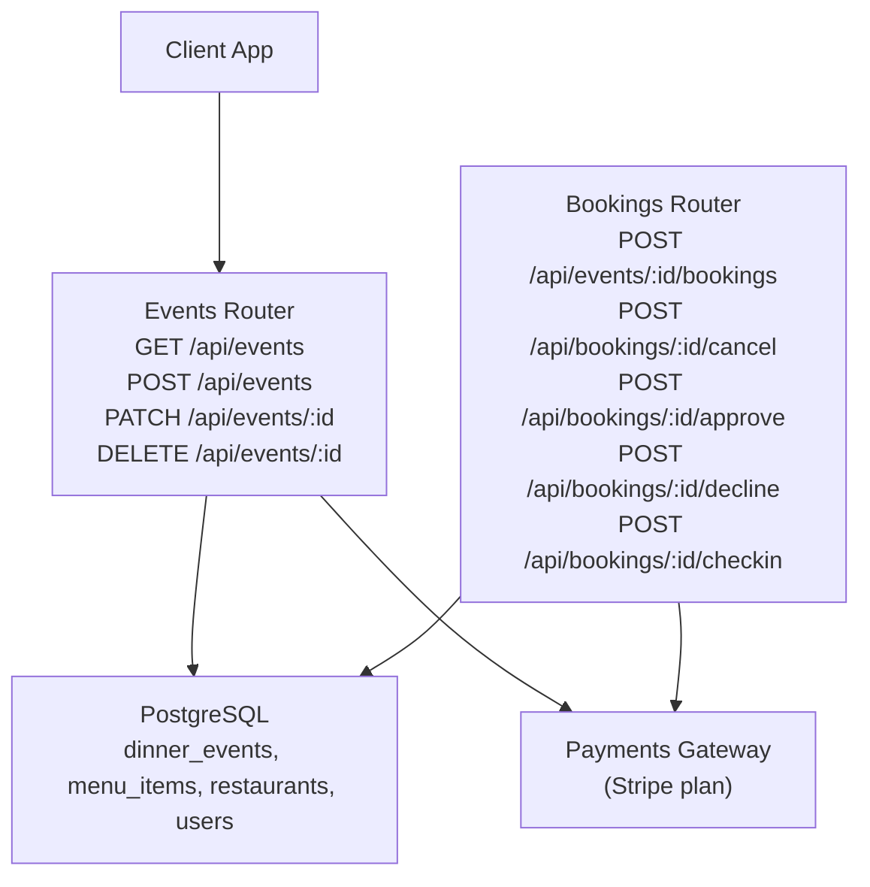
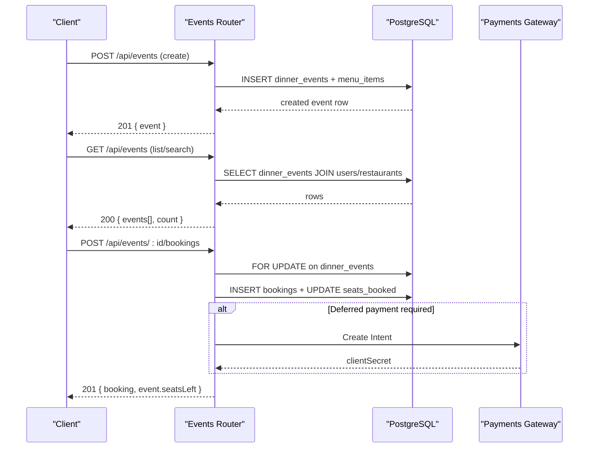
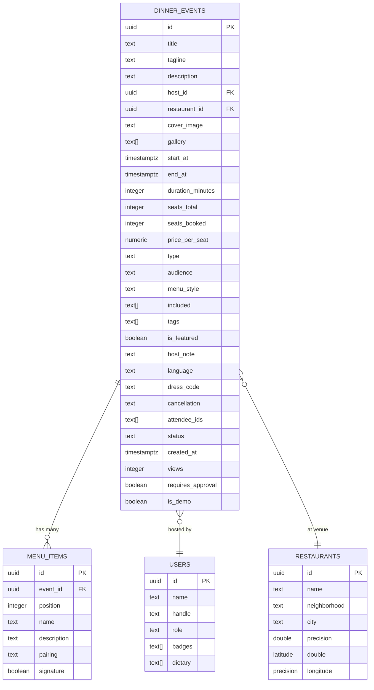
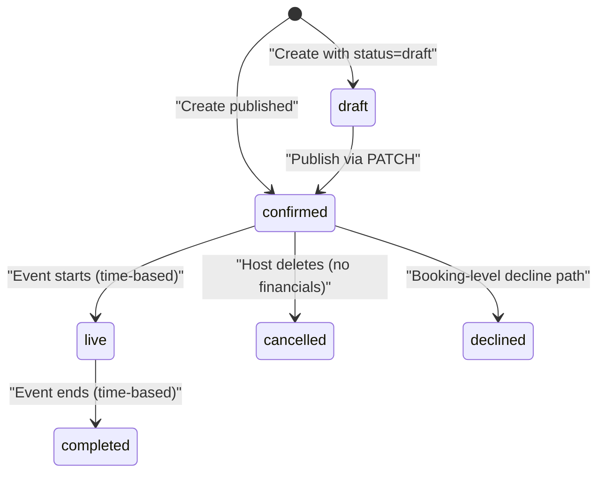
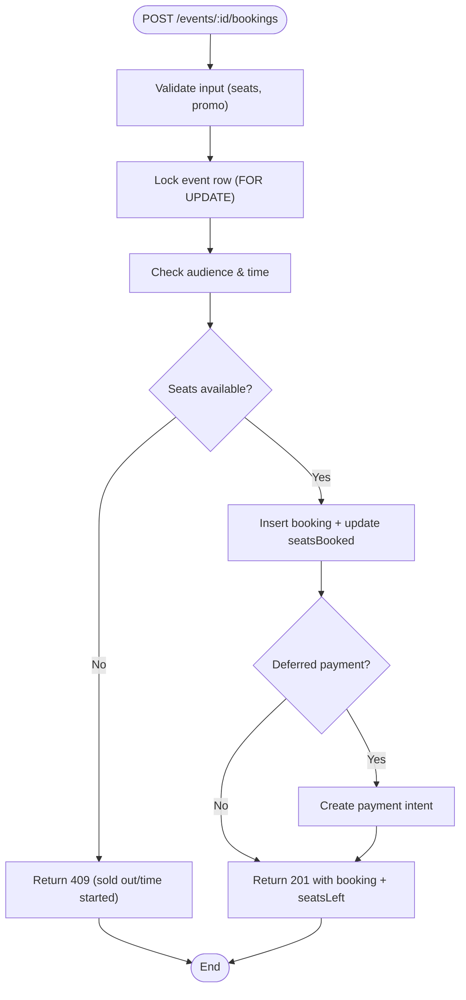
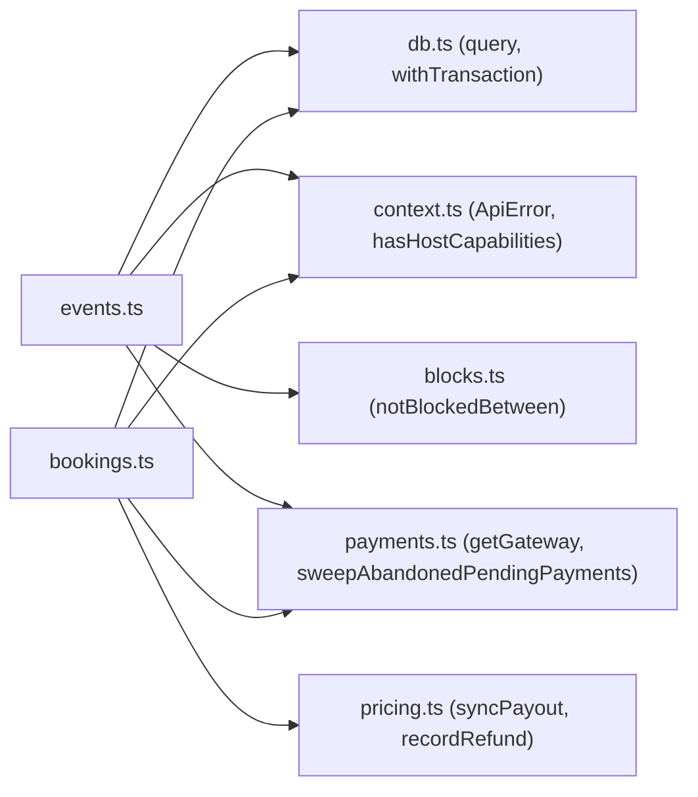

# Events Management API

<cite>
**Referenced Files in This Document**
- [events.ts](file://server/src/routes/events.ts)
- [bookings.ts](file://server/src/routes/bookings.ts)
- [schema.sql](file://server/src/schema.sql)
- [context.ts](file://server/src/context.ts)
</cite>

## Table of Contents
1. [Introduction](#introduction)
2. [Project Structure](#project-structure)
3. [Core Components](#core-components)
4. [Architecture Overview](#architecture-overview)
5. [Detailed Component Analysis](#detailed-component-analysis)
6. [Dependency Analysis](#dependency-analysis)
7. [Performance Considerations](#performance-considerations)
8. [Troubleshooting Guide](#troubleshooting-guide)
9. [Conclusion](#conclusion)

## Introduction
This document describes the DineCircle Events Management API. It covers all CRUD operations for dinner events, including creation, listing, filtering, searching, and status management. It also documents the event schema (title, description, host information, capacity, pricing, location, scheduling), search and filtering capabilities by location, date, price range, and availability, event lifecycle states and transitions, examples of request/response structures, capacity management, booking integration, and real-time availability updates.

## Project Structure
The Events Management API is implemented as an Express router with Zod-based validation, PostgreSQL-backed persistence, and integration with a payment gateway for bookings. The database schema defines the canonical data model and constraints.

**Diagram sources**
- [events.ts:140-456](file://server/src/routes/events.ts#L140-L456)
- [bookings.ts:153-405](file://server/src/routes/bookings.ts#L153-L405)
- [schema.sql:121-179](file://server/src/schema.sql#L121-L179)

**Section sources**
- [events.ts:1-636](file://server/src/routes/events.ts#L1-L636)
- [schema.sql:121-179](file://server/src/schema.sql#L121-L179)

## Core Components
- Events Router: Provides endpoints to list, create, update, and delete events; includes visibility rules, audience gating, and search/filtering.
- Bookings Router: Handles seat reservations, approvals, cancellations, check-ins, and integrates with payments.
- Database Schema: Defines tables for events, menus, bookings, refunds, payouts, and related entities with indexes and constraints.
- Context Utilities: Authentication middleware, role checks, and error helpers.

Key responsibilities:
- Event discovery and filtering by type, audience, featured, host, venue, upcoming window, text search, city/neighborhood, max price, and date range.
- Event creation with draft/publish flows and menu items.
- Event editing limited to drafts; publishing re-validates merged fields.
- Event deletion guarded against financial history.
- Booking flow with capacity locks, audience checks, promo codes, deferred payments, and approval workflows.

**Section sources**
- [events.ts:140-456](file://server/src/routes/events.ts#L140-L456)
- [bookings.ts:153-405](file://server/src/routes/bookings.ts#L153-L405)
- [schema.sql:121-179](file://server/src/schema.sql#L121-L179)
- [context.ts:18-54](file://server/src/context.ts#L18-L54)

## Architecture Overview
The Events API exposes REST endpoints that validate inputs, enforce permissions, query or mutate the database, and return serialized payloads. Bookings are integrated tightly with events to manage capacity and availability. Payment integration supports both simulated and Stripe modes.

**Diagram sources**
- [events.ts:386-456](file://server/src/routes/events.ts#L386-L456)
- [events.ts:140-246](file://server/src/routes/events.ts#L140-L246)
- [bookings.ts:153-405](file://server/src/routes/bookings.ts#L153-L405)

## Detailed Component Analysis

### Event Schema
The event entity models a dinner event with rich metadata, host and venue context, scheduling, capacity, pricing, and policy fields.

**Diagram sources**
- [schema.sql:121-179](file://server/src/schema.sql#L121-L179)
- [schema.sql:169-179](file://server/src/schema.sql#L169-L179)
- [schema.sql:14-37](file://server/src/schema.sql#L14-L37)
- [schema.sql:74-119](file://server/src/schema.sql#L74-L119)

Event fields include:
- Identification and media: id, title, tagline, description, coverImage, gallery
- Host and venue: hostId, restaurantId, plus joined host and restaurant details in responses
- Scheduling: startAt, endAt, durationMinutes
- Capacity and pricing: seatsTotal, seatsBooked, pricePerSeat
- Classification and policies: type, audience, menuStyle, included, tags, isFeatured, hostNote, language, dressCode, cancellation
- Attendees and state: attendeeIds, status, requiresApproval, views

Response serialization computes derived fields such as seatsLeft and isSoldOut, and enriches host and restaurant objects.

**Section sources**
- [events.ts:15-122](file://server/src/routes/events.ts#L15-L122)
- [schema.sql:121-179](file://server/src/schema.sql#L121-L179)

### Event Lifecycle States and Transitions
Valid event statuses are constrained at the database level. The API enforces specific transitions:
- Creation:
  - Draft: status set to draft when explicitly requested.
  - Published: default status becomes confirmed when not drafting.
- Editing:
  - Only drafts can be edited.
  - Publishing a draft sets status to confirmed after full validation.
- Deletion:
  - Host-only deletion; blocked if captured payments or accrued earnings exist.

**Diagram sources**
- [schema.sql:153-154](file://server/src/schema.sql#L153-L154)
- [events.ts:386-456](file://server/src/routes/events.ts#L386-L456)
- [events.ts:458-553](file://server/src/routes/events.ts#L458-L553)
- [events.ts:555-633](file://server/src/routes/events.ts#L555-L633)

**Section sources**
- [schema.sql:153-154](file://server/src/schema.sql#L153-L154)
- [events.ts:386-456](file://server/src/routes/events.ts#L386-L456)
- [events.ts:458-553](file://server/src/routes/events.ts#L458-L553)
- [events.ts:555-633](file://server/src/routes/events.ts#L555-L633)

### Endpoints

#### List Events
- Method: GET
- Path: /api/events
- Query parameters:
  - type: comma-separated allowed values (dinner, tasting, supperClub, brunch, workshop, festival)
  - audience: comma-separated allowed values (public, followers, friends, inviteOnly)
  - featured: true/false
  - hostId: UUID
  - venueId: UUID
  - upcoming: false | all | future (default)
  - q: free-text search across title, tagline, venue name, and tags
  - maxPrice: number >= 0
  - from/to: ISO timestamps bounding start_at
  - city/neighborhood: substring match on venue location
  - limit/offset: pagination (limit capped at 200)
- Response: { events: Event[], count: number }

Behavior:
- Applies audience gate and block-list filters.
- Excludes drafts unless viewer is host.
- Joins users and restaurants to support location and search.
- Computes seatsLeft and isSoldOut per event.

Example request:
- GET /api/events?type=dinner,festival&city=Karachi&maxPrice=5000&from=2025-01-01T00:00:00Z&to=2025-12-31T23:59:59Z&q=brunch

Example response structure:
- { events: [{ id, title, tagline, description, hostId, host, restaurantId, restaurant, coverImage, gallery, startAt, durationMinutes, seatsTotal, seatsBooked, seatsLeft, isSoldOut, pricePerSeat, type, audience, menuStyle, included, tags, isFeatured, hostNote, language, dressCode, cancellation, attendeeIds, status }], count }

**Section sources**
- [events.ts:140-246](file://server/src/routes/events.ts#L140-L246)
- [events.ts:15-122](file://server/src/routes/events.ts#L15-L122)

#### My Events
- Method: GET
- Path: /api/events/mine
- Response: { events: Event[], count: number }
- Behavior: Returns all events hosted by the authenticated user, newest first.

**Section sources**
- [events.ts:248-256](file://server/src/routes/events.ts#L248-L256)

#### Get Event Detail
- Method: GET
- Path: /api/events/:id
- Response: { event: EventDetail }
- EventDetail includes:
  - Base event fields
  - menu: array of menu items
  - venue: restaurant details
  - attendees: basic user info for attendee IDs
- Behavior:
  - Enforces audience gate and block-list.
  - Increments view count for non-host viewers.

Example response structure:
- { event: { ...base fields..., menu: [{ id, position, name, description, pairing, isSignature }], venue: { id, name, cuisines, neighborhood, address, rating, reviewCount, priceRange, coverImage, gallery, about, tags, isPartner, partnerPerk, openingHours }, attendees: [{ id, name, handle, avatarUrl }] } }

**Section sources**
- [events.ts:258-343](file://server/src/routes/events.ts#L258-L343)

#### Create Event
- Method: POST
- Path: /api/events
- Authorization: Requires host capabilities (host, influencer, partner_admin, super_admin).
- Request body:
  - Required fields: title, restaurantId, coverImage, startAt, seatsTotal, pricePerSeat
  - Optional fields: tagline, description, hostId, gallery, durationMinutes, type, audience, menuStyle, included, tags, isFeatured, hostNote, requiresApproval, menu
  - Status field: draft or published (default published)
- Validation:
  - Draft schema relaxes some fields (e.g., optional startAt, default seatsTotal/pricePerSeat).
  - Published schema enforces stricter constraints.
- Business rules:
  - Validates venue existence and partnership status based on user role.
  - Inserts event and menu items.
- Response: 201 { event: Event }

Example request:
- POST /api/events
- Body: { title, restaurantId, coverImage, startAt, seatsTotal, pricePerSeat, type, audience, menuStyle, menu: [...] }

Example response structure:
- { event: { ...serialized event fields... } }

**Section sources**
- [events.ts:345-456](file://server/src/routes/events.ts#L345-L456)
- [context.ts:18-24](file://server/src/context.ts#L18-L24)

#### Update Event
- Method: PATCH
- Path: /api/events/:id
- Authorization: Host only.
- Request body: Partial fields plus optional status=published to publish a draft.
- Rules:
  - Published events cannot be reverted to draft.
  - Only drafts can be edited; publishing triggers full validation on merged fields.
- Response: { event: Event }

Example request:
- PATCH /api/events/{eventId}
- Body: { title: "...", startAt: "...", status: "published" }

Example response structure:
- { event: { ...serialized event fields... } }

**Section sources**
- [events.ts:458-553](file://server/src/routes/events.ts#L458-L553)

#### Delete Event
- Method: DELETE
- Path: /api/events/:id
- Authorization: Host only.
- Guardrails:
  - Refuses deletion if any paid bookings or accrued earnings exist.
  - Notifies affected guests via activity feed.
  - Voids pending payment intents where applicable.
- Response: { deleted: true, eventId }

Example response structure:
- { deleted: true, eventId }

**Section sources**
- [events.ts:555-633](file://server/src/routes/events.ts#L555-L633)

### Search and Filtering Capabilities
- Type filter: Multi-select via comma-separated values, whitelisted against allowed types.
- Audience filter: Multi-select via comma-separated values, whitelisted against allowed audiences.
- Featured filter: Boolean flag.
- Host/Venue filters: By UUID.
- Upcoming filter: Future, past, or all.
- Text search: Across title, tagline, venue name, and tags.
- Price filter: Maximum price cap.
- Date range: From/to ISO timestamps.
- Location discovery: City and neighborhood substring matching on venue data.

These filters are applied server-side using parameterized queries and validated enums.

**Section sources**
- [events.ts:140-246](file://server/src/routes/events.ts#L140-L246)

### Capacity Management and Real-Time Availability
- Capacity fields: seatsTotal, seatsBooked, seatsLeft (computed), isSoldOut (computed).
- Booking creation:
  - Locks the event row to prevent overselling.
  - Checks audience restrictions and time constraints.
  - Prevents duplicate active bookings by the same user.
  - Updates seatsBooked and attendeeIds atomically.
- Cancellation:
  - Releases seats and adjusts seatsBooked.
  - Records refund decisions and interacts with payment gateway as needed.
- Approval workflow:
  - For events requiring approval, bookings start as pending; host approve/decline transitions occur with appropriate payment handling.
- Check-in:
  - Marks attendance and finalizes booking state.

Real-time availability:
- Each booking operation returns updated seatsBooked/seatsLeft so clients can reflect availability immediately.
- Abandoned pending payments are swept periodically to release held seats.

**Diagram sources**
- [bookings.ts:153-405](file://server/src/routes/bookings.ts#L153-L405)

**Section sources**
- [bookings.ts:153-405](file://server/src/routes/bookings.ts#L153-L405)
- [bookings.ts:420-564](file://server/src/routes/bookings.ts#L420-L564)
- [bookings.ts:566-761](file://server/src/routes/bookings.ts#L566-L761)

### Booking Integration
Endpoints:
- POST /api/events/:id/bookings: Reserve seats, apply promo codes, integrate with payments, update capacity.
- POST /api/bookings/:id/cancel: Cancel booking, record refund, release seats, interact with gateway.
- POST /api/bookings/:id/approve: Approve pending request, capture payment if needed, add to attendee list.
- POST /api/bookings/:id/decline: Decline pending request, void authorization, release seats.
- POST /api/bookings/:id/checkin: Mark attendance, finalize booking.

Responses include booking details, refund information, and updated event capacity.

**Section sources**
- [bookings.ts:153-405](file://server/src/routes/bookings.ts#L153-L405)
- [bookings.ts:420-564](file://server/src/routes/bookings.ts#L420-L564)
- [bookings.ts:566-761](file://server/src/routes/bookings.ts#L566-L761)

## Dependency Analysis
The Events API depends on:
- Database layer for persistence and transactions.
- Context utilities for authentication and role checks.
- Payments gateway for deferred payments and refunds.
- Block-list utility for safety enforcement.

**Diagram sources**
- [events.ts:1-6](file://server/src/routes/events.ts#L1-L6)
- [bookings.ts:1-13](file://server/src/routes/bookings.ts#L1-L13)
- [context.ts:1-54](file://server/src/context.ts#L1-L54)

**Section sources**
- [events.ts:1-6](file://server/src/routes/events.ts#L1-L6)
- [bookings.ts:1-13](file://server/src/routes/bookings.ts#L1-L13)
- [context.ts:1-54](file://server/src/context.ts#L1-L54)

## Performance Considerations
- Pagination: Limit capped at 200 to prevent heavy scans.
- Indexes: Optimized indexes on start_at, host_id, restaurant_id, type, status, and related foreign keys.
- Fire-and-forget analytics: View counts incremented asynchronously to avoid blocking detail responses.
- Sweep jobs: Abandoned pending payments are cleaned up opportunistically on high-traffic reads.
- Parameterized queries: All filters use parameter binding to prevent injection and improve plan reuse.

[No sources needed since this section provides general guidance]

## Troubleshooting Guide
Common errors and their meanings:
- 401 Unauthorized: Missing or invalid bearer token.
- 403 Forbidden: Insufficient permissions (e.g., non-host creating events, wrong owner for venue).
- 404 Not Found: Event or resource does not exist.
- 409 Conflict: Event already started, sold out, duplicate booking, or deletion blocked due to financials.
- 422 Unprocessable Entity: Validation failure (e.g., unknown restaurant, draft not ready to publish).
- 500 Internal Server Error: Unexpected failures (e.g., event creation insert failed).
- 502 Bad Gateway: Payment setup or gateway call failed; holds may be released automatically.

Resolution tips:
- Ensure proper Authorization header with a valid bearer token.
- Verify user role grants host capabilities for event creation/editing.
- Confirm venue partnership status aligns with user role.
- For deletions, ensure no captured payments or accrued earnings exist; otherwise cancel bookings individually.
- For payment issues, retry after transient gateway failures; abandoned holds will be released by sweeps.

**Section sources**
- [context.ts:39-54](file://server/src/context.ts#L39-L54)
- [events.ts:386-456](file://server/src/routes/events.ts#L386-L456)
- [events.ts:458-553](file://server/src/routes/events.ts#L458-L553)
- [events.ts:555-633](file://server/src/routes/events.ts#L555-L633)
- [bookings.ts:153-405](file://server/src/routes/bookings.ts#L153-L405)

## Conclusion
The DineCircle Events Management API provides a robust, secure, and scalable system for managing dinner events. It supports comprehensive search and filtering, strict capacity management, and integrated booking workflows with payment processing. The schema-enforced lifecycle ensures consistent state transitions, while safety features like block-list enforcement and financial guards protect both hosts and guests. Clients should leverage the provided filters and respect capacity updates returned by booking operations to deliver real-time availability experiences.

[No sources needed since this section summarizes without analyzing specific files]