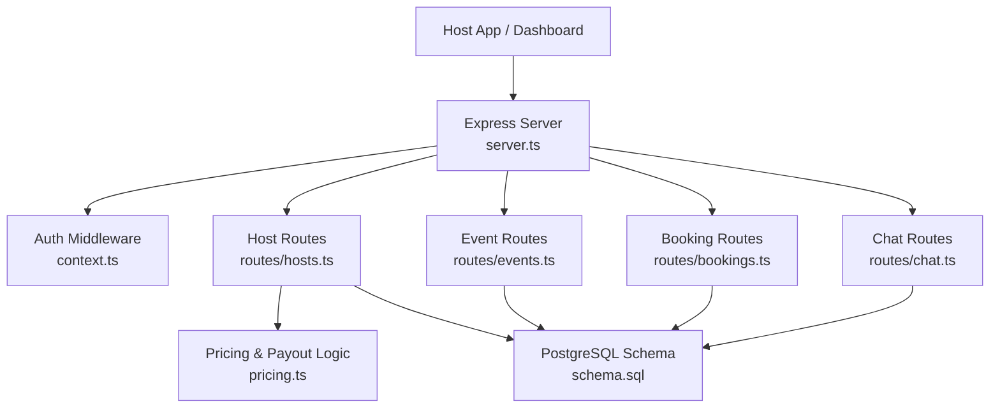
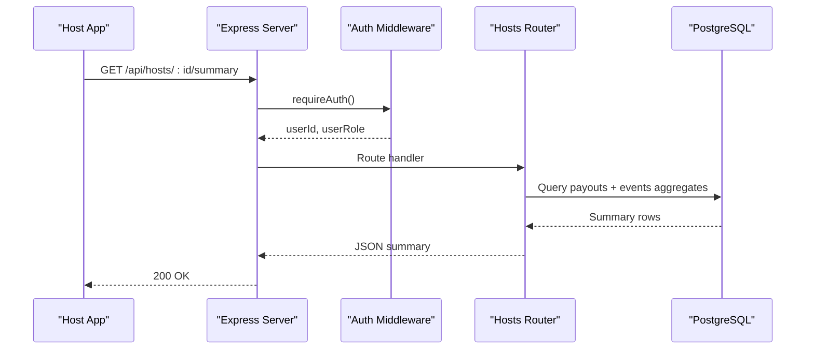
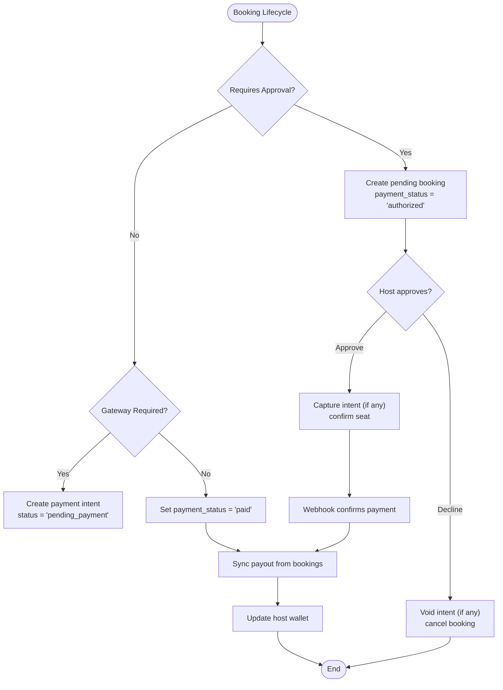
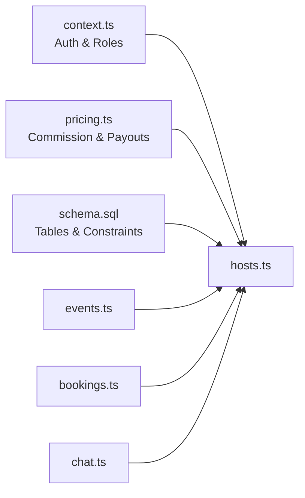
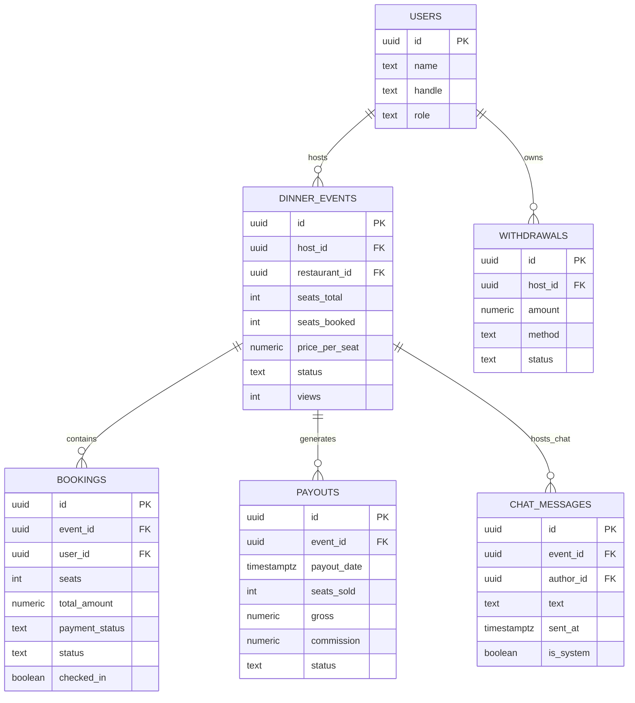

# Host Studio API

<cite>
**Referenced Files in This Document**   
- [server.ts](file://server/src/server.ts)
- [hosts.ts](file://server/src/routes/hosts.ts)
- [events.ts](file://server/src/routes/events.ts)
- [bookings.ts](file://server/src/routes/bookings.ts)
- [chat.ts](file://server/src/routes/chat.ts)
- [pricing.ts](file://server/src/pricing.ts)
- [context.ts](file://server/src/context.ts)
- [schema.sql](file://server/src/schema.sql)
</cite>

## Table of Contents
1. [Introduction](#introduction)
2. [Project Structure](#project-structure)
3. [Core Components](#core-components)
4. [Architecture Overview](#architecture-overview)
5. [Detailed Component Analysis](#detailed-component-analysis)
6. [Dependency Analysis](#dependency-analysis)
7. [Performance Considerations](#performance-considerations)
8. [Troubleshooting Guide](#troubleshooting-guide)
9. [Conclusion](#conclusion)
10. [Appendices](#appendices)

## Introduction
This document describes the host-facing capabilities exposed by the DineCircle server: host dashboard access, event analytics, guest management, earnings tracking, and payout processing. It focuses on the Express routes under `/api/hosts`, related event and booking endpoints that power host workflows, chat-based guest communication, pricing/commission logic, and the database schema that defines the financial and operational state.

The documentation is organized for both technical and non-technical readers: it starts with a high-level architecture, then details each endpoint group, followed by data models, dependency relationships, performance notes, and troubleshooting guidance.

## Project Structure
The host studio features are implemented as Express routers mounted under `/api`. The main server wires authentication, rate limiting, audit logging, WebSocket channels, and route modules. Host-specific endpoints live primarily in `routes/hosts.ts`, while supporting flows use `routes/events.ts`, `routes/bookings.ts`, and `routes/chat.ts`. Financial calculations and gateway settlement helpers live in `pricing.ts`, and shared authorization utilities live in `context.ts`.

**Diagram sources**
- [server.ts:11-24](file://server/src/server.ts#L11-L24)
- [server.ts:222-257](file://server/src/server.ts#L222-L257)
- [hosts.ts:1-10](file://server/src/routes/hosts.ts#L1-L10)
- [events.ts:1-8](file://server/src/routes/events.ts#L1-L8)
- [bookings.ts:1-15](file://server/src/routes/bookings.ts#L1-L15)
- [chat.ts:1-7](file://server/src/routes/chat.ts#L1-L7)
- [pricing.ts:1-20](file://server/src/pricing.ts#L1-L20)
- [schema.sql:1-13](file://server/src/schema.sql#L1-L13)

**Section sources**
- [server.ts:27-257](file://server/src/server.ts#L27-L257)
- [hosts.ts:1-10](file://server/src/routes/hosts.ts#L1-L10)
- [events.ts:1-8](file://server/src/routes/events.ts#L1-L8)
- [bookings.ts:1-15](file://server/src/routes/bookings.ts#L1-L15)
- [chat.ts:1-7](file://server/src/routes/chat.ts#L1-L7)
- [pricing.ts:1-20](file://server/src/pricing.ts#L1-L20)
- [schema.sql:1-13](file://server/src/schema.sql#L1-L13)

## Core Components
- Host dashboard endpoints: summary, payouts, trend, performance, partners, invites, wallet, and withdrawals.
- Event analytics: views, bookings, pending, checked-in counts, and gross estimates per event.
- Guest management: host-only guest list retrieval, approval/decline of pending requests, check-in flow.
- Communication: per-event chat thread for hosts and booked guests.
- Financial reporting: platform commission rate, payout accrual, refund ledger, withdrawal simulation.

Key responsibilities:
- `routes/hosts.ts`: Host dashboard, earnings, wallet, and payout-related endpoints.
- `routes/events.ts`: Event listing, detail (with view counting), creation/editing/cancellation.
- `routes/bookings.ts`: Booking lifecycle, host approval/decline, cancellation/refund, check-in.
- `routes/chat.ts`: Per-event message history and posting.
- `pricing.ts`: Commission rate, payout sync, refund recording, payment settlement helpers.
- `context.ts`: Authentication, role checks, and error helpers.
- `schema.sql`: Tables for events, bookings, payouts, withdrawals, chat messages, and more.

**Section sources**
- [hosts.ts:56-145](file://server/src/routes/hosts.ts#L56-L145)
- [hosts.ts:154-183](file://server/src/routes/hosts.ts#L154-L183)
- [hosts.ts:235-271](file://server/src/routes/hosts.ts#L235-L271)
- [hosts.ts:407-502](file://server/src/routes/hosts.ts#L407-L502)
- [events.ts:140-256](file://server/src/routes/events.ts#L140-L256)
- [events.ts:258-343](file://server/src/routes/events.ts#L258-L343)
- [bookings.ts:79-131](file://server/src/routes/bookings.ts#L79-L131)
- [bookings.ts:566-761](file://server/src/routes/bookings.ts#L566-L761)
- [bookings.ts:763-800](file://server/src/routes/bookings.ts#L763-L800)
- [chat.ts:55-131](file://server/src/routes/chat.ts#L55-L131)
- [pricing.ts:14-94](file://server/src/pricing.ts#L14-L94)
- [pricing.ts:110-156](file://server/src/pricing.ts#L110-L156)
- [context.ts:5-25](file://server/src/context.ts#L5-L25)
- [context.ts:56-85](file://server/src/context.ts#L56-L85)

## Architecture Overview
The host studio is an authenticated REST API with optional real-time updates via WebSocket. All protected routes require a Bearer token resolved from `auth_tokens`. Host-specific routes enforce that callers can only access their own financial data unless they hold privileged roles.

**Diagram sources**
- [server.ts:222-236](file://server/src/server.ts#L222-L236)
- [context.ts:56-85](file://server/src/context.ts#L56-L85)
- [hosts.ts:89-145](file://server/src/routes/hosts.ts#L89-L145)

## Detailed Component Analysis

### Host Dashboard Endpoints
These endpoints provide headline numbers, payout lines, monthly trends, performance metrics, partner venues, collaboration invites, wallet balances, and simulated withdrawals.

- GET `/api/hosts/:id/payouts`
  - Purpose: List one earnings line per hosted event.
  - Access: Host themselves or privileged roles; otherwise forbidden.
  - Response fields include event title, date, seats sold, gross, commission, net, and status.
  - Data source: `payouts` joined to `dinner_events`.

- GET `/api/hosts/:id/summary`
  - Purpose: Headline earnings panel and event stats.
  - Returns earned, in-transit, scheduled, lifetime gross, commission total, seats sold, average seat price, hosted/upcoming counts, average fill rate, next payout date, platform commission rate, and available balance.
  - Uses aggregated queries over `payouts` and `dinner_events`.

- GET `/api/hosts/:id/trend`
  - Purpose: Net revenue and seats per month for the last six months.
  - Aggregates `payouts` grouped by month for the host’s events.

- GET `/api/hosts/:id/performance`
  - Purpose: Per-event analytics: views, seats booked, bookings (confirmed/pending), pending approvals, checked-in count, and estimated gross.
  - Reads `views`, `seats_booked`, `price_per_seat` from `dinner_events` and booking counts.

- GET `/api/hosts/:id/partners`
  - Purpose: Distinct venues the host has held tables at, with event counts.

- GET `/api/hosts/:id/invites`
  - Purpose: Partnership offers from restaurants to the host.

- POST `/api/hosts/:id/invites/:inviteId/accept`
  - Purpose: Accept a venue partnership invite.

- POST `/api/hosts/:id/invites/:inviteId/decline`
  - Purpose: Decline a venue partnership invite.

- GET `/api/hosts/:id/wallet`
  - Purpose: Simulated wallet ledger: available balance, lifetime net, lifetime withdrawn, pending withdrawals, and withdrawal history.
  - Balance formula: lifetime net minus all recorded withdrawals.

- POST `/api/hosts/:id/withdrawals`
  - Purpose: Record a simulated withdrawal request.
  - Validates amount and method, enforces self-only access, locks the host row, applies an advisory lock consistent with payout accrual, checks available balance, inserts a withdrawal row with status `requested`, and returns updated available balance.

Security and validation highlights:
- Host access enforced via `assertHostAccess`; non-host callers get forbidden errors.
- Withdrawal input validated with Zod schema requiring positive numeric amount and string method.
- Concurrent safety uses row lock (`SELECT ... FOR UPDATE`) and PostgreSQL advisory lock keyed by host id.

Example workflow:
- Host loads `/api/hosts/:id/summary` to see earned/in-transit/scheduled totals.
- Host opens `/api/hosts/:id/wallet` to confirm available balance.
- Host submits `/api/hosts/:id/withdrawals` with amount and method.
- Host refreshes `/api/hosts/:id/wallet` to see the new withdrawal entry and reduced available balance.

**Section sources**
- [hosts.ts:56-72](file://server/src/routes/hosts.ts#L56-L72)
- [hosts.ts:89-145](file://server/src/routes/hosts.ts#L89-L145)
- [hosts.ts:154-183](file://server/src/routes/hosts.ts#L154-L183)
- [hosts.ts:235-271](file://server/src/routes/hosts.ts#L235-L271)
- [hosts.ts:282-309](file://server/src/routes/hosts.ts#L282-L309)
- [hosts.ts:312-353](file://server/src/routes/hosts.ts#L312-L353)
- [hosts.ts:407-502](file://server/src/routes/hosts.ts#L407-L502)

### Event Analytics and Management
Hosts manage events through the general event routes, which also feed host-studio analytics.

- GET `/api/events/mine`
  - Purpose: Host’s own events, including drafts, newest first.
  - Useful for building the host’s event list and quick navigation to analytics.

- GET `/api/events/:id`
  - Purpose: Public/detail view of an event, including menu, venue, and attendees.
  - View counting: every non-host view increments `dinner_events.views` (fire-and-forget).
  - Hosts can use this metric in their performance dashboard.

- POST `/api/events`
  - Purpose: Create a new event (draft or published).
  - Requires host capabilities; validates restaurant ownership or verified partner venue depending on role.

- PATCH `/api/events/:id`
  - Purpose: Edit draft events or publish them.
  - Publishing re-validates merged fields against full create schema.

- DELETE `/api/events/:id`
  - Purpose: Cancel/delete an event if no captured payments or accrued earnings exist.
  - If money exists, deletion is refused; hosts must cancel individual bookings instead.

Analytics integration:
- Host performance endpoint reads `views`, `seats_booked`, `price_per_seat`, and booking counts to compute gross estimates and attendance metrics.

**Section sources**
- [events.ts:140-256](file://server/src/routes/events.ts#L140-L256)
- [events.ts:258-343](file://server/src/routes/events.ts#L258-L343)
- [events.ts:345-456](file://server/src/routes/events.ts#L345-L456)
- [events.ts:458-553](file://server/src/routes/events.ts#L458-L553)
- [events.ts:555-633](file://server/src/routes/events.ts#L555-L633)
- [hosts.ts:235-271](file://server/src/routes/hosts.ts#L235-L271)

### Guest Management and Communication
Hosts can manage guests and communicate with them around events.

- GET `/api/bookings?eventId=:eventId`
  - Purpose: Host-only guest list for a specific event.
  - Enforces host ownership; returns serialized bookings with event and venue context.

- POST `/api/bookings/:id/approve`
  - Purpose: Approve a pending seat request.
  - For gateway-backed bookings, captures the payment intent before confirming the seat.
  - Updates attendee list and notifies the guest via activity feed.

- POST `/api/bookings/:id/decline`
  - Purpose: Decline a pending seat request.
  - Cancels the booking, records a $0 refund decision, releases seats, removes guest from attendee list if no other active booking remains, and voids the payment intent when applicable.

- POST `/api/bookings/:id/checkin`
  - Purpose: Mark a ticket used and finalize attendance.
  - Only guest or host can check in; prevents double check-ins.
  - Captures authorized holds and finalizes booking status.

- GET `/api/events/:id/messages`
  - Purpose: Load per-event chat thread (oldest first).
  - Requires membership: host, booked guest, or attendee.

- POST `/api/events/:id/messages`
  - Purpose: Post a message to the event chat.
  - Blocks blocked pairs from messaging; preserves history even after blocks.

Communication model:
- Real-time updates are supported via Socket.IO channels per event and per restaurant. Messages posted through the REST API are persisted and can be broadcast to event watchers.

**Section sources**
- [bookings.ts:79-131](file://server/src/routes/bookings.ts#L79-L131)
- [bookings.ts:566-761](file://server/src/routes/bookings.ts#L566-L761)
- [bookings.ts:763-800](file://server/src/routes/bookings.ts#L763-L800)
- [chat.ts:55-131](file://server/src/routes/chat.ts#L55-L131)
- [server.ts:146-202](file://server/src/server.ts#L146-L202)

### Pricing, Commission, and Payout Processing
Financial behavior is centralized in `pricing.ts` and consumed by booking and host routes.

- Platform commission rate:
  - Configurable via environment variable; falls back to default if invalid.
  - Used consistently across booking accrual and host wallet reads.

- Payout synchronization:
  - Recomputes an event’s payout from authoritative booking data (captured seats only).
  - Idempotent within transactions; safe to call repeatedly.
  - Uses advisory locks keyed by host id to serialize against concurrent withdrawals.

- Refund recording:
  - Books a refund decision into the `refunds` ledger.
  - Captured bookings record actual refund amounts; uncaptured holds book $0 as released.
  - Gateway honesty marker distinguishes simulated vs pending_gateway vs confirmed.

- Payment settlement helpers:
  - Settle a booking as paid after gateway confirmation and trigger payout accrual.
  - Release failed/abandoned bookings and update event attendee lists.
  - Confirm refunds based on Stripe refund id or ledger id.

Host wallet and withdrawals:
- Wallet balance is derived from payouts minus withdrawals.
- Withdrawals are simulated ledger entries; they reduce available balance but do not represent real transfers.

**Diagram sources**
- [bookings.ts:153-405](file://server/src/routes/bookings.ts#L153-L405)
- [bookings.ts:566-761](file://server/src/routes/bookings.ts#L566-L761)
- [pricing.ts:57-94](file://server/src/pricing.ts#L57-L94)
- [pricing.ts:170-189](file://server/src/pricing.ts#L170-L189)

**Section sources**
- [pricing.ts:14-20](file://server/src/pricing.ts#L14-L20)
- [pricing.ts:57-94](file://server/src/pricing.ts#L57-L94)
- [pricing.ts:110-156](file://server/src/pricing.ts#L110-L156)
- [pricing.ts:170-189](file://server/src/pricing.ts#L170-L189)
- [pricing.ts:198-246](file://server/src/pricing.ts#L198-L246)
- [pricing.ts:254-269](file://server/src/pricing.ts#L254-L269)
- [hosts.ts:381-405](file://server/src/routes/hosts.ts#L381-L405)
- [hosts.ts:447-502](file://server/src/routes/hosts.ts#L447-L502)

## Dependency Analysis
Host endpoints depend on several core modules:

- Authentication and roles:
  - `requireAuth` resolves `userId` and `userRole` from bearer tokens.
  - `hasHostCapabilities` determines who can publish events and access host features.

- Database schema:
  - `dinner_events`, `bookings`, `payouts`, `withdrawals`, `chat_messages`, and related tables define the state machine and financial records.

- Pricing module:
  - Centralizes commission rate and payout sync logic.
  - Ensures consistency between booking changes and host earnings.

- Security and middleware:
  - Rate limiters, audit logging, and error handling are applied globally.

**Diagram sources**
- [context.ts:5-25](file://server/src/context.ts#L5-L25)
- [context.ts:56-85](file://server/src/context.ts#L56-L85)
- [pricing.ts:14-20](file://server/src/pricing.ts#L14-L20)
- [schema.sql:121-168](file://server/src/schema.sql#L121-L168)
- [schema.sql:181-280](file://server/src/schema.sql#L181-L280)
- [hosts.ts:1-10](file://server/src/routes/hosts.ts#L1-L10)

**Section sources**
- [context.ts:5-25](file://server/src/context.ts#L5-L25)
- [context.ts:56-85](file://server/src/context.ts#L56-L85)
- [pricing.ts:14-20](file://server/src/pricing.ts#L14-L20)
- [schema.sql:121-168](file://server/src/schema.sql#L121-L168)
- [schema.sql:181-280](file://server/src/schema.sql#L181-L280)
- [hosts.ts:1-10](file://server/src/routes/hosts.ts#L1-L10)

## Performance Considerations
- View counting is fire-and-forget to avoid blocking event detail responses.
- Abandoned checkout sweeps run opportunistically on public feeds and booking lists to release stale holds without impacting read latency.
- Advisory locks serialize payout accrual and withdrawal operations to prevent race conditions.
- Row locks (`FOR UPDATE`) protect critical sections during booking creation, cancellation, approval, decline, and check-in.
- Aggregated queries in host summary and trend endpoints minimize round-trips by computing multiple metrics in single SQL statements.

[No sources needed since this section provides general guidance]

## Troubleshooting Guide
Common issues and resolutions:

- Unauthorized access to host earnings:
  - Cause: Caller is not the host and lacks privileged role.
  - Resolution: Ensure the request is made by the host or a partner/super admin.

- Withdrawal exceeds available balance:
  - Cause: Attempted withdrawal greater than simulated wallet balance.
  - Resolution: Reduce amount or wait for additional payouts to accrue.

- Cannot approve a pending request due to payment capture failure:
  - Cause: Gateway capture failed (guest did not complete card confirmation).
  - Resolution: Retry approval after guest completes payment; handle 502 gracefully.

- Cannot delete an event with captured payments or accrued earnings:
  - Cause: Deletion would destroy financial trail.
  - Resolution: Cancel individual bookings instead; use refund flow.

- Blocked pair cannot join or message:
  - Cause: Safety enforcement prevents interaction between blocked users.
  - Resolution: Respect block boundaries; existing bookings remain unaffected.

**Section sources**
- [hosts.ts:50-54](file://server/src/routes/hosts.ts#L50-L54)
- [hosts.ts:471-496](file://server/src/routes/hosts.ts#L471-L496)
- [bookings.ts:612-634](file://server/src/routes/bookings.ts#L612-L634)
- [events.ts:555-633](file://server/src/routes/events.ts#L555-L633)
- [chat.ts:88-98](file://server/src/routes/chat.ts#L88-L98)

## Conclusion
The Host Studio API provides a comprehensive set of endpoints for managing events, analyzing performance, communicating with guests, and tracking earnings and payouts. Financial integrity is maintained through centralized pricing logic, idempotent payout synchronization, and robust transactional safeguards. Hosts can operate confidently with clear access controls, realistic analytics, and a simulated wallet for withdrawal workflows.

[No sources needed since this section summarizes without analyzing specific files]

## Appendices

### Endpoint Reference Summary
- Host dashboard:
  - GET `/api/hosts/:id/payouts`
  - GET `/api/hosts/:id/summary`
  - GET `/api/hosts/:id/trend`
  - GET `/api/hosts/:id/performance`
  - GET `/api/hosts/:id/partners`
  - GET `/api/hosts/:id/invites`
  - POST `/api/hosts/:id/invites/:inviteId/accept`
  - POST `/api/hosts/:id/invites/:inviteId/decline`
  - GET `/api/hosts/:id/wallet`
  - POST `/api/hosts/:id/withdrawals`

- Event analytics and management:
  - GET `/api/events/mine`
  - GET `/api/events/:id`
  - POST `/api/events`
  - PATCH `/api/events/:id`
  - DELETE `/api/events/:id`

- Guest management:
  - GET `/api/bookings?eventId=:eventId`
  - POST `/api/bookings/:id/approve`
  - POST `/api/bookings/:id/decline`
  - POST `/api/bookings/:id/checkin`

- Guest communication:
  - GET `/api/events/:id/messages`
  - POST `/api/events/:id/messages`

**Section sources**
- [hosts.ts:56-502](file://server/src/routes/hosts.ts#L56-L502)
- [events.ts:140-633](file://server/src/routes/events.ts#L140-L633)
- [bookings.ts:79-800](file://server/src/routes/bookings.ts#L79-L800)
- [chat.ts:55-131](file://server/src/routes/chat.ts#L55-L131)

### Data Models Overview
Key tables involved in host studio functionality:
- `users`: Host identity and roles.
- `dinner_events`: Event metadata, visibility, capacity, and analytics counters.
- `bookings`: Guest reservations, payment states, and attendance.
- `payouts`: Earnings lines per event with gross, commission, and status.
- `withdrawals`: Simulated host withdrawal ledger.
- `chat_messages`: Per-event conversation history.

**Diagram sources**
- [schema.sql:16-37](file://server/src/schema.sql#L16-L37)
- [schema.sql:121-168](file://server/src/schema.sql#L121-L168)
- [schema.sql:181-280](file://server/src/schema.sql#L181-L280)
- [schema.sql:349-357](file://server/src/schema.sql#L349-L357)