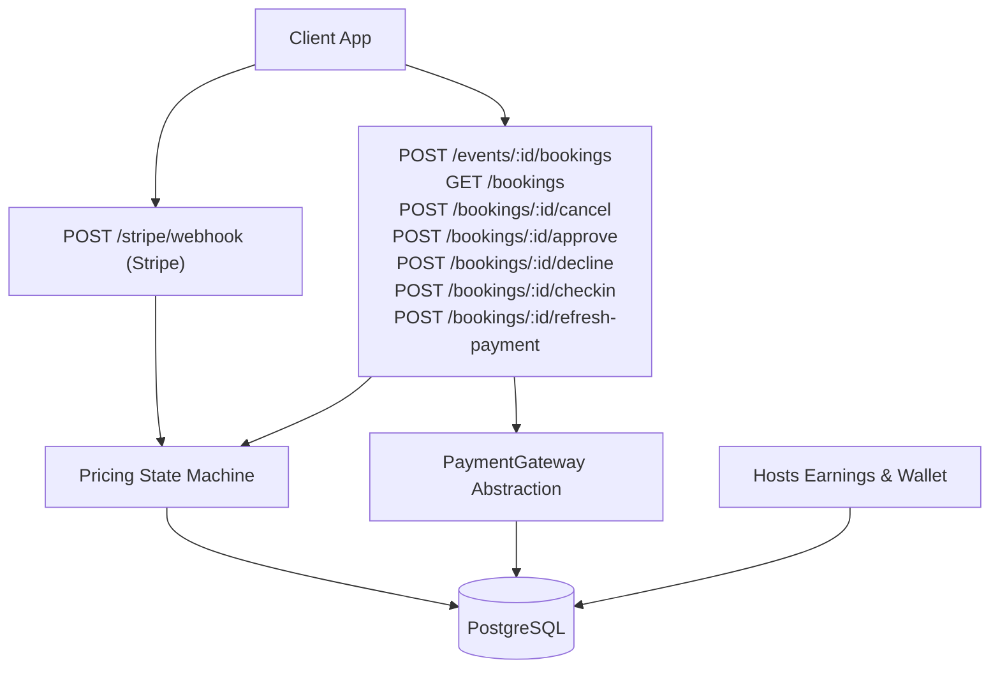
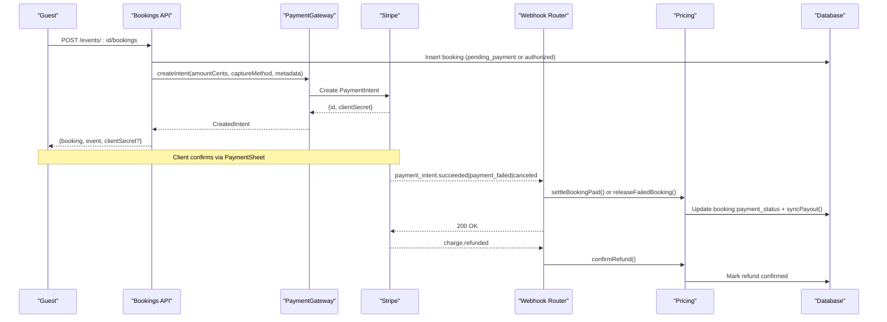
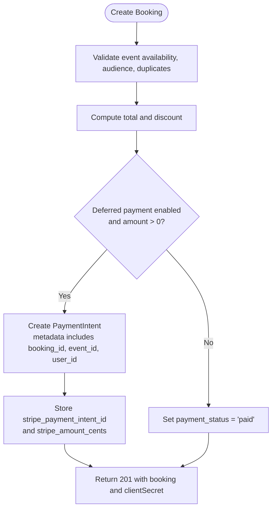
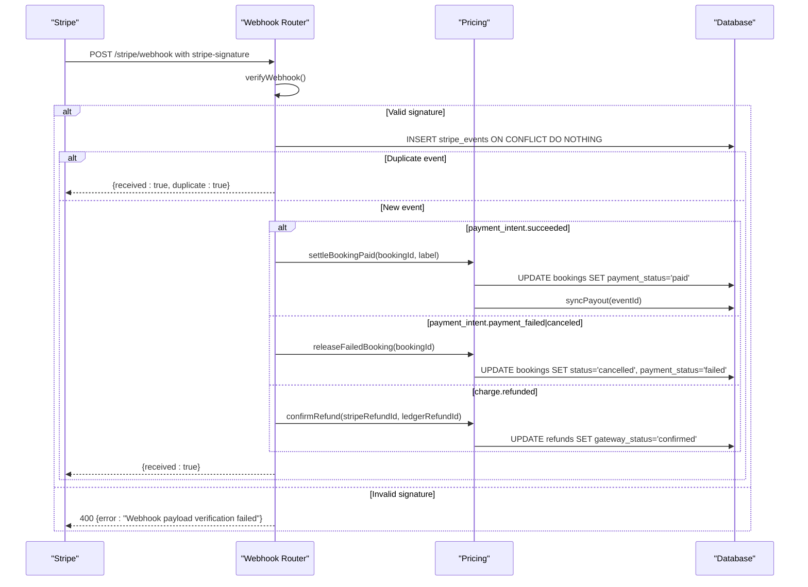
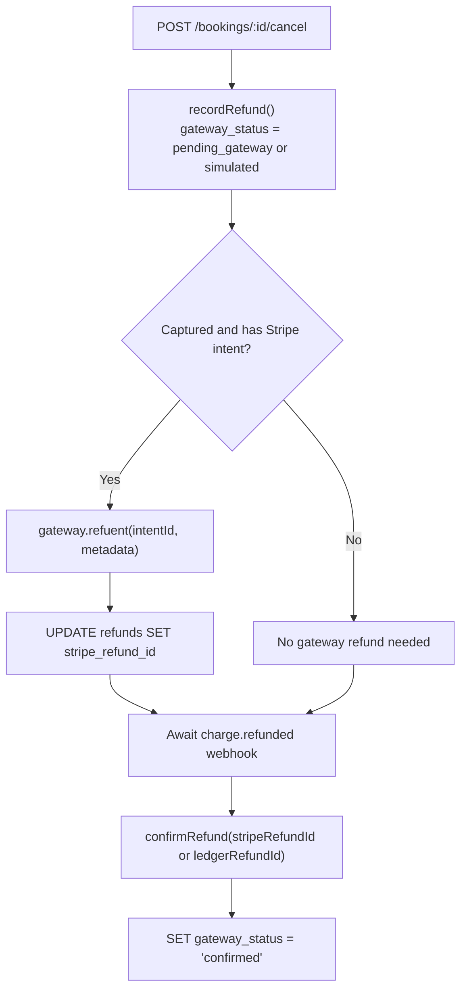
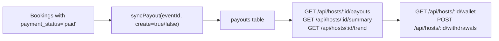
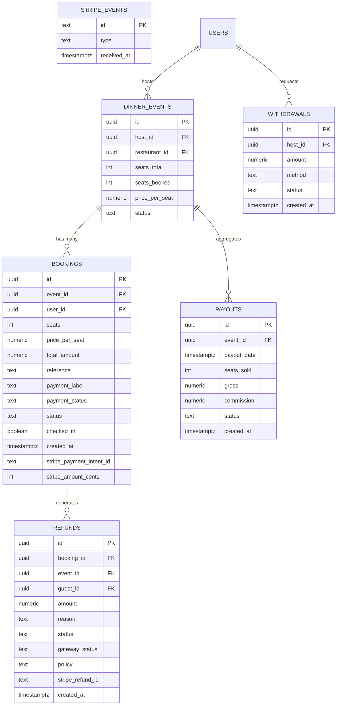
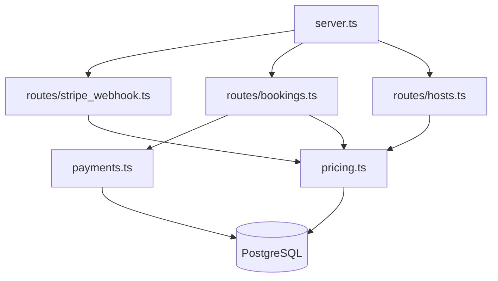

# Payment Processing API

<cite>
**Referenced Files in This Document**
- [server.ts](file://server/src/server.ts)
- [payments.ts](file://server/src/payments.ts)
- [stripe_webhook.ts](file://server/src/routes/stripe_webhook.ts)
- [bookings.ts](file://server/src/routes/bookings.ts)
- [pricing.ts](file://server/src/pricing.ts)
- [schema.sql](file://server/src/schema.sql)
- [hosts.ts](file://server/src/routes/hosts.ts)
- [payments.integration.test.ts](file://server/src/tests/payments.integration.test.ts)
</cite>

## Table of Contents
1. [Introduction](#introduction)
2. [Project Structure](#project-structure)
3. [Core Components](#core-components)
4. [Architecture Overview](#architecture-overview)
5. [Detailed Component Analysis](#detailed-component-analysis)
6. [Dependency Analysis](#dependency-analysis)
7. [Performance Considerations](#performance-considerations)
8. [Troubleshooting Guide](#troubleshooting-guide)
9. [Conclusion](#conclusion)

## Introduction
This document describes the payment processing system integrated with Stripe in DineCircle. It covers:
- Payment intent creation and confirmation via client-side PaymentSheet and server-side intents.
- Webhook handling for payment success, failure, cancellation, and refund events.
- Refund processing and reconciliation between the internal ledger and Stripe.
- Payout management and host earnings accrual.
- Integration patterns for payment method handling, deferred settlement, and financial reporting.
- Webhook security validation, payment state management, error handling, and the relationship between payments, bookings, events, and host payouts.

The implementation supports three gateway modes:
- Real Stripe SDK when a secret key is configured.
- Mock offline gateway for integration tests with real webhook signature verification.
- Simulated historical mode that does not call any external gateway.

## Project Structure
The payment system spans several server modules:
- Gateway abstraction and boot selection live in the payments module.
- Booking routes orchestrate checkout, approval, cancellation, check-in, and abandoned-checkout sweeps.
- The webhook router processes Stripe events securely and updates booking/payment state.
- Pricing provides payout aggregation, refund bookkeeping, and idempotent state transitions.
- Hosts exposes earnings, trends, wallet, and simulated withdrawals.
- Schema defines all relevant tables including bookings, refunds, stripe_events, payouts, and withdrawals.
- Server wires up routes, initializes the payment gateway at boot, and mounts the webhook endpoint before JSON parsing.



**Diagram sources**
- [server.ts:80-89](file://server/src/server.ts#L80-L89)
- [payments.ts:272-325](file://server/src/payments.ts#L272-L325)
- [bookings.ts:156-405](file://server/src/routes/bookings.ts#L156-L405)
- [stripe_webhook.ts:90-153](file://server/src/routes/stripe_webhook.ts#L90-L153)
- [pricing.ts:57-94](file://server/src/pricing.ts#L57-L94)
- [hosts.ts:57-72](file://server/src/routes/hosts.ts#L57-L72)

**Section sources**
- [server.ts:80-89](file://server/src/server.ts#L80-L89)
- [payments.ts:272-325](file://server/src/payments.ts#L272-L325)
- [bookings.ts:156-405](file://server/src/routes/bookings.ts#L156-L405)
- [stripe_webhook.ts:90-153](file://server/src/routes/stripe_webhook.ts#L90-L153)
- [pricing.ts:57-94](file://server/src/pricing.ts#L57-L94)
- [hosts.ts:57-72](file://server/src/routes/hosts.ts#L57-L72)

## Core Components
- Payment gateway abstraction:
  - Defines a unified interface for creating, capturing, canceling, refunding, refreshing client secrets, verifying webhooks, and signing test events.
  - Implements real Stripe, mock offline, and simulated gateways.
  - Provides helpers to convert amounts to cents and derive card labels from settled intents.
- Booking routes:
  - Create bookings with deferred payment when using Stripe or mock; otherwise immediate settlement.
  - Support host approval flows where authorization is captured later.
  - Handle cancellations with refund ledger entries and optional gateway refunds or voids.
  - Capture on check-in for authorized holds.
  - Provide refresh-payment to re-issue client secrets for abandoned sheets.
- Webhook router:
  - Verifies signatures using the gateway’s webhook verifier.
  - Idempotently claims events and dispatches handlers for success, failure, cancellation, and refund events.
  - Updates booking states and reconciles refunds.
- Pricing module:
  - Computes host payouts based on paid seats.
  - Records refunds with gateway status tracking.
  - Settles bookings to paid and releases failed bookings.
  - Confirms refunds when Stripe reports them.
- Hosts endpoints:
  - Expose per-event payouts, summary metrics, trends, performance, and wallet data.
  - Include simulated withdrawal recording and balance checks.

**Section sources**
- [payments.ts:51-71](file://server/src/payments.ts#L51-L71)
- [payments.ts:102-176](file://server/src/payments.ts#L102-L176)
- [payments.ts:185-232](file://server/src/payments.ts#L185-L232)
- [payments.ts:236-266](file://server/src/payments.ts#L236-L266)
- [bookings.ts:156-405](file://server/src/routes/bookings.ts#L156-L405)
- [bookings.ts:420-564](file://server/src/routes/bookings.ts#L420-L564)
- [bookings.ts:612-761](file://server/src/routes/bookings.ts#L612-L761)
- [bookings.ts:770-885](file://server/src/routes/bookings.ts#L770-L885)
- [stripe_webhook.ts:33-88](file://server/src/routes/stripe_webhook.ts#L33-L88)
- [stripe_webhook.ts:90-153](file://server/src/routes/stripe_webhook.ts#L90-L153)
- [pricing.ts:57-94](file://server/src/pricing.ts#L57-L94)
- [pricing.ts:110-156](file://server/src/pricing.ts#L110-L156)
- [pricing.ts:170-269](file://server/src/pricing.ts#L170-L269)
- [hosts.ts:57-72](file://server/src/routes/hosts.ts#L57-L72)
- [hosts.ts:90-145](file://server/src/routes/hosts.ts#L90-L145)
- [hosts.ts:155-183](file://server/src/routes/hosts.ts#L155-L183)
- [hosts.ts:408-502](file://server/src/routes/hosts.ts#L408-L502)

## Architecture Overview
The payment architecture uses a deferred settlement model with Stripe PaymentIntents:
- Checkout creates a booking row and a payment intent when using a real or mock gateway.
- The client confirms payment via PaymentSheet using the returned client secret.
- Stripe sends webhooks for success/failure/cancellation/refund.
- The webhook router verifies signatures, claims events, and updates booking state and payouts.
- Cancellations record refunds in the ledger and optionally issue gateway refunds; webhook confirms them.
- Host payouts are recomputed from paid bookings and exposed through hosts endpoints.



**Diagram sources**
- [bookings.ts:156-405](file://server/src/routes/bookings.ts#L156-L405)
- [payments.ts:114-123](file://server/src/payments.ts#L114-L123)
- [stripe_webhook.ts:33-88](file://server/src/routes/stripe_webhook.ts#L33-L88)
- [pricing.ts:170-189](file://server/src/pricing.ts#L170-L189)
- [pricing.ts:198-246](file://server/src/pricing.ts#L198-L246)
- [pricing.ts:254-269](file://server/src/pricing.ts#L254-L269)

## Detailed Component Analysis

### Payment Gateway Abstraction
The gateway abstraction defines a consistent interface across Stripe, mock, and simulated implementations. Key responsibilities include:
- Creating payment intents with amount in cents, currency, capture method, automatic payment methods, and metadata linking to booking/event/user.
- Capturing or canceling intents safely, ignoring already-done errors.
- Issuing refunds with optional partial amounts and metadata linking to the ledger.
- Refreshing client secrets for still-open intents to support retry flows.
- Verifying webhook payloads against the configured secret.
- Signing test events for mock mode only.

```mermaid
classDiagram
class PaymentGateway {
<<interface>>
+name
+createIntent(input) Promise~CreatedIntent~
+captureIntent(intentId) Promise~void~
+cancelIntent(intentId) Promise~void~
+refund(input) Promise~{refundId}~
+refreshClientSecret(intentId) Promise~string|null~
+verifyWebhook(rawBody, signatureHeader) Stripe.Event
+signEventForTests(payload) string|null
}
class StripeGateway {
+name = "stripe"
-stripe
-currency
-webhookSecret
+createIntent(input)
+captureIntent(intentId)
+cancelIntent(intentId)
+refund(input)
+refreshClientSecret(intentId)
+verifyWebhook(rawBody, signatureHeader)
+signEventForTests() null
}
class MockGateway {
+name = "mock"
-stripe
-webhookSecret
-secrets
+createIntent(input)
+refreshClientSecret(intentId)
+captureIntent()
+cancelIntent()
+refund(input)
+verifyWebhook(rawBody, signatureHeader)
+signEventForTests(payload)
}
class SimulatedGateway {
+name = "simulated"
+createIntent()
+captureIntent()
+cancelIntent()
+refund()
+refreshClientSecret()
+verifyWebhook()
+signEventForTests()
}
PaymentGateway <|.. StripeGateway
PaymentGateway <|.. MockGateway
PaymentGateway <|.. SimulatedGateway
```

**Diagram sources**
- [payments.ts:51-71](file://server/src/payments.ts#L51-L71)
- [payments.ts:102-176](file://server/src/payments.ts#L102-L176)
- [payments.ts:185-232](file://server/src/payments.ts#L185-L232)
- [payments.ts:236-266](file://server/src/payments.ts#L236-L266)

**Section sources**
- [payments.ts:51-71](file://server/src/payments.ts#L51-L71)
- [payments.ts:102-176](file://server/src/payments.ts#L102-L176)
- [payments.ts:185-232](file://server/src/payments.ts#L185-L232)
- [payments.ts:236-266](file://server/src/payments.ts#L236-L266)

### Booking Flow and Payment Intent Creation
Checkout behavior depends on whether deferred payment is enabled and whether the total is greater than zero:
- For deferred payment with a positive amount, the booking is created with `pending_payment` and a payment intent is created.
- For host-gated events, the initial payment status is `authorized`, and capture happens on approval.
- For $0 totals (e.g., 100% promo), the booking settles immediately without a gateway call.
- If intent creation fails, the held seat is released and a clean error is returned.



**Diagram sources**
- [bookings.ts:156-405](file://server/src/routes/bookings.ts#L156-L405)
- [payments.ts:114-123](file://server/src/payments.ts#L114-L123)

**Section sources**
- [bookings.ts:156-405](file://server/src/routes/bookings.ts#L156-L405)
- [payments.ts:114-123](file://server/src/payments.ts#L114-L123)

### Payment Confirmation and Webhook Handling
Webhook security and idempotency:
- The webhook endpoint is mounted before JSON parsing so Stripe can send raw bytes for signature verification.
- Signature verification uses the gateway’s verifier; missing or tampered signatures return 400.
- Each event ID is inserted into `stripe_events` with `ON CONFLICT DO NOTHING`; duplicates are acknowledged without reprocessing.
- Handlers update booking state and payouts only if the current state matches expectations.

Success flow:
- Validates amount guard against stored `stripe_amount_cents`.
- Calls `settleBookingPaid`, which flips booking to `paid` and syncs payouts.

Failure/cancellation flow:
- Calls `releaseFailedBooking`, which cancels the booking, sets `failed`, releases seats, and notifies the guest.

Refund flow:
- Processes `charge.refunded` and calls `confirmRefund` to mark ledger rows as confirmed.



**Diagram sources**
- [stripe_webhook.ts:90-153](file://server/src/routes/stripe_webhook.ts#L90-L153)
- [stripe_webhook.ts:33-88](file://server/src/routes/stripe_webhook.ts#L33-L88)
- [pricing.ts:170-189](file://server/src/pricing.ts#L170-L189)
- [pricing.ts:198-246](file://server/src/pricing.ts#L198-L246)
- [pricing.ts:254-269](file://server/src/pricing.ts#L254-L269)

**Section sources**
- [stripe_webhook.ts:90-153](file://server/src/routes/stripe_webhook.ts#L90-L153)
- [stripe_webhook.ts:33-88](file://server/src/routes/stripe_webhook.ts#L33-L88)
- [pricing.ts:170-189](file://server/src/pricing.ts#L170-L189)
- [pricing.ts:198-246](file://server/src/pricing.ts#L198-L246)
- [pricing.ts:254-269](file://server/src/pricing.ts#L254-L269)

### Refund Processing and Reconciliation
Refunds are recorded in the ledger first, then reconciled with Stripe:
- Cancellation records a refund entry with reason, policy, and gateway status (`simulated` or `pending_gateway`).
- For captured bookings with a Stripe intent, the route issues a gateway refund and stores the Stripe refund ID.
- The webhook handler for `charge.refunded` confirms the ledger row by matching either the Stripe refund ID or the ledger ID.



**Diagram sources**
- [bookings.ts:420-564](file://server/src/routes/bookings.ts#L420-L564)
- [pricing.ts:110-156](file://server/src/pricing.ts#L110-L156)
- [stripe_webhook.ts:75-88](file://server/src/routes/stripe_webhook.ts#L75-L88)
- [pricing.ts:254-269](file://server/src/pricing.ts#L254-L269)

**Section sources**
- [bookings.ts:420-564](file://server/src/routes/bookings.ts#L420-L564)
- [pricing.ts:110-156](file://server/src/pricing.ts#L110-L156)
- [stripe_webhook.ts:75-88](file://server/src/routes/stripe_webhook.ts#L75-L88)
- [pricing.ts:254-269](file://server/src/pricing.ts#L254-L269)

### Payout Management and Host Earnings
Payouts are computed from paid bookings and exposed via hosts endpoints:
- `syncPayout` recomputes seats sold, gross, and commission from booked seats with `payment_status = 'paid'` and valid booking statuses.
- Hosts endpoints provide per-event payouts, summary metrics, monthly trends, performance, and wallet data.
- Withdrawals are simulated ledger entries that reduce available balance but do not move real money.



**Diagram sources**
- [pricing.ts:30-94](file://server/src/pricing.ts#L30-L94)
- [hosts.ts:57-72](file://server/src/routes/hosts.ts#L57-L72)
- [hosts.ts:90-145](file://server/src/routes/hosts.ts#L90-L145)
- [hosts.ts:155-183](file://server/src/routes/hosts.ts#L155-L183)
- [hosts.ts:408-502](file://server/src/routes/hosts.ts#L408-L502)

**Section sources**
- [pricing.ts:30-94](file://server/src/pricing.ts#L30-L94)
- [hosts.ts:57-72](file://server/src/routes/hosts.ts#L57-L72)
- [hosts.ts:90-145](file://server/src/routes/hosts.ts#L90-L145)
- [hosts.ts:155-183](file://server/src/routes/hosts.ts#L155-L183)
- [hosts.ts:408-502](file://server/src/routes/hosts.ts#L408-L502)

### Data Model Relationships
Key relationships among payments, bookings, events, refunds, payouts, and withdrawals:



**Diagram sources**
- [schema.sql:181-213](file://server/src/schema.sql#L181-L213)
- [schema.sql:221-242](file://server/src/schema.sql#L221-L242)
- [schema.sql:247-251](file://server/src/schema.sql#L247-L251)
- [schema.sql:256-266](file://server/src/schema.sql#L256-L266)
- [schema.sql:272-280](file://server/src/schema.sql#L272-L280)

**Section sources**
- [schema.sql:181-213](file://server/src/schema.sql#L181-L213)
- [schema.sql:221-242](file://server/src/schema.sql#L221-L242)
- [schema.sql:247-251](file://server/src/schema.sql#L247-L251)
- [schema.sql:256-266](file://server/src/schema.sql#L256-L266)
- [schema.sql:272-280](file://server/src/schema.sql#L272-L280)

## Dependency Analysis
The payment system integrates multiple layers:
- Server initialization wires the webhook router before JSON parsing and initializes the payment gateway at boot.
- Booking routes depend on the gateway abstraction and pricing helpers.
- Webhook routing depends on pricing helpers and database transactions.
- Hosts endpoints depend on pricing aggregation and database queries.



**Diagram sources**
- [server.ts:80-89](file://server/src/server.ts#L80-L89)
- [server.ts:288-297](file://server/src/server.ts#L288-L297)
- [bookings.ts:156-405](file://server/src/routes/bookings.ts#L156-L405)
- [stripe_webhook.ts:90-153](file://server/src/routes/stripe_webhook.ts#L90-L153)
- [hosts.ts:57-72](file://server/src/routes/hosts.ts#L57-L72)
- [pricing.ts:57-94](file://server/src/pricing.ts#L57-L94)
- [payments.ts:272-325](file://server/src/payments.ts#L272-L325)

**Section sources**
- [server.ts:80-89](file://server/src/server.ts#L80-L89)
- [server.ts:288-297](file://server/src/server.ts#L288-L297)
- [bookings.ts:156-405](file://server/src/routes/bookings.ts#L156-L405)
- [stripe_webhook.ts:90-153](file://server/src/routes/stripe_webhook.ts#L90-L153)
- [hosts.ts:57-72](file://server/src/routes/hosts.ts#L57-L72)
- [pricing.ts:57-94](file://server/src/pricing.ts#L57-L94)
- [payments.ts:272-325](file://server/src/payments.ts#L272-L325)

## Performance Considerations
- Avoid holding expensive locks during external calls: payment intent creation occurs outside the seat-lock transaction to prevent long waits.
- Use advisory locks to serialize payout accrual and withdrawal operations, preventing races between accrual and balance reads.
- Sweep abandoned checkouts opportunistically on read paths rather than relying on cron jobs; failures are swallowed to avoid breaking read operations.
- Idempotent webhook processing prevents double-counting and reduces retry storms.
- Amount guards ensure webhooks cannot settle incorrect amounts.

**Section sources**
- [bookings.ts:337-379](file://server/src/routes/bookings.ts#L337-L379)
- [pricing.ts:62-69](file://server/src/pricing.ts#L62-L69)
- [bookings.ts:84-90](file://server/src/routes/bookings.ts#L84-L90)
- [stripe_webhook.ts:110-124](file://server/src/routes/stripe_webhook.ts#L110-L124)
- [stripe_webhook.ts:40-53](file://server/src/routes/stripe_webhook.ts#L40-L53)

## Troubleshooting Guide
Common issues and resolutions:
- Webhook signature verification fails:
  - Ensure `STRIPE_WEBHOOK_SECRET` is configured and the request includes the `stripe-signature` header.
  - Verify the payload is sent as raw JSON bytes before JSON parsing.
- Payment intent creation fails:
  - Check gateway configuration and environment variables.
  - The route releases the held seat and returns a clear error message.
- Booking remains in `pending_payment`:
  - Check for successful webhook delivery and correct amount match.
  - Abandoned checkouts older than the threshold are swept automatically.
- Refund not confirmed:
  - Ensure the ledger refund ID is included in refund metadata and that the `charge.refunded` webhook arrives.
- Host payout mismatch:
  - Verify that bookings have `payment_status = 'paid'` and valid booking statuses; payouts are recomputed from these conditions.

Operational guidance:
- Inspect `stripe_events` for duplicate deliveries and processing outcomes.
- Review refund ledger rows for `gateway_status` transitions from `pending_gateway` to `confirmed`.
- Monitor sweep logs for abandoned-checkout cleanup.

**Section sources**
- [stripe_webhook.ts:90-153](file://server/src/routes/stripe_webhook.ts#L90-L153)
- [bookings.ts:337-379](file://server/src/routes/bookings.ts#L337-L379)
- [bookings.ts:84-90](file://server/src/routes/bookings.ts#L84-L90)
- [stripe_webhook.ts:40-53](file://server/src/routes/stripe_webhook.ts#L40-L53)
- [pricing.ts:254-269](file://server/src/pricing.ts#L254-L269)

## Conclusion
DineCircle’s payment processing integrates Stripe through a robust abstraction that supports real, mock, and simulated modes. The system enforces deferred settlement, secure webhook handling, idempotent state transitions, and accurate financial reporting. Bookings, events, refunds, payouts, and withdrawals form a cohesive model that ensures consistency between external payment providers and internal ledgers. The design prioritizes safety, auditability, and resilience against retries and race conditions while providing clear APIs for clients and operators.