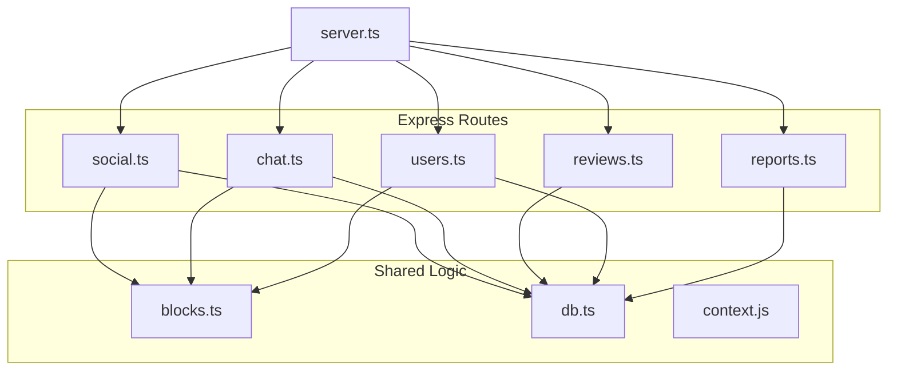
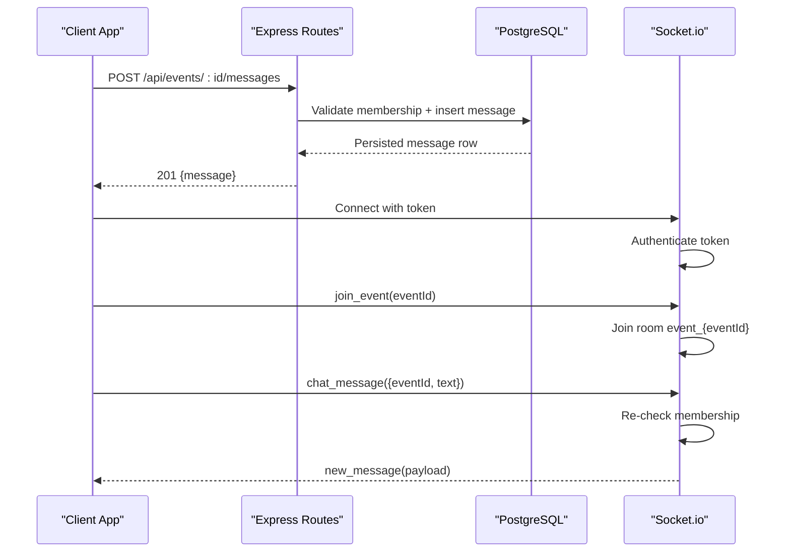
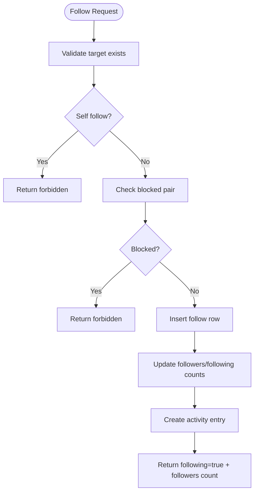
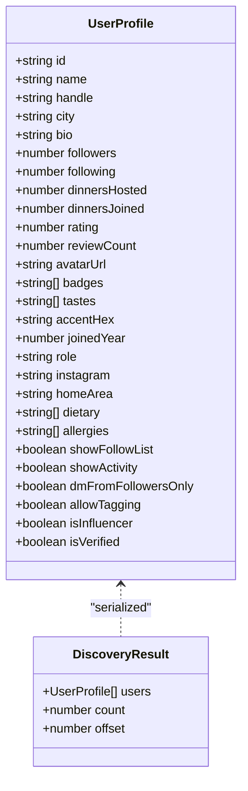
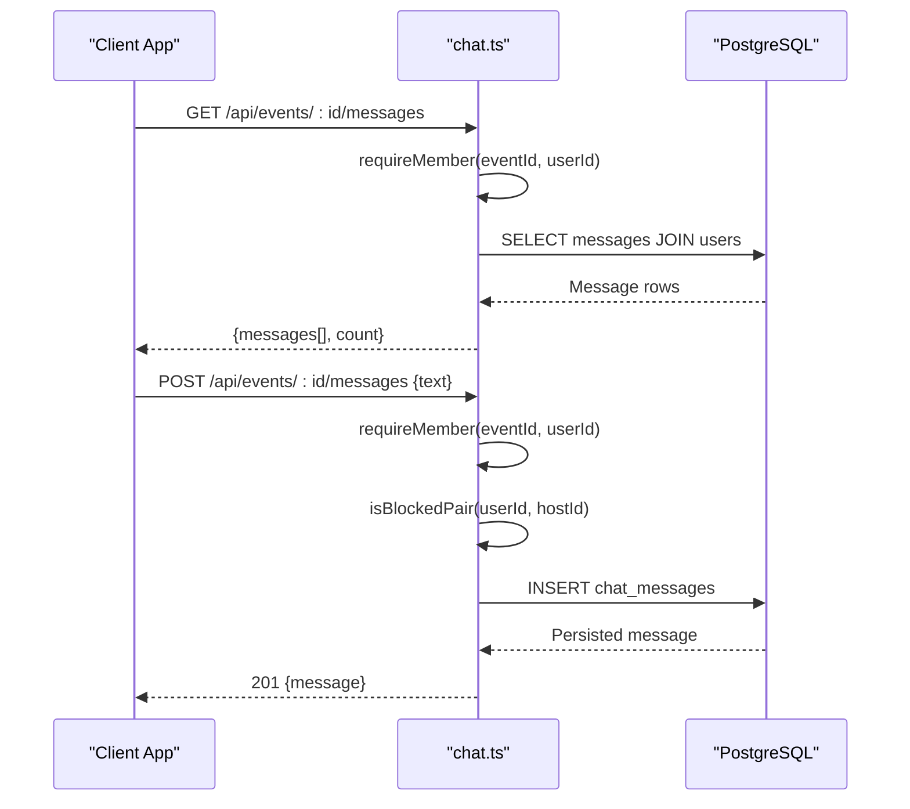
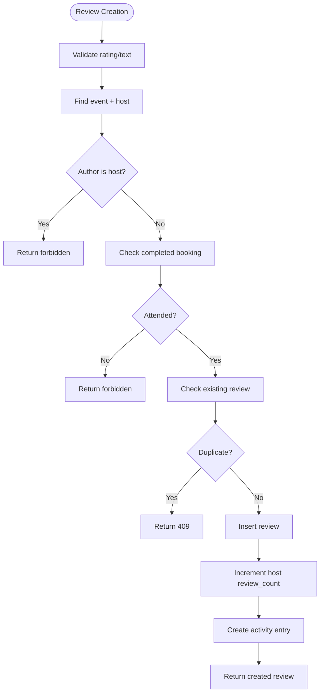
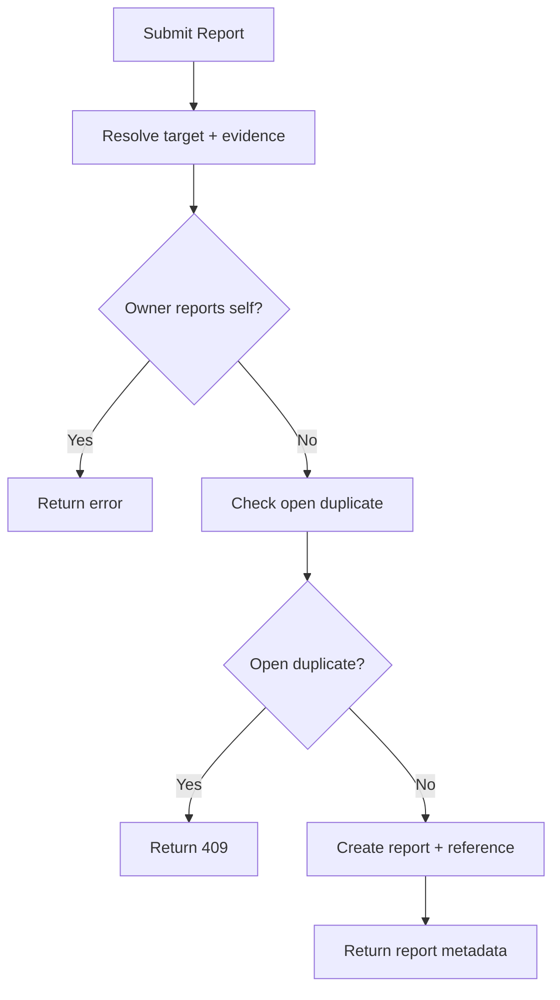
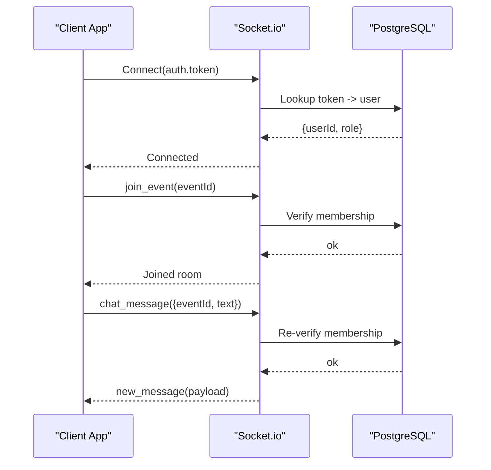
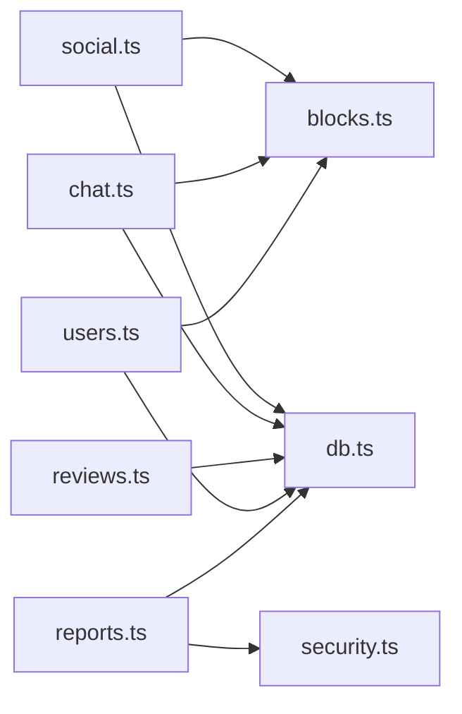

# Social Features API

<cite>
**Referenced Files in This Document**
- [social.ts](file://server/src/routes/social.ts)
- [chat.ts](file://server/src/routes/chat.ts)
- [reviews.ts](file://server/src/routes/reviews.ts)
- [users.ts](file://server/src/routes/users.ts)
- [reports.ts](file://server/src/routes/reports.ts)
- [blocks.ts](file://server/src/blocks.ts)
- [server.ts](file://server/src/server.ts)
- [schema.sql](file://server/src/schema.sql)
</cite>

## Table of Contents
1. [Introduction](#introduction)
2. [Project Structure](#project-structure)
3. [Core Components](#core-components)
4. [Architecture Overview](#architecture-overview)
5. [Detailed Component Analysis](#detailed-component-analysis)
6. [Dependency Analysis](#dependency-analysis)
7. [Performance Considerations](#performance-considerations)
8. [Troubleshooting Guide](#troubleshooting-guide)
9. [Conclusion](#conclusion)

## Introduction
This document provides comprehensive API documentation for DineCircle’s social features. It covers:
- User following and unfollowing, profile management, and user discovery
- Event chat with message history and safety enforcement
- Review and rating systems for events and hosts
- Safety tools including blocking, reporting, and moderation workflows
- Real-time communication via WebSocket connections and message broadcasting

The APIs are implemented as Express routes backed by a PostgreSQL database. Blocking is enforced symmetrically across the platform to ensure blocked users cannot follow, discover, view profiles, or interact through event chat. Reports provide a structured moderation workflow for users and platform administrators.

## Project Structure
The social feature endpoints live under `server/src/routes/` and share common utilities such as database helpers, context/error helpers, and blocking primitives. The server bootstraps both HTTP routes and Socket.io for real-time channels.

**Diagram sources**
- [social.ts:1-355](file://server/src/routes/social.ts#L1-L355)
- [chat.ts:1-134](file://server/src/routes/chat.ts#L1-L134)
- [reviews.ts:1-151](file://server/src/routes/reviews.ts#L1-L151)
- [users.ts:1-739](file://server/src/routes/users.ts#L1-L739)
- [reports.ts:1-283](file://server/src/routes/reports.ts#L1-L283)
- [blocks.ts:1-42](file://server/src/blocks.ts#L1-L42)
- [server.ts:90-289](file://server/src/server.ts#L90-L289)

**Section sources**
- [social.ts:1-355](file://server/src/routes/social.ts#L1-L355)
- [chat.ts:1-134](file://server/src/routes/chat.ts#L1-L134)
- [reviews.ts:1-151](file://server/src/routes/reviews.ts#L1-L151)
- [users.ts:1-739](file://server/src/routes/users.ts#L1-L739)
- [reports.ts:1-283](file://server/src/routes/reports.ts#L1-L283)
- [blocks.ts:1-42](file://server/src/blocks.ts#L1-L42)
- [server.ts:90-289](file://server/src/server.ts#L90-L289)

## Core Components
- Social graph: follows/unfollows, saved events, activity feed, and block management
- Messaging: event chat thread retrieval and posting with member-only access
- Reviews: listing and creating reviews for attended events
- Safety: blocking pairs, report submission, admin moderation queue
- Real-time: Socket.io authentication, room joining, and message broadcasting

Key responsibilities:
- `social.ts`: Activity feed, saved events, follow/unfollow, blocking, block list
- `chat.ts`: Event chat messages (GET/POST), member validation, block checks
- `reviews.ts`: Review listing and creation with attendance validation
- `users.ts`: Profile read/write, discovery search, follower/following lists, role progression
- `reports.ts`: Report submission and admin moderation queue
- `blocks.ts`: Symmetric blocking helpers used across routes
- `server.ts`: Socket.io setup, auth, rooms, and broadcast helpers

**Section sources**
- [social.ts:1-355](file://server/src/routes/social.ts#L1-L355)
- [chat.ts:1-134](file://server/src/routes/chat.ts#L1-L134)
- [reviews.ts:1-151](file://server/src/routes/reviews.ts#L1-L151)
- [users.ts:1-739](file://server/src/routes/users.ts#L1-L739)
- [reports.ts:1-283](file://server/src/routes/reports.ts#L1-L283)
- [blocks.ts:1-42](file://server/src/blocks.ts#L1-L42)
- [server.ts:90-289](file://server/src/server.ts#L90-L289)

## Architecture Overview
DineCircle’s social layer combines REST endpoints with optional real-time updates over WebSockets. All mutating operations validate identity and enforce privacy/safety rules before persisting changes.

**Diagram sources**
- [chat.ts:55-131](file://server/src/routes/chat.ts#L55-L131)
- [server.ts:146-202](file://server/src/server.ts#L146-L202)

## Detailed Component Analysis

### Social Graph: Following, Unfollowing, Saved Events, Activity Feed
Endpoints:
- GET `/api/activity` — signed-in user’s activity feed (newest first)
- POST `/api/activity/read` — mark all items as read
- GET `/api/me/saved` — bookmarked events
- POST `/api/events/:id/save` — bookmark an event
- DELETE `/api/events/:id/save` — unbookmark an event
- GET `/api/social/follow-status?ids=a,b,...` — batch follow status map
- POST `/api/users/:id/follow` — follow a user
- DELETE `/api/users/:id/follow` — unfollow a user
- POST `/api/users/:id/block` — block a user (idempotent, removes mutual follows)
- DELETE `/api/users/:id/block` — unblock a user
- GET `/api/users/me/blocked` — current user’s blocked list

Behavior highlights:
- Follow/unfollow updates counters atomically and creates activity entries on successful follow.
- Blocked pairs prevent new follows; blocking removes existing mutual follows in one transaction.
- Saved events support bookmarking and removal.
- Activity feed returns actor details and unread counts.

**Diagram sources**
- [social.ts:170-227](file://server/src/routes/social.ts#L170-L227)

**Section sources**
- [social.ts:29-67](file://server/src/routes/social.ts#L29-L67)
- [social.ts:84-138](file://server/src/routes/social.ts#L84-L138)
- [social.ts:142-257](file://server/src/routes/social.ts#L142-L257)
- [social.ts:259-352](file://server/src/routes/social.ts#L259-L352)

### Profile Management and User Discovery
Endpoints:
- PATCH `/api/users/me` — edit profile/settings (partial updates supported)
- DELETE `/api/users/me` — anonymize account in place (cancels events/bookings, refunds, revokes sessions)
- GET `/api/users` — discovery/search with pagination and blocked filtering
- POST `/api/users/me/host` — self-promote to host role
- GET `/api/users/me/tier` — current tier and influencer progress
- POST `/api/users/me/influencer` — claim influencer role if eligible
- GET `/api/users/me` — signed-in user’s profile
- GET `/api/users/:id/followers` — paginated followers list (privacy-gated)
- GET `/api/users/:id/following` — paginated following list (privacy-gated)
- GET `/api/users/:id` — public profile card with hosted upcoming events and reviews

Privacy and safety:
- Discovery excludes blocked accounts in both directions.
- Follower/following lists respect visibility toggles.
- Profile access enforces block checks; blocked profiles return 403 rather than 404.

**Diagram sources**
- [users.ts:42-72](file://server/src/routes/users.ts#L42-L72)
- [users.ts:420-454](file://server/src/routes/users.ts#L420-L454)

**Section sources**
- [users.ts:155-186](file://server/src/routes/users.ts#L155-L186)
- [users.ts:188-418](file://server/src/routes/users.ts#L188-L418)
- [users.ts:420-454](file://server/src/routes/users.ts#L420-L454)
- [users.ts:456-530](file://server/src/routes/users.ts#L456-L530)
- [users.ts:532-539](file://server/src/routes/users.ts#L532-L539)
- [users.ts:541-597](file://server/src/routes/users.ts#L541-L597)
- [users.ts:648-736](file://server/src/routes/users.ts#L648-L736)

### Messaging System: Event Chat
Endpoints:
- GET `/api/events/:id/messages` — load event chat thread (oldest first, up to 200)
- POST `/api/events/:id/messages` — post a message as the current user

Access control:
- Only event hosts, booked guests, or attendees on the event’s attendee list can access the chat.
- New messages require that the sender is not blocked relative to the event host; historical messages remain readable.

Message format:
- Each message includes author details when applicable, text content, timestamp, and system flag.

**Diagram sources**
- [chat.ts:13-35](file://server/src/routes/chat.ts#L13-L35)
- [chat.ts:55-82](file://server/src/routes/chat.ts#L55-L82)
- [chat.ts:88-131](file://server/src/routes/chat.ts#L88-L131)

**Section sources**
- [chat.ts:13-35](file://server/src/routes/chat.ts#L13-L35)
- [chat.ts:55-82](file://server/src/routes/chat.ts#L55-L82)
- [chat.ts:88-131](file://server/src/routes/chat.ts#L88-L131)

### Reviews and Ratings
Endpoints:
- GET `/api/reviews` — filterable review listing by host, event, or author
- POST `/api/events/:id/reviews` — create a review for an attended event

Rules:
- Hosts cannot review their own events.
- Only guests who completed an event can review.
- One review per event per author; duplicate submissions return conflict.
- Creating a review increments the host’s review count and creates an activity entry.

**Diagram sources**
- [reviews.ts:81-148](file://server/src/routes/reviews.ts#L81-L148)

**Section sources**
- [reviews.ts:21-74](file://server/src/routes/reviews.ts#L21-L74)
- [reviews.ts:81-148](file://server/src/routes/reviews.ts#L81-L148)

### Safety Tools: Blocking and Reporting
Blocking:
- Symmetric enforcement: either direction of a block prevents following, discovery, profile access, and event chat messaging.
- Blocking removes mutual follows in a transaction and updates counts accordingly.
- Unblock does not restore previous follows.

Reporting:
- Users can report users, events, reviews, and messages.
- Reports include reason, description, and evidence snapshot.
- Rate-limited submission; one open report per reporter+target.
- Admin moderation queue accessible only to super admins; statuses include pending, reviewing, resolved, dismissed.

**Diagram sources**
- [reports.ts:150-198](file://server/src/routes/reports.ts#L150-L198)

**Section sources**
- [blocks.ts:1-42](file://server/src/blocks.ts#L1-L42)
- [social.ts:259-352](file://server/src/routes/social.ts#L259-L352)
- [reports.ts:10-23](file://server/src/routes/reports.ts#L10-L23)
- [reports.ts:150-198](file://server/src/routes/reports.ts#L150-L198)
- [reports.ts:200-213](file://server/src/routes/reports.ts#L200-L213)
- [reports.ts:215-283](file://server/src/routes/reports.ts#L215-L283)

### Real-Time Communication: WebSocket Connections and Broadcasting
WebSocket capabilities:
- Authentication via bearer token lookup against stored tokens.
- Room-based channels for events and restaurants.
- Membership verification before joining rooms and broadcasting messages.
- Broadcast helpers for booking updates, event updates, and restaurant notifications.

**Diagram sources**
- [server.ts:99-113](file://server/src/server.ts#L99-L113)
- [server.ts:146-202](file://server/src/server.ts#L146-L202)

**Section sources**
- [server.ts:90-289](file://server/src/server.ts#L90-L289)

## Dependency Analysis
Social features depend on shared modules:
- Database queries and transactions (`db.ts`)
- Context helpers for errors and user loading (`context.js`)
- Blocking primitives (`blocks.ts`)
- Role and security middleware (`security.ts`, `context.js`)

**Diagram sources**
- [social.ts:1-5](file://server/src/routes/social.ts#L1-L5)
- [chat.ts:1-6](file://server/src/routes/chat.ts#L1-L6)
- [users.ts:1-9](file://server/src/routes/users.ts#L1-L9)
- [reports.ts:1-7](file://server/src/routes/reports.ts#L1-L7)

**Section sources**
- [social.ts:1-5](file://server/src/routes/social.ts#L1-L5)
- [chat.ts:1-6](file://server/src/routes/chat.ts#L1-L6)
- [users.ts:1-9](file://server/src/routes/users.ts#L1-L9)
- [reports.ts:1-7](file://server/src/routes/reports.ts#L1-L7)

## Performance Considerations
- Batch follow-status queries limit input IDs to reduce payload size and query complexity.
- Pagination parameters are clamped to safe ranges to avoid excessive data transfer.
- Chat message retrieval limits results to a fixed maximum to bound response size.
- Indexes exist on frequently queried columns (e.g., chat event timestamps, activity actor).

[No sources needed since this section provides general guidance]

## Troubleshooting Guide
Common issues and resolutions:
- Forbidden errors on follow/profile/chat: verify blocking state between users; blocks are symmetric and enforced server-side.
- Duplicate review submission: ensure the guest has not already reviewed the event; duplicates return conflict.
- Chat access denied: confirm the user is a host, booked guest, or attendee; also check block relationship with the event host.
- Report submission conflicts: an open report for the same target already exists; wait for resolution or dismiss it.

**Section sources**
- [social.ts:170-227](file://server/src/routes/social.ts#L170-L227)
- [chat.ts:88-131](file://server/src/routes/chat.ts#L88-L131)
- [reviews.ts:81-148](file://server/src/routes/reviews.ts#L81-L148)
- [reports.ts:150-198](file://server/src/routes/reports.ts#L150-L198)

## Conclusion
DineCircle’s social features provide a robust foundation for user interaction, safety, and trust. The API enforces privacy and safety consistently across following, messaging, reviews, and reporting. Real-time capabilities complement REST endpoints with authenticated WebSocket channels for live updates. Together, these components enable secure, scalable social experiences within the platform.

[No sources needed since this section summarizes without analyzing specific files]