# Authentication & Authorization

<cite>
**Referenced Files in This Document**
- [auth.ts](file://server/src/routes/auth.ts)
- [context.ts](file://server/src/context.ts)
- [passwords.ts](file://server/src/passwords.ts)
- [security.ts](file://server/src/security.ts)
- [users.ts](file://server/src/routes/users.ts)
- [events.ts](file://server/src/routes/events.ts)
- [feedback.ts](file://server/src/routes/feedback.ts)
- [partner.ts](file://server/src/routes/partner.ts)
- [reports.ts](file://server/src/routes/reports.ts)
</cite>

## Table of Contents
1. [Introduction](#introduction)
2. [Project Structure](#project-structure)
3. [Core Components](#core-components)
4. [Architecture Overview](#architecture-overview)
5. [Detailed Component Analysis](#detailed-component-analysis)
6. [Dependency Analysis](#dependency-analysis)
7. [Performance Considerations](#performance-considerations)
8. [Troubleshooting Guide](#troubleshooting-guide)
9. [Conclusion](#conclusion)

## Introduction
This document explains the authentication and authorization system implemented in the server-side Express application. It covers how users sign up, log in, manage sessions, change credentials, and access protected routes. It also documents security controls such as rate limiting, audit logging, token storage, and role-based access control.

Important clarification: the current implementation does not use JSON Web Tokens (JWT). Instead, it uses opaque bearer tokens stored in a database table with an expiration time. Passwords are hashed using `scrypt`, not bcrypt. There is no CSRF protection or secure cookie configuration because the API is designed for stateless bearer-token clients rather than browser cookies.

## Project Structure
The authentication and authorization logic is primarily implemented in:
- Authentication routes: `/api/auth/*`
- Role and session middleware: shared context utilities
- Password hashing utilities
- Security utilities: rate limiters, token hashing, audit logging
- Example protected routes that enforce roles

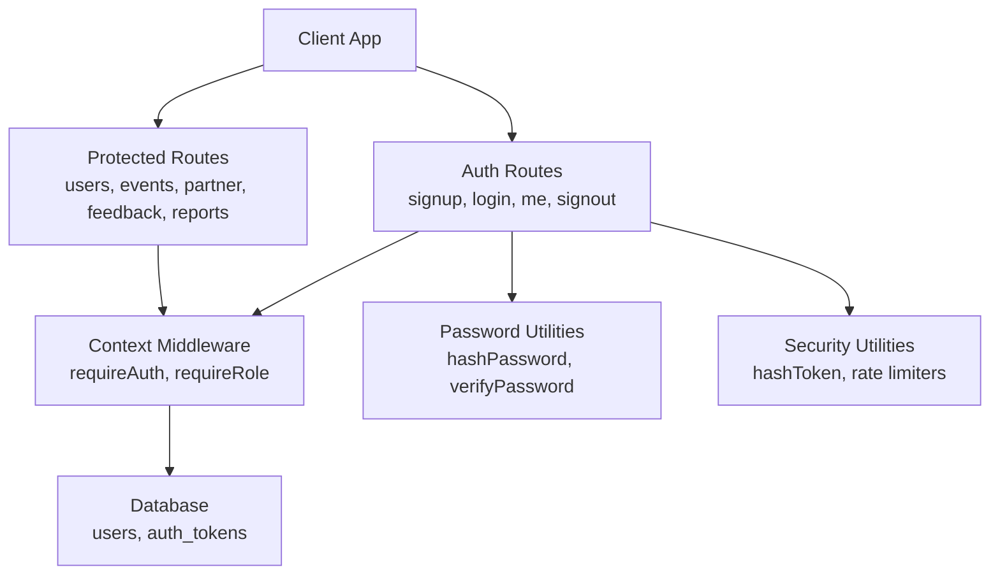

**Diagram sources**
- [auth.ts:12-60](file://server/src/routes/auth.ts#L12-L60)
- [auth.ts:186-280](file://server/src/routes/auth.ts#L186-L280)
- [context.ts:60-98](file://server/src/context.ts#L60-L98)
- [passwords.ts:15-41](file://server/src/passwords.ts#L15-L41)
- [security.ts:12-46](file://server/src/security.ts#L12-L46)

**Section sources**
- [auth.ts:12-60](file://server/src/routes/auth.ts#L12-L60)
- [auth.ts:186-280](file://server/src/routes/auth.ts#L186-L280)
- [context.ts:60-98](file://server/src/context.ts#L60-L98)
- [passwords.ts:15-41](file://server/src/passwords.ts#L15-L41)
- [security.ts:12-46](file://server/src/security.ts#L12-L46)

## Core Components
- Opaque bearer tokens: generated per successful authentication, stored hashed in `auth_tokens`, validated by comparing their SHA-256 digest.
- Session lifetime: tokens include an expiration timestamp; expired tokens are rejected during authentication.
- Password hashing: `scrypt` with random salt and timing-safe comparison.
- Role-based access control: roles are loaded from the database alongside the authenticated user; route-level guards restrict access to specific roles.
- Rate limiting: global API limiter and stricter auth endpoint limiter.
- Audit logging: write operations are recorded with sensitive fields redacted.

Key responsibilities:
- Token lifecycle: generation, validation, revocation on signout and credential changes.
- Credential management: signup, login, password change, email and phone updates with challenge codes.
- Authorization: `requireAuth` and `requireRole` middleware protect routes.

**Section sources**
- [auth.ts:12-60](file://server/src/routes/auth.ts#L12-L60)
- [auth.ts:186-280](file://server/src/routes/auth.ts#L186-L280)
- [auth.ts:302-314](file://server/src/routes/auth.ts#L302-L314)
- [context.ts:60-98](file://server/src/context.ts#L60-L98)
- [passwords.ts:15-41](file://server/src/passwords.ts#L15-L41)
- [security.ts:12-46](file://server/src/security.ts#L12-L46)

## Architecture Overview
The authentication flow uses bearer tokens instead of JWTs. Clients send `Authorization: Bearer <token>` with each request. The server hashes the incoming token before querying the database, compares it against stored digests, and loads the user’s role. Route handlers then enforce business rules and permissions.

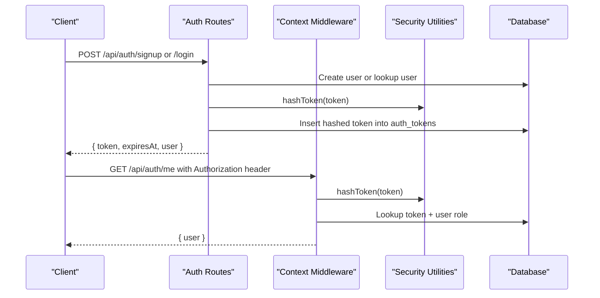

**Diagram sources**
- [auth.ts:216-280](file://server/src/routes/auth.ts#L216-L280)
- [context.ts:60-85](file://server/src/context.ts#L60-L85)
- [security.ts:12-14](file://server/src/security.ts#L12-L14)

## Detailed Component Analysis

### Token Generation, Validation, and Lifecycle
- Token format: opaque string prefixed with a domain marker and random bytes.
- Storage: only the SHA-256 digest is stored in `auth_tokens`; the client retains the plaintext secret.
- Expiration: tokens have a fixed TTL; expired rows are rejected during authentication.
- Revocation:
  - Single signout deletes the current token row.
  - Credential changes revoke all other sessions for the same user.
  - Logout-all deletes every session for the account.

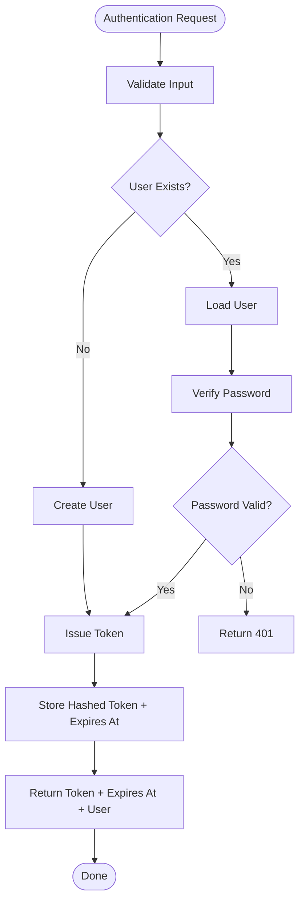

**Diagram sources**
- [auth.ts:216-280](file://server/src/routes/auth.ts#L216-L280)
- [auth.ts:186-196](file://server/src/routes/auth.ts#L186-L196)
- [security.ts:12-14](file://server/src/security.ts#L12-L14)

**Section sources**
- [auth.ts:12-60](file://server/src/routes/auth.ts#L12-L60)
- [auth.ts:186-280](file://server/src/routes/auth.ts#L186-L280)
- [auth.ts:287-293](file://server/src/routes/auth.ts#L287-L293)
- [auth.ts:302-314](file://server/src/routes/auth.ts#L302-L314)
- [auth.ts:518-525](file://server/src/routes/auth.ts#L518-L525)
- [context.ts:60-85](file://server/src/context.ts#L60-L85)
- [security.ts:12-14](file://server/src/security.ts#L12-L14)

### Password Hashing and Verification
- Algorithm: `scrypt` with a random 16-byte salt.
- Stored format: scheme prefix, salt, and derived hash.
- Verification: timing-safe comparison; malformed or unknown schemes fail safely without leaking information.

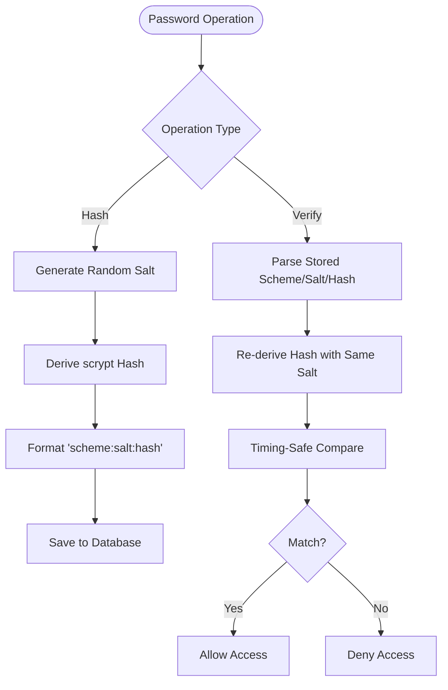

**Diagram sources**
- [passwords.ts:15-41](file://server/src/passwords.ts#L15-L41)

**Section sources**
- [passwords.ts:15-41](file://server/src/passwords.ts#L15-L41)
- [auth.ts:231-258](file://server/src/routes/auth.ts#L231-L258)
- [auth.ts:260-280](file://server/src/routes/auth.ts#L260-L280)
- [auth.ts:365-382](file://server/src/routes/auth.ts#L365-L382)

### Role-Based Access Control and Permission Checking
- Roles: `user`, `host`, `influencer`, `partner_admin`, `super_admin`.
- Host capabilities helper: determines whether a role can publish events.
- Middleware:
  - `requireAuth`: validates bearer token and attaches `userId` and `userRole`.
  - `requireRole(...roles)`: enforces allowed roles on routes.

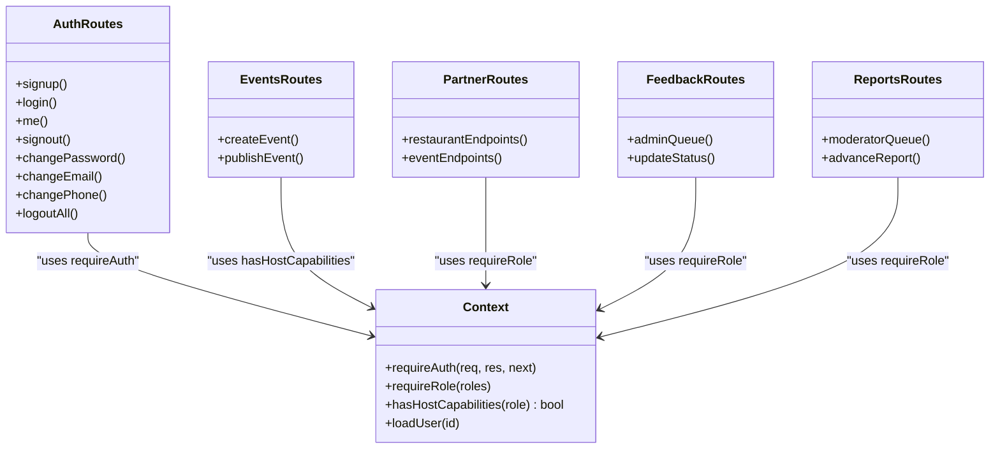

**Diagram sources**
- [context.ts:5-25](file://server/src/context.ts#L5-L25)
- [context.ts:60-98](file://server/src/context.ts#L60-L98)
- [events.ts:384-391](file://server/src/routes/events.ts#L384-L391)
- [partner.ts:8-9](file://server/src/routes/partner.ts#L8-L9)
- [feedback.ts:104-107](file://server/src/routes/feedback.ts#L104-L107)
- [reports.ts:221-224](file://server/src/routes/reports.ts#L221-L224)

**Section sources**
- [context.ts:5-25](file://server/src/context.ts#L5-L25)
- [context.ts:60-98](file://server/src/context.ts#L60-L98)
- [events.ts:384-391](file://server/src/routes/events.ts#L384-L391)
- [partner.ts:8-9](file://server/src/routes/partner.ts#L8-L9)
- [feedback.ts:104-107](file://server/src/routes/feedback.ts#L104-L107)
- [reports.ts:221-224](file://server/src/routes/reports.ts#L221-L224)

### Session Management and Secure Token Storage
- Session model: one row per active device/session in `auth_tokens`.
- Security model:
  - Only hashed tokens are persisted.
  - Expiration enforced at query time.
  - Revocation strategies support single-device logout, multi-device logout, and credential-change-driven revocation.
- No refresh tokens: there is no automatic refresh mechanism; clients must re-authenticate when tokens expire or are revoked.

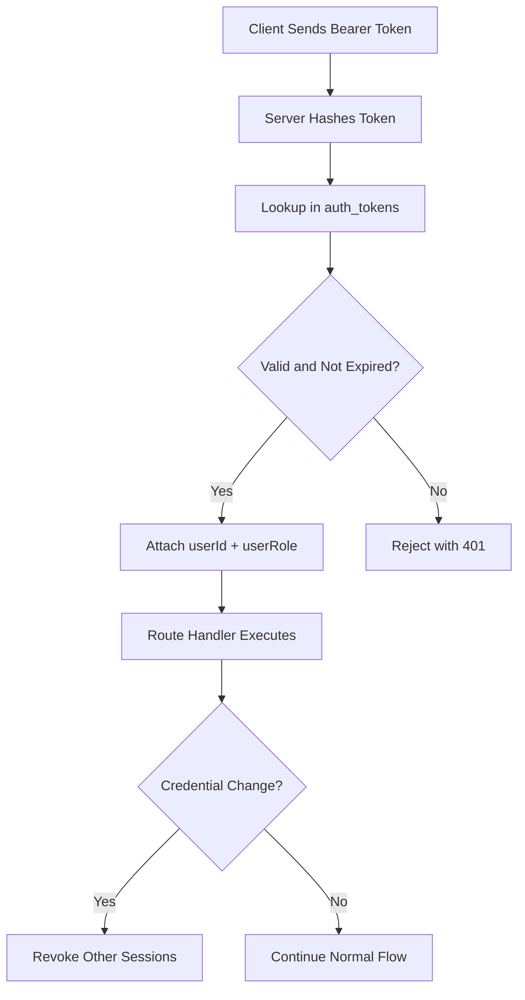

**Diagram sources**
- [context.ts:60-85](file://server/src/context.ts#L60-L85)
- [auth.ts:302-314](file://server/src/routes/auth.ts#L302-L314)
- [security.ts:12-14](file://server/src/security.ts#L12-L14)

**Section sources**
- [context.ts:60-85](file://server/src/context.ts#L60-L85)
- [auth.ts:287-293](file://server/src/routes/auth.ts#L287-L293)
- [auth.ts:302-314](file://server/src/routes/auth.ts#L302-L314)
- [auth.ts:518-525](file://server/src/routes/auth.ts#L518-L525)

### User Registration Flow with Email Verification and Profile Creation
- Signup creates a user with name, handle, email, hashed password, city, and accent color.
- Login verifies the password and issues a token.
- Email verification:
  - The codebase includes a two-step email change flow with a hashed challenge code and TTL.
  - There is no initial email verification step during signup; the first launch uses email/password login directly.
- Profile creation:
  - Basic profile fields are created during signup.
  - Additional settings (home area, dietary preferences, privacy toggles) are updated via a dedicated profile/settings endpoint.

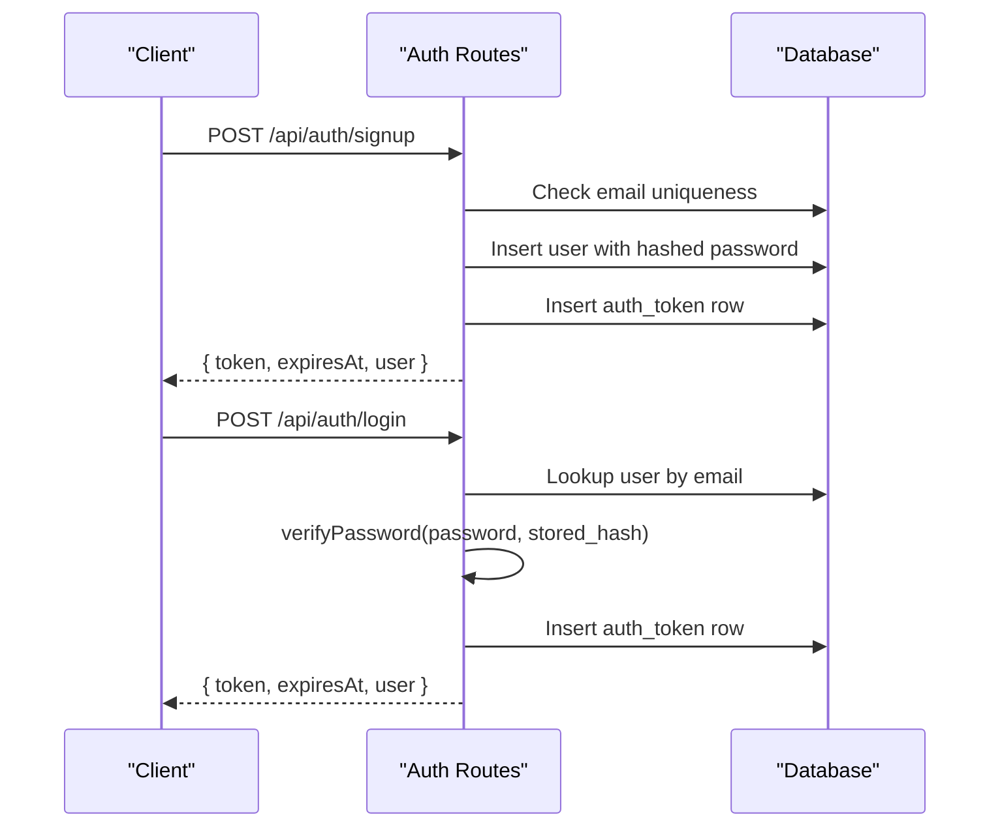

**Diagram sources**
- [auth.ts:216-280](file://server/src/routes/auth.ts#L216-L280)
- [auth.ts:186-196](file://server/src/routes/auth.ts#L186-L196)

**Section sources**
- [auth.ts:160-184](file://server/src/routes/auth.ts#L160-L184)
- [auth.ts:216-280](file://server/src/routes/auth.ts#L216-L280)
- [users.ts:121-186](file://server/src/routes/users.ts#L121-L186)

### Login and Logout Endpoints
- Login: accepts email and password, verifies credentials, issues a token.
- Signout: deletes the current token row.
- Logout-all: deletes all tokens for the user.

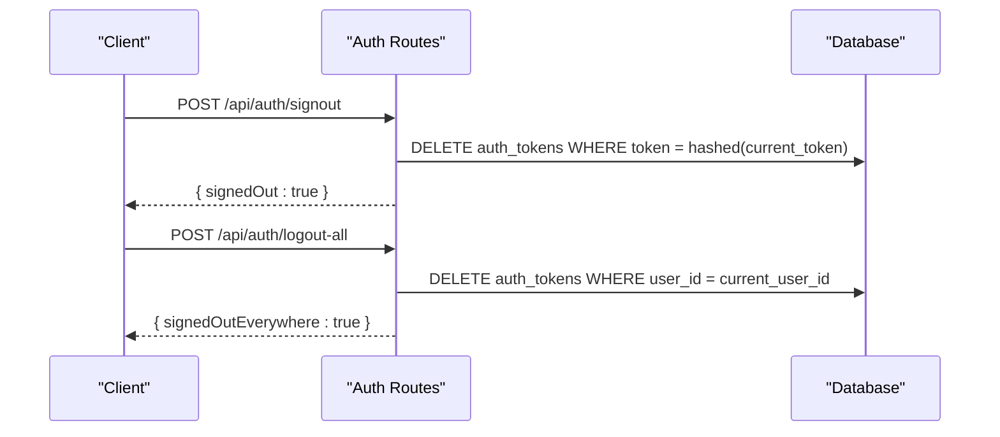

**Diagram sources**
- [auth.ts:287-293](file://server/src/routes/auth.ts#L287-L293)
- [auth.ts:518-525](file://server/src/routes/auth.ts#L518-L525)

**Section sources**
- [auth.ts:260-280](file://server/src/routes/auth.ts#L260-L280)
- [auth.ts:287-293](file://server/src/routes/auth.ts#L287-L293)
- [auth.ts:518-525](file://server/src/routes/auth.ts#L518-L525)

### Protected Route Implementation and Permission Checking
Examples of protected routes:
- Event creation requires host capabilities (`host`, `influencer`, `partner_admin`, `super_admin`).
- Partner endpoints require `partner_admin` or `super_admin`.
- Feedback and reports admin queues require `super_admin`.

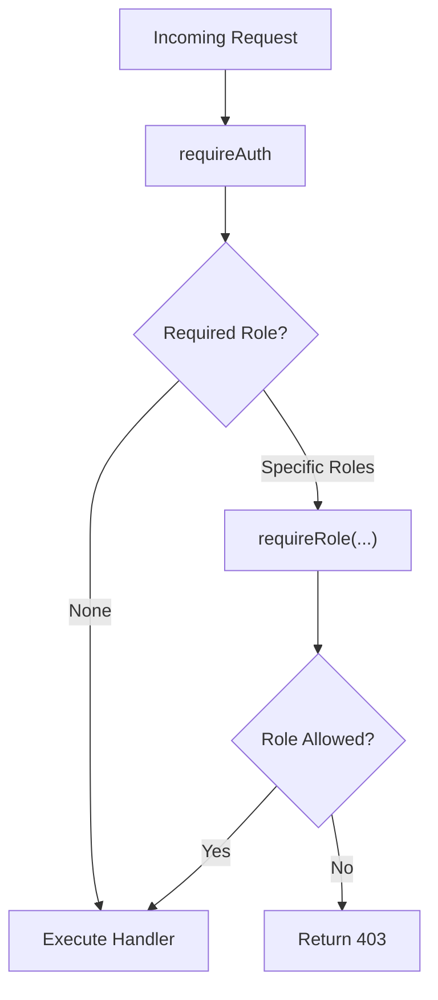

**Diagram sources**
- [context.ts:60-98](file://server/src/context.ts#L60-L98)
- [events.ts:384-391](file://server/src/routes/events.ts#L384-L391)
- [partner.ts:8-9](file://server/src/routes/partner.ts#L8-L9)
- [feedback.ts:104-107](file://server/src/routes/feedback.ts#L104-L107)
- [reports.ts:221-224](file://server/src/routes/reports.ts#L221-L224)

**Section sources**
- [events.ts:384-391](file://server/src/routes/events.ts#L384-L391)
- [partner.ts:8-9](file://server/src/routes/partner.ts#L8-L9)
- [feedback.ts:104-107](file://server/src/routes/feedback.ts#L104-L107)
- [reports.ts:221-224](file://server/src/routes/reports.ts#L221-L224)

### Security Best Practices
- Rate limiting:
  - Global API limiter protects all `/api/*` routes.
  - Stricter limiter protects authentication endpoints.
- Audit logging:
  - Write operations are logged with sensitive fields redacted.
- Token security:
  - Only hashed tokens are stored.
  - Expiration enforced at query time.
- CSRF protection:
  - Not implemented; the API relies on bearer tokens and is intended for non-cookie clients.
- XSS prevention:
  - Not implemented in this backend layer; frontend consumers should sanitize outputs.
- Secure cookie configuration:
  - Not applicable; the API does not set cookies for authentication.

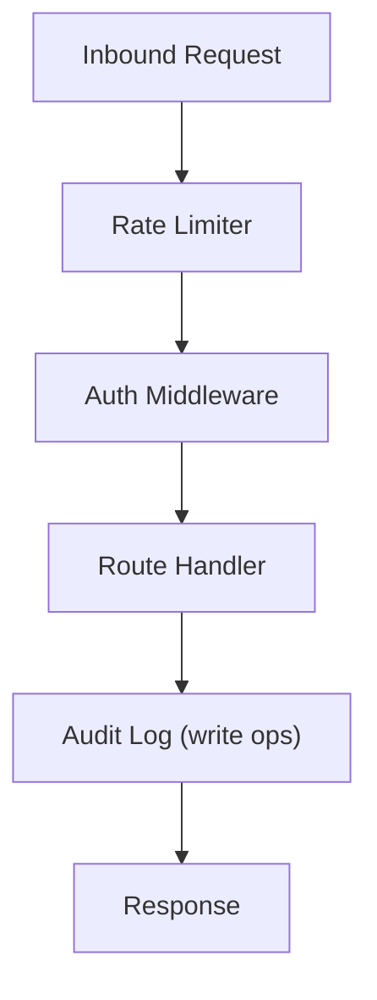

**Diagram sources**
- [security.ts:28-46](file://server/src/security.ts#L28-L46)
- [security.ts:103-147](file://server/src/security.ts#L103-L147)

**Section sources**
- [security.ts:28-46](file://server/src/security.ts#L28-L46)
- [security.ts:77-97](file://server/src/security.ts#L77-L97)
- [security.ts:103-147](file://server/src/security.ts#L103-L147)

## Dependency Analysis
The authentication subsystem depends on:
- Database queries for user and token management.
- Security utilities for token hashing and rate limiting.
- Context utilities for authentication and authorization middleware.
- Password utilities for secure credential handling.

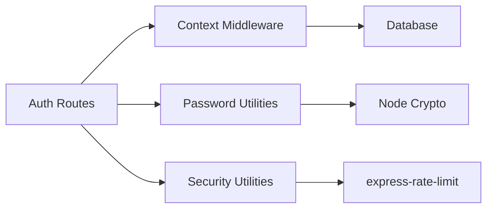

**Diagram sources**
- [auth.ts:1-9](file://server/src/routes/auth.ts#L1-L9)
- [context.ts:1-4](file://server/src/context.ts#L1-L4)
- [passwords.ts:1-4](file://server/src/passwords.ts#L1-L4)
- [security.ts:1-6](file://server/src/security.ts#L1-L6)

**Section sources**
- [auth.ts:1-9](file://server/src/routes/auth.ts#L1-L9)
- [context.ts:1-4](file://server/src/context.ts#L1-L4)
- [passwords.ts:1-4](file://server/src/passwords.ts#L1-L4)
- [security.ts:1-6](file://server/src/security.ts#L1-L6)

## Performance Considerations
- Token lookup cost: hashing the bearer token and querying the database is lightweight but happens on every request; ensure indexes exist on `auth_tokens.token` and `auth_tokens.expires_at`.
- Password hashing cost: `scrypt` is intentionally CPU-intensive; keep password operations out of hot paths and avoid unnecessary retries.
- Rate limiting: configure limits appropriately for production vs test environments; avoid setting limits to zero unintentionally.
- Audit logging: fire-and-forget inserts reduce request latency but may lose logs under failure; monitor insert errors.

[No sources needed since this section provides general guidance]

## Troubleshooting Guide
Common issues and resolutions:
- Invalid or missing bearer token:
  - Ensure the client sends `Authorization: Bearer <token>`.
  - Confirm the token exists in `auth_tokens` and has not expired.
- Incorrect password:
  - Verify the stored password hash format and that `verifyPassword` returns false for mismatches.
- Too many requests:
  - Check rate limiter configuration and environment variables for overrides.
- Audit log failures:
  - Inspect console errors for failed audit inserts; they do not block normal responses.

**Section sources**
- [context.ts:60-85](file://server/src/context.ts#L60-L85)
- [passwords.ts:26-41](file://server/src/passwords.ts#L26-L41)
- [security.ts:28-46](file://server/src/security.ts#L28-L46)
- [security.ts:103-147](file://server/src/security.ts#L103-L147)

## Conclusion
The system implements secure, database-backed session management with opaque bearer tokens, scrypt-based password hashing, and role-based access control. It avoids JWTs and refresh tokens in favor of explicit token expiration and revocation. Security controls include rate limiting and audit logging. For production hardening, consider adding CSRF protection if cookies are used, implementing XSS safeguards in the frontend, and ensuring secure cookie configuration if switching to cookie-based sessions.

[No sources needed since this section summarizes without analyzing specific files]