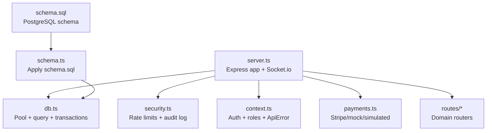
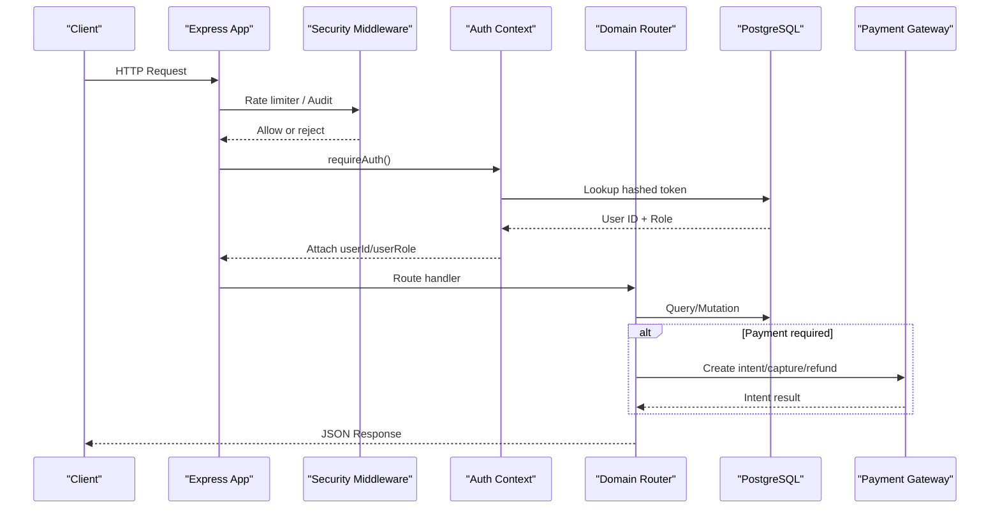
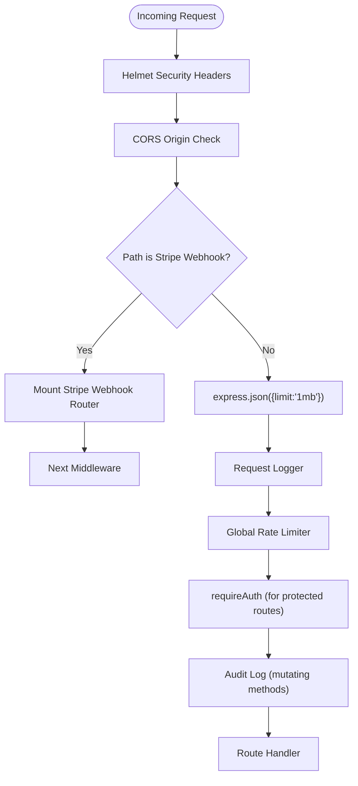
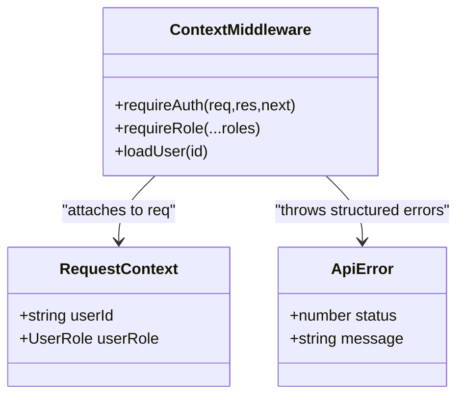
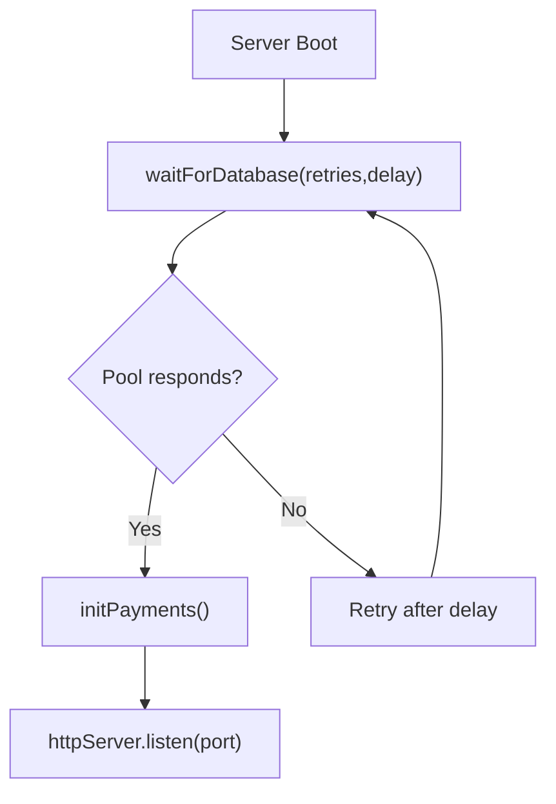
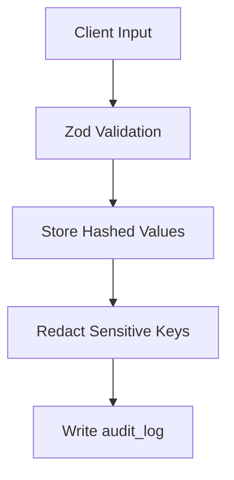
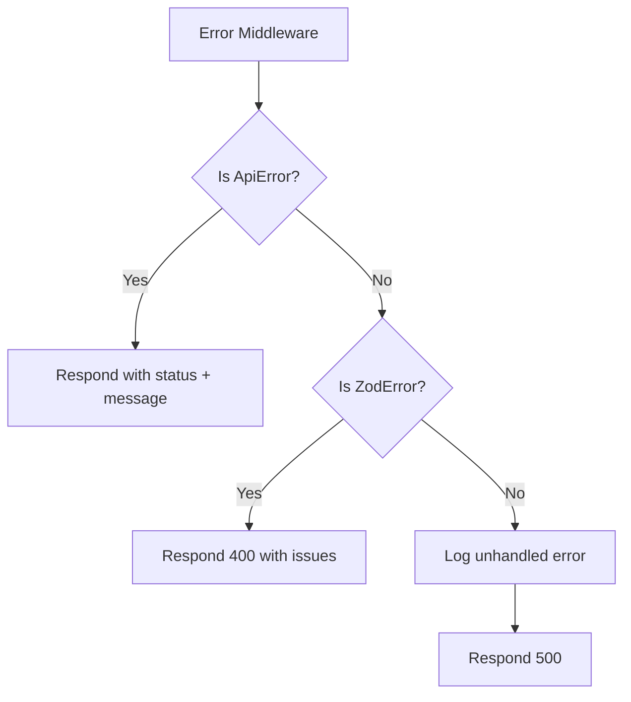
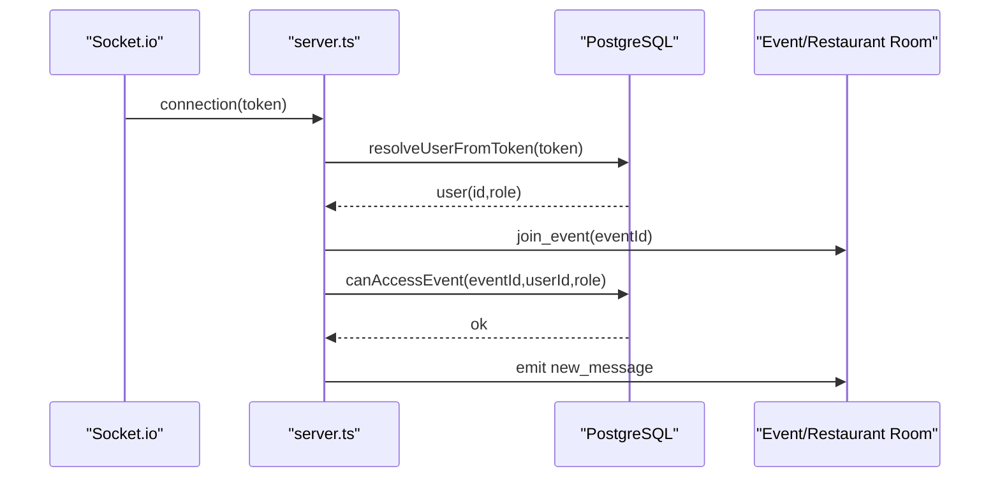
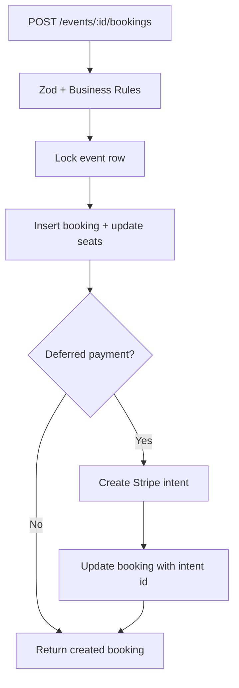
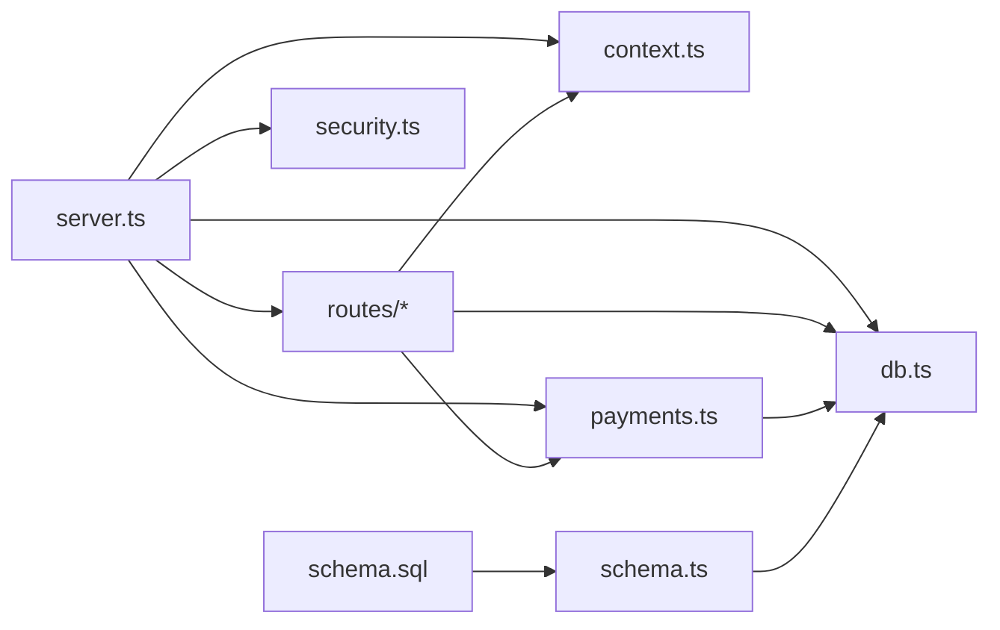

# Backend API Server

<cite>
**Referenced Files in This Document**
- [server.ts](file://server/src/server.ts)
- [context.ts](file://server/src/context.ts)
- [db.ts](file://server/src/db.ts)
- [security.ts](file://server/src/security.ts)
- [passwords.ts](file://server/src/passwords.ts)
- [payments.ts](file://server/src/payments.ts)
- [schema.ts](file://server/src/schema.ts)
- [schema.sql](file://server/src/schema.sql)
- [auth.ts](file://server/src/routes/auth.ts)
- [users.ts](file://server/src/routes/users.ts)
- [bookings.ts](file://server/src/routes/bookings.ts)
- [events.ts](file://server/src/routes/events.ts)
</cite>

## Table of Contents
1. [Introduction](#introduction)
2. [Project Structure](#project-structure)
3. [Core Components](#core-components)
4. [Architecture Overview](#architecture-overview)
5. [Detailed Component Analysis](#detailed-component-analysis)
6. [Dependency Analysis](#dependency-analysis)
7. [Performance Considerations](#performance-considerations)
8. [Troubleshooting Guide](#troubleshooting-guide)
9. [Conclusion](#conclusion)

## Introduction
This document describes the Node.js/Express backend API server for DineCircle. The server is implemented in TypeScript and uses Express 5 as the HTTP runtime, PostgreSQL via `pg` for persistence, Socket.io for real-time event chat, Zod for input validation, Helmet for security headers, CORS for cross-origin configuration, express-rate-limit for request throttling, and Stripe through a pluggable payment gateway abstraction.

The system emphasizes:
- Type safety through strict TypeScript configuration.
- A middleware pipeline that enforces security, rate limiting, authentication, audit logging, and error handling.
- Context-based request handling where authenticated user identity and role are attached to each request.
- Database connection pooling, transaction helpers, and idempotent schema management.
- Secure token storage using hashed bearer tokens, scrypt password hashing, and redacted audit logs.
- Modular route organization by domain with consistent validation and serialization patterns.
- Deferred payment flows through Stripe or offline modes, with webhook verification and ledger bookkeeping.

## Project Structure
The backend lives under `server/src`. The main entry point wires Express, Socket.io, middleware, routes, database readiness checks, payment initialization, and graceful shutdown. Domain-specific routes live under `server/src/routes`, while shared infrastructure includes context, database helpers, security utilities, password hashing, payments, and schema management.

**Diagram sources**
- [server.ts:27-300](file://server/src/server.ts#L27-L300)
- [security.ts:28-147](file://server/src/security.ts#L28-L147)
- [context.ts:60-98](file://server/src/context.ts#L60-L98)
- [db.ts:8-37](file://server/src/db.ts#L8-L37)
- [payments.ts:270-325](file://server/src/payments.ts#L270-L325)
- [schema.ts:10-25](file://server/src/schema.ts#L10-L25)
- [schema.sql:1-12](file://server/src/schema.sql#L1-L12)

**Section sources**
- [server.ts:27-300](file://server/src/server.ts#L27-L300)
- [package.json:17-26](file://server/package.json#L17-L26)
- [tsconfig.json:1-19](file://server/tsconfig.json#L1-L19)

## Core Components
- Express application and HTTP server: initializes middleware, mounts routes, creates an HTTP server, and attaches Socket.io.
- Authentication context: extracts Bearer tokens, resolves user identity and role, provides typed request extensions, and exposes helper errors.
- Database layer: connection pool, typed query wrapper, and transaction helper with commit/rollback semantics.
- Security utilities: SHA-256 token hashing, multiple rate limiters, audit logging with sensitive-field redaction.
- Password utilities: scrypt-based hashing and timing-safe verification.
- Payment gateway abstraction: Stripe SDK, mock offline mode, and simulated historical behavior; boot selection based on environment variables.
- Schema tooling: idempotent application of the canonical SQL schema.

**Section sources**
- [server.ts:27-300](file://server/src/server.ts#L27-L300)
- [context.ts:6-98](file://server/src/context.ts#L6-L98)
- [db.ts:8-37](file://server/src/db.ts#L8-L37)
- [security.ts:12-147](file://server/src/security.ts#L12-L147)
- [passwords.ts:15-41](file://server/src/passwords.ts#L15-L41)
- [payments.ts:270-325](file://server/src/payments.ts#L270-L325)
- [schema.ts:10-25](file://server/src/schema.ts#L10-L25)

## Architecture Overview
The server follows a layered architecture:
- Inbound requests pass through global middleware (Helmet, CORS, JSON parsing, logging).
- Stripe webhooks bypass JSON parsing and rate limiting to preserve raw payload signatures.
- Authenticated routes require a valid Bearer token and attach user context.
- Mutating requests are audited after response completion.
- Domain routers handle business logic, validate inputs with Zod, and use the database layer for persistence.
- Real-time features use Socket.io with token-based authentication and per-event/restaurant room access control.

**Diagram sources**
- [server.ts:61-90](file://server/src/server.ts#L61-L90)
- [server.ts:221-239](file://server/src/server.ts#L221-L239)
- [context.ts:60-85](file://server/src/context.ts#L60-L85)
- [security.ts:28-46](file://server/src/security.ts#L28-L46)
- [security.ts:103-147](file://server/src/security.ts#L103-L147)
- [payments.ts:114-176](file://server/src/payments.ts#L114-L176)

## Detailed Component Analysis

### Middleware Pipeline and Security Headers
- Helmet applies secure HTTP headers.
- CORS allows configured origins and relaxes rules in non-production environments.
- Stripe webhook router is mounted before JSON parsing to preserve raw body bytes.
- JSON parser enforces a 1MB body limit.
- Minimal request logger records method, path, status code, and duration.
- Global rate limiter protects `/api/*`; auth endpoints have stricter limits.
- Audit middleware captures mutating requests with redacted bodies into `audit_log`.

**Diagram sources**
- [server.ts:61-90](file://server/src/server.ts#L61-L90)
- [server.ts:221-239](file://server/src/server.ts#L221-L239)
- [security.ts:28-46](file://server/src/security.ts#L28-L46)
- [security.ts:103-147](file://server/src/security.ts#L103-L147)

**Section sources**
- [server.ts:61-90](file://server/src/server.ts#L61-L90)
- [server.ts:221-239](file://server/src/server.ts#L221-L239)
- [security.ts:28-46](file://server/src/security.ts#L28-L46)
- [security.ts:103-147](file://server/src/security.ts#L103-L147)

### Context-Based Request Handling
- `requireAuth` parses the Authorization header, hashes the token, and queries `auth_tokens` joined with `users` to resolve `userId` and `userRole`.
- Request type augmentation adds `userId` and `userRole` to Express `Request`.
- `requireRole` factory restricts access to specific roles.
- `loadUser` serializes the full user profile including account settings fields used by the mobile app.

**Diagram sources**
- [context.ts:27-37](file://server/src/context.ts#L27-L37)
- [context.ts:60-98](file://server/src/context.ts#L60-L98)
- [context.ts:100-146](file://server/src/context.ts#L100-L146)

**Section sources**
- [context.ts:6-98](file://server/src/context.ts#L6-L98)
- [context.ts:100-146](file://server/src/context.ts#L100-L146)

### Database Connection Management and Query Execution
- `pg.Pool` manages connections with a maximum size of 10.
- `query<T>` wraps pool queries and returns typed rows.
- `withTransaction` executes a function inside a transaction with explicit BEGIN/COMMIT/ROLLBACK and ensures client release.
- Startup waits for PostgreSQL availability with retries before launching the server.

**Diagram sources**
- [db.ts:8-37](file://server/src/db.ts#L8-L37)
- [server.ts:47-59](file://server/src/server.ts#L47-L59)
- [server.ts:280-300](file://server/src/server.ts#L280-L300)

**Section sources**
- [db.ts:8-37](file://server/src/db.ts#L8-L37)
- [server.ts:47-59](file://server/src/server.ts#L47-L59)

### Security Implementation
- Token storage: bearer tokens are stored as SHA-256 digests; clients present plaintext secrets, which are hashed before lookup.
- Password hashing: scrypt with random salt; stored format includes scheme and salt for future migration flexibility.
- Verification: timing-safe comparison prevents timing attacks.
- Input sanitization: Zod schemas validate and normalize inputs across routes.
- Audit redaction: sensitive keys like passwords and OTP codes are replaced with `[redacted]` in audit logs.

**Diagram sources**
- [security.ts:12-14](file://server/src/security.ts#L12-L14)
- [passwords.ts:15-41](file://server/src/passwords.ts#L15-L41)
- [security.ts:77-97](file://server/src/security.ts#L77-L97)
- [security.ts:103-147](file://server/src/security.ts#L103-L147)

**Section sources**
- [security.ts:12-14](file://server/src/security.ts#L12-L14)
- [passwords.ts:15-41](file://server/src/passwords.ts#L15-L41)
- [security.ts:77-97](file://server/src/security.ts#L77-L97)

### Error Handling Strategy and Logging
- Centralized error handler distinguishes between `ApiError`, `ZodError`, and unhandled exceptions.
- Structured error responses include human-readable messages and validation issues.
- Unhandled errors log details and return a generic 500 response.
- Request logger prints concise metrics for operational visibility.

**Diagram sources**
- [server.ts:263-277](file://server/src/server.ts#L263-L277)
- [context.ts:39-54](file://server/src/context.ts#L39-L54)

**Section sources**
- [server.ts:263-277](file://server/src/server.ts#L263-L277)
- [context.ts:39-54](file://server/src/context.ts#L39-L54)

### Modular Route Structure and Controller Organization
Routes are organized by domain:
- Authentication: sign-in, OTP flow, email/password signup/login, session management, credential changes.
- Users: profile updates, growth ladder, discovery, privacy controls, account deletion.
- Bookings: seat reservation, approval workflow, cancellation, check-in, payment integration.
- Events: feed filtering, creation/editing/publishing, venue constraints, audience gating.

Each route:
- Validates inputs with Zod.
- Uses `requireAuth` and optional `requireRole`.
- Performs authorization checks against user role and relationships.
- Serializes data consistently for the frontend.

**Section sources**
- [auth.ts:19-61](file://server/src/routes/auth.ts#L19-L61)
- [auth.ts:159-280](file://server/src/routes/auth.ts#L159-L280)
- [auth.ts:295-525](file://server/src/routes/auth.ts#L295-L525)
- [users.ts:155-186](file://server/src/routes/users.ts#L155-L186)
- [users.ts:188-418](file://server/src/routes/users.ts#L188-L418)
- [users.ts:420-739](file://server/src/routes/users.ts#L420-L739)
- [bookings.ts:153-405](file://server/src/routes/bookings.ts#L153-L405)
- [bookings.ts:420-564](file://server/src/routes/bookings.ts#L420-L564)
- [bookings.ts:566-761](file://server/src/routes/bookings.ts#L566-L761)
- [events.ts:140-246](file://server/src/routes/events.ts#L140-L246)
- [events.ts:345-456](file://server/src/routes/events.ts#L345-L456)
- [events.ts:458-553](file://server/src/routes/events.ts#L458-L553)
- [events.ts:555-633](file://server/src/routes/events.ts#L555-L633)

### WebSocket and Real-Time Features
- Socket.io is attached to the same HTTP server.
- Connections authenticate via a Bearer token resolved from `auth_tokens`.
- Rooms are scoped to events and restaurants; membership is verified before joining.
- Chat messages are re-verified before broadcasting to ensure only authorized users participate.
- Helper functions emit booking and event updates to relevant rooms.

**Diagram sources**
- [server.ts:97-202](file://server/src/server.ts#L97-L202)

**Section sources**
- [server.ts:97-202](file://server/src/server.ts#L97-L202)

### Payment Integration and Ledger
- Three gateway modes: Stripe (real), Mock (offline test fixtures), Simulated (historical immediate settlement).
- Boot selection validates configuration and enforces production constraints.
- Booking creation may create a Stripe PaymentIntent; success webhooks settle bookings.
- Cancellations and declines record refunds in a ledger and optionally call the gateway.
- Abandoned checkout sweep releases stale pending payments opportunistically.

**Diagram sources**
- [bookings.ts:153-405](file://server/src/routes/bookings.ts#L153-L405)
- [payments.ts:114-176](file://server/src/payments.ts#L114-L176)
- [payments.ts:335-390](file://server/src/payments.ts#L335-L390)

**Section sources**
- [payments.ts:270-325](file://server/src/payments.ts#L270-L325)
- [bookings.ts:153-405](file://server/src/routes/bookings.ts#L153-L405)
- [bookings.ts:420-564](file://server/src/routes/bookings.ts#L420-L564)

### CORS Configuration, Request/Response Formatting, and API Versioning
- CORS origin allowlist supports local development addresses and relaxes in non-production.
- All responses are JSON objects with consistent error shapes.
- No explicit URL versioning is present; routes are grouped under `/api` with domain subpaths.
- Health endpoint provides service status and latency.

**Section sources**
- [server.ts:61-78](file://server/src/server.ts#L61-L78)
- [server.ts:224-233](file://server/src/server.ts#L224-L233)
- [server.ts:259-261](file://server/src/server.ts#L259-L261)

## Dependency Analysis
The server composes dependencies as follows:
- Express depends on Helmet, CORS, and express-rate-limit.
- Authentication depends on `db.query` and `security.hashToken`.
- Routes depend on context, database, blocks, pricing, and payments modules.
- Payments module depends on Stripe SDK and database transactions.
- Schema tooling depends on the database pool and reads the canonical SQL file.

**Diagram sources**
- [server.ts:1-25](file://server/src/server.ts#L1-L25)
- [context.ts:1-3](file://server/src/context.ts#L1-L3)
- [db.ts:1-8](file://server/src/db.ts#L1-L8)
- [security.ts:1-5](file://server/src/security.ts#L1-L5)
- [payments.ts:1-5](file://server/src/payments.ts#L1-L5)
- [schema.ts:1-5](file://server/src/schema.ts#L1-L5)

**Section sources**
- [server.ts:1-25](file://server/src/server.ts#L1-L25)
- [context.ts:1-3](file://server/src/context.ts#L1-L3)
- [db.ts:1-8](file://server/src/db.ts#L1-L8)
- [security.ts:1-5](file://server/src/security.ts#L1-L5)
- [payments.ts:1-5](file://server/src/payments.ts#L1-L5)
- [schema.ts:1-5](file://server/src/schema.ts#L1-L5)

## Performance Considerations
- Database pool size is capped at 10 connections to balance concurrency and resource usage.
- Startup waits for PostgreSQL readiness to avoid serving requests without a database.
- Payment operations are isolated outside seat-lock transactions to prevent long external calls from holding locks.
- Abandoned checkout sweeps run opportunistically on read paths to minimize blocking.
- Audit logging is fire-and-forget to avoid impacting response latency.
- Zod validation occurs early to fail fast on malformed payloads.

[No sources needed since this section provides general guidance]

## Troubleshooting Guide
- Database connectivity failures cause startup to exit after retries; verify `DATABASE_URL` and container ordering.
- Payment gateway misconfiguration fails fast at boot; check `STRIPE_SECRET_KEY` and `PAYMENTS_MODE`.
- Stripe webhook signature verification requires `STRIPE_WEBHOOK_SECRET`; missing values throw during verification.
- Audit log insert failures are logged but do not break request processing.
- Authentication failures return structured 401 errors; inspect token presence and expiry.
- Validation errors return 400 with Zod issue arrays; review request payloads.

**Section sources**
- [server.ts:47-59](file://server/src/server.ts#L47-L59)
- [server.ts:288-297](file://server/src/server.ts#L288-L297)
- [payments.ts:165-170](file://server/src/payments.ts#L165-L170)
- [security.ts:138-140](file://server/src/security.ts#L138-L140)
- [context.ts:60-85](file://server/src/context.ts#L60-L85)
- [server.ts:263-277](file://server/src/server.ts#L263-L277)

## Conclusion
The DineCircle backend API server is a modular, type-safe Express application built around a clear middleware pipeline, context-based authentication, robust database abstractions, and a flexible payment gateway strategy. Security is enforced through hashed tokens, scrypt password hashing, rate limiting, CORS controls, and redacted audit logs. The route structure is domain-oriented with consistent validation and serialization, and real-time capabilities are provided via Socket.io with strict access controls. Operational reliability is supported by startup guards, graceful shutdown, centralized error handling, and comprehensive schema management.

[No sources needed since this section summarizes without analyzing specific files]