# Booking & Reservation System

<cite>
**Referenced Files in This Document**
- [bookings.ts](file://server/src/routes/bookings.ts)
- [schema.sql](file://server/src/schema.sql)
- [pricing.ts](file://server/src/pricing.ts)
- [payments.ts](file://server/src/payments.ts)
</cite>

## Table of Contents
1. [Introduction](#introduction)
2. [Project Structure](#project-structure)
3. [Core Components](#core-components)
4. [Architecture Overview](#architecture-overview)
5. [Detailed Component Analysis](#detailed-component-analysis)
6. [Dependency Analysis](#dependency-analysis)
7. [Performance Considerations](#performance-considerations)
8. [Troubleshooting Guide](#troubleshooting-guide)
9. [Conclusion](#conclusion)
10. [Appendices](#appendices)

## Introduction
This document explains the booking and reservation system that powers event seat reservations, payment settlement, cancellations, check-ins, and host approval workflows. It focuses on:
- How bookings are created with capacity checks and availability enforcement
- The transactional process that prevents double bookings using database locks
- The full booking status lifecycle from pending to confirmed to completed or cancelled
- Cancellation policies and refund processing logic
- Confirmation and notification behavior via an activity feed
- Guest management features such as attendee lists and check-in
- Analytics and reporting capabilities for payouts and refunds
- Examples of bulk/group operations and group reservations

The implementation is server-side Express routes backed by a PostgreSQL schema, with optional Stripe-based deferred payments and a platform commission model for host payouts.

## Project Structure
The booking system lives primarily in the server API layer:
- Route handlers define the REST endpoints for listing, creating, approving/declining, cancelling, checking in, and refreshing payment state
- The database schema defines events, bookings, refunds, payouts, and related tables
- Pricing utilities compute platform commissions and reconcile host payouts
- Payments provide a gateway abstraction (Stripe, mock, simulated) and abandoned-checkout cleanup

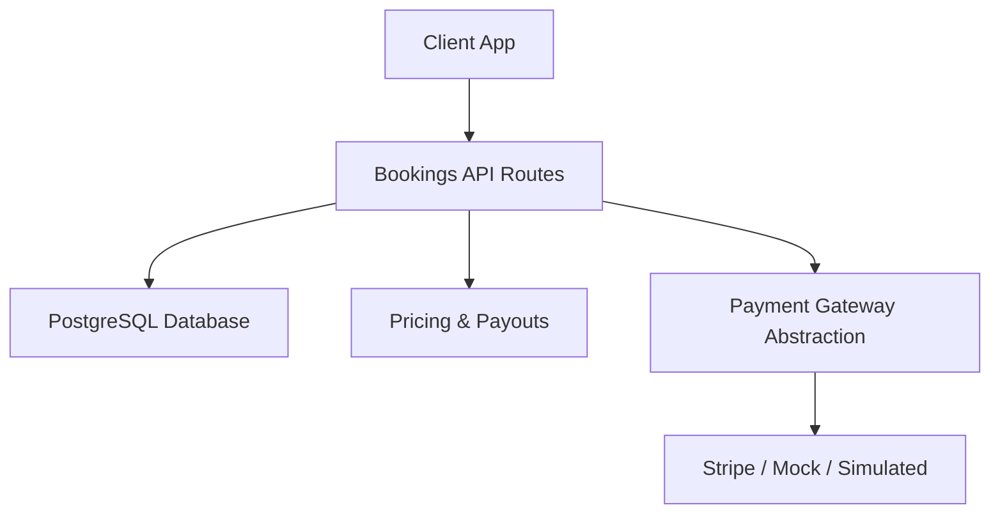

**Diagram sources**
- [bookings.ts:153-405](file://server/src/routes/bookings.ts#L153-L405)
- [schema.sql:121-236](file://server/src/schema.sql#L121-L236)
- [pricing.ts:30-94](file://server/src/pricing.ts#L30-L94)
- [payments.ts:102-176](file://server/src/payments.ts#L102-L176)

**Section sources**
- [bookings.ts:15-155](file://server/src/routes/bookings.ts#L15-L155)
- [schema.sql:121-236](file://server/src/schema.sql#L121-L236)
- [pricing.ts:1-94](file://server/src/pricing.ts#L1-L94)
- [payments.ts:1-71](file://server/src/payments.ts#L1-L71)

## Core Components
- Booking creation endpoint enforces audience rules, duplicate prevention, capacity limits, promo discounts, and initial status/payment state selection based on event configuration and payment mode.
- Host approval flow supports pending requests where the host can approve or decline; approvals may capture a held authorization.
- Cancellation endpoint updates booking status, records a refund decision, releases seats, and reconciles host payouts.
- Check-in endpoint finalizes attendance, captures any remaining authorizations, marks the booking completed, and settles payouts.
- Payment integration supports three modes: real Stripe, offline mock, and historical simulated instant settlement.
- Refund ledger tracks money decisions independently of gateway execution, with webhook-driven confirmation when applicable.
- Payout reconciliation recomputes host earnings from captured seats and applies platform commission.

**Section sources**
- [bookings.ts:153-405](file://server/src/routes/bookings.ts#L153-L405)
- [bookings.ts:420-564](file://server/src/routes/bookings.ts#L420-L564)
- [bookings.ts:566-761](file://server/src/routes/bookings.ts#L566-L761)
- [bookings.ts:763-848](file://server/src/routes/bookings.ts#L763-L848)
- [pricing.ts:30-94](file://server/src/pricing.ts#L30-L94)
- [pricing.ts:110-156](file://server/src/pricing.ts#L110-L156)
- [payments.ts:270-325](file://server/src/payments.ts#L270-L325)

## Architecture Overview
The booking workflow uses row-level locking inside transactions to ensure consistency across event capacity, attendee lists, and booking records. Payment flows integrate with a gateway abstraction that can be Stripe, mock, or simulated.

```mermaid
sequenceDiagram
participant Client as "Client"
participant API as "Bookings API"
participant DB as "PostgreSQL"
participant GW as "Payment Gateway"
participant PR as "Pricing/Payouts"
Client->>API : POST /events/ : id/bookings
API->>DB : SELECT ... FOR UPDATE (event row lock)
API->>DB : INSERT bookings + UPDATE seats_booked
alt Deferred payment required
API->>GW : Create Intent
GW-->>API : clientSecret
API->>DB : Update stripe_payment_intent_id
end
API-->>Client : 201 Created {booking, event}
Note over API,DB : Seats held; payment may remain pending until webhook or capture
```

**Diagram sources**
- [bookings.ts:180-335](file://server/src/routes/bookings.ts#L180-L335)
- [bookings.ts:337-405](file://server/src/routes/bookings.ts#L337-L405)
- [payments.ts:114-123](file://server/src/payments.ts#L114-L123)

## Detailed Component Analysis

### Booking Creation Workflow
Key responsibilities:
- Validate input (seats range, payment label, optional promo code)
- Enforce audience restrictions (public, followers, invite-only)
- Prevent joining if blocked pair exists between guest and host
- Lock the event row to prevent overselling
- Check event start time and available seats
- Prevent duplicate active bookings per user/event
- Apply promo discount server-side
- Determine initial booking status and payment status based on event requirements and payment mode
- Insert booking record and update event capacity and attendee list
- Optionally create a payment intent and store its ID
- Notify host via activity feed

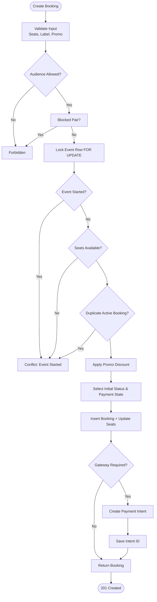

**Diagram sources**
- [bookings.ts:133-137](file://server/src/routes/bookings.ts#L133-L137)
- [bookings.ts:167-178](file://server/src/routes/bookings.ts#L167-L178)
- [bookings.ts:180-233](file://server/src/routes/bookings.ts#L180-L233)
- [bookings.ts:234-269](file://server/src/routes/bookings.ts#L234-L269)
- [bookings.ts:271-335](file://server/src/routes/bookings.ts#L271-L335)
- [bookings.ts:337-405](file://server/src/routes/bookings.ts#L337-L405)

**Section sources**
- [bookings.ts:133-137](file://server/src/routes/bookings.ts#L133-L137)
- [bookings.ts:167-178](file://server/src/routes/bookings.ts#L167-L178)
- [bookings.ts:180-233](file://server/src/routes/bookings.ts#L180-L233)
- [bookings.ts:234-269](file://server/src/routes/bookings.ts#L234-L269)
- [bookings.ts:271-335](file://server/src/routes/bookings.ts#L271-L335)
- [bookings.ts:337-405](file://server/src/routes/bookings.ts#L337-L405)

### Transactional Booking Process and Double-Booking Prevention
- The event row is locked with `FOR UPDATE` within a transaction so concurrent requests cannot oversell the last seat.
- Duplicate active bookings per user/event are rejected.
- Seat counts are updated atomically alongside attendee list changes.
- If gateway integration fails after booking insertion, the system releases the failed booking and restores capacity.

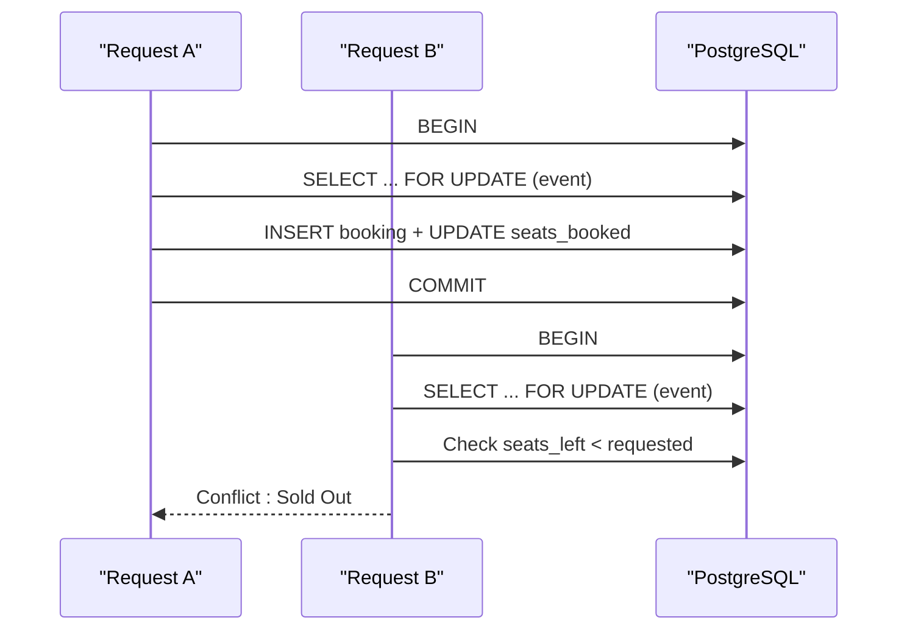

**Diagram sources**
- [bookings.ts:180-233](file://server/src/routes/bookings.ts#L180-L233)
- [bookings.ts:298-307](file://server/src/routes/bookings.ts#L298-L307)
- [bookings.ts:361-378](file://server/src/routes/bookings.ts#L361-L378)

**Section sources**
- [bookings.ts:180-233](file://server/src/routes/bookings.ts#L180-L233)
- [bookings.ts:298-307](file://server/src/routes/bookings.ts#L298-L307)
- [bookings.ts:361-378](file://server/src/routes/bookings.ts#L361-L378)

### Booking Status Lifecycle
States and transitions:
- Pending: Used for host-approved events or deferred payment holds
- Confirmed: Auto-confirmed for non-gated events or after host approval
- Completed: After successful check-in
- Cancelled: Guest cancellation or host decline

Payment states:
- Unpaid, pending_payment, authorized, paid, refunded, failed

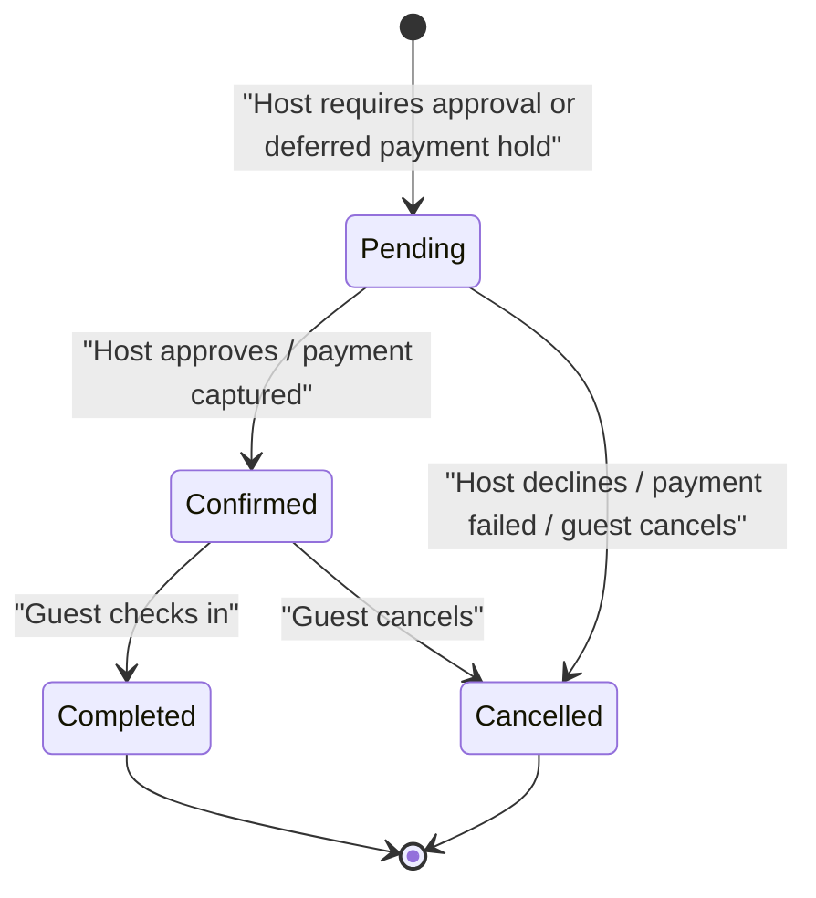

**Diagram sources**
- [bookings.ts:254-269](file://server/src/routes/bookings.ts#L254-L269)
- [bookings.ts:420-564](file://server/src/routes/bookings.ts#L420-L564)
- [bookings.ts:566-761](file://server/src/routes/bookings.ts#L566-L761)
- [bookings.ts:763-848](file://server/src/routes/bookings.ts#L763-L848)
- [schema.sql:181-212](file://server/src/schema.sql#L181-L212)

**Section sources**
- [bookings.ts:254-269](file://server/src/routes/bookings.ts#L254-L269)
- [bookings.ts:420-564](file://server/src/routes/bookings.ts#L420-L564)
- [bookings.ts:566-761](file://server/src/routes/bookings.ts#L566-L761)
- [bookings.ts:763-848](file://server/src/routes/bookings.ts#L763-L848)
- [schema.sql:181-212](file://server/src/schema.sql#L181-L212)

### Cancellation Policies and Refund Processing Logic
- Guest cancellation flips booking to cancelled and sets payment_status to refunded when previously paid or authorized.
- A refund ledger entry is recorded with reason and policy snapshot.
- Seats are released back to the event; host payout is reconciled.
- For real gateway integrations, refunds are initiated asynchronously; the ledger remains pending_gateway until webhook confirms.

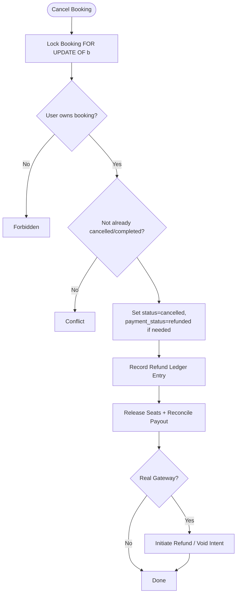

**Diagram sources**
- [bookings.ts:420-564](file://server/src/routes/bookings.ts#L420-L564)
- [pricing.ts:110-156](file://server/src/pricing.ts#L110-L156)

**Section sources**
- [bookings.ts:420-564](file://server/src/routes/bookings.ts#L420-L564)
- [pricing.ts:110-156](file://server/src/pricing.ts#L110-L156)

### Booking Confirmation and Notification System
- On successful booking, an activity entry notifies the host about new guests.
- Host approval/decline also posts activity entries to inform guests.
- Activity feed is used to surface notifications to recipients.

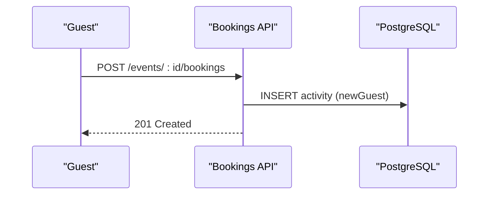

**Diagram sources**
- [bookings.ts:309-324](file://server/src/routes/bookings.ts#L309-L324)
- [bookings.ts:659-668](file://server/src/routes/bookings.ts#L659-L668)
- [schema.sql:333-347](file://server/src/schema.sql#L333-L347)

**Section sources**
- [bookings.ts:309-324](file://server/src/routes/bookings.ts#L309-L324)
- [bookings.ts:659-668](file://server/src/routes/bookings.ts#L659-L668)
- [schema.sql:333-347](file://server/src/schema.sql#L333-L347)

### Guest Management Features: Attendee Lists and Check-In
- Attendee list is maintained as an array on the event row; it is updated when seats are booked and adjusted on cancellations/declines.
- Host can view guest list for their events via the bookings endpoint filtered by eventId.
- Check-in marks the booking completed, captures any outstanding authorizations, and settles payouts.

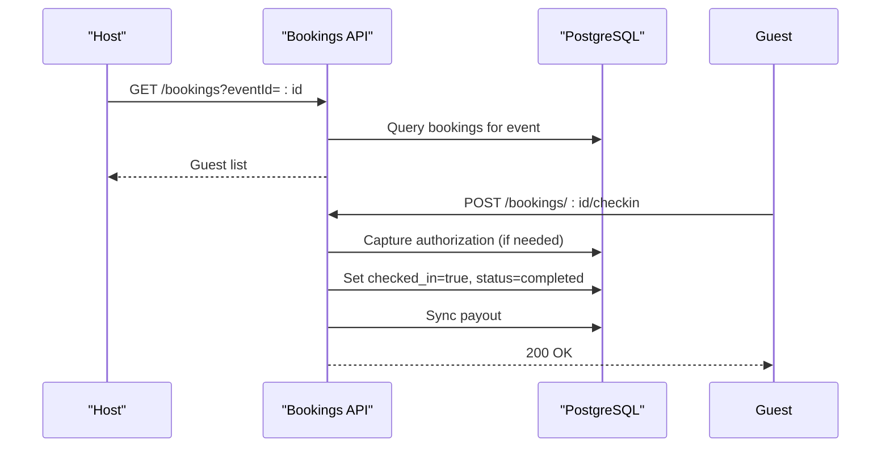

**Diagram sources**
- [bookings.ts:82-131](file://server/src/routes/bookings.ts#L82-L131)
- [bookings.ts:763-848](file://server/src/routes/bookings.ts#L763-L848)
- [schema.sql:121-156](file://server/src/schema.sql#L121-L156)

**Section sources**
- [bookings.ts:82-131](file://server/src/routes/bookings.ts#L82-L131)
- [bookings.ts:763-848](file://server/src/routes/bookings.ts#L763-L848)
- [schema.sql:121-156](file://server/src/schema.sql#L121-L156)

### Booking Analytics and Reporting Capabilities
- Payouts are computed from captured seats per event, applying platform commission rate.
- Refunds ledger provides an immutable audit trail of money decisions, including gateway confirmation status.
- Reports module exposes moderation queues and statuses (not directly booking analytics but part of operational reporting).

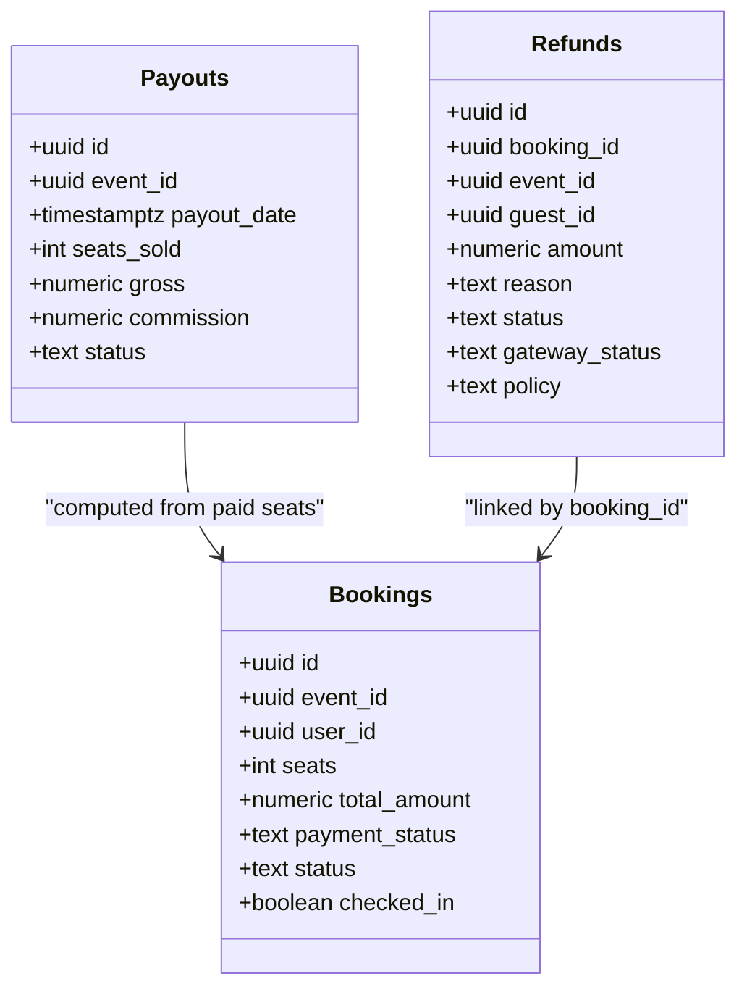

**Diagram sources**
- [schema.sql:253-266](file://server/src/schema.sql#L253-L266)
- [schema.sql:221-236](file://server/src/schema.sql#L221-L236)
- [schema.sql:181-212](file://server/src/schema.sql#L181-L212)
- [pricing.ts:30-94](file://server/src/pricing.ts#L30-L94)
- [pricing.ts:110-156](file://server/src/pricing.ts#L110-L156)

**Section sources**
- [schema.sql:253-266](file://server/src/schema.sql#L253-L266)
- [schema.sql:221-236](file://server/src/schema.sql#L221-L236)
- [schema.sql:181-212](file://server/src/schema.sql#L181-L212)
- [pricing.ts:30-94](file://server/src/pricing.ts#L30-L94)
- [pricing.ts:110-156](file://server/src/pricing.ts#L110-L156)

### Bulk Booking Operations and Group Reservations
- Group reservations are supported by allowing multiple seats per booking request (validated up to a maximum).
- There is no dedicated bulk endpoint; groups book together by specifying seats > 1.
- Duplicate active bookings per user/event are prevented even for multi-seat requests.
- Host approval and payment flows apply uniformly to group bookings.

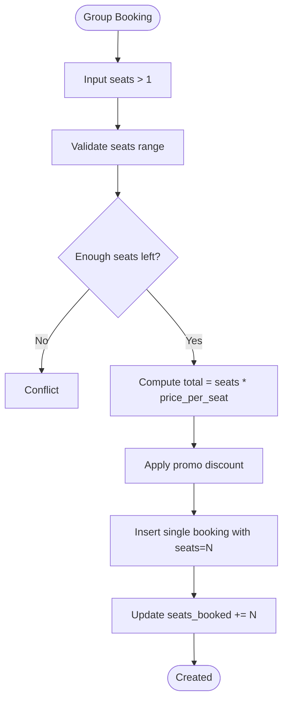

**Diagram sources**
- [bookings.ts:133-137](file://server/src/routes/bookings.ts#L133-L137)
- [bookings.ts:234-269](file://server/src/routes/bookings.ts#L234-L269)
- [bookings.ts:271-335](file://server/src/routes/bookings.ts#L271-L335)

**Section sources**
- [bookings.ts:133-137](file://server/src/routes/bookings.ts#L133-L137)
- [bookings.ts:234-269](file://server/src/routes/bookings.ts#L234-L269)
- [bookings.ts:271-335](file://server/src/routes/bookings.ts#L271-L335)

## Dependency Analysis
- Bookings route depends on:
  - Database helpers for queries and transactions
  - Context utilities for errors and authorization
  - Blocks utility for blocked pairs
  - Pricing utilities for payout sync and refund recording
  - Payments utilities for gateway access, deferred payment checks, and abandoned checkout sweep
- Schema defines core entities and constraints ensuring referential integrity and valid enumerations.

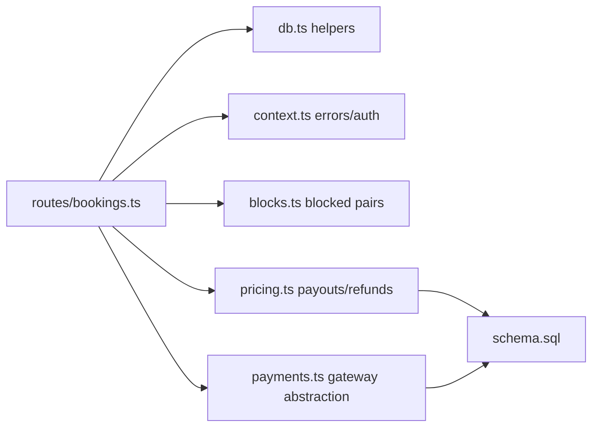

**Diagram sources**
- [bookings.ts:1-14](file://server/src/routes/bookings.ts#L1-L14)
- [pricing.ts:30-94](file://server/src/pricing.ts#L30-L94)
- [payments.ts:270-325](file://server/src/payments.ts#L270-L325)
- [schema.sql:121-236](file://server/src/schema.sql#L121-L236)

**Section sources**
- [bookings.ts:1-14](file://server/src/routes/bookings.ts#L1-L14)
- [pricing.ts:30-94](file://server/src/pricing.ts#L30-L94)
- [payments.ts:270-325](file://server/src/payments.ts#L270-L325)
- [schema.sql:121-236](file://server/src/schema.sql#L121-L236)

## Performance Considerations
- Use row-level locks (`FOR UPDATE`) around critical sections to avoid race conditions during high-concurrency booking attempts.
- Avoid external HTTP calls inside seat-lock transactions; payment intent creation occurs outside the lock to minimize contention.
- Opportunistic sweep of abandoned pending payments runs on read paths without breaking reads; failures are swallowed to keep UI responsive.
- Payout reconciliation recomputes totals from authoritative data rather than incrementally adjusting counters, improving correctness under retries.

[No sources needed since this section provides general guidance]

## Troubleshooting Guide
Common issues and resolutions:
- Double bookings: Ensure event rows are locked and capacity checks occur within transactions; verify duplicate active booking checks.
- Payment setup failures: If gateway call fails after booking insertion, the system releases the failed booking and returns a clean error; retry after resolving gateway issues.
- Cancellation conflicts: Confirm booking is not already cancelled or completed before attempting cancellation.
- Check-in errors: Verify authorization capture succeeds; if not, handle gateway errors appropriately.
- Abandoned payments: Monitor sweep logs; stale pending payments are automatically released after timeout.

**Section sources**
- [bookings.ts:361-378](file://server/src/routes/bookings.ts#L361-L378)
- [bookings.ts:420-564](file://server/src/routes/bookings.ts#L420-L564)
- [bookings.ts:763-848](file://server/src/routes/bookings.ts#L763-L848)
- [payments.ts:335-390](file://server/src/payments.ts#L335-L390)

## Conclusion
The booking and reservation system provides robust seat management with strong concurrency controls, flexible payment flows, comprehensive refund accounting, and clear status lifecycles. It supports group bookings, host approval workflows, and reliable check-in processes while maintaining accurate payout calculations and audit trails.

[No sources needed since this section summarizes without analyzing specific files]

## Appendices

### Data Model Summary
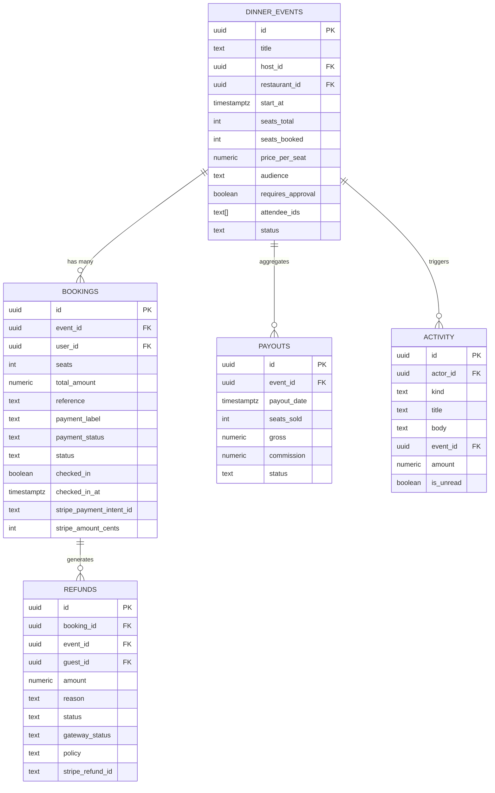

**Diagram sources**
- [schema.sql:121-156](file://server/src/schema.sql#L121-L156)
- [schema.sql:181-236](file://server/src/schema.sql#L181-L236)
- [schema.sql:253-266](file://server/src/schema.sql#L253-L266)
- [schema.sql:333-347](file://server/src/schema.sql#L333-L347)