# Event Management API

<cite>
**Referenced Files in This Document**   
- [events.ts](file://server/src/routes/events.ts)
- [bookings.ts](file://server/src/routes/bookings.ts)
- [schema.sql](file://server/src/schema.sql)
- [context.ts](file://server/src/context.ts)
</cite>

## Table of Contents
1. [Introduction](#introduction)
2. [Project Structure](#project-structure)
3. [Core Components](#core-components)
4. [Architecture Overview](#architecture-overview)
5. [Detailed Component Analysis](#detailed-component-analysis)
6. [Dependency Analysis](#dependency-analysis)
7. [Performance Considerations](#performance-considerations)
8. [Troubleshooting Guide](#troubleshooting-guide)
9. [Conclusion](#conclusion)

## Introduction
This document describes the Event Management API for DinCircle. It covers all event CRUD endpoints, the event data model, visibility and status workflow, search and filtering, image handling, validation rules, and operational constraints such as pagination and cancellation behavior. The API is implemented in a Node/Express backend with PostgreSQL as the database.

## Project Structure
The event management functionality lives primarily in the server-side Express routes:
- Event routes define listing, discovery, creation, update, detail retrieval, and deletion.
- Booking routes handle guest seat reservation, approval flows, cancellations, and check-in.
- The database schema defines tables for events, venues, bookings, menus, users, and related entities.
- Authentication and authorization are provided by shared context middleware.

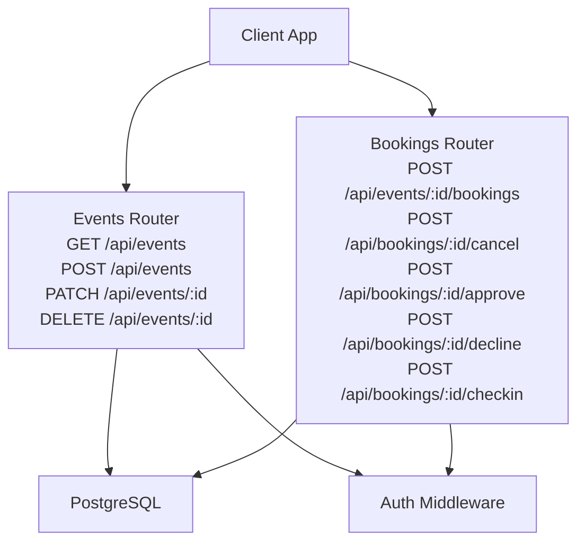

**Diagram sources**
- [events.ts:140-633](file://server/src/routes/events.ts#L140-L633)
- [bookings.ts:153-800](file://server/src/routes/bookings.ts#L153-L800)
- [context.ts:60-98](file://server/src/context.ts#L60-L98)

**Section sources**
- [events.ts:1-636](file://server/src/routes/events.ts#L1-L636)
- [bookings.ts:1-888](file://server/src/routes/bookings.ts#L1-L888)
- [schema.sql:121-168](file://server/src/schema.sql#L121-L168)
- [context.ts:1-147](file://server/src/context.ts#L1-L147)

## Core Components
- Event router: exposes public discovery feed, host-only mine list, event detail, create/update/delete operations.
- Booking router: manages seat reservations, payment intent lifecycle, host approval, cancellations, and check-ins.
- Database schema: defines `dinner_events`, `menu_items`, `bookings`, `restaurants`, `users`, and supporting tables.
- Context middleware: provides authentication, role checks, and error helpers.

Key responsibilities:
- Validation: Zod schemas enforce input shape and business constraints.
- Visibility: audience-based gating ensures only permitted viewers see events.
- Status workflow: draft → confirmed (published), with additional states supported by schema.
- Search/filtering: type, audience, featured, host, venue, location, date range, price, and text search.
- Image fields: cover image and gallery stored as strings; no direct file upload endpoint is present.

**Section sources**
- [events.ts:140-633](file://server/src/routes/events.ts#L140-L633)
- [bookings.ts:153-800](file://server/src/routes/bookings.ts#L153-L800)
- [schema.sql:121-168](file://server/src/schema.sql#L121-L168)
- [context.ts:60-98](file://server/src/context.ts#L60-L98)

## Architecture Overview
The event API follows a layered approach:
- HTTP layer: Express routers define REST endpoints.
- Validation layer: Zod schemas validate request bodies and query parameters.
- Authorization layer: Bearer token authentication resolves user identity and role.
- Data layer: Parameterized SQL queries interact with PostgreSQL.
- External integrations: Stripe gateway integration is used for payment intents and refunds.

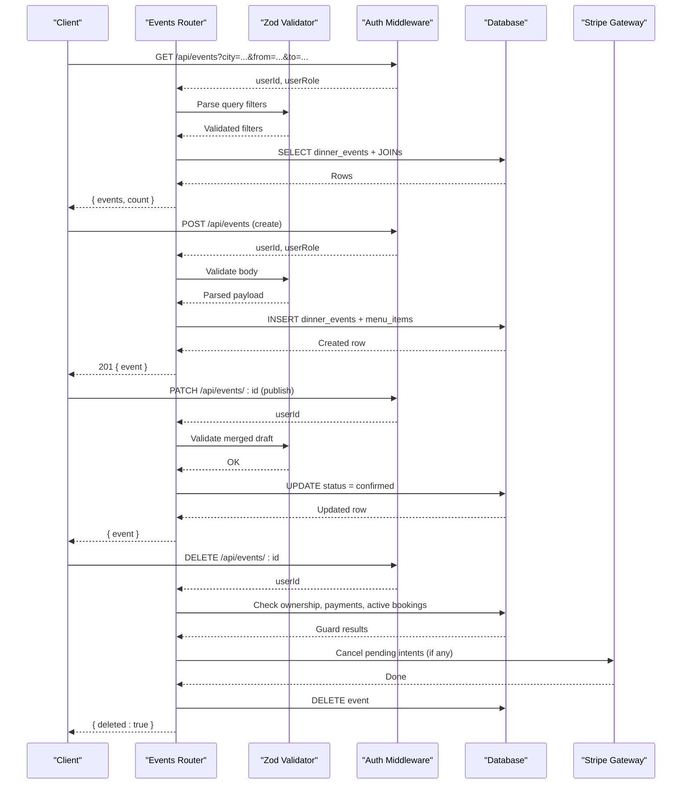

**Diagram sources**
- [events.ts:140-633](file://server/src/routes/events.ts#L140-L633)
- [bookings.ts:153-800](file://server/src/routes/bookings.ts#L153-L800)
- [context.ts:60-98](file://server/src/context.ts#L60-L98)

## Detailed Component Analysis

### Event Endpoints

#### List Events
- Method: GET
- Path: `/api/events`
- Purpose: Public discovery feed with filtering and pagination.
- Query parameters:
  - `type`: comma-separated whitelist of event types.
  - `audience`: comma-separated whitelist of audiences.
  - `featured`: boolean string to include featured events.
  - `hostId`: UUID filter by host.
  - `venueId`: UUID filter by restaurant.
  - `upcoming`: values control time window (`all`, `false`, or default upcoming).
  - `q`: free-text search across title, tagline, venue name, and tags.
  - `maxPrice`: numeric upper bound on price per seat.
  - `from`, `to`: ISO timestamps bounding start time.
  - `city`, `neighborhood`: substring match against venue location.
  - `limit`, `offset`: pagination controls.
- Response: `{ events: Event[], count: number }`.
- Notes:
  - Audience gate restricts visibility based on audience type and viewer relationship.
  - Drafts are hidden unless the viewer is the host.
  - Blocked hosts are excluded from personalized feeds.
  - Abandoned pending payment sweep runs fire-and-forget on this route.

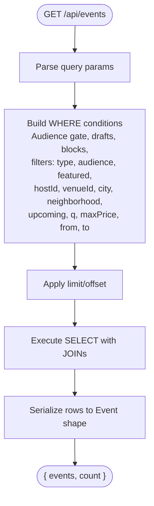

**Diagram sources**
- [events.ts:140-246](file://server/src/routes/events.ts#L140-L246)

**Section sources**
- [events.ts:140-246](file://server/src/routes/events.ts#L140-L246)

#### Host Events
- Method: GET
- Path: `/api/events/mine`
- Purpose: Returns the authenticated host’s own events, including drafts, newest first.
- Response: `{ events: Event[], count: number }`.

**Section sources**
- [events.ts:248-256](file://server/src/routes/events.ts#L248-L256)

#### Get Event Detail
- Method: GET
- Path: `/api/events/:id`
- Purpose: Retrieve one visible event with menu items, venue info, and attendees.
- Behavior:
  - Enforces audience gate and draft visibility.
  - Blocks non-host viewers from seeing blocked hosts’ events.
  - Increments view counter for non-host viewers when not a draft.
  - Joins menu items and venue details.
- Response: `{ event: EventWithMenuVenueAttendees }`.

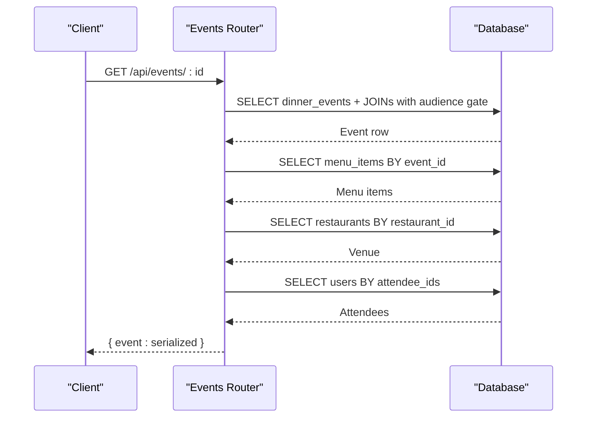

**Diagram sources**
- [events.ts:258-343](file://server/src/routes/events.ts#L258-L343)

**Section sources**
- [events.ts:258-343](file://server/src/routes/events.ts#L258-L343)

#### Create Event
- Method: POST
- Path: `/api/events`
- Purpose: Create a new event as draft or publish it directly.
- Authorization: Requires host capabilities (host, influencer, partner_admin, super_admin).
- Body validation:
  - Full schema for published events.
  - Relaxed draft schema allowing partial data and defaults.
- Business logic:
  - Validates venue existence and partnership status.
  - Restricts publishing at unverified partner venues for hosts/influencers.
  - Defaults gallery to cover image if empty.
  - Sets initial status to `draft` or `confirmed` depending on requested status.
  - Inserts associated menu items.
- Response: 201 `{ event: Event }`.

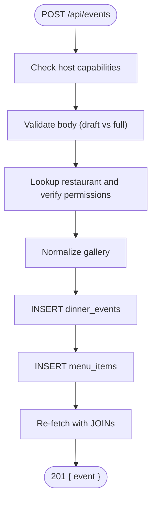

**Diagram sources**
- [events.ts:345-456](file://server/src/routes/events.ts#L345-L456)

**Section sources**
- [events.ts:345-456](file://server/src/routes/events.ts#L345-L456)

#### Update Event
- Method: PATCH
- Path: `/api/events/:id`
- Purpose: Edit an existing event draft or publish it.
- Rules:
  - Only the host can edit.
  - Published events cannot be reverted to draft.
  - Editing requires the event to be in draft state.
  - Publishing merges current draft fields with provided updates and re-validates against the full schema.
  - On publish, sets status to `confirmed`.
- Response: `{ event: Event }`.

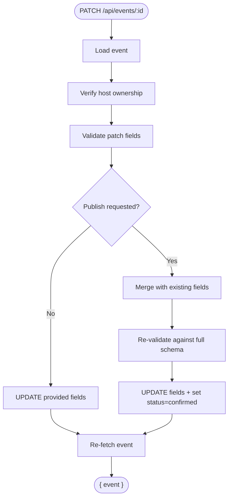

**Diagram sources**
- [events.ts:458-553](file://server/src/routes/events.ts#L458-L553)

**Section sources**
- [events.ts:458-553](file://server/src/routes/events.ts#L458-L553)

#### Delete Event
- Method: DELETE
- Path: `/api/events/:id`
- Purpose: Cancel and delete an event owned by the authenticated host.
- Constraints:
  - Ownership check.
  - Refuses deletion if there are captured payments or accrued earnings; guests must cancel individually instead.
  - Notifies active guests via activity entries.
  - Collects pending payment intents before commit and voids them afterward.
- Response: `{ deleted: true, eventId }`.

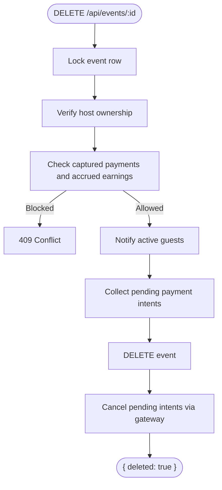

**Diagram sources**
- [events.ts:555-633](file://server/src/routes/events.ts#L555-L633)

**Section sources**
- [events.ts:555-633](file://server/src/routes/events.ts#L555-L633)

### Event Schema and Data Model
The event entity includes fields for identification, description, media, scheduling, capacity, pricing, categorization, audience, menu style, inclusion notes, tags, features, host note, language, dress code, cancellation policy, attendee tracking, and status.

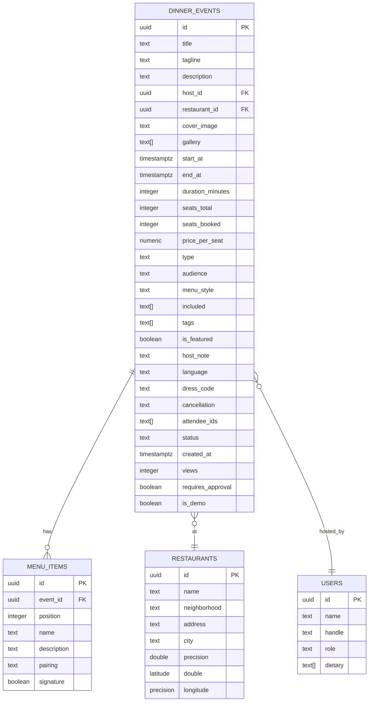

**Diagram sources**
- [schema.sql:121-168](file://server/src/schema.sql#L121-L168)
- [schema.sql:169-179](file://server/src/schema.sql#L169-L179)
- [schema.sql:74-119](file://server/src/schema.sql#L74-L119)
- [schema.sql:14-73](file://server/src/schema.sql#L14-L73)

**Section sources**
- [schema.sql:121-168](file://server/src/schema.sql#L121-L168)
- [schema.sql:169-179](file://server/src/schema.sql#L169-L179)
- [schema.sql:74-119](file://server/src/schema.sql#L74-L119)
- [schema.sql:14-73](file://server/src/schema.sql#L14-L73)

### Event Status Workflow
Supported statuses are enforced by the database CHECK constraint:
- `draft`: Unpublished, editable by host.
- `requested`: Used in some flows; not directly set by event creation but allowed by schema.
- `confirmed`: Published and bookable.
- `live`: Indicates live period.
- `completed`: Finished event.
- `declined`: Rejected or declined.
- `cancelled`: Cancelled by host or system.

Creation flow:
- Draft creation sets status to `draft`.
- Direct publish sets status to `confirmed`.

Update flow:
- Patching a draft allows editing fields.
- Publishing a draft transitions to `confirmed`.

Cancellation/deletion flow:
- Deletion is guarded by financial history; otherwise, it removes the event and notifies guests.

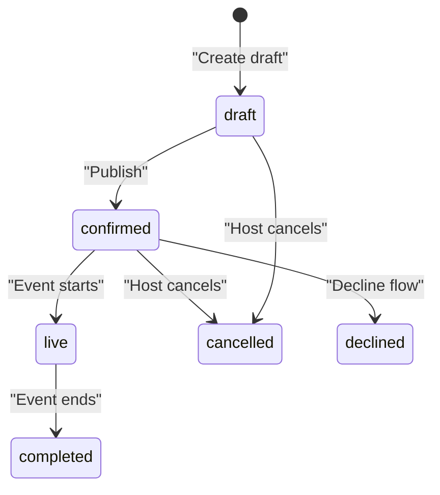

**Diagram sources**
- [schema.sql:153-154](file://server/src/schema.sql#L153-L154)
- [events.ts:393-438](file://server/src/routes/events.ts#L393-L438)
- [events.ts:497-540](file://server/src/routes/events.ts#L497-L540)

**Section sources**
- [schema.sql:153-154](file://server/src/schema.sql#L153-L154)
- [events.ts:393-438](file://server/src/routes/events.ts#L393-L438)
- [events.ts:497-540](file://server/src/routes/events.ts#L497-L540)

### Search and Filtering Capabilities
- Type filter: Whitelisted multi-select using comma-separated values.
- Audience filter: Whitelisted multi-select using comma-separated values.
- Featured filter: Boolean flag.
- Host filter: By host UUID.
- Venue filter: By restaurant UUID.
- Location filters: Substring matches on city and neighborhood.
- Time filters: Upcoming toggle and ISO timestamp bounds.
- Price filter: Maximum price per seat.
- Text search: Across title, tagline, venue name, and tags.

Pagination:
- `limit` capped at 200.
- `offset` clamped to non-negative values.
- Response includes `count` equal to returned array length.

Complex query examples:
- Discover upcoming dinners in a specific neighborhood under a price cap:
  - `GET /api/events?type=dinner&neighborhood=Korangi&maxPrice=5000&upcoming=true&limit=50&offset=0`
- Find tasting events hosted by a specific host within a date range:
  - `GET /api/events?type=tasting&hostId=<uuid>&from=2025-01-01T00:00:00Z&to=2025-01-31T23:59:59Z&limit=100&offset=0`
- Search events mentioning a venue or tag:
  - `GET /api/events?q=Kolachi&limit=50&offset=0`

**Section sources**
- [events.ts:140-246](file://server/src/routes/events.ts#L140-L246)

### Event Discovery Algorithm and Ranking
Discovery is implemented as a filtered SELECT ordered by start time ascending. There is no explicit ranking algorithm beyond:
- Audience gate and draft visibility enforcement.
- Exclusion of blocked hosts from personalized feeds.
- Optional featured filter.
- Sorting by `start_at ASC`.

There is no scoring function combining popularity, ratings, or recency in the event list endpoint.

**Section sources**
- [events.ts:140-246](file://server/src/routes/events.ts#L140-L246)

### Image Upload Handling
- Cover image and gallery are stored as strings in the database.
- No dedicated file upload endpoint exists in the event routes.
- Clients should provide URLs or asset paths for `coverImage` and `gallery`.
- If gallery is empty during creation, it defaults to an array containing the cover image.

Validation:
- `coverImage` is required and must be a non-empty string.
- `gallery` is optional and defaults to an empty array.

**Section sources**
- [events.ts:345-382](file://server/src/routes/events.ts#L345-L382)
- [events.ts:421-438](file://server/src/routes/events.ts#L421-L438)
- [schema.sql:131-132](file://server/src/schema.sql#L131-L132)

### Event Validation Rules and Business Logic Constraints
Input validation uses Zod schemas:
- Title: trimmed, min/max lengths.
- Tagline/description: trimmed, max lengths.
- Restaurant ID: required.
- Media: cover image required; gallery optional array of strings.
- Scheduling: start time coerced to date; duration minutes bounded.
- Capacity: total seats bounded; booked seats managed server-side.
- Pricing: non-negative price per seat with maximum cap.
- Categorization: type, audience, menu style enums.
- Inclusions/tags: arrays of strings.
- Features: featured flag, host note, approval requirement.
- Menu items: name, description, pairing, signature flag.

Business constraints:
- Only hosts/influencers/partner admins/super admins can create events.
- Venue verification required for hosts/influencers; partner admins restricted to owned venues.
- Drafts allow partial data; publishing re-validates merged fields.
- Published events cannot be reverted to draft.
- Deleting events with captured payments or accrued earnings is refused.

**Section sources**
- [events.ts:345-382](file://server/src/routes/events.ts#L345-L382)
- [events.ts:384-456](file://server/src/routes/events.ts#L384-L456)
- [events.ts:458-553](file://server/src/routes/events.ts#L458-L553)
- [events.ts:555-633](file://server/src/routes/events.ts#L555-L633)

### Booking Integration and Seat Management
While not part of the event CRUD itself, booking endpoints interact closely with events:
- Creating a booking locks the event row to prevent overselling.
- Audience restrictions apply to booking eligibility.
- Seats are reserved and attendee IDs updated atomically.
- Payment intent lifecycle integrates with Stripe.
- Host approval flow supports pending requests.
- Cancellation releases seats and records refunds.
- Check-in finalizes attendance and may capture payments.

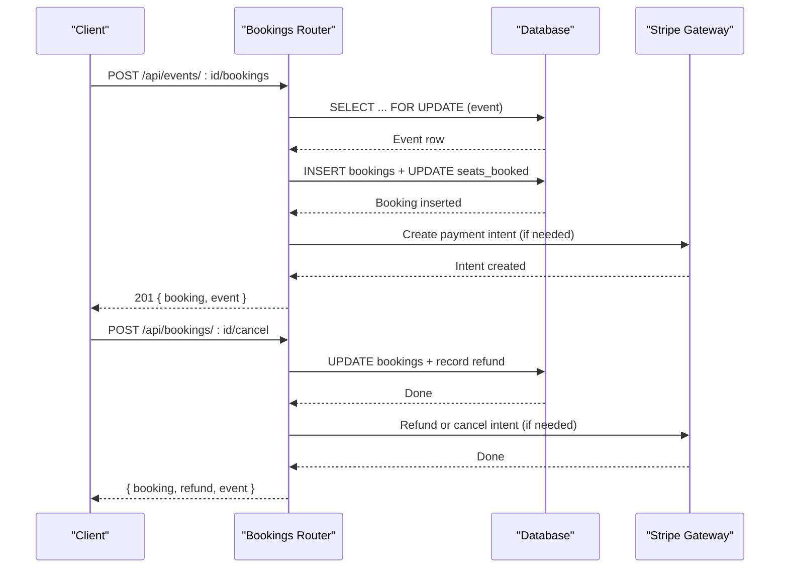

**Diagram sources**
- [bookings.ts:153-405](file://server/src/routes/bookings.ts#L153-L405)
- [bookings.ts:420-564](file://server/src/routes/bookings.ts#L420-L564)

**Section sources**
- [bookings.ts:153-405](file://server/src/routes/bookings.ts#L153-L405)
- [bookings.ts:420-564](file://server/src/routes/bookings.ts#L420-L564)

## Dependency Analysis
- Events router depends on:
  - Zod for validation.
  - Database utilities for parameterized queries and transactions.
  - Context for auth and error helpers.
  - Blocks utility for blocking relationships.
  - Payments module for payment sweeps and gateway access.
- Bookings router depends on:
  - Same core utilities plus pricing and gateway functions.
- Schema defines referential integrity between events, menus, bookings, restaurants, and users.

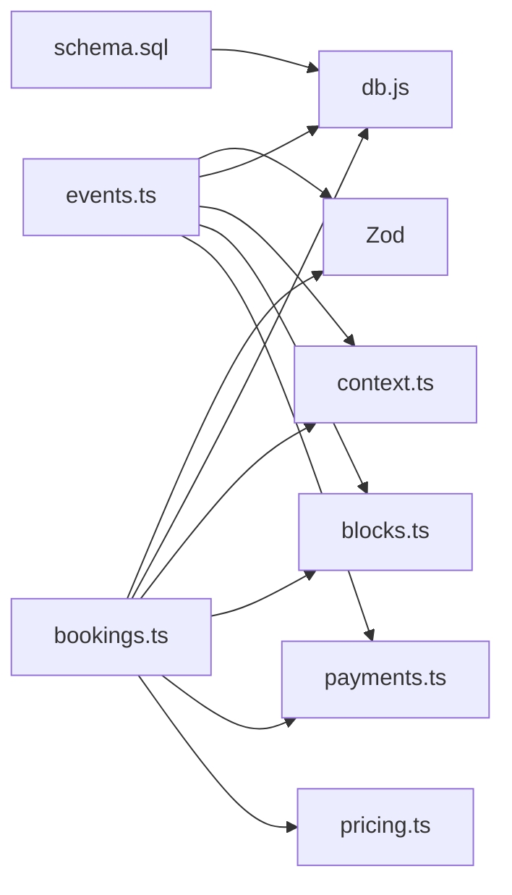

**Diagram sources**
- [events.ts:1-7](file://server/src/routes/events.ts#L1-L7)
- [bookings.ts:1-13](file://server/src/routes/bookings.ts#L1-L13)
- [schema.sql:1-13](file://server/src/schema.sql#L1-L13)

**Section sources**
- [events.ts:1-7](file://server/src/routes/events.ts#L1-L7)
- [bookings.ts:1-13](file://server/src/routes/bookings.ts#L1-L13)
- [schema.sql:1-13](file://server/src/schema.sql#L1-L13)

## Performance Considerations
- Pagination caps limit at 200 to prevent large result sets.
- Indexes exist on key columns like `start_at`, `host_id`, `restaurant_id`, `type`, and `status`.
- View counting is fire-and-forget to avoid blocking detail responses.
- Abandoned payment sweeps run opportunistically on high-traffic read endpoints.
- Parameterized queries reduce injection risk and improve plan reuse.

[No sources needed since this section provides general guidance]

## Troubleshooting Guide
Common errors and their causes:
- 404 Not Found: Event or related resource does not exist.
- 403 Forbidden: Insufficient permissions (not host, venue not verified, wrong owner).
- 409 Conflict: Event already started, sold out, duplicate booking, or deletion blocked due to financial history.
- 422 Unprocessable Entity: Validation failures (invalid fields, unknown restaurant).
- 500 Internal Server Error: Creation or insert failures.
- 502 Bad Gateway: Payment setup or gateway call failure.

Operational tips:
- Use the event detail endpoint to inspect menu, venue, and attendees.
- For deletions, ensure no captured payments or accrued earnings exist; otherwise, cancel bookings individually.
- Monitor activity entries for guest notifications after cancellations.

**Section sources**
- [events.ts:384-456](file://server/src/routes/events.ts#L384-L456)
- [events.ts:458-553](file://server/src/routes/events.ts#L458-L553)
- [events.ts:555-633](file://server/src/routes/events.ts#L555-L633)
- [bookings.ts:153-405](file://server/src/routes/bookings.ts#L153-L405)
- [bookings.ts:420-564](file://server/src/routes/bookings.ts#L420-L564)

## Conclusion
The Event Management API provides comprehensive CRUD operations for events, robust validation, audience-based visibility, and integrated booking workflows. Discovery supports flexible filtering and basic pagination. Image handling relies on URL/path strings rather than direct uploads. Status transitions are constrained by schema and business rules, with strong safeguards around financial records. For advanced ranking or complex image processing, consider extending the discovery query and adding dedicated upload endpoints.