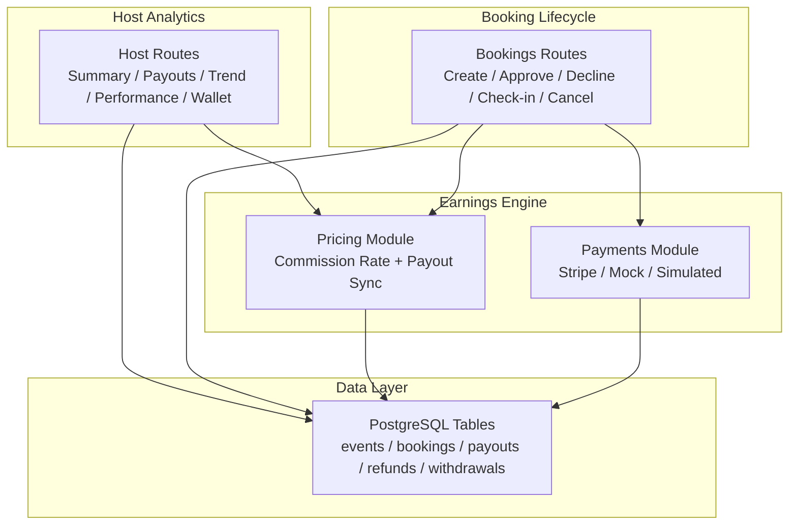
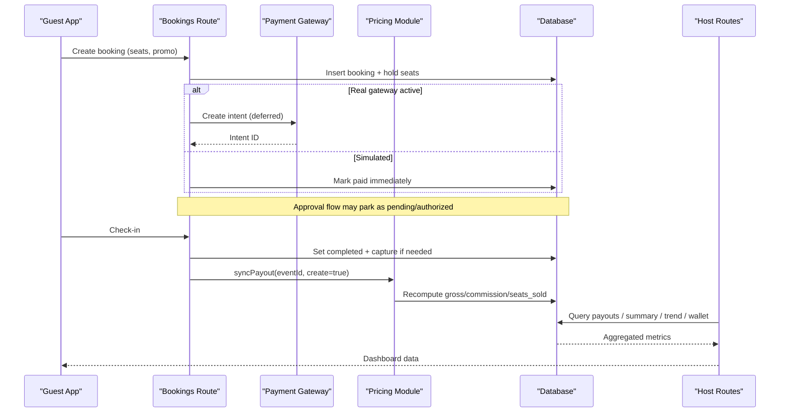
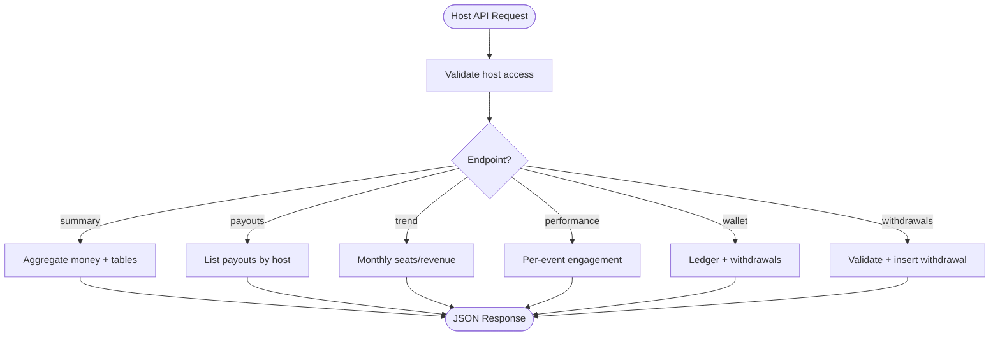
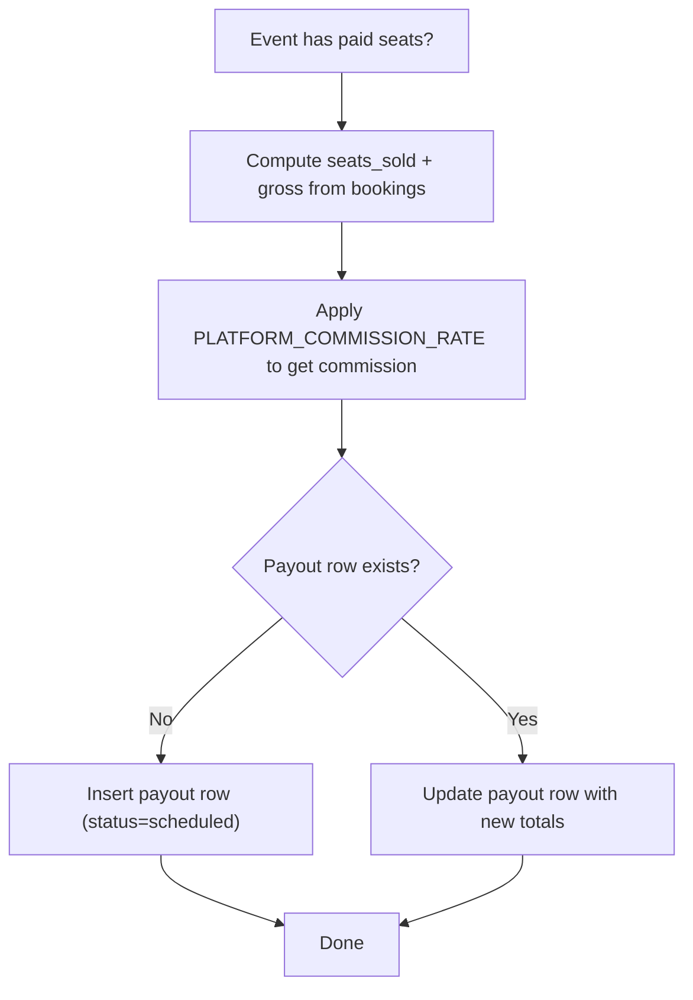
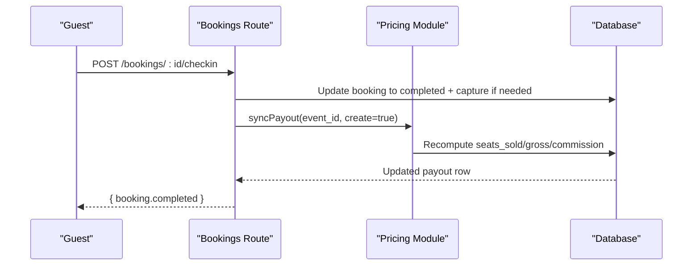
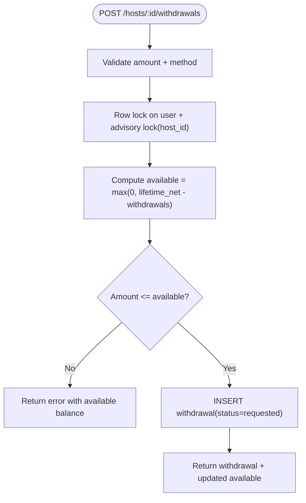
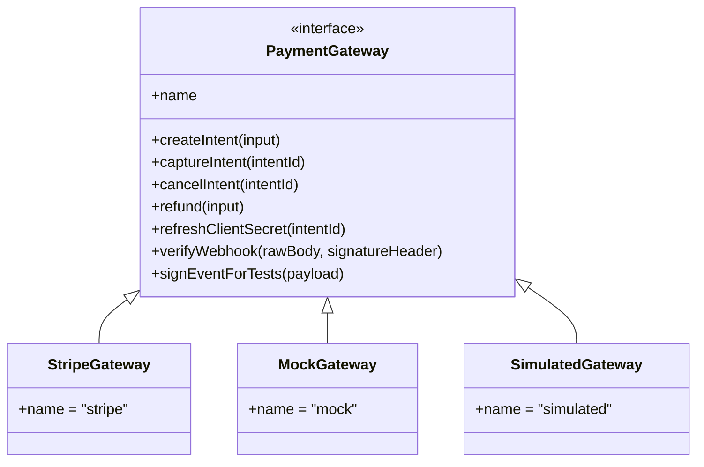
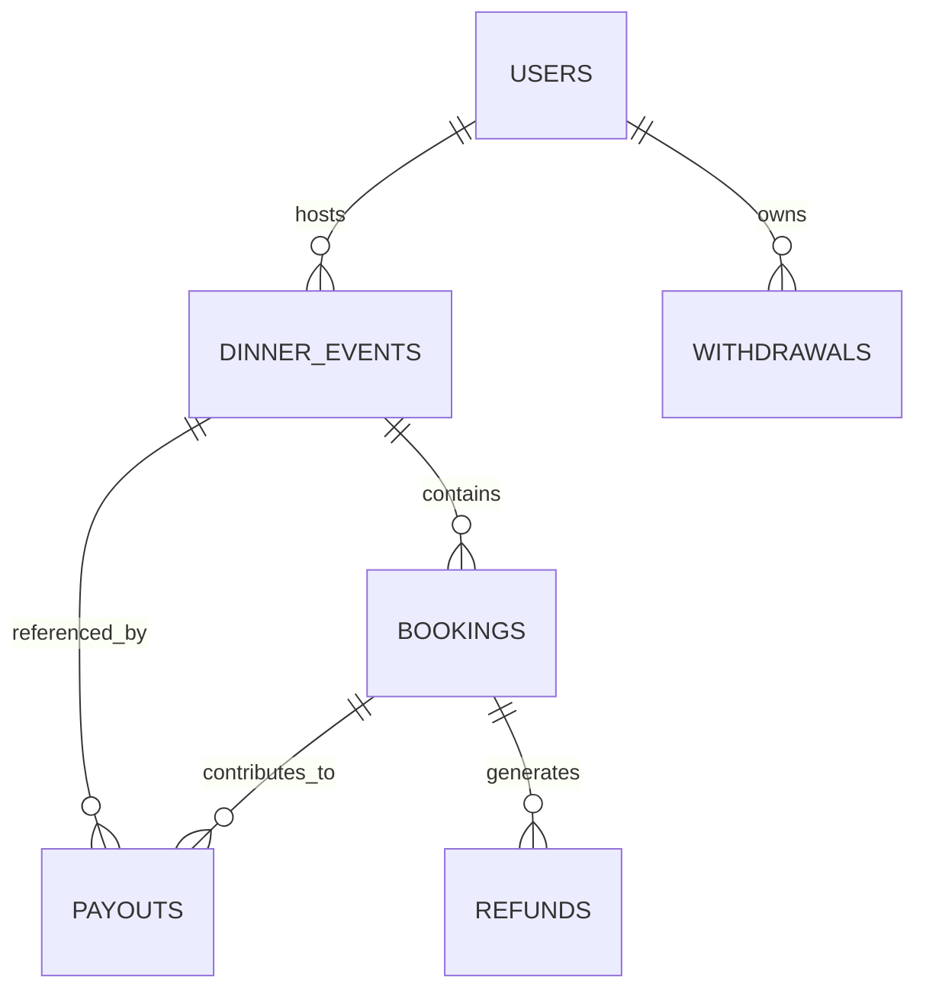
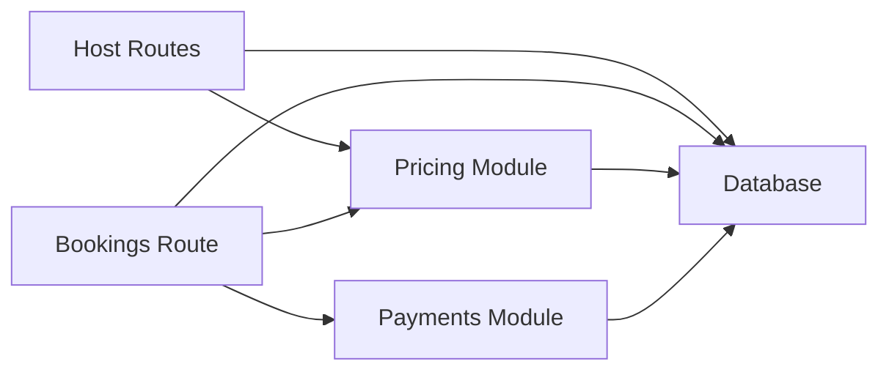

# Host Analytics & Earnings

<cite>
**Referenced Files in This Document**
- [hosts.ts](file://server/src/routes/hosts.ts)
- [pricing.ts](file://server/src/pricing.ts)
- [payments.ts](file://server/src/payments.ts)
- [bookings.ts](file://server/src/routes/bookings.ts)
- [schema.sql](file://server/src/schema.sql)
</cite>

## Table of Contents
1. [Introduction](#introduction)
2. [Project Structure](#project-structure)
3. [Core Components](#core-components)
4. [Architecture Overview](#architecture-overview)
5. [Detailed Component Analysis](#detailed-component-analysis)
6. [Dependency Analysis](#dependency-analysis)
7. [Performance Considerations](#performance-considerations)
8. [Troubleshooting Guide](#troubleshooting-guide)
9. [Conclusion](#conclusion)
10. [Appendices](#appendices)

## Introduction
This document explains the host analytics and earnings tracking system for DinCircle. It covers how performance metrics are collected, how revenue is calculated and paid out, how withdrawals work, and how dashboards can aggregate data. It also documents the commission engine, payout scheduling, payment history, and the integration points with bookings and payments. Where features such as tax reporting, custom report generation, or benchmarking tools are not implemented in the codebase, this document clearly marks them as not present and suggests safe extension paths.

## Project Structure
The host analytics and earnings system lives primarily in the server-side TypeScript routes and pricing/payment modules:

- Host endpoints expose summaries, payouts, trends, performance, wallet, and withdrawal APIs.
- Pricing defines the platform commission rate and recomputes event payouts from captured bookings.
- Payments abstracts Stripe, mock, and simulated gateways and manages abandoned checkout cleanup.
- Bookings orchestrates seat holds, approvals, check-ins, cancellations, and refund bookkeeping.
- Schema defines the authoritative tables for events, bookings, payouts, refunds, and withdrawals.

**Diagram sources**
- [hosts.ts:56-145](file://server/src/routes/hosts.ts#L56-L145)
- [pricing.ts:14-94](file://server/src/pricing.ts#L14-L94)
- [payments.ts:270-325](file://server/src/payments.ts#L270-L325)
- [bookings.ts:153-405](file://server/src/routes/bookings.ts#L153-L405)
- [schema.sql:121-280](file://server/src/schema.sql#L121-L280)

**Section sources**
- [hosts.ts:1-505](file://server/src/routes/hosts.ts#L1-L505)
- [pricing.ts:1-270](file://server/src/pricing.ts#L1-L270)
- [payments.ts:1-391](file://server/src/payments.ts#L1-L391)
- [bookings.ts:1-888](file://server/src/routes/bookings.ts#L1-L888)
- [schema.sql:1-539](file://server/src/schema.sql#L1-L539)

## Core Components
- Host analytics endpoints provide headline numbers, monthly trends, per-event performance, partner venues, collaboration invites, wallet balances, and withdrawal history.
- The earnings calculation engine uses a single source-of-truth commission rate and recomputes payouts from confirmed/completed paid bookings.
- Withdrawals are recorded against a simulated ledger; they reduce available balance without external payouts in this phase.
- Payment gateway abstraction supports real Stripe, offline mock, and historical simulated modes, including abandoned checkout cleanup.
- Booking lifecycle integrates approval flows, check-in settlement, cancellation refunds, and attendance-driven payout accrual.

**Section sources**
- [hosts.ts:56-145](file://server/src/routes/hosts.ts#L56-L145)
- [pricing.ts:14-94](file://server/src/pricing.ts#L14-L94)
- [payments.ts:270-325](file://server/src/payments.ts#L270-L325)
- [bookings.ts:763-848](file://server/src/routes/bookings.ts#L763-L848)

## Architecture Overview
The host analytics and earnings flow connects guest bookings to host payouts and wallets:

**Diagram sources**
- [bookings.ts:153-405](file://server/src/routes/bookings.ts#L153-L405)
- [bookings.ts:763-848](file://server/src/routes/bookings.ts#L763-L848)
- [pricing.ts:57-94](file://server/src/pricing.ts#L57-L94)
- [payments.ts:270-325](file://server/src/payments.ts#L270-L325)
- [hosts.ts:89-145](file://server/src/routes/hosts.ts#L89-L145)

## Detailed Component Analysis

### Host Analytics Endpoints
Host endpoints provide:
- Summary: earned, in-transit, scheduled, lifetime gross, commission total, seats sold, average seat price, hosted/upcoming counts, fill rate, next payout date, platform commission rate, and available balance.
- Payouts: one row per hosted event with gross, commission, net, and status.
- Trend: last six months of seats and net revenue.
- Performance: views, seats booked, bookings, pending, checked-in, and gross per event.
- Partners: distinct venues and event counts together.
- Invites: partnership offers and accept/decline actions.
- Wallet: available, lifetime net, lifetime withdrawn, pending withdrawals, and withdrawal history.
- Withdrawals: create a withdrawal request with balance checks and concurrency controls.

**Diagram sources**
- [hosts.ts:56-145](file://server/src/routes/hosts.ts#L56-L145)
- [hosts.ts:154-183](file://server/src/routes/hosts.ts#L154-L183)
- [hosts.ts:235-271](file://server/src/routes/hosts.ts#L235-L271)
- [hosts.ts:407-445](file://server/src/routes/hosts.ts#L407-L445)
- [hosts.ts:463-502](file://server/src/routes/hosts.ts#L463-L502)

**Section sources**
- [hosts.ts:56-145](file://server/src/routes/hosts.ts#L56-L145)
- [hosts.ts:154-183](file://server/src/routes/hosts.ts#L154-L183)
- [hosts.ts:235-271](file://server/src/routes/hosts.ts#L235-L271)
- [hosts.ts:407-445](file://server/src/routes/hosts.ts#L407-L445)
- [hosts.ts:463-502](file://server/src/routes/hosts.ts#L463-L502)

### Earnings Calculation Engine
Key behaviors:
- Commission rate is configured via environment variable and validated; invalid values fall back to a default.
- Payouts are recomputed from captured bookings only (confirmed/completed with paid status).
- `syncPayout` idempotently seeds or updates a payout row per event using the authoritative booking totals.
- Advisory locks serialize accrual against withdrawals to prevent race conditions.

**Diagram sources**
- [pricing.ts:14-19](file://server/src/pricing.ts#L14-L19)
- [pricing.ts:30-37](file://server/src/pricing.ts#L30-L37)
- [pricing.ts:57-94](file://server/src/pricing.ts#L57-L94)

**Section sources**
- [pricing.ts:14-19](file://server/src/pricing.ts#L14-L19)
- [pricing.ts:30-37](file://server/src/pricing.ts#L30-L37)
- [pricing.ts:57-94](file://server/src/pricing.ts#L57-L94)

### Booking-to-Payout Flow
Check-in finalizes attendance and triggers payout accrual:
- Check-in sets booking to completed and captures any authorized hold when applicable.
- After check-in, `syncPayout` recomputes the event’s payout from all paid seats.
- The payout remains “scheduled” until the host withdraws funds.

**Diagram sources**
- [bookings.ts:763-848](file://server/src/routes/bookings.ts#L763-L848)
- [pricing.ts:57-94](file://server/src/pricing.ts#L57-L94)

**Section sources**
- [bookings.ts:763-848](file://server/src/routes/bookings.ts#L763-L848)
- [pricing.ts:57-94](file://server/src/pricing.ts#L57-L94)

### Withdrawal Processing and Payment History
Withdrawals:
- Only the host themselves can withdraw their own earnings.
- Balance is computed as lifetime net minus all withdrawals, clamped at zero.
- Concurrency safety uses a user row lock and an advisory lock keyed by host ID to match payout accrual locking.
- Withdrawal records are inserted with status “requested”; no external payout occurs in this phase.

Wallet and history:
- Wallet endpoint returns available, lifetime net, lifetime withdrawn, pending withdrawals, and a list of withdrawals.
- Withdrawal rows include amount, method, status, and creation timestamp.

**Diagram sources**
- [hosts.ts:389-405](file://server/src/routes/hosts.ts#L389-L405)
- [hosts.ts:463-502](file://server/src/routes/hosts.ts#L463-L502)

**Section sources**
- [hosts.ts:389-405](file://server/src/routes/hosts.ts#L389-L405)
- [hosts.ts:407-445](file://server/src/routes/hosts.ts#L407-L445)
- [hosts.ts:463-502](file://server/src/routes/hosts.ts#L463-L502)

### Payment Gateway Integration
Three modes:
- Stripe: real SDK with deferred settlement and webhook verification.
- Mock: offline Stripe semantics for integration tests.
- Simulated: historical behavior where checkout settles immediately and no gateway calls occur.

Abandoned checkout sweep:
- Stale `pending_payment` bookings are cancelled and seats released opportunistically inside read paths.

**Diagram sources**
- [payments.ts:51-71](file://server/src/payments.ts#L51-L71)
- [payments.ts:102-176](file://server/src/payments.ts#L102-L176)
- [payments.ts:185-232](file://server/src/payments.ts#L185-L232)
- [payments.ts:236-266](file://server/src/payments.ts#L236-L266)

**Section sources**
- [payments.ts:1-391](file://server/src/payments.ts#L1-L391)

### Data Models and Relationships
Core tables relevant to host analytics and earnings:

**Diagram sources**
- [schema.sql:121-280](file://server/src/schema.sql#L121-L280)

**Section sources**
- [schema.sql:121-280](file://server/src/schema.sql#L121-L280)

## Dependency Analysis
- Host routes depend on pricing for commission and payout recomputation, and on database queries for summaries, trends, performance, and wallet data.
- Bookings route depends on pricing for refund bookkeeping and payout synchronization, and on payments for gateway operations and abandoned checkout sweeps.
- Pricing centralizes commission logic and ensures idempotent payout reconciliation.
- Payments module isolates gateway-specific behavior and provides boot-time mode selection.

**Diagram sources**
- [hosts.ts:1-505](file://server/src/routes/hosts.ts#L1-L505)
- [bookings.ts:1-888](file://server/src/routes/bookings.ts#L1-L888)
- [pricing.ts:1-270](file://server/src/pricing.ts#L1-L270)
- [payments.ts:1-391](file://server/src/payments.ts#L1-L391)

**Section sources**
- [hosts.ts:1-505](file://server/src/routes/hosts.ts#L1-L505)
- [bookings.ts:1-888](file://server/src/routes/bookings.ts#L1-L888)
- [pricing.ts:1-270](file://server/src/pricing.ts#L1-L270)
- [payments.ts:1-391](file://server/src/payments.ts#L1-L391)

## Performance Considerations
- Use indexes defined in schema for efficient queries on events, bookings, payouts, and withdrawals.
- Avoid heavy aggregation in hot paths; rely on precomputed payout rows and summary endpoints.
- Keep gateway calls outside seat-lock transactions to minimize contention.
- Leverage advisory locks to serialize payout accrual and withdrawal processing safely.

[No sources needed since this section provides general guidance]

## Troubleshooting Guide
Common issues and resolutions:
- Withdrawal exceeds available balance: ensure sufficient lifetime net after accounting for withdrawals; the API returns the current available balance.
- Abandoned checkout holds: stale `pending_payment` bookings are cleaned up automatically; verify that the sweep runs on read paths.
- Payout discrepancies: confirm that bookings are marked completed/paid and that `syncPayout` was called during check-in or settlement.
- Gateway errors: check whether the server is in simulated mode or if Stripe keys are configured; review webhook handling for deferred settlements.

**Section sources**
- [hosts.ts:463-502](file://server/src/routes/hosts.ts#L463-L502)
- [payments.ts:329-391](file://server/src/payments.ts#L329-L391)
- [bookings.ts:153-405](file://server/src/routes/bookings.ts#L153-L405)

## Conclusion
The host analytics and earnings system provides robust endpoints for monitoring performance, calculating payouts based on a centralized commission model, and managing a simulated withdrawal ledger. The booking lifecycle integrates seamlessly with payout accrual and payment gateway abstractions. While advanced features like tax reporting, custom report generation, and benchmarking tools are not implemented in the current codebase, the architecture supports extensions through additional endpoints and reports built on the existing data models.

[No sources needed since this section summarizes without analyzing specific files]

## Appendices

### Feature Coverage Matrix
- Performance metrics collection: Implemented via host performance and summary endpoints.
- Revenue tracking: Implemented via payouts and trend endpoints.
- Guest engagement metrics: Implemented via views, bookings, pending, and checked-in counts.
- Earnings calculation engine: Implemented via pricing module and `syncPayout`.
- Commission rates: Configurable via environment variable with validation.
- Payout schedules: Payout rows created with “scheduled” status upon accrual.
- Withdrawal processing: Implemented with concurrency-safe ledger entries.
- Payment history tracking: Implemented via withdrawals table and wallet endpoint.
- Analytics dashboard aggregation: Provided by host summary/trend/performance endpoints.
- Reporting features: Basic aggregated endpoints exist; no dedicated reporting service.
- Host onboarding and account setup: Not implemented in these files.
- Performance benchmarking and comparison tools: Not implemented in these files.
- Tax reporting and compliance: Not implemented in these files.
- Custom report generation and data export: Not implemented in these files.

[No sources needed since this section aggregates feature coverage without analyzing specific files]