# Payment Processing & Stripe Integration

<cite>
**Referenced Files in This Document**
- [payments.ts](file://server/src/payments.ts)
- [stripe_webhook.ts](file://server/src/routes/stripe_webhook.ts)
- [pricing.ts](file://server/src/pricing.ts)
- [bookings.ts](file://server/src/routes/bookings.ts)
- [hosts.ts](file://server/src/routes/hosts.ts)
- [schema.sql](file://server/src/schema.sql)
- [booking.dart](file://lib/models/booking.dart)
- [payment_ledger.dart](file://lib/widgets/payment_ledger.dart)
- [money.dart](file://lib/utils/money.dart)
- [booking_receipt_sheet.dart](file://lib/widgets/booking_receipt_sheet.dart)
</cite>

## Update Summary
**Changes Made**
- Added comprehensive documentation for new BookingPaymentState enum (paid/pending/failed/refunded/notCharged)
- Documented new payment_ledger.dart widget with 744 lines handling currency-aware formatting and booking receipt sheets
- Added documentation for new currency helpers in lib/utils/money.dart supporting ISO currency codes
- Updated payment state management to reflect real API-driven payment state instead of mock data
- Enhanced UI components documentation for payment status visualization and filtering

## Table of Contents
1. [Introduction](#introduction)
2. [Project Structure](#project-structure)
3. [Core Components](#core-components)
4. [Architecture Overview](#architecture-overview)
5. [Detailed Component Analysis](#detailed-component-analysis)
6. [Client-Side Payment State Management](#client-side-payment-state-management)
7. [Dependency Analysis](#dependency-analysis)
8. [Performance Considerations](#performance-considerations)
9. [Troubleshooting Guide](#troubleshooting-guide)
10. [Conclusion](#conclusion)

## Introduction
This document explains the payment processing system integrated with Stripe for DinCircle's booking and host payout flows. It covers:
- Payment intent creation and checkout flow
- Webhook handling for successful payments, failed transactions, and refunds
- Payment validation and security measures including signature verification and amount validation
- Refund processing workflow and partial refund support
- Host payout calculation and commission handling
- Error handling and retry mechanisms with enhanced structured logging
- Financial reporting and reconciliation features
- Client-side payment state management with normalized states
- Currency-aware formatting and multi-currency support
- Examples of integration points and webhook event processing

The implementation uses a gateway abstraction that supports real Stripe, an offline mock, and a simulated historical mode. The server-side ledger is the source of truth for money decisions, while Stripe handles authorization, capture, and settlement signals through webhooks. The client-side now uses a normalized `BookingPaymentState` enum for consistent payment state representation across all UI components.

## Project Structure
The payment-related backend code lives under `server/src`:
- Gateway abstraction and boot selection: `server/src/payments.ts`
- Booking routes (checkout, cancel, approve/decline, check-in): `server/src/routes/bookings.ts`
- Stripe webhook receiver: `server/src/routes/stripe_webhook.ts`
- Pricing, payouts, and refund state helpers: `server/src/pricing.ts`
- Host earnings, payouts, and wallet endpoints: `server/src/routes/hosts.ts`
- Database schema defining bookings, refunds, payouts, withdrawals, and webhook idempotency table: `server/src/schema.sql`

The client-side payment system includes:
- Normalized payment state model: `lib/models/booking.dart`
- Comprehensive payment ledger widget: `lib/widgets/payment_ledger.dart`
- Currency formatting utilities: `lib/utils/money.dart`
- Digital receipt display: `lib/widgets/booking_receipt_sheet.dart`

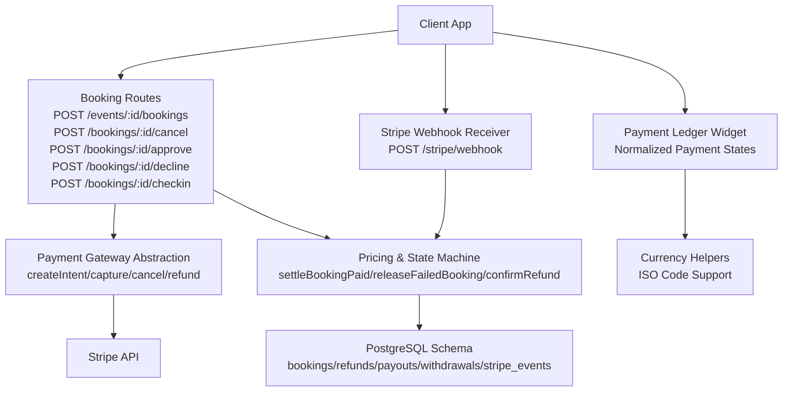

**Diagram sources**
- [bookings.ts:156-405](file://server/src/routes/bookings.ts#L156-L405)
- [stripe_webhook.ts:90-153](file://server/src/routes/stripe_webhook.ts#L90-L153)
- [payments.ts:102-176](file://server/src/payments.ts#L102-L176)
- [pricing.ts:170-269](file://server/src/pricing.ts#L170-L269)
- [schema.sql:181-266](file://server/src/schema.sql#L181-L266)
- [payment_ledger.dart:17-83](file://lib/widgets/payment_ledger.dart#L17-L83)
- [money.dart:1-61](file://lib/utils/money.dart#L1-L61)

**Section sources**
- [payments.ts:1-391](file://server/src/payments.ts#L1-L391)
- [stripe_webhook.ts:1-156](file://server/src/routes/stripe_webhook.ts#L1-L156)
- [pricing.ts:1-270](file://server/src/pricing.ts#L1-L270)
- [bookings.ts:1-894](file://server/src/routes/bookings.ts#L1-L894)
- [hosts.ts:1-505](file://server/src/routes/hosts.ts#L1-L505)
- [schema.sql:181-266](file://server/src/schema.sql#L181-L266)
- [booking.dart:25-118](file://lib/models/booking.dart#L25-L118)
- [payment_ledger.dart:1-745](file://lib/widgets/payment_ledger.dart#L1-L745)
- [money.dart:1-61](file://lib/utils/money.dart#L1-L61)

## Core Components
- Payment gateway abstraction:
  - Real Stripe gateway: creates intents, captures, cancels, refunds, verifies webhooks, refreshes client secrets.
  - Mock gateway: offline Stripe semantics for integration tests; signs events locally.
  - Simulated gateway: historical behavior without gateway calls; used in test environments or when no key is configured.
- Booking routes:
  - Checkout creates a booking, holds seats, optionally creates a Stripe intent, and returns a client secret for client-side confirmation.
  - Cancellation records a refund decision and may call Stripe to refund or void an intent.
  - Approval captures a held authorization; decline voids it.
  - Check-in finalizes attendance and captures any remaining authorization.
- Webhook handler:
  - Verifies Stripe signatures using the configured webhook secret.
  - Idempotent event processing via `stripe_events`.
  - Handles success, failure, cancellation, and refund events.
- Pricing and state machine:
  - Computes platform commission and syncs per-event payouts from captured bookings.
  - Settles paid bookings, releases failed ones, and confirms refunds.
- Host financial reporting:
  - Payouts per event with gross, commission, and net.
  - Summary, trend, performance, and wallet endpoints.
- **New** Client-side payment state management:
  - Normalized `BookingPaymentState` enum providing consistent payment state representation.
  - Comprehensive payment ledger widget with filtering and aggregation.
  - Currency-aware formatting with ISO currency code support.
  - Digital receipt display with payment method information.

**Section sources**
- [payments.ts:29-71](file://server/src/payments.ts#L29-L71)
- [payments.ts:102-176](file://server/src/payments.ts#L102-L176)
- [payments.ts:185-266](file://server/src/payments.ts#L185-L266)
- [bookings.ts:156-405](file://server/src/routes/bookings.ts#L156-L405)
- [bookings.ts:420-564](file://server/src/routes/bookings.ts#L420-L564)
- [stripe_webhook.ts:33-88](file://server/src/routes/stripe_webhook.ts#L33-L88)
- [pricing.ts:30-94](file://server/src/pricing.ts#L30-L94)
- [pricing.ts:170-269](file://server/src/pricing.ts#L170-L269)
- [hosts.ts:56-145](file://server/src/routes/hosts.ts#L56-L145)
- [booking.dart:25-118](file://lib/models/booking.dart#L25-L118)
- [payment_ledger.dart:17-83](file://lib/widgets/payment_ledger.dart#L17-L83)

## Architecture Overview
The payment architecture separates concerns across gateway abstraction, route orchestration, pricing/state machine, and database ledger.

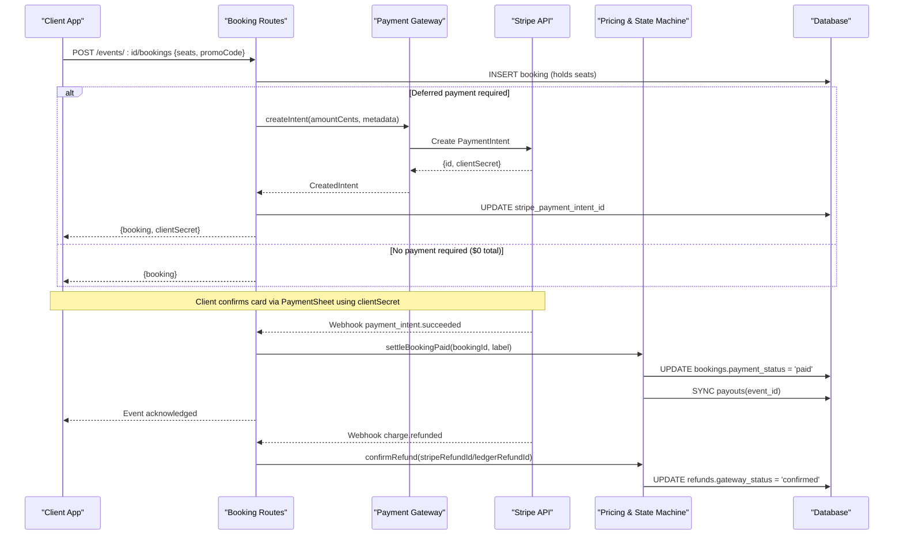

**Diagram sources**
- [bookings.ts:156-405](file://server/src/routes/bookings.ts#L156-L405)
- [payments.ts:114-123](file://server/src/payments.ts#L114-L123)
- [stripe_webhook.ts:33-62](file://server/src/routes/stripe_webhook.ts#L33-L62)
- [pricing.ts:170-189](file://server/src/pricing.ts#L170-L189)

## Detailed Component Analysis

### Payment Intent Creation and Checkout Flow
- The booking route validates inputs, checks availability, applies promo codes, and computes the final amount.
- If deferred payment is active and the amount is greater than zero, a Stripe intent is created with metadata linking to the booking.
- The booking row stores the expected amount in cents and the Stripe intent ID after creation.
- The client receives a client secret to complete card confirmation via PaymentSheet.

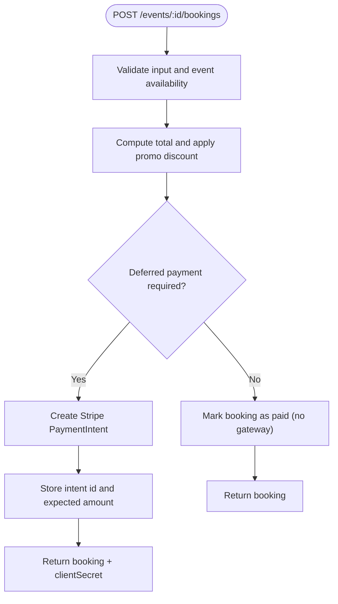

**Diagram sources**
- [bookings.ts:156-405](file://server/src/routes/bookings.ts#L156-L405)
- [payments.ts:114-123](file://server/src/payments.ts#L114-L123)

**Section sources**
- [bookings.ts:156-405](file://server/src/routes/bookings.ts#L156-L405)
- [payments.ts:114-123](file://server/src/payments.ts#L114-L123)

### Webhook Handling for Payment Events
- The webhook endpoint requires raw JSON body and verifies the Stripe signature using the configured webhook secret.
- Duplicate deliveries are handled by claiming the event id in `stripe_events`; duplicates return early.
- Successful payment:
  - Validates the intent amount against the stored expected amount.
  - Calls `settleBookingPaid`, which transitions the booking to `paid` and syncs payouts.
- Failed or canceled payment:
  - Releases the hold and marks the booking as `failed`.
- Refund:
  - Confirms the refund ledger entry by matching either the Stripe refund id or the ledger refund id.

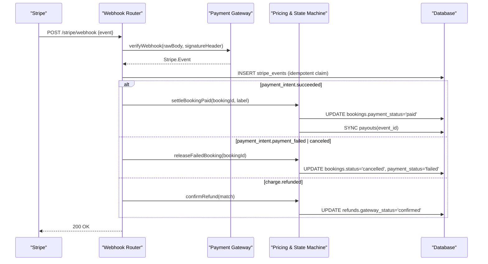

**Diagram sources**
- [stripe_webhook.ts:90-153](file://server/src/routes/stripe_webhook.ts#L90-L153)
- [stripe_webhook.ts:33-88](file://server/src/routes/stripe_webhook.ts#L33-L88)
- [pricing.ts:170-269](file://server/src/pricing.ts#L170-L269)

**Section sources**
- [stripe_webhook.ts:1-156](file://server/src/routes/stripe_webhook.ts#L1-L156)
- [pricing.ts:170-269](file://server/src/pricing.ts#L170-L269)

### Payment Validation and Security Measures
- Signature verification:
  - The webhook router passes the raw request body and `stripe-signature` header to the gateway's `verifyWebhook`.
  - The Stripe gateway throws if the webhook secret is missing or the signature is invalid.
- Amount validation:
  - On success, the webhook compares the intent's paid amount with the booking's stored expected amount in cents.
  - Mismatches are logged and the booking is not settled.
- Idempotency:
  - Every delivered Stripe event id is inserted into `stripe_events` with conflict resolution; duplicate deliveries are ignored.
- Environment safety:
  - Boot-time checks validate Stripe keys and disallow mock mode in production.

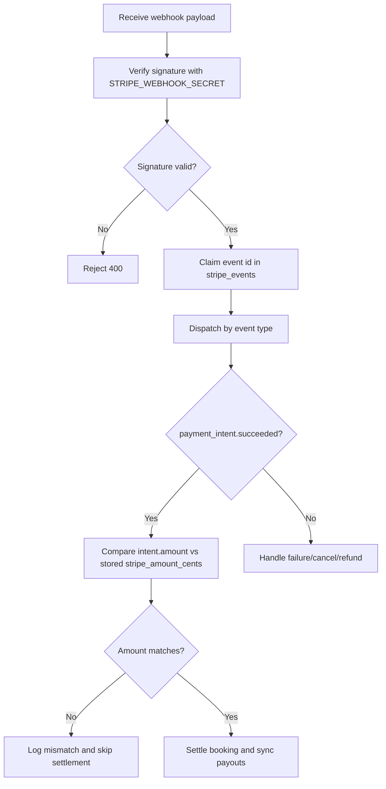

**Diagram sources**
- [stripe_webhook.ts:90-153](file://server/src/routes/stripe_webhook.ts#L90-L153)
- [stripe_webhook.ts:33-62](file://server/src/routes/stripe_webhook.ts#L33-L62)
- [payments.ts:165-170](file://server/src/payments.ts#L165-L170)
- [payments.ts:272-316](file://server/src/payments.ts#L272-L316)

**Section sources**
- [stripe_webhook.ts:90-153](file://server/src/routes/stripe_webhook.ts#L90-L153)
- [payments.ts:165-170](file://server/src/payments.ts#L165-L170)
- [payments.ts:272-316](file://server/src/payments.ts#L272-L316)

### Refund Processing Workflow and Partial Refund Support
- Guest cancellation:
  - Records a refund decision in the ledger with reason `guest_cancel`.
  - For captured (`paid`) bookings, the ledger books the full captured amount; for uncaptured (`authorized`) holds, it books $0 released.
  - When a real gateway is active, the ledger row is marked `pending_gateway`; the actual refund is issued via Stripe and confirmed on `charge.refunded`.
- Host decline:
  - Marks the booking as cancelled and records a `$0 released` refund decision since no money moved.
  - Best-effort voiding of the authorization via Stripe.
- Partial refunds:
  - The Stripe gateway's refund method accepts an optional `amountCents`, enabling partial refunds.
  - The webhook confirms refunds by matching either the Stripe refund id or the ledger refund id embedded in metadata.

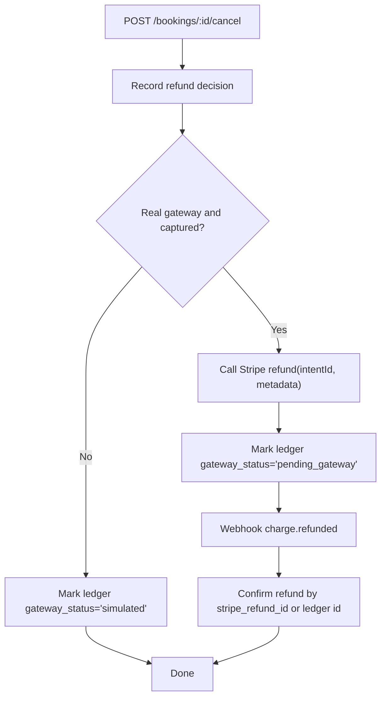

**Diagram sources**
- [bookings.ts:420-564](file://server/src/routes/bookings.ts#L420-L564)
- [pricing.ts:110-156](file://server/src/pricing.ts#L110-L156)
- [payments.ts:143-151](file://server/src/payments.ts#L143-L151)
- [stripe_webhook.ts:75-88](file://server/src/routes/stripe_webhook.ts#L75-L88)

**Section sources**
- [bookings.ts:420-564](file://server/src/routes/bookings.ts#L420-L564)
- [pricing.ts:110-156](file://server/src/pricing.ts#L110-L156)
- [payments.ts:143-151](file://server/src/payments.ts#L143-L151)
- [stripe_webhook.ts:75-88](file://server/src/routes/stripe_webhook.ts#L75-L88)

### Host Payout Calculation and Commission Handling
- Platform commission rate:
  - Configurable via `PLATFORM_COMMISSION_RATE`; defaults to 10% if invalid or out-of-range.
- Payout aggregation:
  - Per-event payout rows are computed from bookings with `payment_status = 'paid'` and live status.
  - Gross is the sum of booked amounts; commission is gross multiplied by the platform rate.
- Syncing payouts:
  - `syncPayout` recomputes from scratch inside a transaction and uses advisory locks to avoid races with withdrawals.
- Reporting:
  - Host endpoints expose per-event payouts, summary metrics, monthly trends, performance analytics, and wallet balances.

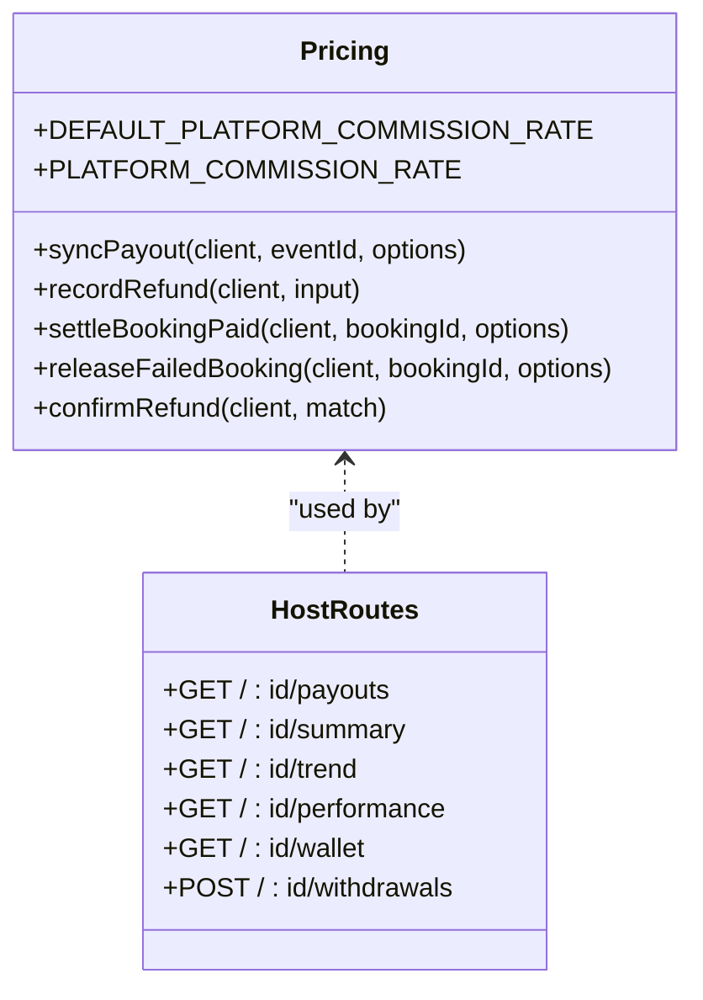

**Diagram sources**
- [pricing.ts:1-94](file://server/src/pricing.ts#L1-L94)
- [hosts.ts:56-145](file://server/src/routes/hosts.ts#L56-L145)

**Section sources**
- [pricing.ts:1-94](file://server/src/pricing.ts#L1-L94)
- [hosts.ts:56-145](file://server/src/routes/hosts.ts#L56-L145)

### Enhanced Payment Error Handling and Structured Logging
**Updated** Enhanced error logging now provides comprehensive debugging information for payment failures during intent creation.

- **Structured Error Logging**: Payment intent creation failures now log detailed structured objects containing:
  - Extracted error message from Error instances or stringified generic errors
  - Complete stack trace for Error instances
  - Correlated booking ID for tracking
  - Amount in cents for financial context
  - Currency information (USD)
  - Comprehensive error object structure for better debugging and monitoring

- **Error Recovery**: When payment intent creation fails:
  - Structured error logging captures all relevant context
  - Automatic release of held seats via `releaseFailedBooking`
  - Graceful fallback to 502 error response for clients
  - Background cleanup ensures no orphaned holds remain

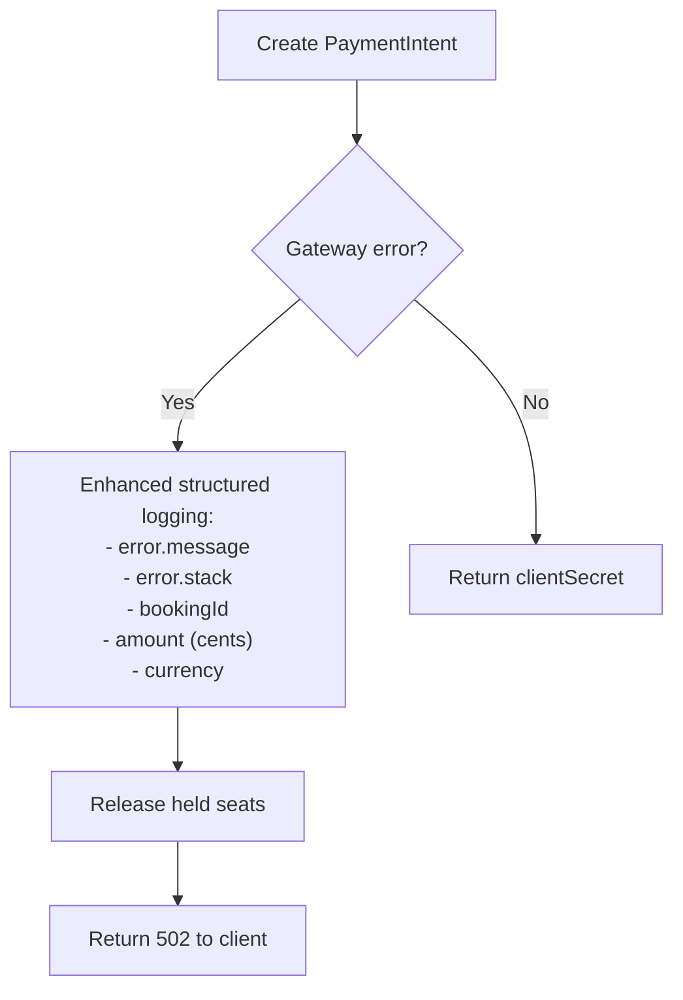

**Diagram sources**
- [bookings.ts:362-384](file://server/src/routes/bookings.ts#L362-L384)

**Section sources**
- [bookings.ts:362-384](file://server/src/routes/bookings.ts#L362-L384)

### Payment Error Handling and Retry Mechanisms
- Gateway errors during intent creation:
  - Enhanced structured logging captures comprehensive error context including message extraction, stack traces, booking correlation, and financial details.
  - The booking route releases the held seat and returns a clean error response.
  - A background sweep later cleans up abandoned pending payments.
- Webhook retries:
  - Stripe retries until a 2xx response is received.
  - The webhook claims each event id once; duplicates are acknowledged without reprocessing.
  - If processing fails, the claim is deleted so Stripe can retry safely.
- Already-done operations:
  - Gateway methods swallow idempotent Stripe errors such as already captured or canceled intents.

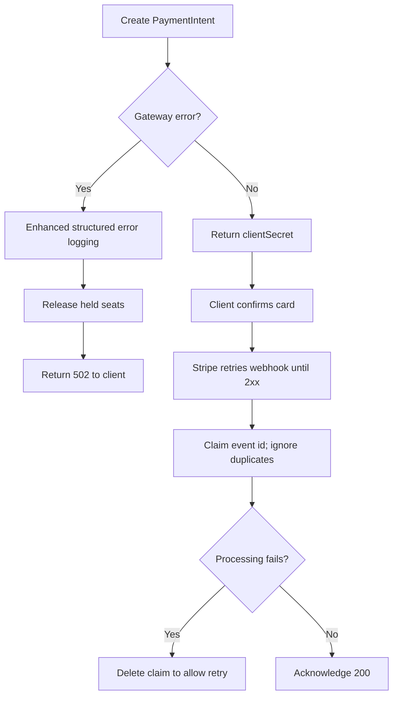

**Diagram sources**
- [bookings.ts:337-379](file://server/src/routes/bookings.ts#L337-L379)
- [stripe_webhook.ts:110-151](file://server/src/routes/stripe_webhook.ts#L110-L151)
- [payments.ts:73-79](file://server/src/payments.ts#L73-L79)

**Section sources**
- [bookings.ts:337-379](file://server/src/routes/bookings.ts#L337-L379)
- [stripe_webhook.ts:110-151](file://server/src/routes/stripe_webhook.ts#L110-L151)
- [payments.ts:73-79](file://server/src/payments.ts#L73-L79)

### Financial Reporting and Reconciliation Features
- Payouts:
  - One row per event with seats sold, gross, commission, and status.
  - Computed from authoritative booking data; cancellations and refunds reduce accruals.
- Host summary:
  - Earned, in-transit, scheduled, lifetime gross, commission total, seats sold, average seat price, fill rate, next payout date, and available balance.
- Trends and performance:
  - Monthly revenue and seats; per-event views, bookings, pending, checked-in, and gross.
- Wallet:
  - Lifetime net, lifetime withdrawn, pending withdrawals, and withdrawal history.
- Reconciliation:
  - Webhook idempotency table ensures no double-settlement.
  - Refund ledger tracks gateway status transitions from pending to confirmed.

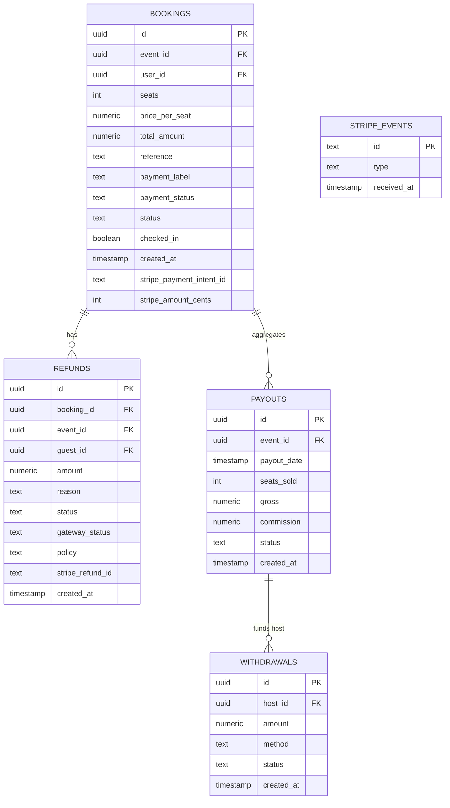

**Diagram sources**
- [schema.sql:181-266](file://server/src/schema.sql#L181-L266)
- [hosts.ts:56-145](file://server/src/routes/hosts.ts#L56-L145)

**Section sources**
- [schema.sql:181-266](file://server/src/schema.sql#L181-L266)
- [hosts.ts:56-145](file://server/src/routes/hosts.ts#L56-L145)

## Client-Side Payment State Management

### New BookingPaymentState Enum
**Updated** The payment system now uses a normalized `BookingPaymentState` enum to provide consistent payment state representation across all UI components.

The `BookingPaymentState` enum defines five distinct states:
- `paid`: Successfully completed payment (maps from 'paid' or 'authorized' server states)
- `pending`: Payment authorized but awaiting completion (maps from 'pending_payment')
- `failed`: Payment attempt failed (maps from 'failed')
- `refunded`: Payment was refunded (maps from 'refunded')
- `notCharged`: No payment was attempted (maps from cancelled bookings)

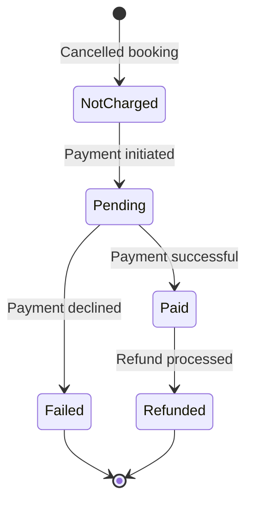

**Diagram sources**
- [booking.dart:25-118](file://lib/models/booking.dart#L25-L118)

### Payment Ledger Widget
**New** The comprehensive payment ledger widget provides a unified interface for displaying and managing payment information across the application.

Key features include:
- **Currency-Aware Formatting**: Uses ISO currency codes to properly format amounts with appropriate symbols
- **Payment State Filtering**: Allows users to filter transactions by payment state (All, Paid, Pending, Failed, Refunded)
- **Aggregated Statistics**: Displays total paid amounts, transaction counts, and breakdowns by currency
- **Digital Receipt Display**: Opens detailed receipt sheets for individual bookings
- **Payment Method Tracking**: Shows masked payment methods recorded by the server

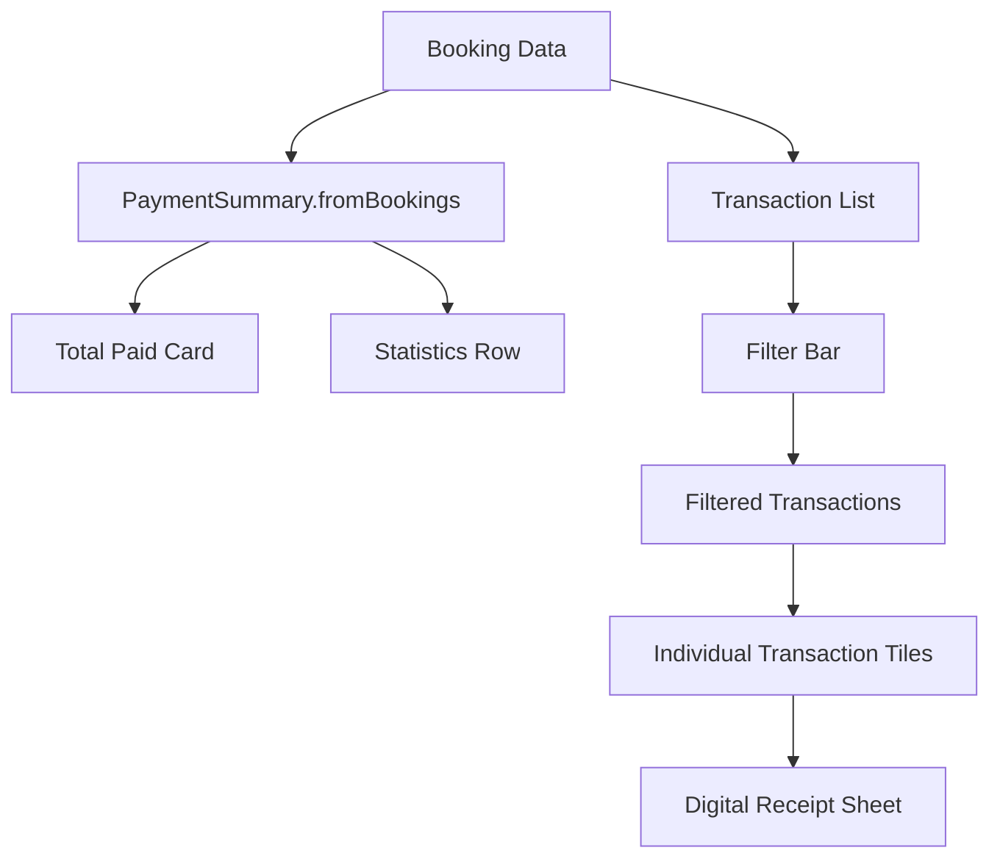

**Diagram sources**
- [payment_ledger.dart:17-83](file://lib/widgets/payment_ledger.dart#L17-L83)
- [payment_ledger.dart:90-227](file://lib/widgets/payment_ledger.dart#L90-L227)

**Section sources**
- [booking.dart:25-118](file://lib/models/booking.dart#L25-L118)
- [payment_ledger.dart:1-745](file://lib/widgets/payment_ledger.dart#L1-L745)

### Currency Helpers and ISO Currency Support
**New** The currency helper utilities provide robust support for ISO currency codes and proper monetary formatting.

Key capabilities:
- **ISO Currency Code Support**: Supports standard currency codes (USD, EUR, GBP, PKR, AED)
- **Symbol Mapping**: Maps currency codes to appropriate symbols ($, €, £, Rs, AED)
- **Decimal Precision**: Maintains 2 decimal places for financial accuracy
- **Per-Currency Aggregation**: Prevents blending different currencies into incorrect totals
- **Default Fallback**: Defaults to USD for legacy data without explicit currency codes

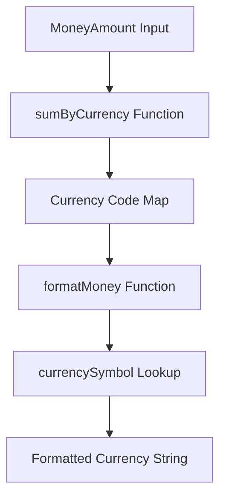

**Diagram sources**
- [money.dart:1-61](file://lib/utils/money.dart#L1-L61)

**Section sources**
- [money.dart:1-61](file://lib/utils/money.dart#L1-L61)

### Digital Receipt System
**New** The digital receipt system provides detailed payment information in a user-friendly modal interface.

Features include:
- **Event Information Display**: Shows dinner details, restaurant name, and date
- **Price Breakdown**: Displays subtotal, discounts, service fees, and total paid
- **Payment Method Display**: Shows masked payment methods recorded by the server
- **Payment Status Visualization**: Uses color-coded status indicators based on `BookingPaymentState`
- **Reference Management**: Provides copy functionality for booking references

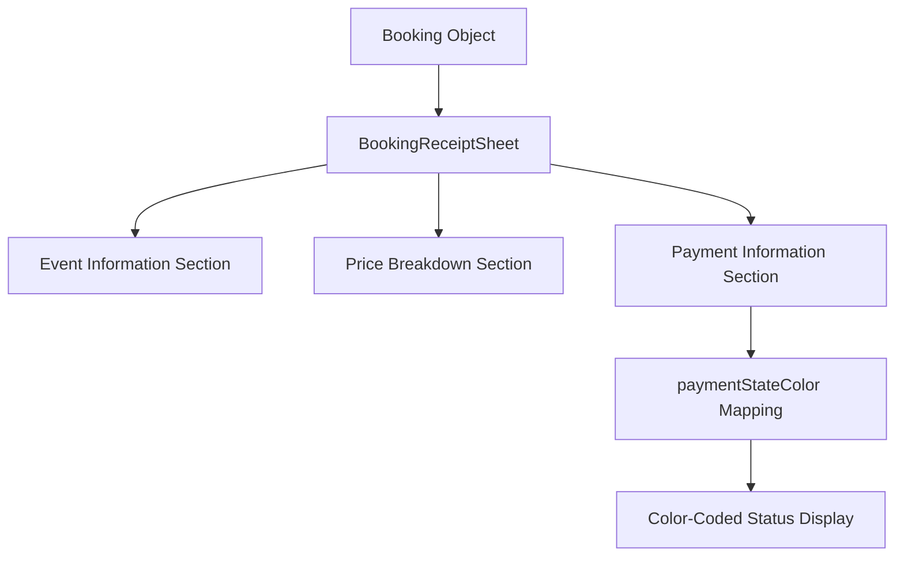

**Diagram sources**
- [booking_receipt_sheet.dart:32-260](file://lib/widgets/booking_receipt_sheet.dart#L32-L260)
- [booking_receipt_sheet.dart:263-293](file://lib/widgets/booking_receipt_sheet.dart#L263-L293)

**Section sources**
- [booking_receipt_sheet.dart:1-344](file://lib/widgets/booking_receipt_sheet.dart#L1-L344)

## Dependency Analysis
The payment system has clear layering:
- Routes depend on the gateway abstraction and pricing helpers.
- The gateway abstracts Stripe SDK usage and environment configuration.
- Pricing encapsulates business logic for payouts, refunds, and state transitions.
- The database schema provides the authoritative ledger and idempotency guarantees.
- **New** Client-side components depend on normalized payment states and currency utilities.

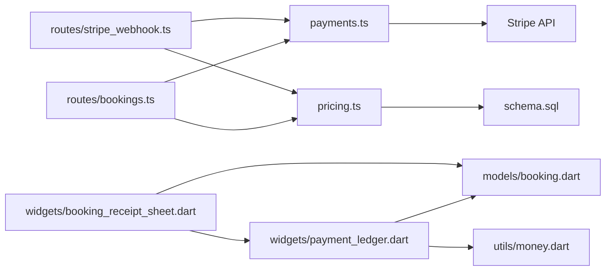

**Diagram sources**
- [bookings.ts:1-14](file://server/src/routes/bookings.ts#L1-L14)
- [stripe_webhook.ts:1-5](file://server/src/routes/stripe_webhook.ts#L1-L5)
- [payments.ts:1-6](file://server/src/payments.ts#L1-L6)
- [pricing.ts:1-3](file://server/src/pricing.ts#L1-L3)
- [schema.sql:181-266](file://server/src/schema.sql#L181-L266)
- [payment_ledger.dart:1-10](file://lib/widgets/payment_ledger.dart#L1-L10)
- [booking_receipt_sheet.dart:1-8](file://lib/widgets/booking_receipt_sheet.dart#L1-L8)

**Section sources**
- [bookings.ts:1-14](file://server/src/routes/bookings.ts#L1-L14)
- [stripe_webhook.ts:1-5](file://server/src/routes/stripe_webhook.ts#L1-L5)
- [payments.ts:1-6](file://server/src/payments.ts#L1-L6)
- [pricing.ts:1-3](file://server/src/pricing.ts#L1-L3)
- [schema.sql:181-266](file://server/src/schema.sql#L181-L266)
- [payment_ledger.dart:1-10](file://lib/widgets/payment_ledger.dart#L1-L10)
- [booking_receipt_sheet.dart:1-8](file://lib/widgets/booking_receipt_sheet.dart#L1-L8)

## Performance Considerations
- Avoid holding database locks across external HTTP calls:
  - Payment intent creation occurs outside the seat-lock transaction to prevent blocking other bookings.
- Idempotent state transitions:
  - Webhook handlers rely on conditional updates and event idempotency to handle retries safely.
- Advisory locks:
  - Payout synchronization and withdrawals use advisory locks to serialize concurrent access and prevent race conditions.
- Opportunistic cleanup:
  - Abandoned pending payments are swept opportunistically within read paths to keep seat counts accurate without a cron job.
- **New** Client-side performance optimizations:
  - Payment summaries are computed once and cached for the widget lifecycle
  - Currency formatting uses efficient string operations
  - Transaction lists are filtered client-side to minimize re-renders

## Troubleshooting Guide
- Webhook signature failures:
  - Ensure `STRIPE_WEBHOOK_SECRET` is configured and the endpoint is mounted before global JSON parsing.
- Amount mismatches:
  - Verify that the booking's stored `stripe_amount_cents` matches the intent's paid amount.
- Duplicate settlements:
  - Confirm that `stripe_events` contains the event id and that the state machine only moves bookings from expected statuses.
- Abandoned checkouts:
  - Use the sweep function to release stale `pending_payment` holds and cancel intents.
- Refund reconciliation:
  - Check the refund ledger's `gateway_status` and ensure the webhook flips it to `confirmed` upon receiving `charge.refunded`.
- **Enhanced Error Monitoring**:
  - Payment intent creation failures now provide structured logs with error messages, stack traces, booking IDs, amounts, and currency information for better debugging.
  - Monitor structured error logs for patterns in payment failures to identify systemic issues.
  - Use the correlated booking IDs in error logs to trace specific booking lifecycle issues.
- **New** Client-side payment state issues:
  - Verify that `BookingPaymentState` mappings correctly translate server states to normalized states.
  - Check that currency codes are properly passed through the API to ensure correct formatting.
  - Ensure payment method labels are sanitized and don't contain sensitive card data.

**Section sources**
- [stripe_webhook.ts:90-153](file://server/src/routes/stripe_webhook.ts#L90-L153)
- [stripe_webhook.ts:33-62](file://server/src/routes/stripe_webhook.ts#L33-L62)
- [payments.ts:329-390](file://server/src/payments.ts#L329-L390)
- [pricing.ts:248-269](file://server/src/pricing.ts#L248-L269)
- [bookings.ts:362-384](file://server/src/routes/bookings.ts#L362-L384)
- [booking.dart:94-118](file://lib/models/booking.dart#L94-L118)
- [payment_ledger.dart:42-83](file://lib/widgets/payment_ledger.dart#L42-L83)

## Conclusion
DinCircle's payment processing integrates Stripe through a robust gateway abstraction, ensuring secure signature verification, strict amount validation, and idempotent webhook processing. The server-side ledger remains authoritative for money decisions, with clear state transitions for successful payments, failures, and refunds. Host payouts and commissions are computed deterministically from captured bookings, and comprehensive reporting endpoints provide visibility into earnings, trends, and wallet balances. Enhanced structured error logging provides detailed debugging information for payment failures, including error messages, stack traces, booking correlations, and financial context. Error handling and retry mechanisms protect against network failures and duplicate deliveries, while background sweeps maintain consistency for abandoned checkouts.

**Updated** The client-side payment system now provides a comprehensive, normalized approach to payment state management through the `BookingPaymentState` enum, ensuring consistent representation across all UI components. The new payment ledger widget offers rich functionality including currency-aware formatting, payment state filtering, aggregated statistics, and digital receipt display. Currency helpers provide robust ISO currency code support, preventing incorrect blending of different currencies and ensuring proper symbol mapping. This complete rebuild eliminates mock payment data in favor of real API-driven payment state management, providing users with accurate, trustworthy payment information and a seamless experience across the entire payment lifecycle.