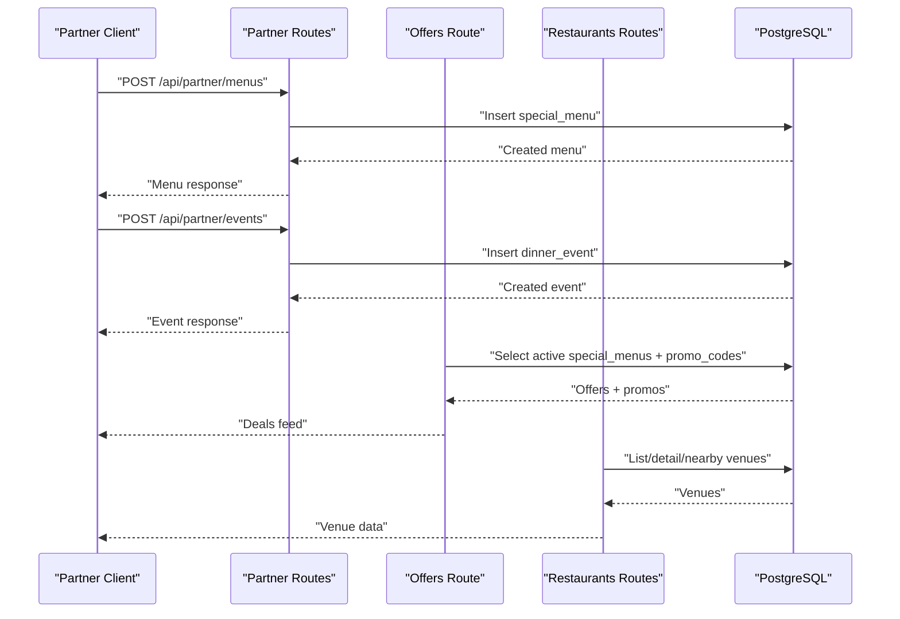
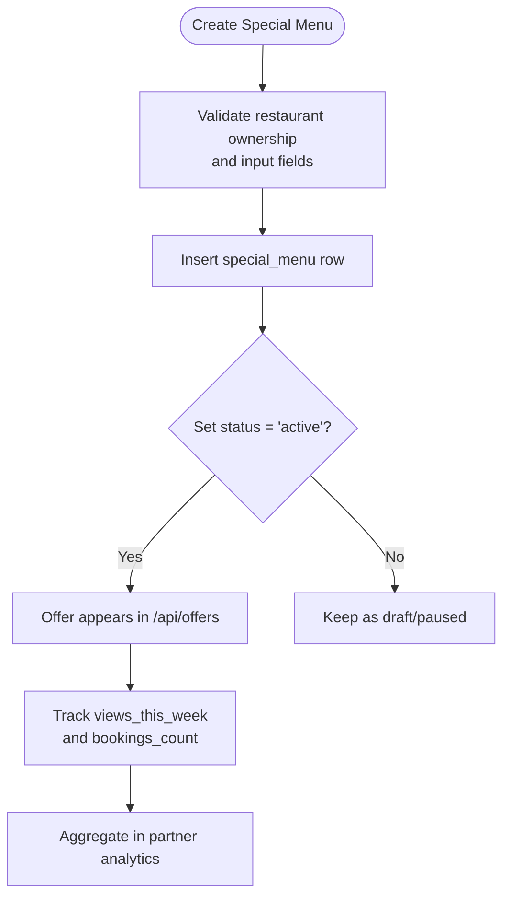
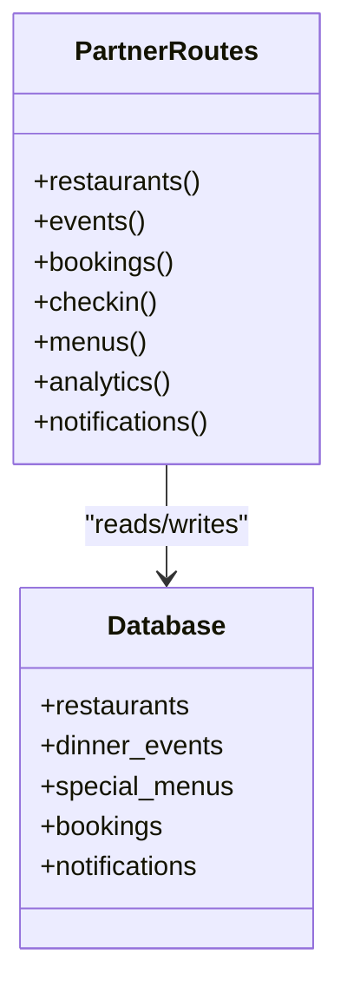
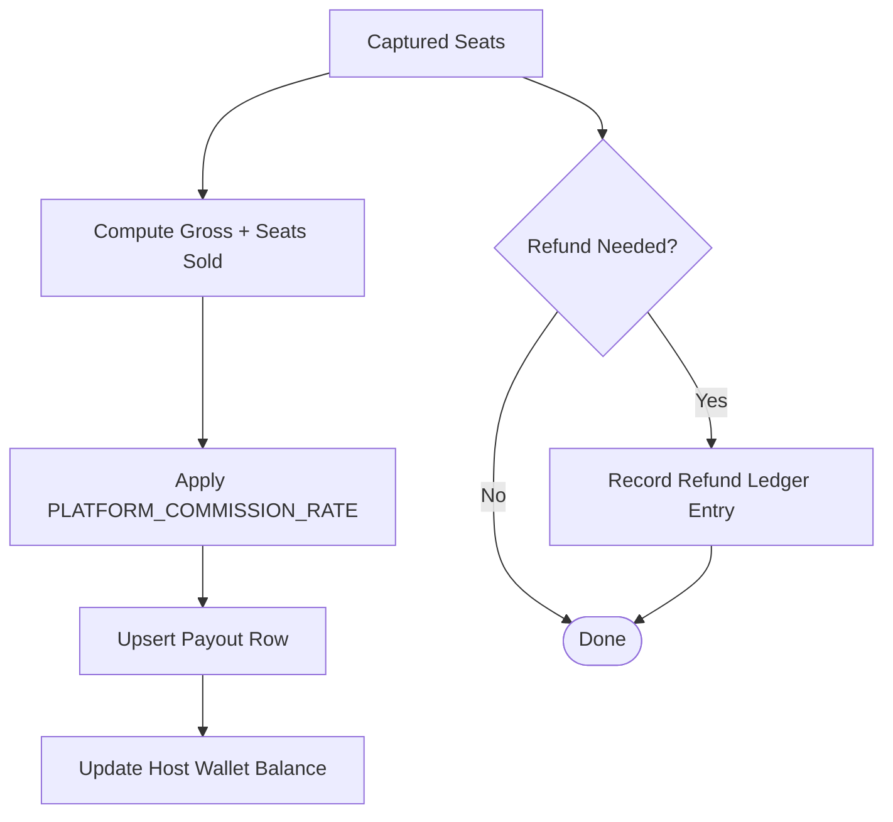
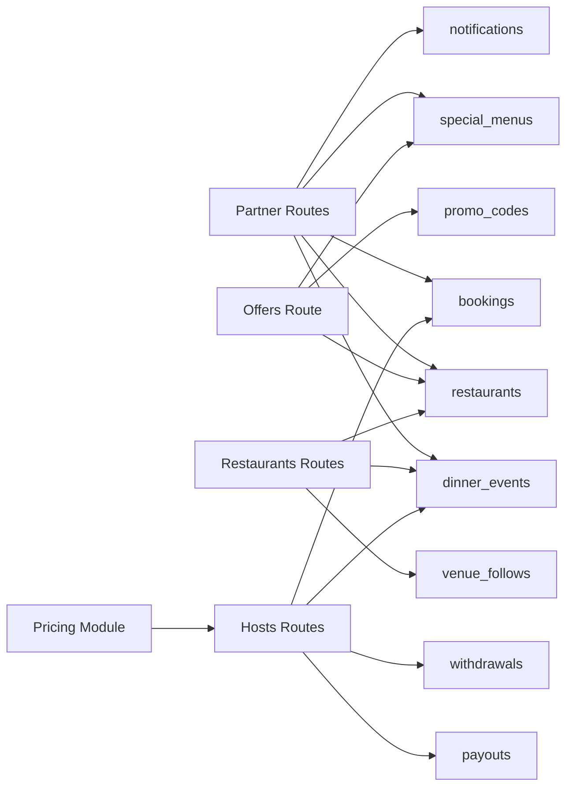

# Restaurant Partnerships & Offers

<cite>
**Referenced Files in This Document**
- [README.md](file://README.md)
- [server/src/routes/partner.ts](file://server/src/routes/partner.ts)
- [server/src/routes/offers.ts](file://server/src/routes/offers.ts)
- [server/src/routes/restaurants.ts](file://server/src/routes/restaurants.ts)
- [server/src/routes/hosts.ts](file://server/src/routes/hosts.ts)
- [server/src/pricing.ts](file://server/src/pricing.ts)
- [server/src/schema.sql](file://server/src/schema.sql)
</cite>

## Table of Contents
1. [Introduction](#introduction)
2. [Project Structure](#project-structure)
3. [Core Components](#core-components)
4. [Architecture Overview](#architecture-overview)
5. [Detailed Component Analysis](#detailed-component-analysis)
6. [Dependency Analysis](#dependency-analysis)
7. [Performance Considerations](#performance-considerations)
8. [Troubleshooting Guide](#troubleshooting-guide)
9. [Conclusion](#conclusion)

## Introduction
This document explains the restaurant partnership and special offers system in DineCircle. It covers:
- Restaurant onboarding and partnership agreement management through the partner API.
- Special offer creation via special menus and distribution through the public offers feed.
- Partner dashboard capabilities for venues, events, bookings, check-ins, menus, analytics, and notifications.
- Offer redemption tracking through menu booking counts and analytics.
- Restaurant performance metrics and how customer feedback integrates into venue profiles.
- Partnership tier signals such as `is_partner`, `partnership_status`, and `partner_perk`.
- Commission structure and revenue sharing using a server-side configurable platform commission rate.
- Examples of campaign setup and performance tracking using the available endpoints.

The system is implemented as an Express + PostgreSQL backend with role-gated partner routes and public discovery routes. The Flutter consumer app currently has no dedicated partner client; partner operations are accessed through the REST API.

**Section sources**
- [README.md:1-33](file://README.md#L1-L33)
- [README.md:207-252](file://README.md#L207-L252)
- [README.md:367-403](file://README.md#L367-L403)

## Project Structure
The relevant code for partnerships and offers lives in the server’s route modules and database schema:
- Partner routes manage restaurants owned by a partner admin, partner events, bookings, check-ins, special menus, analytics, and notifications.
- Offers routes expose active special menus and promo codes to diners.
- Restaurants routes provide public venue discovery, follow/unfollow, and nearby search.
- Hosts routes provide host earnings, payouts, wallet, and collaboration invites that relate to partnership workflows.
- Pricing defines the platform commission rate and payout/refund helpers.
- Schema defines all tables including restaurants, dinner_events, special_menus, bookings, refunds, payouts, withdrawals, collaboration_invites, reviews, and promo_codes.

```mermaid
graph TB
subgraph "Partner Surface"
P_Restaurants["GET /api/partner/restaurants"]
P_EventCRUD["POST/PUT /api/partner/events"]
P_Bookings["GET /api/partner/bookings"]
P_Checkin["POST /api/partner/bookings/:id/checkin"]
P_Menus["POST/GET /api/partner/menus"]
P_Analytics["GET /api/partner/analytics"]
P_Notifications["GET /api/partner/notifications"]
end
subgraph "Public Discovery"
O_OfferFeed["GET /api/offers"]
R_List["GET /api/restaurants"]
R_Detail["GET /api/restaurants/:id"]
R_Nearby["GET /api/restaurants/nearby"]
R_Follow["POST/DELETE /api/restaurants/:id/follow"]
end
subgraph "Host & Money"
H_Payouts["GET /api/hosts/:id/payouts"]
H_Summary["GET /api/hosts/:id/summary"]
H_Trend["GET /api/hosts/:id/trend"]
H_Wallet["GET /api/hosts/:id/wallet"]
H_Withdraw["POST /api/hosts/:id/withdrawals"]
H_Perf["GET /api/hosts/:id/performance"]
H_Partners["GET /api/hosts/:id/partners"]
H_Invites["GET /api/hosts/:id/invites"]
end
DB[(PostgreSQL)]
P_Restaurants --> DB
P_EventCRUD --> DB
P_Bookings --> DB
P_Checkin --> DB
P_Menus --> DB
P_Analytics --> DB
P_Notifications --> DB
O_OfferFeed --> DB
R_List --> DB
R_Detail --> DB
R_Nearby --> DB
R_Follow --> DB
H_Payouts --> DB
H_Summary --> DB
H_Trend --> DB
H_Wallet --> DB
H_Withdraw --> DB
H_Perf --> DB
H_Partners --> DB
H_Invites --> DB
```

**Diagram sources**
- [server/src/routes/partner.ts:11-533](file://server/src/routes/partner.ts#L11-L533)
- [server/src/routes/offers.ts:6-98](file://server/src/routes/offers.ts#L6-L98)
- [server/src/routes/restaurants.ts:47-207](file://server/src/routes/restaurants.ts#L47-L207)
- [server/src/routes/hosts.ts:56-504](file://server/src/routes/hosts.ts#L56-L504)

**Section sources**
- [server/src/routes/partner.ts:1-536](file://server/src/routes/partner.ts#L1-L536)
- [server/src/routes/offers.ts:1-99](file://server/src/routes/offers.ts#L1-L99)
- [server/src/routes/restaurants.ts:1-210](file://server/src/routes/restaurants.ts#L1-L210)
- [server/src/routes/hosts.ts:1-505](file://server/src/routes/hosts.ts#L1-L505)
- [server/src/schema.sql:74-119](file://server/src/schema.sql#L74-L119)

## Core Components
- Partner Admin Role Gate: All partner routes require `partner_admin` or `super_admin`.
- Restaurant Management: List and view partner-owned venues with profile completion, acceptance flags, and partner perks.
- Event Management: Create and update partner events with lifecycle status and seat capacity.
- Booking Management: Query bookings across partner events and mark guests checked in.
- Special Menus (Offers): Create and list special menus tied to restaurants; these power the public offers feed.
- Analytics: Revenue summary, upcoming events count, average fill rate, recent bookings, and partner notifications.
- Public Offers Feed: Active special menus plus active promo codes exposed to diners.
- Venue Discovery: Public listing, detail, nearby search, and follow/unfollow.
- Host Earnings & Collaboration: Payouts, summaries, trends, wallet, withdrawals, per-event performance, partner venues, and collaboration invites.
- Pricing & Ledger: Configurable platform commission rate, idempotent payout sync, refund ledger, and payment settlement helpers.

**Section sources**
- [server/src/routes/partner.ts:8-10](file://server/src/routes/partner.ts#L8-L10)
- [server/src/routes/partner.ts:13-65](file://server/src/routes/partner.ts#L13-L65)
- [server/src/routes/partner.ts:85-178](file://server/src/routes/partner.ts#L85-L178)
- [server/src/routes/partner.ts:228-323](file://server/src/routes/partner.ts#L228-L323)
- [server/src/routes/partner.ts:337-404](file://server/src/routes/partner.ts#L337-L404)
- [server/src/routes/partner.ts:408-490](file://server/src/routes/partner.ts#L408-L490)
- [server/src/routes/partner.ts:494-533](file://server/src/routes/partner.ts#L494-L533)
- [server/src/routes/offers.ts:42-96](file://server/src/routes/offers.ts#L42-L96)
- [server/src/routes/restaurants.ts:47-207](file://server/src/routes/restaurants.ts#L47-L207)
- [server/src/routes/hosts.ts:56-504](file://server/src/routes/hosts.ts#L56-L504)
- [server/src/pricing.ts:4-19](file://server/src/pricing.ts#L4-L19)

## Architecture Overview
The partnership and offers architecture separates partner-only operations from public discovery:
- Partner routes enforce role-based access and operate on restaurants owned by the authenticated partner admin.
- Offers derive deals from active special menus and include active promo codes.
- Restaurants routes serve public venue data and user interactions like following venues.
- Host routes compute earnings and support collaboration invitations between hosts and venues.
- Pricing centralizes commission logic and provides idempotent financial helpers.

**Diagram sources**
- [server/src/routes/partner.ts:337-404](file://server/src/routes/partner.ts#L337-L404)
- [server/src/routes/partner.ts:85-178](file://server/src/routes/partner.ts#L85-L178)
- [server/src/routes/offers.ts:42-96](file://server/src/routes/offers.ts#L42-L96)
- [server/src/routes/restaurants.ts:47-178](file://server/src/routes/restaurants.ts#L47-L178)

## Detailed Component Analysis

### Restaurant Onboarding and Partnership Agreement Management
- Ownership model: Restaurants have an `owner_id` referencing a partner admin user. Partner routes filter by this owner.
- Partnership fields: `is_partner`, `partnership_status`, and `partner_perk` indicate partnership state and benefits.
- Profile completeness: `profile_completion` helps partners track onboarding progress.
- Acceptance flag: `accepting_bookings` controls whether the venue appears in discoverable listings.

Key behaviors:
- Partner lists only their own restaurants.
- Partner can view detailed venue profiles including amenities, opening hours, tags, gallery, and partner perks.
- Tests and seed data set venues as verified partners for demo flows.

Operational guidance:
- Ensure the partner admin owns the restaurant before creating events or menus.
- Use `partnership_status` to reflect verification stages during onboarding.
- Enable `accepting_bookings` when the venue is ready for discovery and bookings.

**Section sources**
- [server/src/schema.sql:74-119](file://server/src/schema.sql#L74-L119)
- [server/src/routes/partner.ts:13-65](file://server/src/routes/partner.ts#L13-L65)
- [server/src/routes/restaurants.ts:47-99](file://server/src/routes/restaurants.ts#L47-L99)
- [server/src/routes/restaurants.ts:138-178](file://server/src/routes/restaurants.ts#L138-L178)

### Special Offers Creation and Distribution
Special offers are modeled as special menus and promo codes:
- Special menus represent curated packages (e.g., couple, group, tasting) with price per guest, minimum guests, tags, cover image, and status.
- Promo codes define percentage discounts and are validated server-side during checkout.

Creation flow:
- Partner creates a special menu linked to one of their restaurants.
- Menu status can be draft, active, paused, or archived.
- Active menus appear in the public offers feed.

Distribution flow:
- Offers endpoint returns active special menus and active promo codes.
- Offers are sorted by booking count and creation time.
- Kind derivation uses tags and minimum guests to categorize offers as couple, group, or tasting.

Redemption tracking:
- Each special menu tracks `bookings_count` and `views_this_week`.
- Analytics aggregate total bookings and revenue across partner events.

**Diagram sources**
- [server/src/routes/partner.ts:337-404](file://server/src/routes/partner.ts#L337-L404)
- [server/src/routes/offers.ts:42-96](file://server/src/routes/offers.ts#L42-L96)
- [server/src/schema.sql:359-374](file://server/src/schema.sql#L359-L374)

**Section sources**
- [server/src/routes/partner.ts:337-404](file://server/src/routes/partner.ts#L337-L404)
- [server/src/routes/offers.ts:6-98](file://server/src/routes/offers.ts#L6-L98)
- [server/src/schema.sql:409-415](file://server/src/schema.sql#L409-L415)

### Partner Dashboard Capabilities
The partner dashboard surface includes:
- Venues: List and detailed view of partner-owned restaurants.
- Events: Create, update, and list events for partner restaurants.
- Bookings: Query bookings across partner events and perform check-ins.
- Menus: Create and list special menus.
- Analytics: Revenue summary, upcoming events, average fill rate, recent bookings.
- Notifications: Read partner notifications scoped to partner restaurants.

Important notes:
- All partner endpoints require `partner_admin` or `super_admin`.
- Check-in enforces non-cancelled, not-already-checked-in constraints.
- Analytics queries join bookings, events, and restaurants scoped by partner ownership.

**Diagram sources**
- [server/src/routes/partner.ts:11-533](file://server/src/routes/partner.ts#L11-L533)

**Section sources**
- [server/src/routes/partner.ts:11-533](file://server/src/routes/partner.ts#L11-L533)

### Offer Redemption Tracking and Analytics
Tracking relies on:
- `special_menus.bookings_count`: incremented as bookings occur for partner events associated with the venue.
- `special_menus.views_this_week`: tracks menu visibility.
- Partner analytics: aggregates total revenue, total bookings, total events, average price per seat, total covers, upcoming events, and average fill rate.

Integration points:
- Offers feed surfaces active menus and promo codes.
- Partner analytics summarize business insights across all partner restaurants.

**Section sources**
- [server/src/routes/partner.ts:408-490](file://server/src/routes/partner.ts#L408-L490)
- [server/src/routes/offers.ts:42-96](file://server/src/routes/offers.ts#L42-L96)
- [server/src/schema.sql:359-374](file://server/src/schema.sql#L359-L374)

### Restaurant Performance Metrics and Customer Feedback Integration
Restaurant performance metrics:
- Total revenue, total bookings, total events, average price per seat, total covers.
- Upcoming events count and average fill rate.
- Recent bookings list for quick operational review.

Customer feedback integration:
- Reviews are stored per event and contribute to venue rating and review count.
- Public restaurant detail includes upcoming events and venue metadata.
- Follow/unfollow allows users to subscribe to venue updates.

**Section sources**
- [server/src/routes/partner.ts:408-490](file://server/src/routes/partner.ts#L408-L490)
- [server/src/routes/restaurants.ts:138-178](file://server/src/routes/restaurants.ts#L138-L178)
- [server/src/schema.sql:294-304](file://server/src/schema.sql#L294-L304)

### Partnership Tier System and Benefit Management
Partnership signals:
- `is_partner`: boolean indicating partner status.
- `partnership_status`: text field used to track onboarding/verification stages.
- `partner_perk`: optional perk description surfaced in venue details.

Benefits:
- Verified partner venues can be featured in discovery and may carry perks visible to diners.
- Partner routes allow full control over events, menus, and analytics.

Operational guidance:
- Update `partnership_status` during onboarding progression.
- Set `partner_perk` to communicate exclusive benefits.
- Ensure `accepting_bookings` is enabled when ready for live discovery.

**Section sources**
- [server/src/schema.sql:74-119](file://server/src/schema.sql#L74-L119)
- [server/src/routes/restaurants.ts:18-45](file://server/src/routes/restaurants.ts#L18-L45)
- [server/src/routes/restaurants.ts:47-99](file://server/src/routes/restaurants.ts#L47-L99)

### Commission Structure and Revenue Sharing Calculations
Commission model:
- Platform commission rate is configurable via environment variable and defaults to 10%.
- Payouts are computed from captured seats (`payment_status = 'paid'`) with statuses `confirmed` or `completed`.
- Idempotent payout sync recomputes gross, seats sold, and commission from authoritative booking data.
- Refunds are recorded immutably with gateway honesty markers.

Revenue sharing:
- Host net equals gross minus commission.
- Wallet balance reflects lifetime net minus withdrawals.
- Withdrawals are simulated in this phase; real payments are future work.

**Diagram sources**
- [server/src/pricing.ts:4-19](file://server/src/pricing.ts#L4-L19)
- [server/src/pricing.ts:30-94](file://server/src/pricing.ts#L30-L94)
- [server/src/pricing.ts:110-156](file://server/src/pricing.ts#L110-L156)
- [server/src/routes/hosts.ts:389-445](file://server/src/routes/hosts.ts#L389-L445)

**Section sources**
- [server/src/pricing.ts:4-19](file://server/src/pricing.ts#L4-L19)
- [server/src/pricing.ts:30-94](file://server/src/pricing.ts#L30-L94)
- [server/src/pricing.ts:110-156](file://server/src/pricing.ts#L110-L156)
- [server/src/routes/hosts.ts:389-504](file://server/src/routes/hosts.ts#L389-L504)

### Examples of Offer Campaign Setup and Performance Tracking
Example campaign setup:
- Create a special menu for a partner restaurant with appropriate tags and minimum guests.
- Activate the menu so it appears in the offers feed.
- Promote the campaign using partner notifications and venue discovery.

Performance tracking:
- Monitor `bookings_count` and `views_this_week` on the special menu.
- Review partner analytics for revenue, bookings, and fill rate.
- Inspect recent bookings to validate campaign effectiveness.

Operational checklist:
- Verify restaurant ownership before creating menus or events.
- Ensure menu status is active for public visibility.
- Use analytics to measure ROI and adjust pricing or targeting.

**Section sources**
- [server/src/routes/partner.ts:337-404](file://server/src/routes/partner.ts#L337-L404)
- [server/src/routes/offers.ts:42-96](file://server/src/routes/offers.ts#L42-L96)
- [server/src/routes/partner.ts:408-490](file://server/src/routes/partner.ts#L408-L490)

## Dependency Analysis
Component relationships:
- Partner routes depend on restaurants, dinner_events, special_menus, bookings, and notifications tables.
- Offers route depends on special_menus, restaurants, and promo_codes.
- Restaurants route depends on restaurants, venue_follows, and dinner_events.
- Hosts route depends on payouts, dinner_events, bookings, and withdrawals.
- Pricing module centralizes commission logic used by host earnings and financial flows.

**Diagram sources**
- [server/src/routes/partner.ts:11-533](file://server/src/routes/partner.ts#L11-L533)
- [server/src/routes/offers.ts:6-98](file://server/src/routes/offers.ts#L6-L98)
- [server/src/routes/restaurants.ts:47-207](file://server/src/routes/restaurants.ts#L47-L207)
- [server/src/routes/hosts.ts:56-504](file://server/src/routes/hosts.ts#L56-L504)
- [server/src/pricing.ts:4-19](file://server/src/pricing.ts#L4-L19)

**Section sources**
- [server/src/routes/partner.ts:11-533](file://server/src/routes/partner.ts#L11-L533)
- [server/src/routes/offers.ts:6-98](file://server/src/routes/offers.ts#L6-L98)
- [server/src/routes/restaurants.ts:47-207](file://server/src/routes/restaurants.ts#L47-L207)
- [server/src/routes/hosts.ts:56-504](file://server/src/routes/hosts.ts#L56-L504)
- [server/src/pricing.ts:4-19](file://server/src/pricing.ts#L4-L19)

## Performance Considerations
- Limit parameters: Many endpoints cap limits (e.g., 50–200 rows) to prevent heavy queries.
- Indexes: Schema includes indexes on frequently queried columns such as restaurant owner, event start date, bookings event/user, and notifications restaurant/time.
- Aggregations: Analytics use COALESCE and GROUP BY to produce robust summaries even with empty datasets.
- Idempotency: Payout sync and refund recording are designed to be safe under retries and concurrency.

Recommendations:
- Keep limit parameters reasonable in dashboards.
- Use pagination where possible for large lists.
- Monitor query plans for analytics-heavy reports.

[No sources needed since this section provides general guidance]

## Troubleshooting Guide
Common issues and resolutions:
- Partner access denied: Ensure the caller has `partner_admin` or `super_admin` role.
- Restaurant not found: Confirm the restaurant belongs to the authenticated partner owner.
- Already checked in: Check-in rejects duplicate check-ins and cancelled bookings.
- Menu creation failed: Verify restaurant ownership and input validation.
- Analytics empty: Ensure events and bookings exist for partner restaurants.
- Offers not appearing: Ensure special menu status is active and promo codes are active.

Debugging steps:
- Validate role and ownership checks in partner routes.
- Inspect database rows for restaurant ownership, menu status, and booking counts.
- Review analytics queries for correct joins and filters.

**Section sources**
- [server/src/routes/partner.ts:8-10](file://server/src/routes/partner.ts#L8-L10)
- [server/src/routes/partner.ts:85-178](file://server/src/routes/partner.ts#L85-L178)
- [server/src/routes/partner.ts:285-323](file://server/src/routes/partner.ts#L285-L323)
- [server/src/routes/partner.ts:337-404](file://server/src/routes/partner.ts#L337-L404)
- [server/src/routes/partner.ts:408-490](file://server/src/routes/partner.ts#L408-L490)
- [server/src/routes/offers.ts:42-96](file://server/src/routes/offers.ts#L42-L96)

## Conclusion
DineCircle’s restaurant partnership and offers system provides a robust foundation for managing venues, events, special menus, and analytics through a role-gated partner API. Offers are distributed via active special menus and promo codes, while analytics and booking counts enable performance tracking. Commission calculations are centralized and idempotent, ensuring accurate revenue sharing. Although the partner client is not yet built, the API surface is complete and ready for integration. Future phases should focus on building the partner dashboard UI, integrating real payments, and expanding analytics and marketing features.

[No sources needed since this section summarizes without analyzing specific files]