# Server Architecture & Core Components

<cite>
**Referenced Files in This Document**
- [server.ts](file://server/src/server.ts)
- [context.ts](file://server/src/context.ts)
- [security.ts](file://server/src/security.ts)
- [db.ts](file://server/src/db.ts)
- [auth.ts](file://server/src/routes/auth.ts)
- [payments.ts](file://server/src/payments.ts)
- [package.json](file://server/package.json)
</cite>

## Table of Contents
1. [Introduction](#introduction)
2. [Project Structure](#project-structure)
3. [Core Components](#core-components)
4. [Architecture Overview](#architecture-overview)
5. [Detailed Component Analysis](#detailed-component-analysis)
6. [Dependency Analysis](#dependency-analysis)
7. [Performance Considerations](#performance-considerations)
8. [Troubleshooting Guide](#troubleshooting-guide)
9. [Conclusion](#conclusion)

## Introduction
This document describes the Express.js server foundation for the DineCircle backend. It explains how the application boots, configures security and middleware, initializes core services, handles requests through a context-based pattern, manages PostgreSQL connections, implements error handling, logs activity, and organizes modular routes with dependency injection patterns.

The server combines REST endpoints, WebSocket channels, Stripe-backed payments, and audit logging into a single unified process.

## Project Structure
The server lives under `server/`. The runtime entry point is `src/server.ts`, which wires Express, Socket.io, security, database, payment initialization, and route modules. Domain logic is split across feature-specific route files under `src/routes/`. Cross-cutting concerns such as authentication, authorization, rate limiting, auditing, and database access are centralized in shared modules.

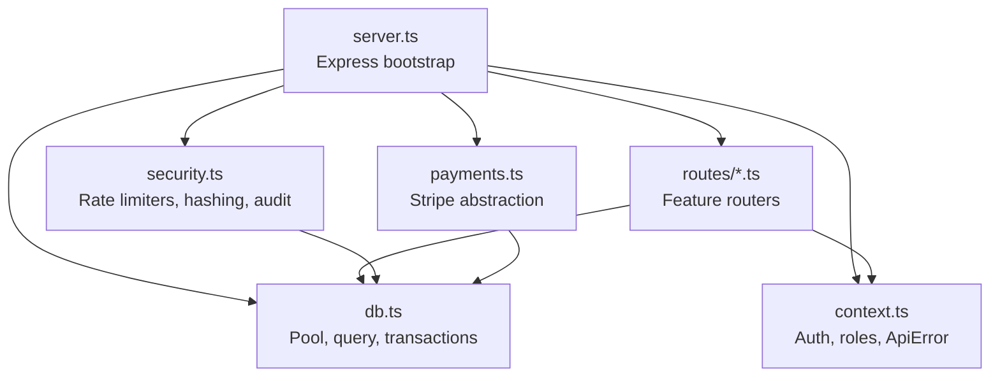

**Diagram sources**
- [server.ts:1-30](file://server/src/server.ts#L1-L30)
- [security.ts:1-20](file://server/src/security.ts#L1-L20)
- [context.ts:1-15](file://server/src/context.ts#L1-L15)
- [db.ts:1-10](file://server/src/db.ts#L1-L10)
- [payments.ts:1-10](file://server/src/payments.ts#L1-L10)

**Section sources**
- [server.ts:1-30](file://server/src/server.ts#L1-L30)
- [package.json:1-16](file://server/package.json#L1-L16)

## Core Components
- Application bootstrap and HTTP/WebSocket server setup.
- Security layer: Helmet, CORS, JSON parsing, request logger, rate limiters, and audit logging.
- Authentication and authorization: Bearer token validation, role checks, and user context enrichment.
- Database layer: Connection pool, typed query helper, and transaction wrapper.
- Payment gateway abstraction: Stripe, mock, and simulated modes selected at boot.
- Error strategy: Custom `ApiError`, Zod validation errors, and global error middleware.
- Logging and monitoring: Minimal request logger, structured audit log, health endpoint, and graceful shutdown.

**Section sources**
- [server.ts:27-95](file://server/src/server.ts#L27-L95)
- [security.ts:28-68](file://server/src/security.ts#L28-L68)
- [context.ts:39-98](file://server/src/context.ts#L39-L98)
- [db.ts:8-37](file://server/src/db.ts#L8-L37)
- [payments.ts:270-325](file://server/src/payments.ts#L270-L325)

## Architecture Overview
The server starts an Express app, attaches security headers and CORS, mounts Stripe’s webhook before body parsing, applies JSON parsing and a lightweight request logger, then enforces global rate limiting. After mounting all feature routers, it installs a 404 handler and a global error handler. A health endpoint verifies database connectivity. On startup, the server waits for PostgreSQL to be ready, initializes the payment gateway, and listens on a configured port. Socket.io is attached to the same HTTP server for authenticated real-time channels.

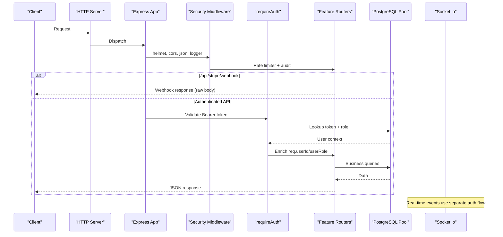

**Diagram sources**
- [server.ts:61-95](file://server/src/server.ts#L61-L95)
- [server.ts:219-277](file://server/src/server.ts#L219-L277)
- [context.ts:60-85](file://server/src/context.ts#L60-L85)
- [security.ts:103-147](file://server/src/security.ts#L103-L147)

## Detailed Component Analysis

### Application Bootstrap and Lifecycle
- Disables default Express signature header.
- Applies Helmet and CORS with an allowlist; in non-production environments, permissive behavior is used.
- Mounts Stripe webhook before JSON parsing so raw bytes are available for signature verification.
- Parses JSON bodies up to 1MB and adds a minimal request logger that prints method, path, status, and duration.
- Waits for PostgreSQL readiness with retries before starting the server.
- Initializes the payment gateway once at boot; invalid configuration aborts startup.
- Exposes `/api/health` to verify database connectivity and latency.
- Gracefully shuts down on SIGINT/SIGTERM by closing Socket.io, HTTP server, and releasing the database pool.

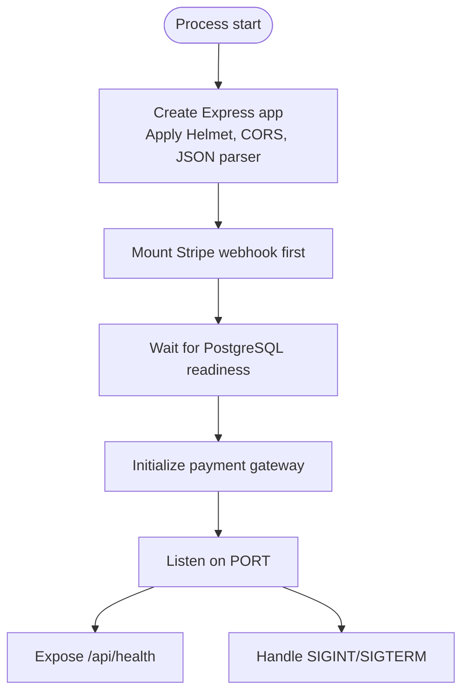

**Diagram sources**
- [server.ts:27-41](file://server/src/server.ts#L27-L41)
- [server.ts:47-59](file://server/src/server.ts#L47-L59)
- [server.ts:279-315](file://server/src/server.ts#L279-L315)

**Section sources**
- [server.ts:27-95](file://server/src/server.ts#L27-L95)
- [server.ts:219-277](file://server/src/server.ts#L219-L277)
- [server.ts:279-315](file://server/src/server.ts#L279-L315)

### Security Implementation
- Helmet is enabled to set secure headers.
- CORS allows specific development origins and relaxes rules outside production.
- Global rate limiter (`express-rate-limit`) protects `/api/*` with a configurable ceiling via `API_RATE_LIMIT_MAX`.
- Stricter rate limiters protect auth endpoints and sensitive flows like reports and feedback.
- Audit logging records mutating requests with redacted sensitive fields.
- Tokens are stored as SHA-256 digests; clients present plaintext tokens, which are hashed before lookup.

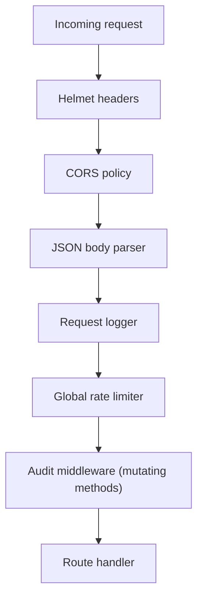

**Diagram sources**
- [server.ts:61-95](file://server/src/server.ts#L61-L95)
- [security.ts:28-68](file://server/src/security.ts#L28-L68)
- [security.ts:77-97](file://server/src/security.ts#L77-L97)
- [security.ts:103-147](file://server/src/security.ts#L103-L147)

**Section sources**
- [server.ts:61-95](file://server/src/server.ts#L61-L95)
- [security.ts:1-148](file://server/src/security.ts#L1-L148)

### Context-Based Request Handling Pattern
The application uses a context-enriched request object to carry authenticated identity and role information:
- `requireAuth` validates the Bearer token against `auth_tokens`, loads the user’s role, and attaches `userId` and `userRole` to the request.
- `requireRole(...)` restricts handlers to specific roles.
- `loadUser(id)` returns a normalized user profile shape used by endpoints.
- `ApiError` and helpers (`notFound`, `forbidden`, `unauthorized`) provide consistent error semantics.

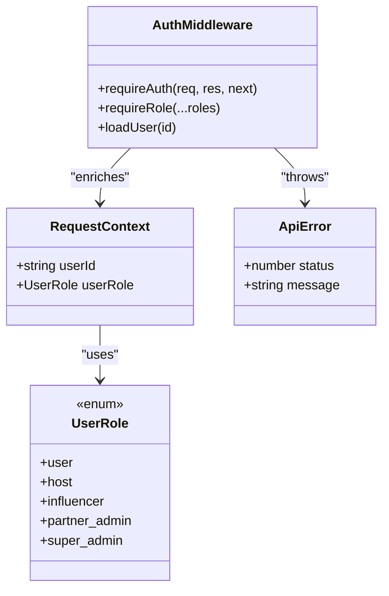

**Diagram sources**
- [context.ts:5-11](file://server/src/context.ts#L5-L11)
- [context.ts:27-37](file://server/src/context.ts#L27-L37)
- [context.ts:39-55](file://server/src/context.ts#L39-L55)
- [context.ts:60-98](file://server/src/context.ts#L60-L98)
- [context.ts:100-146](file://server/src/context.ts#L100-L146)

**Section sources**
- [context.ts:1-147](file://server/src/context.ts#L1-L147)

### Authentication Flow
Authentication supports multiple flows:
- Phone-based sign-in or OTP verification creates or finds a user and issues a token.
- Email/password signup and login issue tokens after password hashing and verification.
- Token management includes session retrieval, sign-out, credential changes with password confirmation, email change with challenge code, phone update, and logout-all.

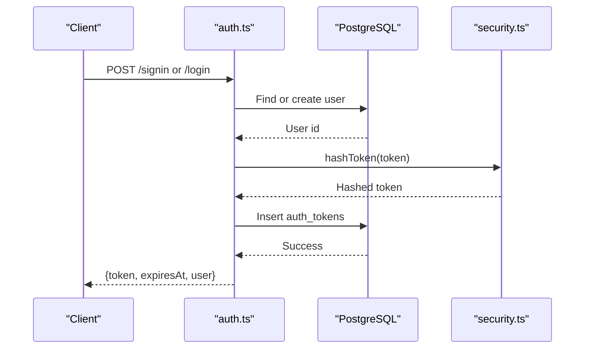

**Diagram sources**
- [auth.ts:19-61](file://server/src/routes/auth.ts#L19-L61)
- [auth.ts:159-280](file://server/src/routes/auth.ts#L159-L280)
- [security.ts:12-14](file://server/src/security.ts#L12-L14)

**Section sources**
- [auth.ts:1-528](file://server/src/routes/auth.ts#L1-L528)

### Input Validation Strategy
Input validation is performed using Zod schemas directly in route handlers. Schemas enforce format, length, and business constraints before any database interaction. Validation failures are caught by the global error handler and returned as structured client errors.

Key examples include phone number normalization, email validation, password strength checks, and six-digit code formats.

**Section sources**
- [auth.ts:14-18](file://server/src/routes/auth.ts#L14-L18)
- [auth.ts:160-184](file://server/src/routes/auth.ts#L160-L184)
- [server.ts:263-277](file://server/src/server.ts#L263-L277)

### Database Connection Management
- Uses `pg.Pool` with a connection string from environment variables and a maximum pool size of 10.
- Provides a typed `query` helper returning rows.
- Offers a `withTransaction` helper that begins, commits, rolls back on failure, and always releases the client.
- Startup waits for the database to respond to a simple query before accepting traffic.

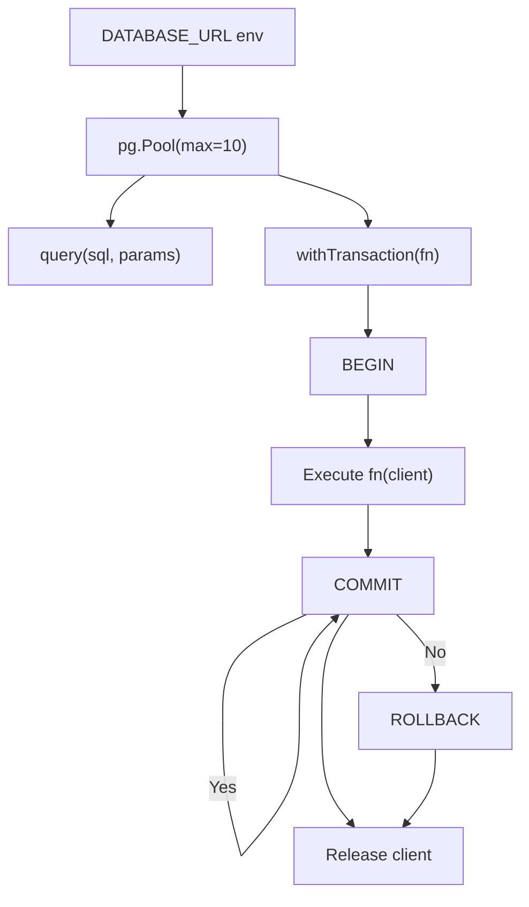

**Diagram sources**
- [db.ts:4-8](file://server/src/db.ts#L4-L8)
- [db.ts:12-19](file://server/src/db.ts#L12-L19)
- [db.ts:21-37](file://server/src/db.ts#L21-L37)

**Section sources**
- [db.ts:1-38](file://server/src/db.ts#L1-L38)
- [server.ts:47-59](file://server/src/server.ts#L47-L59)

### Payment Gateway Abstraction
The payment subsystem abstracts three implementations:
- Stripe: real SDK integration with intent creation, capture, cancel, refund, secret refresh, and webhook verification.
- Mock: offline implementation with Stripe-shaped IDs and test-only webhook signing.
- Simulated: historical instant-settlement mode with no external calls.

Boot selection logic chooses the active gateway based on environment variables and flags, failing fast if credentials are malformed.

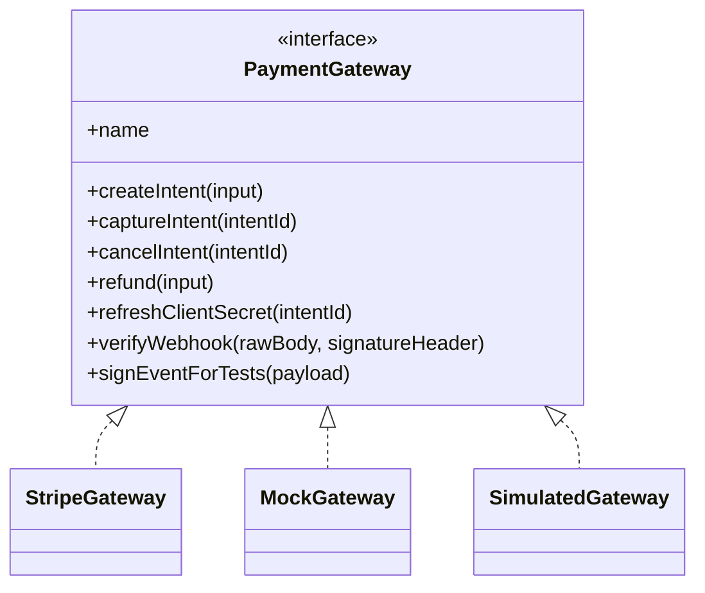

**Diagram sources**
- [payments.ts:51-71](file://server/src/payments.ts#L51-L71)
- [payments.ts:102-176](file://server/src/payments.ts#L102-L176)
- [payments.ts:185-232](file://server/src/payments.ts#L185-L232)
- [payments.ts:236-266](file://server/src/payments.ts#L236-L266)

**Section sources**
- [payments.ts:1-391](file://server/src/payments.ts#L1-L391)

### Error Handling Strategy
- Custom `ApiError` carries HTTP status codes and messages.
- Zod validation errors are handled globally to return structured issues.
- Unhandled exceptions are logged and mapped to a generic server error response.
- Route handlers throw `ApiError` instances for domain-level failures (e.g., forbidden, not found).

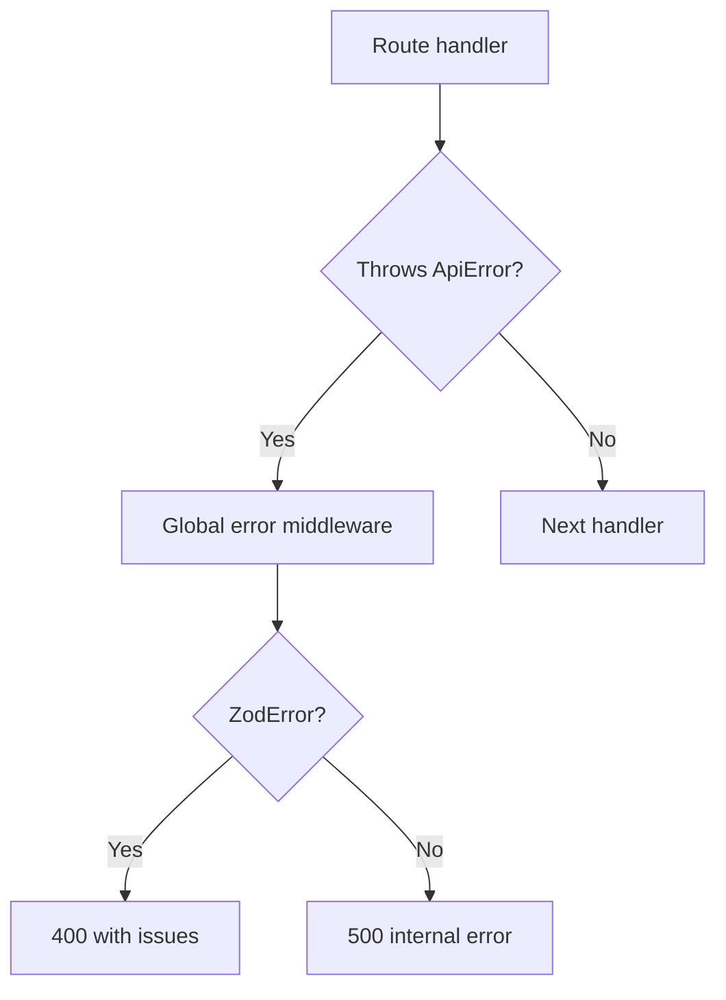

**Diagram sources**
- [context.ts:39-55](file://server/src/context.ts#L39-L55)
- [server.ts:263-277](file://server/src/server.ts#L263-L277)

**Section sources**
- [context.ts:39-55](file://server/src/context.ts#L39-L55)
- [server.ts:263-277](file://server/src/server.ts#L263-L277)

### Logging and Monitoring
- Minimal request logger outputs method, URL, status, and duration for every request.
- Audit middleware records mutating requests with sanitized payloads and metadata.
- Health endpoint exposes service status, database connectivity, latency, and timestamp.
- Process signals trigger graceful shutdown, closing sockets, HTTP server, and releasing the database pool.

**Section sources**
- [server.ts:34-41](file://server/src/server.ts#L34-L41)
- [security.ts:103-147](file://server/src/security.ts#L103-L147)
- [server.ts:224-233](file://server/src/server.ts#L224-L233)
- [server.ts:302-315](file://server/src/server.ts#L302-L315)

### Modular Architecture and Dependency Injection
- Feature routers are organized by domain under `src/routes/` and mounted on Express paths.
- Shared services (authentication, authorization, database, security utilities) are imported by routes rather than passed explicitly, following a module-level dependency pattern.
- Payment gateway is initialized once at boot and accessed via a getter, acting as a simple singleton-style DI container.
- Socket.io event handlers reuse the same database and security primitives for authorization checks.

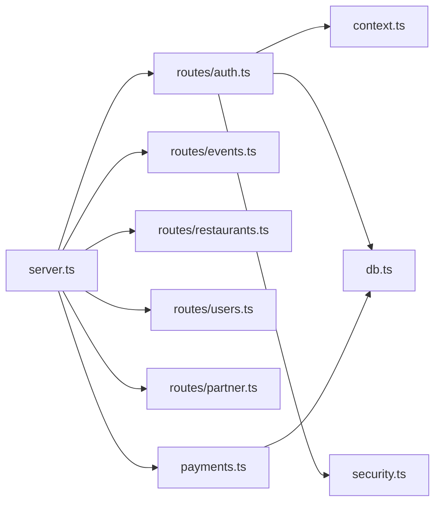

**Diagram sources**
- [server.ts:11-24](file://server/src/server.ts#L11-L24)
- [server.ts:241-257](file://server/src/server.ts#L241-L257)
- [payments.ts:270-325](file://server/src/payments.ts#L270-L325)

**Section sources**
- [server.ts:11-24](file://server/src/server.ts#L11-L24)
- [server.ts:241-257](file://server/src/server.ts#L241-L257)
- [payments.ts:270-325](file://server/src/payments.ts#L270-L325)

## Dependency Analysis
External dependencies are declared in `package.json` and consumed throughout the server:
- Express for routing and middleware.
- CORS and Helmet for security headers and cross-origin policy.
- express-rate-limit for request throttling.
- pg for PostgreSQL connection pooling.
- socket.io for real-time channels.
- stripe for payment processing.
- zod for input validation.
- dotenv for environment configuration.

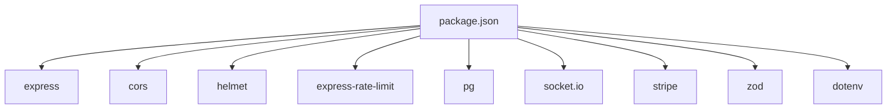

**Diagram sources**
- [package.json:17-27](file://server/package.json#L17-L27)

**Section sources**
- [package.json:1-37](file://server/package.json#L1-L37)

## Performance Considerations
- Connection pooling limits concurrent database connections to a fixed maximum; tune `max` based on workload and database capacity.
- Global rate limiting protects endpoints from abuse; adjust window sizes and ceilings per route sensitivity.
- Audit logging is fire-and-forget to avoid blocking request paths; monitor insert failures separately.
- Stripe webhook handling occurs before JSON parsing to preserve raw payload integrity.
- Avoid heavy synchronous operations in middleware; keep middleware thin and asynchronous where needed.

[No sources needed since this section provides general guidance]

## Troubleshooting Guide
- Database not ready at startup: The server retries until PostgreSQL responds; check `DATABASE_URL` and network connectivity.
- Payment gateway misconfiguration: Invalid Stripe keys cause immediate startup failure; verify `STRIPE_SECRET_KEY` and `PAYMENTS_MODE`.
- CORS rejections: Ensure client origin matches the allowlist or adjust environment-specific behavior.
- Rate limiting errors: Inspect `API_RATE_LIMIT_MAX`, `AUTH_RATE_LIMIT_MAX`, and related environment variables.
- Audit log misses: Confirm mutating methods reach the audit middleware and that the database is writable.
- Graceful shutdown issues: Verify signal handlers close Socket.io and release the database pool.

**Section sources**
- [server.ts:47-59](file://server/src/server.ts#L47-L59)
- [server.ts:288-297](file://server/src/server.ts#L288-L297)
- [server.ts:302-315](file://server/src/server.ts#L302-L315)
- [security.ts:28-68](file://server/src/security.ts#L28-L68)

## Conclusion
The DineCircle server follows a clear, modular architecture centered around Express and Socket.io. Security is enforced early in the pipeline, authentication enriches requests with user context, and database access is pooled and transactional. Payments are abstracted behind a pluggable gateway interface, and errors are consistently modeled. Logging and audit trails support observability, while graceful shutdown ensures clean resource cleanup. This design balances simplicity for rapid iteration with robustness for production operations.

[No sources needed since this section summarizes without analyzing specific files]