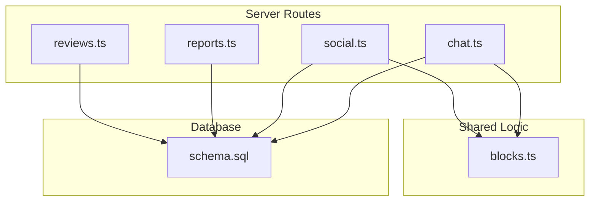
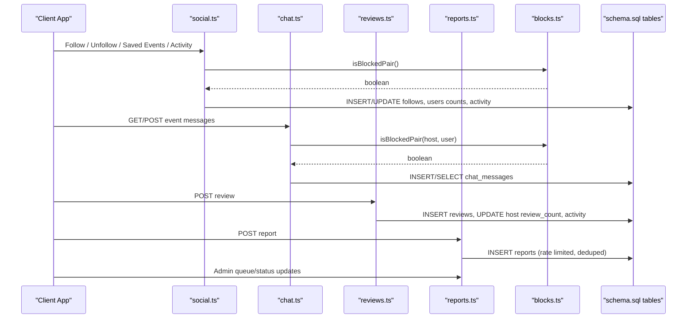
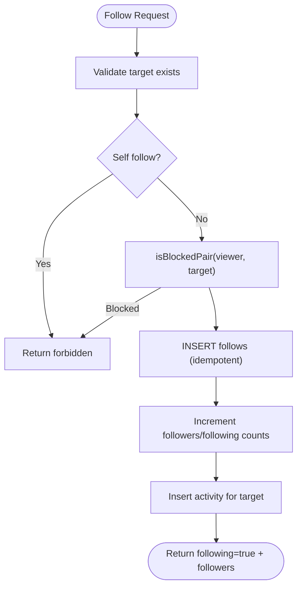
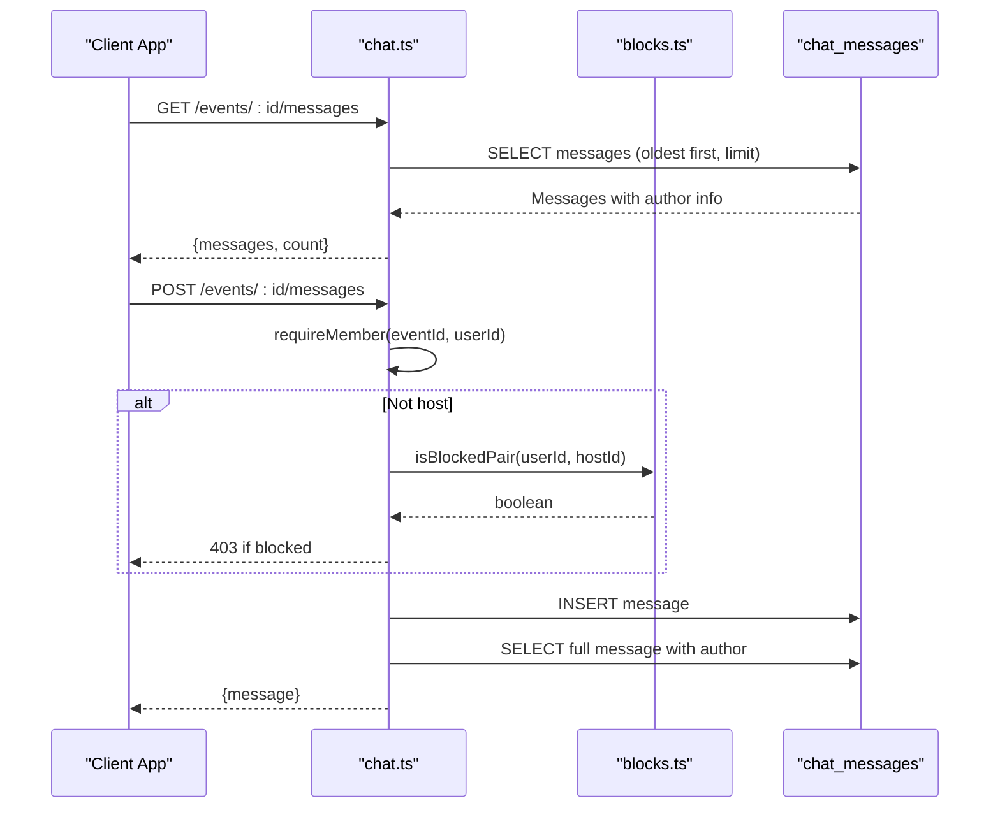
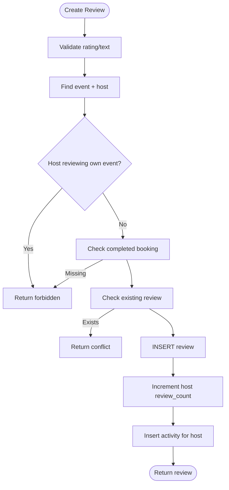
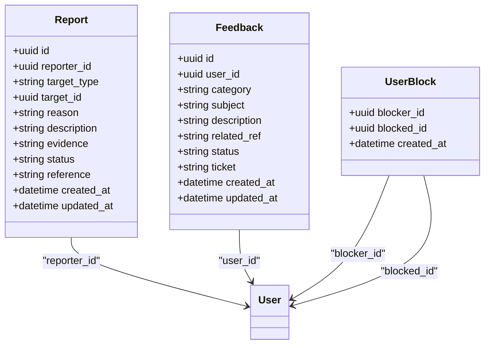
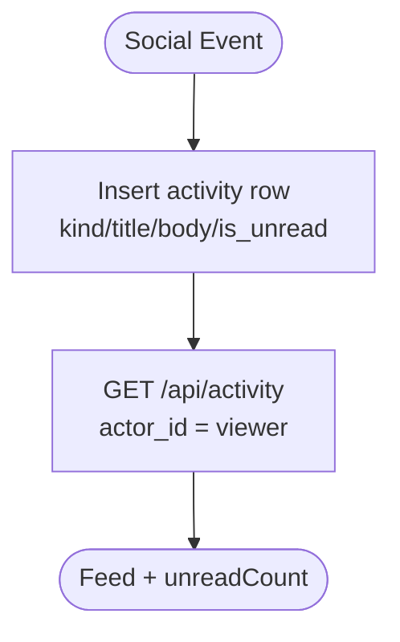
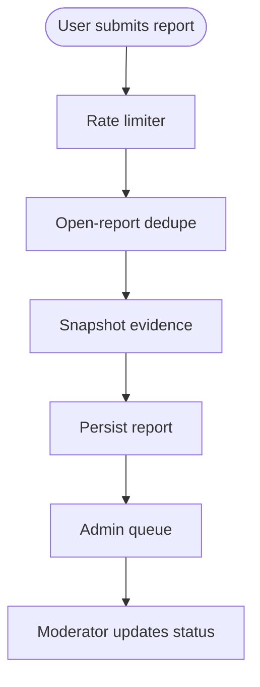
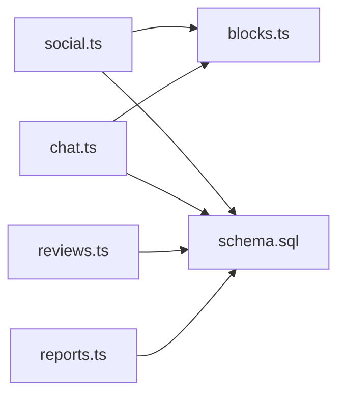

# Social Features & Community

<cite>
**Referenced Files in This Document**
- [social.ts](file://server/src/routes/social.ts)
- [chat.ts](file://server/src/routes/chat.ts)
- [reviews.ts](file://server/src/routes/reviews.ts)
- [reports.ts](file://server/src/routes/reports.ts)
- [blocks.ts](file://server/src/blocks.ts)
- [schema.sql](file://server/src/schema.sql)
</cite>

## Table of Contents
1. [Introduction](#introduction)
2. [Project Structure](#project-structure)
3. [Core Components](#core-components)
4. [Architecture Overview](#architecture-overview)
5. [Detailed Component Analysis](#detailed-component-analysis)
6. [Dependency Analysis](#dependency-analysis)
7. [Performance Considerations](#performance-considerations)
8. [Troubleshooting Guide](#troubleshooting-guide)
9. [Conclusion](#conclusion)

## Introduction
This document explains the social features and community interactions implemented in the server-side API. It covers:
- User following system with relationship management and activity feed generation
- Event-based messaging with persistence and safety checks
- Review and rating system with moderation support
- Safety features including blocking, reporting, and admin moderation workflows
- Notification behavior via an activity table
- Integration points for real-time chat patterns and social graph enforcement

The goal is to make these systems understandable for both technical and non-technical readers while providing concrete references to the implementation.

## Project Structure
The social features are primarily implemented as Express routes under `server/src/routes`, with shared safety logic in `server/src/blocks.ts` and a single source-of-truth database schema in `server/src/schema.sql`. The Flutter app exposes screens and providers that call these endpoints, but this document focuses on the server-side contracts and data model.

**Diagram sources**
- [social.ts:1-355](file://server/src/routes/social.ts#L1-L355)
- [chat.ts:1-134](file://server/src/routes/chat.ts#L1-L134)
- [reviews.ts:1-151](file://server/src/routes/reviews.ts#L1-L151)
- [reports.ts:1-283](file://server/src/routes/reports.ts#L1-L283)
- [blocks.ts:1-42](file://server/src/blocks.ts#L1-L42)
- [schema.sql:306-474](file://server/src/schema.sql#L306-L474)

**Section sources**
- [social.ts:1-355](file://server/src/routes/social.ts#L1-L355)
- [chat.ts:1-134](file://server/src/routes/chat.ts#L1-L134)
- [reviews.ts:1-151](file://server/src/routes/reviews.ts#L1-L151)
- [reports.ts:1-283](file://server/src/routes/reports.ts#L1-L283)
- [blocks.ts:1-42](file://server/src/blocks.ts#L1-L42)
- [schema.sql:306-474](file://server/src/schema.sql#L306-L474)

## Core Components
- Following and social graph: Follow/unfollow users, batch follow-status checks, saved events, and activity notifications. Blocking severs mutual follows and prevents new interactions.
- Messaging: Per-event chat threads with member-only access, author info enrichment, and block checks against the event host.
- Reviews and ratings: Guest-only reviews for completed bookings, duplicate prevention, and activity notification to hosts.
- Reports and moderation: Polymorphic reports for users, events, reviews, and messages; rate-limited submission; admin queue with status transitions.
- Safety primitives: Symmetric blocking checks and SQL predicates to hide blocked content from discovery/feeds.

**Section sources**
- [social.ts:140-355](file://server/src/routes/social.ts#L140-L355)
- [chat.ts:1-134](file://server/src/routes/chat.ts#L1-L134)
- [reviews.ts:21-151](file://server/src/routes/reviews.ts#L21-L151)
- [reports.ts:10-283](file://server/src/routes/reports.ts#L10-L283)
- [blocks.ts:1-42](file://server/src/blocks.ts#L1-L42)

## Architecture Overview
The social subsystem is organized around REST endpoints that enforce business rules before persisting data. Shared safety logic centralizes blocking checks so every route behaves consistently. Data models are defined once in the schema and referenced by routes.

**Diagram sources**
- [social.ts:30-355](file://server/src/routes/social.ts#L30-L355)
- [chat.ts:13-131](file://server/src/routes/chat.ts#L13-L131)
- [reviews.ts:81-151](file://server/src/routes/reviews.ts#L81-L151)
- [reports.ts:150-283](file://server/src/routes/reports.ts#L150-L283)
- [blocks.ts:13-41](file://server/src/blocks.ts#L13-L41)
- [schema.sql:306-474](file://server/src/schema.sql#L306-L474)

## Detailed Component Analysis

### User Following System and Feed Generation
- Follow/unfollow:
  - Prevents self-follow and enforces blocking symmetry.
  - Updates follower/following counts atomically and inserts an activity record for the target user.
- Batch follow status:
  - Efficiently returns a map of whether the current viewer follows each requested user ID.
- Saved events:
  - Bookmark/unbookmark events and list them ordered by start time.
- Activity feed:
  - Returns the signed-in user’s activity items newest-first with unread count.
  - Supports marking all items read.

**Diagram sources**
- [social.ts:170-227](file://server/src/routes/social.ts#L170-L227)
- [blocks.ts:13-24](file://server/src/blocks.ts#L13-L24)

**Section sources**
- [social.ts:29-67](file://server/src/routes/social.ts#L29-L67)
- [social.ts:84-138](file://server/src/routes/social.ts#L84-L138)
- [social.ts:140-257](file://server/src/routes/social.ts#L140-L257)
- [schema.sql:306-331](file://server/src/schema.sql#L306-L331)
- [schema.sql:333-347](file://server/src/schema.sql#L333-L347)

### Messaging System (Event Chat)
- Access control:
  - Only event host, attendees, or guests with active bookings can join the thread.
- Message persistence:
  - Messages are stored with author, text, timestamp, and system flag.
  - Author details are enriched on read.
- Safety:
  - If the sender is not the host, a block check against the host prevents posting.
  - Existing message history remains readable even if a block occurs later.

**Diagram sources**
- [chat.ts:13-131](file://server/src/routes/chat.ts#L13-L131)
- [blocks.ts:13-24](file://server/src/blocks.ts#L13-L24)
- [schema.sql:349-357](file://server/src/schema.sql#L349-L357)

**Section sources**
- [chat.ts:1-134](file://server/src/routes/chat.ts#L1-L134)
- [schema.sql:349-357](file://server/src/schema.sql#L349-L357)

### Review and Rating System
- Submission rules:
  - Only guests who attended and completed a booking can review.
  - Hosts cannot review their own events.
  - One review per event per user enforced at the database level.
- Enrichment and notifications:
  - Reviews include author profile fields.
  - An activity item is created for the host when a new review arrives.

**Diagram sources**
- [reviews.ts:81-151](file://server/src/routes/reviews.ts#L81-L151)
- [schema.sql:294-304](file://server/src/schema.sql#L294-L304)
- [schema.sql:333-347](file://server/src/schema.sql#L333-L347)

**Section sources**
- [reviews.ts:21-151](file://server/src/routes/reviews.ts#L21-L151)
- [schema.sql:294-304](file://server/src/schema.sql#L294-L304)
- [schema.sql:333-347](file://server/src/schema.sql#L333-L347)

### Safety Features: Blocking, Reporting, and Moderation Workflows
- Blocking:
  - Symmetric enforcement: either direction blocks all social interactions between the pair.
  - Blocking removes mutual follows in a transaction and updates counts safely.
  - Unblock does not restore previous follows.
- Reporting:
  - Users can report users, events, reviews, and messages.
  - Rate-limited submissions and deduplication for open reports.
  - Evidence snapshot preserved even if target is deleted.
  - Admin-only moderation queue with status transitions.

**Diagram sources**
- [schema.sql:426-474](file://server/src/schema.sql#L426-L474)
- [schema.sql:476-496](file://server/src/schema.sql#L476-L496)

**Section sources**
- [social.ts:259-352](file://server/src/routes/social.ts#L259-L352)
- [blocks.ts:1-42](file://server/src/blocks.ts#L1-L42)
- [reports.ts:10-283](file://server/src/routes/reports.ts#L10-L283)
- [schema.sql:426-496](file://server/src/schema.sql#L426-L496)

### Notification System (Activity Feed)
- Activity records are created for key social events such as new followers and new reviews.
- The activity endpoint returns the recipient’s feed with unread flags and actor metadata.
- Clients can mark all items read.

**Diagram sources**
- [social.ts:29-67](file://server/src/routes/social.ts#L29-L67)
- [social.ts:207-215](file://server/src/routes/social.ts#L207-L215)
- [reviews.ts:127-136](file://server/src/routes/reviews.ts#L127-L136)
- [schema.sql:333-347](file://server/src/schema.sql#L333-L347)

**Section sources**
- [social.ts:29-67](file://server/src/routes/social.ts#L29-L67)
- [schema.sql:333-347](file://server/src/schema.sql#L333-L347)

### Social Graph Algorithms and Recommendations
- Current implementation provides:
  - Follow/unfollow relationships and counts.
  - Batch follow-status queries for efficient UI rendering.
  - Blocked-pair checks to hide or disallow interactions.
- Recommendation algorithms (e.g., friend suggestions, community building) are not present in the analyzed routes. They would typically build on top of the follows table and blocking predicates.

[No sources needed since this section describes conceptual extension beyond analyzed code]

### Content Moderation Pipeline and Automated Filtering
- Automated safeguards:
  - Rate limiting on report submissions.
  - Deduplication of open reports per reporter+target.
  - Evidence snapshots to preserve context after deletion.
- Human moderation:
  - Admin-only queue to view and update report statuses.
  - No automatic bans or content removal in this phase; status changes drive future enforcement.

**Diagram sources**
- [reports.ts:150-198](file://server/src/routes/reports.ts#L150-L198)
- [reports.ts:220-283](file://server/src/routes/reports.ts#L220-L283)
- [schema.sql:443-474](file://server/src/schema.sql#L443-L474)

**Section sources**
- [reports.ts:150-283](file://server/src/routes/reports.ts#L150-L283)
- [schema.sql:443-474](file://server/src/schema.sql#L443-L474)

## Dependency Analysis
- Route-to-route dependencies:
  - `social.ts` depends on `blocks.ts` for symmetric blocking checks and on the database for follows, user counts, and activity.
  - `chat.ts` depends on `blocks.ts` to prevent blocked users from chatting with the event host.
  - `reviews.ts` writes to reviews and activity tables and updates host counters.
  - `reports.ts` depends on security rate limiters and the reports table.
- Database dependencies:
  - All social entities are modeled in `schema.sql`, including follows, user_blocks, activity, chat_messages, reviews, and reports.

**Diagram sources**
- [social.ts:1-355](file://server/src/routes/social.ts#L1-L355)
- [chat.ts:1-134](file://server/src/routes/chat.ts#L1-L134)
- [reviews.ts:1-151](file://server/src/routes/reviews.ts#L1-L151)
- [reports.ts:1-283](file://server/src/routes/reports.ts#L1-L283)
- [blocks.ts:1-42](file://server/src/blocks.ts#L1-L42)
- [schema.sql:306-474](file://server/src/schema.sql#L306-L474)

**Section sources**
- [social.ts:1-355](file://server/src/routes/social.ts#L1-L355)
- [chat.ts:1-134](file://server/src/routes/chat.ts#L1-L134)
- [reviews.ts:1-151](file://server/src/routes/reviews.ts#L1-L151)
- [reports.ts:1-283](file://server/src/routes/reports.ts#L1-L283)
- [blocks.ts:1-42](file://server/src/blocks.ts#L1-L42)
- [schema.sql:306-474](file://server/src/schema.sql#L306-L474)

## Performance Considerations
- Batch follow-status queries reduce N+1 lookups for list screens.
- Activity feed uses LIMIT and indexes on actor and timestamps for fast pagination.
- Chat messages are paginated with a reasonable limit and indexed by event and timestamp.
- Reports use partial unique indexes to prevent duplicate open reports efficiently.
- Blocking checks are centralized and used across routes to avoid redundant logic.

[No sources needed since this section provides general guidance]

## Troubleshooting Guide
- Cannot follow a user:
  - Verify the target exists and is not yourself.
  - Check if either party has blocked the other; blocking is symmetric.
- Cannot post in event chat:
  - Ensure you are a host, attendee, or have an active booking.
  - If not the host, verify you are not blocked by the host.
- Cannot submit a review:
  - Confirm you attended and completed the booking.
  - Ensure you are not the host and have not already reviewed the event.
- Report submission fails:
  - Check rate limits and whether an open report already exists for the same target.
  - Ensure the reported entity still exists and is not anonymized.

**Section sources**
- [social.ts:170-227](file://server/src/routes/social.ts#L170-L227)
- [chat.ts:13-99](file://server/src/routes/chat.ts#L13-L99)
- [reviews.ts:81-116](file://server/src/routes/reviews.ts#L81-L116)
- [reports.ts:150-198](file://server/src/routes/reports.ts#L150-L198)

## Conclusion
The social features provide a robust foundation for community interactions:
- A clear, safe following system with activity-driven notifications
- Event-scoped messaging with strict access and blocking controls
- A guest-only review system that enriches host profiles and feeds
- Comprehensive safety tools including symmetric blocking and moderated reporting
- A scalable data model that supports future recommendation and moderation enhancements

These components are designed for extensibility, allowing additional social graph algorithms and automated content filtering to be layered on top without disrupting existing contracts.