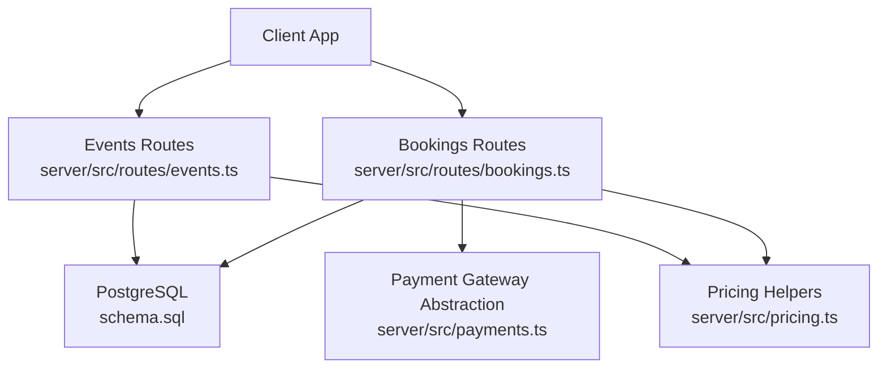
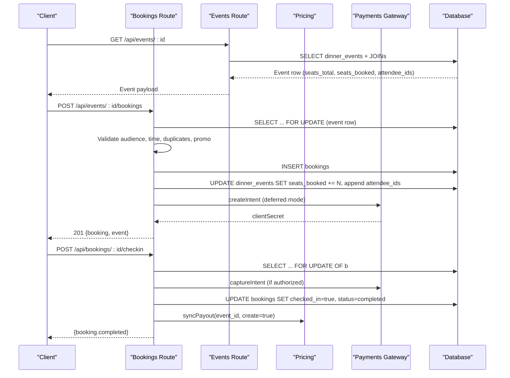
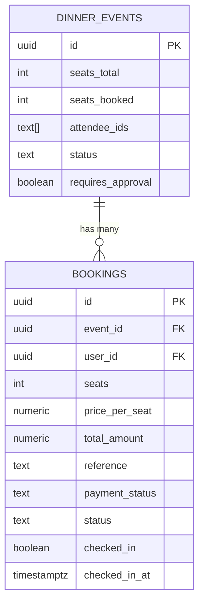
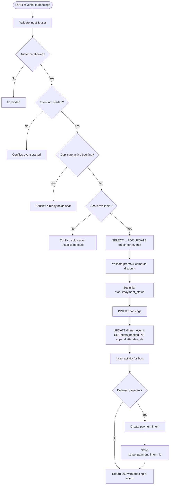
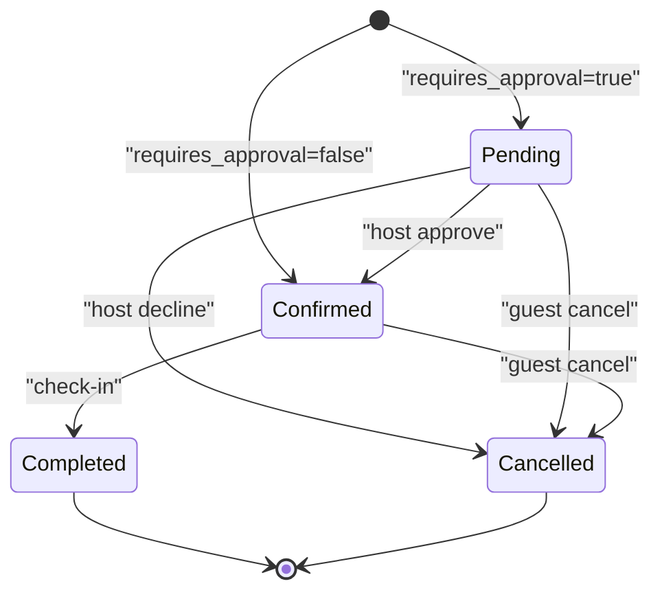
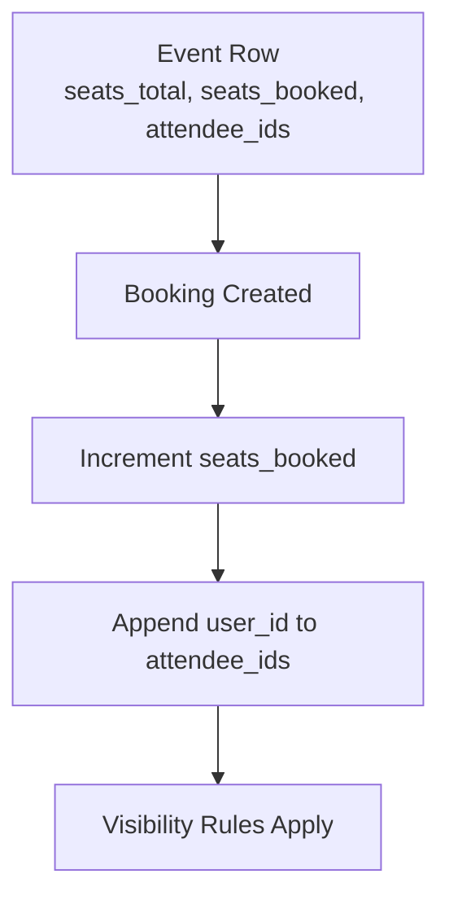
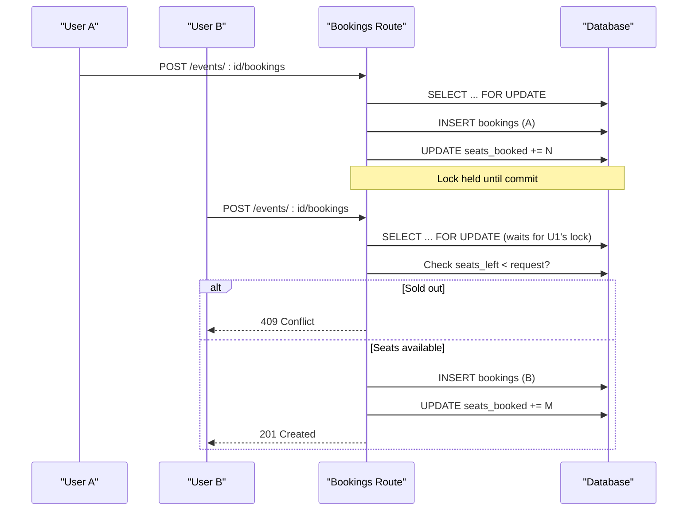
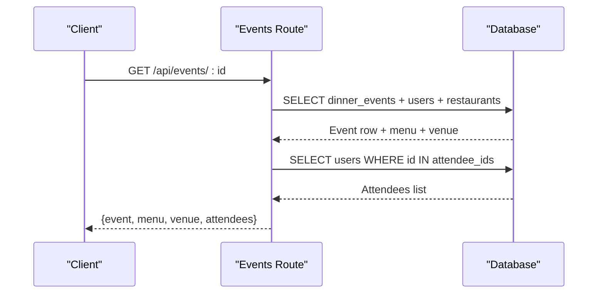
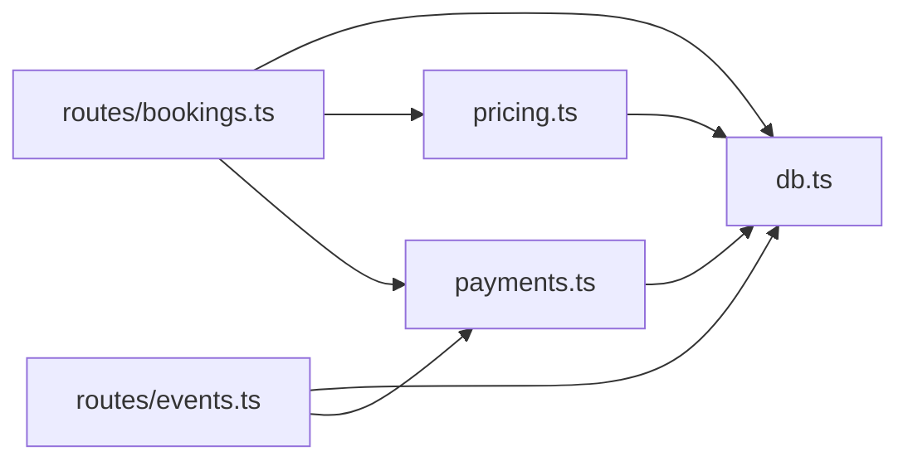

# Booking Management

<cite>
**Referenced Files in This Document**
- [bookings.ts](file://server/src/routes/bookings.ts)
- [events.ts](file://server/src/routes/events.ts)
- [schema.sql](file://server/src/schema.sql)
- [schema.ts](file://server/src/schema.ts)
- [pricing.ts](file://server/src/pricing.ts)
- [payments.ts](file://server/src/payments.ts)
</cite>

## Table of Contents
1. [Introduction](#introduction)
2. [Project Structure](#project-structure)
3. [Core Components](#core-components)
4. [Architecture Overview](#architecture-overview)
5. [Detailed Component Analysis](#detailed-component-analysis)
6. [Dependency Analysis](#dependency-analysis)
7. [Performance Considerations](#performance-considerations)
8. [Troubleshooting Guide](#troubleshooting-guide)
9. [Conclusion](#conclusion)

## Introduction
This document explains the booking management system for DinCircle’s dinner events. It covers:
- The bookings table structure and its relationship to dinner_events.
- Seat reservation logic, including capacity fields seats_total and seats_booked.
- Booking status workflows (confirmed, pending, completed, cancelled).
- Attendee tracking through attendee_ids arrays on dinner_events.
- The end-to-end booking creation flow, seat allocation, and conflict resolution under high concurrency.
- Examples of queries, status transitions, and integration with the event system.
- Performance considerations and data consistency patterns for concurrent bookings.

## Project Structure
The booking system is implemented in the server-side TypeScript routes and backed by a PostgreSQL schema. Key files:
- Route handlers for bookings and events.
- Database schema defining tables, constraints, and indexes.
- Pricing helpers for payouts and refunds.
- Payment gateway abstraction supporting Stripe, mock, and simulated modes.

**Diagram sources**
- [bookings.ts:1-888](file://server/src/routes/bookings.ts#L1-L888)
- [events.ts:1-636](file://server/src/routes/events.ts#L1-L636)
- [schema.sql:121-212](file://server/src/schema.sql#L121-L212)
- [pricing.ts:1-270](file://server/src/pricing.ts#L1-L270)
- [payments.ts:1-391](file://server/src/payments.ts#L1-L391)

**Section sources**
- [bookings.ts:1-888](file://server/src/routes/bookings.ts#L1-L888)
- [events.ts:1-636](file://server/src/routes/events.ts#L1-L636)
- [schema.sql:121-212](file://server/src/schema.sql#L121-L212)
- [pricing.ts:1-270](file://server/src/pricing.ts#L1-L270)
- [payments.ts:1-391](file://server/src/payments.ts#L1-L391)

## Core Components
- Bookings route: handles listing, creating, cancelling, approving/declining requests, check-in, and payment refresh.
- Events route: exposes event discovery, visibility rules, and event metadata including seats_total, seats_booked, and attendee_ids.
- Schema: defines dinner_events and bookings tables, enums via CHECK constraints, and related indexes.
- Pricing: recomputes host payouts from captured seats and records refund decisions idempotently.
- Payments: abstracts Stripe/mocked/simulated gateways, manages deferred payment state, abandoned checkout sweep, and webhook settlement.

Key responsibilities:
- Capacity management: seats_total vs seats_booked on dinner_events; updated atomically with booking mutations.
- Status workflow: booking status transitions enforced per operation; payment_status tracks money lifecycle.
- Attendee tracking: attendee_ids array maintained when seats are booked or approved; removed only if no active booking remains.
- Concurrency safety: FOR UPDATE locks around critical reads/writes; transactional updates ensure consistency.

**Section sources**
- [bookings.ts:133-405](file://server/src/routes/bookings.ts#L133-L405)
- [bookings.ts:420-564](file://server/src/routes/bookings.ts#L420-L564)
- [bookings.ts:566-761](file://server/src/routes/bookings.ts#L566-L761)
- [bookings.ts:763-848](file://server/src/routes/bookings.ts#L763-L848)
- [events.ts:16-122](file://server/src/routes/events.ts#L16-L122)
- [schema.sql:121-212](file://server/src/schema.sql#L121-L212)
- [pricing.ts:21-94](file://server/src/pricing.ts#L21-L94)
- [payments.ts:7-27](file://server/src/payments.ts#L7-L27)

## Architecture Overview
The booking system integrates three layers:
- API layer: Express routes for bookings and events.
- Domain layer: pricing and payments utilities encapsulating business rules for payouts, refunds, and payment flows.
- Data layer: PostgreSQL schema with explicit constraints and indexes.

**Diagram sources**
- [events.ts:258-343](file://server/src/routes/events.ts#L258-L343)
- [bookings.ts:156-405](file://server/src/routes/bookings.ts#L156-L405)
- [bookings.ts:763-848](file://server/src/routes/bookings.ts#L763-L848)
- [pricing.ts:57-94](file://server/src/pricing.ts#L57-L94)
- [payments.ts:114-123](file://server/src/payments.ts#L114-L123)

## Detailed Component Analysis

### Database Model: dinner_events and bookings
- dinner_events:
  - seats_total: maximum seats allowed for the event.
  - seats_booked: number of seats currently held/booked; must remain non-negative.
  - attendee_ids: text[] of guest IDs who have been confirmed into the event.
  - status: event lifecycle (draft, requested, confirmed, live, completed, declined, cancelled).
  - requires_approval: boolean gating approval-based bookings.
- bookings:
  - user_id: guest holding the seat.
  - seats: number of seats reserved by this booking.
  - price_per_seat, total_amount: monetary values.
  - reference: unique human-readable booking reference.
  - payment_status: unpaid, pending_payment, authorized, paid, refunded, failed.
  - status: confirmed, pending, completed, cancelled.
  - checked_in, checked_in_at: attendance flags.

Indexes:
- idx_bookings_user, idx_bookings_event optimize lookups by user/event.
- idx_events_* support event filtering and analytics.

**Diagram sources**
- [schema.sql:121-212](file://server/src/schema.sql#L121-L212)

**Section sources**
- [schema.sql:121-212](file://server/src/schema.sql#L121-L212)

### Booking Creation Flow and Seat Allocation
- Input validation: seats between 1 and 10; optional promo code validated server-side.
- Audience checks: followers-only and invite-only enforcement using follows and attendee_ids.
- Time guard: cannot book events that already started.
- Duplicate guard: prevents multiple active bookings (confirmed/pending) by the same user for the same event.
- Capacity check: ensures seats_left >= requested seats.
- Transactional lock: SELECT ... FOR UPDATE on dinner_events prevents overselling under concurrency.
- Insert booking: creates a booking row with initial status/payment_status depending on requires_approval and payment mode.
- Update capacity: increments seats_booked and appends user_id to attendee_ids if not present.
- Activity feed: notifies host about new guests.
- Payment intent: if deferred payment is enabled, creates a payment intent outside the lock; stores stripe_payment_intent_id.

**Diagram sources**
- [bookings.ts:156-405](file://server/src/routes/bookings.ts#L156-L405)

**Section sources**
- [bookings.ts:133-405](file://server/src/routes/bookings.ts#L133-L405)

### Booking Status Workflow
- Initial states:
  - requires_approval = true: status = pending, payment_status = authorized (or pending_payment in deferred mode).
  - requires_approval = false: status = confirmed, payment_status = paid (or pending_payment in deferred mode).
- Host approval:
  - Approve: captures payment intent if needed; sets status = confirmed; adds guest to attendee_ids; notifies guest.
  - Decline: sets status = cancelled, payment_status = refunded; releases seats; removes guest from attendee_ids unless another active booking exists; notifies guest.
- Guest cancellation:
  - Sets status = cancelled; marks payment_status = refunded if previously paid/authorized; releases seats; books refund ledger entry; syncs payout.
- Check-in:
  - Only guest or host can check in; sets checked_in = true, checked_in_at = now(), status = completed; captures authorization if applicable; syncs payout.

**Diagram sources**
- [bookings.ts:420-564](file://server/src/routes/bookings.ts#L420-L564)
- [bookings.ts:566-761](file://server/src/routes/bookings.ts#L566-L761)
- [bookings.ts:763-848](file://server/src/routes/bookings.ts#L763-L848)

**Section sources**
- [bookings.ts:420-564](file://server/src/routes/bookings.ts#L420-L564)
- [bookings.ts:566-761](file://server/src/routes/bookings.ts#L566-L761)
- [bookings.ts:763-848](file://server/src/routes/bookings.ts#L763-L848)

### Relationship Between Bookings and Dinner Events
- Capacity:
  - seats_total defines max capacity; seats_booked reflects current reservations.
  - Updated atomically within transactions to prevent race conditions.
- Attendees:
  - attendee_ids tracks confirmed attendees; appended during booking creation and approval; conditionally removed on decline/cancellation if no other active booking remains.
- Visibility:
  - Event visibility rules consider audience types and whether the viewer is a follower or has an active booking.

**Diagram sources**
- [events.ts:124-138](file://server/src/routes/events.ts#L124-L138)
- [bookings.ts:298-307](file://server/src/routes/bookings.ts#L298-L307)
- [bookings.ts:651-658](file://server/src/routes/bookings.ts#L651-L658)

**Section sources**
- [events.ts:124-138](file://server/src/routes/events.ts#L124-L138)
- [bookings.ts:298-307](file://server/src/routes/bookings.ts#L298-L307)
- [bookings.ts:651-658](file://server/src/routes/bookings.ts#L651-L658)

### Conflict Resolution Under High Concurrency
- Row-level locking:
  - SELECT ... FOR UPDATE on dinner_events during booking creation serializes access to capacity and attendee lists.
- Duplicate prevention:
  - Query for existing active bookings (confirmed/pending) by user+event before inserting.
- Capacity integrity:
  - seats_booked updated with arithmetic inside the same transaction as booking insert.
- Payment hold release:
  - If payment intent creation fails, releaseFailedBooking rolls back seat holds and attendee membership.
- Abandoned checkout sweep:
  - Periodic cleanup cancels pending_payment bookings older than threshold, releasing seats and removing attendees.

**Diagram sources**
- [bookings.ts:180-232](file://server/src/routes/bookings.ts#L180-L232)
- [bookings.ts:298-307](file://server/src/routes/bookings.ts#L298-L307)
- [payments.ts:335-390](file://server/src/payments.ts#L335-L390)

**Section sources**
- [bookings.ts:180-232](file://server/src/routes/bookings.ts#L180-L232)
- [bookings.ts:298-307](file://server/src/routes/bookings.ts#L298-L307)
- [payments.ts:335-390](file://server/src/payments.ts#L335-L390)

### Integration With the Event System
- Event detail endpoint returns seatsTotal, seatsBooked, seatsLeft, and attendeeIds.
- Visibility rules enforce audience restrictions and allow hosts/booked guests to see events.
- Menu and venue details are joined and returned alongside event metadata.

**Diagram sources**
- [events.ts:258-343](file://server/src/routes/events.ts#L258-L343)

**Section sources**
- [events.ts:258-343](file://server/src/routes/events.ts#L258-L343)

## Dependency Analysis
- Bookings route depends on:
  - Database helpers (query, withTransaction).
  - Context utilities (ApiError, notFound, forbidden).
  - Blocks utility (isBlockedPair).
  - Pricing helpers (syncPayout, recordRefund, releaseFailedBooking).
  - Payments helpers (getGateway, usesDeferredPayment, centsFromAmount, sweepAbandonedPendingPayments).
- Events route depends on:
  - Database helpers.
  - Context utilities.
  - Blocks utility (notBlockedBetween).
  - Payments helpers (getGateway, sweepAbandonedPendingPayments).
- Pricing module:
  - Computes platform commission and reconciles payouts from bookings.
  - Records refunds and settles payment intents via webhooks.
- Payments module:
  - Abstracts Stripe/mocked/simulated gateways.
  - Manages deferred payment lifecycle and abandoned checkout cleanup.

**Diagram sources**
- [bookings.ts:1-14](file://server/src/routes/bookings.ts#L1-L14)
- [events.ts:1-7](file://server/src/routes/events.ts#L1-L7)
- [pricing.ts:1-20](file://server/src/pricing.ts#L1-L20)
- [payments.ts:1-27](file://server/src/payments.ts#L1-L27)

**Section sources**
- [bookings.ts:1-14](file://server/src/routes/bookings.ts#L1-L14)
- [events.ts:1-7](file://server/src/routes/events.ts#L1-L7)
- [pricing.ts:1-20](file://server/src/pricing.ts#L1-L20)
- [payments.ts:1-27](file://server/src/payments.ts#L1-L27)

## Performance Considerations
- Concurrency control:
  - FOR UPDATE locks on dinner_events during booking creation prevent overselling.
  - Advisory locks in syncPayout serialize payout recomputation against withdrawals.
- Indexing:
  - idx_bookings_user, idx_bookings_event accelerate user/event queries.
  - idx_events_* support event discovery and analytics.
- Read paths:
  - Abandoned checkout sweep runs opportunistically in read endpoints to avoid blocking responses.
- Transaction boundaries:
  - All mutating operations (insert booking, update seats, update attendee_ids, record refund, sync payout) occur within transactions to maintain consistency.
- External calls:
  - Payment intent creation occurs outside the seat-lock transaction to minimize lock duration.
  - Gateway failures trigger releaseFailedBooking to restore capacity and attendee state.

[No sources needed since this section provides general guidance]

## Troubleshooting Guide
Common issues and resolutions:
- Oversold event:
  - Ensure SELECT ... FOR UPDATE is used around capacity checks; verify seats_booked updates are atomic with booking inserts.
- Stale pending payments:
  - Use sweepAbandonedPendingPayments to cancel expired holds and release seats.
- Double check-in:
  - Enforce checked_in flag and status checks; use FOR UPDATE OF b to prevent races.
- Refund discrepancies:
  - Verify refunds ledger entries and gateway_status; confirmRefund should be called on webhook confirmation.
- Payout mismatches:
  - Call syncPayout after check-in or cancellation; it recomputes from authoritative booking data.

**Section sources**
- [bookings.ts:180-232](file://server/src/routes/bookings.ts#L180-L232)
- [payments.ts:335-390](file://server/src/payments.ts#L335-L390)
- [bookings.ts:763-848](file://server/src/routes/bookings.ts#L763-L848)
- [pricing.ts:248-269](file://server/src/pricing.ts#L248-L269)

## Conclusion
The booking management system enforces strict capacity and status controls through database constraints, transactional updates, and row-level locking. It integrates seamlessly with the event system to track attendees and manage visibility. The pricing and payments modules provide robust handling of payouts, refunds, and deferred payment lifecycles. For high-concurrency scenarios, the design prioritizes data consistency and performance through careful indexing, advisory locks, and minimal lock durations.

[No sources needed since this section summarizes without analyzing specific files]