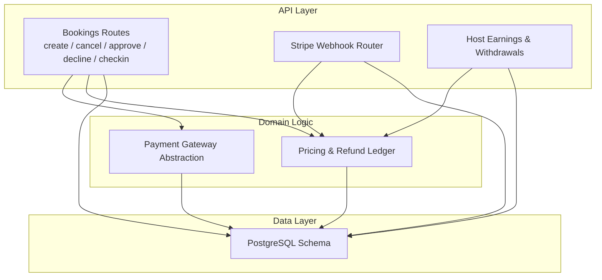
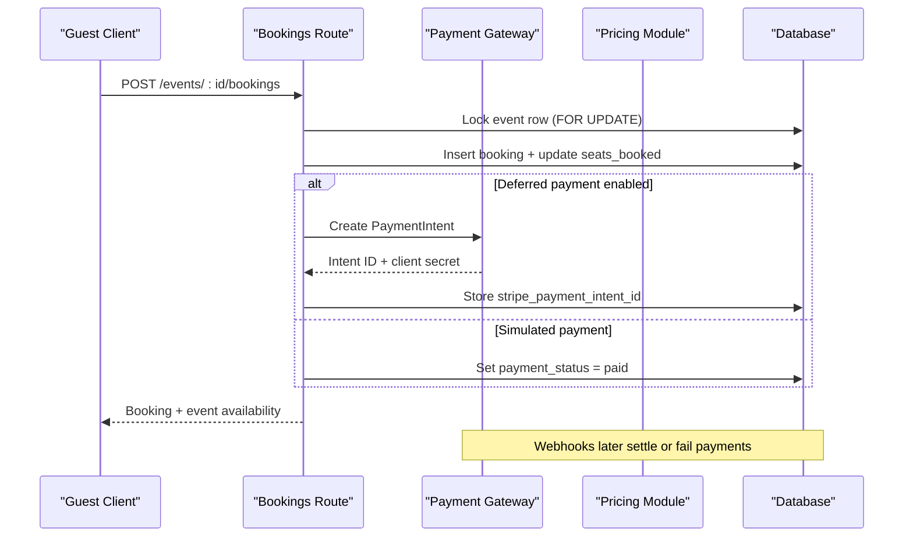
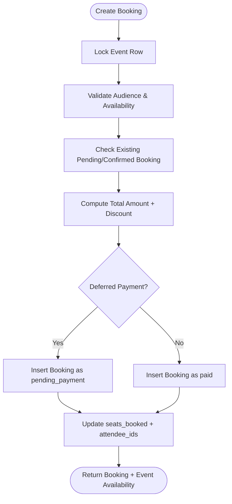
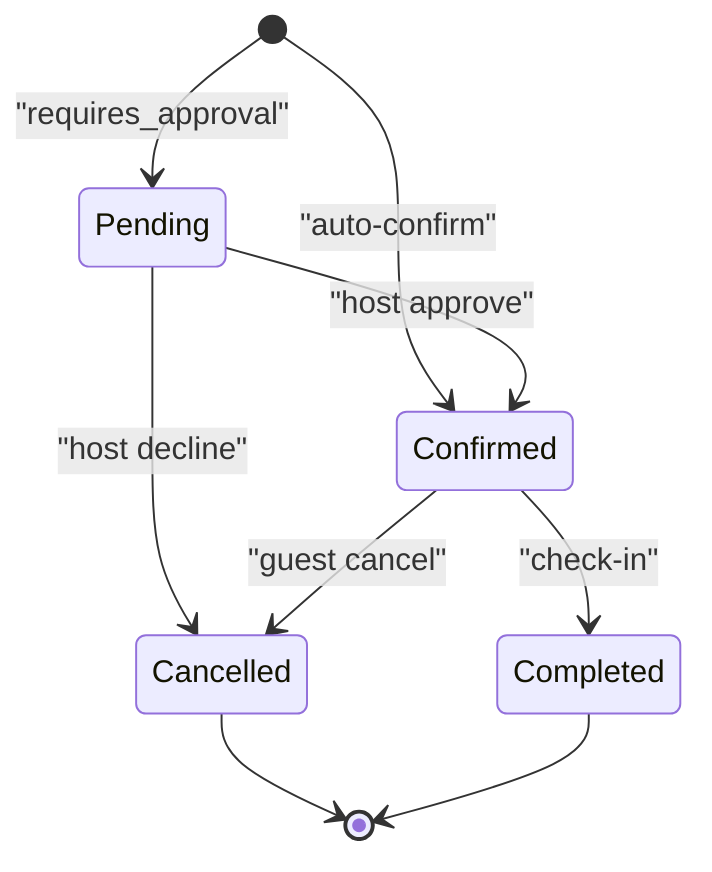
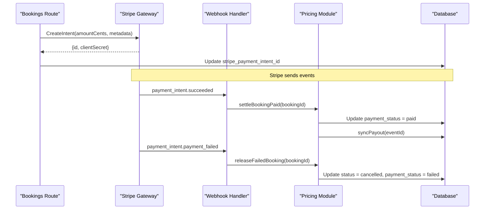
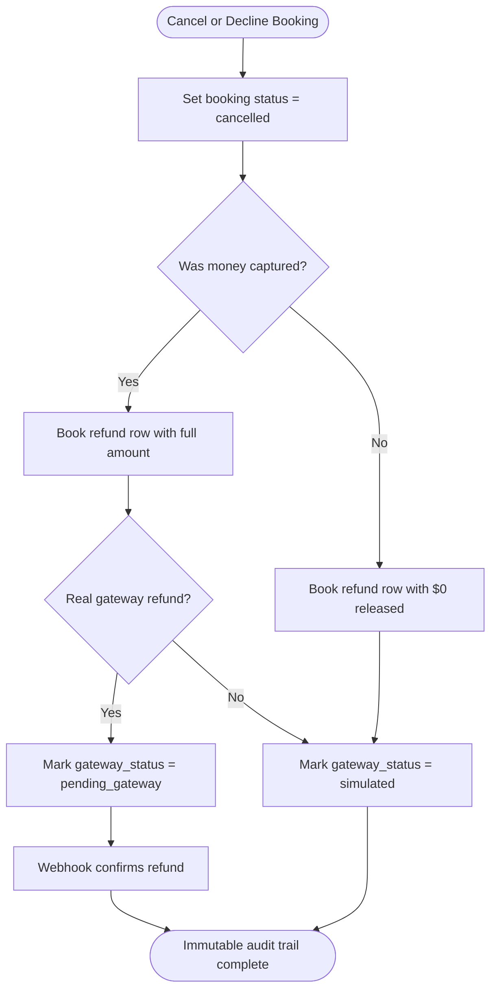
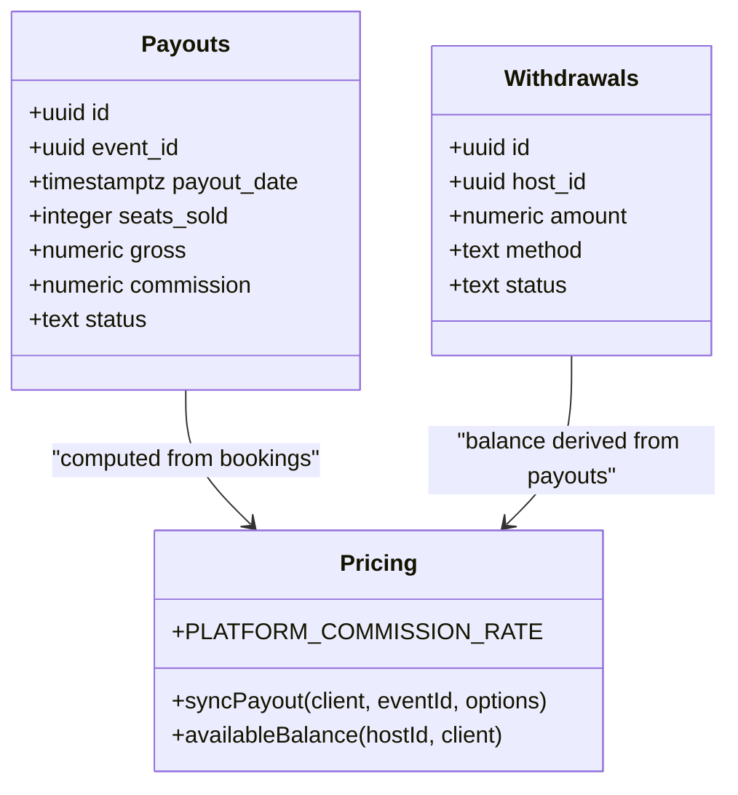
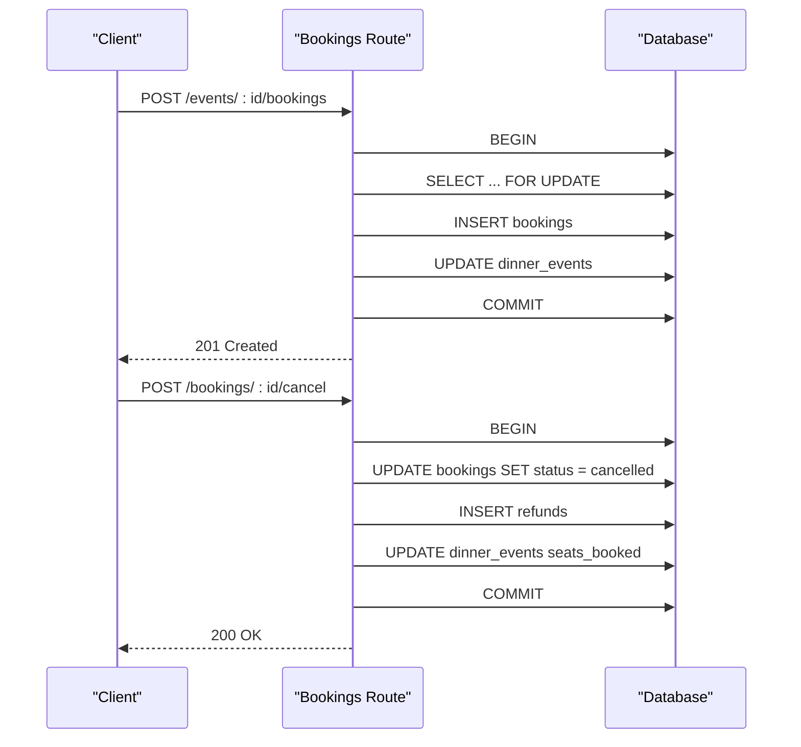
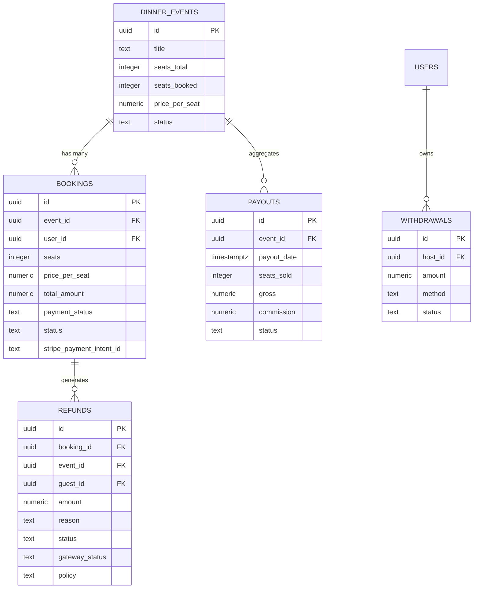
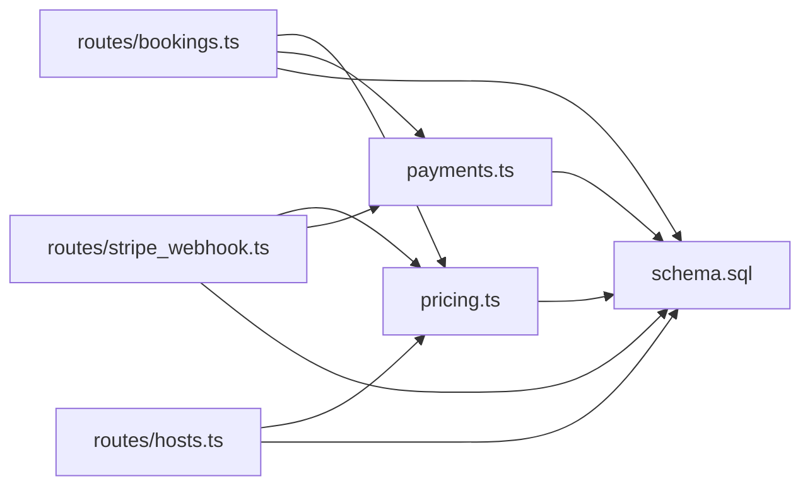

# Booking System

<cite>
**Referenced Files in This Document**   
- [schema.sql](file://server/src/schema.sql)
- [bookings.ts](file://server/src/routes/bookings.ts)
- [payments.ts](file://server/src/payments.ts)
- [pricing.ts](file://server/src/pricing.ts)
- [stripe_webhook.ts](file://server/src/routes/stripe_webhook.ts)
- [hosts.ts](file://server/src/routes/hosts.ts)
</cite>

## Table of Contents
1. [Introduction](#introduction)
2. [Project Structure](#project-structure)
3. [Core Components](#core-components)
4. [Architecture Overview](#architecture-overview)
5. [Detailed Component Analysis](#detailed-component-analysis)
6. [Dependency Analysis](#dependency-analysis)
7. [Performance Considerations](#performance-considerations)
8. [Troubleshooting Guide](#troubleshooting-guide)
9. [Conclusion](#conclusion)

## Introduction
This document explains the booking and payment system’s database design and operational flows. It focuses on:
- The bookings table structure, seat management, pricing calculations, and status workflows.
- Stripe integration, including `payment_intent_id` tracking and `payment_status` transitions.
- The refunds ledger with immutable audit trails, gateway status tracking, and policy enforcement.
- Host payouts and withdrawals, including commission calculation and withdrawal processing.
- Transaction handling patterns for critical operations such as seat reservation and payment confirmation.
- Relationships between bookings, events, and financial records, illustrated through common booking flows.

The documentation is grounded in the server schema and route implementations, so it reflects the actual source of truth used by the API.

## Project Structure
The relevant backend code lives under `server/src`:
- Database schema and indexes are defined in a single idempotent SQL file.
- Route handlers implement booking creation, cancellation, approval, decline, check-in, and payment refresh.
- A payment gateway abstraction supports real Stripe, an offline mock, and a simulated mode.
- Pricing logic centralizes commission rates, payout recomputation, refund ledgering, and webhook-driven state transitions.
- Host routes expose earnings, wallet balances, and withdrawal submission.

**Diagram sources**
- [bookings.ts:153-405](file://server/src/routes/bookings.ts#L153-L405)
- [stripe_webhook.ts:90-152](file://server/src/routes/stripe_webhook.ts#L90-L152)
- [hosts.ts:56-145](file://server/src/routes/hosts.ts#L56-L145)
- [payments.ts:100-325](file://server/src/payments.ts#L100-L325)
- [pricing.ts:30-94](file://server/src/pricing.ts#L30-L94)
- [schema.sql:181-280](file://server/src/schema.sql#L181-L280)

**Section sources**
- [schema.sql:1-13](file://server/src/schema.sql#L1-L13)
- [bookings.ts:1-15](file://server/src/routes/bookings.ts#L1-L15)
- [payments.ts:7-27](file://server/src/payments.ts#L7-L27)
- [pricing.ts:4-19](file://server/src/pricing.ts#L4-L19)
- [hosts.ts:56-145](file://server/src/routes/hosts.ts#L56-L145)

## Core Components
This section summarizes the core tables and modules that power the booking and payment system.

- Events (`dinner_events`) define seats, pricing, audience restrictions, and attendee tracking.
- Bookings (`bookings`) represent guest reservations with seat counts, per-seat price, total amount, reference, payment label, payment status, booking status, and optional Stripe fields.
- Refunds (`refunds`) provide an immutable ledger of refund decisions, reasons, amounts, statuses, gateway status, and policy snapshots.
- Payouts (`payouts`) aggregate host earnings per event, including seats sold, gross revenue, platform commission, and payout status.
- Withdrawals (`withdrawals`) record host withdrawal requests against their simulated wallet balance.
- Stripe events (`stripe_events`) ensure idempotent webhook delivery.

Key relationships:
- `bookings.event_id` → `dinner_events.id`
- `refunds.booking_id` → `bookings.id`, plus `event_id` and `guest_id`
- `payouts.event_id` → `dinner_events.id`
- `withdrawals.host_id` → `users.id`

**Section sources**
- [schema.sql:121-167](file://server/src/schema.sql#L121-L167)
- [schema.sql:181-280](file://server/src/schema.sql#L181-L280)

## Architecture Overview
The system separates concerns into routes (user-facing operations), domain logic (pricing and payments), and data persistence (PostgreSQL).

**Diagram sources**
- [bookings.ts:153-405](file://server/src/routes/bookings.ts#L153-L405)
- [payments.ts:114-123](file://server/src/payments.ts#L114-L123)
- [stripe_webhook.ts:33-62](file://server/src/routes/stripe_webhook.ts#L33-L62)

## Detailed Component Analysis

### Bookings Table Structure and Seat Management
The bookings table captures each guest reservation with:
- Seats count and per-seat price.
- Total amount after discounts.
- Human-readable reference and payment label.
- Payment status ladder: unpaid, pending_payment, authorized, paid, refunded, failed.
- Booking status: confirmed, pending, completed, cancelled.
- Attendance tracking via checked_in and checked_in_at.
- Optional Stripe fields: `stripe_payment_intent_id` and `stripe_amount_cents`.

Seat management is enforced at the event level:
- `seats_total` and `seats_booked` track capacity.
- `attendee_ids` tracks unique guests.
- Concurrency is protected using `FOR UPDATE` locks during booking creation and cancellation.

**Diagram sources**
- [bookings.ts:153-335](file://server/src/routes/bookings.ts#L153-L335)
- [schema.sql:121-167](file://server/src/schema.sql#L121-L167)
- [schema.sql:181-212](file://server/src/schema.sql#L181-L212)

**Section sources**
- [schema.sql:181-212](file://server/src/schema.sql#L181-L212)
- [bookings.ts:153-335](file://server/src/routes/bookings.ts#L153-L335)

### Pricing Calculations and Discounts
Pricing is calculated server-side:
- Base total equals seats multiplied by event price per seat.
- Promo codes are validated server-side and applied as percentage discounts.
- Final amount cannot be negative; zero totals bypass gateway authorization.

Promo codes are stored separately and must be active to apply.

**Section sources**
- [bookings.ts:234-252](file://server/src/routes/bookings.ts#L234-L252)
- [schema.sql:409-415](file://server/src/schema.sql#L409-L415)

### Status Workflows and Approval Flow
Booking status depends on event configuration and payment flow:
- If the event requires host approval, initial booking status is `pending`; otherwise it is `confirmed`.
- With deferred payments, initial payment status is `pending_payment`; without it, it is `paid`.
- Host approval changes booking status to `confirmed`; with Stripe, payment settlement still occurs via webhook.
- Host decline cancels the booking and books a $0 refund entry.

**Diagram sources**
- [bookings.ts:254-266](file://server/src/routes/bookings.ts#L254-L266)
- [bookings.ts:612-678](file://server/src/routes/bookings.ts#L612-L678)
- [bookings.ts:686-761](file://server/src/routes/bookings.ts#L686-L761)

**Section sources**
- [bookings.ts:254-266](file://server/src/routes/bookings.ts#L254-L266)
- [bookings.ts:612-761](file://server/src/routes/bookings.ts#L612-L761)

### Stripe Integration and Payment Intent Tracking
Stripe integration is abstracted behind a gateway interface supporting three modes:
- Real Stripe SDK when a secret key is configured.
- Mock gateway for offline testing with signature verification.
- Simulated gateway for historical behavior without network calls.

When deferred payments are enabled:
- A PaymentIntent is created outside the seat-lock transaction.
- The booking stores `stripe_payment_intent_id` and `stripe_amount_cents`.
- Success webhooks settle the booking to `paid` and update the payment label.
- Failure or cancellation releases the hold and marks the booking as `failed`.

**Diagram sources**
- [bookings.ts:337-379](file://server/src/routes/bookings.ts#L337-L379)
- [payments.ts:100-176](file://server/src/payments.ts#L100-L176)
- [stripe_webhook.ts:33-73](file://server/src/routes/stripe_webhook.ts#L33-L73)
- [pricing.ts:170-189](file://server/src/pricing.ts#L170-L189)

**Section sources**
- [payments.ts:7-27](file://server/src/payments.ts#L7-L27)
- [payments.ts:100-325](file://server/src/payments.ts#L100-L325)
- [stripe_webhook.ts:90-152](file://server/src/routes/stripe_webhook.ts#L90-L152)

### Refunds System with Immutable Audit Trails
Refunds are recorded immutably:
- Each decision creates one row in the refunds ledger.
- Reasons include guest cancellation, host decline, and event cancellation.
- For captured payments, the ledger books the full amount as refunded.
- For uncaptured authorizations, the ledger books $0 as released.
- Gateway status tracks whether the movement is simulated, pending, or confirmed.
- Cancellation policies are frozen at refund time.

**Diagram sources**
- [bookings.ts:420-548](file://server/src/routes/bookings.ts#L420-L548)
- [pricing.ts:98-156](file://server/src/pricing.ts#L98-L156)
- [pricing.ts:248-269](file://server/src/pricing.ts#L248-L269)

**Section sources**
- [schema.sql:214-242](file://server/src/schema.sql#L214-L242)
- [bookings.ts:420-548](file://server/src/routes/bookings.ts#L420-L548)
- [pricing.ts:98-156](file://server/src/pricing.ts#L98-L156)

### Payout System for Hosts
Host payouts are computed from captured bookings:
- Gross revenue equals the sum of total amounts for paid bookings.
- Platform commission is configurable and defaults to a safe fallback.
- Net payout equals gross minus commission.
- Payout rows are seeded on first capture and resynced on cancellations.

Withdrawals are simulated:
- Available balance equals lifetime net earnings minus all withdrawals.
- Withdrawal requests are recorded with method and status.
- Balance checks use row locks and advisory locks to prevent double-spending.

**Diagram sources**
- [schema.sql:253-280](file://server/src/schema.sql#L253-L280)
- [pricing.ts:30-94](file://server/src/pricing.ts#L30-L94)
- [hosts.ts:381-502](file://server/src/routes/hosts.ts#L381-L502)

**Section sources**
- [schema.sql:253-280](file://server/src/schema.sql#L253-L280)
- [pricing.ts:30-94](file://server/src/pricing.ts#L30-L94)
- [hosts.ts:56-145](file://server/src/routes/hosts.ts#L56-L145)
- [hosts.ts:381-502](file://server/src/routes/hosts.ts#L381-L502)

### Transaction Handling Patterns
Critical operations use transactions to maintain consistency:
- Seat reservation locks the event row to prevent overselling.
- Booking insertion updates seats and attendees atomically.
- Cancellation flips booking status and books a refund ledger entry in one transaction.
- Check-in captures authorizations and accrues payouts within a transaction.
- Withdrawals lock the user row and take an advisory lock to serialize against accruals.

**Diagram sources**
- [bookings.ts:180-335](file://server/src/routes/bookings.ts#L180-L335)
- [bookings.ts:424-498](file://server/src/routes/bookings.ts#L424-L498)

**Section sources**
- [bookings.ts:180-335](file://server/src/routes/bookings.ts#L180-L335)
- [bookings.ts:424-498](file://server/src/routes/bookings.ts#L424-L498)

### Relationship Between Bookings, Events, and Financial Transactions
- Bookings link guests to events and carry financial state.
- Events define capacity, pricing, and audience rules.
- Refunds ledger entries document every refund decision tied to a booking and event.
- Payouts aggregate host earnings per event based on captured bookings.
- Withdrawals record host attempts to move funds out of the simulated wallet.

**Diagram sources**
- [schema.sql:121-167](file://server/src/schema.sql#L121-L167)
- [schema.sql:181-280](file://server/src/schema.sql#L181-L280)

**Section sources**
- [schema.sql:121-167](file://server/src/schema.sql#L121-L167)
- [schema.sql:181-280](file://server/src/schema.sql#L181-L280)

## Dependency Analysis
The booking system depends on several modules:
- Routes depend on database helpers, context utilities, blocks validation, pricing functions, and payment gateway functions.
- Pricing module centralizes commission rate configuration, payout synchronization, refund ledgering, and webhook-driven state transitions.
- Payments module provides gateway abstraction, intent lifecycle methods, and abandoned checkout sweep.
- Webhook router validates signatures, claims events idempotently, and delegates state changes to pricing helpers.

**Diagram sources**
- [bookings.ts:1-13](file://server/src/routes/bookings.ts#L1-L13)
- [stripe_webhook.ts:1-5](file://server/src/routes/stripe_webhook.ts#L1-L5)
- [hosts.ts:1-7](file://server/src/routes/hosts.ts#L1-L7)
- [pricing.ts:1-19](file://server/src/pricing.ts#L1-L19)
- [payments.ts:1-6](file://server/src/payments.ts#L1-L6)
- [schema.sql:1-13](file://server/src/schema.sql#L1-L13)

**Section sources**
- [bookings.ts:1-13](file://server/src/routes/bookings.ts#L1-L13)
- [stripe_webhook.ts:1-5](file://server/src/routes/stripe_webhook.ts#L1-L5)
- [hosts.ts:1-7](file://server/src/routes/hosts.ts#L1-L7)
- [pricing.ts:1-19](file://server/src/pricing.ts#L1-L19)
- [payments.ts:1-6](file://server/src/payments.ts#L1-L6)

## Performance Considerations
- Seat locking uses `FOR UPDATE` to prevent race conditions during high-concurrency booking creation.
- Payout recomputation is idempotent and serializes against withdrawals using advisory locks.
- Webhook processing is idempotent via `stripe_events` deduplication and conditional state transitions.
- Abandoned checkout sweep runs opportunistically on read paths to avoid cron complexity while releasing stale holds.

[No sources needed since this section provides general guidance]

## Troubleshooting Guide
Common issues and their handling:
- Duplicate webhook deliveries are ignored after the first claim.
- Amount mismatches between booking and Stripe intent prevent accidental settlement.
- Failed gateway calls during booking creation release held seats and return a clean error.
- Cancellations book refund ledger entries even if gateway calls fail, preserving audit truth.
- Withdrawals enforce balance checks and serialization to prevent double-spending.

**Section sources**
- [stripe_webhook.ts:110-151](file://server/src/routes/stripe_webhook.ts#L110-L151)
- [bookings.ts:361-378](file://server/src/routes/bookings.ts#L361-L378)
- [bookings.ts:524-548](file://server/src/routes/bookings.ts#L524-L548)
- [hosts.ts:471-496](file://server/src/routes/hosts.ts#L471-L496)

## Conclusion
The booking and payment system is designed around strong database constraints, transactional integrity, and clear separation of concerns. Bookings manage seats and pricing, Stripe integration handles deferred payments with robust webhook processing, refunds provide immutable audit trails, and payouts/withdrawals model host earnings safely. The architecture ensures correctness under concurrency, idempotency for external integrations, and transparency for financial operations.

[No sources needed since this section summarizes without analyzing specific files]