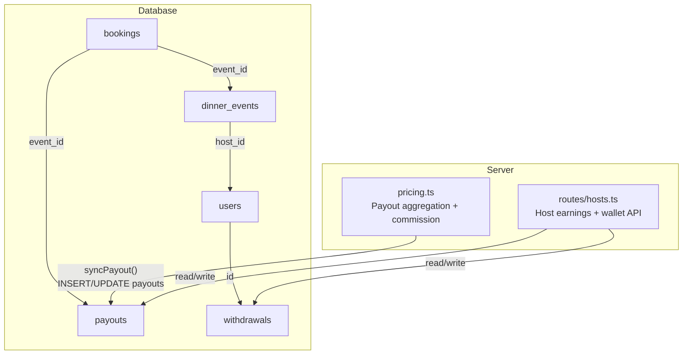
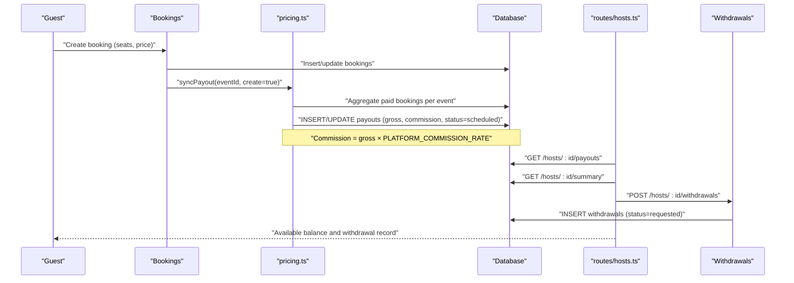
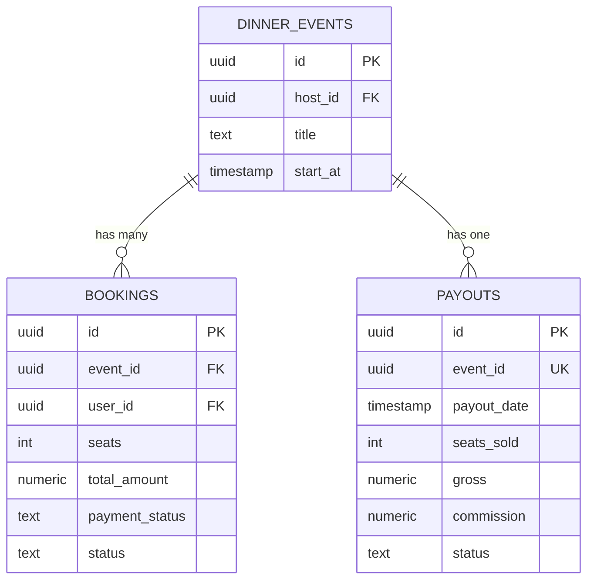
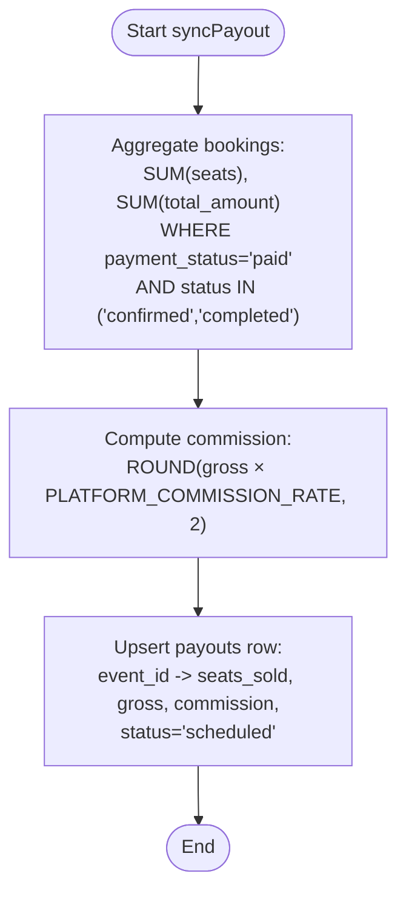
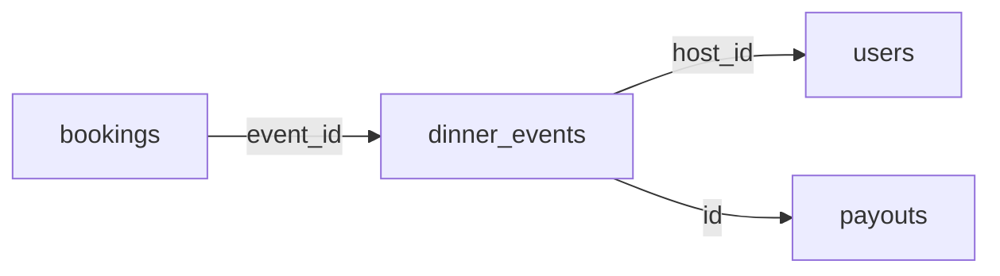
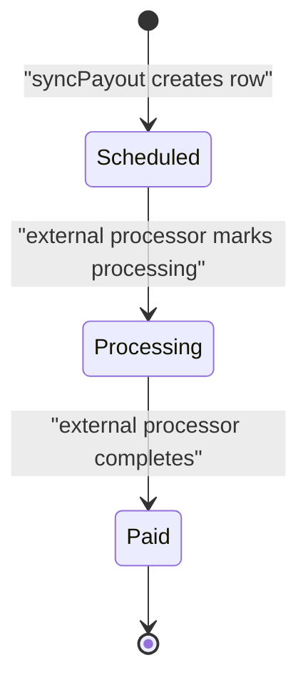
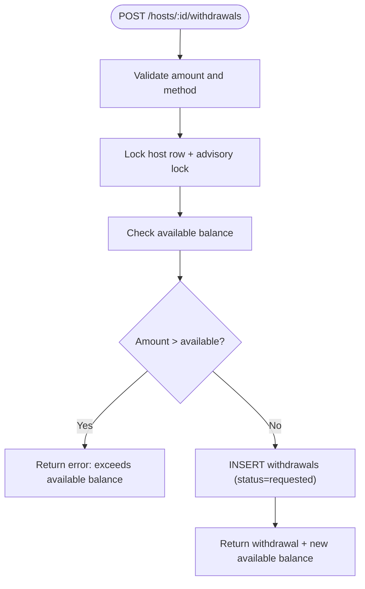
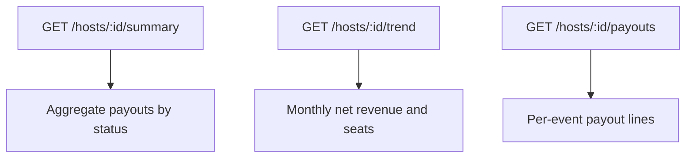
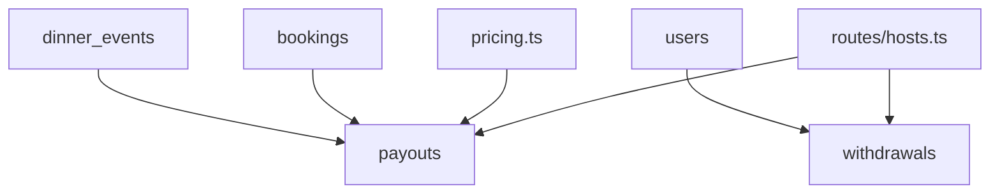

# Host Payouts

<cite>
**Referenced Files in This Document**
- [schema.sql](file://server/src/schema.sql)
- [pricing.ts](file://server/src/pricing.ts)
- [hosts.ts](file://server/src/routes/hosts.ts)
</cite>

## Table of Contents
1. [Introduction](#introduction)
2. [Project Structure](#project-structure)
3. [Core Components](#core-components)
4. [Architecture Overview](#architecture-overview)
5. [Detailed Component Analysis](#detailed-component-analysis)
6. [Dependency Analysis](#dependency-analysis)
7. [Performance Considerations](#performance-considerations)
8. [Troubleshooting Guide](#troubleshooting-guide)
9. [Conclusion](#conclusion)
10. [Appendices](#appendices)

## Introduction
This document explains the host payout system: how host earnings are calculated from bookings, how payouts are recorded and summarized, and how the simulated withdrawal wallet works. It also documents the database schema for `payouts` and `withdrawals`, the relationship between bookings, events, and host earnings through `event_id`, commission deduction logic, and the current simulated nature of payouts with a migration path toward real payment processors.

## Project Structure
The host payout system is implemented on the server side:
- Database schema defines the `payouts` and `withdrawals` tables and their relationships to `dinner_events` and `users`.
- Pricing logic computes gross revenue, seats sold, and platform commission per event.
- Host routes expose endpoints for payout history, earnings summaries, trends, wallet balance, and simulated withdrawals.

**Diagram sources**
- [schema.sql:124-156](file://server/src/schema.sql#L124-L156)
- [schema.sql:184-200](file://server/src/schema.sql#L184-L200)
- [schema.sql:256-266](file://server/src/schema.sql#L256-L266)
- [schema.sql:272-280](file://server/src/schema.sql#L272-L280)
- [pricing.ts:30-37](file://server/src/pricing.ts#L30-L37)
- [pricing.ts:57-94](file://server/src/pricing.ts#L57-L94)
- [hosts.ts:57-72](file://server/src/routes/hosts.ts#L57-L72)
- [hosts.ts:407-445](file://server/src/routes/hosts.ts#L407-L445)

**Section sources**
- [schema.sql:124-156](file://server/src/schema.sql#L124-L156)
- [schema.sql:184-200](file://server/src/schema.sql#L184-L200)
- [schema.sql:256-266](file://server/src/schema.sql#L256-L266)
- [schema.sql:272-280](file://server/src/schema.sql#L272-L280)
- [pricing.ts:30-37](file://server/src/pricing.ts#L30-L37)
- [pricing.ts:57-94](file://server/src/pricing.ts#L57-L94)
- [hosts.ts:57-72](file://server/src/routes/hosts.ts#L57-L72)
- [hosts.ts:407-445](file://server/src/routes/hosts.ts#L407-L445)

## Core Components
- Payouts table: records one row per event with seats sold, gross revenue, platform commission, and status.
- Withdrawals table: simulates a host wallet ledger; each withdrawal reduces available balance but does not trigger real payments.
- Pricing module: aggregates paid bookings per event to compute gross and commission, then syncs the `payouts` row idempotently.
- Host routes: provide payout lists, earnings summary, trend data, wallet balance/history, and simulated withdrawal creation.

Key responsibilities:
- `pricing.ts`: single source of truth for platform commission rate and payout aggregation.
- `routes/hosts.ts`: read-only financial endpoints plus write endpoint for simulated withdrawals.
- `schema.sql`: authoritative definitions for `payouts` and `withdrawals`, including constraints and indexes.

**Section sources**
- [schema.sql:256-266](file://server/src/schema.sql#L256-L266)
- [schema.sql:272-280](file://server/src/schema.sql#L272-L280)
- [pricing.ts:12-19](file://server/src/pricing.ts#L12-L19)
- [pricing.ts:30-37](file://server/src/pricing.ts#L30-L37)
- [pricing.ts:57-94](file://server/src/pricing.ts#L57-L94)
- [hosts.ts:57-72](file://server/src/routes/hosts.ts#L57-L72)
- [hosts.ts:90-145](file://server/src/routes/hosts.ts#L90-L145)
- [hosts.ts:407-445](file://server/src/routes/hosts.ts#L407-L445)
- [hosts.ts:463-502](file://server/src/routes/hosts.ts#L463-L502)

## Architecture Overview
The payout lifecycle flows from guest bookings into event-level earnings, then into per-event payout rows, and finally into the host’s simulated wallet via withdrawals.

**Diagram sources**
- [pricing.ts:30-37](file://server/src/pricing.ts#L30-L37)
- [pricing.ts:57-94](file://server/src/pricing.ts#L57-L94)
- [hosts.ts:57-72](file://server/src/routes/hosts.ts#L57-L72)
- [hosts.ts:90-145](file://server/src/routes/hosts.ts#L90-L145)
- [hosts.ts:463-502](file://server/src/routes/hosts.ts#L463-L502)

## Detailed Component Analysis

### Payouts Table and Event Earnings
The `payouts` table stores one row per hosted event. It links to `dinner_events` via `event_id`, allowing the system to derive event title and host context at query time. Each row captures:
- `seats_sold`: number of paid seats aggregated from bookings.
- `gross`: total captured amount for that event.
- `commission`: platform take computed as gross multiplied by the platform commission rate.
- `status`: scheduling state (`scheduled`, `processing`, `paid`).

**Diagram sources**
- [schema.sql:124-156](file://server/src/schema.sql#L124-L156)
- [schema.sql:184-200](file://server/src/schema.sql#L184-L200)
- [schema.sql:256-266](file://server/src/schema.sql#L256-L266)

#### Commission Calculation Logic
- The platform commission rate is configured via environment variable and validated; invalid values fall back to a default.
- For each event, the system aggregates all bookings where `payment_status = 'paid'` and booking status is live (`confirmed` or `completed`).
- Gross equals the sum of `total_amount` across those bookings.
- Commission equals gross multiplied by the platform commission rate, rounded to two decimals.
- The `payouts` row is created or updated idempotently using an upsert keyed by `event_id`.

**Diagram sources**
- [pricing.ts:30-37](file://server/src/pricing.ts#L30-L37)
- [pricing.ts:57-94](file://server/src/pricing.ts#L57-L94)

**Section sources**
- [schema.sql:256-266](file://server/src/schema.sql#L256-L266)
- [pricing.ts:12-19](file://server/src/pricing.ts#L12-L19)
- [pricing.ts:30-37](file://server/src/pricing.ts#L30-L37)
- [pricing.ts:57-94](file://server/src/pricing.ts#L57-L94)

### Relationship Between Bookings, Events, and Host Earnings
- `bookings.event_id` references `dinner_events.id`, linking each seat sale to an event.
- `dinner_events.host_id` identifies the host who earns from that event.
- `payouts.event_id` references `dinner_events.id`, so each event has exactly one payout row.
- Host earnings are derived by aggregating paid bookings per event and applying the platform commission rate.

**Diagram sources**
- [schema.sql:124-156](file://server/src/schema.sql#L124-L156)
- [schema.sql:184-200](file://server/src/schema.sql#L184-L200)
- [schema.sql:256-266](file://server/src/schema.sql#L256-L266)

**Section sources**
- [schema.sql:124-156](file://server/src/schema.sql#L124-L156)
- [schema.sql:184-200](file://server/src/schema.sql#L184-L200)
- [schema.sql:256-266](file://server/src/schema.sql#L256-L266)

### Payout Scheduling and Statuses
- New payout rows are inserted with `status = 'scheduled'`.
- The host summary endpoint groups net earnings (`gross - commission`) by payout status:
  - `paid`: earned money.
  - `processing`: in-transit funds.
  - `scheduled`: future scheduled amounts.
- The next payout date is computed as the first day of the next month for display purposes.

**Diagram sources**
- [pricing.ts:71-82](file://server/src/pricing.ts#L71-L82)
- [hosts.ts:95-107](file://server/src/routes/hosts.ts#L95-L107)
- [hosts.ts:124-145](file://server/src/routes/hosts.ts#L124-L145)

**Section sources**
- [pricing.ts:71-82](file://server/src/pricing.ts#L71-L82)
- [hosts.ts:95-107](file://server/src/routes/hosts.ts#L95-L107)
- [hosts.ts:124-145](file://server/src/routes/hosts.ts#L124-L145)

### Withdrawal System and Simulated Wallet
The withdrawal system is a simulated wallet ledger:
- `withdrawals.host_id` references `users.id`.
- Each withdrawal has `amount`, `method`, and `status`.
- Status progression: `requested` → `processing` → `completed`. In this phase, `requested` and `processing` are terminal because no external gateway executes the payout.
- Available balance equals lifetime net earnings minus all withdrawals recorded to date.

**Diagram sources**
- [hosts.ts:463-502](file://server/src/routes/hosts.ts#L463-L502)

#### Withdrawal Endpoint Behavior
- Input validation enforces minimum amount and method length.
- A transaction ensures atomicity:
  - Row lock on the host user row prevents concurrent double-spend.
  - Advisory lock serializes against payout accruals to avoid race conditions.
  - Balance check uses the same logic as the wallet summary.
- On success, a withdrawal row is inserted with `status = 'requested'`.

**Section sources**
- [schema.sql:272-280](file://server/src/schema.sql#L272-L280)
- [hosts.ts:381-405](file://server/src/routes/hosts.ts#L381-L405)
- [hosts.ts:407-445](file://server/src/routes/hosts.ts#L407-L445)
- [hosts.ts:463-502](file://server/src/routes/hosts.ts#L463-L502)

### Host Earnings Summary and Trends
- `/api/hosts/:id/summary` returns:
  - Earned, in-transit, and scheduled net amounts.
  - Lifetime gross and total commission.
  - Seats sold, average seat price, event counts, fill rate.
  - Next payout date and platform commission rate.
  - Available balance for withdrawals.
- `/api/hosts/:id/trend` returns monthly net revenue and seats for the last six months.
- `/api/hosts/:id/payouts` returns per-event payout lines with `net = gross - commission`.

**Diagram sources**
- [hosts.ts:57-72](file://server/src/routes/hosts.ts#L57-L72)
- [hosts.ts:90-145](file://server/src/routes/hosts.ts#L90-L145)
- [hosts.ts:154-183](file://server/src/routes/hosts.ts#L154-L183)

**Section sources**
- [hosts.ts:57-72](file://server/src/routes/hosts.ts#L57-L72)
- [hosts.ts:90-145](file://server/src/routes/hosts.ts#L90-L145)
- [hosts.ts:154-183](file://server/src/routes/hosts.ts#L154-L183)

## Dependency Analysis
The payout system depends on:
- `dinner_events` and `bookings` for earnings aggregation.
- `users` for host identity and withdrawal ownership.
- `payouts` for per-event earnings records.
- `withdrawals` for simulated wallet operations.

**Diagram sources**
- [schema.sql:124-156](file://server/src/schema.sql#L124-L156)
- [schema.sql:184-200](file://server/src/schema.sql#L184-L200)
- [schema.sql:256-266](file://server/src/schema.sql#L256-L266)
- [schema.sql:272-280](file://server/src/schema.sql#L272-L280)
- [pricing.ts:57-94](file://server/src/pricing.ts#L57-L94)
- [hosts.ts:57-72](file://server/src/routes/hosts.ts#L57-L72)
- [hosts.ts:463-502](file://server/src/routes/hosts.ts#L463-L502)

**Section sources**
- [schema.sql:124-156](file://server/src/schema.sql#L124-L156)
- [schema.sql:184-200](file://server/src/schema.sql#L184-L200)
- [schema.sql:256-266](file://server/src/schema.sql#L256-L266)
- [schema.sql:272-280](file://server/src/schema.sql#L272-L280)
- [pricing.ts:57-94](file://server/src/pricing.ts#L57-L94)
- [hosts.ts:57-72](file://server/src/routes/hosts.ts#L57-L72)
- [hosts.ts:463-502](file://server/src/routes/hosts.ts#L463-L502)

## Performance Considerations
- Idempotent payout synchronization avoids double-counting when retried or concurrently invoked.
- Advisory locks serialize payout accruals against withdrawals to prevent race conditions.
- Indexes on `payouts.event_id` and `withdrawals.host_id` optimize lookups and joins.
- Aggregation queries filter by `payment_status = 'paid'` and live booking statuses to ensure only captured revenue contributes to host earnings.

[No sources needed since this section provides general guidance]

## Troubleshooting Guide
Common issues and resolutions:
- Withdrawal rejected due to insufficient balance:
  - Cause: requested amount exceeds available balance.
  - Resolution: reduce amount or wait for additional booked events to accrue earnings.
- Race between accrual and withdrawal:
  - Cause: concurrent payout updates and withdrawal requests.
  - Resolution: handled by advisory locks; if errors persist, retry after a short delay.
- Missing payout row for an event:
  - Cause: cancellation path does not fabricate a payout row unless one already exists.
  - Resolution: ensure the event had at least one paid booking before expecting a payout row.

**Section sources**
- [hosts.ts:463-502](file://server/src/routes/hosts.ts#L463-L502)
- [pricing.ts:48-56](file://server/src/pricing.ts#L48-L56)

## Conclusion
The host payout system currently simulates payouts and withdrawals while maintaining accurate accounting of host earnings based on paid bookings. The `payouts` table captures per-event gross and commission, and the `withdrawals` table serves as a simulated wallet ledger. To move to real payment processors, the system should integrate gateway webhooks to transition payout statuses from `scheduled` to `processing` to `paid`, and update withdrawal statuses accordingly, while preserving the existing ledger semantics and idempotency guarantees.

[No sources needed since this section summarizes without analyzing specific files]

## Appendices

### Migration Path to Real Payment Processors
Recommended steps:
- Integrate Stripe webhook handlers to:
  - Transition booking payment states to `paid` upon successful capture.
  - Update payout statuses from `scheduled` to `processing` and then to `paid`.
  - Record gateway-specific identifiers (e.g., `stripe_payment_intent_id`) in relevant tables.
- Extend withdrawal status transitions:
  - `requested` → `processing` when the processor initiates transfer.
  - `processing` → `completed` upon confirmation from the processor.
- Maintain `gateway_status` markers similar to refunds to distinguish simulated bookkeeping from confirmed provider movements.

**Section sources**
- [schema.sql:202-212](file://server/src/schema.sql#L202-L212)
- [schema.sql:214-236](file://server/src/schema.sql#L214-L236)
- [pricing.ts:158-189](file://server/src/pricing.ts#L158-L189)