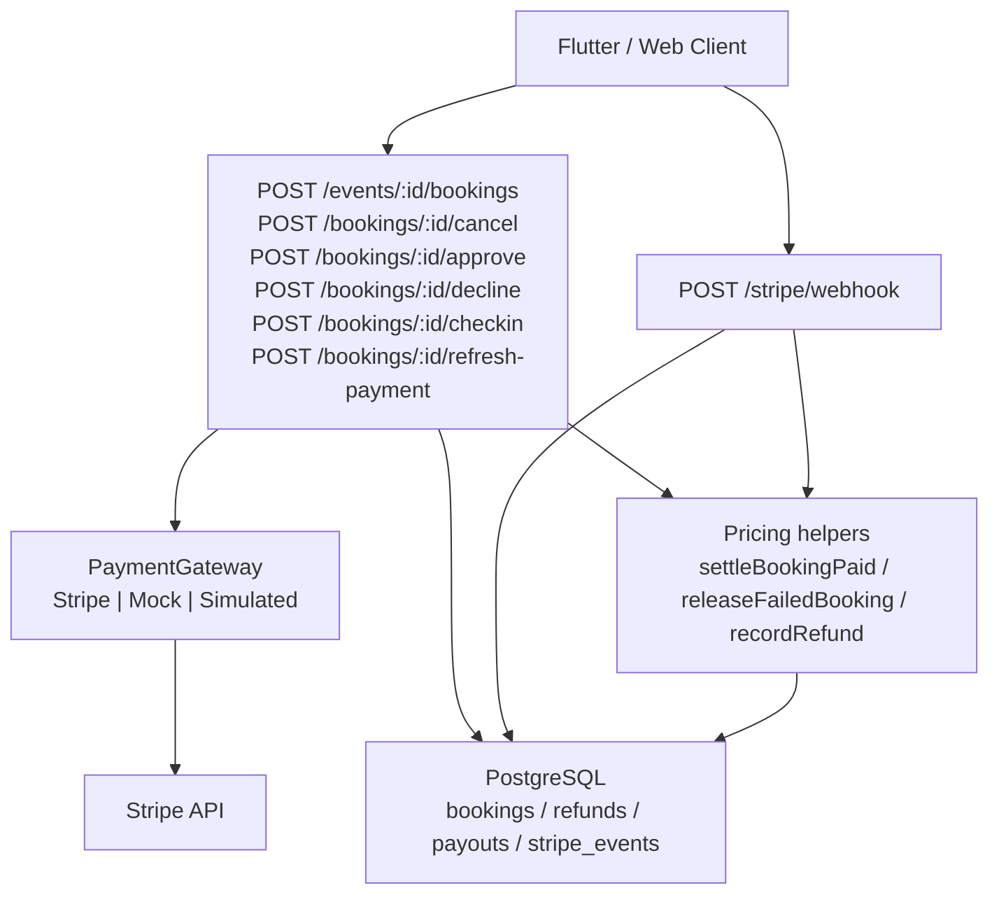
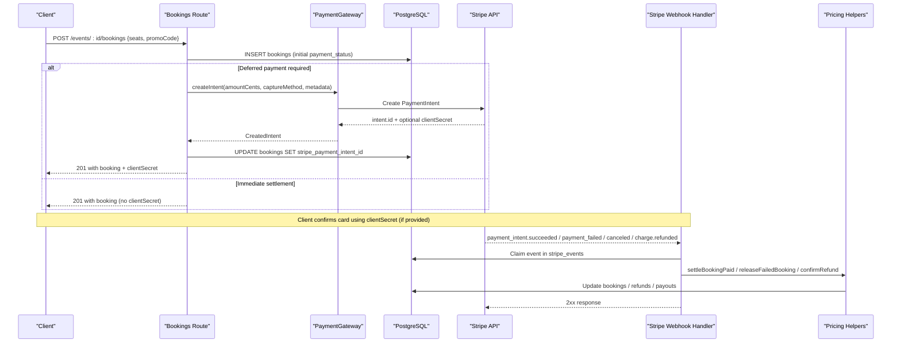
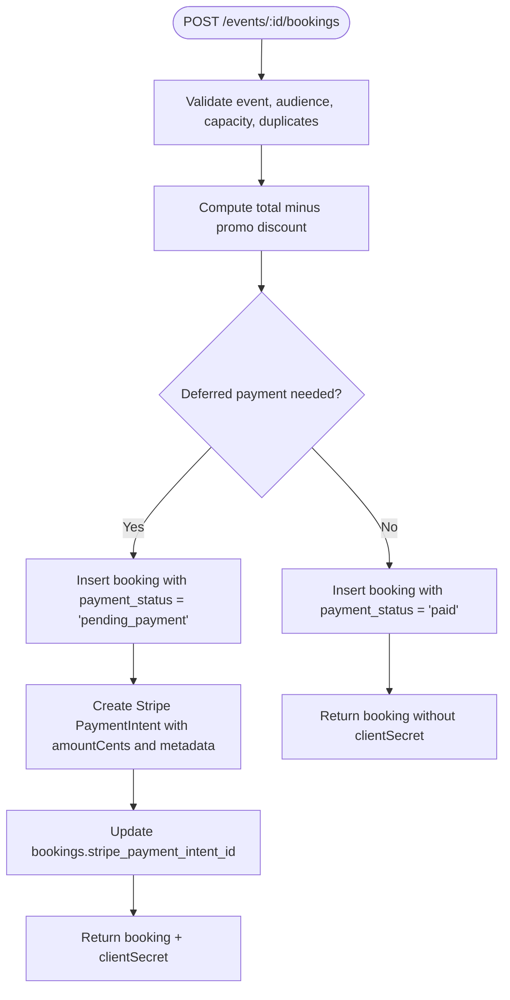
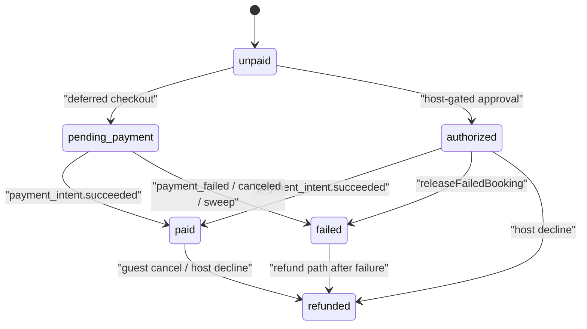
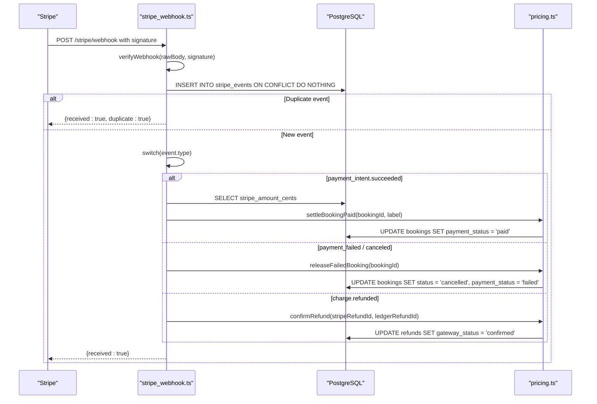
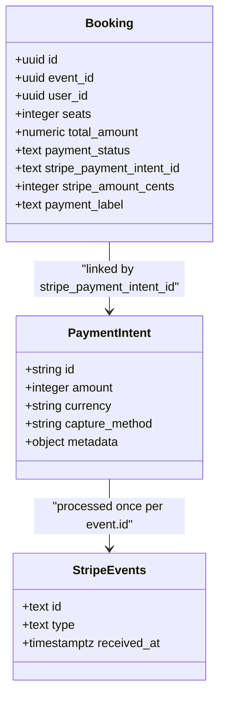
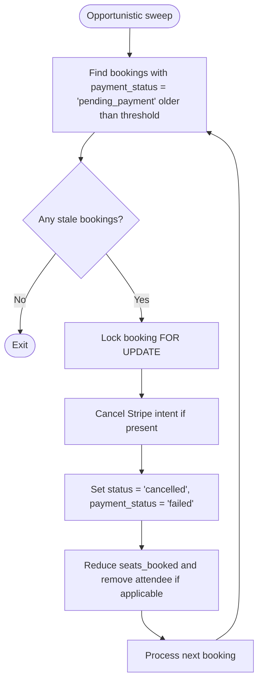
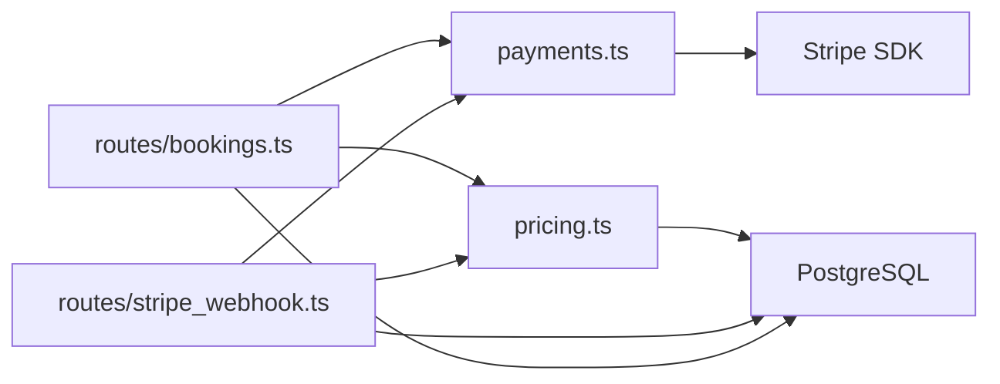

# Payment Processing

<cite>
**Referenced Files in This Document**
- [stripe_webhook.ts](file://server/src/routes/stripe_webhook.ts)
- [payments.ts](file://server/src/payments.ts)
- [bookings.ts](file://server/src/routes/bookings.ts)
- [pricing.ts](file://server/src/pricing.ts)
- [schema.sql](file://server/src/schema.sql)
</cite>

## Table of Contents
1. [Introduction](#introduction)
2. [Project Structure](#project-structure)
3. [Core Components](#core-components)
4. [Architecture Overview](#architecture-overview)
5. [Detailed Component Analysis](#detailed-component-analysis)
6. [Dependency Analysis](#dependency-analysis)
7. [Performance Considerations](#performance-considerations)
8. [Troubleshooting Guide](#troubleshooting-guide)
9. [Conclusion](#conclusion)

## Introduction
This document explains the Stripe payment processing integration for DineCircle bookings. It covers the end-to-end flow from booking creation through payment confirmation, including:
- How a booking transitions between `unpaid`, `pending_payment`, `authorized`, `paid`, and `failed`.
- How Stripe PaymentIntents are created, linked to bookings via `stripe_payment_intent_id`, and reconciled by webhooks.
- How amounts are handled in integer cents and how currency is configured.
- How webhook idempotency is enforced using the `stripe_events` table.
- Error handling, retry behavior, abandoned-checkout cleanup, security considerations, and debugging guidance.

The server uses a gateway abstraction so the same business logic works with real Stripe, an offline mock for tests, or a simulated mode that does not call any external gateway.

## Project Structure
The payment integration lives primarily in the server backend:
- Route layer: booking creation, cancellation, approval/decline, check-in, refresh-payment, and Stripe webhook endpoint.
- Gateway layer: Stripe SDK wrapper, mock implementation, simulated fallback, and boot-time selection.
- Pricing layer: payout recomputation, refund ledger entries, and idempotent state transitions for paid and failed events.
- Schema: database tables for bookings, refunds, payouts, and the webhook idempotency ledger.

**Diagram sources**
- [bookings.ts:156-405](file://server/src/routes/bookings.ts#L156-L405)
- [bookings.ts:420-564](file://server/src/routes/bookings.ts#L420-L564)
- [bookings.ts:612-761](file://server/src/routes/bookings.ts#L612-L761)
- [bookings.ts:770-885](file://server/src/routes/bookings.ts#L770-L885)
- [stripe_webhook.ts:90-153](file://server/src/routes/stripe_webhook.ts#L90-L153)
- [payments.ts:102-176](file://server/src/payments.ts#L102-L176)
- [payments.ts:185-232](file://server/src/payments.ts#L185-L232)
- [payments.ts:236-266](file://server/src/payments.ts#L236-L266)
- [payments.ts:272-325](file://server/src/payments.ts#L272-L325)
- [pricing.ts:170-269](file://server/src/pricing.ts#L170-L269)
- [schema.sql:181-251](file://server/src/schema.sql#L181-L251)

**Section sources**
- [bookings.ts:156-405](file://server/src/routes/bookings.ts#L156-L405)
- [stripe_webhook.ts:1-156](file://server/src/routes/stripe_webhook.ts#L1-L156)
- [payments.ts:1-325](file://server/src/payments.ts#L1-L325)
- [pricing.ts:1-269](file://server/src/pricing.ts#L1-L269)
- [schema.sql:181-251](file://server/src/schema.sql#L181-L251)

## Core Components
- Booking route: validates event availability, applies promo discounts, computes final amount, creates the booking row, optionally creates a Stripe PaymentIntent, and returns either immediate confirmation or a client secret for card confirmation.
- Payment gateway abstraction: encapsulates Stripe SDK calls, provides mock and simulated modes, converts amounts to cents, and verifies webhook signatures.
- Pricing helpers: provide idempotent transitions for settling payments, releasing failed holds, recording refunds, and confirming gateway refunds.
- Webhook handler: verifies Stripe signature, claims each event once, dispatches to handlers, and updates booking/payment state only when the current state matches expectations.
- Database schema: defines booking fields such as `payment_status`, `stripe_payment_intent_id`, `stripe_amount_cents`, plus `refunds`, `payouts`, and `stripe_events`.

Key responsibilities:
- Amounts are always integers in minor units (cents).
- Currency comes from environment configuration and is applied when creating intents.
- The ledger (`bookings.payment_status`) is the source of truth; webhooks reconcile it.
- Idempotency is enforced at both the event claim level and the state-transition level.

**Section sources**
- [bookings.ts:234-294](file://server/src/routes/bookings.ts#L234-L294)
- [bookings.ts:337-379](file://server/src/routes/bookings.ts#L337-L379)
- [payments.ts:31-49](file://server/src/payments.ts#L31-L49)
- [payments.ts:81-98](file://server/src/payments.ts#L81-L98)
- [payments.ts:102-176](file://server/src/payments.ts#L102-L176)
- [payments.ts:272-325](file://server/src/payments.ts#L272-L325)
- [pricing.ts:170-269](file://server/src/pricing.ts#L170-L269)
- [schema.sql:181-251](file://server/src/schema.sql#L181-L251)

## Architecture Overview
The system separates three concerns:
1. Business rules live in routes and pricing helpers.
2. External payment provider details live in the gateway abstraction.
3. State persistence lives in PostgreSQL, with explicit constraints on money-related columns.

**Diagram sources**
- [bookings.ts:156-405](file://server/src/routes/bookings.ts#L156-L405)
- [payments.ts:114-123](file://server/src/payments.ts#L114-L123)
- [stripe_webhook.ts:90-153](file://server/src/routes/stripe_webhook.ts#L90-L153)
- [pricing.ts:170-269](file://server/src/pricing.ts#L170-L269)
- [schema.sql:243-251](file://server/src/schema.sql#L243-L251)

## Detailed Component Analysis

### Booking Creation and Payment Intent Lifecycle
When a guest books seats:
- The route locks the event row to prevent overselling.
- Promo codes are validated server-side and subtracted from the total.
- If deferred payment is active and the final amount is greater than zero, the initial `payment_status` becomes `pending_payment`; otherwise it is `paid`.
- For host-gated events requiring approval, the initial status is `pending` and the initial payment status is `authorized`.
- A Stripe PaymentIntent is created outside the seat-lock transaction, with metadata containing `booking_id`, `event_id`, and `user_id`.
- The booking row is updated with `stripe_payment_intent_id`, and the client receives a `clientSecret` when card confirmation is required.

**Diagram sources**
- [bookings.ts:156-335](file://server/src/routes/bookings.ts#L156-L335)
- [bookings.ts:337-379](file://server/src/routes/bookings.ts#L337-L379)
- [payments.ts:114-123](file://server/src/payments.ts#L114-L123)

**Section sources**
- [bookings.ts:156-335](file://server/src/routes/bookings.ts#L156-L335)
- [bookings.ts:337-379](file://server/src/routes/bookings.ts#L337-L379)

### Payment Status Transitions
The supported payment statuses are:
- `unpaid`: historical baseline; used where no payment was attempted.
- `pending_payment`: seat held while the client confirms the card.
- `authorized`: authorization hold exists but is not yet captured (host approval flow).
- `paid`: money captured; eligible for host payout.
- `refunded`: money returned or released due to cancellation/decline.
- `failed`: checkout failure or abandoned hold.

Transitions occur in these places:
- Booking creation sets `pending_payment` or `authorized` depending on flow.
- Success webhook settles `pending_payment` or `authorized` to `paid`.
- Failure/cancellation releases unsettled holds to `failed`.
- Cancellation route marks `paid` or `authorized` as `refunded`.
- Check-in captures an outstanding authorization if present.

**Diagram sources**
- [schema.sql:181-212](file://server/src/schema.sql#L181-L212)
- [bookings.ts:254-266](file://server/src/routes/bookings.ts#L254-L266)
- [pricing.ts:170-246](file://server/src/pricing.ts#L170-L246)
- [bookings.ts:447-459](file://server/src/routes/bookings.ts#L447-L459)

**Section sources**
- [schema.sql:181-212](file://server/src/schema.sql#L181-L212)
- [bookings.ts:254-266](file://server/src/routes/bookings.ts#L254-L266)
- [pricing.ts:170-246](file://server/src/pricing.ts#L170-L246)
- [bookings.ts:447-459](file://server/src/routes/bookings.ts#L447-L459)

### Stripe Webhook Handling and Idempotency
The webhook endpoint:
- Requires raw JSON body before global parsing so Stripe’s signature can be verified.
- Verifies the payload against `STRIPE_WEBHOOK_SECRET`.
- Claims the event by inserting into `stripe_events` with `ON CONFLICT DO NOTHING`.
- Dispatches to handlers for success, failure/cancel, and refund events.
- Deletes the claim only when processing fails, allowing Stripe retries to reprocess safely.

Idempotency is two-layered:
1. Event-level: duplicate deliveries are acknowledged without reprocessing because the event id already exists.
2. State-level: state transitions only apply when the booking is in the expected state.

**Diagram sources**
- [stripe_webhook.ts:90-153](file://server/src/routes/stripe_webhook.ts#L90-L153)
- [pricing.ts:170-269](file://server/src/pricing.ts#L170-L269)
- [schema.sql:243-251](file://server/src/schema.sql#L243-L251)

**Section sources**
- [stripe_webhook.ts:1-156](file://server/src/routes/stripe_webhook.ts#L1-L156)
- [pricing.ts:170-269](file://server/src/pricing.ts#L170-L269)
- [schema.sql:243-251](file://server/src/schema.sql#L243-L251)

### Amounts in Cents and Currency Handling
- All monetary values sent to Stripe are integers representing minor units.
- The gateway helper converts decimal amounts to cents before calling Stripe.
- Currency is read from environment configuration and defaults to USD when not set.
- When creating a PaymentIntent, the server passes `amountCents` and `currency`.
- The booking stores `stripe_amount_cents` so the webhook can validate that the settled amount matches what checkout requested.

Important implications:
- Never pass floating-point dollar amounts directly to Stripe.
- Always use the gateway’s conversion helper.
- Use the stored `stripe_amount_cents` as the authoritative amount for reconciliation.

**Section sources**
- [payments.ts:31-36](file://server/src/payments.ts#L31-L36)
- [payments.ts:81-85](file://server/src/payments.ts#L81-L85)
- [payments.ts:114-123](file://server/src/payments.ts#L114-L123)
- [payments.ts:108-112](file://server/src/payments.ts#L108-L112)
- [bookings.ts:271-294](file://server/src/routes/bookings.ts#L271-L294)
- [stripe_webhook.ts:40-53](file://server/src/routes/stripe_webhook.ts#L40-L53)

### Integration Between Bookings and Stripe PaymentIntents
Each gateway-backed booking tracks:
- `stripe_payment_intent_id`: links the booking to the Stripe intent.
- `stripe_amount_cents`: the exact amount requested at checkout.
- `payment_label`: replaced by the webhook with a real card label when possible.

The booking route writes the intent id immediately after successful creation. The webhook reads the booking id from the intent’s metadata. This bidirectional linkage ensures:
- The correct booking is settled on success.
- Failed or canceled intents release the correct hold.
- Refunds are matched to ledger rows via metadata.

**Diagram sources**
- [schema.sql:181-212](file://server/src/schema.sql#L181-L212)
- [schema.sql:243-251](file://server/src/schema.sql#L243-L251)
- [bookings.ts:345-359](file://server/src/routes/bookings.ts#L345-L359)
- [stripe_webhook.ts:27-31](file://server/src/routes/stripe_webhook.ts#L27-L31)

**Section sources**
- [bookings.ts:345-359](file://server/src/routes/bookings.ts#L345-L359)
- [stripe_webhook.ts:27-31](file://server/src/routes/stripe_webhook.ts#L27-L31)
- [schema.sql:181-212](file://server/src/schema.sql#L181-L212)
- [schema.sql:243-251](file://server/src/schema.sql#L243-L251)

### Abandoned Checkout Sweep and Retry Behavior
If a guest starts a deferred checkout but never completes card confirmation:
- The booking remains `pending_payment` with seats held.
- On read paths such as listing bookings, the server opportunistically sweeps stale pending payments.
- Stale bookings older than the configured threshold have their Stripe intent canceled and their status moved to `cancelled` with `payment_status = failed`.
- Seats are released and attendee lists are corrected.

Stripe also retries webhooks until a 2xx response is received. The webhook handler’s idempotency design ensures retries do not double-settle or double-release.

**Diagram sources**
- [payments.ts:329-390](file://server/src/payments.ts#L329-L390)
- [bookings.ts:82-90](file://server/src/routes/bookings.ts#L82-L90)

**Section sources**
- [payments.ts:329-390](file://server/src/payments.ts#L329-L390)
- [bookings.ts:82-90](file://server/src/routes/bookings.ts#L82-L90)

### Refunds and Host Approval Flow
Cancellation and host approval interact with payments as follows:
- Guest cancellation:
  - Marks the booking cancelled.
  - Records a refund decision in the ledger.
  - If the booking was captured, initiates a Stripe refund and marks the refund row `pending_gateway` until the webhook confirms it.
  - If the booking was only authorized, cancels the intent instead of issuing a refund.
- Host approval:
  - Captures the intent if one exists.
  - Confirms the booking seat; payment confirmation still comes from the success webhook for gateway-backed bookings.
- Host decline:
  - Marks the booking cancelled and refunded.
  - Releases the authorization by canceling the intent.

**Section sources**
- [bookings.ts:420-564](file://server/src/routes/bookings.ts#L420-L564)
- [bookings.ts:612-761](file://server/src/routes/bookings.ts#L612-L761)
- [pricing.ts:96-156](file://server/src/pricing.ts#L96-L156)
- [pricing.ts:248-269](file://server/src/pricing.ts#L248-L269)

### Refresh Payment for Abandoned Sheets
If a guest closes the payment sheet before confirming:
- The client can call the refresh-payment endpoint.
- The server checks ownership, ensures the booking is still `pending_payment`, and retrieves a fresh `clientSecret` from the gateway.
- If the intent no longer exists or has expired, the client must start a new booking.

**Section sources**
- [bookings.ts:850-885](file://server/src/routes/bookings.ts#L850-L885)
- [payments.ts:153-163](file://server/src/payments.ts#L153-L163)

## Dependency Analysis
The main dependencies are:
- Routes depend on the gateway abstraction rather than Stripe directly.
- Webhooks depend on pricing helpers for state transitions.
- Pricing helpers depend on the database for authoritative state changes.
- The gateway depends on environment variables for keys, currency, and webhook secrets.

**Diagram sources**
- [bookings.ts:1-13](file://server/src/routes/bookings.ts#L1-L13)
- [stripe_webhook.ts:1-5](file://server/src/routes/stripe_webhook.ts#L1-L5)
- [payments.ts:1-5](file://server/src/payments.ts#L1-L5)
- [pricing.ts:1-2](file://server/src/pricing.ts#L1-L2)

**Section sources**
- [bookings.ts:1-13](file://server/src/routes/bookings.ts#L1-L13)
- [stripe_webhook.ts:1-5](file://server/src/routes/stripe_webhook.ts#L1-L5)
- [payments.ts:1-5](file://server/src/payments.ts#L1-L5)
- [pricing.ts:1-2](file://server/src/pricing.ts#L1-L2)

## Performance Considerations
- Seat locking uses `FOR UPDATE` inside a transaction to prevent overselling during concurrent bookings.
- PaymentIntent creation occurs outside the seat-lock transaction to avoid holding database locks for external HTTP calls.
- Webhook processing is lightweight: signature verification, event claim, conditional state update, and acknowledgment.
- Abandoned checkout cleanup runs opportunistically on read paths rather than relying on a cron job, reducing operational complexity.
- Payout recomputation is idempotent and recomputes from the authoritative booking state rather than incrementally adjusting totals.

[No sources needed since this section provides general guidance]

## Troubleshooting Guide

### Common Issues and Resolutions
- **Webhook signature verification fails**:
  - Ensure `STRIPE_WEBHOOK_SECRET` is configured.
  - Verify the webhook endpoint is mounted before the global JSON parser so raw bytes are available for verification.
  - Confirm the request header `stripe-signature` is present.

- **Duplicate webhook deliveries**:
  - Expected behavior; the `stripe_events` table prevents reprocessing.
  - If processing fails, the claim is deleted so Stripe retries can succeed later.

- **Amount mismatch on success webhook**:
  - The webhook compares the intent amount with `stripe_amount_cents` stored at checkout.
  - Investigate whether the booking amount changed after intent creation or whether the wrong intent is being reconciled.

- **Booking stuck in `pending_payment`**:
  - Check whether the guest completed card confirmation.
  - Trigger or wait for the opportunistic sweep to release stale holds.
  - Use the refresh-payment endpoint to obtain a new client secret if the intent is still valid.

- **Abandoned checkout not releasing seats**:
  - Verify the sweep threshold and timing.
  - Inspect logs for sweep failures.
  - Confirm the booking’s `payment_status` and `created_at`.

- **Refund not confirmed**:
  - Check whether the refund ledger row is `pending_gateway`.
  - Confirm that `charge.refunded` webhook delivers the matching `stripe_refund_id` or ledger id.

**Section sources**
- [stripe_webhook.ts:10-23](file://server/src/routes/stripe_webhook.ts#L10-L23)
- [stripe_webhook.ts:100-153](file://server/src/routes/stripe_webhook.ts#L100-L153)
- [stripe_webhook.ts:40-53](file://server/src/routes/stripe_webhook.ts#L40-L53)
- [payments.ts:329-390](file://server/src/payments.ts#L329-L390)
- [bookings.ts:850-885](file://server/src/routes/bookings.ts#L850-L885)
- [pricing.ts:248-269](file://server/src/pricing.ts#L248-L269)

## Security Considerations
- Webhook authentication relies on Stripe’s cryptographic signature verification; bearer tokens are not used for the webhook endpoint.
- Environment variables include sensitive keys:
  - `STRIPE_SECRET_KEY` for API access.
  - `STRIPE_WEBHOOK_SECRET` for webhook verification.
  - `STRIPE_CURRENCY` for default currency.
- The gateway rejects malformed keys at boot time.
- Production disallows mock mode.
- Test environments may fall back to simulated mode to avoid network calls.
- Card labels are derived from gateway responses and stored as display-only text.

**Section sources**
- [payments.ts:7-27](file://server/src/payments.ts#L7-L27)
- [payments.ts:272-316](file://server/src/payments.ts#L272-L316)
- [payments.ts:108-112](file://server/src/payments.ts#L108-L112)
- [payments.ts:165-170](file://server/src/payments.ts#L165-L170)
- [stripe_webhook.ts:10-13](file://server/src/routes/stripe_webhook.ts#L10-L13)

## Conclusion
The DineCircle payment integration centers on a clear separation between business logic, gateway abstraction, and persistent state. Bookings transition through well-defined payment statuses, and Stripe webhooks reconcile external payment outcomes with internal state. Idempotency is enforced at both the event and state levels, ensuring safe retries. Amounts are consistently handled in cents, and currency is centrally configured. Operational safety is reinforced by abandoned-checkout cleanup, robust error handling, and careful security practices around webhook verification and environment configuration.

[No sources needed since this section summarizes without analyzing specific files]