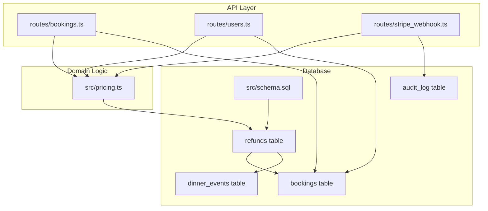
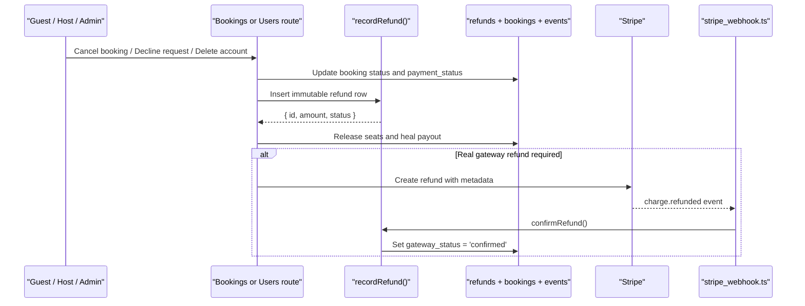
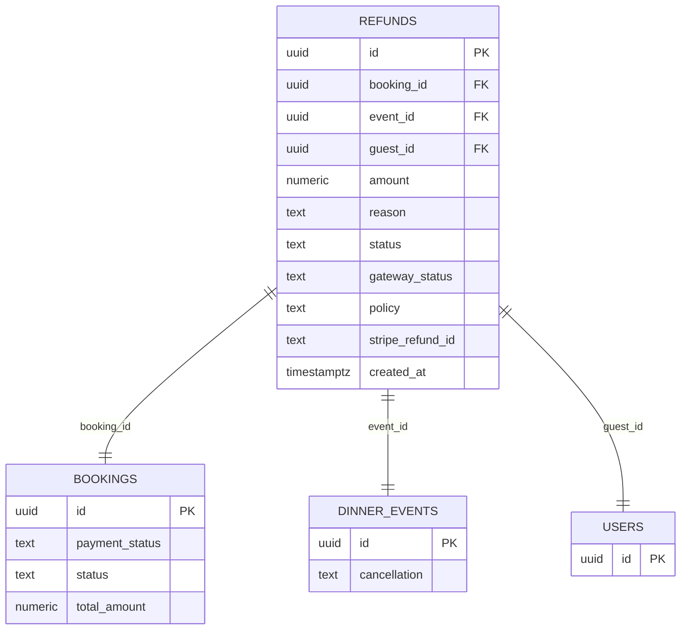
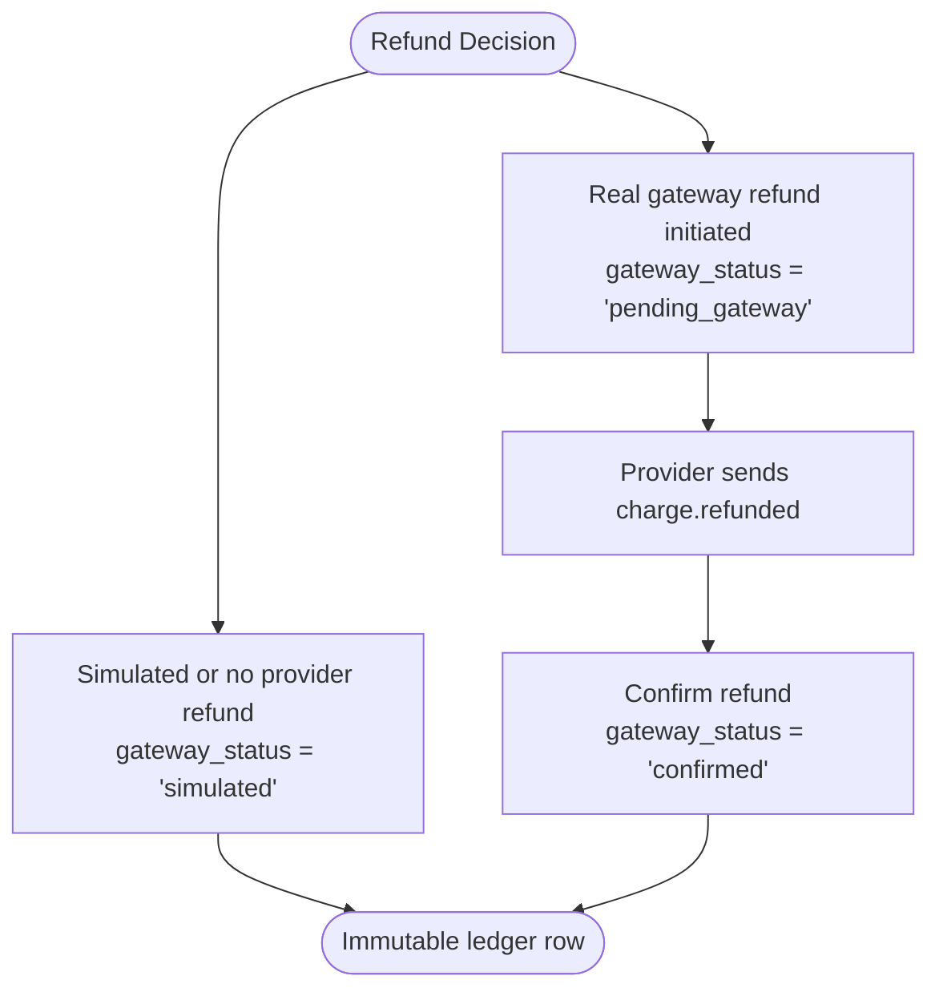
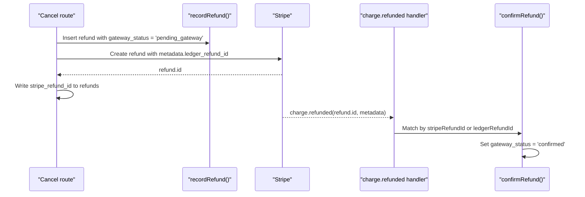
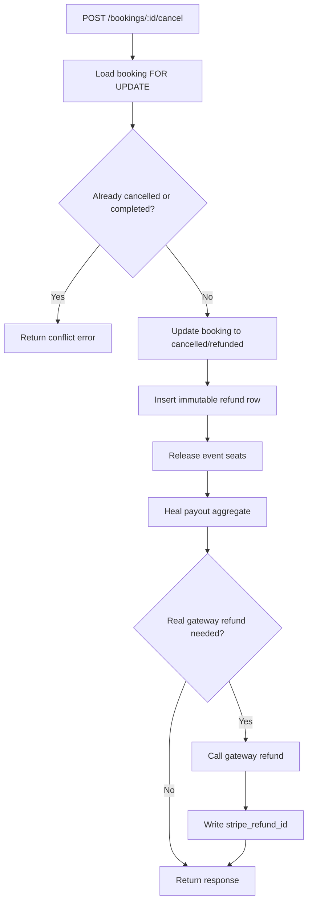
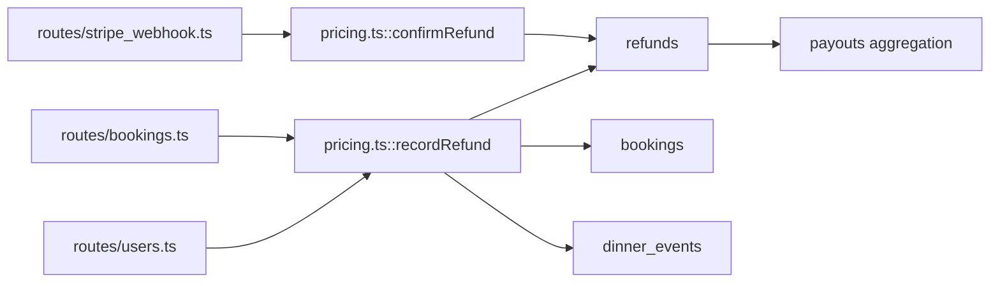

# Refund System

<cite>
**Referenced Files in This Document**
- [schema.sql](file://server/src/schema.sql)
- [pricing.ts](file://server/src/pricing.ts)
- [bookings.ts](file://server/src/routes/bookings.ts)
- [stripe_webhook.ts](file://server/src/routes/stripe_webhook.ts)
- [users.ts](file://server/src/routes/users.ts)
- [security.ts](file://server/src/security.ts)
- [money.integration.test.ts](file://server/src/tests/money.integration.test.ts)
</cite>

## Table of Contents
1. [Introduction](#introduction)
2. [Project Structure](#project-structure)
3. [Core Components](#core-components)
4. [Architecture Overview](#architecture-overview)
5. [Detailed Component Analysis](#detailed-component-analysis)
6. [Dependency Analysis](#dependency-analysis)
7. [Performance Considerations](#performance-considerations)
8. [Troubleshooting Guide](#troubleshooting-guide)
9. [Conclusion](#conclusion)

## Introduction
This document explains the refund system used by DineCircle to record, track, and reconcile money movements related to booking cancellations, host declines, and event cancellations. The system is built around an immutable `refunds` ledger table, a strict policy-driven reason code model, and a gateway-aware status machine that distinguishes internal bookkeeping from provider-confirmed money movement. It also documents how Stripe refunds are integrated through `stripe_refund_id`, how audit logging supports compliance, and how financial records must remain immutable.

## Project Structure
The refund system spans database schema definitions, business logic for recording and confirming refunds, API routes that trigger refund scenarios, and a webhook handler that reconciles external payment-provider signals with internal state.

**Diagram sources**
- [bookings.ts:420-564](file://server/src/routes/bookings.ts#L420-L564)
- [users.ts:273-309](file://server/src/routes/users.ts#L273-L309)
- [stripe_webhook.ts:75-88](file://server/src/routes/stripe_webhook.ts#L75-L88)
- [pricing.ts:98-156](file://server/src/pricing.ts#L98-L156)
- [schema.sql:214-236](file://server/src/schema.sql#L214-L236)

**Section sources**
- [schema.sql:214-236](file://server/src/schema.sql#L214-L236)
- [pricing.ts:98-156](file://server/src/pricing.ts#L98-L156)
- [bookings.ts:420-564](file://server/src/routes/bookings.ts#L420-L564)
- [stripe_webhook.ts:75-88](file://server/src/routes/stripe_webhook.ts#L75-L88)

## Core Components
- **Refunds ledger**: An immutable row per refund decision, capturing who was refunded, why, how much, which policy applied, whether money actually moved, and whether the payment provider confirmed it.
- **Reason codes**: Enforced at the database level as `guest_cancel`, `host_decline`, or `event_cancelled`.
- **Status model**:
  - `status`: Financial meaning — `refunded` means money was captured and should be returned; `released` means no money was charged (for example, reversing an authorization hold).
  - `gateway_status`: Provider reconciliation — `simulated`, `pending_gateway`, or `confirmed`.
- **Stripe integration**: When a real gateway is active, refunds may be initiated against Stripe, and the `charge.refunded` webhook flips the ledger row to `confirmed`, optionally filling `stripe_refund_id`.
- **Audit trail**: General request-level audit logging captures mutating operations, while the `refunds` table itself provides the financial audit trail.

**Section sources**
- [schema.sql:214-236](file://server/src/schema.sql#L214-L236)
- [pricing.ts:98-156](file://server/src/pricing.ts#L98-L156)
- [security.ts:99-126](file://server/src/security.ts#L99-L126)

## Architecture Overview
The refund architecture separates three concerns:
1. **Business decision**: A guest cancels, a host declines a pending request, or an event is cancelled.
2. **Ledger entry**: A single immutable row is inserted into `refunds` inside the same transaction that updates the booking and event state.
3. **Gateway reconciliation**: If a real payment provider is involved, the ledger row starts as `pending_gateway` and only becomes `confirmed` after the provider confirms the refund.

**Diagram sources**
- [bookings.ts:420-564](file://server/src/routes/bookings.ts#L420-L564)
- [users.ts:273-309](file://server/src/routes/users.ts#L273-L309)
- [pricing.ts:110-156](file://server/src/pricing.ts#L110-L156)
- [stripe_webhook.ts:75-88](file://server/src/routes/stripe_webhook.ts#L75-L88)

## Detailed Component Analysis

### Refunds Table Structure and Immutability
The `refunds` table is the authoritative financial ledger for refund decisions. Each row is immutable once inserted: there is no update path for core fields such as `amount`, `reason`, `status`, or `policy`. Only `gateway_status` and `stripe_refund_id` can change during provider reconciliation.

Key design points:
- **Primary key**: `id` is a UUID generated by the database.
- **Foreign keys**: Links to `bookings`, `dinner_events`, and `users`; deletions cascade so referenced entities cannot outlive their financial context.
- **Amount**: Numeric with two decimal places, constrained to non-negative values.
- **Reason**: Restricted to `guest_cancel`, `host_decline`, and `event_cancelled`.
- **Status**: Restricted to `refunded` or `released`.
- **Gateway status**: Restricted to `simulated`, `pending_gateway`, or `confirmed`.
- **Policy**: Text snapshot of the cancellation policy frozen at refund time.
- **Stripe reference**: Optional text field for the provider’s refund identifier.
- **Timestamp**: `created_at` records when the decision was booked.

**Diagram sources**
- [schema.sql:214-236](file://server/src/schema.sql#L214-L236)

**Section sources**
- [schema.sql:214-236](file://server/src/schema.sql#L214-L236)

### Policy Enforcement Through Reason Codes
The system enforces refund reasons through both application logic and database constraints:
- Application code passes one of the allowed reasons when creating a refund.
- Database CHECK constraints reject any other value.
- The reason determines part of the financial semantics:
  - `guest_cancel`: Guest-initiated cancellation.
  - `host_decline`: Host rejects a pending seat request; no money was captured, so the ledger books `$0` and marks the row as `released`.
  - `event_cancelled`: Event-wide cancellation, typically triggered when a host deletes their account or the platform cancels the event.

**Section sources**
- [schema.sql:227-228](file://server/src/schema.sql#L227-L228)
- [pricing.ts:96-156](file://server/src/pricing.ts#L96-L156)
- [bookings.ts:698-706](file://server/src/routes/bookings.ts#L698-L706)
- [users.ts:277-286](file://server/src/routes/users.ts#L277-L286)

### Distinction Between `refunded` and `released`
The `status` column describes the financial outcome, not just whether the booking is cancelled:
- `refunded`: Money was captured on the booking (`payment_status = 'paid'`). The refund amount equals the captured amount, and the ledger records a true refund.
- `released`: No money was captured. This applies when reversing an uncaptured authorization hold, such as a host decline. The ledger books `$0` because nothing left the guest’s card.

This distinction ensures that reports, payouts, and compliance queries can distinguish between actual money movement and administrative seat release.

**Section sources**
- [schema.sql:229-230](file://server/src/schema.sql#L229-L230)
- [pricing.ts:132-135](file://server/src/pricing.ts#L132-L135)
- [bookings.ts:680-706](file://server/src/routes/bookings.ts#L680-L706)

### Gateway Status Tracking: `simulated`, `pending_gateway`, `confirmed`
The `gateway_status` column tracks whether the payment provider has confirmed the money movement:
- `simulated`: Used in simulation mode or when no provider refund is due. It explicitly means “this row is bookkeeping only.”
- `pending_gateway`: Used when a real gateway refund is initiated but not yet confirmed. The ledger is truthful about intent, but outbound money movement is not complete.
- `confirmed`: Set only by the webhook reconciliation path after the provider confirms the refund.

**Diagram sources**
- [pricing.ts:104-108](file://server/src/pricing.ts#L104-L108)
- [pricing.ts:248-269](file://server/src/pricing.ts#L248-L269)
- [stripe_webhook.ts:75-88](file://server/src/routes/stripe_webhook.ts#L75-L88)

**Section sources**
- [schema.sql:231-232](file://server/src/schema.sql#L231-L232)
- [pricing.ts:104-108](file://server/src/pricing.ts#L104-L108)
- [pricing.ts:248-269](file://server/src/pricing.ts#L248-L269)

### Stripe Refund Integration via `stripe_refund_id`
When a real gateway is configured:
1. The cancel route inserts a refund row with `gateway_status = 'pending_gateway'`.
2. The route calls the gateway to create a refund and attaches metadata including the internal ledger refund ID.
3. The route writes the provider’s refund ID into `stripe_refund_id`.
4. The Stripe webhook receives `charge.refunded`.
5. The webhook calls `confirmRefund`, which matches either by `stripe_refund_id` or by the embedded ledger refund ID and sets `gateway_status = 'confirmed'`.

**Diagram sources**
- [bookings.ts:475-538](file://server/src/routes/bookings.ts#L475-L538)
- [stripe_webhook.ts:75-88](file://server/src/routes/stripe_webhook.ts#L75-L88)
- [pricing.ts:248-269](file://server/src/pricing.ts#L248-L269)

**Section sources**
- [bookings.ts:475-538](file://server/src/routes/bookings.ts#L475-L538)
- [stripe_webhook.ts:75-88](file://server/src/routes/stripe_webhook.ts#L75-L88)
- [pricing.ts:248-269](file://server/src/pricing.ts#L248-L269)

### Refund Creation Flow: Guest Cancellation
A guest cancellation follows this sequence:
1. Load the booking with a row lock.
2. Validate ownership and lifecycle state.
3. Update the booking to `cancelled` and set `payment_status` to `refunded` if it was `paid` or `authorized`.
4. Insert an immutable refund row with reason `guest_cancel`, the captured amount, and the frozen cancellation policy.
5. Release seats on the event.
6. Recalculate the host payout based on live captured bookings.
7. If a real gateway refund is required, call the gateway and write `stripe_refund_id`.

**Diagram sources**
- [bookings.ts:420-564](file://server/src/routes/bookings.ts#L420-L564)
- [pricing.ts:110-156](file://server/src/pricing.ts#L110-L156)

**Section sources**
- [bookings.ts:420-564](file://server/src/routes/bookings.ts#L420-L564)
- [pricing.ts:110-156](file://server/src/pricing.ts#L110-L156)

### Refund Creation Flow: Host Decline
A host decline applies to a pending seat request:
1. Load the pending request and verify host ownership.
2. Mark the booking as `cancelled` and `refunded`.
3. Insert a refund row with reason `host_decline`. Because the hold was `authorized` but not captured, the recorded amount is `$0` and the status is `released`.
4. Release seats and remove the guest from the attendee list unless another active booking still holds a seat.
5. Optionally void the Stripe authorization.

**Section sources**
- [bookings.ts:680-761](file://server/src/routes/bookings.ts#L680-L761)
- [pricing.ts:132-135](file://server/src/pricing.ts#L132-L135)

### Refund Creation Flow: Event Cancellation
Event-wide cancellations occur when a host deletes their account or similar bulk operations:
1. Query all live bookings belonging to the host’s events.
2. For each captured booking, insert a refund row with reason `event_cancelled`.
3. Update those bookings to `cancelled` and appropriate payment statuses.
4. Release seats and heal payouts across affected events.

**Section sources**
- [users.ts:273-309](file://server/src/routes/users.ts#L273-L309)

### Status Updates and Reconciliation
Refund rows move through gateway states only through controlled paths:
- Initial creation uses `simulated` or `pending_gateway`.
- Only the webhook reconciliation path transitions `pending_gateway` to `confirmed`.
- Matching is intentionally robust: it accepts either the Stripe refund ID or the internal ledger refund ID stored in metadata.

**Section sources**
- [pricing.ts:248-269](file://server/src/pricing.ts#L248-L269)
- [stripe_webhook.ts:75-88](file://server/src/routes/stripe_webhook.ts#L75-L88)

### Audit Logging and Compliance
Financial immutability is supported by two complementary mechanisms:
- The `refunds` table is append-only for financial facts. Core fields are not updated after insertion.
- The general `audit_log` table records mutating API requests, with sensitive fields redacted before storage.

Compliance considerations:
- Never treat `gateway_status = 'simulated'` as proof that a provider has moved money.
- Always reconcile provider statements against `refunds.gateway_status = 'confirmed'`.
- Preserve historical policy snapshots in `policy` rather than re-reading current event settings.
- Keep refund rows even when related entities are deleted; foreign-key cascades preserve referential integrity without erasing financial history.

**Section sources**
- [schema.sql:498-511](file://server/src/schema.sql#L498-L511)
- [security.ts:70-97](file://server/src/security.ts#L70-L97)
- [security.ts:99-126](file://server/src/security.ts#L99-L126)

## Dependency Analysis
The refund system depends on several tightly coupled components:

**Diagram sources**
- [bookings.ts:475-564](file://server/src/routes/bookings.ts#L475-L564)
- [users.ts:273-309](file://server/src/routes/users.ts#L273-L309)
- [pricing.ts:110-156](file://server/src/pricing.ts#L110-L156)
- [pricing.ts:248-269](file://server/src/pricing.ts#L248-L269)
- [stripe_webhook.ts:75-88](file://server/src/routes/stripe_webhook.ts#L75-L88)

**Section sources**
- [bookings.ts:475-564](file://server/src/routes/bookings.ts#L475-L564)
- [users.ts:273-309](file://server/src/routes/users.ts#L273-L309)
- [pricing.ts:110-156](file://server/src/pricing.ts#L110-L156)
- [stripe_webhook.ts:75-88](file://server/src/routes/stripe_webhook.ts#L75-L88)

## Performance Considerations
- **Single-row ledger entries**: Each refund decision is one immutable row, minimizing reconciliation complexity.
- **Indexed lookups**: Indexes on `booking_id` and `event_id` support efficient queries by booking or event.
- **Transaction boundaries**: Refund creation happens inside the same transaction as booking and event mutations, preventing partial state.
- **Webhook idempotency**: Duplicate Stripe events are handled safely through `stripe_events` deduplication and conditional state transitions.
- **Payout healing**: Payout aggregates are recomputed from authoritative booking data rather than incrementally adjusted, reducing drift risk.

**Section sources**
- [schema.sql:522-523](file://server/src/schema.sql#L522-L523)
- [bookings.ts:420-564](file://server/src/routes/bookings.ts#L420-L564)
- [stripe_webhook.ts:110-124](file://server/src/routes/stripe_webhook.ts#L110-L124)
- [pricing.ts:48-94](file://server/src/pricing.ts#L48-L94)

## Troubleshooting Guide
Common issues and diagnostics:

| Symptom | Likely Cause | Diagnostic Action | Resolution |
|---|---|---|---|
| Refund row exists but `gateway_status = 'simulated'` | Simulation mode or no provider refund was initiated | Check whether the booking had a real Stripe payment intent and whether the cancel route called the gateway | Ensure gateway configuration is active and the cancel flow reaches the gateway branch |
| Refund row exists with `gateway_status = 'pending_gateway'` but never becomes `confirmed` | Stripe webhook did not arrive, failed signature verification, or did not match the ledger row | Inspect `stripe_events` for the event, check webhook logs, and verify `stripe_refund_id` or metadata | Fix webhook routing/signature, ensure metadata includes `ledger_refund_id`, and retry Stripe delivery |
| Refund amount differs from expected | Booking discount or prior payment state changed expectations | Compare `total_amount` and `priorPaymentStatus` used by `recordRefund` | Verify promo discounts and capture state; tests assert discounted refunds match captured amounts |
| Host wallet balance does not reflect refund | Payout aggregation not healed or refund occurred before accrual | Check whether the event had a payout row and whether the cancellation ran after check-in | Re-run payout healing; cancellations should never fabricate a payout row |
| Audit log contains sensitive data | Redaction middleware did not run or unexpected payload shape | Inspect `audit_log.changes` and compare with `REDACTED_KEYS` | Ensure audit middleware is mounted and body redaction runs before writing |

**Section sources**
- [stripe_webhook.ts:90-151](file://server/src/routes/stripe_webhook.ts#L90-L151)
- [money.integration.test.ts:329-344](file://server/src/tests/money.integration.test.ts#L329-L344)
- [security.ts:70-97](file://server/src/security.ts#L70-L97)

## Conclusion
The DineCircle refund system is designed as an immutable financial ledger with clear separation between business decisions, provider reconciliation, and auditability. The `refunds` table enforces policy through reason codes, distinguishes financial outcomes through `refunded` versus `released`, and tracks provider confirmation through `simulated`, `pending_gateway`, and `confirmed`. Stripe integration is explicit and safe: refunds are initiated by the API, reconciled by webhooks, and matched by stable identifiers rather than mutable amounts. Together with audit logging and transactional consistency, this design supports compliance, debugging, and future migration to real payment flows without rewriting financial history.