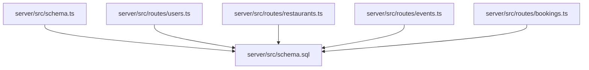
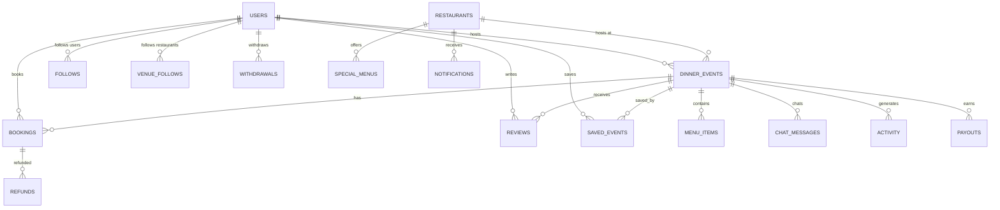
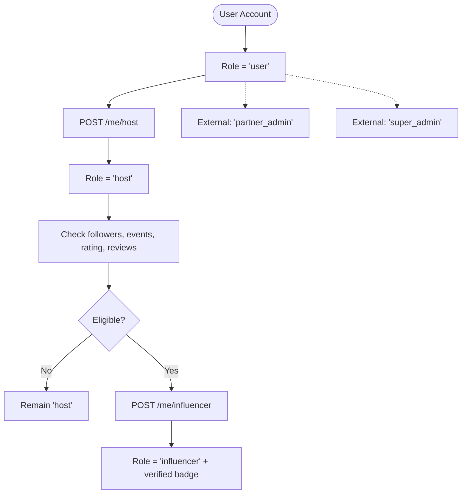
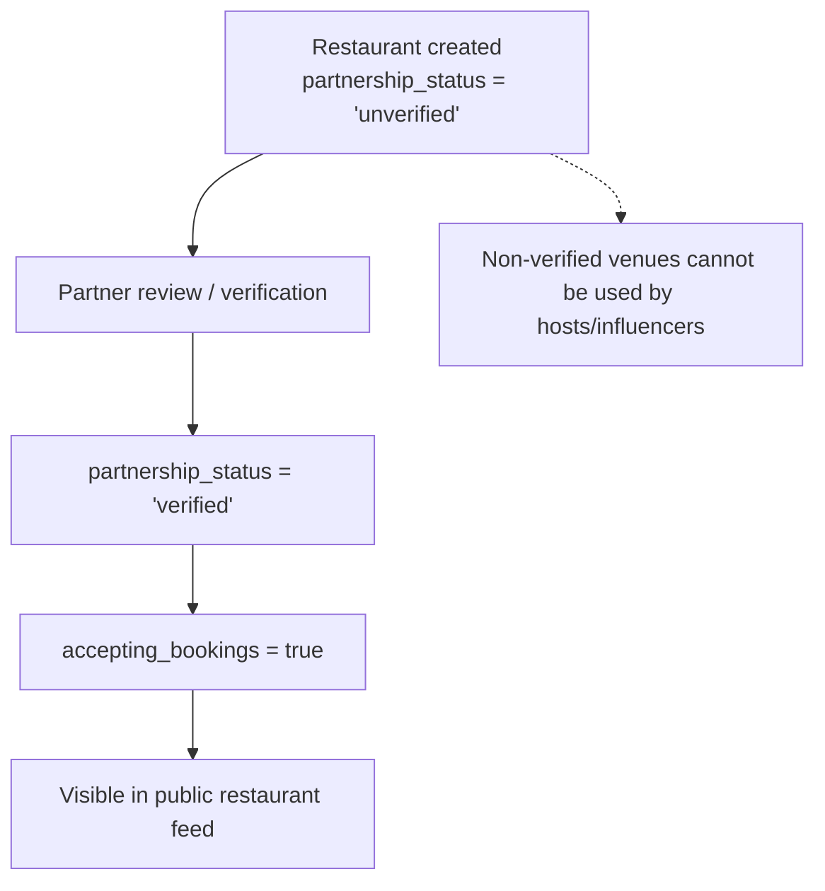
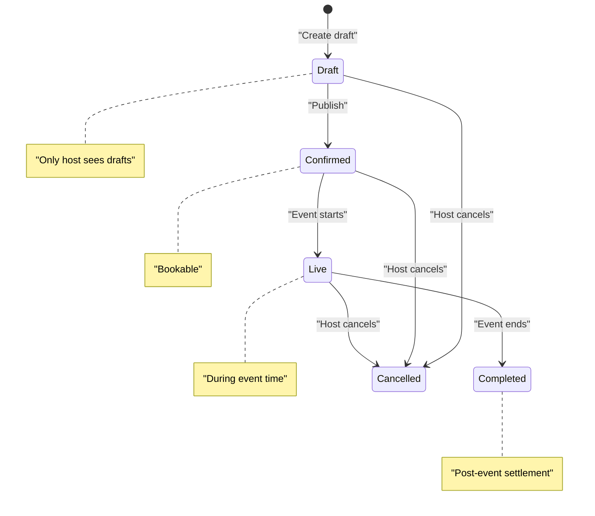
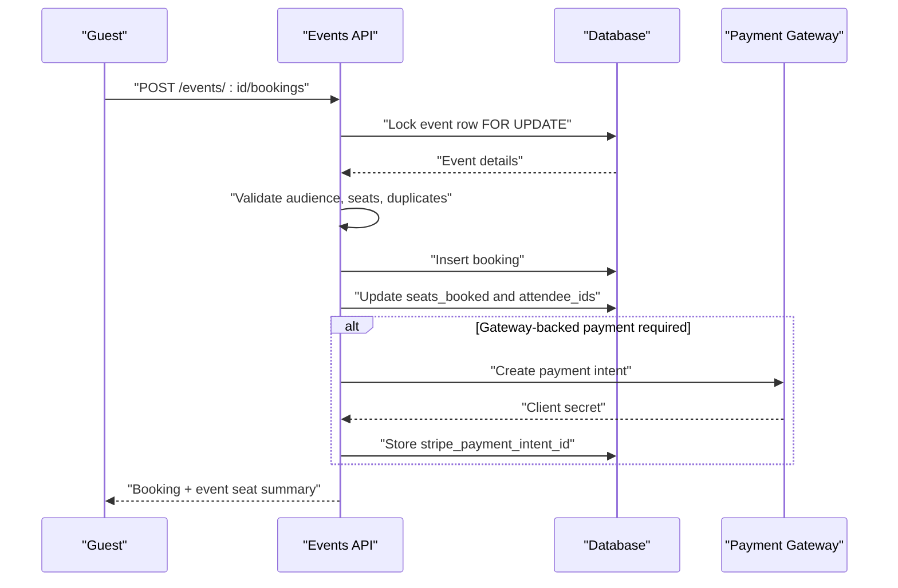
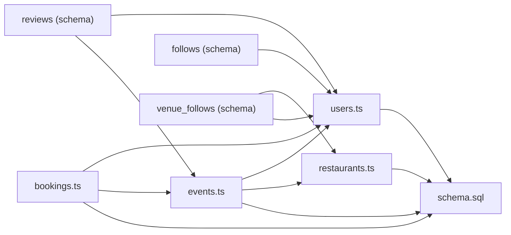

# Core Entities

<cite>
**Referenced Files in This Document**
- [schema.sql](file://server/src/schema.sql)
- [schema.ts](file://server/src/schema.ts)
- [users.ts](file://server/src/routes/users.ts)
- [restaurants.ts](file://server/src/routes/restaurants.ts)
- [events.ts](file://server/src/routes/events.ts)
- [bookings.ts](file://server/src/routes/bookings.ts)
</cite>

## Table of Contents
1. [Introduction](#introduction)
2. [Project Structure](#project-structure)
3. [Core Components](#core-components)
4. [Architecture Overview](#architecture-overview)
5. [Detailed Component Analysis](#detailed-component-analysis)
6. [Dependency Analysis](#dependency-analysis)
7. [Performance Considerations](#performance-considerations)
8. [Troubleshooting Guide](#troubleshooting-guide)
9. [Conclusion](#conclusion)

## Introduction
This document explains the core DineCircle data model and how it powers the booking and social ecosystem. It focuses on three primary entities:

- **Users**: People who browse, host, influence, or manage partner venues.
- **Restaurants**: Venues where dinners are hosted, including partnership and venue-management metadata.
- **Dinner Events**: Hosted experiences at restaurants with lifecycle states, audience controls, and seat accounting.

The schema is defined as a single idempotent SQL file and applied by the server startup script. The API routes enforce business rules such as role-based publishing, venue verification, event visibility, and booking concurrency.

## Project Structure
The backend relevant to this documentation lives under `server/src`:

- `schema.sql` defines all tables, constraints, indexes, and enum-like CHECK values.
- `schema.ts` applies the schema once per process.
- Route files implement the API contracts that read/write these tables.

**Diagram sources**
- [schema.ts:10-17](file://server/src/schema.ts#L10-L17)
- [schema.sql:1-13](file://server/src/schema.sql#L1-L13)

**Section sources**
- [schema.ts:1-26](file://server/src/schema.ts#L1-L26)
- [schema.sql:1-13](file://server/src/schema.sql#L1-L13)

## Core Components
The core domain centers on three tables:

| Entity | Purpose | Key Fields | Important Constraints |
|---|---|---|---|
| `users` | Accounts for diners, hosts, influencers, partners, and admins | `id`, `name`, `handle`, `phone`, `city`, `bio`, `role`, `followers_count`, `following_count`, `dinners_hosted`, `dinners_joined`, `rating`, `review_count`, `badges`, `tastes`, `accent_hex`, `joined_year`, `created_at` | `id` is UUID PK; `handle` unique; `phone` unique; `role` restricted by CHECK; numeric rating precision; arrays default to empty; timestamps default to now. |
| `restaurants` | Partner and non-partner venues | `id`, `owner_id`, `name`, `tagline`, `about`, `cuisines`, `neighborhood`, `address`, `city`, `phone`, `email`, `website`, `instagram`, `price_range`, `rating`, `review_count`, `seats`, `tables_count`, `since`, `owner_name`, `amenities`, `opening_hours`, `profile_completion`, `accepting_bookings`, `dine_circle_plus`, `cover_image`, `gallery`, `tags`, `is_partner`, `partner_perk`, `partnership_status`, `latitude`, `longitude`, `created_at` | `id` is UUID PK; `owner_id` references `users(id)` with SET NULL; JSONB opening hours; array defaults; boolean flags; text enums via CHECK. |
| `dinner_events` | Hosted dinner experiences | `id`, `title`, `tagline`, `description`, `host_id`, `restaurant_id`, `cover_image`, `gallery`, `start_at`, `end_at`, `duration_minutes`, `seats_total`, `seats_booked`, `price_per_seat`, `type`, `audience`, `menu_style`, `included`, `tags`, `is_featured`, `host_note`, `language`, `dress_code`, `cancellation`, `attendee_ids`, `status`, `views`, `requires_approval`, `is_demo`, `created_at` | `id` is UUID PK; `host_id` references `users(id)` CASCADE; `restaurant_id` references `restaurants(id)` CASCADE; CHECKs on `seats_total`, `seats_booked`, `price_per_seat`, `type`, `audience`, `menu_style`, `status`; `attendee_ids` is text array. |

Additional related tables used by the booking and social flows include `bookings`, `refunds`, `payouts`, `withdrawals`, `reviews`, `follows`, `venue_follows`, `saved_events`, `activity`, `chat_messages`, `special_menus`, `notifications`, `promo_codes`, `auth_tokens`, `user_blocks`, `reports`, `feedback`, and `audit_log`.

**Section sources**
- [schema.sql:14-73](file://server/src/schema.sql#L14-L73)
- [schema.sql:74-120](file://server/src/schema.sql#L74-L120)
- [schema.sql:121-168](file://server/src/schema.sql#L121-L168)

## Architecture Overview
At a high level:

- Users create or join events.
- Events live at restaurants.
- Guests book seats against events.
- Bookings drive payment, refunds, payouts, and attendance.
- Social features connect users to users and users to venues.

**Diagram sources**
- [schema.sql:14-73](file://server/src/schema.sql#L14-L73)
- [schema.sql:74-120](file://server/src/schema.sql#L74-L120)
- [schema.sql:121-168](file://server/src/schema.sql#L121-L168)
- [schema.sql:169-200](file://server/src/schema.sql#L169-L200)
- [schema.sql:221-280](file://server/src/schema.sql#L221-L280)
- [schema.sql:282-331](file://server/src/schema.sql#L282-L331)
- [schema.sql:333-387](file://server/src/schema.sql#L333-L387)

## Detailed Component Analysis

### User Model and Role System
The user model represents every person in the system. Roles control capabilities:

- `user`: Default diner.
- `host`: Can publish events.
- `influencer`: Verified publisher with additional discovery signals.
- `partner_admin`: Manages partner venues.
- `super_admin`: Platform administration.

The database enforces allowed roles through a CHECK constraint. The application also implements a growth ladder:

- A diner can promote themselves to `host`.
- A `host` can claim `influencer` when thresholds are met.
- `partner_admin` and `super_admin` exist outside the ladder.

Key fields and behaviors:

| Field / Feature | Meaning |
|---|---|
| `role` | One of the five allowed roles. |
| `followers_count`, `following_count` | Social graph counters. |
| `dinners_hosted`, `dinners_joined` | Event participation counters. |
| `rating`, `review_count` | Reputation metrics. |
| `badges`, `tastes` | Discovery and personalization arrays. |
| `instagram`, `is_demo` | Test and influencer discovery support. |
| Privacy toggles | Control follow lists, activity visibility, DM permissions, and tagging. |
| Food preferences | `dietary` and `allergies` arrays. |
| Soft delete | `is_deleted` anonymizes the account without breaking referential integrity. |

Role progression rules:

- Self-promotion to `host` is allowed unless the user already has a publishing role (`influencer`, `partner_admin`, `super_admin`).
- Influencer eligibility requires minimum followers, hosted events, rating, and review count.
- Influencer promotion updates the role and adds a verified badge.

**Diagram sources**
- [users.ts:74-107](file://server/src/routes/users.ts#L74-L107)
- [users.ts:456-530](file://server/src/routes/users.ts#L456-L530)
- [schema.sql:14-73](file://server/src/schema.sql#L14-L73)

**Section sources**
- [schema.sql:14-73](file://server/src/schema.sql#L14-L73)
- [users.ts:74-107](file://server/src/routes/users.ts#L74-L107)
- [users.ts:456-530](file://server/src/routes/users.ts#L456-L530)

### Restaurant Model and Partnership Workflow
The restaurant table stores full venue profiles. It supports both regular venues and partner venues.

Important fields:

| Field | Meaning |
|---|---|
| `owner_id` | The `partner_admin` who manages the venue; nullable means unowned. |
| `accepting_bookings` | Whether the venue appears in public listings. |
| `is_partner` | Whether the venue is a DineCircle partner. |
| `partnership_status` | Pipeline state for partner onboarding. |
| `latitude`, `longitude` | Optional coordinates for map and nearby queries. |
| `opening_hours` | JSON object describing operating hours. |
| `profile_completion` | Numeric completion score. |
| `seats`, `tables_count` | Venue capacity metadata. |

Partnership status workflow:

- Seeded test venues enter as `unverified`.
- The schema includes a `partnership_status` column with a default value.
- The route layer filters venues by `accepting_bookings` and exposes `partnershipStatus` in responses.
- Event creation restricts non-owner publishers to verified partner venues.

Venue management features:

- Searchable by name, neighborhood, city, cuisines, tags, price range, and partner flag.
- Nearby query uses latitude/longitude with equirectangular distance approximation.
- Follow/unfollow relationship stored in `venue_follows`.
- Venue profile returns upcoming events hosted at the restaurant.

**Diagram sources**
- [schema.sql:74-120](file://server/src/schema.sql#L74-L120)
- [restaurants.ts:47-100](file://server/src/routes/restaurants.ts#L47-L100)
- [events.ts:403-419](file://server/src/routes/events.ts#L403-L419)

**Section sources**
- [schema.sql:74-120](file://server/src/schema.sql#L74-L120)
- [restaurants.ts:47-210](file://server/src/routes/restaurants.ts#L47-L210)
- [events.ts:403-419](file://server/src/routes/events.ts#L403-L419)

### Dinner Event Model and Lifecycle
A dinner event connects a host, a restaurant, time, capacity, pricing, and audience policy.

Core fields:

| Field | Meaning |
|---|---|
| `host_id` | The user who created the event. |
| `restaurant_id` | The venue hosting the event. |
| `start_at`, `end_at`, `duration_minutes` | Time window and duration. |
| `seats_total`, `seats_booked` | Capacity and current bookings. |
| `price_per_seat` | Price in numeric currency format. |
| `type` | Event category such as dinner, tasting, supper club, brunch, workshop, festival. |
| `audience` | Visibility policy: public, followers, friends, invite-only. |
| `menu_style` | Service style such as set menu, tasting menu, family style, sharing, buffet. |
| `attendee_ids` | Text array of attendee user IDs. |
| `status` | Lifecycle state. |
| `requires_approval` | Whether bookings must be approved by the host. |
| `views` | Analytics counter bumped on detail views. |

Event lifecycle states:

| State | Meaning |
|---|---|
| `draft` | Unpublished; only visible to the host. |
| `requested` | Exists in the schema but not used by the event creation path shown here. |
| `confirmed` | Published and bookable. |
| `live` | Exists in the schema; may be used by partner event flows. |
| `completed` | Exists in the schema; typically reflects post-event settlement. |
| `declined` | Exists in the schema; may reflect partner-side decisions. |
| `cancelled` | Cancelled by host or during account deletion. |

Audience types:

| Audience | Rule |
|---|---|
| `public` | Open to anyone who can see the event. |
| `followers` | Only the host’s followers can see and book. |
| `friends` | Treated as open in the visibility gate alongside public. |
| `inviteOnly` | Only listed attendees or guests with an active booking can see/join. |

Event creation and editing rules:

- Only hosts, influencers, and publishing admins can create events.
- Drafts have relaxed validation; publishing re-validates the merged row.
- Non-owner hosts/influencers can only publish at verified partner venues.
- Owners can publish at their own venues regardless of partner verification.
- Drafts cannot be edited after becoming published.
- Deleting an event is blocked if captured payments or accrued earnings exist.

**Diagram sources**
- [schema.sql:121-168](file://server/src/schema.sql#L121-L168)
- [events.ts:10-14](file://server/src/routes/events.ts#L10-L14)
- [events.ts:124-138](file://server/src/routes/events.ts#L124-L138)
- [events.ts:384-456](file://server/src/routes/events.ts#L384-L456)
- [events.ts:462-553](file://server/src/routes/events.ts#L462-L553)
- [events.ts:555-633](file://server/src/routes/events.ts#L555-L633)

**Section sources**
- [schema.sql:121-168](file://server/src/schema.sql#L121-L168)
- [events.ts:10-14](file://server/src/routes/events.ts#L10-L14)
- [events.ts:124-138](file://server/src/routes/events.ts#L124-L138)
- [events.ts:384-633](file://server/src/routes/events.ts#L384-L633)

### Booking Model and Seat Accounting
Bookings represent guest reservations against events. They track seats, pricing, payment state, confirmation state, check-in, and gateway integration.

Key fields:

| Field | Meaning |
|---|---|
| `event_id` | Parent event. |
| `user_id` | Guest. |
| `seats` | Number of seats booked. |
| `price_per_seat` | Price snapshot from the event. |
| `total_amount` | Final amount after discounts. |
| `reference` | Human-readable booking code. |
| `payment_label` | Payment method label. |
| `payment_status` | Gateway/payment state. |
| `status` | Booking lifecycle state. |
| `checked_in`, `checked_in_at` | Attendance tracking. |
| `stripe_payment_intent_id`, `stripe_amount_cents` | Stripe integration fields. |

Booking lifecycle states:

| State | Meaning |
|---|---|
| `confirmed` | Auto-confirmed booking. |
| `pending` | Requires host approval. |
| `completed` | Checked in and settled. |
| `cancelled` | Cancelled by guest or host. |

Payment states:

| State | Meaning |
|---|---|
| `unpaid` | No payment flow started. |
| `pending_payment` | Waiting for gateway confirmation. |
| `authorized` | Hold placed; awaiting capture or decline. |
| `paid` | Captured. |
| `refunded` | Refunded or released. |
| `failed` | Payment failure. |

Booking flow highlights:

- Concurrency is protected by locking the event row inside a transaction.
- Audience checks prevent unauthorized joining.
- Duplicate active bookings are rejected.
- Promo codes are validated server-side.
- Seats are reserved immediately; payment may be deferred depending on gateway mode and approval settings.
- Cancellation releases seats, updates refund ledger entries, and syncs payouts.
- Check-in finalizes attendance and captures authorizations when applicable.

**Diagram sources**
- [bookings.ts:153-405](file://server/src/routes/bookings.ts#L153-L405)
- [schema.sql:181-213](file://server/src/schema.sql#L181-L213)

**Section sources**
- [schema.sql:181-213](file://server/src/schema.sql#L181-L213)
- [bookings.ts:153-405](file://server/src/routes/bookings.ts#L153-L405)
- [bookings.ts:420-564](file://server/src/routes/bookings.ts#L420-L564)
- [bookings.ts:566-761](file://server/src/routes/bookings.ts#L566-L761)
- [bookings.ts:763-800](file://server/src/routes/bookings.ts#L763-L800)

### Entity Relationships and Referential Integrity
Primary relationships:

- `dinner_events.host_id` → `users.id` (CASCADE).
- `dinner_events.restaurant_id` → `restaurants.id` (CASCADE).
- `bookings.event_id` → `dinner_events.id` (CASCADE).
- `bookings.user_id` → `users.id` (CASCADE).
- `restaurants.owner_id` → `users.id` (SET NULL).
- Social edges: `follows`, `venue_follows`, `saved_events`.
- Financial edges: `refunds`, `payouts`, `withdrawals`.
- Moderation and safety: `user_blocks`, `reports`, `feedback`, `audit_log`.

Referential integrity rules:

- Deleting a user cascades out of most child tables but soft-deletes the account for history preservation.
- Deleting a restaurant or event cascades child rows such as bookings, menu items, chat messages, and saved events.
- Blocking removes mutual follows and hides blocked accounts from discovery and feeds.
- Unique constraints protect identity and deduplication: `users.handle`, `users.email`, `bookings.reference`, `reviews(event_id, author_id)`, `venue_follows(user_id, restaurant_id)`, `saved_events(user_id, event_id)`.

Indexes:

- Event queries use indexes on `start_at`, `host_id`, `restaurant_id`, `type`, and `status`.
- Booking queries use indexes on `user_id` and `event_id`.
- Restaurant queries use indexes on `owner_id` and `partnership_status`.
- Activity, auth tokens, saved events, special menus, notifications, and audit logs have dedicated indexes.

**Section sources**
- [schema.sql:14-73](file://server/src/schema.sql#L14-L73)
- [schema.sql:74-120](file://server/src/schema.sql#L74-L120)
- [schema.sql:121-168](file://server/src/schema.sql#L121-L168)
- [schema.sql:169-200](file://server/src/schema.sql#L169-L200)
- [schema.sql:221-331](file://server/src/schema.sql#L221-L331)
- [schema.sql:426-475](file://server/src/schema.sql#L426-L475)
- [schema.sql:513-539](file://server/src/schema.sql#L513-L539)

### Common Queries and Interaction Examples
Below are conceptual examples of how the core entities interact. These describe intended queries rather than exact SQL strings.

- List discoverable events for a viewer:
  - Filter by type, audience, featured, host, venue, upcoming window, search term, max price, city, neighborhood, and date range.
  - Apply audience visibility rules so only permitted events appear.
  - Exclude drafts except for the event’s host.
  - Respect block relationships between viewer and host.

- View one event detail:
  - Load the event with host and restaurant information.
  - Validate audience access and block rules.
  - Return menu items, venue details, and attendee list.
  - Increment view count for non-host viewers.

- Create an event:
  - Require host-level capability.
  - Validate venue ownership or partner verification.
  - Insert event and menu items.
  - Return serialized event with joined host and venue data.

- Book seats:
  - Lock the event row.
  - Validate audience, start time, seat availability, and duplicate bookings.
  - Apply promo discount.
  - Insert booking and update seats.
  - Optionally create a payment intent and store its ID.

- Cancel a booking:
  - Authorize the cancellation request.
  - Mark booking cancelled and adjust payment status.
  - Record refund decision.
  - Release seats and heal payout accrual.
  - Void or refund gateway authorization as needed.

- Follow/unfollow a venue:
  - Upsert or delete a row in `venue_follows`.
  - Include `isFollowing` in venue listing and profile responses.

**Section sources**
- [events.ts:140-246](file://server/src/routes/events.ts#L140-L246)
- [events.ts:258-343](file://server/src/routes/events.ts#L258-L343)
- [events.ts:384-456](file://server/src/routes/events.ts#L384-L456)
- [bookings.ts:153-405](file://server/src/routes/bookings.ts#L153-L405)
- [bookings.ts:420-564](file://server/src/routes/bookings.ts#L420-L564)
- [restaurants.ts:181-207](file://server/src/routes/restaurants.ts#L181-L207)

## Dependency Analysis
The runtime dependency chain is:

- Routes depend on the schema.
- Business logic depends on foreign keys and CHECK constraints.
- Social and financial flows depend on multiple related tables.

**Diagram sources**
- [users.ts:1-10](file://server/src/routes/users.ts#L1-L10)
- [restaurants.ts:1-5](file://server/src/routes/restaurants.ts#L1-L5)
- [events.ts:1-8](file://server/src/routes/events.ts#L1-L8)
- [bookings.ts:1-14](file://server/src/routes/bookings.ts#L1-L14)
- [schema.sql:14-73](file://server/src/schema.sql#L14-L73)
- [schema.sql:74-120](file://server/src/schema.sql#L74-L120)
- [schema.sql:121-168](file://server/src/schema.sql#L121-L168)
- [schema.sql:169-200](file://server/src/schema.sql#L169-L200)
- [schema.sql:294-331](file://server/src/schema.sql#L294-L331)

**Section sources**
- [users.ts:1-10](file://server/src/routes/users.ts#L1-L10)
- [restaurants.ts:1-5](file://server/src/routes/restaurants.ts#L1-L5)
- [events.ts:1-8](file://server/src/routes/events.ts#L1-L8)
- [bookings.ts:1-14](file://server/src/routes/bookings.ts#L1-L14)
- [schema.sql:14-331](file://server/src/schema.sql#L14-L331)

## Performance Considerations
- Use the provided indexes for event discovery, booking lookups, restaurant partner filtering, and activity queries.
- Avoid scanning large arrays without containment operators; the schema intentionally stores `attendee_ids` as a text array and compares/appends by text.
- Keep pagination bounded by the route-layer limits.
- Prefer filtered queries using CHECK-constrained enums instead of ad-hoc string matching.
- For nearby venue searches, rely on latitude/longitude bounds before computing distances.
- Treat fire-and-forget analytics bumps carefully; they should not block primary responses.

[No sources needed since this section provides general guidance]

## Troubleshooting Guide
Common issues and their likely causes:

- Cannot publish an event at a venue:
  - The venue may not be a verified partner, or the caller does not own the venue.
- Event not visible in discovery:
  - The event may be a draft, audience-restricted, or hosted by a blocked user.
- Booking fails with sold-out or already started:
  - Seats are exhausted or the event start time has passed.
- Duplicate booking error:
  - The guest already holds an active booking at the same event.
- Cannot cancel an event:
  - The event has captured payments or accrued earnings; individual booking cancellations are required instead.
- Blocked user cannot join an event:
  - Block enforcement prevents new joins in either direction.
- Account deletion leaves historical records:
  - Deletion anonymizes the user and cancels affected events/bookings while preserving financial and social history.

**Section sources**
- [events.ts:403-419](file://server/src/routes/events.ts#L403-L419)
- [events.ts:124-138](file://server/src/routes/events.ts#L124-L138)
- [bookings.ts:188-232](file://server/src/routes/bookings.ts#L188-L232)
- [bookings.ts:555-633](file://server/src/routes/events.ts#L555-L633)
- [users.ts:188-418](file://server/src/routes/users.ts#L188-L418)

## Conclusion
DineCircle’s core data model ties users, restaurants, and dinner events together through strict constraints, explicit lifecycle states, and clear business rules. The schema acts as the source of truth, while the route layer enforces role-based publishing, venue verification, audience visibility, and safe booking concurrency. Together, these components support a complete booking and social ecosystem with robust financial, moderation, and analytics foundations.

[No sources needed since this section summarizes without analyzing specific files]