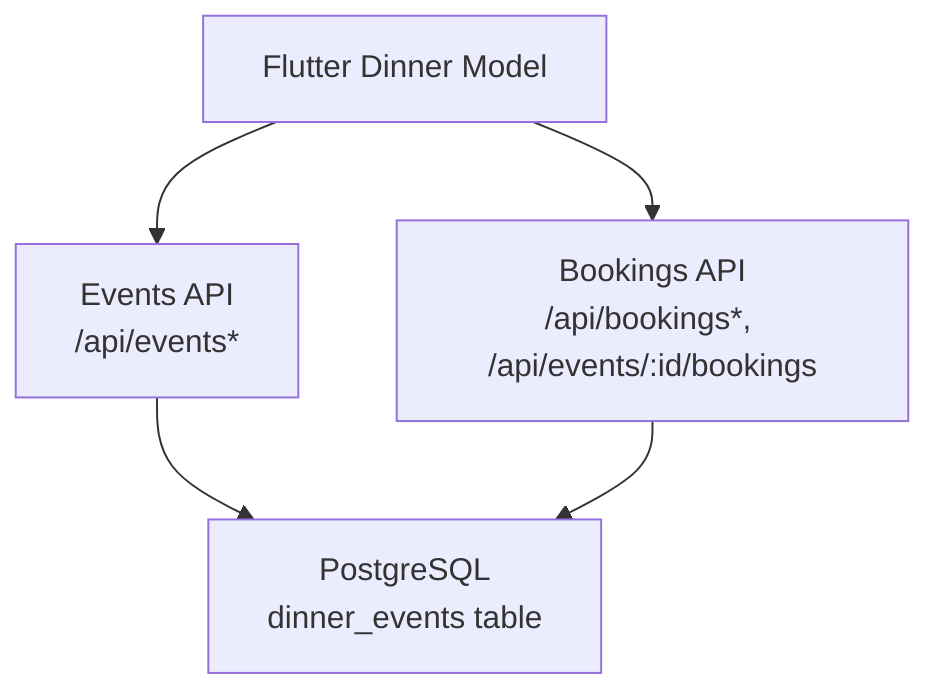
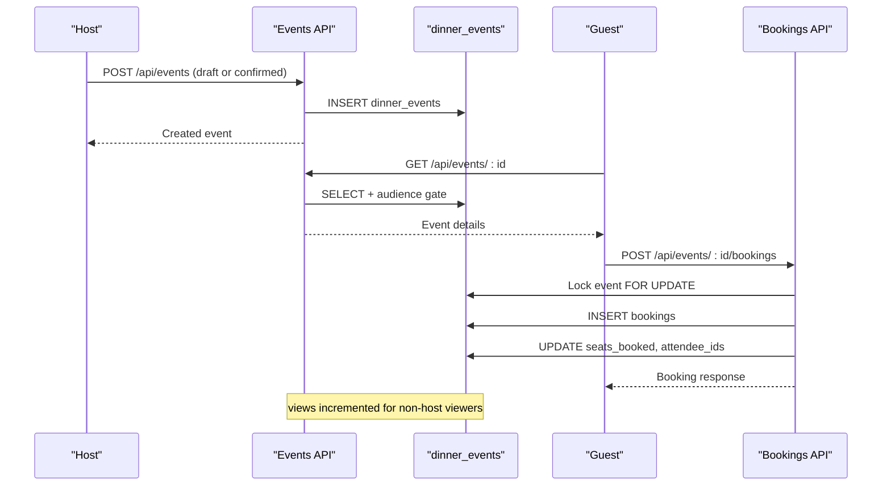
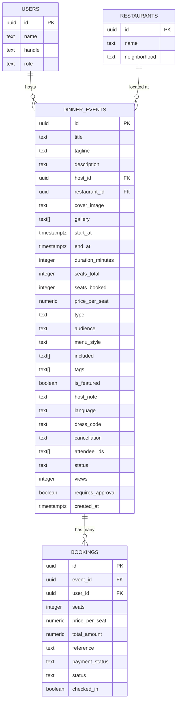
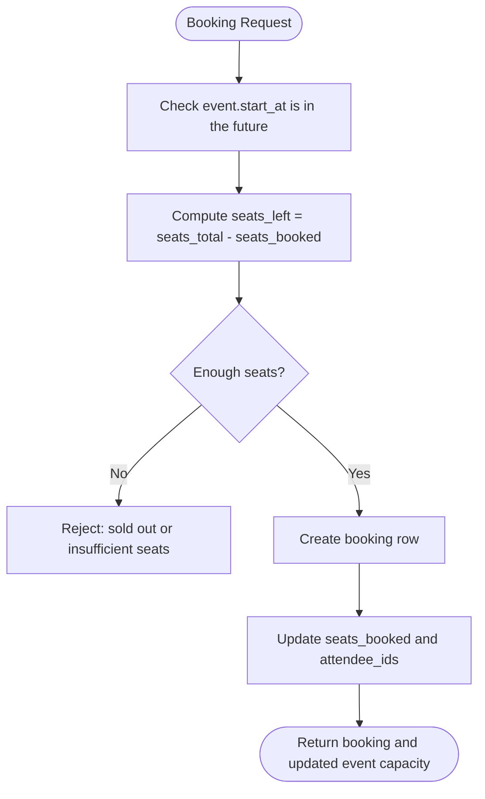
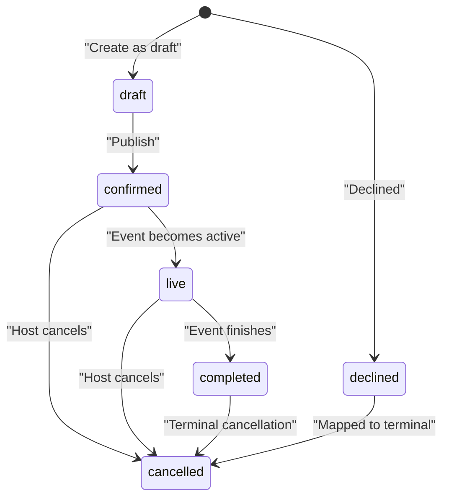
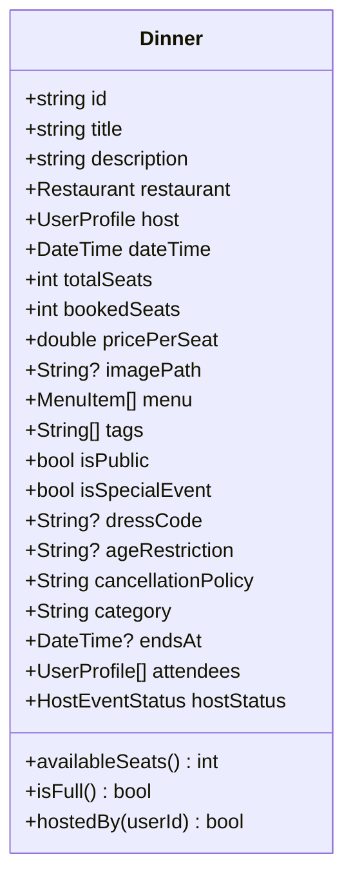
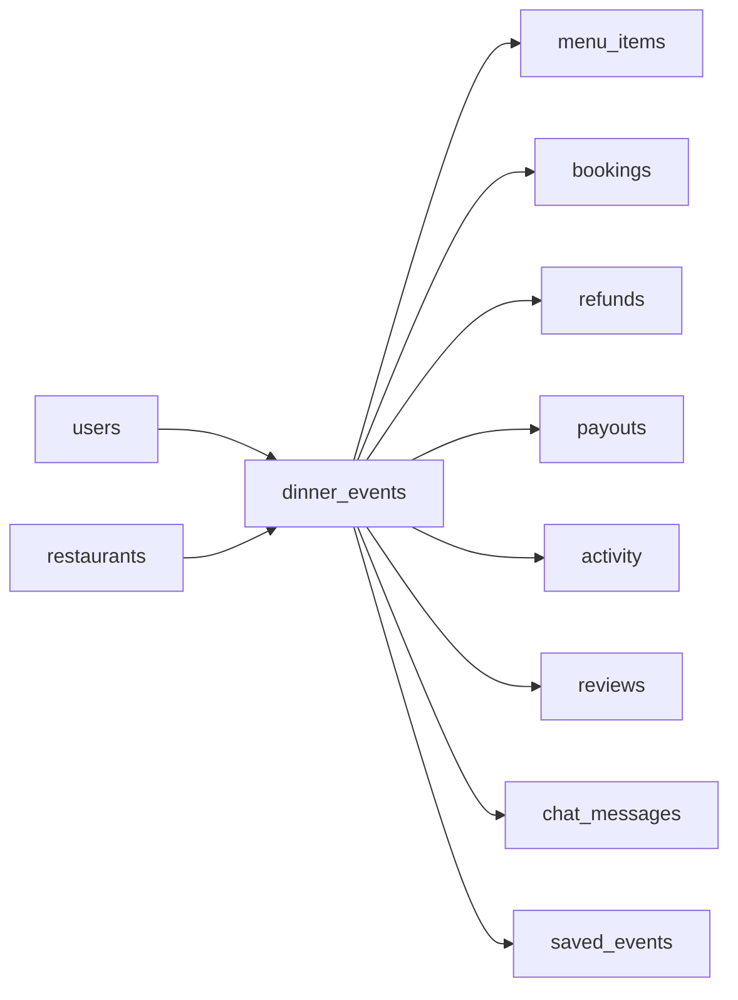

# Dinner Events Entity

<cite>
**Referenced Files in This Document**
- [schema.sql](file://server/src/schema.sql)
- [events.ts](file://server/src/routes/events.ts)
- [bookings.ts](file://server/src/routes/bookings.ts)
- [dinner.dart](file://lib/models/dinner.dart)
</cite>

## Table of Contents
1. [Introduction](#introduction)
2. [Project Structure](#project-structure)
3. [Core Components](#core-components)
4. [Architecture Overview](#architecture-overview)
5. [Detailed Component Analysis](#detailed-component-analysis)
6. [Dependency Analysis](#dependency-analysis)
7. [Performance Considerations](#performance-considerations)
8. [Troubleshooting Guide](#troubleshooting-guide)
9. [Conclusion](#conclusion)

## Introduction
This document provides a comprehensive data model and integration guide for the `dinner_events` entity. It explains the complete event schema, scheduling fields, capacity management, audience and type enums, menu style, discovery attributes, host analytics, and the booking flow that interacts with the event row. It also documents the event lifecycle through the `status` field and shows how the server enforces visibility, availability, approvals, and seat accounting.

## Project Structure
The `dinner_events` entity is defined in the database schema and consumed by the server routes and Flutter models:

- Database definition: `server/src/schema.sql`
- Event API (create, list, detail, edit, delete): `server/src/routes/events.ts`
- Booking and approval flows: `server/src/routes/bookings.ts`
- Flutter-side dinner model used by UI layers: `lib/models/dinner.dart`

**Diagram sources**
- [schema.sql:121-167](file://server/src/schema.sql#L121-L167)
- [events.ts:10-65](file://server/src/routes/events.ts#L10-L65)
- [bookings.ts:153-335](file://server/src/routes/bookings.ts#L153-L335)
- [dinner.dart:24-73](file://lib/models/dinner.dart#L24-L73)

**Section sources**
- [schema.sql:121-167](file://server/src/schema.sql#L121-L167)
- [events.ts:10-65](file://server/src/routes/events.ts#L10-L65)
- [bookings.ts:153-335](file://server/src/routes/bookings.ts#L153-L335)
- [dinner.dart:24-73](file://lib/models/dinner.dart#L24-L73)

## Core Components
The `dinner_events` table is the central record for every hosted dinner or related event. Its columns can be grouped into six functional areas:

| Area | Fields | Purpose |
|---|---|---|
| Identity and ownership | `id`, `host_id`, `restaurant_id` | Identifies the event and links it to its host user and venue restaurant. |
| Event metadata | `title`, `tagline`, `description`, `cover_image`, `gallery`, `host_note` | Describes the event’s public-facing identity and optional media. |
| Scheduling | `start_at`, `end_at`, `duration_minutes` | Defines when the event starts, optionally ends, and how long it lasts. |
| Capacity and pricing | `seats_total`, `seats_booked`, `price_per_seat` | Controls total seats, booked seats, and per-seat price. |
| Classification and discovery | `type`, `audience`, `menu_style`, `included`, `tags`, `is_featured`, `language`, `dress_code`, `cancellation` | Classifies the event and controls discoverability and presentation. |
| Attendance and lifecycle | `attendee_ids`, `status`, `views`, `requires_approval`, `created_at` | Tracks invited attendees, lifecycle state, analytics, and approval gating. |

Key constraints from the schema include:

- Non-negative capacity: `seats_total >= 0`, `seats_booked >= 0`.
- Non-negative price: `price_per_seat >= 0`.
- Enum-like text columns constrained by `CHECK`:
  - `type`: `dinner`, `tasting`, `supperClub`, `brunch`, `workshop`, `festival`.
  - `audience`: `public`, `followers`, `friends`, `inviteOnly`.
  - `menu_style`: `setMenu`, `tastingMenu`, `familyStyle`, `sharing`, `buffet`.
  - `status`: `draft`, `requested`, `confirmed`, `live`, `completed`, `declined`, `cancelled`.

**Section sources**
- [schema.sql:121-167](file://server/src/schema.sql#L121-L167)

## Architecture Overview
The `dinner_events` entity participates in three main flows:

1. **Event creation and publishing**: Hosts create events as drafts or publish them directly; published events default to `confirmed`.
2. **Event discovery and visibility**: The feed and detail endpoints apply audience rules, block-list checks, draft-only access, and location/type filters.
3. **Booking and attendance**: Guests book seats; the system updates `seats_booked` and `attendee_ids`, optionally requires host approval, and integrates with payment logic.

**Diagram sources**
- [events.ts:384-455](file://server/src/routes/events.ts#L384-L455)
- [events.ts:258-343](file://server/src/routes/events.ts#L258-L343)
- [bookings.ts:153-335](file://server/src/routes/bookings.ts#L153-L335)
- [schema.sql:121-167](file://server/src/schema.sql#L121-L167)

## Detailed Component Analysis

### Event Schema and Data Model
The `dinner_events` table defines the canonical shape of an event. Important modeling decisions include:

- `id` is a UUID primary key generated by the database.
- `host_id` and `restaurant_id` are foreign keys with cascade deletion, so deleting a host or restaurant removes associated events.
- `start_at` is required; `end_at` is optional, allowing events without explicit end times.
- `duration_minutes` defaults to 150 minutes.
- `seats_total` and `seats_booked` are integers with non-negative constraints.
- `attendee_ids` is a text array of user IDs; the server treats these as text values and uses array functions such as membership checks and appending.
- `status` is a constrained text column representing the event lifecycle.
- `views` and `requires_approval` are added later via idempotent schema changes to support host analytics and approval gating.

**Diagram sources**
- [schema.sql:121-167](file://server/src/schema.sql#L121-L167)
- [schema.sql:181-200](file://server/src/schema.sql#L181-L200)

**Section sources**
- [schema.sql:121-167](file://server/src/schema.sql#L121-L167)

### Event Metadata
Metadata fields describe the event’s identity and presentation:

| Field | Type | Default | Behavior |
|---|---|---|---|
| `title` | text | none | Required; must be between 3 and 120 characters for published events. |
| `tagline` | text | empty string | Short promotional line. |
| `description` | text | empty string | Longer event description. |
| `cover_image` | text | empty string | Primary image URL or asset path. |
| `gallery` | text[] | empty array | Additional images; if omitted during creation, the server may use the cover image. |
| `host_note` | text | empty string | Optional internal note visible to hosts. |

Validation behavior:

- Published event creation validates `title` length and other fields strictly.
- Draft creation relaxes some requirements, allowing partial events to be saved and polished later.

**Section sources**
- [events.ts:345-382](file://server/src/routes/events.ts#L345-L382)
- [events.ts:423-455](file://server/src/routes/events.ts#L423-L455)

### Scheduling Fields
Scheduling is represented by:

| Field | Type | Meaning |
|---|---|---|
| `start_at` | `timestamptz` | Event start time; required. |
| `end_at` | `timestamptz` | Optional end time; not enforced by the schema constraint. |
| `duration_minutes` | integer | Expected duration in minutes; defaults to 150. |

Rules:

- Published events require a valid future start time.
- Drafts allow missing or flexible start times so hosts can save incomplete events.
- The booking flow rejects bookings for events whose `start_at` has already passed.

**Section sources**
- [schema.sql:121-135](file://server/src/schema.sql#L121-L135)
- [events.ts:374-382](file://server/src/routes/events.ts#L374-L382)
- [bookings.ts:208-219](file://server/src/routes/bookings.ts#L208-L219)

### Capacity Management
Capacity is tracked through:

| Field | Type | Constraint |
|---|---|---|
| `seats_total` | integer | Must be greater than or equal to zero. |
| `seats_booked` | integer | Must be greater than or equal to zero. |
| `price_per_seat` | numeric(10,2) | Must be greater than or equal to zero. |

Behavior:

- When a guest books seats, `seats_booked` increases by the number of seats.
- When a booking is cancelled or declined, `seats_booked` decreases, but never below zero.
- The API computes available seats as `seats_total - seats_booked`.
- If available seats are insufficient, the booking request fails with a sold-out or limited-seats error.

**Diagram sources**
- [bookings.ts:180-335](file://server/src/routes/bookings.ts#L180-L335)

**Section sources**
- [schema.sql:136-138](file://server/src/schema.sql#L136-L138)
- [events.ts:67-121](file://server/src/routes/events.ts#L67-L121)
- [bookings.ts:211-307](file://server/src/routes/bookings.ts#L211-L307)

### Status Lifecycle
The `status` field defines the event lifecycle. The schema allows:

| Status | Meaning | Typical Transition |
|---|---|---|
| `draft` | Unpublished work-in-progress. | Created by host; edited until published. |
| `requested` | Listed in the schema but not the primary creation path shown here. | May appear in broader lifecycle extensions. |
| `confirmed` | Published and bookable. | Default for newly published events. |
| `live` | Currently happening or active. | Used by partner events and UI mapping. |
| `completed` | Finished event. | Used by UI mapping and post-event flows. |
| `declined` | Declined or rejected event. | Maps to terminal UI state. |
| `cancelled` | Cancelled event. | Used when host cancels or declines. |

Important notes:

- The server’s create endpoint inserts either `draft` or `confirmed`.
- The patch endpoint allows editing drafts and publishing them to `confirmed`.
- The Flutter mapper collapses several backend statuses (`confirmed`, `live`, `requested`) into a single published UI state, while `draft`, `completed`, and `cancelled` map to their corresponding UI states.
- `declined` maps to a terminal cancelled-like state in the Flutter layer.

**Diagram sources**
- [schema.sql:153-154](file://server/src/schema.sql#L153-L154)
- [events.ts:438-439](file://server/src/routes/events.ts#L438-L439)
- [events.ts:538-540](file://server/src/routes/events.ts#L538-L540)
- [dinner.dart:46-70](file://lib/models/dinner.dart#L46-L70)

**Section sources**
- [schema.sql:153-154](file://server/src/schema.sql#L153-L154)
- [events.ts:438-439](file://server/src/routes/events.ts#L438-L439)
- [events.ts:538-540](file://server/src/routes/events.ts#L538-L540)
- [dinner.dart:46-70](file://lib/models/dinner.dart#L46-L70)

### Audience Types
The `audience` field controls who can see and join the event:

| Value | Visibility Rule |
|---|---|
| `public` | Visible to anyone who meets general visibility rules. |
| `followers` | Only followers of the host can join. |
| `friends` | Open to friends and others allowed by the visibility gate. |
| `inviteOnly` | Only users listed in `attendee_ids` or existing guests can join. |

The API applies audience gates both in listing and booking flows. For example, a booking request for an `inviteOnly` event fails unless the user is already an attendee or has an active booking.

**Section sources**
- [schema.sql:141-142](file://server/src/schema.sql#L141-L142)
- [events.ts:124-138](file://server/src/routes/events.ts#L124-L138)
- [bookings.ts:191-206](file://server/src/routes/bookings.ts#L191-L206)

### Event Types
The `type` field classifies the event format:

| Value | Intended Use |
|---|---|
| `dinner` | Standard dinner event. |
| `tasting` | Tasting-style event. |
| `supperClub` | Supper club event. |
| `brunch` | Brunch event. |
| `workshop` | Educational or hands-on workshop. |
| `festival` | Festival-style gathering. |

These values are validated by both the schema and the API.

**Section sources**
- [schema.sql:139-140](file://server/src/schema.sql#L139-L140)
- [events.ts:12](file://server/src/routes/events.ts#L12)
- [events.ts:358](file://server/src/routes/events.ts#L358)

### Menu Styles
The `menu_style` field describes how food is served:

| Value | Meaning |
|---|---|
| `setMenu` | Fixed set menu. |
| `tastingMenu` | Multi-course tasting menu. |
| `familyStyle` | Shared family-style serving. |
| `sharing` | General sharing format. |
| `buffet` | Buffet-style service. |

The default is `familyStyle`.

**Section sources**
- [schema.sql:143-144](file://server/src/schema.sql#L143-L144)
- [events.ts:360](file://server/src/routes/events.ts#L360)

### Discovery and Presentation Attributes
Discovery-related fields help users find and understand events:

| Field | Type | Purpose |
|---|---|---|
| `tags` | text[] | Free-form tags for search and filtering. |
| `is_featured` | boolean | Marks featured events. |
| `language` | text | Event language; defaults to English. |
| `dress_code` | text | Dress code guidance; defaults to Smart casual. |
| `cancellation` | text | Cancellation policy text. |
| `included` | text[] | Items or services included with the event. |

The event list endpoint supports filtering by type, audience, featured flag, host, venue, upcoming status, query text, price, city, neighborhood, and date range.

**Section sources**
- [schema.sql:145-152](file://server/src/schema.sql#L145-L152)
- [events.ts:140-245](file://server/src/routes/events.ts#L140-L245)

### Host Analytics and Approval Gating
Two additional columns support host operations:

| Field | Type | Behavior |
|---|---|---|
| `views` | integer | Incremented when a non-host viewer opens the event detail. |
| `requires_approval` | boolean | When true, new bookings are parked as pending until the host approves them. |

Analytics behavior:

- Every non-host view of a published event increments `views`.
- The increment is fire-and-forget so it does not block the response.

Approval behavior:

- If `requires_approval` is true, the booking status becomes `pending` and the initial payment status is `authorized`.
- The host can approve or decline pending requests.
- Approving captures the payment intent and confirms the booking; declining cancels the request and releases the held seat.

**Section sources**
- [schema.sql:158-164](file://server/src/schema.sql#L158-L164)
- [events.ts:274-280](file://server/src/routes/events.ts#L274-L280)
- [bookings.ts:254-269](file://server/src/routes/bookings.ts#L254-L269)
- [bookings.ts:612-678](file://server/src/routes/bookings.ts#L612-L678)
- [bookings.ts:686-761](file://server/src/routes/bookings.ts#L686-L761)

### Flutter Dinner Model Mapping
The Flutter `Dinner` model represents a simplified view of an event for the app layer. It includes:

- Identifier, title, description.
- Restaurant and host references.
- Start time and optional end time.
- Total seats, booked seats, and price per seat.
- Cover image, menu items, tags, public flag, special event flag.
- Dress code, age restriction, cancellation policy, category.
- Attendees and host status.

It also exposes derived properties such as available seats, fullness, formatted dates, and host ownership checks.

**Diagram sources**
- [dinner.dart:24-73](file://lib/models/dinner.dart#L24-L73)

**Section sources**
- [dinner.dart:24-73](file://lib/models/dinner.dart#L24-L73)

## Dependency Analysis
The `dinner_events` entity depends on and relates to several other entities:

- `users`: The host of the event.
- `restaurants`: The venue where the event occurs.
- `menu_items`: Menu entries belonging to an event.
- `bookings`: Guest reservations linked to an event.
- `refunds`, `payouts`, `activity`, `reviews`, `chat_messages`, `saved_events`: Related operational and social records.

**Diagram sources**
- [schema.sql:121-167](file://server/src/schema.sql#L121-L167)
- [schema.sql:169-179](file://server/src/schema.sql#L169-L179)
- [schema.sql:181-200](file://server/src/schema.sql#L181-L200)
- [schema.sql:214-236](file://server/src/schema.sql#L214-L236)
- [schema.sql:253-266](file://server/src/schema.sql#L253-L266)
- [schema.sql:294-304](file://server/src/schema.sql#L294-L304)
- [schema.sql:325-331](file://server/src/schema.sql#L325-L331)
- [schema.sql:333-347](file://server/src/schema.sql#L333-L347)
- [schema.sql:349-357](file://server/src/schema.sql#L349-L357)

**Section sources**
- [schema.sql:121-167](file://server/src/schema.sql#L121-L167)
- [schema.sql:169-179](file://server/src/schema.sql#L169-L179)
- [schema.sql:181-200](file://server/src/schema.sql#L181-L200)
- [schema.sql:214-236](file://server/src/schema.sql#L214-L236)
- [schema.sql:253-266](file://server/src/schema.sql#L253-L266)
- [schema.sql:294-304](file://server/src/schema.sql#L294-L304)
- [schema.sql:325-331](file://server/src/schema.sql#L325-L331)
- [schema.sql:333-347](file://server/src/schema.sql#L333-L347)
- [schema.sql:349-357](file://server/src/schema.sql#L349-L357)

## Performance Considerations
Several design choices improve performance and reliability around `dinner_events`:

- Indexes exist on `start_at`, `host_id`, `restaurant_id`, `type`, and `status`, supporting common queries such as upcoming events, host feeds, venue-based discovery, and status filtering.
- Booking seat updates run inside a transaction with `FOR UPDATE` locking to prevent overselling.
- View counting is fire-and-forget so event detail responses remain fast.
- The event list endpoint caps pagination limits and ignores invalid timestamps rather than failing the whole request.
- Idempotent schema changes allow safe reapplication without breaking existing data.

Recommendations:

- Keep `seats_total` realistic to avoid large gaps between total and booked seats.
- Use `tags` and `type` consistently to improve discovery query performance.
- Avoid excessive `gallery` arrays for very large lists; prefer lazy loading if needed.
- Monitor `views` growth for high-traffic events, though current increments are lightweight.

**Section sources**
- [schema.sql:513-518](file://server/src/schema.sql#L513-L518)
- [events.ts:237-245](file://server/src/routes/events.ts#L237-L245)
- [events.ts:274-280](file://server/src/routes/events.ts#L274-L280)
- [bookings.ts:180-186](file://server/src/routes/bookings.ts#L180-L186)

## Troubleshooting Guide
Common issues and their likely causes:

| Symptom | Likely Cause | Resolution |
|---|---|---|
| Event not visible in feed | Event is `draft` or audience blocked | Publish the event or adjust audience; ensure the viewer is allowed by audience rules. |
| Booking says event started | `start_at` is in the past | Do not allow bookings after the event start time. |
| Sold-out error | `seats_booked` equals or exceeds `seats_total` | Reduce requested seats or increase capacity; verify no stale holds remain. |
| Invite-only event blocks guest | Guest not in `attendee_ids` and no active booking | Add guest to `attendee_ids` or grant access through an existing booking. |
| Pending booking not confirmed | `requires_approval` is true | Host must approve the booking; check `/api/bookings/:id/approve`. |
| Views not increasing | Viewer is the host or event is `draft` | Only non-host views of non-draft events increment views. |
| Cannot cancel event | Event has captured payments or accrued earnings | Refund individual bookings instead of deleting the event. |

**Section sources**
- [events.ts:157-163](file://server/src/routes/events.ts#L157-L163)
- [events.ts:258-272](file://server/src/routes/events.ts#L258-L272)
- [bookings.ts:188-219](file://server/src/routes/bookings.ts#L188-L219)
- [bookings.ts:254-269](file://server/src/routes/bookings.ts#L254-L269)
- [events.ts:555-590](file://server/src/routes/events.ts#L555-L590)

## Conclusion
The `dinner_events` entity is the core of DineCircle’s event system. It combines rich metadata, scheduling, capacity control, classification, discovery attributes, and lifecycle tracking. The server enforces strict validation, audience gating, seat accounting, and approval workflows. Understanding this entity is essential for building reliable event creation, discovery, booking, and host management features.