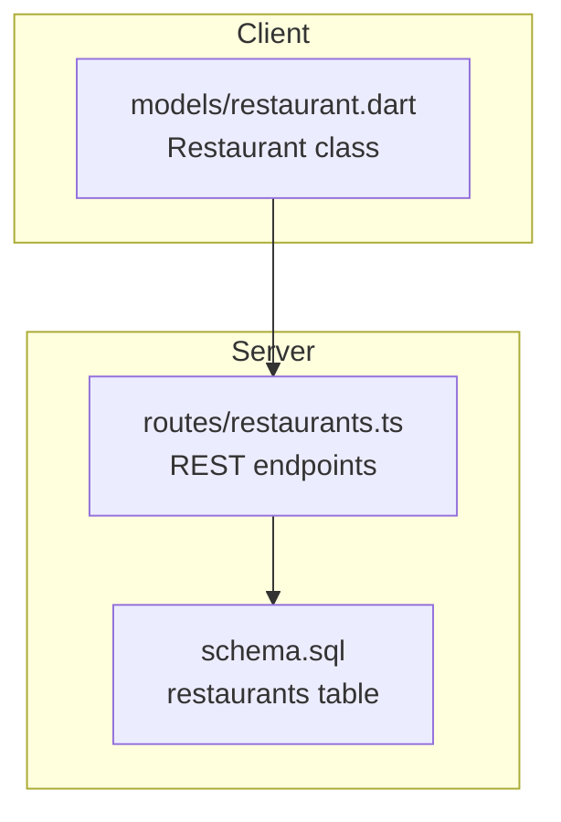
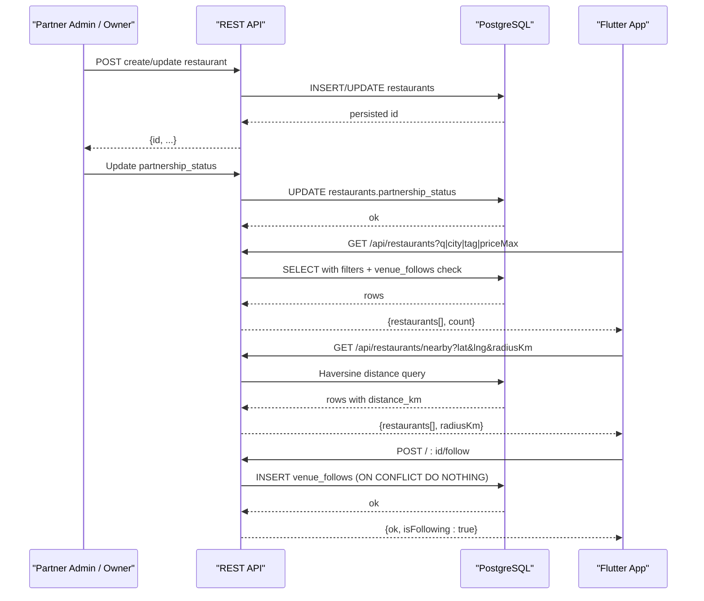
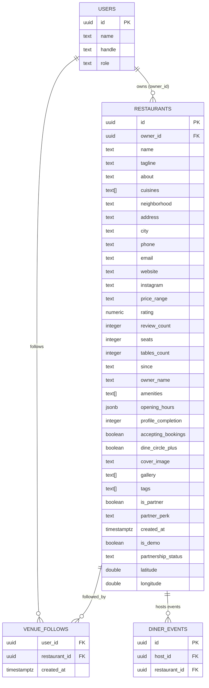
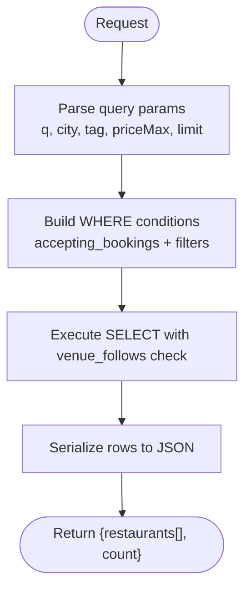
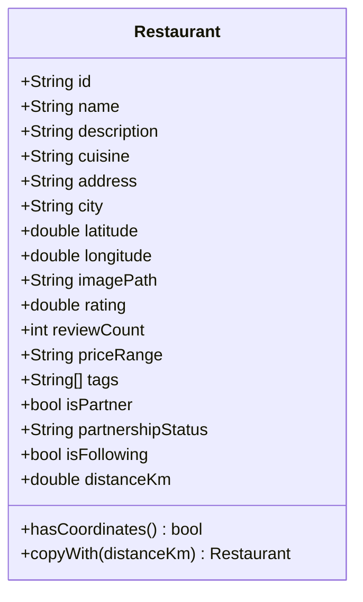
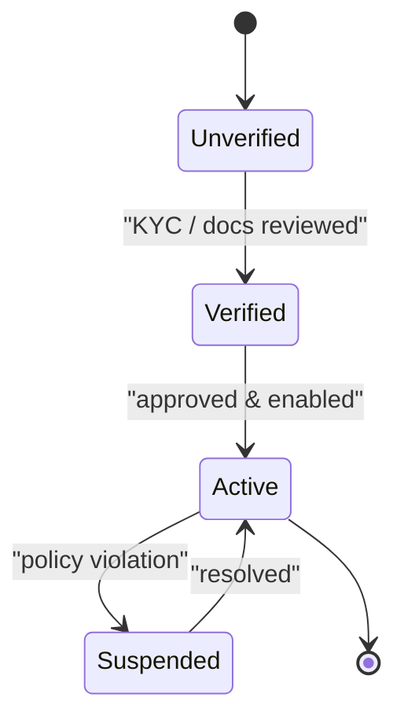
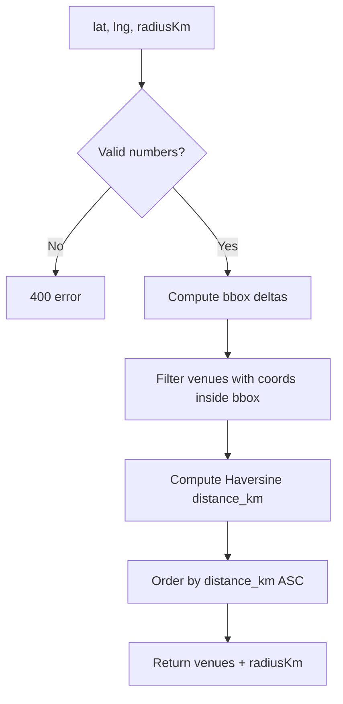
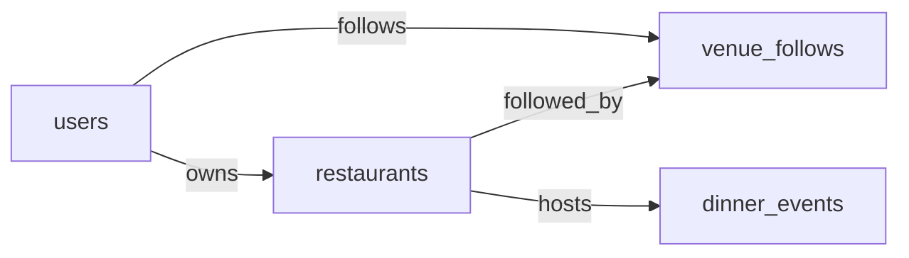

# Restaurants Entity

<cite>
**Referenced Files in This Document**
- [schema.sql](file://server/src/schema.sql)
- [restaurants.ts](file://server/src/routes/restaurants.ts)
- [restaurant.dart](file://lib/models/restaurant.dart)
</cite>

## Table of Contents
1. [Introduction](#introduction)
2. [Project Structure](#project-structure)
3. [Core Components](#core-components)
4. [Architecture Overview](#architecture-overview)
5. [Detailed Component Analysis](#detailed-component-analysis)
6. [Dependency Analysis](#dependency-analysis)
7. [Performance Considerations](#performance-considerations)
8. [Troubleshooting Guide](#troubleshooting-guide)
9. [Conclusion](#conclusion)

## Introduction
This document describes the restaurants entity as implemented in the DineCircle backend and Flutter client. It explains the complete restaurant schema, including venue identity, contact details, operational data, partnership workflow, location support, profile completion tracking, booking acceptance status, and how the server exposes search and nearby queries. It also provides practical examples for creating a restaurant, onboarding it into the partnership pipeline, and querying venues by city, tag, price range, or geographic proximity.

## Project Structure
The restaurants entity is defined at three layers:
- Database layer: the `restaurants` table and related indexes are defined in the SQL schema.
- API layer: Express routes expose listing, filtering, nearby search, detail, and follow/unfollow operations.
- Client model: a Dart model represents the core fields consumed by the Flutter app.

**Diagram sources**
- [schema.sql:74-119](file://server/src/schema.sql#L74-L119)
- [restaurants.ts:1-209](file://server/src/routes/restaurants.ts#L1-L209)
- [restaurant.dart:1-79](file://lib/models/restaurant.dart#L1-L79)

**Section sources**
- [schema.sql:74-119](file://server/src/schema.sql#L74-L119)
- [restaurants.ts:1-209](file://server/src/routes/restaurants.ts#L1-L209)
- [restaurant.dart:1-79](file://lib/models/restaurant.dart#L1-L79)

## Core Components
The restaurants entity captures:
- Venue identity and description: name, tagline, about, cuisines, neighborhood, address, city.
- Contact details: phone, email, website, instagram.
- Operational data: seats, tables_count, opening_hours (JSON), since, owner_name.
- Partnership and partner metadata: is_partner, partnership_status, partner_perk, dine_circle_plus.
- Reputation and pricing: rating, review_count, price_range.
- Media: cover_image, gallery (array of image URLs).
- Discovery and tagging: tags array.
- Location: latitude, longitude (nullable; required for map features).
- Profile health: profile_completion (integer score), accepting_bookings (boolean).
- Ownership: owner_id references a users row (NULL means unowned).

Key relationships:
- owner_id links to users(id) with ON DELETE SET NULL.
- venue_follows tracks user-to-restaurant follows used to compute isFollowing.
- dinner_events reference restaurants via restaurant_id.

**Section sources**
- [schema.sql:74-119](file://server/src/schema.sql#L74-L119)
- [schema.sql:315-323](file://server/src/schema.sql#L315-L323)
- [schema.sql:121-156](file://server/src/schema.sql#L121-L156)

## Architecture Overview
The restaurant lifecycle spans creation, partnership onboarding, discovery, and interaction:

**Diagram sources**
- [restaurants.ts:47-100](file://server/src/routes/restaurants.ts#L47-L100)
- [restaurants.ts:102-136](file://server/src/routes/restaurants.ts#L102-L136)
- [restaurants.ts:181-193](file://server/src/routes/restaurants.ts#L181-L193)
- [schema.sql:74-119](file://server/src/schema.sql#L74-L119)
- [schema.sql:315-323](file://server/src/schema.sql#L315-L323)

## Detailed Component Analysis

### Restaurant Schema
The `restaurants` table defines the canonical shape of a venue. Important aspects:
- Identity and ownership:
  - id: uuid primary key.
  - owner_id: nullable foreign key to users(id); NULL indicates an unowned venue.
- Venue information:
  - name, tagline, about, cuisines (text[]), neighborhood, address, city.
- Contact details:
  - phone, email, website, instagram.
- Operational data:
  - seats, tables_count, opening_hours (jsonb), since, owner_name.
- Partner and marketplace signals:
  - is_partner, partnership_status (text), partner_perk, dine_circle_plus.
- Reputation and pricing:
  - rating (numeric(3,2)), review_count, price_range (e.g., "$$", length corresponds to dollar count).
- Media and discovery:
  - cover_image, gallery (text[]), tags (text[]).
- Profile health and availability:
  - profile_completion (integer), accepting_bookings (boolean).
- Location:
  - latitude, longitude (double precision, nullable).
- Metadata:
  - created_at timestamp.
  - is_demo (for test records).

Indexes:
- idx_restaurants_owner on owner_id.
- idx_restaurants_partnership on partnership_status.

**Diagram sources**
- [schema.sql:74-119](file://server/src/schema.sql#L74-L119)
- [schema.sql:315-323](file://server/src/schema.sql#L315-L323)
- [schema.sql:121-156](file://server/src/schema.sql#L121-L156)

**Section sources**
- [schema.sql:74-119](file://server/src/schema.sql#L74-L119)
- [schema.sql:513-535](file://server/src/schema.sql#L513-L535)

### API Endpoints and Serialization
The restaurants API provides:
- GET /api/restaurants: partner venues filterable by partner flag, free-text search q, city, tag, and priceMax. Returns serialized restaurant objects plus count.
- GET /api/restaurants/nearby: geospatial search using lat/lng and radiusKm, returning venues within the radius ordered by distance_km.
- GET /api/restaurants/:id: venue profile plus upcoming events.
- POST /api/restaurants/:id/follow: idempotent follow action.
- DELETE /api/restaurants/:id/follow: unfollow action.

Serialization maps database columns to camelCase JSON fields, including:
- id, name, cuisines, neighborhood, address, city, rating, reviewCount, priceRange, coverImage, gallery, about, tags, isPartner, partnershipStatus, partnerPerk, openingHours, seats, latitude, longitude, isFollowing, and optional distanceKm.

**Diagram sources**
- [restaurants.ts:47-100](file://server/src/routes/restaurants.ts#L47-L100)
- [restaurants.ts:18-45](file://server/src/routes/restaurants.ts#L18-L45)

**Section sources**
- [restaurants.ts:18-45](file://server/src/routes/restaurants.ts#L18-L45)
- [restaurants.ts:47-100](file://server/src/routes/restaurants.ts#L47-L100)
- [restaurants.ts:102-136](file://server/src/routes/restaurants.ts#L102-L136)
- [restaurants.ts:138-179](file://server/src/routes/restaurants.ts#L138-L179)
- [restaurants.ts:181-207](file://server/src/routes/restaurants.ts#L181-L207)

### Flutter Model Mapping
The Flutter Restaurant model includes:
- Core identifiers and display fields: id, name, description, cuisine, address, city.
- Coordinates: latitude, longitude (nullable).
- Media and reputation: imagePath, rating, reviewCount, priceRange.
- Discovery and partnership: tags, isPartner, partnershipStatus.
- Follow state: isFollowing.
- Distance: distanceKm (nullable; set by client when needed).

Note: The model’s field names differ slightly from the server response (e.g., description vs about, cuisine vs cuisines). Consumers should map accordingly.

**Diagram sources**
- [restaurant.dart:1-79](file://lib/models/restaurant.dart#L1-L79)

**Section sources**
- [restaurant.dart:1-79](file://lib/models/restaurant.dart#L1-L79)

### Partnership Workflow
Partnership progression is tracked via the partnership_status column. Seeded venues start as unverified test records. Typical flow:
- Create or update a restaurant with initial data.
- Set partnership_status to reflect verification progress (e.g., unverified → verified → active).
- Optionally mark is_partner and set partner_perk once approved.
- Ensure accepting_bookings is true if you want the venue to appear in public listings and nearby results.

**Diagram sources**
- [schema.sql:110-114](file://server/src/schema.sql#L110-L114)
- [schema.sql:74-108](file://server/src/schema.sql#L74-L108)

**Section sources**
- [schema.sql:110-114](file://server/src/schema.sql#L110-L114)
- [schema.sql:74-108](file://server/src/schema.sql#L74-L108)

### Location Support and Map Integration
Location fields:
- latitude and longitude are nullable double precision values.
- A venue without coordinates remains off the map.

Nearby endpoint behavior:
- Requires lat and lng numbers.
- Uses equirectangular bounding box pre-filter followed by Haversine distance calculation.
- Returns distance_km per venue and orders by ascending distance.

**Diagram sources**
- [restaurants.ts:102-136](file://server/src/routes/restaurants.ts#L102-L136)
- [schema.sql:116-119](file://server/src/schema.sql#L116-L119)

**Section sources**
- [restaurants.ts:102-136](file://server/src/routes/restaurants.ts#L102-L136)
- [schema.sql:116-119](file://server/src/schema.sql#L116-L119)

### Profile Completion and Booking Acceptance
- profile_completion: integer score indicating how complete the venue profile is.
- accepting_bookings: boolean controlling whether the venue appears in public listings and nearby results.

These fields enable:
- Internal dashboards to track completeness.
- Public discovery to exclude incomplete or non-accepting venues.

**Section sources**
- [schema.sql:99-100](file://server/src/schema.sql#L99-L100)
- [restaurants.ts:47-50](file://server/src/routes/restaurants.ts#L47-L50)

### Examples

#### Example: Creating a Restaurant
Steps:
1. Insert a new row into restaurants with:
   - name, tagline, about, cuisines, neighborhood, address, city.
   - phone, email, website, instagram.
   - seats, tables_count, opening_hours (JSON object).
   - price_range (e.g., "$$"), rating default 0, review_count default 0.
   - cover_image, gallery (array), tags (array).
   - is_partner false initially, partnership_status 'unverified'.
   - owner_id set to the partner_admin user id (or NULL if unowned).
   - profile_completion set based on filled fields.
   - accepting_bookings true if ready for bookings.
   - latitude and longitude if available for map integration.

Validation tips:
- Ensure opening_hours is a valid JSON object.
- Keep price_range as a string of $ symbols (length 1–4).
- If setting is_partner true, also set partnership_status to an appropriate value like 'verified' or 'active'.

References:
- [schema.sql:74-119](file://server/src/schema.sql#L74-L119)

#### Example: Onboarding a Restaurant into Partnership
Steps:
1. Update partnership_status through the appropriate admin flow (e.g., 'unverified' → 'verified' → 'active').
2. Optionally set is_partner true and partner_perk if applicable.
3. Ensure accepting_bookings is true so the venue appears in listings.
4. Verify that profile_completion reflects the final state.

References:
- [schema.sql:110-114](file://server/src/schema.sql#L110-L114)
- [schema.sql:74-108](file://server/src/schema.sql#L74-L108)

#### Example: Searching Venues
Public listing filters:
- Free-text search: q matches name, neighborhood, city, cuisines, or tags.
- City filter: city ILIKE.
- Tag filter: tag matches any element in tags or cuisines arrays.
- Price filter: priceMax 1–4 limits by length(price_range).
- Partner filter: partner=true restricts to is_partner venues.

Example queries:
- Search by cuisine and city: GET /api/restaurants?q=Italian&city=Mumbai
- Filter by tag and max price: GET /api/restaurants?tag=Vegan&priceMax=3
- List only partners: GET /api/restaurants?partner=true

References:
- [restaurants.ts:47-100](file://server/src/routes/restaurants.ts#L47-L100)

#### Example: Nearby Search
Parameters:
- lat: number
- lng: number
- radiusKm: number (default 25, clamped between 1 and 100)
- limit: number (default 50, capped at 100)

Behavior:
- Only venues with non-null latitude and longitude are considered.
- Results include distance_km and are ordered by ascending distance.

Example query:
- GET /api/restaurants/nearby?lat=19.0760&lng=72.8777&radiusKm=10

References:
- [restaurants.ts:102-136](file://server/src/routes/restaurants.ts#L102-L136)
- [schema.sql:116-119](file://server/src/schema.sql#L116-L119)

## Dependency Analysis
Relationships involving restaurants:
- Users:
  - owner_id references users(id) with ON DELETE SET NULL.
- Venue follows:
  - venue_follows(user_id, restaurant_id) enables isFollowing flags in responses.
- Events:
  - dinner_events.restaurant_id references restaurants(id) with ON DELETE CASCADE.

**Diagram sources**
- [schema.sql:74-78](file://server/src/schema.sql#L74-L78)
- [schema.sql:315-323](file://server/src/schema.sql#L315-L323)
- [schema.sql:121-130](file://server/src/schema.sql#L121-L130)

**Section sources**
- [schema.sql:74-78](file://server/src/schema.sql#L74-L78)
- [schema.sql:315-323](file://server/src/schema.sql#L315-L323)
- [schema.sql:121-130](file://server/src/schema.sql#L121-L130)

## Performance Considerations
- Indexes:
  - idx_restaurants_owner supports queries filtered by owner.
  - idx_restaurants_partnership supports filtering by partnership_status.
- Listing performance:
  - Filters use ILIKE and array unnesting; keep search terms specific to avoid full scans.
  - Limit parameter caps results; default 50, hard cap 200 for listing and 100 for nearby.
- Nearby search:
  - Equirectangular bbox pre-filter reduces candidate set before Haversine calculation.
  - Ensure latitude and longitude are populated for venues intended for map display.

Recommendations:
- Populate latitude and longitude during onboarding for venues expected in map views.
- Use partner and tag filters to narrow result sets.
- Avoid overly broad q terms; prefer city/tag combinations.

**Section sources**
- [schema.sql:513-535](file://server/src/schema.sql#L513-L535)
- [restaurants.ts:47-100](file://server/src/routes/restaurants.ts#L47-L100)
- [restaurants.ts:102-136](file://server/src/routes/restaurants.ts#L102-L136)

## Troubleshooting Guide
Common issues and resolutions:
- Venue not appearing in listings:
  - Check accepting_bookings is true.
  - Ensure partnership_status is not blocking visibility (e.g., still unverified).
- Venue missing from map:
  - Verify latitude and longitude are set.
- Follow/unfollow not reflected:
  - Confirm venue_follows insert/delete succeeded.
  - Re-fetch venue list to refresh isFollowing flag.
- Nearby search returns empty:
  - Ensure lat/lng are valid numbers.
  - Increase radiusKm or verify venue coordinates exist.

Operational checks:
- Inspect restaurant row for profile_completion and accepting_bookings.
- Validate partnership_status progression.
- Confirm venue_follows entries for the current user.

**Section sources**
- [restaurants.ts:47-50](file://server/src/routes/restaurants.ts#L47-L50)
- [restaurants.ts:102-136](file://server/src/routes/restaurants.ts#L102-L136)
- [restaurants.ts:181-207](file://server/src/routes/restaurants.ts#L181-L207)
- [schema.sql:99-119](file://server/src/schema.sql#L99-L119)

## Conclusion
The restaurants entity centralizes venue identity, contact and operational data, partnership state, media, discovery attributes, and location. The API exposes robust search and nearby capabilities, while the Flutter model provides a concise representation for UI consumption. Properly managing partnership_status, accepting_bookings, profile_completion, and coordinates ensures consistent visibility across listings and maps.