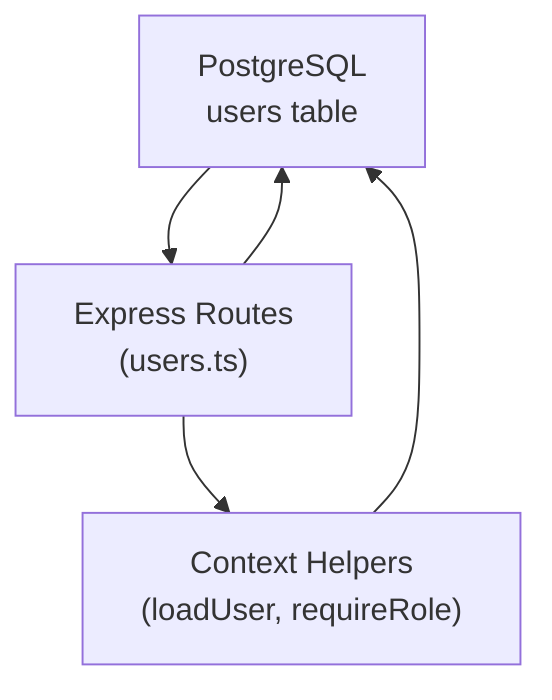
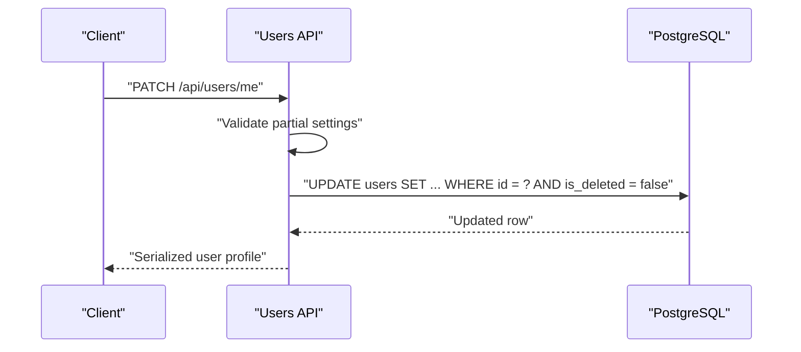
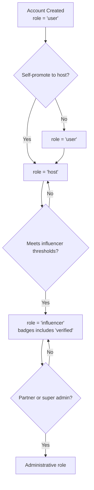
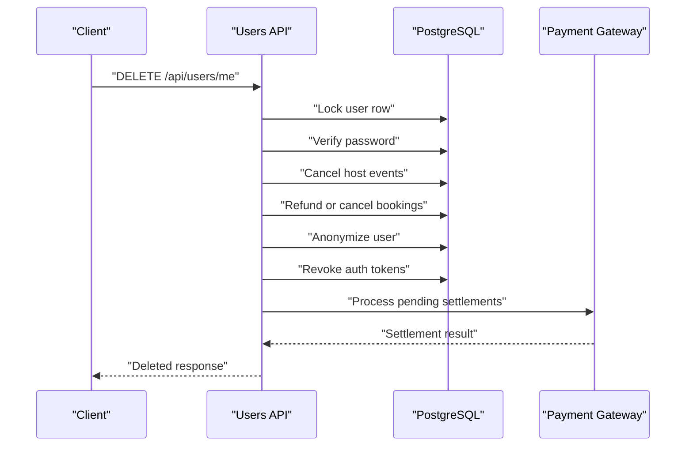
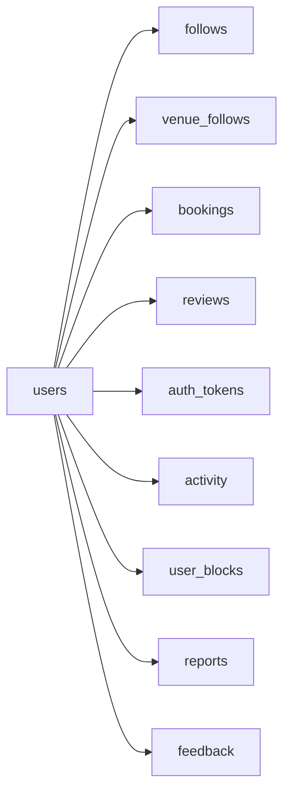

# Users Entity

<cite>
**Referenced Files in This Document**
- [schema.sql](file://server/src/schema.sql)
- [users.ts](file://server/src/routes/users.ts)
- [context.ts](file://server/src/context.ts)
</cite>

## Table of Contents
1. [Introduction](#introduction)
2. [Project Structure](#project-structure)
3. [Core Components](#core-components)
4. [Architecture Overview](#architecture-overview)
5. [Detailed Component Analysis](#detailed-component-analysis)
6. [Dependency Analysis](#dependency-analysis)
7. [Performance Considerations](#performance-considerations)
8. [Troubleshooting Guide](#troubleshooting-guide)
9. [Conclusion](#conclusion)

## Introduction
This document describes the `users` entity as the central identity and profile model for DineCircle. It covers the complete user schema, authentication fields, profile information, social metrics, role system, privacy settings, dietary preferences, account management behavior, field constraints, defaults, business rules, and practical examples for creation, role updates, and common queries.

The authoritative database definition lives in the server schema, while route handlers implement validation, authorization, progression logic, and API contracts that shape how clients interact with the users entity.

## Project Structure
The users entity is defined and consumed across three main layers:

- Database layer: PostgreSQL schema defines columns, constraints, indexes, and idempotent migrations.
- Server API layer: Express routes validate input, enforce business rules, manage roles, and serialize responses.
- Context layer: Shared helpers load user rows, map them to DTOs, and provide role-based access control.

**Diagram sources**
- [schema.sql:16-72](file://server/src/schema.sql#L16-L72)
- [users.ts:13-72](file://server/src/routes/users.ts#L13-L72)
- [context.ts:100-144](file://server/src/context.ts#L100-L144)

**Section sources**
- [schema.sql:16-72](file://server/src/schema.sql#L16-L72)
- [users.ts:13-72](file://server/src/routes/users.ts#L13-L72)
- [context.ts:100-144](file://server/src/context.ts#L100-L144)

## Core Components
The `users` table stores a single unified identity that supports multiple capabilities through its `role` column. The most important aspects are:

- Identity and authentication:
  - `id`: UUID primary key generated by the database.
  - `email`: Unique email address used for sign-in; nullable for legacy phone-only accounts.
  - `password_hash`: Nullable hashed password used for email/password authentication.
  - `phone`: Optional unique phone number for OTP-based flows.
- Profile information:
  - `name`, `handle`, `city`, `bio`, `avatar_url`.
  - `tastes`: Array of food taste tags.
  - `accent_hex`: Optional color preference.
  - `joined_year`: Year the account joined.
  - `instagram`: Optional public Instagram handle (used for discovery/testing).
- Social metrics:
  - `followers_count`, `following_count`.
  - `dinners_hosted`, `dinners_joined`.
  - `rating`, `review_count`.
  - `badges`: Array including `'verified'` when eligible.
- Role system:
  - `role` constrained to `'user' | 'host' | 'influencer' | 'partner_admin' | 'super_admin'`.
- Privacy and account settings:
  - `show_follow_list`, `show_activity`, `dm_from_followers_only`, `allow_tagging`.
  - `dietary`, `allergies`: Arrays of preference/allergy labels.
  - `home_area`: Free-text neighborhood or district within `city`.
  - `is_deleted`: Soft-delete marker for anonymized accounts.

Defaults ensure existing accounts remain compatible when new columns are added. Many arrays default to empty arrays, booleans default to predictable visibility states, and numeric counters default to zero.

**Section sources**
- [schema.sql:16-72](file://server/src/schema.sql#L16-L72)

## Architecture Overview
The users entity participates in several workflows:

- User creation and authentication:
  - Email/password sign-up creates a row with default role `'user'`.
  - Sign-in validates credentials and issues an opaque bearer token stored separately.
- Profile and settings updates:
  - PATCH `/api/users/me` allows partial updates without overwriting unrelated fields.
  - Validation ensures name, city, bio, tastes, home area, privacy toggles, dietary, and allergies meet length and count limits.
- Role progression:
  - Self-promotion to host is allowed for basic users.
  - Influencer status requires meeting thresholds on followers, hosted events, rating, and review count.
- Privacy enforcement:
  - Follower/following lists can be hidden.
  - Activity exposure can be disabled.
  - DM restrictions can limit incoming messages to followers only.
- Account deletion:
  - Anonymizes the account in place rather than deleting the row.
  - Cancels affected events and bookings, refunds payments where applicable, and revokes sessions.

**Diagram sources**
- [users.ts:121-186](file://server/src/routes/users.ts#L121-L186)
- [schema.sql:16-72](file://server/src/schema.sql#L16-L72)

**Section sources**
- [users.ts:121-186](file://server/src/routes/users.ts#L121-L186)
- [schema.sql:16-72](file://server/src/schema.sql#L16-L72)

## Detailed Component Analysis

### User Schema Fields and Constraints
The `users` table is the single source of truth for identity, profile, metrics, and settings. Key characteristics:

| Field | Type | Constraint | Default | Purpose |
|---|---|---|---|---|
| `id` | `uuid` | Primary key | `gen_random_uuid()` | Stable identity |
| `name` | `text` | Not null | None | Display name |
| `handle` | `text` | Not null, unique | None | Public username |
| `phone` | `text` | Unique | None | Optional phone auth |
| `email` | `text` | Unique | None | Email auth identity |
| `password_hash` | `text` | Nullable | None | Stored credential hash |
| `city` | `text` | Not null | `''` | City location |
| `bio` | `text` | Not null | `''` | Short biography |
| `role` | `text` | Not null, CHECK | `'user'` | Capability role |
| `followers_count` | `integer` | Not null | `0` | Social metric |
| `following_count` | `integer` | Not null | `0` | Social metric |
| `dinners_hosted` | `integer` | Not null | `0` | Host activity metric |
| `dinners_joined` | `integer` | Not null | `0` | Guest activity metric |
| `rating` | `numeric(3,2)` | Not null | `0` | Average rating |
| `review_count` | `integer` | Not null | `0` | Number of reviews |
| `avatar_url` | `text` | Nullable | None | Profile image URL |
| `badges` | `text[]` | Not null | `'{}'` | Achievement flags |
| `tastes` | `text[]` | Not null | `'{}'` | Food taste tags |
| `accent_hex` | `text` | Nullable | None | UI accent color |
| `joined_year` | `integer` | Not null | `2024` | Join year |
| `created_at` | `timestamptz` | Not null | `now()` | Creation timestamp |
| `instagram` | `text` | Not null | `''` | Public social handle |
| `is_demo` | `boolean` | Not null | `false` | Test record flag |
| `show_follow_list` | `boolean` | Not null | `true` | Hide follower/following lists |
| `show_activity` | `boolean` | Not null | `true` | Hide upcoming event list |
| `dm_from_followers_only` | `boolean` | Not null | `false` | Restrict DMs to followers |
| `allow_tagging` | `boolean` | Not null | `true` | Allow tagging |
| `dietary` | `text[]` | Not null | `'{}'` | Dietary preferences |
| `allergies` | `text[]` | Not null | `'{}'` | Allergy labels |
| `home_area` | `text` | Not null | `''` | Neighborhood/district |
| `is_deleted` | `boolean` | Not null | `false` | Soft-delete marker |

Business rules enforced at the database level include:

- Role values must be one of the allowed roles.
- Handle uniqueness prevents duplicate usernames.
- Email uniqueness prevents duplicate email identities.
- Counters and ratings use numeric types appropriate for aggregation.
- Arrays default to empty arrays so missing data does not break serialization.

**Section sources**
- [schema.sql:16-72](file://server/src/schema.sql#L16-L72)

### Authentication Fields
Authentication uses two primary mechanisms:

- Email/password:
  - `email` is unique and nullable because legacy phone-only accounts may not have an email.
  - `password_hash` is nullable and stores a secure hash; plaintext passwords are never persisted.
- Phone OTP:
  - `phone` is optional and unique.
  - OTP challenges are tracked in a separate table, and tokens are stored as opaque digests elsewhere.

When signing up via email/password, the application creates a user with default role `'user'`. When signing in, the server verifies the password against the stored hash and returns a session or token.

Important security behaviors:

- Password verification happens server-side before sensitive operations like account deletion.
- Tokens store SHA-256 digests, not plaintext secrets.
- Deleted accounts clear `email`, `phone`, and `password_hash`, preventing re-authentication.

**Section sources**
- [schema.sql:39-43](file://server/src/schema.sql#L39-L43)
- [users.ts:199-223](file://server/src/routes/users.ts#L199-L223)

### Profile Information
Profile fields describe the public-facing identity:

- `name`: Required display name.
- `handle`: Required unique username.
- `city`: Required city field.
- `bio`: Optional short biography.
- `avatar_url`: Optional profile image URL.
- `tastes`: Optional array of taste tags.
- `accent_hex`: Optional UI accent color.
- `instagram`: Optional public social handle.
- `joined_year`: Year the account joined.

Validation for profile updates enforces:

- Name length between 2 and 80 characters.
- City length between 2 and 60 characters.
- Bio length up to 400 characters.
- Tastes limited to 8 items, each trimmed and between 1 and 40 characters.

These constraints protect UI consistency and prevent abuse.

**Section sources**
- [schema.sql:16-37](file://server/src/schema.sql#L16-L37)
- [users.ts:121-138](file://server/src/routes/users.ts#L121-L138)

### Social Metrics
Social metrics track engagement and reputation:

- `followers_count`: Number of users following this account.
- `following_count`: Number of users this account follows.
- `dinners_hosted`: Number of events hosted.
- `dinners_joined`: Number of events attended.
- `rating`: Numeric average rating.
- `review_count`: Number of reviews received.
- `badges`: Array containing achievement flags such as `'verified'`.

These fields are primarily read and updated by related tables such as `follows`, `bookings`, and `reviews`. The API serializes them into client-friendly names like `followers`, `following`, `dinnersHosted`, `dinnersJoined`, `rating`, `reviewCount`, and `badges`.

**Section sources**
- [schema.sql:25-32](file://server/src/schema.sql#L25-L32)
- [users.ts:42-72](file://server/src/routes/users.ts#L42-L72)

### Role System and Progression Ladder
The role system defines capability tiers:

- `'user'`: Basic diner.
- `'host'`: Can publish and manage dinner events.
- `'influencer'`: Verified content creator with elevated visibility.
- `'partner_admin'`: Administrative partner role.
- `'super_admin'`: Platform administrative role.

The progression ladder applies to a single account:

1. Start as `'user'`.
2. Self-promote to `'host'`.
3. Meet influencer thresholds to claim `'influencer'`.
4. Partner and super admin roles exist outside the ladder and are granted administratively.

Influencer eligibility thresholds:

- Minimum followers: 50.
- Minimum events hosted: 3.
- Minimum rating: 4.0.
- Minimum review count: 3.

When a host meets all thresholds, the influencer endpoint updates the role to `'influencer'` and adds the `'verified'` badge if not already present.

**Diagram sources**
- [schema.sql:23-24](file://server/src/schema.sql#L23-L24)
- [schema.sql:45-51](file://server/src/schema.sql#L45-L51)
- [users.ts:77-107](file://server/src/routes/users.ts#L77-L107)
- [users.ts:456-530](file://server/src/routes/users.ts#L456-L530)

**Section sources**
- [schema.sql:23-24](file://server/src/schema.sql#L23-L24)
- [schema.sql:45-51](file://server/src/schema.sql#L45-L51)
- [users.ts:77-107](file://server/src/routes/users.ts#L77-L107)
- [users.ts:456-530](file://server/src/routes/users.ts#L456-L530)

### Privacy Settings
Privacy controls let users manage visibility:

- `show_follow_list`: Controls whether other users can view who follows or is followed by the account.
- `show_activity`: Controls whether upcoming hosted events appear in the public profile activity section.
- `dm_from_followers_only`: Restricts direct messages to followers only.
- `allow_tagging`: Controls whether the user can be tagged.

Enforcement behavior:

- Follower/following endpoints return a forbidden error for non-owners when `show_follow_list` is false.
- Profile activity hides upcoming events when `show_activity` is false.
- Blocked users cannot see each other's profiles or discovery results.

**Section sources**
- [schema.sql:65-72](file://server/src/schema.sql#L65-L72)
- [users.ts:625-646](file://server/src/routes/users.ts#L625-L646)

### Dietary Preferences and Allergies
Dietary preferences and allergies are stored as text arrays:

- `dietary`: Labels such as halal, vegetarian, vegan, etc.
- `allergies`: Labels indicating food allergies.

Validation rules:

- Each label is trimmed and limited to 1–40 characters.
- Up to 12 labels per array.
- Defaults to empty arrays so missing preferences do not break serialization.

These fields support matching guests with events and restaurants based on dietary needs.

**Section sources**
- [schema.sql:69-70](file://server/src/schema.sql#L69-L70)
- [users.ts:134-137](file://server/src/routes/users.ts#L134-L137)

### Account Management Features
Account management includes editing, deletion, and session handling:

- Edit profile:
  - PATCH `/api/users/me` accepts partial updates.
  - Only sent fields are updated; unrelated fields remain unchanged.
  - Deleted accounts cannot be edited.
- Delete account:
  - Requires password confirmation.
  - Anonymizes the account in place.
  - Cancels affected events and bookings.
  - Refunds or cancels gateway-held payments where applicable.
  - Revokes all active sessions.
- Session and token handling:
  - Bearer tokens are stored separately and expire after a configured period.
  - Token digests are stored instead of plaintext tokens.

**Diagram sources**
- [users.ts:188-418](file://server/src/routes/users.ts#L188-L418)
- [schema.sql:417-424](file://server/src/schema.sql#L417-L424)

**Section sources**
- [users.ts:155-186](file://server/src/routes/users.ts#L155-L186)
- [users.ts:188-418](file://server/src/routes/users.ts#L188-L418)

### Examples

#### User Creation
A typical first-launch flow creates a user with:

- `name`, `handle`, `city`, `bio`, `tastes`.
- `email` and `password_hash` for email/password authentication.
- Default role `'user'`.
- Default social metrics at zero.
- Default privacy settings allowing follow lists and activity visibility.
- Empty dietary and allergy arrays.
- `is_deleted` set to false.

Example request pattern:

- POST sign-up with name, email, and password.
- Server creates the user row with defaults.
- Server returns a session or token.

Example query pattern:

- SELECT user by email or handle during sign-in.
- Verify password hash.
- Issue token.

**Section sources**
- [schema.sql:16-43](file://server/src/schema.sql#L16-L43)
- [users.ts:199-223](file://server/src/routes/users.ts#L199-L223)

#### Role Updates
Self-promotion examples:

- Become host:
  - Allowed for `'user'`.
  - Prevents promotion if already `'influencer'`, `'partner_admin'`, or `'super_admin'`.
- Claim influencer:
  - Requires current role `'host'`.
  - Requires meeting follower, event, rating, and review thresholds.
  - Adds `'verified'` badge on success.

Example request patterns:

- POST `/api/users/me/host` to become a host.
- GET `/api/users/me/tier` to check eligibility.
- POST `/api/users/me/influencer` to claim influencer status.

**Section sources**
- [users.ts:456-530](file://server/src/routes/users.ts#L456-L530)
- [users.ts:77-107](file://server/src/routes/users.ts#L77-L107)

#### Common Queries for User Management
Common operations include:

- Discovery list:
  - Search by name, handle, or bio.
  - Exclude blocked users.
  - Paginate with limit and offset.
- Profile retrieval:
  - Load full user profile.
  - Check block state.
  - Include upcoming hosted events and reviews.
- Follower/following rosters:
  - Enforce `show_follow_list` privacy.
  - Return viewer follow state.
- Settings update:
  - Partial PATCH with validated fields.
  - Reject updates for deleted accounts.

Example query patterns:

- SELECT users with ILIKE search and pagination.
- SELECT user by ID with follow-state subquery.
- UPDATE users with dynamic SET clauses from validated keys.

**Section sources**
- [users.ts:422-454](file://server/src/routes/users.ts#L422-L454)
- [users.ts:649-736](file://server/src/routes/users.ts#L649-L736)
- [users.ts:155-186](file://server/src/routes/users.ts#L155-L186)

## Dependency Analysis
The users entity depends on several related tables and services:

- `follows`: Tracks user-to-user follows.
- `venue_follows`: Tracks user-to-restaurant follows.
- `bookings`: Links users to events they attend.
- `reviews`: Links users as authors of reviews.
- `auth_tokens`: Stores session tokens linked to users.
- `activity`: Records user-triggered events.
- `user_blocks`: Enforces blocking relationships.
- `reports` and `feedback`: Support moderation and support workflows.

**Diagram sources**
- [schema.sql:306-331](file://server/src/schema.sql#L306-L331)
- [schema.sql:333-347](file://server/src/schema.sql#L333-L347)
- [schema.sql:426-438](file://server/src/schema.sql#L426-L438)
- [schema.sql:443-494](file://server/src/schema.sql#L443-L494)
- [schema.sql:417-424](file://server/src/schema.sql#L417-L424)

**Section sources**
- [schema.sql:306-331](file://server/src/schema.sql#L306-L331)
- [schema.sql:333-347](file://server/src/schema.sql#L333-L347)
- [schema.sql:417-438](file://server/src/schema.sql#L417-L438)
- [schema.sql:443-494](file://server/src/schema.sql#L443-L494)

## Performance Considerations
The users entity benefits from several design choices:

- UUID primary keys avoid sequential ID exposure and reduce collision risk.
- Text arrays for tags and preferences allow flexible metadata without extra join tables.
- Counters (`followers_count`, `following_count`, `dinners_hosted`, `dinners_joined`) enable fast sorting and filtering without expensive aggregations.
- Boolean privacy flags allow cheap visibility checks.
- Indexes on related tables improve lookup performance for events, bookings, reviews, and activity feeds.

Potential optimization opportunities include:

- Ensuring indexes exist on frequently filtered columns such as `handle`, `email`, and `role`.
- Using materialized views for heavy discovery queries if scale increases.
- Caching serialized user profiles for read-heavy endpoints where consistency permits.

[No sources needed since this section provides general guidance]

## Troubleshooting Guide
Common issues and their likely causes:

- Cannot edit profile:
  - Account may be soft-deleted (`is_deleted = true`).
  - PATCH payload may contain invalid lengths or counts.
- Cannot delete account:
  - Password confirmation failed.
  - Account has no password hash yet.
- Cannot view follower/following lists:
  - Target user has `show_follow_list = false`.
  - Viewer is blocked by target or vice versa.
- Cannot view profile:
  - Viewer is blocked by target or vice versa.
- Influencer claim fails:
  - Current role is not `'host'`.
  - Thresholds for followers, events, rating, or reviews are not met.
- Discovery search returns unexpected results:
  - Blocked users are excluded.
  - Query parameters may exceed allowed limits.

Recommended debugging steps:

- Inspect the user row for `is_deleted`, `role`, and privacy flags.
- Validate PATCH payloads against the settings schema.
- Check block relationships using the blocking utilities.
- Review influencer thresholds and current metrics.
- Confirm that tokens and sessions are valid and not revoked.

**Section sources**
- [users.ts:155-186](file://server/src/routes/users.ts#L155-L186)
- [users.ts:199-223](file://server/src/routes/users.ts#L199-L223)
- [users.ts:607-646](file://server/src/routes/users.ts#L607-L646)
- [users.ts:494-530](file://server/src/routes/users.ts#L494-L530)

## Conclusion
The `users` entity is the foundation of DineCircle’s identity, profile, social graph, and capability model. Its schema balances flexibility with strong constraints, while the API layer enforces business rules around authentication, role progression, privacy, and account lifecycle. Understanding the users entity requires reading both the database schema and the route handlers, because the schema defines storage and constraints, while the routes define validation, authorization, and real-world behavior.