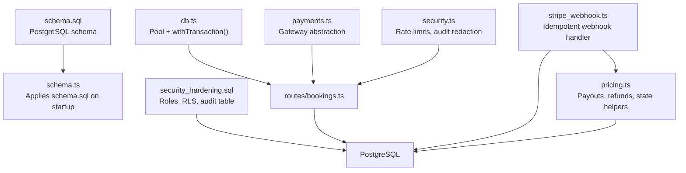
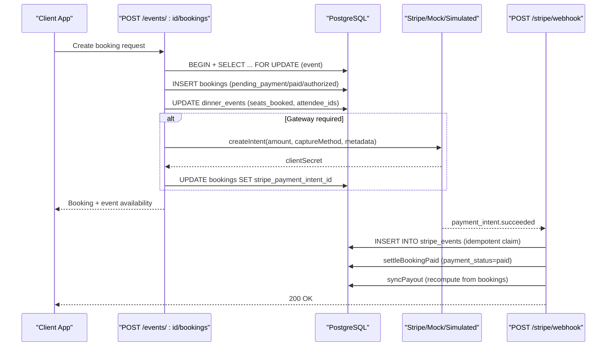
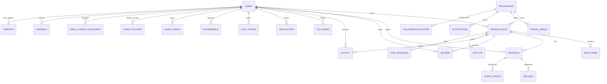
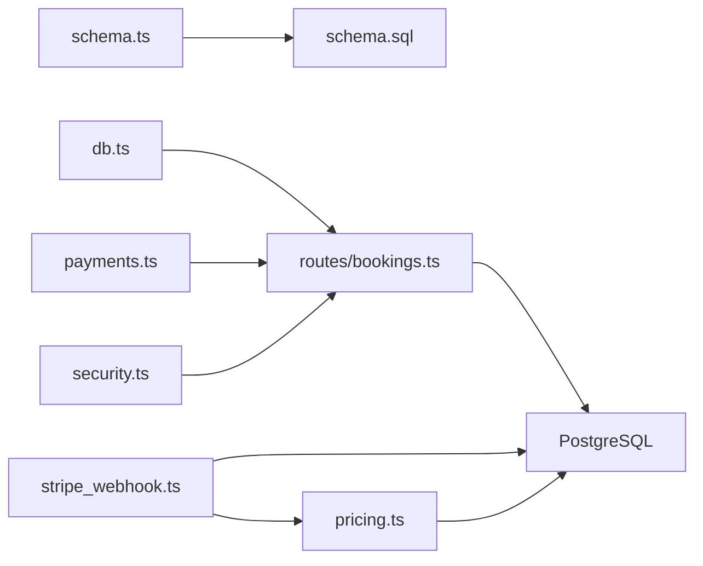

# Database Design

<cite>
**Referenced Files in This Document**
- [schema.sql](file://server/src/schema.sql)
- [schema.ts](file://server/src/schema.ts)
- [db.ts](file://server/src/db.ts)
- [security_hardening.sql](file://server/database/security_hardening.sql)
- [bookings.ts](file://server/src/routes/bookings.ts)
- [payments.ts](file://server/src/payments.ts)
- [stripe_webhook.ts](file://server/src/routes/stripe_webhook.ts)
- [pricing.ts](file://server/src/pricing.ts)
- [security.ts](file://server/src/security.ts)
</cite>

## Table of Contents
1. [Introduction](#introduction)
2. [Project Structure](#project-structure)
3. [Core Components](#core-components)
4. [Architecture Overview](#architecture-overview)
5. [Detailed Component Analysis](#detailed-component-analysis)
6. [Dependency Analysis](#dependency-analysis)
7. [Performance Considerations](#performance-considerations)
8. [Troubleshooting Guide](#troubleshooting-guide)
9. [Conclusion](#conclusion)
10. [Appendices](#appendices)

## Introduction
This document describes the DineCircle PostgreSQL database design, including the complete entity relationship model for users, events, bookings, restaurants, and social entities. It explains table schemas, constraints, indexes, normalization decisions, transaction patterns for critical operations (bookings and payments), migration strategy, sample queries, and security considerations such as sensitive data protection and access control.

## Project Structure
The database schema is defined in a single idempotent SQL file and applied at startup by a Node script. Security hardening (roles, permissions, row-level security) is provided separately. Transaction handling and payment flows are implemented in TypeScript route modules that operate against this schema.

**Diagram sources**
- [schema.sql:1-539](file://server/src/schema.sql#L1-L539)
- [schema.ts:1-26](file://server/src/schema.ts#L1-L26)
- [security_hardening.sql:1-74](file://server/database/security_hardening.sql#L1-L74)
- [db.ts:1-38](file://server/src/db.ts#L1-L38)
- [bookings.ts:1-888](file://server/src/routes/bookings.ts#L1-L888)
- [payments.ts:1-391](file://server/src/payments.ts#L1-L391)
- [stripe_webhook.ts:1-156](file://server/src/routes/stripe_webhook.ts#L1-L156)
- [pricing.ts:1-270](file://server/src/pricing.ts#L1-L270)
- [security.ts:1-148](file://server/src/security.ts#L1-L148)

**Section sources**
- [schema.sql:1-539](file://server/src/schema.sql#L1-L539)
- [schema.ts:1-26](file://server/src/schema.ts#L1-L26)
- [security_hardening.sql:1-74](file://server/database/security_hardening.sql#L1-L74)

## Core Components
DineCircle’s data model centers around five core domains:

- Users and authentication
- Restaurants and partner profiles
- Dinner events and menus
- Bookings, payments, refunds, payouts, withdrawals
- Social features and moderation

Key tables and responsibilities:

- users: user identity, profile, role, preferences, safety flags
- restaurants: venue details, partner status, amenities, location
- dinner_events: event metadata, capacity, audience, menu style, attendee tracking
- menu_items: per-event menu entries
- bookings: guest reservations, seat counts, payment states, check-in
- refunds: immutable ledger of refund decisions and gateway status
- stripe_events: idempotency ledger for Stripe webhooks
- payouts: host payout aggregates per event
- withdrawals: simulated host wallet withdrawals
- collaboration_invites: restaurant-host partnership offers
- reviews: event reviews by guests
- follows / venue_follows / saved_events: social graph and bookmarks
- activity: notifications feed
- chat_messages: event chat
- special_menus: partner special menus
- notifications: partner notifications
- otp_codes: phone sign-in codes
- email_change_challenges: secure email change verification
- promo_codes: discount codes
- auth_tokens: bearer tokens (hashed)
- user_blocks: blocking relationships
- reports: content/user reports
- feedback: support tickets
- audit_log: API audit trail

Normalization and denormalization:
- Normalized references via UUID foreign keys maintain integrity across users, restaurants, events, bookings, and social entities.
- Denormalized fields include:
  - dinner_events.attendee_ids (text[]) to avoid frequent joins when checking membership or appending attendees.
  - restaurants.owner_name and review/rating aggregates for quick display.
  - dinners_hosted/dinners_joined and followers_count/following_count on users for fast profile stats.
  - views, seats_booked, and other counters for performance.

Constraints and types:
- All primary keys are uuid with server-side defaults.
- Money uses numeric(10,2); ratings use numeric(3,2).
- Enum-like columns use text with CHECK constraints aligned with API identifiers.

Indexes:
- Extensive indexes on frequently filtered/joined columns (event start time, host, restaurant, type, status; booking user/event; refund booking/event; payouts unique per event; withdrawals host; reviews author/event; chat event+time; activity actor; auth_tokens user; saved_events user; restaurants owner/partnership; special_menus restaurant; notifications restaurant+time; audit_log user/created_at).

**Section sources**
- [schema.sql:14-539](file://server/src/schema.sql#L14-L539)

## Architecture Overview
The system applies an idempotent schema at startup, then routes perform business logic using transactions and a payment gateway abstraction. Webhooks update state idempotently.

**Diagram sources**
- [bookings.ts:153-405](file://server/src/routes/bookings.ts#L153-L405)
- [stripe_webhook.ts:33-62](file://server/src/routes/stripe_webhook.ts#L33-L62)
- [pricing.ts:170-189](file://server/src/pricing.ts#L170-L189)

## Detailed Component Analysis

### Entity Relationship Diagram

**Diagram sources**
- [schema.sql:14-539](file://server/src/schema.sql#L14-L539)

### Users
- Purpose: Identity, profile, roles, preferences, safety toggles, growth metrics.
- Key fields: id (uuid PK), name, handle (unique), phone (unique), city, bio, role (CHECK enum), followers_count, following_count, dinners_hosted, dinners_joined, rating, review_count, avatar_url, badges[], tastes[], accent_hex, joined_year, created_at.
- Auth: email (unique), password_hash (nullable for phone-only accounts).
- Safety/preferences: show_follow_list, show_activity, dm_from_followers_only, allow_tagging, dietary[], allergies[], home_area, is_deleted.
- Demo/testing: instagram, is_demo.

Integrity:
- Role constrained via CHECK.
- Unique handles and phones prevent duplicates.

Indexes:
- None explicitly defined beyond PK/UNIQUE; rely on application filters.

**Section sources**
- [schema.sql:14-73](file://server/src/schema.sql#L14-L73)

### Restaurants
- Purpose: Venue profiles, partner pipeline, map coordinates.
- Key fields: id (uuid PK), owner_id (FK users), name, tagline, about, cuisines[], neighborhood, address, city, phone, email, website, instagram, price_range, rating, review_count, seats, tables_count, since, owner_name, amenities[], opening_hours (jsonb), profile_completion, accepting_bookings, dine_circle_plus, cover_image, gallery[], tags, is_partner, partner_perk, created_at.
- Partner pipeline: is_demo, partnership_status.
- Location: latitude, longitude.

Integrity:
- owner_id FK with ON DELETE SET NULL.

Indexes:
- idx_restaurants_owner, idx_restaurants_partnership.

**Section sources**
- [schema.sql:74-120](file://server/src/schema.sql#L74-L120)

### Dinner Events
- Purpose: Hosted events with capacity, pricing, audience, menu style, and attendee tracking.
- Key fields: id (uuid PK), title, tagline, description, host_id (FK users), restaurant_id (FK restaurants), cover_image, gallery[], start_at, end_at, duration_minutes, seats_total, seats_booked, price_per_seat, type (CHECK enum), audience (CHECK enum), menu_style (CHECK enum), included[], tags[], is_featured, host_note, language, dress_code, cancellation, attendee_ids (text[]), status (CHECK enum), created_at.
- Analytics/approval: views, requires_approval, is_demo.

Integrity:
- host_id and restaurant_id FKs with ON DELETE CASCADE.
- CHECK constraints on seats_total/seats_booked/price_per_seat/status/type/audience/menu_style.

Indexes:
- idx_events_start_at, idx_events_host, idx_events_restaurant, idx_events_type, idx_events_status.

Denormalization:
- attendee_ids array avoids repeated joins for membership checks.

**Section sources**
- [schema.sql:121-168](file://server/src/schema.sql#L121-L168)

### Menu Items
- Purpose: Per-event menu entries.
- Key fields: id (uuid PK), event_id (FK dinner_events), position, name, description, pairing, signature.

Integrity:
- event_id FK with ON DELETE CASCADE.

Indexes:
- idx_menu_items_event.

**Section sources**
- [schema.sql:169-179](file://server/src/schema.sql#L169-L179)

### Bookings
- Purpose: Guest reservations tied to events and users, with payment lifecycle.
- Key fields: id (uuid PK), event_id (FK dinner_events), user_id (FK users), seats (>0), price_per_seat, total_amount, reference (unique), payment_label, payment_status (CHECK enum), status (CHECK enum), checked_in, checked_in_at, created_at.
- Stripe integration: stripe_payment_intent_id (unique), stripe_amount_cents.

Integrity:
- event_id and user_id FKs with ON DELETE CASCADE.
- UNIQUE reference prevents duplicate human-readable IDs.
- CHECK constraints on seats/payment_status/status.

Indexes:
- idx_bookings_user, idx_bookings_event.

Transactions:
- Seat reservation uses SELECT ... FOR UPDATE on dinner_events within a transaction to prevent overselling.
- Payment intent creation occurs outside the seat-lock transaction to avoid holding locks during external calls.

**Section sources**
- [schema.sql:181-213](file://server/src/schema.sql#L181-L213)
- [bookings.ts:153-405](file://server/src/routes/bookings.ts#L153-L405)

### Refunds
- Purpose: Immutable ledger of refund decisions and gateway confirmation.
- Key fields: id (uuid PK), booking_id (FK bookings), event_id (FK dinner_events), guest_id (FK users), amount (>=0), reason (CHECK enum), status (CHECK enum), gateway_status (CHECK enum), policy, stripe_refund_id, created_at.

Integrity:
- FKs cascade deletes.
- CHECK constraints ensure valid reasons/statuses/gateway statuses.

Indexes:
- idx_refunds_booking, idx_refunds_event.

**Section sources**
- [schema.sql:214-242](file://server/src/schema.sql#L214-L242)

### Stripe Events
- Purpose: Idempotency ledger for Stripe webhook deliveries.
- Key fields: id (PK text), type, received_at.

Integrity:
- Primary key on id ensures duplicate deliveries are ignored.

**Section sources**
- [schema.sql:243-251](file://server/src/schema.sql#L243-L251)

### Payouts
- Purpose: Host payout aggregates per event.
- Key fields: id (uuid PK), event_id (FK dinner_events), payout_date, seats_sold, gross, commission, status (CHECK enum), created_at.

Integrity:
- event_id FK with ON DELETE CASCADE.
- Unique index on event_id ensures one payout row per event.

Indexes:
- idx_payouts_event (unique).

**Section sources**
- [schema.sql:253-266](file://server/src/schema.sql#L253-L266)

### Withdrawals
- Purpose: Simulated host wallet withdrawals.
- Key fields: id (uuid PK), host_id (FK users), amount (>0), method, status (CHECK enum), created_at.

Integrity:
- host_id FK with ON DELETE CASCADE.
- CHECK constraint on amount.

Indexes:
- idx_withdrawals_host.

**Section sources**
- [schema.sql:268-280](file://server/src/schema.sql#L268-L280)

### Collaboration Invites
- Purpose: Restaurant-to-host partnership offers.
- Key fields: id (uuid PK), host_id (FK users), restaurant_id (FK restaurants), title, message, status (CHECK enum), created_at.

Integrity:
- FKs cascade deletes.

Indexes:
- idx_collab_invites_host.

**Section sources**
- [schema.sql:282-292](file://server/src/schema.sql#L282-L292)

### Reviews
- Purpose: Event reviews by guests.
- Key fields: id (uuid PK), author_id (FK users), event_id (FK dinner_events), rating (0..5), text, created_at.

Integrity:
- UNIQUE(event_id, author_id) prevents duplicate reviews per event.
- CHECK constraint on rating range.

Indexes:
- idx_reviews_event, idx_reviews_author.

**Section sources**
- [schema.sql:294-304](file://server/src/schema.sql#L294-L304)

### Follows and Social Graph
- follows: follower_id, followee_id (composite PK), created_at; CHECK(follower_id <> followee_id).
- venue_follows: user_id, restaurant_id (composite PK), created_at.
- saved_events: user_id, event_id (composite PK), created_at.

Integrity:
- Composite PKs enforce uniqueness.
- FKs cascade deletes.

Indexes:
- idx_saved_events_user.

**Section sources**
- [schema.sql:306-331](file://server/src/schema.sql#L306-L331)

### Activity Feed
- Purpose: Notifications feed for users.
- Key fields: id (uuid PK), actor_id (FK users), kind (CHECK enum), title, body, event_id (FK dinner_events), amount, is_unread, created_at.

Indexes:
- idx_activity_actor.

**Section sources**
- [schema.sql:333-347](file://server/src/schema.sql#L333-L347)

### Chat Messages
- Purpose: Event chat messages.
- Key fields: id (uuid PK), event_id (FK dinner_events), author_id (FK users), text, sent_at, is_system.

Indexes:
- idx_chat_event.

**Section sources**
- [schema.sql:349-357](file://server/src/schema.sql#L349-L357)

### Special Menus
- Purpose: Partner special menus.
- Key fields: id (uuid PK), restaurant_id (FK restaurants), name, description, price_per_guest, min_guests, tags[], cover_image, status (CHECK enum), views_this_week, bookings_count, created_at.

Indexes:
- idx_special_menus_rest.

**Section sources**
- [schema.sql:359-374](file://server/src/schema.sql#L359-L374)

### Notifications
- Purpose: Partner notifications.
- Key fields: id (uuid PK), restaurant_id (FK restaurants), title, body, category, read, icon, tint, notification_time.

Indexes:
- idx_notifications_rest.

**Section sources**
- [schema.sql:376-387](file://server/src/schema.sql#L376-L387)

### OTP Codes
- Purpose: Phone sign-in codes.
- Key fields: phone (PK), code, expires_at, created_at.

**Section sources**
- [schema.sql:389-395](file://server/src/schema.sql#L389-L395)

### Email Change Challenges
- Purpose: Secure email change verification using hashed codes.
- Key fields: user_id (PK, FK users), new_email, code_hash, expires_at, created_at.

Security:
- code_hash stores SHA-256 digest only.

**Section sources**
- [schema.sql:397-407](file://server/src/schema.sql#L397-L407)

### Promo Codes
- Purpose: Server-validated booking discounts.
- Key fields: code (PK), discount_pct (0..100), active, created_at.

Integrity:
- CHECK constraint on discount_pct.

**Section sources**
- [schema.sql:409-415](file://server/src/schema.sql#L409-L415)

### Auth Tokens
- Purpose: Opaque bearer tokens with expiry.
- Key fields: token (PK, hashed), user_id (FK users), created_at, expires_at.

Security:
- token column stores SHA-256 hex digest of secret.

Indexes:
- idx_auth_tokens_user.

**Section sources**
- [schema.sql:417-424](file://server/src/schema.sql#L417-L424)

### User Blocks
- Purpose: Blocking relationships.
- Key fields: blocker_id, blocked_id (composite PK), created_at; CHECK(blocker_id <> blocked_id).

Indexes:
- idx_user_blocks_blocked.

**Section sources**
- [schema.sql:426-442](file://server/src/schema.sql#L426-L442)

### Reports
- Purpose: Polymorphic content/user reports.
- Key fields: id (uuid PK), reporter_id (FK users), target_type (CHECK enum), target_id, reason (CHECK enum), description, evidence, status (CHECK enum), reference (unique), created_at, updated_at.

Indexes:
- idx_reports_reporter, idx_reports_target, idx_reports_status, idx_reports_open_duplicate (partial unique for open reports).

**Section sources**
- [schema.sql:443-474](file://server/src/schema.sql#L443-L474)

### Feedback
- Purpose: Support tickets.
- Key fields: id (uuid PK), user_id (FK users), category (CHECK enum), subject, description, related_ref, status (CHECK enum), ticket (unique), created_at, updated_at.

Indexes:
- idx_feedback_user.

**Section sources**
- [schema.sql:476-497](file://server/src/schema.sql#L476-L497)

### Audit Log
- Purpose: API audit trail.
- Key fields: id (uuid PK), user_id, action, resource, resource_id, changes (jsonb), status_code, ip_address, user_agent, created_at.

Indexes:
- idx_audit_log_user, idx_audit_log_created.

Security:
- Sensitive request bodies are redacted before logging.

**Section sources**
- [schema.sql:498-511](file://server/src/schema.sql#L498-L511)
- [security.ts:70-97](file://server/src/security.ts#L70-L97)

### Index Summary
- Event-related: start_at, host, restaurant, type, status.
- Booking-related: user, event.
- Refund-related: booking, event.
- Payouts: unique per event.
- Withdrawals: host.
- Reviews: event, author.
- Chat: event+sent_at.
- Activity: actor.
- Auth tokens: user.
- Saved events: user.
- Restaurants: owner, partnership_status.
- Special menus: restaurant.
- Notifications: restaurant+notification_time.
- Audit log: user, created_at.

**Section sources**
- [schema.sql:513-539](file://server/src/schema.sql#L513-L539)

## Dependency Analysis
The database is consumed by several service layers:

- Schema application: schema.ts reads and executes schema.sql.
- Transactions: db.ts provides pool and withTransaction helper used by routes.
- Payments: payments.ts abstracts Stripe/Mock/Simulated gateways; routes call it for intent creation/capture/cancel/refund.
- Webhooks: stripe_webhook.ts verifies signatures, claims events idempotently, and updates state via pricing.ts helpers.
- Pricing: pricing.ts recomputes payouts and records refunds; exposes state machine helpers for webhooks.
- Security: security.ts provides rate limiters and audit redaction middleware.

**Diagram sources**
- [schema.ts:1-26](file://server/src/schema.ts#L1-L26)
- [db.ts:1-38](file://server/src/db.ts#L1-L38)
- [bookings.ts:1-888](file://server/src/routes/bookings.ts#L1-L888)
- [payments.ts:1-391](file://server/src/payments.ts#L1-L391)
- [stripe_webhook.ts:1-156](file://server/src/routes/stripe_webhook.ts#L1-L156)
- [pricing.ts:1-270](file://server/src/pricing.ts#L1-L270)
- [security.ts:1-148](file://server/src/security.ts#L1-L148)

**Section sources**
- [schema.ts:1-26](file://server/src/schema.ts#L1-L26)
- [db.ts:1-38](file://server/src/db.ts#L1-L38)
- [bookings.ts:1-888](file://server/src/routes/bookings.ts#L1-L888)
- [payments.ts:1-391](file://server/src/payments.ts#L1-L391)
- [stripe_webhook.ts:1-156](file://server/src/routes/stripe_webhook.ts#L1-L156)
- [pricing.ts:1-270](file://server/src/pricing.ts#L1-L270)
- [security.ts:1-148](file://server/src/security.ts#L1-L148)

## Performance Considerations
- Idempotent schema: Re-running schema.sql is safe; ALTER TABLE IF NOT EXISTS and DROP/ADD CONSTRAINT patterns ensure upgrades without data loss.
- Indexes: Heavily indexed common query paths (events by time/host/restaurant/type/status; bookings by user/event; refunds by booking/event; payouts unique per event; withdrawals by host; reviews by event/author; chat by event/time; activity by actor; auth_tokens by user; saved_events by user; restaurants by owner/partnership; special_menus by restaurant; notifications by restaurant/time; audit_log by user/created_at).
- Denormalization: Attendee arrays and counters reduce join overhead for high-frequency reads.
- Row-level security: Multi-tenant isolation via RLS policies reduces accidental cross-tenant access.
- Advisory locks: Payout synchronization uses pg_advisory_xact_lock to serialize accrual vs withdrawal races.

[No sources needed since this section provides general guidance]

## Troubleshooting Guide
Common issues and resolutions:

- Oversold events: Ensure bookings use SELECT ... FOR UPDATE on dinner_events within a transaction; verify seats_booked updates occur inside the same transaction.
- Abandoned pending payments: The sweep function releases stale pending_payment bookings after 30 minutes; confirm sweep runs opportunistically on read paths.
- Duplicate webhook processing: stripe_events table ensures idempotency; if processing fails, the claim is released so retries can reprocess safely.
- Refund ledger mismatches: Use recordRefund and confirmRefund helpers; ensure gateway_status transitions from simulated → pending_gateway → confirmed via webhooks.
- Payout inconsistencies: Use syncPayout to recompute from authoritative bookings; advisory locks serialize concurrent accruals and withdrawals.
- Audit logs missing sensitive data: Verify redactForAudit is applied to request bodies before insertion into audit_log.

**Section sources**
- [bookings.ts:153-405](file://server/src/routes/bookings.ts#L153-L405)
- [payments.ts:327-391](file://server/src/payments.ts#L327-L391)
- [stripe_webhook.ts:110-151](file://server/src/routes/stripe_webhook.ts#L110-L151)
- [pricing.ts:57-94](file://server/src/pricing.ts#L57-L94)
- [security.ts:103-147](file://server/src/security.ts#L103-L147)

## Conclusion
DineCircle’s PostgreSQL schema balances normalization for integrity with selective denormalization for performance. Critical operations like bookings and payments are protected by transactions, row-level security, and idempotent webhook handling. The design includes comprehensive indexes, robust constraints, and clear separation of concerns between schema, routing, payment abstraction, and pricing logic. Security measures include hashed tokens, redacted audit logs, rate limiting, and RLS policies.

[No sources needed since this section summarizes without analyzing specific files]

## Appendices

### Migration Strategy and Versioning
- Single source of truth: schema.sql is idempotent and re-runnable.
- Application entry point: schema.ts reads and executes schema.sql at startup.
- Security hardening: security_hardening.sql creates restricted API user, grants minimal privileges, revokes public access, and enables RLS policies for multi-tenant isolation.

**Section sources**
- [schema.sql:1-13](file://server/src/schema.sql#L1-L13)
- [schema.ts:1-26](file://server/src/schema.ts#L1-L26)
- [security_hardening.sql:1-74](file://server/database/security_hardening.sql#L1-L74)

### Transaction Handling Patterns
- withTransaction wrapper: Begins, commits, rolls back, and releases connections.
- Booking creation: Locks event row, validates audience/capacity, inserts booking, updates seats_booked and attendee_ids, optionally creates payment intent outside lock.
- Cancellation: Updates booking status/payment_status, records refund, releases seats, syncs payout.
- Approval/decline: Host approves (capture) or declines (void/release) pending requests; updates attendee lists and activity feed.
- Check-in: Finalizes booking to completed; captures authorized holds; syncs payout.

**Section sources**
- [db.ts:21-37](file://server/src/db.ts#L21-L37)
- [bookings.ts:153-405](file://server/src/routes/bookings.ts#L153-L405)
- [bookings.ts:420-564](file://server/src/routes/bookings.ts#L420-L564)
- [bookings.ts:566-761](file://server/src/routes/bookings.ts#L566-L761)
- [bookings.ts:763-888](file://server/src/routes/bookings.ts#L763-L888)

### Data Security Considerations
- Sensitive data protection:
  - auth_tokens store SHA-256 digests of secrets.
  - email_change_challenges store code_hash (SHA-256).
  - audit_log redacts sensitive request fields.
- Access control:
  - RLS policies restrict restaurants, bookings, and auth_tokens access based on current user context.
  - Dedicated API user with minimal privileges.
- Rate limiting:
  - Global API limiter, stricter auth limiter, report and feedback spambuckets.

**Section sources**
- [schema.sql:417-424](file://server/src/schema.sql#L417-L424)
- [schema.sql:397-407](file://server/src/schema.sql#L397-L407)
- [security.ts:70-97](file://server/src/security.ts#L70-L97)
- [security_hardening.sql:22-74](file://server/database/security_hardening.sql#L22-L74)
- [security.ts:28-68](file://server/src/security.ts#L28-L68)

### Sample Queries
Note: These are conceptual examples derived from the schema and usage patterns. Replace placeholders with actual values.

- List upcoming events for a host:
  - SELECT * FROM dinner_events WHERE host_id = $1 AND start_at > now() ORDER BY start_at ASC;

- Get all bookings for a guest:
  - SELECT b.*, e.title, e.start_at FROM bookings b JOIN dinner_events e ON e.id = b.event_id WHERE b.user_id = $1 ORDER BY e.start_at ASC;

- Check remaining seats for an event:
  - SELECT seats_total - seats_booked AS seats_left FROM dinner_events WHERE id = $1;

- Find events by type and status:
  - SELECT * FROM dinner_events WHERE type = $1 AND status = $2 ORDER BY start_at DESC;

- Get host payout for an event:
  - SELECT seats_sold, gross, commission FROM payouts WHERE event_id = $1;

- List reviews for an event:
  - SELECT r.*, u.name AS author_name FROM reviews r JOIN users u ON u.id = r.author_id WHERE r.event_id = $1;

- Find venues followed by a user:
  - SELECT v.* FROM venue_follows vf JOIN restaurants v ON v.id = vf.restaurant_id WHERE vf.user_id = $1;

- Get activity feed for a user:
  - SELECT * FROM activity WHERE actor_id = $1 ORDER BY created_at DESC LIMIT 50;

- Search reports by target:
  - SELECT * FROM reports WHERE target_type = $1 AND target_id = $2 ORDER BY created_at DESC;

- Audit recent actions by user:
  - SELECT * FROM audit_log WHERE user_id = $1 ORDER BY created_at DESC LIMIT 100;

[No sources needed since this section provides general guidance]