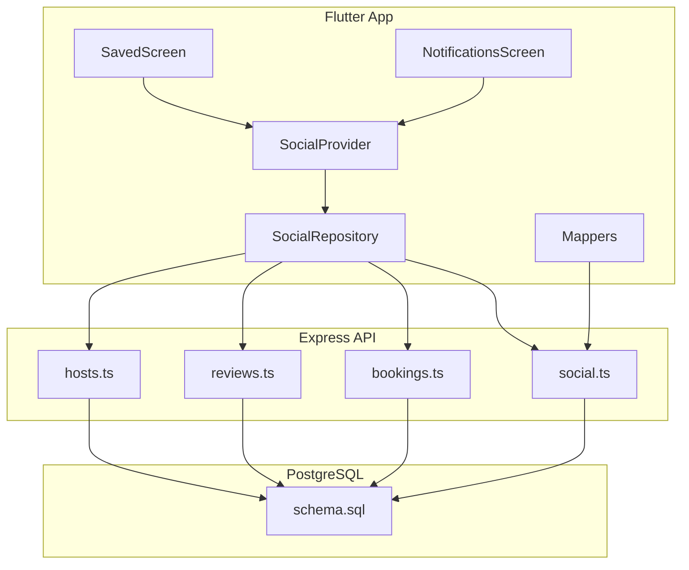
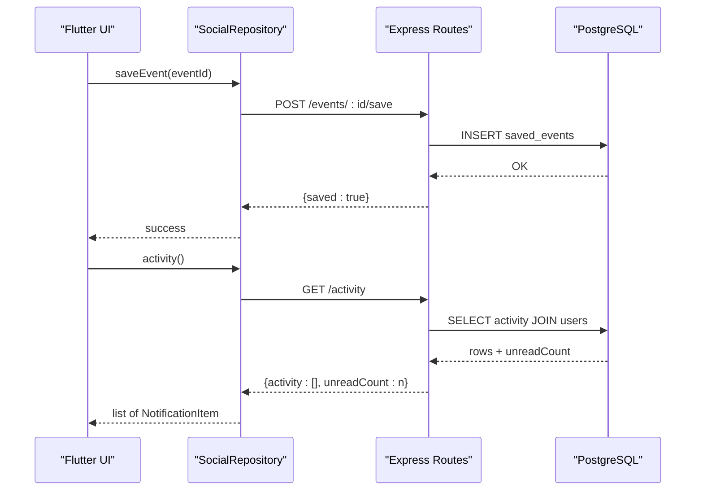
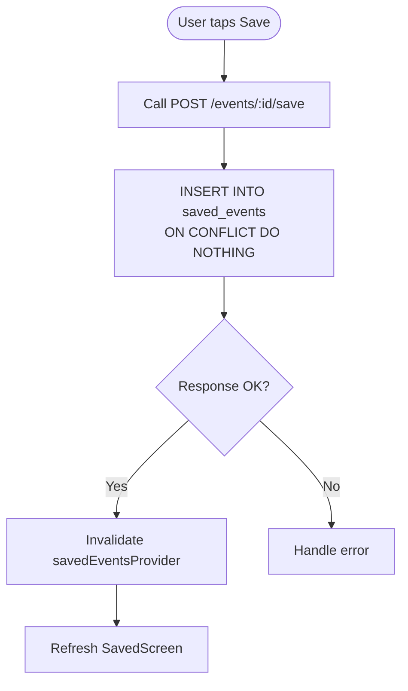
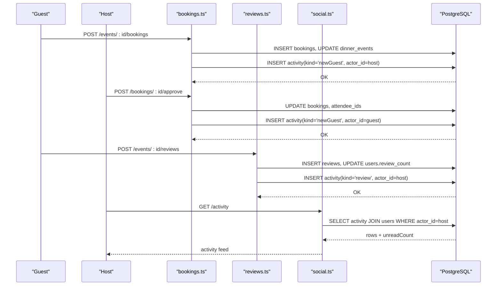
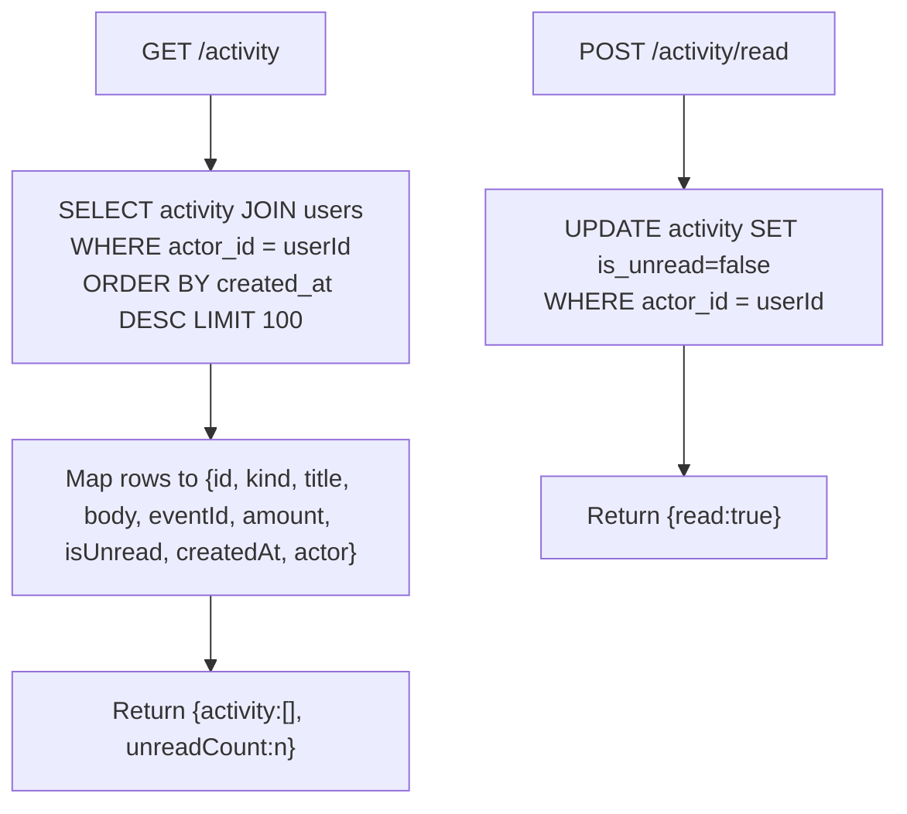
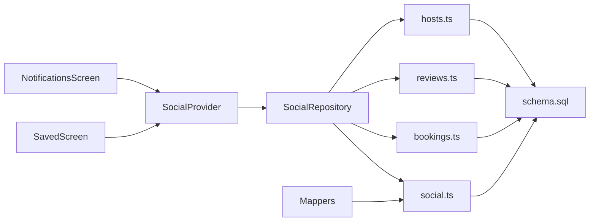

# Engagement & Activity Features

<cite>
**Referenced Files in This Document**
- [schema.sql](file://server/src/schema.sql)
- [social.ts](file://server/src/routes/social.ts)
- [bookings.ts](file://server/src/routes/bookings.ts)
- [reviews.ts](file://server/src/routes/reviews.ts)
- [hosts.ts](file://server/src/routes/hosts.ts)
- [context.ts](file://server/src/context.ts)
- [mappers.dart](file://lib/api/mappers/mappers.dart)
- [social_repository.dart](file://lib/repositories/social_repository.dart)
- [social_provider.dart](file://lib/providers/social_provider.dart)
- [saved_screen.dart](file://lib/screens/saved/saved_screen.dart)
- [notifications_screen.dart](file://lib/screens/notifications/notifications_screen.dart)
</cite>

## Table of Contents
1. [Introduction](#introduction)
2. [Project Structure](#project-structure)
3. [Core Components](#core-components)
4. [Architecture Overview](#architecture-overview)
5. [Detailed Component Analysis](#detailed-component-analysis)
6. [Dependency Analysis](#dependency-analysis)
7. [Performance Considerations](#performance-considerations)
8. [Troubleshooting Guide](#troubleshooting-guide)
9. [Conclusion](#conclusion)

## Introduction
This document explains the engagement and activity features that power user bookmarks, favorites, social actions, notifications, and profile metrics. It covers:
- The saved events table for user bookmarks and favorites.
- The activity feed system with supported activity kinds and notification generation.
- User profile metrics including follower counts, review counts, and engagement statistics.
- Activity feed queries for personalized notifications and social updates.
- Examples of saving events, generating activity entries, and retrieving engagement data.
- Performance considerations and integration points across social features and user preference controls.

## Project Structure
The engagement and activity features span server routes, database schema, client repositories, providers, and screens:
- Server routes implement endpoints for saved events, activity feed, follows, reviews, bookings, and host payouts.
- Database schema defines tables such as `saved_events`, `activity`, `follows`, `users`, `reviews`, and related indexes.
- Client code reads and writes through a repository layer and exposes state via providers to Flutter screens.



**Diagram sources**
- [social.ts:29-67](file://server/src/routes/social.ts#L29-L67)
- [bookings.ts:309-324](file://server/src/routes/bookings.ts#L309-L324)
- [reviews.ts:112-136](file://server/src/routes/reviews.ts#L112-L136)
- [schema.sql:325-347](file://server/src/schema.sql#L325-L347)
- [social_provider.dart:11-31](file://lib/providers/social_provider.dart#L11-L31)
- [social_repository.dart:17-24](file://lib/repositories/social_repository.dart#L17-L24)
- [mappers.dart:349-383](file://lib/api/mappers/mappers.dart#L349-L383)

**Section sources**
- [social.ts:29-67](file://server/src/routes/social.ts#L29-L67)
- [schema.sql:325-347](file://server/src/schema.sql#L325-L347)
- [social_provider.dart:11-31](file://lib/providers/social_provider.dart#L11-L31)
- [social_repository.dart:17-24](file://lib/repositories/social_repository.dart#L17-L24)

## Core Components
- Saved events (bookmarks/favorites):
  - Persisted in `saved_events` with a composite primary key `(user_id, event_id)` and an index on `user_id`.
  - Exposed via `GET /me/saved`, `POST /events/:id/save`, and `DELETE /events/:id/save`.
- Activity feed (notifications):
  - Stored in `activity` with `kind` constrained to `newGuest`, `payment`, `reminder`, `follower`, `payout`, `invite`, `review`.
  - Read by `GET /activity` and marked read by `POST /activity/read`.
- Follows and social graph:
  - `follows` table tracks user-to-user follows; counters are maintained on `users.followers_count` and `users.following_count`.
  - Batch follow status endpoint `GET /social/follow-status?ids=...`.
- Reviews:
  - `reviews` table stores guest reviews; host `review_count` is incremented on new reviews.
- Host earnings and payouts:
  - `payouts` table records per-event payout lines; host summary and trend endpoints aggregate earnings.

**Section sources**
- [schema.sql:325-347](file://server/src/schema.sql#L325-L347)
- [schema.sql:306-313](file://server/src/schema.sql#L306-L313)
- [schema.sql:294-304](file://server/src/schema.sql#L294-L304)
- [schema.sql:253-266](file://server/src/schema.sql#L253-L266)
- [social.ts:84-138](file://server/src/routes/social.ts#L84-L138)
- [social.ts:140-168](file://server/src/routes/social.ts#L140-L168)
- [reviews.ts:81-147](file://server/src/routes/reviews.ts#L81-L147)
- [hosts.ts:56-145](file://server/src/routes/hosts.ts#L56-L145)

## Architecture Overview
The engagement and activity flow connects UI components to server routes and PostgreSQL:
- Saved events: UI calls repository methods that hit `/events/:id/save` or `/events/:id/save`; listing uses `/me/saved`.
- Activity feed: UI calls `/activity` and marks all read via `/activity/read`.
- Social actions: Follow/unfollow update counters and insert activity rows; reviews increment host review count and create activity entries.
- Mapping: Client mappers convert server activity rows into notification items.



**Diagram sources**
- [social_repository.dart:55-74](file://lib/repositories/social_repository.dart#L55-L74)
- [social.ts:84-138](file://server/src/routes/social.ts#L84-L138)
- [social.ts:29-67](file://server/src/routes/social.ts#L29-L67)
- [schema.sql:325-347](file://server/src/schema.sql#L325-L347)

## Detailed Component Analysis

### Saved Events (Bookmarks and Favorites)
- Data model:
  - `saved_events(user_id, event_id, created_at)` with a composite primary key and an index on `user_id`.
- Endpoints:
  - `GET /me/saved`: returns bookmarked events ordered by start time.
  - `POST /events/:id/save`: idempotent upsert using `ON CONFLICT DO NOTHING`.
  - `DELETE /events/:id/save`: removes a bookmark.
- Client integration:
  - Repository methods call the save/unsave endpoints.
  - Provider invalidates saved events after mutations so UI refreshes.
  - Saved screen displays the list from `/me/saved`.



**Diagram sources**
- [social.ts:115-138](file://server/src/routes/social.ts#L115-L138)
- [social_provider.dart:74-82](file://lib/providers/social_provider.dart#L74-L82)
- [saved_screen.dart:12-22](file://lib/screens/saved/saved_screen.dart#L12-L22)
- [schema.sql:325-331](file://server/src/schema.sql#L325-L331)

**Section sources**
- [social.ts:84-138](file://server/src/routes/social.ts#L84-L138)
- [social_repository.dart:55-61](file://lib/repositories/social_repository.dart#L55-L61)
- [social_provider.dart:11-24](file://lib/providers/social_provider.dart#L11-L24)
- [saved_screen.dart:12-22](file://lib/screens/saved/saved_screen.dart#L12-L22)
- [schema.sql:325-331](file://server/src/schema.sql#L325-L331)

### Activity Feed System and Notification Generation
- Data model:
  - `activity(actor_id, kind, title, body, event_id, amount, is_unread, created_at)` with an index on `(actor_id, created_at DESC)`.
  - `kind` is constrained to `newGuest`, `payment`, `reminder`, `follower`, `payout`, `invite`, `review`.
- Reading the feed:
  - `GET /activity` returns the signed-in user’s feed (ordered newest first, limited to 100), including actor details and unread count.
  - `POST /activity/read` marks all items as read for the current user.
- Generating activities:
  - New booking creates a `newGuest` activity for the host.
  - Booking approval creates a `newGuest` activity for the guest.
  - Booking decline creates a `reminder` activity for the guest.
  - Review creation increments host `review_count` and inserts a `review` activity for the host.
  - Follow action increments follower/following counts and inserts a `follower` activity for the followee.
- Client mapping:
  - Mappers translate server activity rows into `NotificationItem` objects, mapping `kind` to notification types.



**Diagram sources**
- [bookings.ts:309-324](file://server/src/routes/bookings.ts#L309-L324)
- [bookings.ts:659-668](file://server/src/routes/bookings.ts#L659-L668)
- [bookings.ts:726-735](file://server/src/routes/bookings.ts#L726-L735)
- [reviews.ts:112-136](file://server/src/routes/reviews.ts#L112-L136)
- [social.ts:29-67](file://server/src/routes/social.ts#L29-L67)
- [schema.sql:333-347](file://server/src/schema.sql#L333-L347)

**Section sources**
- [social.ts:29-67](file://server/src/routes/social.ts#L29-L67)
- [social.ts:60-67](file://server/src/routes/social.ts#L60-L67)
- [bookings.ts:309-324](file://server/src/routes/bookings.ts#L309-L324)
- [bookings.ts:659-668](file://server/src/routes/bookings.ts#L659-L668)
- [bookings.ts:726-735](file://server/src/routes/bookings.ts#L726-L735)
- [reviews.ts:112-136](file://server/src/routes/reviews.ts#L112-L136)
- [mappers.dart:349-383](file://lib/api/mappers/mappers.dart#L349-L383)
- [schema.sql:333-347](file://server/src/schema.sql#L333-L347)

### User Profile Metrics and Engagement Statistics
- Follower and following counts:
  - Maintained on `users.followers_count` and `users.following_count`.
  - Updated on follow/unfollow and block operations.
- Review count:
  - Incremented when a guest posts a review for an event hosted by a user.
- Additional profile fields:
  - Rating, badges, tastes, accent color, joined year, role, home area, dietary preferences, allergies, and privacy toggles (`show_follow_list`, `show_activity`, `dm_from_followers_only`, `allow_tagging`).
- Host engagement analytics:
  - Earnings summary includes earned, in-transit, scheduled, lifetime gross, commission total, seats sold, average seat price, hosted/upcoming event counts, fill rate, and next payout date.

```mermaid
classDiagram
class Users {
+uuid id
+string name
+string handle
+integer followers_count
+integer following_count
+numeric rating
+integer review_count
+boolean show_follow_list
+boolean show_activity
+boolean dm_from_followers_only
+boolean allow_tagging
}
class Reviews {
+uuid id
+uuid author_id
+uuid event_id
+numeric rating
+text text
+timestamp created_at
}
class Payouts {
+uuid id
+uuid event_id
+timestamp payout_date
+integer seats_sold
+numeric gross
+numeric commission
+text status
}
Users ||--o{ Reviews : "author_id"
Users ||--o{ Payouts : "via events.host_id"
```

**Diagram sources**
- [schema.sql:16-37](file://server/src/schema.sql#L16-L37)
- [schema.sql:294-304](file://server/src/schema.sql#L294-L304)
- [schema.sql:253-266](file://server/src/schema.sql#L253-L266)
- [context.ts:128-146](file://server/src/context.ts#L128-L146)
- [hosts.ts:89-145](file://server/src/routes/hosts.ts#L89-L145)

**Section sources**
- [schema.sql:16-37](file://server/src/schema.sql#L16-L37)
- [schema.sql:294-304](file://server/src/schema.sql#L294-L304)
- [schema.sql:253-266](file://server/src/schema.sql#L253-L266)
- [context.ts:128-146](file://server/src/context.ts#L128-L146)
- [hosts.ts:89-145](file://server/src/routes/hosts.ts#L89-L145)

### Activity Feed Queries for Personalized Notifications and Social Updates
- Personalized feed:
  - `GET /activity` filters by `actor_id = req.userId` and orders by `created_at DESC` with a limit of 100.
  - Returns each activity with optional actor reference (id, name, handle, avatarUrl).
- Unread management:
  - `POST /activity/read` sets `is_unread = false` for all activities belonging to the current user.
- Social updates:
  - Follow/unfollow endpoints update counters and optionally generate activity entries.
  - Batch follow status endpoint returns a map of viewer-relative follow states for efficient list rendering.



**Diagram sources**
- [social.ts:29-67](file://server/src/routes/social.ts#L29-L67)
- [social.ts:60-67](file://server/src/routes/social.ts#L60-L67)

**Section sources**
- [social.ts:29-67](file://server/src/routes/social.ts#L29-L67)
- [social.ts:60-67](file://server/src/routes/social.ts#L60-L67)

### Examples

- Saving an event:
  - Call `POST /events/:id/save` to add a bookmark; use `DELETE /events/:id/save` to remove it.
  - On success, invalidate the saved events provider to refresh the UI.
- Generating an activity entry:
  - When a guest books an event, insert a `newGuest` activity targeting the host.
  - When a host approves a request, insert a `newGuest` activity targeting the guest.
  - When a host declines a request, insert a `reminder` activity targeting the guest.
  - When a guest reviews an event, increment the host’s `review_count` and insert a `review` activity targeting the host.
- Retrieving user engagement data:
  - Use `GET /activity` to fetch the user’s notifications and unread count.
  - Use host summary endpoints to retrieve earnings, seats sold, fill rate, and upcoming events.

**Section sources**
- [social.ts:115-138](file://server/src/routes/social.ts#L115-L138)
- [bookings.ts:309-324](file://server/src/routes/bookings.ts#L309-L324)
- [bookings.ts:659-668](file://server/src/routes/bookings.ts#L659-L668)
- [bookings.ts:726-735](file://server/src/routes/bookings.ts#L726-L735)
- [reviews.ts:112-136](file://server/src/routes/reviews.ts#L112-L136)
- [hosts.ts:89-145](file://server/src/routes/hosts.ts#L89-L145)

## Dependency Analysis
Key dependencies between components:
- Flutter screens depend on providers, which depend on repositories.
- Repositories depend on Express routes for persistence and business logic.
- Routes depend on PostgreSQL schema for data integrity and performance.
- Mappers transform server payloads into UI models.



**Diagram sources**
- [saved_screen.dart:12-22](file://lib/screens/saved/saved_screen.dart#L12-L22)
- [notifications_screen.dart:12-58](file://lib/screens/notifications/notifications_screen.dart#L12-L58)
- [social_provider.dart:11-31](file://lib/providers/social_provider.dart#L11-L31)
- [social_repository.dart:17-24](file://lib/repositories/social_repository.dart#L17-L24)
- [social.ts:29-67](file://server/src/routes/social.ts#L29-L67)
- [bookings.ts:309-324](file://server/src/routes/bookings.ts#L309-L324)
- [reviews.ts:112-136](file://server/src/routes/reviews.ts#L112-L136)
- [hosts.ts:89-145](file://server/src/routes/hosts.ts#L89-L145)
- [schema.sql:325-347](file://server/src/schema.sql#L325-L347)

**Section sources**
- [social_provider.dart:11-31](file://lib/providers/social_provider.dart#L11-L31)
- [social_repository.dart:17-24](file://lib/repositories/social_repository.dart#L17-L24)
- [social.ts:29-67](file://server/src/routes/social.ts#L29-L67)
- [bookings.ts:309-324](file://server/src/routes/bookings.ts#L309-L324)
- [reviews.ts:112-136](file://server/src/routes/reviews.ts#L112-L136)
- [hosts.ts:89-145](file://server/src/routes/hosts.ts#L89-L145)
- [schema.sql:325-347](file://server/src/schema.sql#L325-L347)

## Performance Considerations
- Index usage:
  - `idx_activity_actor` on `activity(actor_id, created_at DESC)` optimizes feed retrieval.
  - `idx_saved_events_user` on `saved_events(user_id)` optimizes bookmark listing.
- Query limits:
  - Activity feed is limited to 100 rows to control payload size.
- Transaction safety:
  - Booking flows lock event rows to prevent overselling and ensure consistent attendee lists.
- Counters:
  - Follower/following counts and review counts are updated inline to avoid expensive aggregations at read time.
- Pagination and batching:
  - Batch follow status endpoint reduces N+1 queries for list screens.

[No sources needed since this section provides general guidance]

## Troubleshooting Guide
- Activity not appearing:
  - Verify the correct `actor_id` was used when inserting the activity row.
  - Ensure the feed query filters by the intended recipient.
- Bookmark toggle not reflecting:
  - Confirm the save endpoint returned success and that the provider was invalidated.
  - Check that the saved events query filters by the authenticated user.
- Follower count mismatch:
  - Inspect follow/unfollow endpoints for counter updates.
  - Validate block operations do not leave inconsistent counts.
- Review count not incremented:
  - Ensure the review insertion path also updates the host’s `review_count`.

**Section sources**
- [social.ts:29-67](file://server/src/routes/social.ts#L29-L67)
- [social.ts:115-138](file://server/src/routes/social.ts#L115-L138)
- [social.ts:170-227](file://server/src/routes/social.ts#L170-L227)
- [reviews.ts:112-136](file://server/src/routes/reviews.ts#L112-L136)

## Conclusion
The engagement and activity features provide a robust foundation for user bookmarks, social interactions, notifications, and profile metrics. The design emphasizes:
- Clear separation of concerns between UI, repository, route, and database layers.
- Efficient indexing and query patterns for scalable activity feeds and saved events.
- Consistent state maintenance through counters and transactional updates.
- Extensibility for additional activity kinds and social integrations while respecting user preferences.

[No sources needed since this section summarizes without analyzing specific files]