# Messaging & Chat System

<cite>
**Referenced Files in This Document**
- [chat.ts](file://server/src/routes/chat.ts)
- [schema.sql](file://server/src/schema.sql)
- [server.ts](file://server/src/server.ts)
- [bookings.ts](file://server/src/routes/bookings.ts)
- [context.ts](file://server/src/context.ts)
- [security.ts](file://server/src/security.ts)
- [chat_repository.dart](file://lib/repositories/chat_repository.dart)
- [chat_detail_screen.dart](file://lib/screens/chat_detail/chat_detail_screen.dart)
</cite>

## Table of Contents
1. [Introduction](#introduction)
2. [Project Structure](#project-structure)
3. [Core Components](#core-components)
4. [Architecture Overview](#architecture-overview)
5. [Detailed Component Analysis](#detailed-component-analysis)
6. [Dependency Analysis](#dependency-analysis)
7. [Performance Considerations](#performance-considerations)
8. [Troubleshooting Guide](#troubleshooting-guide)
9. [Conclusion](#conclusion)

## Introduction
This document explains the messaging and chat system for DineCircle dinner events. It covers:
- The `chat_messages` table structure and how it supports event-scoped conversations, author attribution, and system messages.
- The REST-based chat API used by the Flutter app during Phase 3.
- The real-time WebSocket architecture built with Socket.IO, including room-based messaging, authentication, authorization, and broadcasting.
- The message lifecycle from creation to delivery, including integration with the booking system and safety controls such as blocking and reporting.

The current mobile client polls the REST endpoints; the server-side WebSocket layer is already implemented and ready for a realtime client upgrade.

## Project Structure
The messaging system spans both backend and frontend:
- Backend REST routes handle reading and writing event chat threads.
- Database schema defines the persistent chat model.
- WebSocket setup provides authenticated rooms for events and restaurants.
- Frontend repository and screen implement polling-based chat with safety actions.

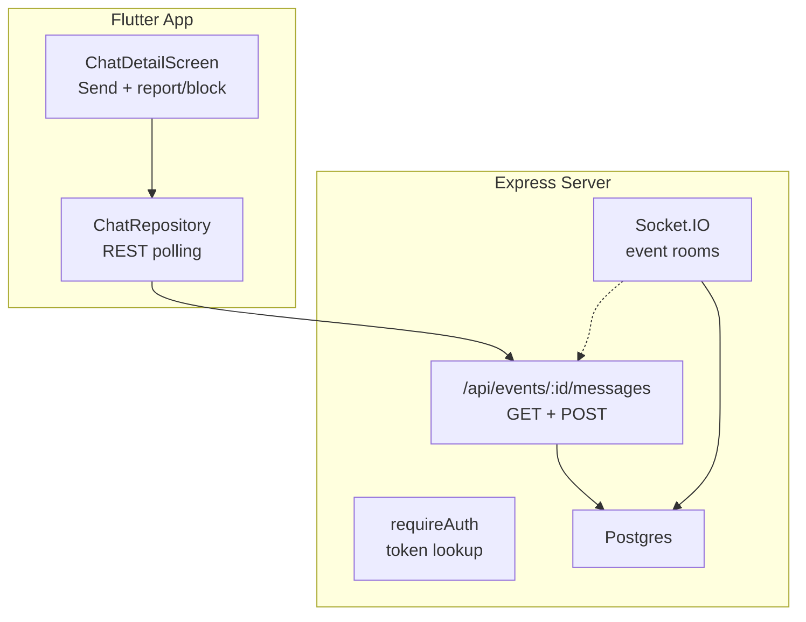

**Diagram sources**
- [chat.ts:55-131](file://server/src/routes/chat.ts#L55-L131)
- [schema.sql:349-357](file://server/src/schema.sql#L349-L357)
- [server.ts:91-202](file://server/src/server.ts#L91-L202)
- [chat_repository.dart:4-35](file://lib/repositories/chat_repository.dart#L4-L35)
- [chat_detail_screen.dart:17-22](file://lib/screens/chat_detail/chat_detail_screen.dart#L17-L22)

**Section sources**
- [chat.ts:1-134](file://server/src/routes/chat.ts#L1-L134)
- [schema.sql:349-357](file://server/src/schema.sql#L349-L357)
- [server.ts:91-202](file://server/src/server.ts#L91-L202)
- [chat_repository.dart:4-35](file://lib/repositories/chat_repository.dart#L4-L35)
- [chat_detail_screen.dart:17-22](file://lib/screens/chat_detail/chat_detail_screen.dart#L17-L22)

## Core Components
- Event-scoped chat thread API: reads and writes messages for a specific dinner event.
- Persistent chat model: `chat_messages` stores per-event messages with optional user attribution and system flags.
- WebSocket server: authenticates connections, manages event/restaurant rooms, and broadcasts real-time messages.
- Booking integration: chat membership is derived from host status, attendee list, or active bookings.
- Safety controls: blocked pairs cannot send new event-chat messages; users can report messages and block senders.

Key responsibilities:
- `routes/chat.ts`: REST endpoints, member checks, blocked-pair enforcement, message persistence.
- `schema.sql`: database tables, constraints, and indexes for chat and related entities.
- `server.ts`: HTTP server, Socket.IO setup, token-based auth, room management, and broadcast helpers.
- `routes/bookings.ts`: creates and updates bookings that grant chat access.
- `context.ts` and `security.ts`: authentication middleware, role handling, rate limiting, and audit logging.
- Flutter `repositories/chat_repository.dart` and `screens/chat_detail_screen.dart`: client-side chat UI and polling behavior.

**Section sources**
- [chat.ts:9-35](file://server/src/routes/chat.ts#L9-L35)
- [chat.ts:48-82](file://server/src/routes/chat.ts#L48-L82)
- [chat.ts:84-131](file://server/src/routes/chat.ts#L84-L131)
- [schema.sql:349-357](file://server/src/schema.sql#L349-L357)
- [schema.sql:529-529](file://server/src/schema.sql#L529-L529)
- [server.ts:91-202](file://server/src/server.ts#L91-L202)
- [bookings.ts:153-335](file://server/src/routes/bookings.ts#L153-L335)
- [context.ts:60-85](file://server/src/context.ts#L60-L85)
- [security.ts:7-14](file://server/src/security.ts#L7-L14)
- [chat_repository.dart:4-35](file://lib/repositories/chat_repository.dart#L4-L35)
- [chat_detail_screen.dart:17-22](file://lib/screens/chat_detail/chat_detail_screen.dart#L17-L22)

## Architecture Overview
The chat system has two layers:
1. REST layer: clients poll `/events/:id/messages` to load history and post new messages.
2. WebSocket layer: authenticated clients join event rooms and receive real-time messages.

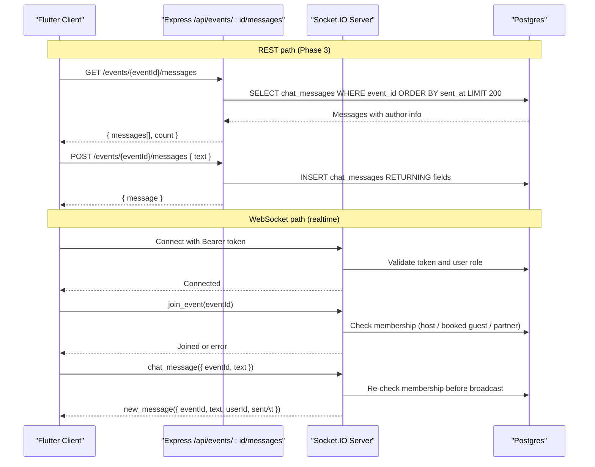

**Diagram sources**
- [chat.ts:55-131](file://server/src/routes/chat.ts#L55-L131)
- [server.ts:99-113](file://server/src/server.ts#L99-L113)
- [server.ts:115-129](file://server/src/server.ts#L115-L129)
- [server.ts:146-202](file://server/src/server.ts#L146-L202)

**Section sources**
- [chat.ts:55-131](file://server/src/routes/chat.ts#L55-L131)
- [server.ts:91-202](file://server/src/server.ts#L91-L202)

## Detailed Component Analysis

### Database Model: `chat_messages`
The `chat_messages` table stores event-scoped conversation history. Each row represents one message in an event’s thread.

| Column | Type | Description |
|--------|------|-------------|
| `id` | uuid | Primary key, server-generated UUID. |
| `event_id` | uuid | Foreign key to `dinner_events`; enforces event-scoped conversations. |
| `author_id` | uuid (nullable) | User who authored the message; nullable for system messages. |
| `text` | text | Message content; required and validated on write. |
| `sent_at` | timestamptz | Timestamp when the message was created; defaults to now. |
| `is_system` | boolean | Flag indicating whether the message is a system message. |

Indexes:
- `idx_chat_event` on `(event_id, sent_at)` optimizes loading event threads ordered by time.

Relationships:
- `event_id` references `dinner_events(id)` with cascade delete.
- `author_id` references `users(id)` with set-null on delete, allowing historical messages to remain readable even if the author account is removed.

System messages are supported by the schema through `is_system`, while the REST route currently inserts user-authored messages. System messages can be introduced by setting `is_system = true` and leaving `author_id` null.

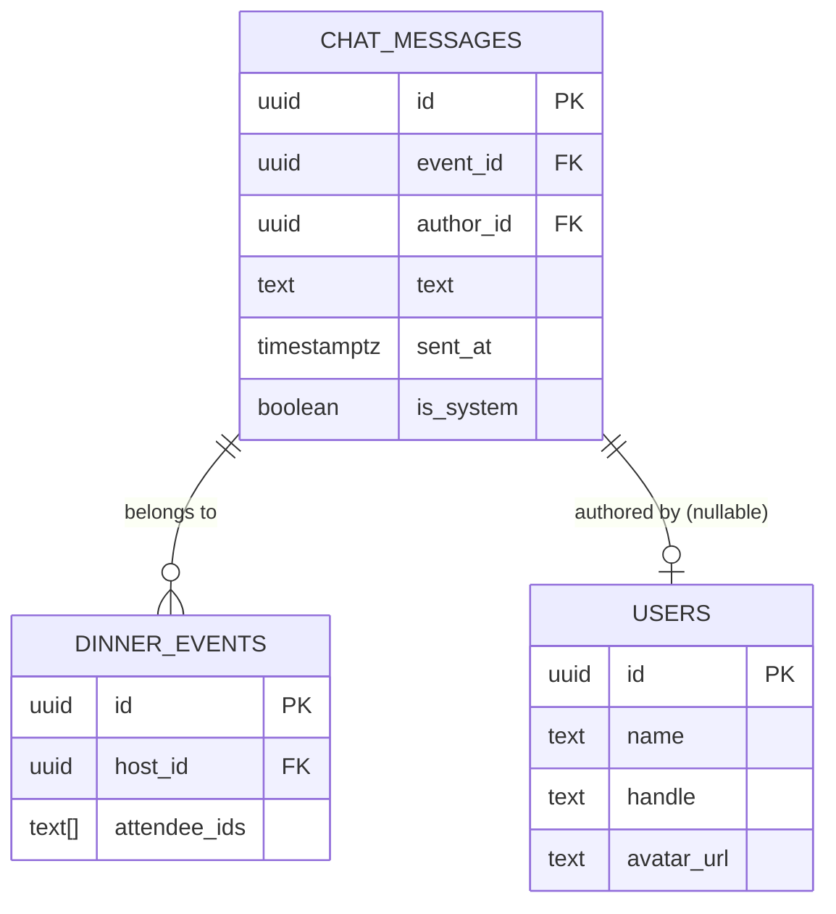

**Diagram sources**
- [schema.sql:349-357](file://server/src/schema.sql#L349-L357)
- [schema.sql:121-156](file://server/src/schema.sql#L121-L156)
- [schema.sql:16-37](file://server/src/schema.sql#L16-L37)
- [schema.sql:529-529](file://server/src/schema.sql#L529-L529)

**Section sources**
- [schema.sql:349-357](file://server/src/schema.sql#L349-L357)
- [schema.sql:529-529](file://server/src/schema.sql#L529-L529)

### REST Chat API: Event Threads and Message Posting
The chat REST API provides:
- `GET /api/events/:id/messages`: loads the event’s chat thread, oldest first, limited to 200 messages.
- `POST /api/events/:id/messages`: posts a new message as the authenticated user.

Member eligibility:
- A member is the host, a guest with an active booking, or anyone on the event’s seeded attendee list.
- If the user is not a member, the endpoint returns a forbidden error.

Blocked-pair enforcement:
- If the sender is not the host, the server checks whether the sender and host form a blocked pair.
- Blocked pairs cannot send new messages in the shared event chat; existing history remains readable.

Message payload validation:
- Text must be trimmed, non-empty, and at most 1000 characters.

Response shape:
- GET returns a list of messages with author details and a count.
- POST returns the newly created message with author details.

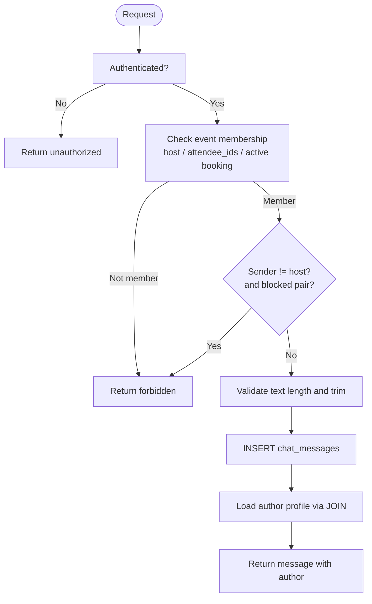

**Diagram sources**
- [chat.ts:13-35](file://server/src/routes/chat.ts#L13-L35)
- [chat.ts:55-82](file://server/src/routes/chat.ts#L55-L82)
- [chat.ts:84-131](file://server/src/routes/chat.ts#L84-L131)

**Section sources**
- [chat.ts:9-35](file://server/src/routes/chat.ts#L9-L35)
- [chat.ts:55-82](file://server/src/routes/chat.ts#L55-L82)
- [chat.ts:84-131](file://server/src/routes/chat.ts#L84-L131)

### Real-Time Communication: WebSocket Connections and Room-Based Messaging
The server uses Socket.IO to provide real-time communication:
- Connections require a Bearer token attached to handshake auth.
- Tokens are hashed and looked up against `auth_tokens` joined with `users`.
- Unauthenticated connections are disconnected immediately.

Room management:
- Clients join event rooms using `join_event(eventId)`.
- Clients leave event rooms using `leave_event(eventId)`.
- Restaurant rooms are also supported via `join_restaurant(restaurantId)` and `leave_restaurant(restaurantId)`.

Authorization:
- Joining an event requires membership: host, booked guest, or partner/super admin.
- Sending a chat message re-validates membership before broadcasting.

Broadcasting:
- On successful `chat_message`, the server emits `new_message` to all sockets in the target event room.
- Broadcast payload includes event ID, text, user ID, and timestamp.

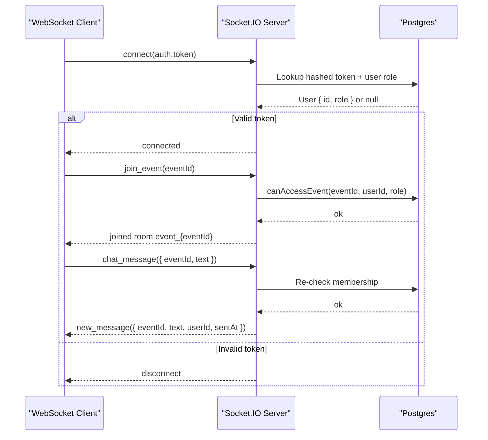

**Diagram sources**
- [server.ts:99-113](file://server/src/server.ts#L99-L113)
- [server.ts:115-129](file://server/src/server.ts#L115-L129)
- [server.ts:146-202](file://server/src/server.ts#L146-L202)

**Section sources**
- [server.ts:91-202](file://server/src/server.ts#L91-L202)

### Message Lifecycle: Creation to Delivery
The full lifecycle combines REST persistence and optional real-time delivery:

1. Client sends a message via REST (`POST /events/:id/messages`) or WebSocket (`chat_message`).
2. Server validates authentication and authorization:
   - REST: `requireMember` ensures host, attendee, or active booking.
   - WebSocket: `canAccessEvent` ensures membership.
3. Server enforces safety:
   - Blocked pairs cannot send new messages in shared event chat.
4. Server persists the message:
   - REST inserts into `chat_messages` and joins `users` to include author details.
   - WebSocket currently broadcasts without persisting; production realtime should persist first.
5. Server responds:
   - REST returns the persisted message with author info.
   - WebSocket emits `new_message` to the event room.

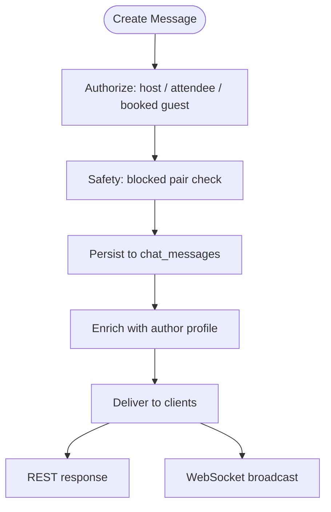

**Diagram sources**
- [chat.ts:13-35](file://server/src/routes/chat.ts#L13-L35)
- [chat.ts:84-131](file://server/src/routes/chat.ts#L84-L131)
- [server.ts:184-197](file://server/src/server.ts#L184-L197)

**Section sources**
- [chat.ts:13-35](file://server/src/routes/chat.ts#L13-L35)
- [chat.ts:84-131](file://server/src/routes/chat.ts#L84-L131)
- [server.ts:184-197](file://server/src/server.ts#L184-L197)

### Authentication and Authorization Integration
Authentication:
- REST: `requireAuth` middleware extracts the Bearer token, hashes it, and looks it up in `auth_tokens` joined with `users`.
- WebSocket: connection handler resolves the token from handshake auth and rejects unauthenticated connections.

Authorization:
- REST: `requireMember` checks host, attendee list, and active bookings.
- WebSocket: `canAccessEvent` checks host, bookings, and allows partner/super admins to access any event.

Roles:
- Recognized roles include user, host, influencer, partner_admin, super_admin.
- Partner/super admins bypass event membership checks.

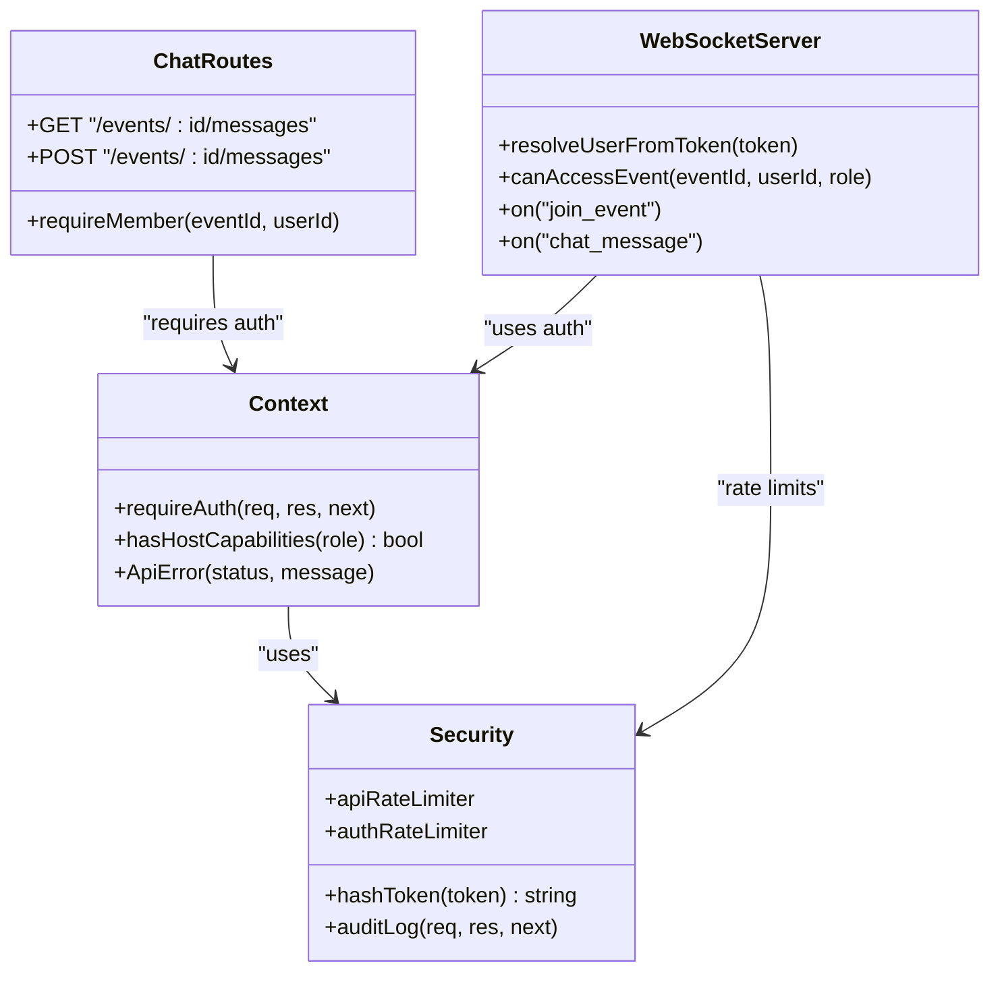

**Diagram sources**
- [context.ts:6-37](file://server/src/context.ts#L6-L37)
- [context.ts:60-85](file://server/src/context.ts#L60-L85)
- [security.ts:7-14](file://server/src/security.ts#L7-L14)
- [security.ts:103-147](file://server/src/security.ts#L103-L147)
- [chat.ts:13-35](file://server/src/routes/chat.ts#L13-L35)
- [server.ts:99-129](file://server/src/server.ts#L99-L129)

**Section sources**
- [context.ts:60-85](file://server/src/context.ts#L60-L85)
- [security.ts:7-14](file://server/src/security.ts#L7-L14)
- [chat.ts:13-35](file://server/src/routes/chat.ts#L13-L35)
- [server.ts:99-129](file://server/src/server.ts#L99-L129)

### Chat Room Management for Dinner Events
Event chat rooms are managed through Socket.IO rooms named `event_{eventId}`:
- Clients call `join_event(eventId)` to enter the room after successful authorization.
- Clients call `leave_event(eventId)` to exit the room.
- Broadcasting uses `socket.to(`event_${eventId}`).emit(...)`.

Participant filtering:
- Membership is determined by host status, attendee list, or active bookings.
- Partner/super admins can access any event.

Restaurant rooms:
- Similar pattern applies for restaurant-specific notifications and updates.

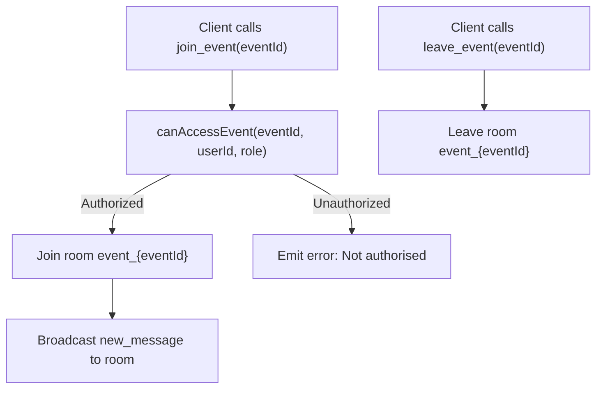

**Diagram sources**
- [server.ts:115-129](file://server/src/server.ts#L115-L129)
- [server.ts:158-169](file://server/src/server.ts#L158-L169)
- [server.ts:191-197](file://server/src/server.ts#L191-L197)

**Section sources**
- [server.ts:115-129](file://server/src/server.ts#L115-L129)
- [server.ts:158-169](file://server/src/server.ts#L158-L169)
- [server.ts:191-197](file://server/src/server.ts#L191-L197)

### Integration with the Booking System
Chat access is tightly integrated with bookings:
- Active bookings grant chat membership for the associated event.
- When a booking is created, the event’s `seats_booked` and `attendee_ids` are updated.
- Cancellations and declines adjust seat counts and attendee lists accordingly.

This ensures that only guests with valid reservations (or hosts/seeded attendees) can participate in event chat.

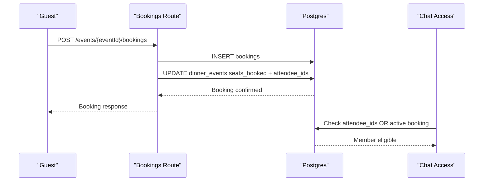

**Diagram sources**
- [bookings.ts:153-335](file://server/src/routes/bookings.ts#L153-L335)
- [chat.ts:13-35](file://server/src/routes/chat.ts#L13-L35)

**Section sources**
- [bookings.ts:153-335](file://server/src/routes/bookings.ts#L153-L335)
- [chat.ts:13-35](file://server/src/routes/chat.ts#L13-L35)

### Safety Measures for Content Moderation
Safety controls protect users and maintain respectful communication:
- Blocking:
  - Blocked pairs cannot send new messages in shared event chat.
  - Existing message history remains readable to preserve context.
- Reporting:
  - Users can report messages via the Flutter UI, which triggers server-side reports.
- Rate limiting:
  - API and auth endpoints are rate-limited to prevent abuse.
- Audit logging:
  - Mutating requests are logged to `audit_log` with sensitive fields redacted.

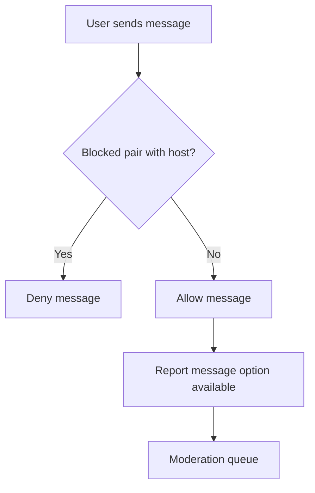

**Diagram sources**
- [chat.ts:91-98](file://server/src/routes/chat.ts#L91-L98)
- [security.ts:48-68](file://server/src/security.ts#L48-L68)
- [security.ts:103-147](file://server/src/security.ts#L103-L147)
- [chat_detail_screen.dart:68-100](file://lib/screens/chat_detail/chat_detail_screen.dart#L68-L100)

**Section sources**
- [chat.ts:91-98](file://server/src/routes/chat.ts#L91-L98)
- [security.ts:48-68](file://server/src/security.ts#L48-L68)
- [security.ts:103-147](file://server/src/security.ts#L103-L147)
- [chat_detail_screen.dart:68-100](file://lib/screens/chat_detail/chat_detail_screen.dart#L68-L100)

### Client-Side Chat Behavior
The Flutter app implements chat via REST polling:
- `ChatRepository` fetches the thread and sends messages.
- `ChatDetailScreen` displays messages, handles sending, and provides safety actions like reporting and blocking.

Realtime support:
- The repository comment indicates Socket.IO realtime is a Phase 3b drop-in behind the same provider.
- The server’s WebSocket layer is ready for this integration.

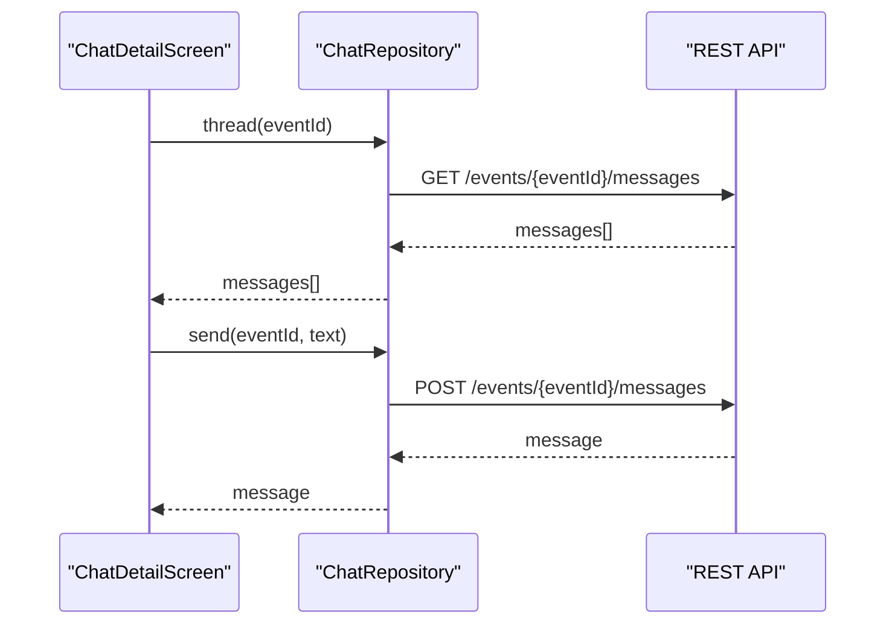

**Diagram sources**
- [chat_repository.dart:4-35](file://lib/repositories/chat_repository.dart#L4-L35)
- [chat_detail_screen.dart:17-22](file://lib/screens/chat_detail/chat_detail_screen.dart#L17-L22)

**Section sources**
- [chat_repository.dart:4-35](file://lib/repositories/chat_repository.dart#L4-L35)
- [chat_detail_screen.dart:17-22](file://lib/screens/chat_detail/chat_detail_screen.dart#L17-L22)

## Dependency Analysis
The messaging system depends on several core modules:

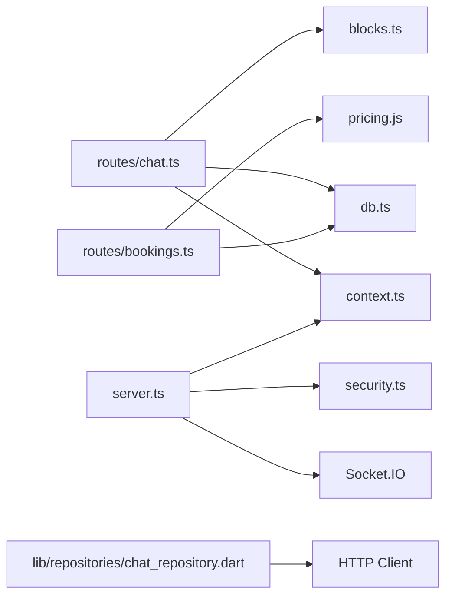

**Diagram sources**
- [chat.ts:1-6](file://server/src/routes/chat.ts#L1-L6)
- [server.ts:1-25](file://server/src/server.ts#L1-L25)
- [bookings.ts:1-13](file://server/src/routes/bookings.ts#L1-L13)
- [chat_repository.dart:1-3](file://lib/repositories/chat_repository.dart#L1-L3)

**Section sources**
- [chat.ts:1-6](file://server/src/routes/chat.ts#L1-L6)
- [server.ts:1-25](file://server/src/server.ts#L1-L25)
- [bookings.ts:1-13](file://server/src/routes/bookings.ts#L1-L13)
- [chat_repository.dart:1-3](file://lib/repositories/chat_repository.dart#L1-L3)

## Performance Considerations
- Chat thread loading is limited to 200 messages to prevent large payloads.
- Index on `chat_messages(event_id, sent_at)` optimizes chronological queries.
- WebSocket broadcasts are room-scoped, reducing unnecessary traffic.
- REST endpoints are rate-limited to mitigate abuse.
- Audit logging is fire-and-forget to avoid impacting request latency.

Recommendations:
- For high-volume events, consider pagination or cursor-based loading beyond 200 messages.
- Persist WebSocket messages to `chat_messages` before broadcasting to ensure durability.
- Monitor room sizes and consider sharding or partitioning by event for scale.

[No sources needed since this section provides general guidance]

## Troubleshooting Guide
Common issues and resolutions:
- Unauthorized WebSocket connections:
  - Ensure the client attaches a valid Bearer token to the handshake.
  - Verify the token exists in `auth_tokens` and is not expired.
- Forbidden chat access:
  - Confirm the user is the host, has an active booking, or is in the attendee list.
  - Check for blocked pairs between sender and host.
- Message not appearing in realtime:
  - Verify the client joined the correct event room.
  - Ensure membership re-check passes before broadcasting.
- Rate limiting errors:
  - Adjust `API_RATE_LIMIT_MAX` or `AUTH_RATE_LIMIT_MAX` for testing environments.
- Audit log gaps:
  - Check fire-and-forget insert failures in audit logging.

**Section sources**
- [server.ts:146-154](file://server/src/server.ts#L146-L154)
- [server.ts:158-169](file://server/src/server.ts#L158-L169)
- [server.ts:184-197](file://server/src/server.ts#L184-L197)
- [security.ts:28-46](file://server/src/security.ts#L28-L46)
- [security.ts:103-147](file://server/src/security.ts#L103-L147)

## Conclusion
The DineCircle messaging and chat system provides robust event-scoped conversations through both REST and WebSocket channels. The `chat_messages` table supports event scoping, author attribution, and system messages. Authentication and authorization are enforced at both layers, with safety controls like blocking and reporting ensuring respectful communication. Integration with the booking system guarantees that only eligible participants can chat. The current Flutter client uses REST polling, while the server’s WebSocket infrastructure is ready for realtime upgrades. With proper indexing, rate limiting, and audit logging, the system balances performance, security, and usability.

[No sources needed since this section summarizes without analyzing specific files]