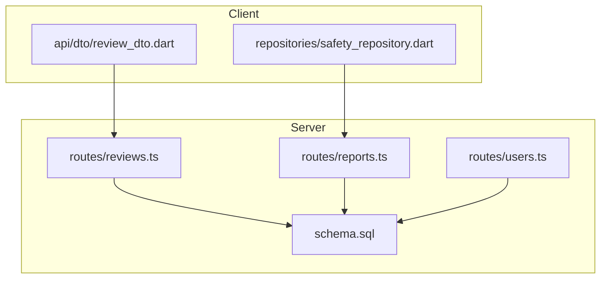
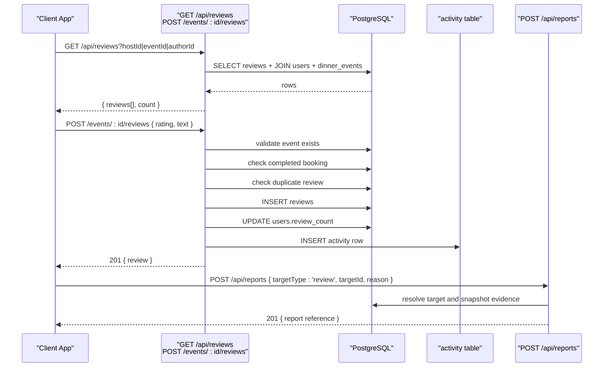
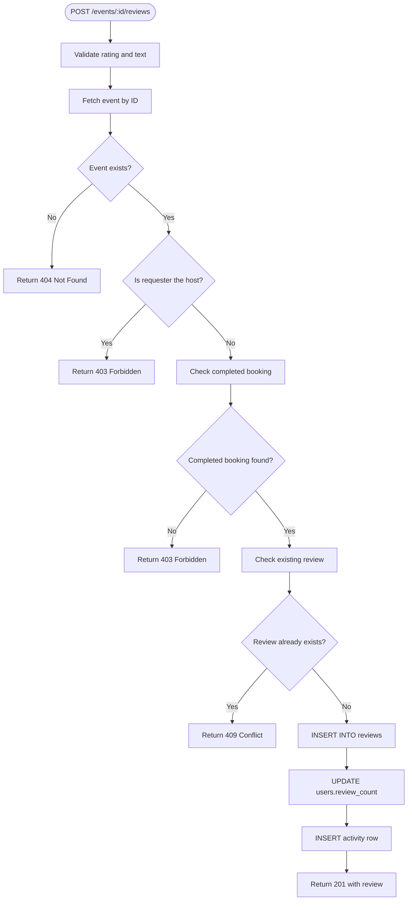
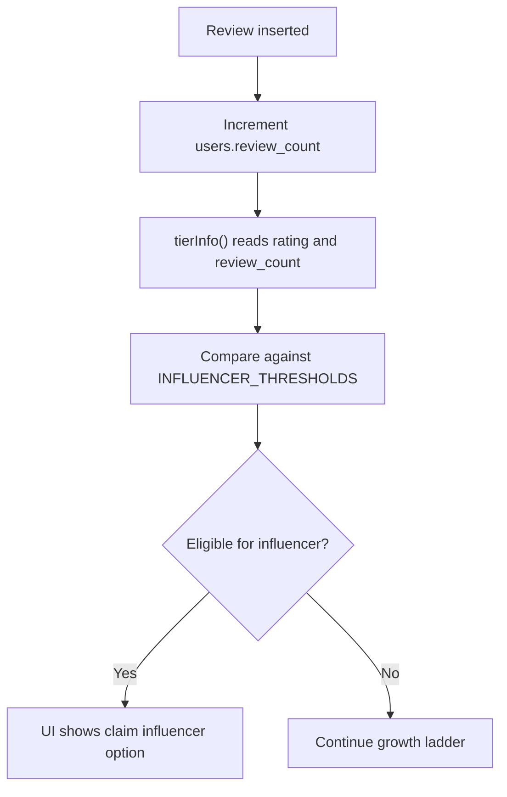
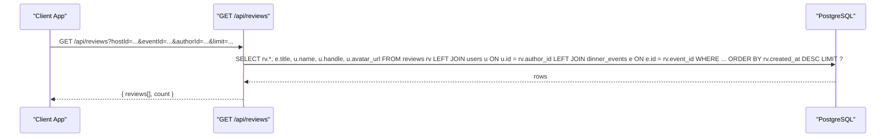
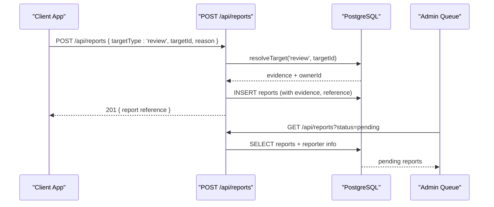
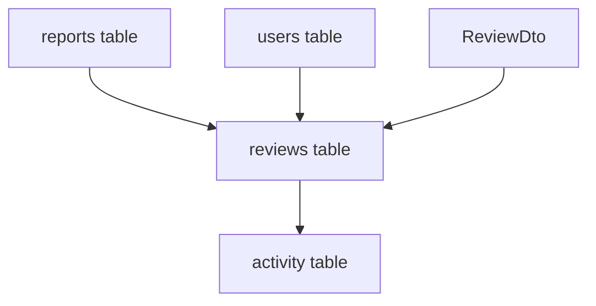
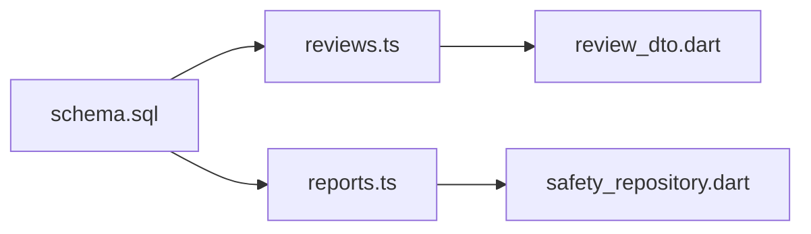

# Reviews & Ratings System

<cite>
**Referenced Files in This Document**
- [schema.sql](file://server/src/schema.sql)
- [reviews.ts](file://server/src/routes/reviews.ts)
- [reports.ts](file://server/src/routes/reports.ts)
- [users.ts](file://server/src/routes/users.ts)
- [qa_run.mjs](file://server/.qa/qa_run.mjs)
- [review_dto.dart](file://lib/api/dto/review_dto.dart)
- [safety_repository.dart](file://lib/repositories/safety_repository.dart)
</cite>

## Table of Contents
1. [Introduction](#introduction)
2. [Project Structure](#project-structure)
3. [Core Components](#core-components)
4. [Architecture Overview](#architecture-overview)
5. [Detailed Component Analysis](#detailed-component-analysis)
6. [Dependency Analysis](#dependency-analysis)
7. [Performance Considerations](#performance-considerations)
8. [Troubleshooting Guide](#troubleshooting-guide)
9. [Conclusion](#conclusion)

## Introduction
This document explains the reviews and ratings system for DinCircle. It covers the database schema, API endpoints, validation rules, data integrity constraints, review creation workflow, querying patterns, moderation integration, and how reviews interact with user profiles and broader social features such as reporting and safety mechanisms.

The system is centered around event reviews submitted by guests who have attended an event. Reviews are stored in a dedicated table with strict rating and uniqueness constraints, and they integrate with activity tracking, user profile metrics, and the platform’s reporting system.

## Project Structure
The reviews feature spans server-side route logic, database schema definitions, client DTOs, and safety/reporting infrastructure:

- Server routes define the public API for listing and creating reviews.
- The database schema defines the `reviews` table, its constraints, and indexes.
- Client code includes a review DTO used to parse review payloads.
- Safety and reporting routes provide the moderation surface that can target reviews.



**Diagram sources**
- [reviews.ts:1-151](file://server/src/routes/reviews.ts#L1-L151)
- [reports.ts:1-283](file://server/src/routes/reports.ts#L1-L283)
- [schema.sql:294-304](file://server/src/schema.sql#L294-L304)
- [users.ts:84-110](file://server/src/routes/users.ts#L84-L110)
- [review_dto.dart:1-49](file://lib/api/dto/review_dto.dart#L1-L49)
- [safety_repository.dart:1-43](file://lib/repositories/safety_repository.dart#L1-L43)

**Section sources**
- [reviews.ts:1-151](file://server/src/routes/reviews.ts#L1-L151)
- [schema.sql:294-304](file://server/src/schema.sql#L294-L304)
- [review_dto.dart:1-49](file://lib/api/dto/review_dto.dart#L1-L49)
- [reports.ts:1-283](file://server/src/routes/reports.ts#L1-L283)

## Core Components
- Reviews table: stores event reviews with rating, text, author, event, and timestamps.
- Review list endpoint: returns reviews filtered by host, event, or author.
- Review creation endpoint: validates guest eligibility, prevents duplicates, inserts the review, updates host metrics, and logs an activity notification.
- Reports system: allows users to report reviews (and other targets), with moderation workflows.
- User tier/profile integration: uses user-level rating and review count for growth ladder progress.

Key responsibilities:
- Data integrity: enforced through schema constraints and route-level validations.
- Query flexibility: supports filtering by host, event, and author.
- Moderation linkage: reports can target reviews; evidence snapshots preserve context even if content changes.

**Section sources**
- [schema.sql:294-304](file://server/src/schema.sql#L294-L304)
- [reviews.ts:21-74](file://server/src/routes/reviews.ts#L21-L74)
- [reviews.ts:76-148](file://server/src/routes/reviews.ts#L76-L148)
- [reports.ts:84-98](file://server/src/routes/reports.ts#L84-L98)
- [users.ts:84-110](file://server/src/routes/users.ts#L84-L110)

## Architecture Overview
The reviews system integrates three main layers:

- Database layer: defines tables, constraints, and indexes.
- API layer: exposes endpoints for listing and creating reviews, plus reporting endpoints.
- Client layer: parses review payloads and interacts with safety/reporting flows.



**Diagram sources**
- [reviews.ts:21-74](file://server/src/routes/reviews.ts#L21-L74)
- [reviews.ts:76-148](file://server/src/routes/reviews.ts#L76-L148)
- [reports.ts:150-198](file://server/src/routes/reports.ts#L150-L198)
- [schema.sql:294-304](file://server/src/schema.sql#L294-L304)

## Detailed Component Analysis

### Reviews Table Schema and Constraints
The `reviews` table enforces core integrity rules:

- Primary key: UUID generated server-side.
- Foreign keys:
  - `author_id` references `users(id)` with cascade delete.
  - `event_id` references `dinner_events(id)` with cascade delete.
- Rating constraint: numeric value between 0 and 5.
- Uniqueness rule: one review per `(event_id, author_id)` pair.
- Indexes:
  - `idx_reviews_event` on `event_id`.
  - `idx_reviews_author` on `author_id`.

These constraints ensure:
- Referential integrity with users and events.
- Valid rating range at the database level.
- Prevention of duplicate reviews per event-author pair.

```mermaid
erDiagram
USERS ||--o{ REVIEWS : "author_id"
DINNER_EVENTS ||--o{ REVIEWS : "event_id"
REVIEWS {
uuid id PK
uuid author_id FK
uuid event_id FK
numeric(3,2) rating
text text
timestamptz created_at
}
USERS {
uuid id PK
text name
text handle
numeric(3,2) rating
integer review_count
}
DINNER_EVENTS {
uuid id PK
text title
uuid host_id FK
}
```

**Diagram sources**
- [schema.sql:294-304](file://server/src/schema.sql#L294-L304)
- [schema.sql:16-37](file://server/src/schema.sql#L16-L37)
- [schema.sql:124-156](file://server/src/schema.sql#L124-L156)

**Section sources**
- [schema.sql:294-304](file://server/src/schema.sql#L294-L304)
- [schema.sql:513-528](file://server/src/schema.sql#L513-L528)

### Review Creation Workflow
The creation flow ensures only eligible guests can submit reviews and that each event receives at most one review from a given author.

Steps:
1. Validate request body using Zod:
   - `rating`: number between 1 and 5.
   - `text`: trimmed string between 10 and 1000 characters.
2. Verify the event exists and is not authored by the current user.
3. Confirm the current user has a completed booking for the event.
4. Check for an existing review by this author for this event.
5. Insert the review into the `reviews` table.
6. Increment the host’s `review_count` in the `users` table.
7. Create an activity entry notifying the host about the new review.
8. Return a 201 response with the review payload.



**Diagram sources**
- [reviews.ts:76-148](file://server/src/routes/reviews.ts#L76-L148)

**Section sources**
- [reviews.ts:76-148](file://server/src/routes/reviews.ts#L76-L148)

### Validation Rules and Data Integrity
Validation occurs at multiple layers:

- Request body validation:
  - Rating must be a number between 1 and 5.
  - Text must be non-empty after trimming, with length between 10 and 1000.
- Business rule validation:
  - Host cannot review their own event.
  - Only guests with completed bookings can review.
  - Duplicate reviews are rejected.
- Database constraints:
  - Rating must be between 0 and 5.
  - Unique `(event_id, author_id)` prevents duplicates.
  - Foreign keys enforce referential integrity.

Note: There is a mismatch between the route-level rating minimum (1) and the database CHECK constraint (0–5). The stricter route-level validation should be aligned with the database constraint to avoid confusion and maintain consistency.

**Section sources**
- [reviews.ts:76-148](file://server/src/routes/reviews.ts#L76-L148)
- [schema.sql:294-304](file://server/src/schema.sql#L294-L304)

### Review Count Impact on User Profiles
When a review is created, the host’s `review_count` is incremented. This metric feeds into the user tier system:

- The tier calculation reads `rating` and `review_count` from the user record.
- Progress toward influencer status depends on thresholds including rating and review count.
- UI surfaces these metrics in profile and tier cards.



**Diagram sources**
- [reviews.ts:118-121](file://server/src/routes/reviews.ts#L118-L121)
- [users.ts:84-110](file://server/src/routes/users.ts#L84-L110)

**Section sources**
- [reviews.ts:118-121](file://server/src/routes/reviews.ts#L118-L121)
- [users.ts:84-110](file://server/src/routes/users.ts#L84-L110)

### Review Querying Patterns
The list endpoint supports flexible filtering:

- By host: `hostId` filters reviews for events hosted by a specific user.
- By event: `eventId` filters reviews for a specific event.
- By author: `authorId` filters reviews written by a specific user.
- Pagination: `limit` defaults to 50 and is capped at 200.
- Ordering: newest first by `created_at DESC`.

The query joins:
- `reviews` with `users` to include author details.
- `reviews` with `dinner_events` to include event title.



**Diagram sources**
- [reviews.ts:21-74](file://server/src/routes/reviews.ts#L21-L74)

**Section sources**
- [reviews.ts:21-74](file://server/src/routes/reviews.ts#L21-L74)

### Examples: Submission, Retrieval, and Moderation

#### Review Submission Example
A guest submits a review for an event they attended:

- Endpoint: `POST /events/:id/reviews`
- Body: `{ rating: number, text: string }`
- Success: 201 with review object.
- Errors:
  - 404 if event not found.
  - 403 if host tries to review own event or guest lacks completed booking.
  - 409 if duplicate review exists.

QA harness tests:
- Seeded completed bookings allow review submission.
- Duplicate review attempts return 409.

**Section sources**
- [reviews.ts:76-148](file://server/src/routes/reviews.ts#L76-L148)
- [qa_run.mjs:346-365](file://server/.qa/qa_run.mjs#L346-L365)

#### Review Retrieval Example
A client retrieves reviews filtered by event or author:

- Endpoint: `GET /api/reviews`
- Query params: `hostId`, `eventId`, `authorId`, `limit`
- Response: array of reviews with author details and event title.

**Section sources**
- [reviews.ts:21-74](file://server/src/routes/reviews.ts#L21-L74)

#### Moderation Workflow Example
A user reports a review:

- Endpoint: `POST /api/reports`
- Body: `{ targetType: 'review', targetId, reason, description }`
- Server resolves the review, snapshots evidence, and creates a report.
- Response: 201 with report reference (e.g., `RP-XXXXXX`).
- Admin queue: `GET /api/reports` (super_admin only) lists pending reports with reporter info.
- Status update: `PATCH /api/reports/:id` (super_admin only) advances case status.



**Diagram sources**
- [reports.ts:150-198](file://server/src/routes/reports.ts#L150-L198)
- [reports.ts:220-258](file://server/src/routes/reports.ts#L220-L258)
- [reports.ts:263-279](file://server/src/routes/reports.ts#L263-L279)

**Section sources**
- [reports.ts:150-198](file://server/src/routes/reports.ts#L150-L198)
- [reports.ts:220-258](file://server/src/routes/reports.ts#L220-L258)
- [reports.ts:263-279](file://server/src/routes/reports.ts#L263-L279)

### Relationship Between Reviews and Social Features
Reviews integrate with the broader social ecosystem:

- Activity feed: new reviews create activity entries for hosts.
- Reporting: reviews can be reported via the safety system, with evidence snapshots preserved.
- User profiles: host metrics (`rating`, `review_count`) influence tier progression and UI presentation.
- Client DTOs: review payloads are parsed consistently across the app.



**Diagram sources**
- [schema.sql:294-304](file://server/src/schema.sql#L294-L304)
- [schema.sql:333-347](file://server/src/schema.sql#L333-L347)
- [schema.sql:443-474](file://server/src/schema.sql#L443-L474)
- [review_dto.dart:1-49](file://lib/api/dto/review_dto.dart#L1-L49)

**Section sources**
- [schema.sql:294-304](file://server/src/schema.sql#L294-L304)
- [schema.sql:333-347](file://server/src/schema.sql#L333-L347)
- [schema.sql:443-474](file://server/src/schema.sql#L443-L474)
- [review_dto.dart:1-49](file://lib/api/dto/review_dto.dart#L1-L49)

## Dependency Analysis
The reviews system depends on several components:

- Database schema: defines tables, constraints, and indexes.
- Route handlers: implement business logic and validation.
- Client DTOs: parse and serialize review data.
- Safety/reporting: provides moderation capabilities targeting reviews.



**Diagram sources**
- [schema.sql:294-304](file://server/src/schema.sql#L294-L304)
- [reviews.ts:1-151](file://server/src/routes/reviews.ts#L1-L151)
- [reports.ts:1-283](file://server/src/routes/reports.ts#L1-L283)
- [review_dto.dart:1-49](file://lib/api/dto/review_dto.dart#L1-L49)
- [safety_repository.dart:1-43](file://lib/repositories/safety_repository.dart#L1-L43)

**Section sources**
- [schema.sql:294-304](file://server/src/schema.sql#L294-L304)
- [reviews.ts:1-151](file://server/src/routes/reviews.ts#L1-L151)
- [reports.ts:1-283](file://server/src/routes/reports.ts#L1-L283)
- [review_dto.dart:1-49](file://lib/api/dto/review_dto.dart#L1-L49)
- [safety_repository.dart:1-43](file://lib/repositories/safety_repository.dart#L1-L43)

## Performance Considerations
- Index usage:
  - `idx_reviews_event` optimizes queries filtering by event.
  - `idx_reviews_author` optimizes queries filtering by author.
- Query limits:
  - The list endpoint caps `limit` at 200 to prevent excessive payloads.
- Join efficiency:
  - Joins with `users` and `dinner_events` are necessary for rich responses but should be used judiciously in high-volume scenarios.
- Transactional integrity:
  - Review insertion and host metric updates are separate statements; consider wrapping in a transaction if atomicity is required.

[No sources needed since this section provides general guidance]

## Troubleshooting Guide
Common issues and resolutions:

- Duplicate review error (409):
  - Cause: Attempting to submit a second review for the same event by the same author.
  - Resolution: Check existing reviews before submission; inform the user they already reviewed the event.
- Guest eligibility error (403):
  - Cause: User does not have a completed booking for the event.
  - Resolution: Ensure the booking status is `completed` before allowing review submission.
- Host self-review prevention (403):
  - Cause: Host attempting to review their own event.
  - Resolution: Block host reviews at the API level; inform the user that hosts cannot review their own events.
- Rating validation mismatch:
  - Cause: Route-level minimum rating is 1, while database allows 0–5.
  - Resolution: Align route validation with database constraint to avoid inconsistency.
- Report submission failures:
  - Cause: Target not found or duplicate open report.
  - Resolution: Validate target existence; handle 409 responses gracefully in the client.

**Section sources**
- [reviews.ts:76-148](file://server/src/routes/reviews.ts#L76-L148)
- [reports.ts:150-198](file://server/src/routes/reports.ts#L150-L198)

## Conclusion
The DinCircle reviews and ratings system provides a robust foundation for event feedback. It enforces data integrity through schema constraints and route-level validations, supports flexible querying, and integrates with user profiles and moderation workflows. Key areas for improvement include aligning rating validation ranges and considering transactional guarantees for review insertion and metric updates. The system’s design balances usability, security, and extensibility, making it suitable for scaling within the broader social features of the platform.

[No sources needed since this section summarizes without analyzing specific files]