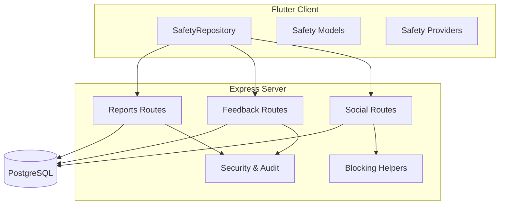
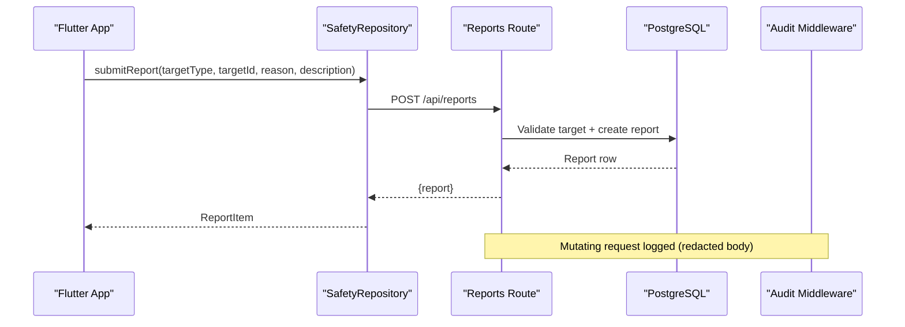
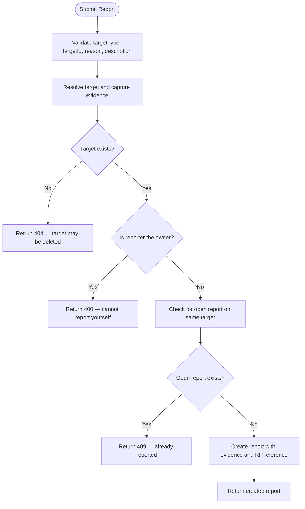
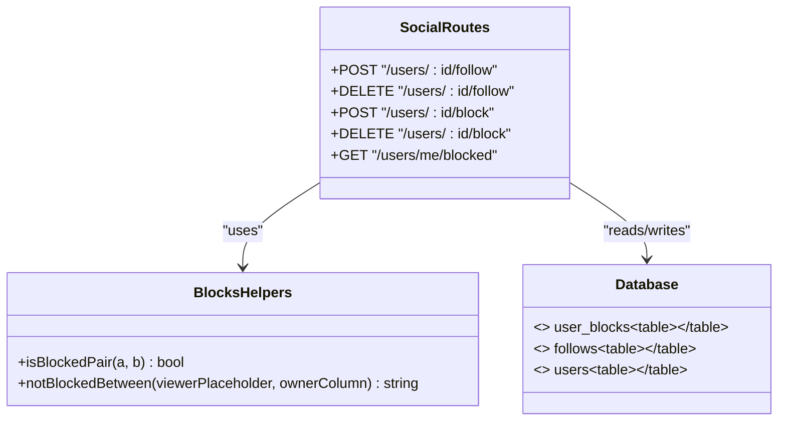
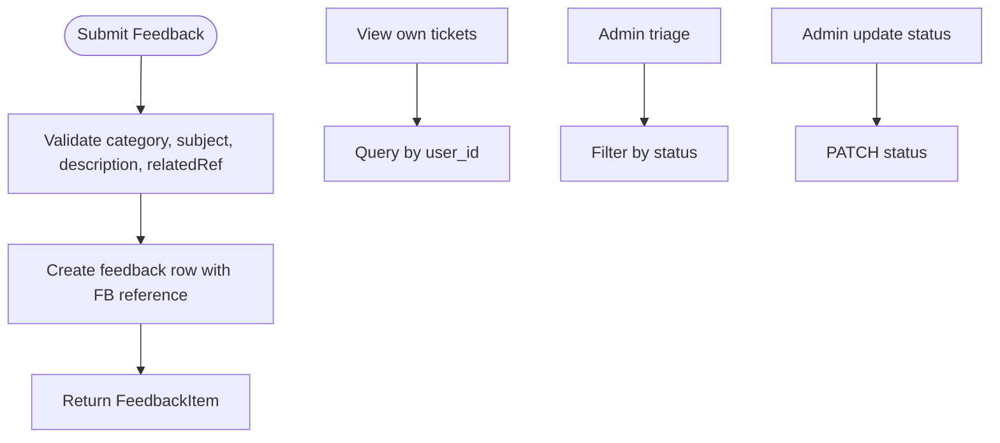
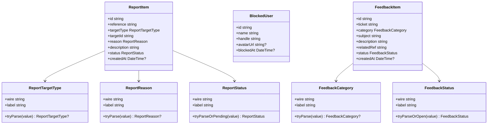
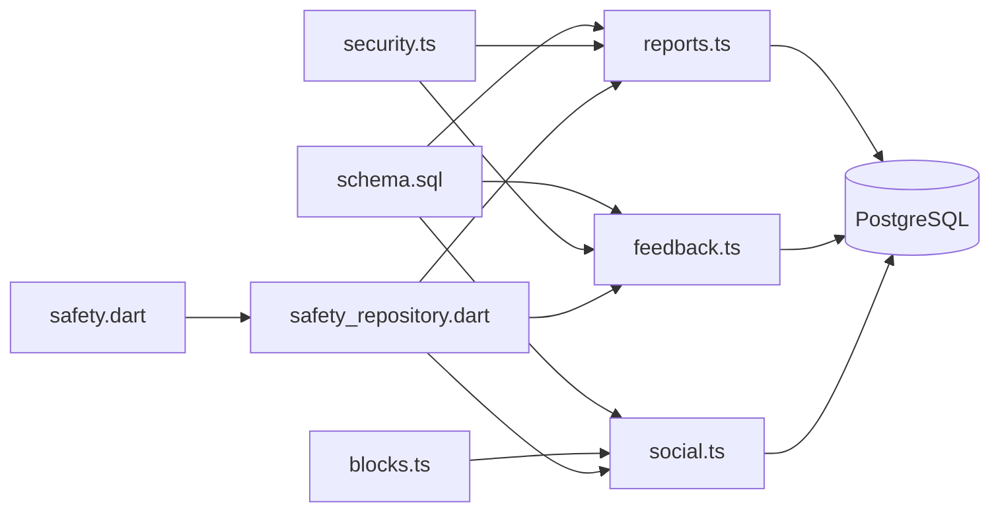

# Safety & Moderation System

<cite>
**Referenced Files in This Document**
- [schema.sql](file://server/src/schema.sql)
- [reports.ts](file://server/src/routes/reports.ts)
- [blocks.ts](file://server/src/blocks.ts)
- [social.ts](file://server/src/routes/social.ts)
- [feedback.ts](file://server/src/routes/feedback.ts)
- [security.ts](file://server/src/security.ts)
- [safety_repository.dart](file://lib/repositories/safety_repository.dart)
- [safety.dart](file://lib/models/safety.dart)
- [safety_provider.dart](file://lib/providers/safety_provider.dart)
</cite>

## Table of Contents
1. [Introduction](#introduction)
2. [Project Structure](#project-structure)
3. [Core Components](#core-components)
4. [Architecture Overview](#architecture-overview)
5. [Detailed Component Analysis](#detailed-component-analysis)
6. [Dependency Analysis](#dependency-analysis)
7. [Performance Considerations](#performance-considerations)
8. [Troubleshooting Guide](#troubleshooting-guide)
9. [Conclusion](#conclusion)

## Introduction
This document explains the safety and moderation system that protects users, content, and community interactions. It covers:
- The reports table and its polymorphic targeting for users, events, reviews, and messages.
- The report lifecycle from submission through moderator resolution.
- The user_blocks system with bidirectional enforcement and cascade operations.
- The feedback ticketing system for support requests.
- Privacy protections, anti-spam measures, audit logging, integration points, and role-based access controls.

The backend is implemented in TypeScript on Express; the Flutter client calls the same endpoints through a repository layer. Database schema, indexes, constraints, and route logic are the authoritative sources for behavior.

## Project Structure
Safety and moderation spans server routes, shared safety helpers, database schema, and Flutter models/repositories:
- Server schema defines tables, constraints, and indexes.
- Route handlers implement submission, ownership checks, rate limiting, and admin queues.
- Shared blocking helpers centralize symmetric block enforcement.
- Flutter models and providers represent the API payloads and surface live state to screens.

**Diagram sources**
- [reports.ts:1-283](file://server/src/routes/reports.ts#L1-L283)
- [feedback.ts:1-152](file://server/src/routes/feedback.ts#L1-L152)
- [social.ts:1-355](file://server/src/routes/social.ts#L1-L355)
- [blocks.ts:1-42](file://server/src/blocks.ts#L1-L42)
- [security.ts:1-148](file://server/src/security.ts#L1-L148)
- [safety_repository.dart:1-84](file://lib/repositories/safety_repository.dart#L1-L84)
- [safety.dart:1-202](file://lib/models/safety.dart#L1-L202)

**Section sources**
- [schema.sql:426-539](file://server/src/schema.sql#L426-L539)
- [reports.ts:1-283](file://server/src/routes/reports.ts#L1-L283)
- [feedback.ts:1-152](file://server/src/routes/feedback.ts#L1-L152)
- [social.ts:259-355](file://server/src/routes/social.ts#L259-L355)
- [blocks.ts:1-42](file://server/src/blocks.ts#L1-L42)
- [security.ts:48-148](file://server/src/security.ts#L48-L148)
- [safety_repository.dart:1-84](file://lib/repositories/safety_repository.dart#L1-L84)
- [safety.dart:1-202](file://lib/models/safety.dart#L1-L202)

## Core Components
- Reports: Polymorphic reporting for users, events, reviews, and messages with evidence snapshots, duplicate prevention, and admin-only moderation queue.
- User blocks: Bidirectional enforcement preventing follow, discover, chat, and booking between blocked pairs; mutual follows are removed when blocking.
- Feedback tickets: Support request workflow with category classification, status tracking, and admin triage.
- Security and audit: Rate limiters for abuse prevention, redaction of sensitive fields, and write audit logging.

Key responsibilities:
- Submission endpoints validate inputs, enforce privacy, and persist records.
- Admin endpoints require platform-admin roles and expose reporter identity only there.
- Blocking helpers provide a single source of truth for symmetric block rules.
- Flutter layers mirror server enums and statuses with safe fallbacks.

**Section sources**
- [schema.sql:426-539](file://server/src/schema.sql#L426-L539)
- [reports.ts:10-22](file://server/src/routes/reports.ts#L10-L22)
- [feedback.ts:10-16](file://server/src/routes/feedback.ts#L10-L16)
- [blocks.ts:3-11](file://server/src/blocks.ts#L3-L11)
- [security.ts:48-148](file://server/src/security.ts#L48-L148)

## Architecture Overview
The system separates concerns across client, routes, shared helpers, and database:
- Flutter clients call `/reports`, `/users/me/reports`, `/feedback`, `/users/me/feedback`, and social/blocking endpoints.
- Server routes perform validation, rate limiting, ownership checks, and persistence.
- Blocking logic is centralized in `blocks.ts` and consumed by social routes.
- Audit middleware logs mutating requests with redacted bodies.

**Diagram sources**
- [reports.ts:150-198](file://server/src/routes/reports.ts#L150-L198)
- [security.ts:99-148](file://server/src/security.ts#L99-L148)
- [safety_repository.dart:62-78](file://lib/repositories/safety_repository.dart#L62-L78)

## Detailed Component Analysis

### Reports System
The reports subsystem enables users to flag profiles, events, reviews, and chat messages. It uses a polymorphic design where each report references a target type and id without direct foreign keys. Evidence is captured at submission time so moderation records survive later edits or deletions.

Database structure:
- `reports`: reporter, target_type, target_id, reason, description, evidence, status, reference, timestamps.
- Constraints: allowed target types, reasons, statuses; unique human-readable reference; partial unique index prevents duplicate open reports per reporter-target pair.
- Indexes optimize queries by reporter, target, status, and open-duplicate guard.

Submission flow:
- Input validation ensures allowed target types, reasons, and description length.
- Target resolution fetches a short evidence snapshot and owner id for self-report protection.
- Self-reporting is rejected; an existing open report returns conflict.
- A crypto-random reference like `RP-XXXXXX` is generated and stored.
- The created report is returned to the caller.

Admin moderation:
- Only platform admins can view the queue and update status.
- Reporter identity is exposed only in admin endpoints.
- Status transitions do not auto-enforce actions; they track review state.

**Diagram sources**
- [reports.ts:54-115](file://server/src/routes/reports.ts#L54-L115)
- [reports.ts:150-198](file://server/src/routes/reports.ts#L150-L198)

Status lifecycle:
- `pending` → `reviewing` → `resolved` or `dismissed`.
- Transitions are performed by moderators via PATCH; no automatic enforcement yet.

Privacy model:
- Users can read only their own reports.
- Reporter identity is never exposed outside admin endpoints.
- Evidence is a short snapshot, not full content.

Anti-spam measures:
- Per-IP rate limiter for report submissions.
- Partial unique index prevents duplicate open reports per reporter-target.

Integration points:
- Targets include users, events, reviews, and messages.
- Evidence includes context such as event title and message text.

Role-based access:
- Public: authenticated users can submit and view their own reports.
- Admin: super_admin can view queue and update status.

**Section sources**
- [schema.sql:443-474](file://server/src/schema.sql#L443-L474)
- [reports.ts:10-22](file://server/src/routes/reports.ts#L10-L22)
- [reports.ts:54-115](file://server/src/routes/reports.ts#L54-L115)
- [reports.ts:150-198](file://server/src/routes/reports.ts#L150-L198)
- [reports.ts:200-280](file://server/src/routes/reports.ts#L200-L280)
- [security.ts:48-59](file://server/src/security.ts#L48-L59)

### User Blocks System
The blocking system prevents harassment by enforcing symmetric interaction rules between blocked pairs. A single directed row represents a block, but every safety rule treats the pair as blocked in both directions.

Database structure:
- `user_blocks`: blocker_id, blocked_id, created_at; composite primary key; check prevents self-blocks.
- Index on blocked_id supports reverse lookups.

Bidirectional enforcement:
- `isBlockedPair(a, b)` returns true if either direction has a block.
- `notBlockedBetween(viewer, ownerColumn)` generates a SQL predicate to exclude blocked owners from discovery/search/feeds.

Cascade operations:
- Blocking removes mutual follows in one transaction and updates follower/following counts.
- Unblocking deletes the block row but does not restore previously removed follows.

**Diagram sources**
- [blocks.ts:13-41](file://server/src/blocks.ts#L13-L41)
- [social.ts:170-227](file://server/src/routes/social.ts#L170-L227)
- [social.ts:259-355](file://server/src/routes/social.ts#L259-L355)
- [schema.sql:426-441](file://server/src/schema.sql#L426-L441)

Behavioral guarantees:
- Follow attempts between blocked pairs are forbidden.
- Block operation is idempotent; duplicates change nothing.
- Blocking severs the graph symmetrically; unblocking does not re-establish follows.

**Section sources**
- [blocks.ts:1-42](file://server/src/blocks.ts#L1-L42)
- [social.ts:170-227](file://server/src/routes/social.ts#L170-L227)
- [social.ts:259-355](file://server/src/routes/social.ts#L259-L355)
- [schema.sql:426-441](file://server/src/schema.sql#L426-L441)

### Feedback Ticketing System
The feedback subsystem provides a support workflow for user issues. Tickets are owned by the signed-in user and readable only by that user or platform admins.

Database structure:
- `feedback`: user_id, category, subject, description, related_ref, status, ticket, timestamps.
- Allowed categories: bug, feature, booking, payment, restaurant_experience, general.
- Allowed statuses: open, in_progress, resolved, closed.
- Unique human-readable ticket reference like `FB-XXXXXX`.

Workflow:
- Users submit tickets with category, subject, description, and optional related reference.
- Each ticket receives a unique FB reference.
- Users can view their own tickets with live status.
- Admins triage the queue and advance status.

**Diagram sources**
- [feedback.ts:63-86](file://server/src/routes/feedback.ts#L63-L86)
- [feedback.ts:88-149](file://server/src/routes/feedback.ts#L88-L149)

Anti-spam measures:
- Per-IP rate limiter for feedback submissions.

Privacy model:
- Only the ticket owner and platform admins can access tickets.
- No endpoint reveals another user’s tickets.

Role-based access:
- Public: authenticated users can submit and view their own tickets.
- Admin: super_admin can view queue and update status.

**Section sources**
- [schema.sql:476-497](file://server/src/schema.sql#L476-L497)
- [feedback.ts:10-16](file://server/src/routes/feedback.ts#L10-L16)
- [feedback.ts:63-86](file://server/src/routes/feedback.ts#L63-L86)
- [feedback.ts:88-149](file://server/src/routes/feedback.ts#L88-L149)
- [security.ts:61-68](file://server/src/security.ts#L61-L68)

### Flutter Integration Layer
The Flutter side mirrors server enums and statuses with safe fallbacks and exposes repository methods for blocking, reporting, and feedback.

Models:
- `ReportTargetType`, `ReportReason`, `ReportStatus` map wire values to labels and parse safely.
- `ReportItem` carries id, reference, target info, reason, description, status, and timestamp.
- `BlockedUser` represents blocked accounts shown to the user.
- `FeedbackCategory`, `FeedbackStatus`, `FeedbackItem` represent support tickets.

Repository:
- Calls real backend endpoints for block/unblock, blocked list, report submission, my reports, feedback submission, and my feedback.
- Ensures client state is driven by server responses.

Providers:
- FutureProviders fetch blocked users, my reports, and my feedback, invalidating after writes.

**Diagram sources**
- [safety.dart:10-95](file://lib/models/safety.dart#L10-L95)
- [safety.dart:97-131](file://lib/models/safety.dart#L97-L131)
- [safety.dart:133-202](file://lib/models/safety.dart#L133-L202)

**Section sources**
- [safety_repository.dart:1-84](file://lib/repositories/safety_repository.dart#L1-L84)
- [safety.dart:1-202](file://lib/models/safety.dart#L1-L202)
- [safety_provider.dart:1-29](file://lib/providers/safety_provider.dart#L1-L29)

## Dependency Analysis
The safety system depends on:
- Database schema for constraints, indexes, and referential integrity.
- Express routes for input validation, authorization, and persistence.
- Shared blocking helpers for consistent enforcement.
- Security utilities for rate limiting and audit logging.
- Flutter models and repositories for client-side representation and API calls.

**Diagram sources**
- [schema.sql:426-539](file://server/src/schema.sql#L426-L539)
- [reports.ts:1-283](file://server/src/routes/reports.ts#L1-L283)
- [feedback.ts:1-152](file://server/src/routes/feedback.ts#L1-L152)
- [social.ts:1-355](file://server/src/routes/social.ts#L1-L355)
- [blocks.ts:1-42](file://server/src/blocks.ts#L1-L42)
- [security.ts:1-148](file://server/src/security.ts#L1-L148)
- [safety_repository.dart:1-84](file://lib/repositories/safety_repository.dart#L1-L84)
- [safety.dart:1-202](file://lib/models/safety.dart#L1-L202)

**Section sources**
- [schema.sql:426-539](file://server/src/schema.sql#L426-L539)
- [reports.ts:1-283](file://server/src/routes/reports.ts#L1-L283)
- [feedback.ts:1-152](file://server/src/routes/feedback.ts#L1-L152)
- [social.ts:1-355](file://server/src/routes/social.ts#L1-L355)
- [blocks.ts:1-42](file://server/src/blocks.ts#L1-L42)
- [security.ts:1-148](file://server/src/security.ts#L1-L148)
- [safety_repository.dart:1-84](file://lib/repositories/safety_repository.dart#L1-L84)
- [safety.dart:1-202](file://lib/models/safety.dart#L1-L202)

## Performance Considerations
- Indexes on `reports(reporter_id, created_at)`, `reports(target_type, target_id)`, `reports(status, created_at)`, and the partial unique index for open duplicates optimize common queries and prevent queue pollution.
- Index on `feedback(user_id, created_at)` optimizes user ticket history.
- Index on `user_blocks(blocked_id)` supports reverse lookup and efficient block checks.
- Rate limiters protect against abuse without blocking legitimate usage; thresholds are configurable via environment variables.
- Audit logging is fire-and-forget to avoid impacting request latency; failures are logged but do not fail the request.

Recommendations:
- Monitor query performance on large report queues using the status and target indexes.
- Tune rate limiter thresholds based on observed traffic patterns.
- Periodically archive old audit logs to maintain performance.

[No sources needed since this section provides general guidance]

## Troubleshooting Guide
Common issues and resolutions:
- Duplicate report submission:
  - Symptom: 409 Conflict when filing a report.
  - Cause: An open report already exists for the same reporter-target pair.
  - Resolution: Wait for moderator action or use a different target.

- Self-reporting attempt:
  - Symptom: 400 Bad Request.
  - Cause: Reporter attempted to report their own content.
  - Resolution: Use appropriate channels (e.g., feedback) instead of reports.

- Target not found:
  - Symptom: 404 Not Found.
  - Cause: Reported entity was deleted or anonymized before submission.
  - Resolution: Verify target existence; evidence snapshot remains in the report.

- Follow blocked by block:
  - Symptom: Forbidden error when following a user.
  - Cause: Either party has blocked the other.
  - Resolution: Unblock first; note that unblocking does not restore previous follows.

- Feedback rate limited:
  - Symptom: Too many feedback submissions.
  - Cause: Exceeded per-IP feedback rate limit.
  - Resolution: Retry after cooldown; ensure correct category and description.

- Audit log missing:
  - Symptom: Write not recorded in audit_log.
  - Cause: Audit insert failed silently.
  - Resolution: Check server logs for audit insert errors; verify write permissions.

**Section sources**
- [reports.ts:150-198](file://server/src/routes/reports.ts#L150-L198)
- [social.ts:170-227](file://server/src/routes/social.ts#L170-L227)
- [feedback.ts:71-86](file://server/src/routes/feedback.ts#L71-L86)
- [security.ts:99-148](file://server/src/security.ts#L99-L148)

## Conclusion
The safety and moderation system provides robust protections through:
- Polymorphic reports with evidence snapshots and strict duplicate prevention.
- Bidirectional blocking with symmetric enforcement and cascade removal of mutual follows.
- Structured feedback tickets with clear categories and status tracking.
- Strong privacy controls ensuring reporters and ticket owners are protected.
- Anti-spam rate limiters and comprehensive audit logging for compliance.
- Clear role-based access separating user-facing flows from admin moderation tasks.

Future enhancements should focus on automated safety checks, policy-driven enforcement tied to report outcomes, and expanded moderation workflows while preserving privacy and performance.

[No sources needed since this section summarizes without analyzing specific files]