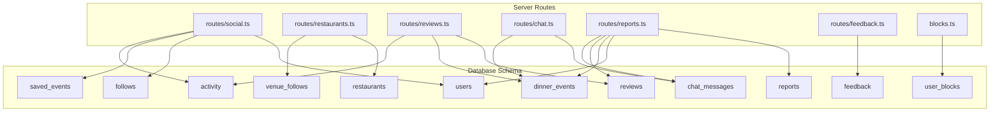
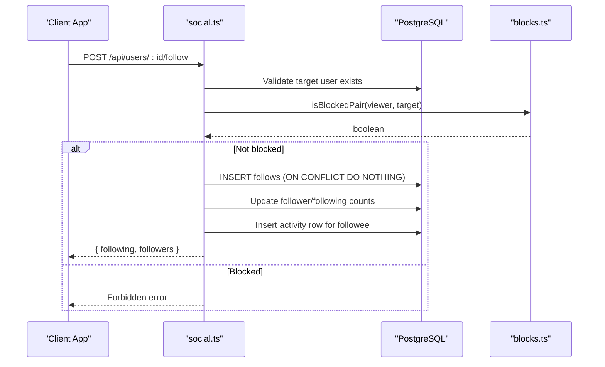
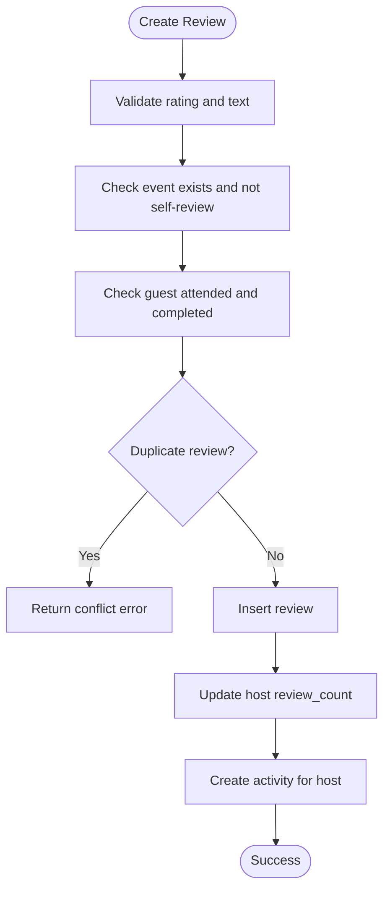
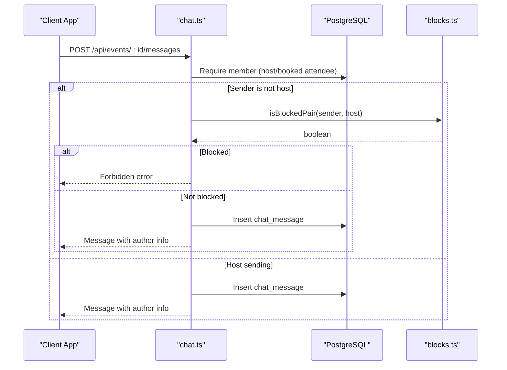
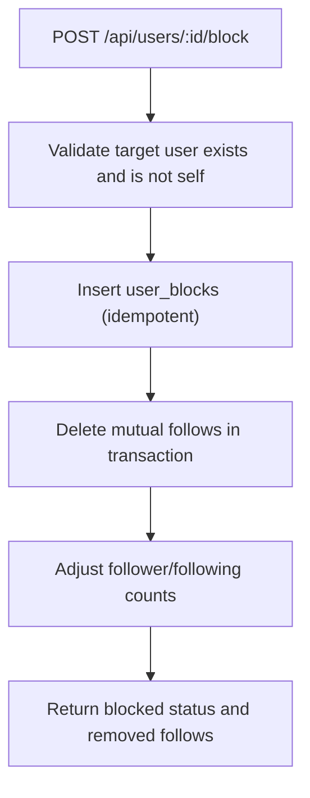
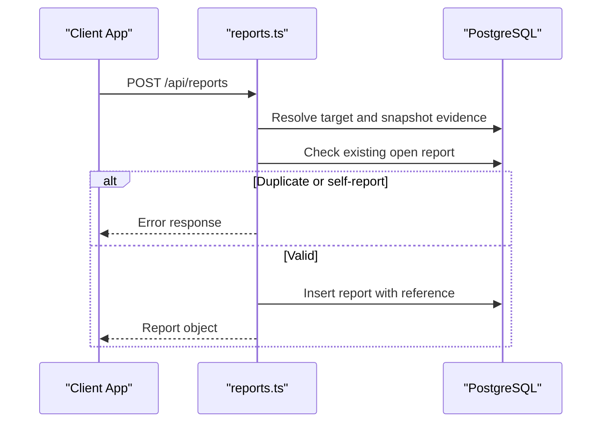
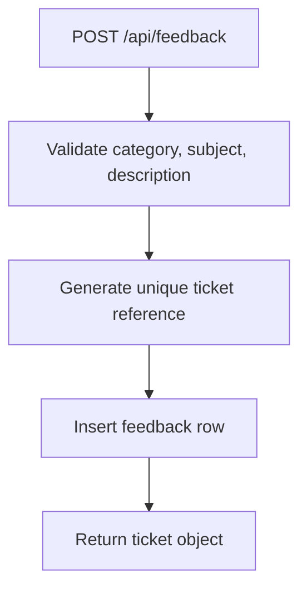
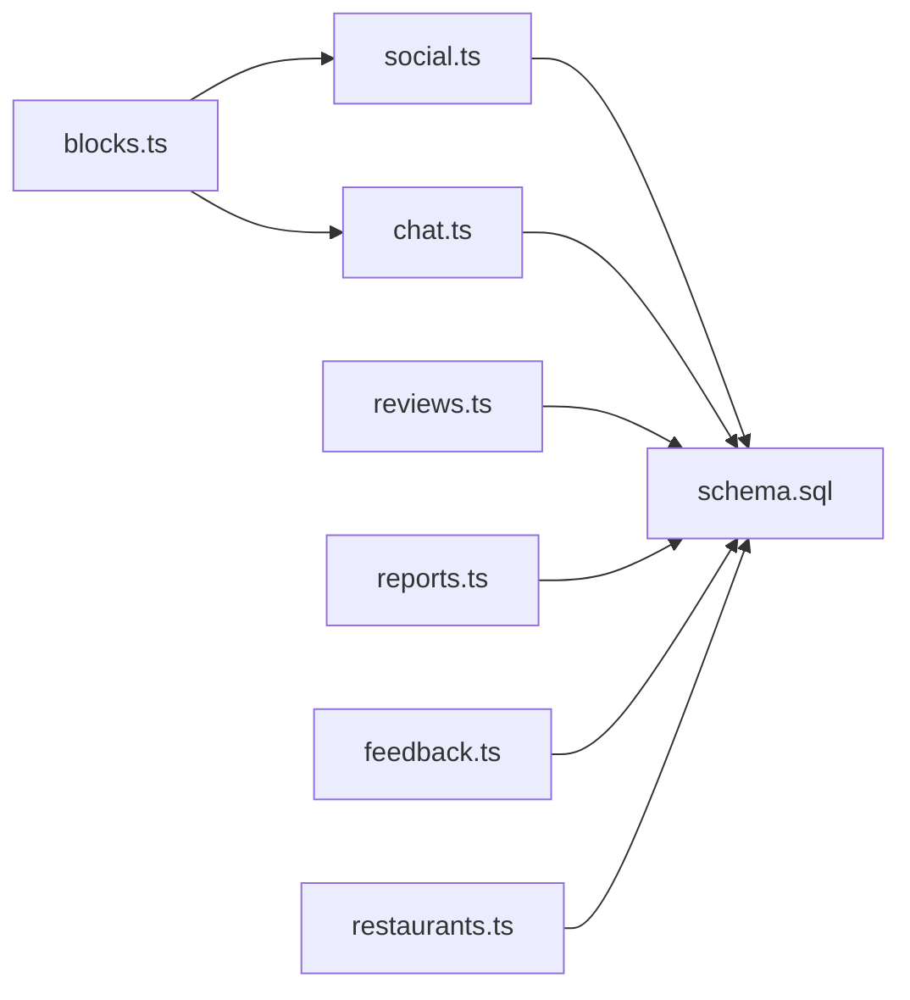

# Social Features

<cite>
**Referenced Files in This Document**
- [schema.sql](file://server/src/schema.sql)
- [social.ts](file://server/src/routes/social.ts)
- [chat.ts](file://server/src/routes/chat.ts)
- [reviews.ts](file://server/src/routes/reviews.ts)
- [reports.ts](file://server/src/routes/reports.ts)
- [blocks.ts](file://server/src/blocks.ts)
- [restaurants.ts](file://server/src/routes/restaurants.ts)
- [feedback.ts](file://server/src/routes/feedback.ts)
</cite>

## Table of Contents
1. [Introduction](#introduction)
2. [Project Structure](#project-structure)
3. [Core Components](#core-components)
4. [Architecture Overview](#architecture-overview)
5. [Detailed Component Analysis](#detailed-component-analysis)
6. [Dependency Analysis](#dependency-analysis)
7. [Performance Considerations](#performance-considerations)
8. [Troubleshooting Guide](#troubleshooting-guide)
9. [Conclusion](#conclusion)

## Introduction
This document explains the social features database design and server-side behavior for DinCircle’s social graph, messaging, reviews, safety, moderation, and support systems. It focuses on:
- User-to-user follows and venue-follows for restaurants
- Reviews with rating constraints and uniqueness rules
- Event chat messages and activity feed generation
- Safety through user blocks and reports
- Saved events as user bookmarks
- Polymorphic reporting and feedback ticketing

The schema is the single source of truth; routes implement validation, authorization, and business logic around it.

## Project Structure
The social feature surface spans one SQL schema file and several route modules:
- `server/src/schema.sql` defines all tables, constraints, and indexes used by social features.
- Route files implement endpoints that read/write those tables and enforce safety/moderation policies.



**Diagram sources**
- [schema.sql:16-37](file://server/src/schema.sql#L16-L37)
- [schema.sql:76-108](file://server/src/schema.sql#L76-L108)
- [schema.sql:124-156](file://server/src/schema.sql#L124-L156)
- [schema.sql:296-304](file://server/src/schema.sql#L296-L304)
- [schema.sql:307-323](file://server/src/schema.sql#L307-L323)
- [schema.sql:326-331](file://server/src/schema.sql#L326-L331)
- [schema.sql:336-347](file://server/src/schema.sql#L336-L347)
- [schema.sql:350-357](file://server/src/schema.sql#L350-L357)
- [schema.sql:432-441](file://server/src/schema.sql#L432-L441)
- [schema.sql:450-474](file://server/src/schema.sql#L450-L474)
- [schema.sql:480-496](file://server/src/schema.sql#L480-L496)
- [social.ts:1-355](file://server/src/routes/social.ts#L1-L355)
- [restaurants.ts:1-210](file://server/src/routes/restaurants.ts#L1-L210)
- [reviews.ts:1-151](file://server/src/routes/reviews.ts#L1-L151)
- [chat.ts:1-134](file://server/src/routes/chat.ts#L1-L134)
- [reports.ts:1-283](file://server/src/routes/reports.ts#L1-L283)
- [feedback.ts:1-152](file://server/src/routes/feedback.ts#L1-L152)
- [blocks.ts:1-42](file://server/src/blocks.ts#L1-L42)

**Section sources**
- [schema.sql:1-13](file://server/src/schema.sql#L1-L13)
- [social.ts:1-355](file://server/src/routes/social.ts#L1-L355)
- [restaurants.ts:1-210](file://server/src/routes/restaurants.ts#L1-L210)
- [reviews.ts:1-151](file://server/src/routes/reviews.ts#L1-L151)
- [chat.ts:1-134](file://server/src/routes/chat.ts#L1-L134)
- [reports.ts:1-283](file://server/src/routes/reports.ts#L1-L283)
- [feedback.ts:1-152](file://server/src/routes/feedback.ts#L1-L152)
- [blocks.ts:1-42](file://server/src/blocks.ts#L1-L42)

## Core Components
This section summarizes the core social data models and their responsibilities.

- Users: identity, role, counts, privacy toggles, and profile metadata.
- Restaurants: partner venues with ratings, attributes, and optional coordinates.
- Dinner events: host-created experiences linked to a restaurant.
- Follows: directed user-to-user connections with composite primary key.
- Venue follows: directed user-to-restaurant connections.
- Reviews: per-event reviews with rating range and author/event uniqueness.
- Chat messages: event-scoped messages with optional system messages.
- Activity: recipient-scoped notifications for social actions.
- User blocks: directed block edges with symmetric enforcement.
- Reports: polymorphic moderation queue with duplicate guards.
- Feedback: support tickets with unique ticket references.

Key constraints and relationships:
- `follows` prevents self-follows via a check constraint and uses a composite primary key.
- `venue_follows` uses a composite primary key to make following idempotent.
- `reviews` enforces a numeric rating range and a unique pair of event and author.
- `chat_messages` links to events and optionally to users; system messages have null authors.
- `user_blocks` has a composite primary key and a check preventing self-blocks; an index supports reverse lookups.
- `reports` uses a partial unique index to prevent multiple open reports for the same reporter-target pair.
- `feedback` stores a unique human-readable ticket reference per ticket.

**Section sources**
- [schema.sql:16-72](file://server/src/schema.sql#L16-L72)
- [schema.sql:76-119](file://server/src/schema.sql#L76-L119)
- [schema.sql:124-156](file://server/src/schema.sql#L124-L156)
- [schema.sql:296-304](file://server/src/schema.sql#L296-L304)
- [schema.sql:307-323](file://server/src/schema.sql#L307-L323)
- [schema.sql:326-331](file://server/src/schema.sql#L326-L331)
- [schema.sql:336-347](file://server/src/schema.sql#L336-L347)
- [schema.sql:350-357](file://server/src/schema.sql#L350-L357)
- [schema.sql:432-441](file://server/src/schema.sql#L432-L441)
- [schema.sql:450-474](file://server/src/schema.sql#L450-L474)
- [schema.sql:480-496](file://server/src/schema.sql#L480-L496)

## Architecture Overview
The social architecture combines relational integrity with route-level validation:
- The schema enforces referential integrity, ranges, and uniqueness at the database layer.
- Routes validate inputs (e.g., rating ranges, message length), enforce ownership (e.g., only guests who attended can review), and apply safety checks (e.g., blocked pairs).
- Activity rows are created as side effects of social actions to power the user’s notification feed.
- Blocking is symmetrically enforced across features even though storage is directional.



**Diagram sources**
- [social.ts:170-227](file://server/src/routes/social.ts#L170-L227)
- [blocks.ts:13-24](file://server/src/blocks.ts#L13-L24)
- [schema.sql:307-313](file://server/src/schema.sql#L307-L313)
- [schema.sql:336-347](file://server/src/schema.sql#L336-L347)

## Detailed Component Analysis

### User Relationships: Follows and Venue Follows
User-to-user follows are stored in `follows`, while user-to-restaurant follows are stored in `venue_follows`. Both use composite primary keys to ensure idempotency.

- Follows:
  - Prevents self-follows via a check constraint.
  - Composite primary key `(follower_id, followee_id)` ensures no duplicates.
  - Follow/unfollow updates counters and creates activity entries.
  - Blocking prevents new follows between blocked pairs.

- Venue follows:
  - Idempotent upsert using `ON CONFLICT DO NOTHING`.
  - Restaurant listing endpoints include an `isFollowing` flag computed from `venue_follows`.

```mermaid
classDiagram
class Users {
+uuid id
+string name
+string handle
+integer followers_count
+integer following_count
}
class Follows {
+uuid follower_id
+uuid followee_id
+timestamp created_at
}
class Restaurants {
+uuid id
+string name
+numeric rating
}
class VenueFollows {
+uuid user_id
+uuid restaurant_id
+timestamp created_at
}
Users ||--o{ Follows : "follower"
Users ||--o{ Follows : "followee"
Users ||--o{ VenueFollows : "user"
Restaurants ||--o{ VenueFollows : "restaurant"
```

**Diagram sources**
- [schema.sql:16-37](file://server/src/schema.sql#L16-L37)
- [schema.sql:76-108](file://server/src/schema.sql#L76-L108)
- [schema.sql:307-323](file://server/src/schema.sql#L307-L323)

**Section sources**
- [schema.sql:307-323](file://server/src/schema.sql#L307-L323)
- [social.ts:140-257](file://server/src/routes/social.ts#L140-L257)
- [restaurants.ts:86-99](file://server/src/routes/restaurants.ts#L86-L99)
- [restaurants.ts:181-207](file://server/src/routes/restaurants.ts#L181-L207)

### Reviews System: Constraints and Uniqueness
Reviews are tied to events and authors with strict validation:
- Rating must be within a defined numeric range.
- A unique constraint prevents multiple reviews by the same author for the same event.
- Only guests who completed an event may review.
- Hosts cannot review their own events.
- Creating a review increments the host’s review count and posts an activity entry.



**Diagram sources**
- [reviews.ts:76-147](file://server/src/routes/reviews.ts#L76-L147)
- [schema.sql:296-304](file://server/src/schema.sql#L296-L304)

**Section sources**
- [schema.sql:296-304](file://server/src/schema.sql#L296-L304)
- [reviews.ts:21-74](file://server/src/routes/reviews.ts#L21-L74)
- [reviews.ts:76-147](file://server/src/routes/reviews.ts#L76-L147)

### Messaging and Activity Feed
Event chat messages are persisted in `chat_messages` and filtered by membership:
- Only the host, booked guests, or seeded attendees may post.
- New messages require a clean relationship with the event host when the sender is not the host; blocked pairs cannot send new messages.
- Message history remains readable after blocking.
- Activity rows are generated for social actions like follows and reviews, powering the user’s notification feed.



**Diagram sources**
- [chat.ts:13-35](file://server/src/routes/chat.ts#L13-L35)
- [chat.ts:88-131](file://server/src/routes/chat.ts#L88-L131)
- [blocks.ts:13-24](file://server/src/blocks.ts#L13-L24)
- [schema.sql:350-357](file://server/src/schema.sql#L350-L357)

**Section sources**
- [schema.sql:336-347](file://server/src/schema.sql#L336-L347)
- [schema.sql:350-357](file://server/src/schema.sql#L350-L357)
- [social.ts:29-67](file://server/src/routes/social.ts#L29-L67)
- [chat.ts:1-134](file://server/src/routes/chat.ts#L1-L134)

### Safety: User Blocks and Harassment Prevention
Blocking is directional in storage but symmetric in enforcement:
- `user_blocks` stores a directed edge with a composite primary key and a check preventing self-blocks.
- An index supports reverse lookups (`blocked_id`).
- Shared helper functions determine if two users form a blocked pair and generate SQL predicates to exclude blocked owners from discovery and feeds.
- Blocking removes mutual follows atomically and updates counts; unblocking does not restore follows.



**Diagram sources**
- [social.ts:259-307](file://server/src/routes/social.ts#L259-L307)
- [blocks.ts:13-41](file://server/src/blocks.ts#L13-L41)
- [schema.sql:432-441](file://server/src/schema.sql#L432-L441)

**Section sources**
- [schema.sql:432-441](file://server/src/schema.sql#L432-L441)
- [social.ts:259-318](file://server/src/routes/social.ts#L259-L318)
- [blocks.ts:1-42](file://server/src/blocks.ts#L1-42)

### Reports: Polymorphic Moderation Queue
Reports allow users to flag users, events, reviews, and messages:
- Target existence is validated at submission time; short evidence snapshots are stored so moderation records survive content edits/deletions.
- Partial unique index prevents multiple open reports for the same reporter-target pair.
- Reporter identity is hidden from non-admin endpoints.
- Admin-only endpoints expose the moderation queue and allow status transitions.



**Diagram sources**
- [reports.ts:54-115](file://server/src/routes/reports.ts#L54-L115)
- [reports.ts:150-198](file://server/src/routes/reports.ts#L150-L198)
- [schema.sql:450-474](file://server/src/schema.sql#L450-L474)

**Section sources**
- [schema.sql:450-474](file://server/src/schema.sql#L450-L474)
- [reports.ts:1-283](file://server/src/routes/reports.ts#L1-L283)

### Feedback Ticketing
Feedback tickets are support cases raised by users:
- Each ticket receives a unique human-readable reference.
- Tickets are owned by the submitting user and visible only to them or admins.
- Admins triage and update ticket statuses.



**Diagram sources**
- [feedback.ts:30-35](file://server/src/routes/feedback.ts#L30-L35)
- [feedback.ts:63-86](file://server/src/routes/feedback.ts#L63-L86)
- [schema.sql:480-496](file://server/src/schema.sql#L480-L496)

**Section sources**
- [schema.sql:480-496](file://server/src/schema.sql#L480-L496)
- [feedback.ts:1-152](file://server/src/routes/feedback.ts#L1-L152)

### Saved Events: User Bookmarks
Saved events represent user bookmarks:
- Composite primary key `(user_id, event_id)` makes saving idempotent.
- Listing joins saved events with dinner events and hosts, ordered by start time.
- Save/unsave endpoints toggle bookmark state.

```mermaid
classDiagram
class Users {
+uuid id
}
class DinnerEvents {
+uuid id
+string title
+timestamp start_at
+uuid host_id
}
class SavedEvents {
+uuid user_id
+uuid event_id
+timestamp created_at
}
Users ||--o{ SavedEvents : "user"
DinnerEvents ||--o{ SavedEvents : "event"
```

**Diagram sources**
- [schema.sql:124-156](file://server/src/schema.sql#L124-L156)
- [schema.sql:326-331](file://server/src/schema.sql#L326-L331)
- [social.ts:84-138](file://server/src/routes/social.ts#L84-L138)

**Section sources**
- [schema.sql:326-331](file://server/src/schema.sql#L326-L331)
- [social.ts:84-138](file://server/src/routes/social.ts#L84-L138)

## Dependency Analysis
The social features rely on shared safety primitives and consistent indexing:
- `blocks.ts` centralizes blocked-pair checks and reusable SQL predicates.
- Routes call `isBlockedPair` to enforce symmetric blocking across follows, chat, and other interactions.
- Indexes optimize common queries: chat by event/time, activity by actor, reports by status/target, etc.



**Diagram sources**
- [blocks.ts:1-42](file://server/src/blocks.ts#L1-L42)
- [social.ts:1-355](file://server/src/routes/social.ts#L1-L355)
- [chat.ts:1-134](file://server/src/routes/chat.ts#L1-L134)
- [reviews.ts:1-151](file://server/src/routes/reviews.ts#L1-L151)
- [reports.ts:1-283](file://server/src/routes/reports.ts#L1-L283)
- [feedback.ts:1-152](file://server/src/routes/feedback.ts#L1-L152)
- [restaurants.ts:1-210](file://server/src/routes/restaurants.ts#L1-L210)
- [schema.sql:513-539](file://server/src/schema.sql#L513-L539)

**Section sources**
- [blocks.ts:1-42](file://server/src/blocks.ts#L1-L42)
- [schema.sql:513-539](file://server/src/schema.sql#L513-L539)

## Performance Considerations
- Use composite primary keys for follow-like relationships to avoid duplicate work and enable efficient upserts.
- Leverage indexes on frequently filtered columns:
  - Chat messages by event and timestamp.
  - Activity by recipient and creation time.
  - Reports by status and target type/id.
  - Saved events by user.
- Keep list endpoints bounded with limits and prefer server-side filtering to reduce payload size.
- Avoid unnecessary joins; compute flags like `isFollowing` inline where possible.

[No sources needed since this section provides general guidance]

## Troubleshooting Guide
Common issues and resolutions:
- Cannot follow a user:
  - Verify the target exists and is not the current user.
  - Check for a blocked pair; either direction blocks new follows.
  - Confirm the operation is idempotent; duplicate inserts are ignored.

- Cannot send a chat message:
  - Ensure the user is a member (host, booked guest, or seeded attendee).
  - If not the host, verify there is no block between sender and host.
  - Inspect message length and content validation.

- Cannot submit a review:
  - Confirm the user attended and completed the event.
  - Ensure the user is not the host.
  - Check for an existing review by the same author for the same event.

- Report submission fails:
  - Validate target existence; deleted targets return not found.
  - Prevent self-reports and duplicate open reports for the same target.
  - Confirm rate limiting is not exceeded.

- Feedback ticket not created:
  - Validate category, subject, and description lengths.
  - Ensure rate limiting allows the request.

**Section sources**
- [social.ts:170-227](file://server/src/routes/social.ts#L170-L227)
- [chat.ts:88-131](file://server/src/routes/chat.ts#L88-L131)
- [reviews.ts:81-147](file://server/src/routes/reviews.ts#L81-L147)
- [reports.ts:150-198](file://server/src/routes/reports.ts#L150-L198)
- [feedback.ts:71-86](file://server/src/routes/feedback.ts#L71-L86)

## Conclusion
DinCircle’s social features combine strong database constraints with route-level validation and safety checks. The design emphasizes:
- Idempotent relationships (follows, venue follows, saved events)
- Strict review rules and uniqueness
- Symmetric blocking enforcement across features
- Polymorphic reporting with robust duplicate prevention
- Clear separation between user-facing queues and admin moderation workflows

This structure supports scalable social graphs, safe communication, and reliable moderation pipelines.

[No sources needed since this section summarizes without analyzing specific files]