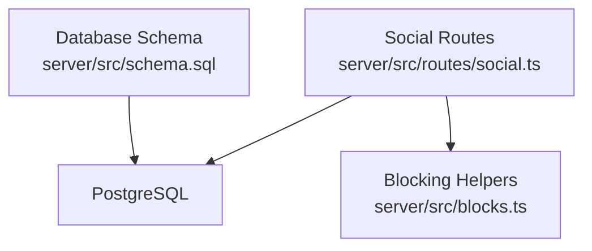
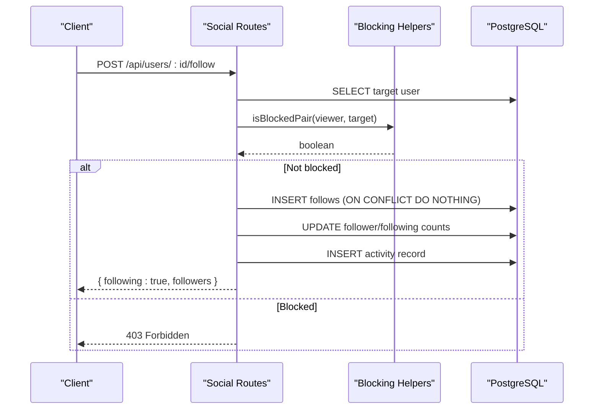
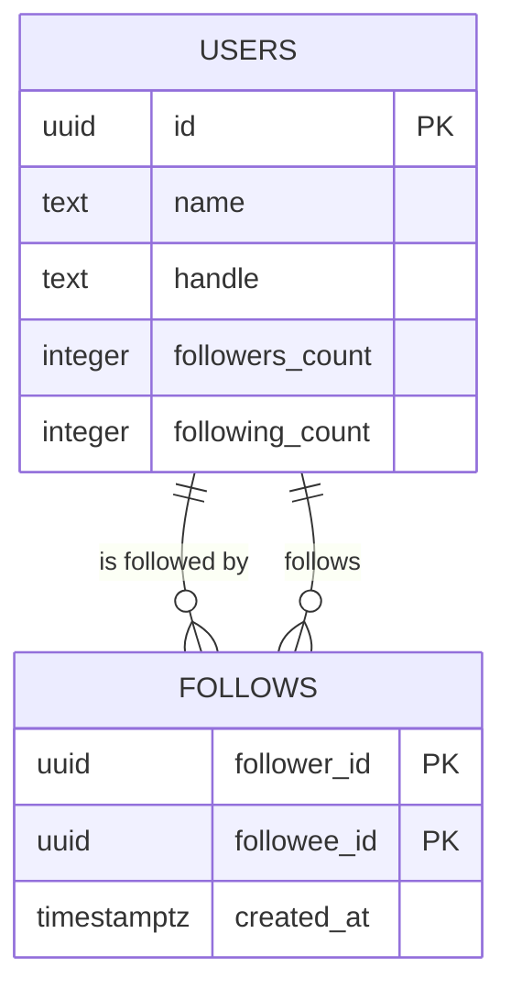
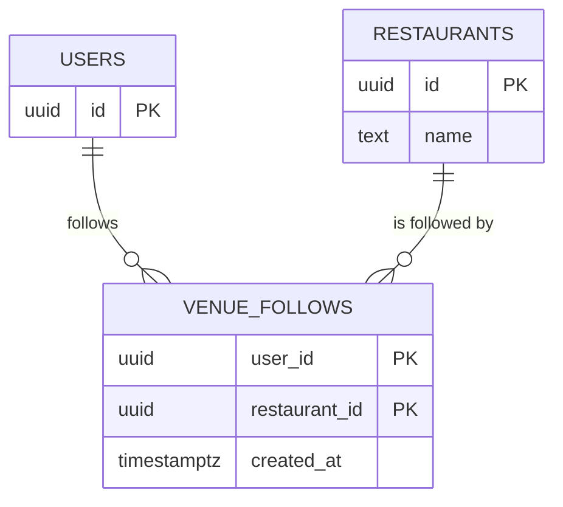
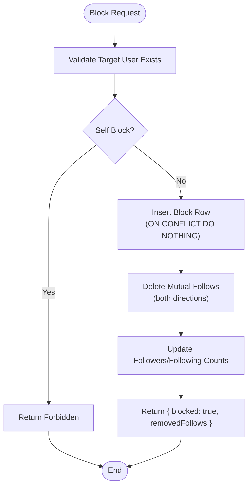
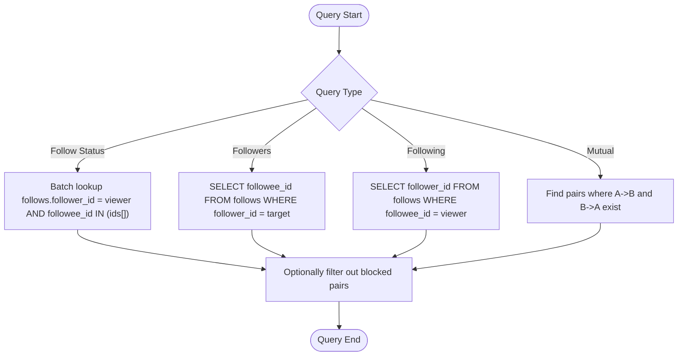
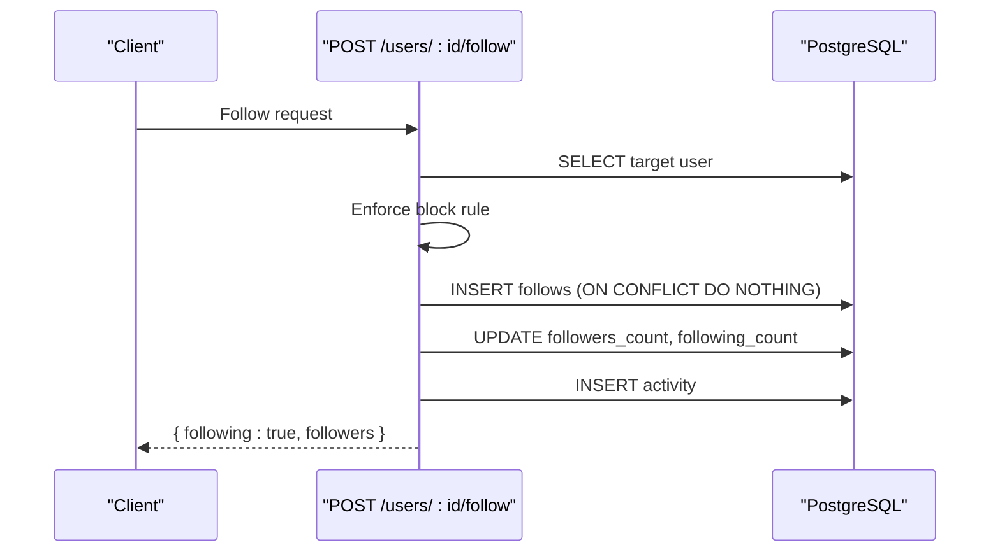
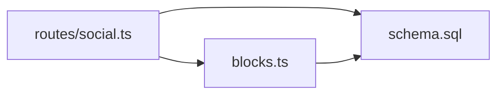

# User Relationships & Following System

<cite>
**Referenced Files in This Document**
- [schema.sql](file://server/src/schema.sql)
- [social.ts](file://server/src/routes/social.ts)
- [blocks.ts](file://server/src/blocks.ts)
</cite>

## Table of Contents
1. [Introduction](#introduction)
2. [Project Structure](#project-structure)
3. [Core Components](#core-components)
4. [Architecture Overview](#architecture-overview)
5. [Detailed Component Analysis](#detailed-component-analysis)
6. [Dependency Analysis](#dependency-analysis)
7. [Performance Considerations](#performance-considerations)
8. [Troubleshooting Guide](#troubleshooting-guide)
9. [Conclusion](#conclusion)

## Introduction
This document explains the user relationships and following system in DineCircle. It covers:
- The `follows` table for user-to-user relationships, including its composite primary key and self-follow prevention.
- The `venue_follows` table for user-to-restaurant relationships and how it differs from user-to-user follows.
- The bidirectional blocking system implemented through `user_blocks`, including mutual block enforcement and cascade deletion of follows when users are blocked.
- Social graph queries for followers, following lists, and relationship status checks.
- Relationship management operations such as follow/unfollow and block/unblock.
- Performance considerations and indexing strategies for large social graphs.

## Project Structure
The relationship logic is implemented in the server layer:
- Database schema defines the tables and constraints that enforce data integrity.
- Route handlers implement the API endpoints for social features.
- A shared blocking helper centralizes safety checks so all routes use consistent rules.

**Diagram sources**
- [schema.sql:306-338](file://server/src/schema.sql#L306-L338)
- [social.ts:140-354](file://server/src/routes/social.ts#L140-L354)
- [blocks.ts:1-42](file://server/src/blocks.ts#L1-L42)

**Section sources**
- [schema.sql:306-338](file://server/src/schema.sql#L306-L338)
- [social.ts:140-354](file://server/src/routes/social.ts#L140-L354)
- [blocks.ts:1-42](file://server/src/blocks.ts#L1-L42)

## Core Components
- `follows`: Stores directed user-to-user follows with a composite primary key `(follower_id, followee_id)` and a constraint preventing self-follows.
- `venue_follows`: Stores directed user-to-restaurant follows with a composite primary key `(user_id, restaurant_id)`.
- `user_blocks`: Stores directed blocks with a composite primary key `(blocker_id, blocked_id)` and a constraint preventing self-blocks; mutual block enforcement is applied at query time.
- Social route handlers provide follow/unfollow, block/unblock, and relationship status endpoints.
- Blocking helpers provide symmetric block checks used across routes.

**Section sources**
- [schema.sql:306-338](file://server/src/schema.sql#L306-L338)
- [schema.sql:426-441](file://server/src/schema.sql#L426-L441)
- [social.ts:140-354](file://server/src/routes/social.ts#L140-L354)
- [blocks.ts:1-42](file://server/src/blocks.ts#L1-L42)

## Architecture Overview
The social feature uses a layered approach:
- Routes validate inputs, enforce business rules (including blocking), and update counts and activity records.
- The database enforces referential integrity and uniqueness via primary keys and constraints.
- Blocking is centralized to ensure consistent behavior across all social interactions.

**Diagram sources**
- [social.ts:170-227](file://server/src/routes/social.ts#L170-L227)
- [blocks.ts:13-24](file://server/src/blocks.ts#L13-L24)
- [schema.sql:306-313](file://server/src/schema.sql#L306-L313)

## Detailed Component Analysis

### Follows Table (User-to-User)
- Purpose: Represents a directed edge from a follower to a followee.
- Primary Key: Composite `(follower_id, followee_id)` ensures one follow per pair.
- Self-Follow Prevention: A check constraint disallows `follower_id = followee_id`.
- Referential Integrity: Both columns reference `users(id)` with cascade deletes.

**Diagram sources**
- [schema.sql:16-37](file://server/src/schema.sql#L16-L37)
- [schema.sql:306-313](file://server/src/schema.sql#L306-L313)

**Section sources**
- [schema.sql:306-313](file://server/src/schema.sql#L306-L313)

### Venue Follows Table (User-to-Restaurant)
- Purpose: Represents a directed edge from a user to a restaurant they follow.
- Primary Key: Composite `(user_id, restaurant_id)` ensures one venue follow per pair.
- Differences from `follows`:
  - Targets restaurants instead of users.
  - Used for venue discovery and “isFollowing” flags exposed by restaurant routes.
  - Does not affect user follower/following counts.

**Diagram sources**
- [schema.sql:74-108](file://server/src/schema.sql#L74-L108)
- [schema.sql:315-323](file://server/src/schema.sql#L315-L323)

**Section sources**
- [schema.sql:315-323](file://server/src/schema.sql#L315-L323)

### Blocking System (Mutual Enforcement)
- Storage: `user_blocks` stores a single directed row `(blocker_id, blocked_id)` with a composite primary key and a self-block prevention constraint.
- Mutual Enforcement: The helper treats a block as bidirectional for safety checks; if either user has blocked the other, the pair is considered blocked.
- Cascade Deletion of Follows: When blocking, the route removes any existing follows between the two users in both directions and updates their counts accordingly. Unblocking does not restore those follows.

**Diagram sources**
- [social.ts:261-307](file://server/src/routes/social.ts#L261-L307)
- [blocks.ts:13-24](file://server/src/blocks.ts#L13-L24)
- [schema.sql:426-441](file://server/src/schema.sql#L426-L441)

**Section sources**
- [social.ts:261-307](file://server/src/routes/social.ts#L261-L307)
- [blocks.ts:13-24](file://server/src/blocks.ts#L13-L24)
- [schema.sql:426-441](file://server/src/schema.sql#L426-L441)

### Social Graph Queries
- Batch Follow Status: Endpoint returns whether the current viewer follows each requested user ID using an array-based lookup against `follows`.
- Followers/Following Lists:
  - Followers of a user: rows where `followee_id = target_user`.
  - Following list of a user: rows where `follower_id = viewer_user`.
  - Mutual connections: pairs where both A follows B and B follows A.
- Blocked Pair Check: Helper queries `user_blocks` for either direction to determine if a pair is blocked.

**Diagram sources**
- [social.ts:142-168](file://server/src/routes/social.ts#L142-L168)
- [blocks.ts:13-24](file://server/src/blocks.ts#L13-L24)
- [schema.sql:306-313](file://server/src/schema.sql#L306-L313)

**Section sources**
- [social.ts:142-168](file://server/src/routes/social.ts#L142-L168)
- [blocks.ts:13-24](file://server/src/blocks.ts#L13-L24)
- [schema.sql:306-313](file://server/src/schema.sql#L306-L313)

### Relationship Management Operations

#### Follow a User
- Validates target exists and is not self.
- Checks blocking state; if blocked, returns forbidden.
- Inserts into `follows` with idempotent upsert semantics.
- Updates `followers_count` and `following_count`.
- Creates an activity notification for the new follower.

**Diagram sources**
- [social.ts:170-227](file://server/src/routes/social.ts#L170-L227)
- [schema.sql:306-313](file://server/src/schema.sql#L306-L313)

**Section sources**
- [social.ts:170-227](file://server/src/routes/social.ts#L170-L227)

#### Unfollow a User
- Deletes the follow row if present.
- Decrements `followers_count` and `following_count` safely (no negative values).
- Returns updated follower count.

**Section sources**
- [social.ts:229-257](file://server/src/routes/social.ts#L229-L257)

#### Block a User
- Validates target exists and is not self.
- Inserts block row idempotently.
- Removes mutual follows in both directions within a transaction.
- Updates affected follower/following counts.
- Returns number of removed follows.

**Section sources**
- [social.ts:261-307](file://server/src/routes/social.ts#L261-L307)
- [blocks.ts:13-24](file://server/src/blocks.ts#L13-L24)

#### Unblock a User
- Deletes the block row.
- Does not restore previously removed follows.

**Section sources**
- [social.ts:309-318](file://server/src/routes/social.ts#L309-L318)

#### Check Relationship Status
- Batch endpoint accepts comma-separated user IDs and returns a map of follow statuses for the current viewer.
- Malformed IDs are ignored; results capped to prevent abuse.

**Section sources**
- [social.ts:142-168](file://server/src/routes/social.ts#L142-L168)

## Dependency Analysis
- Routes depend on:
  - Database for persistence and constraints.
  - Blocking helpers for symmetric safety checks.
- Schema depends on:
  - Referential integrity to `users` and `restaurants`.
  - Constraints to prevent invalid relationships (self-follows, self-blocks).

**Diagram sources**
- [social.ts:1-5](file://server/src/routes/social.ts#L1-L5)
- [blocks.ts:1-4](file://server/src/blocks.ts#L1-L4)
- [schema.sql:306-338](file://server/src/schema.sql#L306-L338)

**Section sources**
- [social.ts:1-5](file://server/src/routes/social.ts#L1-L5)
- [blocks.ts:1-4](file://server/src/blocks.ts#L1-L4)
- [schema.sql:306-338](file://server/src/schema.sql#L306-L338)

## Performance Considerations
- Indexing Strategy:
  - `follows`: Use the composite primary key `(follower_id, followee_id)` for fast lookups and inserts. For performance-critical queries like “who follows me,” consider adding an index on `followee_id` if not already covered by the PK.
  - `venue_follows`: Use the composite primary key `(user_id, restaurant_id)` for fast existence checks and upserts.
  - `user_blocks`: An index on `blocked_id` supports reverse lookups (“who blocked me?”). The composite PK also speeds up direct pair checks.
- Query Patterns:
  - Batch follow-status checks use array matching to reduce round-trips.
  - Blocking removes mutual follows in a transaction to maintain consistency and avoid partial updates.
- Count Maintenance:
  - `followers_count` and `following_count` are incremented/decremented on changes to `follows`; ensure these updates remain synchronized with relational changes.
- Large Graph Scaling:
  - Prefer indexed joins and filtered subqueries over full scans.
  - Avoid exposing unbounded relationship lists without pagination or limits.
  - Consider partitioning or materialized views for heavy analytics on social graphs.

[No sources needed since this section provides general guidance]

## Troubleshooting Guide
- Self-Follow or Self-Block Errors:
  - The schema prevents self-references; attempts will be rejected by constraints.
- Unexpected Follow Removals:
  - Blocking removes mutual follows in both directions; unblocking does not restore them. Re-follow must be initiated again.
- Inconsistent Counts:
  - If `followers_count` or `following_count` drift, verify that all follow/unfollow/block paths update counts consistently.
- Blocked Users Still Visible:
  - Ensure blocking checks are applied in discovery, search, feeds, and profile views using the shared helper.

**Section sources**
- [schema.sql:306-313](file://server/src/schema.sql#L306-L313)
- [schema.sql:426-441](file://server/src/schema.sql#L426-L441)
- [social.ts:170-227](file://server/src/routes/social.ts#L170-L227)
- [social.ts:261-307](file://server/src/routes/social.ts#L261-L307)
- [blocks.ts:13-24](file://server/src/blocks.ts#L13-L24)

## Conclusion
DineCircle’s social graph is built on clear, constrained tables and centralized safety checks:
- `follows` models user-to-user relationships with strong integrity guarantees.
- `venue_follows` separates venue preferences from user relationships.
- `user_blocks` enforces bidirectional safety while keeping storage minimal.
- Route handlers implement robust operations for following and blocking, maintaining counts and activity records.
With proper indexing and careful query design, the system scales to large social graphs while preserving correctness and performance.