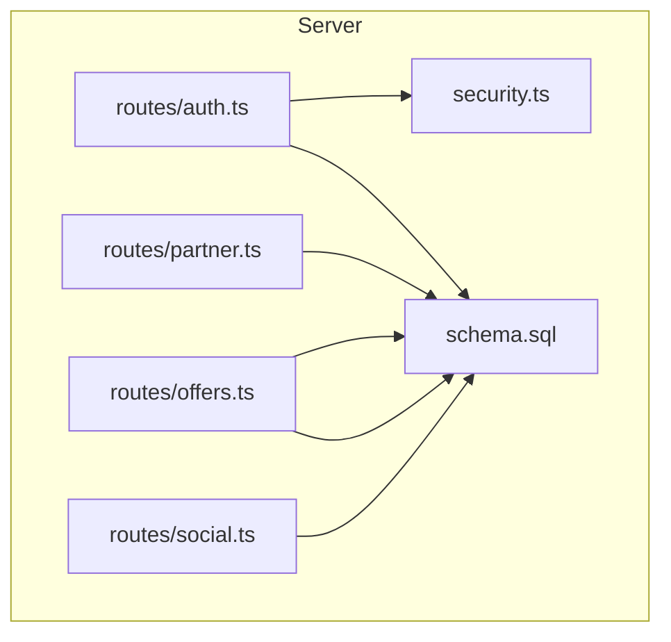
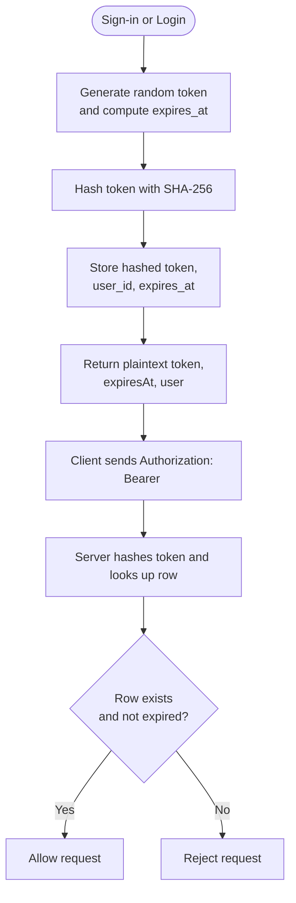
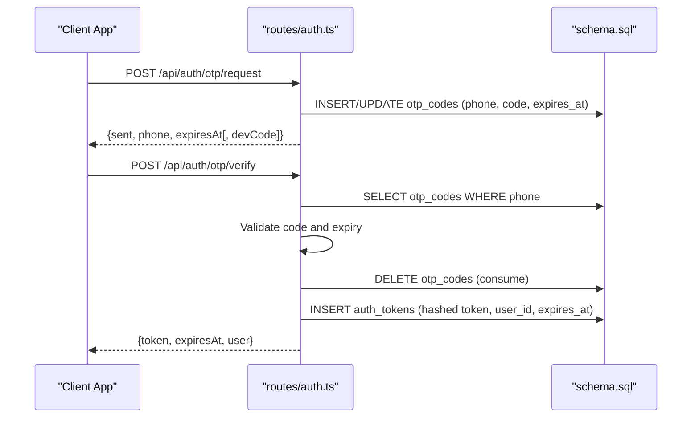
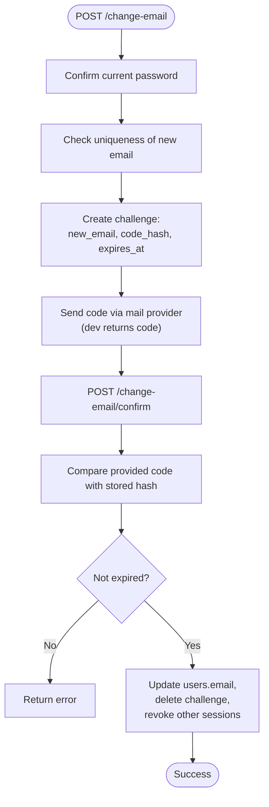
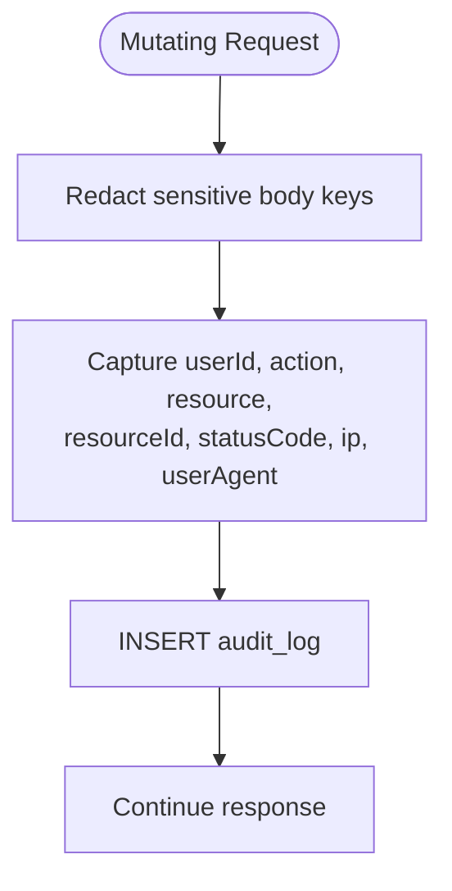
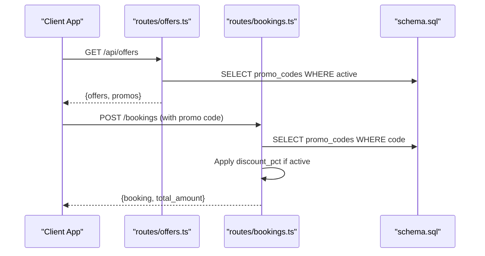
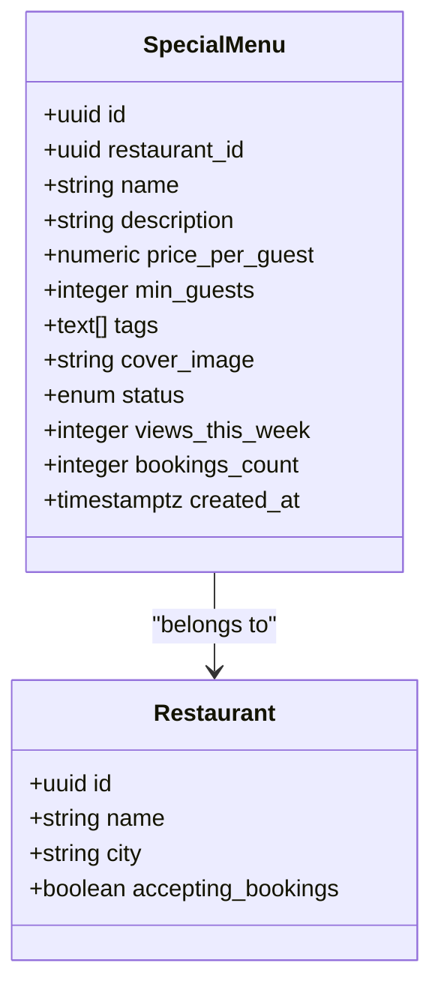
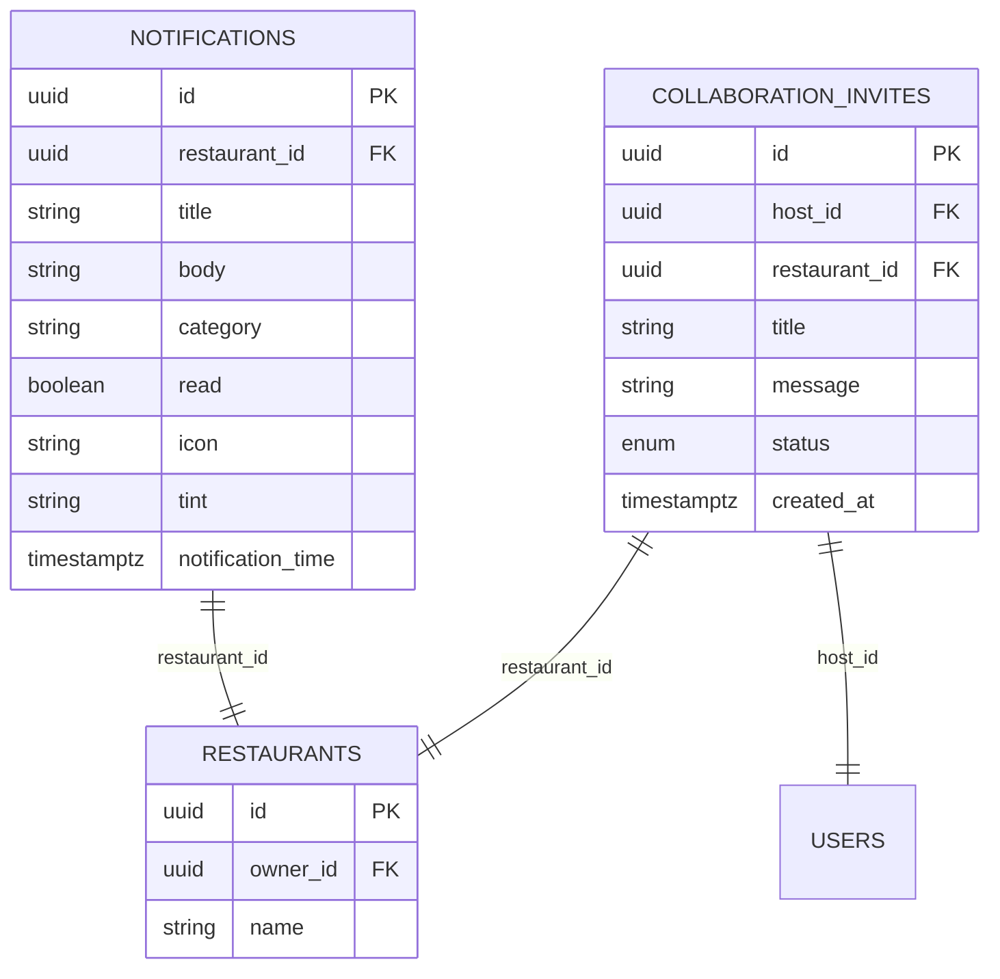
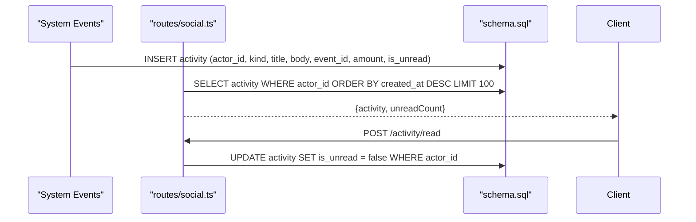
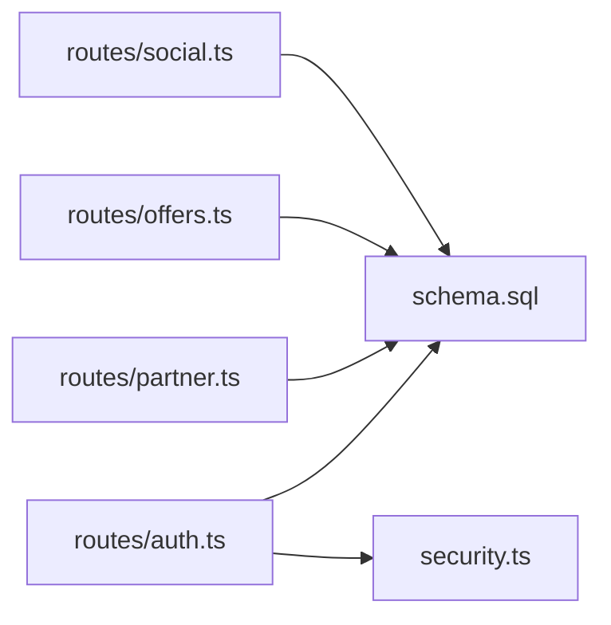

# Support Infrastructure

<cite>
**Referenced Files in This Document**
- [schema.sql](file://server/src/schema.sql)
- [security.ts](file://server/src/security.ts)
- [auth.ts](file://server/src/routes/auth.ts)
- [offers.ts](file://server/src/routes/offers.ts)
- [partner.ts](file://server/src/routes/partner.ts)
- [social.ts](file://server/src/routes/social.ts)
</cite>

## Table of Contents
1. [Introduction](#introduction)
2. [Project Structure](#project-structure)
3. [Core Components](#core-components)
4. [Architecture Overview](#architecture-overview)
5. [Detailed Component Analysis](#detailed-component-analysis)
6. [Dependency Analysis](#dependency-analysis)
7. [Performance Considerations](#performance-considerations)
8. [Troubleshooting Guide](#troubleshooting-guide)
9. [Conclusion](#conclusion)

## Introduction
This document explains the support and infrastructure tables that enable application security, authentication, operational monitoring, partner features, and promotional capabilities. It focuses on:

- Authentication session management with hashed bearer tokens and expiration policies.
- Phone-based OTP verification and secure email-change challenges using SHA-256 hashing.
- Security audit logging for compliance and incident investigation.
- Promo codes and special menus for restaurant partnerships and discounts.
- Notifications and collaboration invites for partner management.
- Indexing strategies and performance considerations for high-volume operations such as audit logging and activity feeds.

The goal is to make these systems understandable for both technical and non-technical readers while preserving precise implementation details from the codebase.

## Project Structure
The relevant backend logic lives under `server/src`:

- Database schema and indexes are defined in a single source-of-truth SQL file.
- Security utilities provide token hashing, rate limiting, and audit middleware.
- Route modules implement authentication flows, partner features, offers, and social/activity endpoints.



**Diagram sources**
- [auth.ts:1-528](file://server/src/routes/auth.ts#L1-L528)
- [partner.ts:1-536](file://server/src/routes/partner.ts#L1-L536)
- [offers.ts:1-99](file://server/src/routes/offers.ts#L1-L99)
- [social.ts:1-355](file://server/src/routes/social.ts#L1-L355)
- [security.ts:1-148](file://server/src/security.ts#L1-L148)
- [schema.sql:1-539](file://server/src/schema.sql#L1-L539)

**Section sources**
- [schema.sql:1-539](file://server/src/schema.sql#L1-L539)
- [security.ts:1-148](file://server/src/security.ts#L1-L148)
- [auth.ts:1-528](file://server/src/routes/auth.ts#L1-L528)
- [partner.ts:1-536](file://server/src/routes/partner.ts#L1-L536)
- [offers.ts:1-99](file://server/src/routes/offers.ts#L1-L99)
- [social.ts:1-355](file://server/src/routes/social.ts#L1-L355)

## Core Components
This section summarizes the key tables and their roles:

- auth_tokens: Stores hashed bearer tokens with user association and expiration.
- otp_codes: Stores phone-based one-time codes with TTL.
- email_change_challenges: Stores hashed challenge codes for verified email updates.
- audit_log: Records mutating API requests for security and compliance.
- promo_codes: Server-side discount codes applied during bookings.
- special_menus: Partner-curated menu packages tied to restaurants.
- notifications: Restaurant-facing notifications for partners.
- collaboration_invites: Partnership invitations between hosts and restaurants.
- activity: User-facing notification feed for events, payments, reviews, etc.

These components work together to secure access, verify identity changes, track sensitive actions, and power partner and promotional features.

**Section sources**
- [schema.sql:389-424](file://server/src/schema.sql#L389-L424)
- [schema.sql:409-424](file://server/src/schema.sql#L409-L424)
- [schema.sql:498-538](file://server/src/schema.sql#L498-L538)
- [auth.ts:12-60](file://server/src/routes/auth.ts#L12-L60)
- [auth.ts:63-157](file://server/src/routes/auth.ts#L63-L157)
- [auth.ts:384-490](file://server/src/routes/auth.ts#L384-L490)
- [security.ts:103-147](file://server/src/security.ts#L103-L147)
- [offers.ts:42-96](file://server/src/routes/offers.ts#L42-L96)
- [partner.ts:325-404](file://server/src/routes/partner.ts#L325-L404)
- [partner.ts:492-533](file://server/src/routes/partner.ts#L492-L533)
- [social.ts:29-67](file://server/src/routes/social.ts#L29-L67)

## Architecture Overview
The authentication and security architecture uses hashed tokens, strict rate limits, and comprehensive audit logging. The flow below shows how sign-in creates and stores a hashed token, and how subsequent requests use it.

```mermaid
sequenceDiagram
participant Client as "Client App"
participant Auth as "routes/auth.ts"
participant Sec as "security.ts"
participant DB as "schema.sql"
Client->>Auth : POST /api/auth/signin
Auth->>Sec : hashToken(token)
Sec-->>Auth : sha256 hex digest
Auth->>DB : INSERT auth_tokens (hashed token, user_id, expires_at)
Auth-->>Client : {token, expiresAt, user}
Note over Client,DB : Subsequent requests send plaintext token; server hashes before lookup.
```

**Diagram sources**
- [auth.ts:19-60](file://server/src/routes/auth.ts#L19-L60)
- [security.ts:7-14](file://server/src/security.ts#L7-L14)
- [schema.sql:417-424](file://server/src/schema.sql#L417-L424)

## Detailed Component Analysis

### Authentication Tokens and Session Management
The system issues opaque bearer tokens prefixed with a client-specific marker. Before storing them, the server hashes each token with SHA-256 so only digests exist in the database. Tokens expire after a fixed period, and clients receive both the token and its expiration time.

Key behaviors:
- Token creation occurs on sign-in, OTP verification, signup, and login.
- Sign-out deletes the current token row by matching the hashed token.
- Logout-all revokes all tokens for the user.
- Credential changes revoke other sessions but keep the current device active.



**Diagram sources**
- [auth.ts:12-60](file://server/src/routes/auth.ts#L12-L60)
- [auth.ts:186-196](file://server/src/routes/auth.ts#L186-L196)
- [auth.ts:287-293](file://server/src/routes/auth.ts#L287-L293)
- [auth.ts:518-525](file://server/src/routes/auth.ts#L518-L525)
- [security.ts:7-14](file://server/src/security.ts#L7-L14)
- [schema.sql:417-424](file://server/src/schema.sql#L417-L424)

**Section sources**
- [auth.ts:12-60](file://server/src/routes/auth.ts#L12-L60)
- [auth.ts:186-196](file://server/src/routes/auth.ts#L186-L196)
- [auth.ts:287-293](file://server/src/routes/auth.ts#L287-L293)
- [auth.ts:308-314](file://server/src/routes/auth.ts#L308-L314)
- [auth.ts:518-525](file://server/src/routes/auth.ts#L518-L525)
- [security.ts:7-14](file://server/src/security.ts#L7-L14)
- [schema.sql:417-424](file://server/src/schema.sql#L417-L424)

### Phone-Based OTP Authentication
Phone sign-in supports an OTP flow where a six-digit code is generated per request, stored with an expiration, and consumed once. In development, the code is returned in the response; in production, it is logged for operators.

Key behaviors:
- Request generates a new code and sets a short TTL.
- Verification checks code equality and expiration, then deletes the code.
- After successful verification, a session token is issued.



**Diagram sources**
- [auth.ts:63-157](file://server/src/routes/auth.ts#L63-L157)
- [schema.sql:389-395](file://server/src/schema.sql#L389-L395)

**Section sources**
- [auth.ts:63-157](file://server/src/routes/auth.ts#L63-L157)
- [schema.sql:389-395](file://server/src/schema.sql#L389-L395)

### Secure Email Change Challenges
Email changes require password confirmation and a time-limited challenge code. The code is stored as a SHA-256 digest, preventing replay if the table is leaked. Only one live challenge exists per user; re-requesting replaces the previous one.

Key behaviors:
- Password confirmation gates the start of the change.
- A new challenge is created with a hashed code and expiration.
- Confirmation validates the hashed code and applies the new email atomically.
- On success, other sessions are revoked.



**Diagram sources**
- [auth.ts:384-490](file://server/src/routes/auth.ts#L384-L490)
- [security.ts:7-14](file://server/src/security.ts#L7-L14)
- [schema.sql:397-407](file://server/src/schema.sql#L397-L407)

**Section sources**
- [auth.ts:384-490](file://server/src/routes/auth.ts#L384-L490)
- [security.ts:7-14](file://server/src/security.ts#L7-L14)
- [schema.sql:397-407](file://server/src/schema.sql#L397-L407)

### Audit Logging and Compliance Tracking
All mutating requests are recorded in the audit log. Sensitive body fields are redacted before storage. The middleware captures user context, HTTP method, resource path, status code, IP address, and user agent.

Key behaviors:
- Only POST/PUT/PATCH/DELETE are logged.
- Sensitive keys like passwords, codes, and tokens are replaced with placeholders.
- Audit inserts are fire-and-forget to avoid impacting request latency.



**Diagram sources**
- [security.ts:70-97](file://server/src/security.ts#L70-L97)
- [security.ts:103-147](file://server/src/security.ts#L103-L147)
- [schema.sql:498-511](file://server/src/schema.sql#L498-L511)

**Section sources**
- [security.ts:70-97](file://server/src/security.ts#L70-L97)
- [security.ts:103-147](file://server/src/security.ts#L103-L147)
- [schema.sql:498-511](file://server/src/schema.sql#L498-L511)

### Promo Codes and Discount Management
Promo codes are server-validated discounts used during booking workflows. Active codes are exposed through the public Offers endpoint alongside special menus.

Key behaviors:
- Promo codes have a percentage discount and an active flag.
- Offers endpoint returns active promo codes sorted by discount value.
- Booking routes can apply promo codes when calculating totals.



**Diagram sources**
- [offers.ts:42-96](file://server/src/routes/offers.ts#L42-L96)
- [schema.sql:409-415](file://server/src/schema.sql#L409-L415)

**Section sources**
- [offers.ts:42-96](file://server/src/routes/offers.ts#L42-L96)
- [schema.sql:409-415](file://server/src/schema.sql#L409-L415)

### Special Menus for Restaurant Partnerships
Special menus represent curated packages offered by partner restaurants. They include pricing, minimum guests, tags, and media.

Key behaviors:
- Partner routes create and list menus scoped to the partner’s restaurants.
- Public offers endpoint surfaces active menus with derived deal kinds.
- Menu analytics include views and bookings counts.



**Diagram sources**
- [schema.sql:359-374](file://server/src/schema.sql#L359-L374)
- [partner.ts:325-404](file://server/src/routes/partner.ts#L325-L404)
- [offers.ts:42-96](file://server/src/routes/offers.ts#L42-L96)

**Section sources**
- [schema.sql:359-374](file://server/src/schema.sql#L359-L374)
- [partner.ts:325-404](file://server/src/routes/partner.ts#L325-L404)
- [offers.ts:42-96](file://server/src/routes/offers.ts#L42-L96)

### Notifications and Collaboration Invites
Notifications and collaboration invites support partner management and communication.

Key behaviors:
- Notifications are scoped to restaurants owned by the partner admin.
- Collaboration invites link hosts and restaurants with lifecycle statuses.
- Both tables support filtering and ordering for partner dashboards.



**Diagram sources**
- [schema.sql:282-292](file://server/src/schema.sql#L282-L292)
- [schema.sql:376-387](file://server/src/schema.sql#L376-L387)
- [partner.ts:492-533](file://server/src/routes/partner.ts#L492-L533)

**Section sources**
- [schema.sql:282-292](file://server/src/schema.sql#L282-L292)
- [schema.sql:376-387](file://server/src/schema.sql#L376-L387)
- [partner.ts:492-533](file://server/src/routes/partner.ts#L492-L533)

### Activity Feed and Operational Monitoring
The activity table powers the user-facing notification feed. It records events such as new guests, payments, reminders, followers, payouts, invites, and reviews.

Key behaviors:
- The actor_id column represents the recipient of the notification.
- The feed is ordered by creation time and limited to recent items.
- Mark-as-read updates unread flags for the user.



**Diagram sources**
- [social.ts:29-67](file://server/src/routes/social.ts#L29-L67)
- [schema.sql:333-347](file://server/src/schema.sql#L333-L347)

**Section sources**
- [social.ts:29-67](file://server/src/routes/social.ts#L29-L67)
- [schema.sql:333-347](file://server/src/schema.sql#L333-L347)

## Dependency Analysis
The following diagram maps how route modules depend on the schema and security utilities.



**Diagram sources**
- [auth.ts:1-528](file://server/src/routes/auth.ts#L1-L528)
- [partner.ts:1-536](file://server/src/routes/partner.ts#L1-L536)
- [offers.ts:1-99](file://server/src/routes/offers.ts#L1-L99)
- [social.ts:1-355](file://server/src/routes/social.ts#L1-L355)
- [security.ts:1-148](file://server/src/security.ts#L1-L148)
- [schema.sql:1-539](file://server/src/schema.sql#L1-L539)

**Section sources**
- [auth.ts:1-528](file://server/src/routes/auth.ts#L1-L528)
- [partner.ts:1-536](file://server/src/routes/partner.ts#L1-L536)
- [offers.ts:1-99](file://server/src/routes/offers.ts#L1-L99)
- [social.ts:1-355](file://server/src/routes/social.ts#L1-L355)
- [security.ts:1-148](file://server/src/security.ts#L1-L148)
- [schema.sql:1-539](file://server/src/schema.sql#L1-L539)

## Performance Considerations
High-volume operations benefit from targeted indexing and careful query design:

- Audit logging:
  - Indexes on user_id and created_at support querying logs by user and time range.
  - Fire-and-forget inserts reduce request latency impact.

- Activity feed:
  - Composite index on actor_id and created_at optimizes feed retrieval.
  - Limiting results to recent entries prevents large scans.

- Auth tokens:
  - Index on user_id enables efficient session revocation and cleanup.

- Special menus and notifications:
  - Indexes on restaurant_id optimize partner-scoped queries.
  - Notification queries order by notification_time for dashboard efficiency.

- Offers and promo codes:
  - Active promo code reads are simple primary-key lookups.
  - Special menus join with restaurants; indexes on restaurant_id improve performance.

Recommended practices:
- Keep audit inserts asynchronous and resilient to transient failures.
- Paginate or limit activity feed responses.
- Periodically purge expired OTP codes and email challenges.
- Monitor slow queries on partner analytics and adjust indexes as needed.

**Section sources**
- [schema.sql:513-538](file://server/src/schema.sql#L513-L538)
- [security.ts:103-147](file://server/src/security.ts#L103-L147)
- [social.ts:29-67](file://server/src/routes/social.ts#L29-L67)
- [partner.ts:492-533](file://server/src/routes/partner.ts#L492-L533)
- [offers.ts:42-96](file://server/src/routes/offers.ts#L42-L96)

## Troubleshooting Guide
Common issues and resolutions:

- Authentication failures:
  - Ensure the client sends the Authorization header with the correct Bearer token.
  - Verify the token has not expired and still exists in auth_tokens.
  - If multiple devices should be invalidated, use logout-all.

- OTP verification errors:
  - Confirm the code matches exactly and has not expired.
  - Re-request a new OTP if the previous one was consumed or expired.

- Email change challenges:
  - Verify the provided code matches the stored hash.
  - If the new email is already taken, resolve conflicts before confirming.

- Audit log gaps:
  - Check for insert failures in the audit middleware; they are logged but do not block requests.
  - Ensure sensitive fields are redacted correctly to avoid leaking secrets.

- Partner notifications and menus:
  - Confirm the partner owns the restaurant when creating or listing resources.
  - Filter notifications by unread status and limit results for performance.

**Section sources**
- [auth.ts:287-293](file://server/src/routes/auth.ts#L287-L293)
- [auth.ts:518-525](file://server/src/routes/auth.ts#L518-L525)
- [auth.ts:104-157](file://server/src/routes/auth.ts#L104-L157)
- [auth.ts:440-490](file://server/src/routes/auth.ts#L440-L490)
- [security.ts:103-147](file://server/src/security.ts#L103-L147)
- [partner.ts:492-533](file://server/src/routes/partner.ts#L492-L533)

## Conclusion
The support infrastructure combines secure authentication, robust auditing, and partner-focused features to deliver a safe and scalable platform. By hashing tokens and challenge codes, enforcing expiration policies, and maintaining comprehensive indexes, the system balances security with performance. The audit log provides compliance visibility, while promo codes, special menus, notifications, and collaboration invites enable rich partner experiences. Proper operational practices—such as limiting feed sizes, purging expired credentials, and monitoring audit inserts—ensure reliable performance at scale.