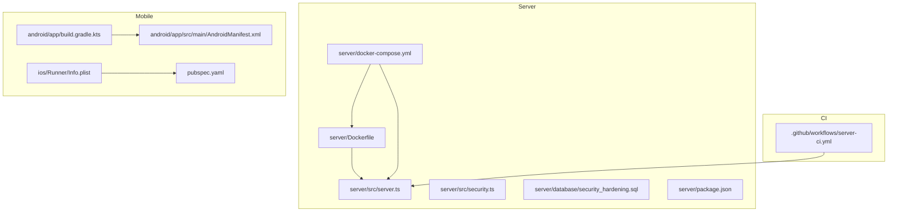
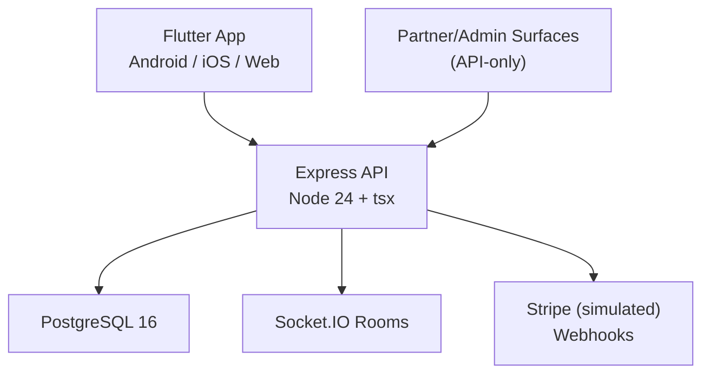
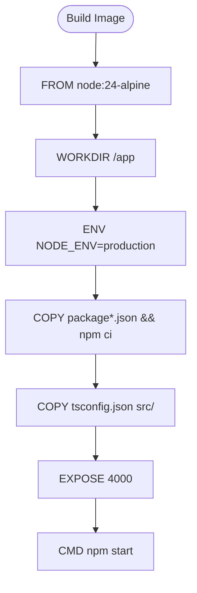
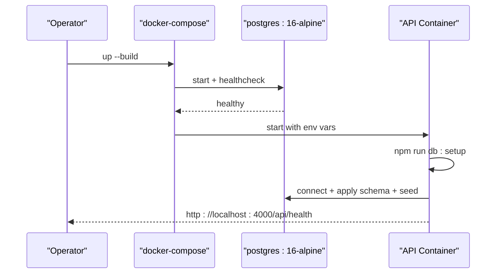
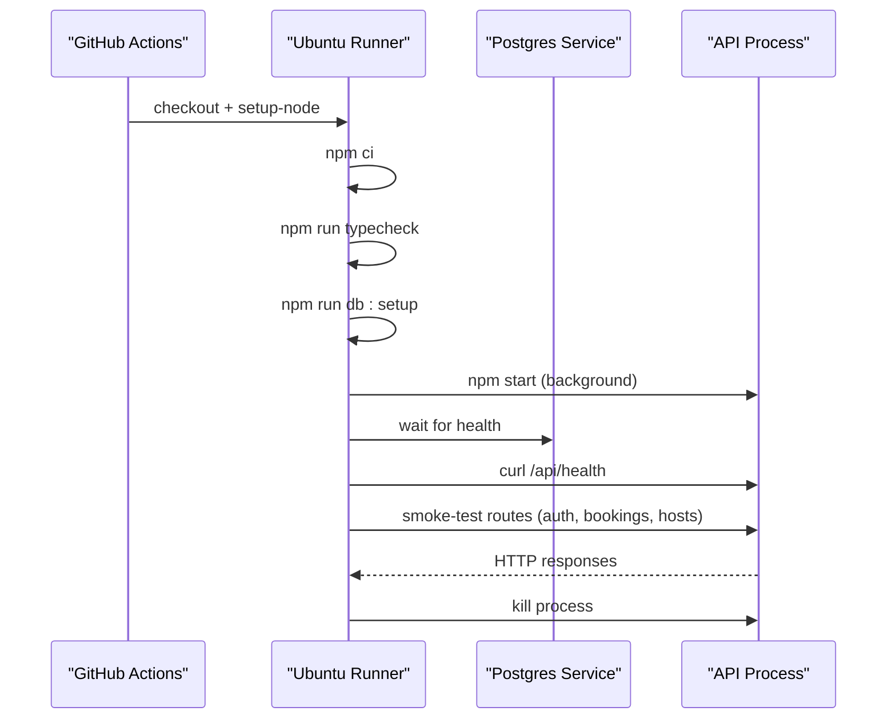
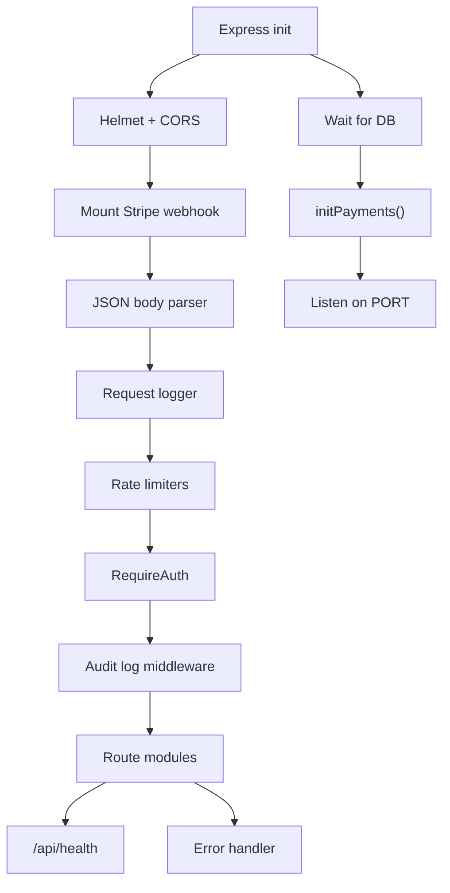
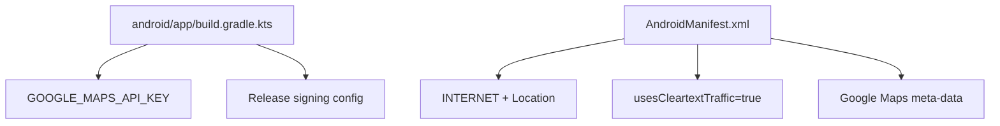
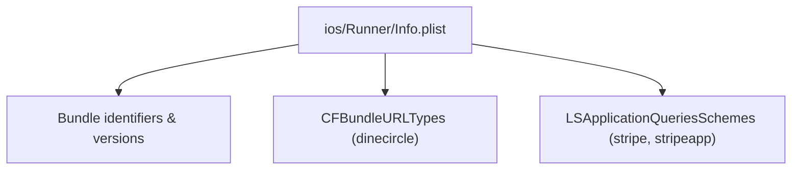
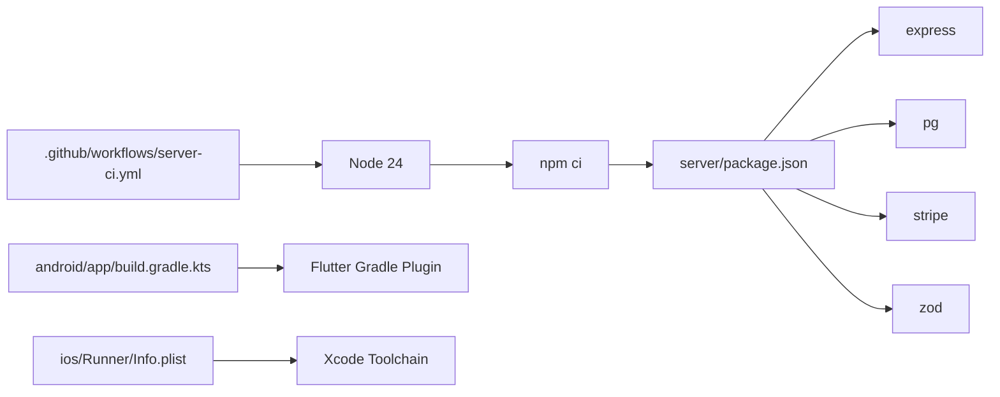

# Deployment and DevOps

<cite>
**Referenced Files in This Document**
- [README.md](file://README.md)
- [server/Dockerfile](file://server/Dockerfile)
- [server/docker-compose.yml](file://server/docker-compose.yml)
- [.github/workflows/server-ci.yml](file://.github/workflows/server-ci.yml)
- [server/src/server.ts](file://server/src/server.ts)
- [server/src/security.ts](file://server/src/security.ts)
- [server/database/security_hardening.sql](file://server/database/security_hardening.sql)
- [server/package.json](file://server/package.json)
- [android/app/build.gradle.kts](file://android/app/build.gradle.kts)
- [android/app/src/main/AndroidManifest.xml](file://android/app/src/main/AndroidManifest.xml)
- [ios/Runner/Info.plist](file://ios/Runner/Info.plist)
- [pubspec.yaml](file://pubspec.yaml)
</cite>

## Table of Contents
1. [Introduction](#introduction)
2. [Project Structure](#project-structure)
3. [Core Components](#core-components)
4. [Architecture Overview](#architecture-overview)
5. [Detailed Component Analysis](#detailed-component-analysis)
6. [Dependency Analysis](#dependency-analysis)
7. [Performance Considerations](#performance-considerations)
8. [Troubleshooting Guide](#troubleshooting-guide)
9. [Conclusion](#conclusion)
10. [Appendices](#appendices)

## Introduction
This document provides deployment and DevOps guidance for the DineCircle platform, covering:
- Backend containerization with Docker and environment configuration
- CI/CD automation using GitHub Actions
- Flutter mobile build processes for Android and iOS
- Production topology, scaling, and database provisioning
- Monitoring, logging, security hardening, backups, and disaster recovery
- Staging and production environment management

DineCircle is a monorepo containing a Flutter app and an Express + PostgreSQL API. The repository includes Docker Compose for local/staging bring-up, a GitHub Actions workflow for server testing and smoke checks, and Android/iOS project files that configure signing, keys, and platform-specific behavior.

**Section sources**
- [README.md:1-52](file://README.md#L1-L52)
- [README.md:207-223](file://README.md#L207-L223)
- [README.md:226-252](file://README.md#L226-L252)

## Project Structure
The deployment-relevant structure centers on:
- `server/`: Node/Express API, Docker image definition, Compose file, scripts, and schema/seed
- `.github/workflows/server-ci.yml`: Server CI pipeline
- `android/` and `ios/`: Mobile build configurations, signing, and platform manifests
- Root-level `pubspec.yaml`: Flutter package metadata and dependencies

**Diagram sources**
- [server/Dockerfile:1-16](file://server/Dockerfile#L1-L16)
- [server/docker-compose.yml:1-47](file://server/docker-compose.yml#L1-L47)
- [server/src/server.ts:1-316](file://server/src/server.ts#L1-L316)
- [server/src/security.ts:1-148](file://server/src/security.ts#L1-L148)
- [server/database/security_hardening.sql:1-74](file://server/database/security_hardening.sql#L1-L74)
- [server/package.json:1-37](file://server/package.json#L1-L37)
- [.github/workflows/server-ci.yml:1-245](file://.github/workflows/server-ci.yml#L1-L245)
- [android/app/build.gradle.kts:1-69](file://android/app/build.gradle.kts#L1-L69)
- [android/app/src/main/AndroidManifest.xml:1-60](file://android/app/src/main/AndroidManifest.xml#L1-L60)
- [ios/Runner/Info.plist:1-91](file://ios/Runner/Info.plist#L1-L91)
- [pubspec.yaml:1-99](file://pubspec.yaml#L1-L99)

**Section sources**
- [README.md:270-299](file://README.md#L270-L299)

## Core Components
- Backend runtime: Express 5 with TypeScript via tsx, running on Node 24
- Database: PostgreSQL 16
- Containerization: Single-stage Docker image for the API; Compose for local/staging
- CI: GitHub Actions job that typechecks, applies schema/seed, starts the server, and runs a write-path curl smoke test against Postgres 16
- Mobile: Flutter app targeting Android and iOS with Gradle and Xcode toolchains

Key operational characteristics:
- The API waits for Postgres before starting
- Schema and seed are applied at boot time in Compose
- Rate limiting, Helmet headers, CORS allowlist, audit logging, and token hashing are built-in
- Android release builds currently use debug signing; Google Maps key injection is supported
- iOS URL scheme and Stripe-related entries exist for future payment flows

**Section sources**
- [README.md:207-223](file://README.md#L207-L223)
- [server/Dockerfile:1-16](file://server/Dockerfile#L1-L16)
- [server/docker-compose.yml:1-47](file://server/docker-compose.yml#L1-L47)
- [.github/workflows/server-ci.yml:1-245](file://.github/workflows/server-ci.yml#L1-L245)
- [android/app/build.gradle.kts:44-50](file://android/app/build.gradle.kts#L44-L50)
- [android/app/src/main/AndroidManifest.xml:1-20](file://android/app/src/main/AndroidManifest.xml#L1-L20)
- [ios/Runner/Info.plist:27-46](file://ios/Runner/Info.plist#L27-L46)

## Architecture Overview
The production-like stack consists of:
- Flutter clients (Android/iOS/Web) calling the REST API
- Express API with Socket.IO for real-time rooms
- PostgreSQL for persistence
- Optional Stripe integration (currently simulated)

**Diagram sources**
- [README.md:226-252](file://README.md#L226-L252)
- [server/src/server.ts:27-316](file://server/src/server.ts#L27-L316)

## Detailed Component Analysis

### Backend Docker Image and Runtime
- Base image: `node:24-alpine`
- Working directory: `/app`
- Environment: `NODE_ENV=production`
- Dependency install: `npm ci`
- Source copy: `tsconfig.json`, `src/`
- Exposed port: `4000`
- Entrypoint: `npm start` (tsx runtime)

Notes:
- The current Dockerfile is not multi-stage; it installs dependencies and copies source into one image.
- The entrypoint relies on `npm start`, which executes `tsx src/server.ts`.

**Diagram sources**
- [server/Dockerfile:1-16](file://server/Dockerfile#L1-L16)
- [server/package.json:6-15](file://server/package.json#L6-L15)

**Section sources**
- [server/Dockerfile:1-16](file://server/Dockerfile#L1-L16)
- [server/package.json:1-37](file://server/package.json#L1-L37)

### Docker Compose Orchestration
- Services:
  - `db`: PostgreSQL 16 Alpine, health-checked with `pg_isready`
  - `api`: Builds from `server/Dockerfile`, depends on healthy `db`, exposes port `4000`
- Environment variables:
  - `DATABASE_URL`, `PORT`, `NODE_ENV`
  - Stripe keys (`STRIPE_SECRET_KEY`, `STRIPE_WEBHOOK_SECRET`, `STRIPE_CURRENCY`) and `PAYMENTS_MODE`
- Boot command: `npm run db:setup && npm start`

Operational notes:
- Secrets should be provided via host shell or a `.env` file next to compose; do not bake secrets into images.
- The API applies schema and seed on every boot in this Compose setup.

**Diagram sources**
- [server/docker-compose.yml:1-47](file://server/docker-compose.yml#L1-L47)

**Section sources**
- [server/docker-compose.yml:1-47](file://server/docker-compose.yml#L1-L47)

### CI/CD Pipeline (GitHub Actions)
- Trigger: push/pull_request affecting `server/**` or the workflow file
- Job: `api` on `ubuntu-latest`
- Steps:
  - Checkout code
  - Setup Node 24 with npm cache
  - Install dependencies
  - Typecheck
  - Apply schema + seed
  - Start server and run a comprehensive write-path smoke test against Postgres 16 service

Smoke test highlights:
- Sign-in, events, restaurants reads
- Signup, become-host, booking creation, cancellation, seat-locking (409), promo validation (400), horizontal authorization fix verification, event creation authz (403 vs 201)
- Host Studio surfaces: performance/partners/invites reads, invite accept, wallet withdrawal validation (over-balance 400, valid 201), approve/decline booking flows

**Diagram sources**
- [.github/workflows/server-ci.yml:1-245](file://.github/workflows/server-ci.yml#L1-L245)

**Section sources**
- [.github/workflows/server-ci.yml:1-245](file://.github/workflows/server-ci.yml#L1-L245)

### Server Startup, Security, and Logging
- Startup sequence:
  - Disable `x-powered-by`
  - Apply Helmet and CORS (allowlist; permissive in non-production)
  - Mount Stripe webhook router before JSON parser
  - Global request logger
  - Rate limiters for API and auth endpoints
  - RequireAuth middleware and audit logging for authenticated mutations
  - Route mounting for mobile, partner, reports, feedback
  - Health endpoint
  - Error handler for ApiError and ZodError
  - Wait for database readiness, initialize payments, then listen

- Security features:
  - Token hashing (SHA-256) for storage and lookup
  - Rate limiters: API, auth, report, feedback
  - Audit log middleware redacts sensitive fields
  - Database hardening script creates restricted user and row-level policies

**Diagram sources**
- [server/src/server.ts:27-316](file://server/src/server.ts#L27-L316)
- [server/src/security.ts:1-148](file://server/src/security.ts#L1-L148)
- [server/database/security_hardening.sql:1-74](file://server/database/security_hardening.sql#L1-L74)

**Section sources**
- [server/src/server.ts:1-316](file://server/src/server.ts#L1-L316)
- [server/src/security.ts:1-148](file://server/src/security.ts#L1-L148)
- [server/database/security_hardening.sql:1-74](file://server/database/security_hardening.sql#L1-L74)

### Flutter Build and Signing (Android)
- Gradle config:
  - Java 17 target
  - Application ID and versioning from Flutter tooling
  - Google Maps key injection via Gradle property or dart-define
  - Release build currently uses debug signing

- Manifest:
  - Internet permission required
  - Cleartext traffic enabled for dev/test over HTTP
  - Google Maps meta-data placeholder injected at build time

Recommendations:
- Replace debug signing with a proper release keystore for production
- Restrict cleartext traffic for production builds
- Inject Google Maps key securely through CI secret store

**Diagram sources**
- [android/app/build.gradle.kts:1-69](file://android/app/build.gradle.kts#L1-L69)
- [android/app/src/main/AndroidManifest.xml:1-60](file://android/app/src/main/AndroidManifest.xml#L1-L60)

**Section sources**
- [android/app/build.gradle.kts:1-69](file://android/app/build.gradle.kts#L1-L69)
- [android/app/src/main/AndroidManifest.xml:1-60](file://android/app/src/main/AndroidManifest.xml#L1-L60)

### Flutter Build and Signing (iOS)
- Info.plist contains:
  - Bundle identifiers and version placeholders
  - URL schemes for Stripe redirect-based payment methods
  - LSApplicationQueriesSchemes for Stripe apps

Recommendations:
- Configure code signing with a distribution certificate and provisioning profile in CI
- Ensure URL schemes and query schemes match your Stripe configuration

**Diagram sources**
- [ios/Runner/Info.plist:1-91](file://ios/Runner/Info.plist#L1-L91)

**Section sources**
- [ios/Runner/Info.plist:1-91](file://ios/Runner/Info.plist#L1-L91)

### Flutter Package Metadata
- `pubspec.yaml` defines:
  - SDK constraints
  - Dependencies including Dio, flutter_secure_storage, google_maps_flutter, geolocator, flutter_stripe
  - Assets and material design usage

Operational note:
- Payment-related keys can be passed at build time via dart-defines; when absent, Stripe-enabled paths remain disabled in client logic.

**Section sources**
- [pubspec.yaml:1-99](file://pubspec.yaml#L1-L99)

## Dependency Analysis
- Server runtime depends on Express, cors, helmet, express-rate-limit, pg, socket.io, stripe, zod
- CI depends on Node 24 and npm caching
- Android build depends on Flutter Gradle plugin and Kotlin 17
- iOS build depends on Xcode toolchain and Info.plist configuration

**Diagram sources**
- [.github/workflows/server-ci.yml:1-245](file://.github/workflows/server-ci.yml#L1-L245)
- [server/package.json:1-37](file://server/package.json#L1-L37)
- [android/app/build.gradle.kts:1-69](file://android/app/build.gradle.kts#L1-L69)
- [ios/Runner/Info.plist:1-91](file://ios/Runner/Info.plist#L1-L91)

**Section sources**
- [server/package.json:1-37](file://server/package.json#L1-L37)
- [.github/workflows/server-ci.yml:1-245](file://.github/workflows/server-ci.yml#L1-L245)

## Performance Considerations
- Use connection pooling to PostgreSQL (already configured via `pg` pool)
- Keep rate limits tuned for production workloads; CI overrides via environment variables
- Avoid unnecessary re-seeding in production; apply schema once during migrations
- Prefer multi-stage Docker images to reduce image size and attack surface
- Enable gzip/brotli compression at the reverse proxy layer
- Cache static assets at CDN edge if serving web assets
- Monitor database connections and tune pool sizes based on concurrency

[No sources needed since this section provides general guidance]

## Troubleshooting Guide
Common issues and resolutions:
- Database not ready at startup:
  - The API retries until Postgres responds; ensure health checks pass and network connectivity is correct
- CORS errors in development:
  - Allowed origins include localhost and emulator addresses; adjust origin allowlist for production
- Stripe webhook signature verification failures:
  - Ensure raw body is preserved by mounting the webhook router before JSON parsing and set `STRIPE_WEBHOOK_SECRET`
- Audit log insert failures:
  - Non-fatal; check database permissions and disk space
- Over-balance withdrawal attempts:
  - Expected 400 response; verify wallet balance and withdrawal amount
- Seat locking conflicts:
  - Booking requests exceeding available seats return 409; handle conflict UI accordingly

**Section sources**
- [server/src/server.ts:47-59](file://server/src/server.ts#L47-L59)
- [server/src/server.ts:62-78](file://server/src/server.ts#L62-L78)
- [server/src/server.ts:80-86](file://server/src/server.ts#L80-L86)
- [server/src/security.ts:123-140](file://server/src/security.ts#L123-L140)
- [.github/workflows/server-ci.yml:98-120](file://.github/workflows/server-ci.yml#L98-L120)

## Conclusion
DineCircle’s deployment model combines a simple but robust backend container, Compose-driven local/staging environments, and a CI pipeline that validates types, schema, and critical write paths. The Flutter app supports Android and iOS with configurable keys and signing. For production, adopt secure signing, restrict cleartext traffic, externalize secrets, implement migrations separate from application boot, and add observability and backup strategies as outlined below.

[No sources needed since this section summarizes without analyzing specific files]

## Appendices

### Production Deployment Topology
- Reverse proxy/load balancer:
  - Terminate TLS at the edge
  - Route `/api/*` to API instances
  - Support WebSocket upgrades for Socket.IO
- API layer:
  - Stateless containers behind load balancer
  - Horizontal scaling based on CPU/memory and request latency
- Database:
  - Managed PostgreSQL with automated backups and point-in-time recovery
  - Read replicas for analytics/reporting if needed
- Storage:
  - Object storage for media uploads (future phase)
- Observability:
  - Centralized logs (structured JSON)
  - Metrics collection (request rates, error rates, latency percentiles)
  - Health and readiness probes

[No sources needed since this section provides general guidance]

### Monitoring and Logging Strategy
- Request logging:
  - Minimal structured logger already present; extend with correlation IDs
- Audit logging:
  - Persisted in PostgreSQL; export to SIEM or log aggregation
- Metrics:
  - Expose Prometheus metrics or integrate with APM
- Alerts:
  - High error rates, slow queries, low DB connections, high latency
- Dashboards:
  - API throughput, error budget burn, DB utilization, queue/backlog metrics

**Section sources**
- [server/src/server.ts:34-41](file://server/src/server.ts#L34-L41)
- [server/src/security.ts:99-147](file://server/src/security.ts#L99-L147)

### Security Hardening Measures
- Network:
  - Enforce HTTPS/TLS at the edge
  - Restrict CORS origins to known domains in production
- Authentication:
  - Continue hashing tokens at rest; consider token rotation and refresh flow
- Authorization:
  - Maintain role checks and ownership validations
- Input validation:
  - Keep Zod schemas and parameterized SQL
- Rate limiting:
  - Tune limits per environment; protect auth endpoints
- Database:
  - Use restricted DB user and RLS policies as defined in hardening script
- Secrets management:
  - Store secrets in a vault; inject at runtime

**Section sources**
- [server/src/server.ts:62-78](file://server/src/server.ts#L62-L78)
- [server/src/security.ts:1-14](file://server/src/security.ts#L1-L14)
- [server/database/security_hardening.sql:22-74](file://server/database/security_hardening.sql#L22-L74)

### Backup Procedures and Disaster Recovery
- Database backups:
  - Automated daily full backups and continuous WAL archiving
  - Test restore procedures regularly
- Configuration backups:
  - Version control infrastructure definitions (Compose, CI, IaC)
  - Back up environment variable templates (without secrets)
- Recovery runbooks:
  - Define RTO/RPO targets
  - Document failover steps for DB and API services
- Data integrity:
  - Validate checksums after restore
  - Reconcile financial ledgers post-recovery

[No sources needed since this section provides general guidance]

### Staging and Production Environment Management
- Staging:
  - Mirror production topology
  - Use seeded data sets and feature flags
  - Run CI smoke tests against staging-like environment
- Production:
  - Blue/green or rolling deployments
  - Canary releases for risky changes
- Secret rotation:
  - Rotate Stripe keys, DB credentials, and JWT secrets periodically
- Change management:
  - Promote artifacts (images, APKs/IPAs) rather than code branches
  - Track versions and rollbacks

[No sources needed since this section provides general guidance]