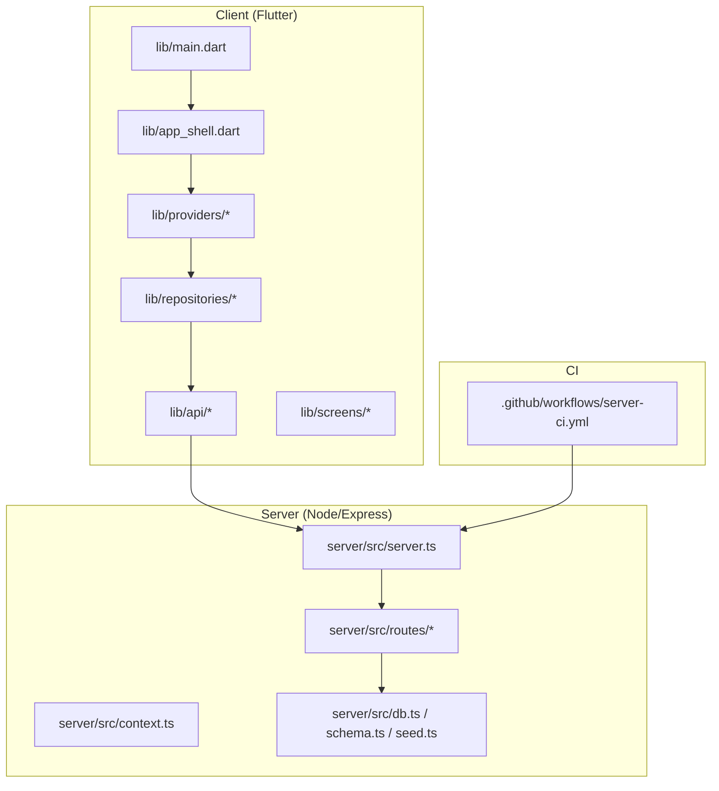
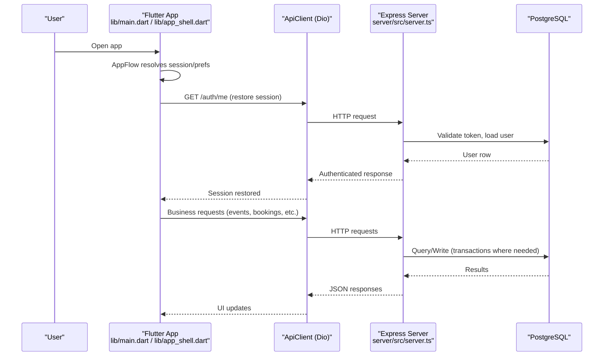
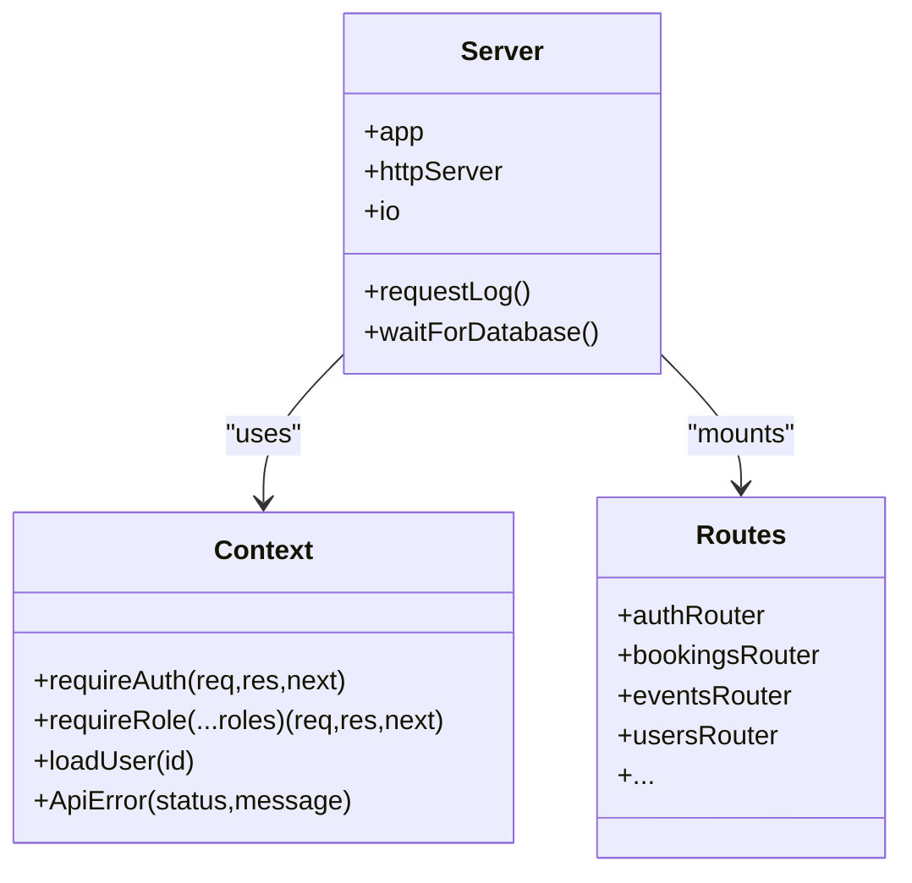
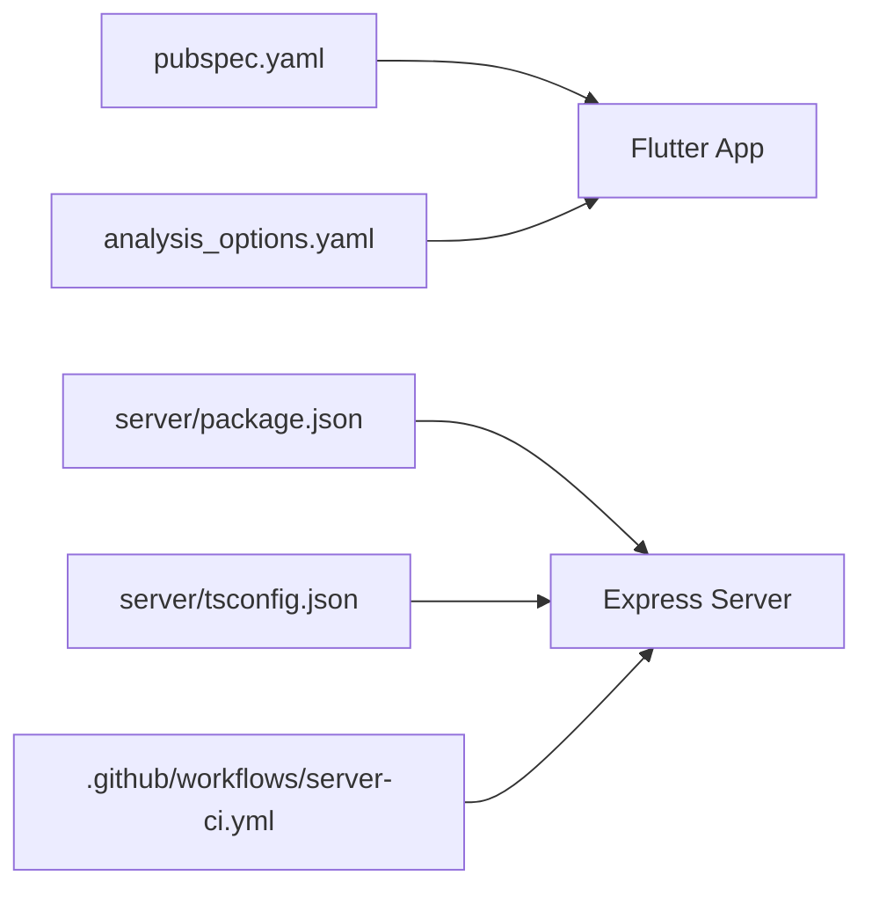

# Development Guidelines

<cite>
**Referenced Files in This Document**
- [README.md](file://README.md)
- [analysis_options.yaml](file://analysis_options.yaml)
- [pubspec.yaml](file://pubspec.yaml)
- [server/package.json](file://server/package.json)
- [server/tsconfig.json](file://server/tsconfig.json)
- [.github/workflows/server-ci.yml](file://.github/workflows/server-ci.yml)
- [server/src/server.ts](file://server/src/server.ts)
- [server/src/context.ts](file://server/src/context.ts)
- [lib/main.dart](file://lib/main.dart)
- [lib/app_shell.dart](file://lib/app_shell.dart)
- [.gitignore](file://.gitignore)
</cite>

## Table of Contents
1. [Introduction](#introduction)
2. [Project Structure](#project-structure)
3. [Core Components](#core-components)
4. [Architecture Overview](#architecture-overview)
5. [Detailed Component Analysis](#detailed-component-analysis)
6. [Dependency Analysis](#dependency-analysis)
7. [Performance Considerations](#performance-considerations)
8. [Troubleshooting Guide](#troubleshooting-guide)
9. [Conclusion](#conclusion)
10. [Appendices](#appendices)

## Introduction
This document defines the development guidelines for contributing to DineCircle, a monorepo with a Flutter client and a Node/Express + PostgreSQL server. It covers Dart/Flutter coding standards, TypeScript/Node.js standards, Git workflow, code review practices, documentation standards, debugging and performance guidance, and the end-to-end contribution process from issue identification to merge.

DineCircle’s current state emphasizes:
- End-to-end wired write paths between the Flutter app and the API (auth, bookings, events, social, chat, profile).
- Server-authoritative money math and Host Studio features backed by PostgreSQL.
- CI that typechecks, seeds the database, and runs a curl-based smoke test against Postgres 16.

**Section sources**
- [README.md:1-53](file://README.md#L1-L53)
- [README.md:207-252](file://README.md#L207-L252)
- [README.md:593-627](file://README.md#L593-L627)

## Project Structure
The repository is organized as a monorepo:
- `lib/` — Flutter application (screens, providers, repositories, models, theme, widgets, api layer).
- `server/` — Express 5 API in TypeScript ESM with Socket.IO, Zod validation, and PostgreSQL.
- `.github/workflows/server-ci.yml` — CI pipeline for the server.
- Root configuration files for Dart/Flutter (`pubspec.yaml`, `analysis_options.yaml`) and Node/TypeScript (`server/package.json`, `server/tsconfig.json`).

**Diagram sources**
- [lib/main.dart:13-29](file://lib/main.dart#L13-L29)
- [lib/app_shell.dart:33-39](file://lib/app_shell.dart#L33-L39)
- [server/src/server.ts:27-27](file://server/src/server.ts#L27-L27)
- [server/src/context.ts:1-11](file://server/src/context.ts#L1-L11)
- [.github/workflows/server-ci.yml:1-11](file://.github/workflows/server-ci.yml#L1-L11)

**Section sources**
- [README.md:270-299](file://README.md#L270-L299)
- [README.md:226-252](file://README.md#L226-L252)

## Core Components
This section summarizes the core components relevant to contributors and their responsibilities.

- Flutter entrypoint and flow
  - `lib/main.dart` initializes the provider scope and renders the root flow (splash → onboarding/auth → preferences → shell).
  - `lib/app_shell.dart` implements the 5-tab navigation shell and orchestrates key user flows (create dinner, location update, navigation to detail screens).

- Server bootstrap and middleware
  - `server/src/server.ts` configures security headers, CORS, rate limiting, Stripe webhook route, JSON parsing, request logging, Socket.IO, and mounts all REST routers under `/api`.
  - `server/src/context.ts` provides authentication middleware, role checks, typed error helpers, and user loading utilities.

- Configuration and tooling
  - Dart analyzer rules via `analysis_options.yaml` include Flutter lints; custom rules can be added there.
  - Flutter dependencies and SDK constraints are declared in `pubspec.yaml`.
  - Server scripts, dependencies, and dev tools are defined in `server/package.json`; TypeScript compiler options are in `server/tsconfig.json`.

**Section sources**
- [lib/main.dart:13-29](file://lib/main.dart#L13-L29)
- [lib/app_shell.dart:33-39](file://lib/app_shell.dart#L33-L39)
- [server/src/server.ts:27-27](file://server/src/server.ts#L27-L27)
- [server/src/context.ts:39-46](file://server/src/context.ts#L39-L46)
- [analysis_options.yaml:1-36](file://analysis_options.yaml#L1-L36)
- [pubspec.yaml:21-48](file://pubspec.yaml#L21-L48)
- [server/package.json:1-37](file://server/package.json#L1-L37)
- [server/tsconfig.json:1-20](file://server/tsconfig.json#L1-L20)

## Architecture Overview
High-level architecture and data flow across the client and server:

**Diagram sources**
- [lib/main.dart:31-79](file://lib/main.dart#L31-L79)
- [lib/app_shell.dart:97-127](file://lib/app_shell.dart#L97-L127)
- [server/src/server.ts:221-257](file://server/src/server.ts#L221-L257)
- [server/src/context.ts:60-85](file://server/src/context.ts#L60-L85)

## Detailed Component Analysis

### Dart/Flutter Coding Standards
- Analyzer and linting
  - Use `flutter analyze` locally; it includes Flutter lints via `analysis_options.yaml`.
  - Add or customize rules in `analysis_options.yaml` under `linter.rules`.
- Dependencies and SDK
  - Keep SDK constraints aligned with `pubspec.yaml` environment.
  - Prefer stable versions and avoid unnecessary packages.
- State management and data layer
  - Use Riverpod providers for state; keep business logic out of widgets.
  - Repository pattern for data access; DTOs/mappers separate from domain models.
- UI organization
  - Screens under `lib/screens/<area>/`; reusable widgets under `lib/widgets/`.
  - Theme tokens under `lib/theme/`; avoid ad-hoc colors/text styles in screens.
- Error handling
  - Centralize API errors through the ApiClient; surface user-friendly messages.
  - Handle connectivity and offline states with the connectivity banner and retry-once GETs.

**Section sources**
- [analysis_options.yaml:1-36](file://analysis_options.yaml#L1-L36)
- [pubspec.yaml:21-48](file://pubspec.yaml#L21-L48)
- [README.md:226-252](file://README.md#L226-L252)
- [lib/app_shell.dart:162-192](file://lib/app_shell.dart#L162-L192)

### TypeScript/Node.js Coding Standards
- Compiler and module system
  - TypeScript strict mode enabled; ESM modules with `module: NodeNext`.
  - Enforce consistent casing, no fallthrough cases, and verbatim module syntax.
- Validation and types
  - All request bodies validated with Zod; use typed schemas per route.
  - Extend Express Request with `userId` and `userRole` via context augmentation.
- Middleware and security
  - Helmet, CORS allowlist, rate limiting, audit logging, and parameterized SQL.
  - Authentication via Bearer token lookup against hashed tokens in DB.
- Routing and organization
  - Route modules under `server/src/routes/`; mount them under `/api`.
  - Shared utilities in `context.ts`, `security.ts`, `db.ts`, `schema.ts`, `seed.ts`.

**Diagram sources**
- [server/src/context.ts:39-98](file://server/src/context.ts#L39-L98)
- [server/src/server.ts:27-27](file://server/src/server.ts#L27-L27)
- [server/src/server.ts:221-257](file://server/src/server.ts#L221-L257)

**Section sources**
- [server/tsconfig.json:1-20](file://server/tsconfig.json#L1-L20)
- [server/src/context.ts:1-11](file://server/src/context.ts#L1-L11)
- [server/src/context.ts:60-98](file://server/src/context.ts#L60-L98)
- [server/src/server.ts:61-90](file://server/src/server.ts#L61-L90)
- [server/src/server.ts:221-257](file://server/src/server.ts#L221-L257)

### Git Workflow
- Branching strategy
  - Use feature branches named after the work item (e.g., `feat/bookings-refactor`, `fix/authz-gate`).
  - Keep main branch deployable; create release branches for versioned releases.
- Commit message conventions
  - Use conventional commits: `feat:`, `fix:`, `chore:`, `docs:`, `test:`, `refactor:`.
  - Keep commit messages concise and descriptive; reference issues when applicable.
- Pull requests
  - Ensure local checks pass before opening PRs: `flutter analyze`, `flutter test`, `npm run typecheck`, `npm run test:integration`.
  - Include a clear description of changes, rationale, and any migration notes.
  - Attach screenshots or short videos for UI changes.

[No sources needed since this section provides general guidance]

### Code Review Guidelines
- Functional correctness
  - Verify end-to-end behavior for critical paths (auth, booking, event creation, profile edits).
  - Confirm authorization and role checks are enforced server-side.
- Security and privacy
  - Ensure sensitive data is not logged; verify rate limits and CORS settings.
  - Validate that tokens are handled securely and not exposed unnecessarily.
- Performance
  - Check for N+1 queries, excessive polling, and heavy computations on the UI thread.
- Test coverage
  - Add unit tests for new logic; integration tests for database interactions.
  - Update existing tests to reflect behavioral changes.

[No sources needed since this section provides general guidance]

### Documentation Standards
- Code comments
  - Explain non-obvious logic, especially around transactions, concurrency, and security.
  - Keep comments up to date with code changes.
- README and project docs
  - Keep README sections current (status, tech stack, architecture, getting started, testing).
  - Maintain a roadmap and known issues list.
- API documentation
  - Document endpoints, request/response shapes, status codes, and error formats.
  - Keep route modules self-descriptive with clear naming and consistent error handling.

**Section sources**
- [README.md:36-53](file://README.md#L36-L53)
- [README.md:440-509](file://README.md#L440-L509)
- [README.md:593-627](file://README.md#L593-L627)

### Debugging Techniques, Profiling Tools, and Performance Optimization
- Flutter debugging
  - Use `flutter analyze` and `flutter test` to catch static issues and regressions.
  - Inspect network calls via Dio interceptors and logs; handle 401 gracefully.
- Server debugging
  - Use built-in request logger to track method, path, status, and duration.
  - Validate inputs with Zod; inspect structured error responses.
- Database
  - Run `npm run db:setup` to reset schema and seed data for reproducible environments.
  - Use integration tests to assert DB rows directly.
- Performance
  - Avoid expensive computations on the UI thread; offload to providers/services.
  - Prefer server-side calculations (totals, discounts) over client-side assumptions.
  - Monitor WebSocket room joins and re-check membership on send.

**Section sources**
- [README.md:502-509](file://README.md#L502-L509)
- [server/src/server.ts:30-41](file://server/src/server.ts#L30-L41)
- [server/src/server.ts:263-277](file://server/src/server.ts#L263-L277)
- [server/package.json:6-16](file://server/package.json#L6-L16)

### Contribution Workflow (Issue to Merge)
1. Identify or create an issue describing the problem or feature.
2. Fork the repo and create a feature branch.
3. Implement changes following the coding standards above.
4. Add/update tests and ensure all checks pass locally.
5. Open a pull request with a detailed description and references to the issue.
6. Address review feedback and iterate until approved.
7. Squash and merge following team conventions.

[No sources needed since this section provides general guidance]

## Dependency Analysis
Key runtime and tooling dependencies:

- Flutter/Dart
  - SDK constraint and dependencies declared in `pubspec.yaml`.
  - Linting via `analysis_options.yaml`.
- Node/TypeScript
  - Scripts and dependencies in `server/package.json`.
  - Strict TypeScript configuration in `server/tsconfig.json`.
- CI
  - GitHub Actions pipeline in `.github/workflows/server-ci.yml` runs typecheck, schema/seed, and a curl smoke test against Postgres 16.

**Diagram sources**
- [pubspec.yaml:21-48](file://pubspec.yaml#L21-L48)
- [analysis_options.yaml:1-36](file://analysis_options.yaml#L1-L36)
- [server/package.json:1-37](file://server/package.json#L1-L37)
- [server/tsconfig.json:1-20](file://server/tsconfig.json#L1-L20)
- [.github/workflows/server-ci.yml:1-11](file://.github/workflows/server-ci.yml#L1-L11)

**Section sources**
- [pubspec.yaml:21-48](file://pubspec.yaml#L21-L48)
- [analysis_options.yaml:1-36](file://analysis_options.yaml#L1-L36)
- [server/package.json:1-37](file://server/package.json#L1-L37)
- [server/tsconfig.json:1-20](file://server/tsconfig.json#L1-L20)
- [.github/workflows/server-ci.yml:1-11](file://.github/workflows/server-ci.yml#L1-L11)

## Performance Considerations
- Client-side
  - Minimize rebuilds by scoping provider reads and using `select` where appropriate.
  - Debounce search and input-heavy operations; paginate large lists.
- Server-side
  - Use parameterized SQL and transactions for consistency.
  - Leverage rate limiters and audit logging for observability.
  - Avoid synchronous blocking operations; keep I/O asynchronous.
- Database
  - Index frequently queried columns; prefer targeted selects.
  - Use advisory locks for critical financial operations to prevent races.

[No sources needed since this section provides general guidance]

## Troubleshooting Guide
- Flutter
  - If `flutter analyze` reports issues, fix them before committing.
  - For network errors, check Dio interceptors and API base URL configuration.
- Server
  - If the server fails to start, verify database connectivity and environment variables.
  - Inspect structured error responses for Zod validation failures.
- CI
  - If CI fails, reproduce locally with `npm run typecheck` and `npm run test:integration`.
  - Ensure Postgres service is healthy and schema/seed applied.

**Section sources**
- [README.md:502-509](file://README.md#L502-L509)
- [server/src/server.ts:263-277](file://server/src/server.ts#L263-L277)
- [.github/workflows/server-ci.yml:47-51](file://.github/workflows/server-ci.yml#L47-L51)

## Conclusion
These guidelines establish consistent standards for Dart/Flutter and TypeScript/Node.js development, define the Git workflow and code review expectations, and provide practical debugging and performance advice. Following these practices will help maintain code quality, security, and reliability as DineCircle evolves.

[No sources needed since this section summarizes without analyzing specific files]

## Appendices

### Quick Commands
- Flutter
  - `flutter analyze`
  - `flutter test`
- Server
  - `npm run typecheck`
  - `npm run test:integration`
  - `npm run db:setup`

**Section sources**
- [README.md:502-509](file://README.md#L502-L509)
- [server/package.json:6-16](file://server/package.json#L6-L16)

### Secrets and Local Keys
- Do not commit secrets; use environment variables and gitignored files.
- Client keys (Stripe publishable, Google Maps) are managed via `dart-defines.json` (gitignored).

**Section sources**
- [.gitignore:50-53](file://.gitignore#L50-L53)
- [README.md:474-491](file://README.md#L474-L491)