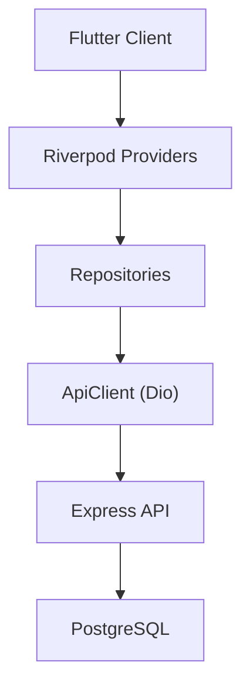
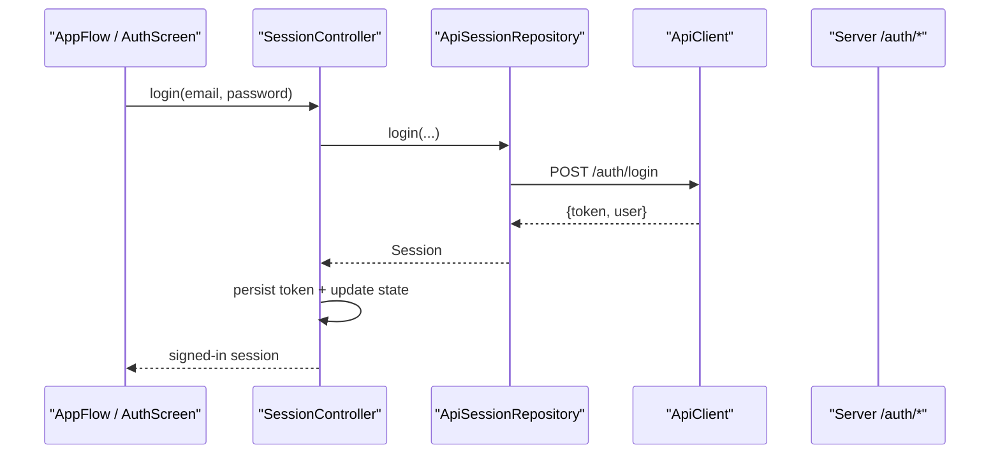
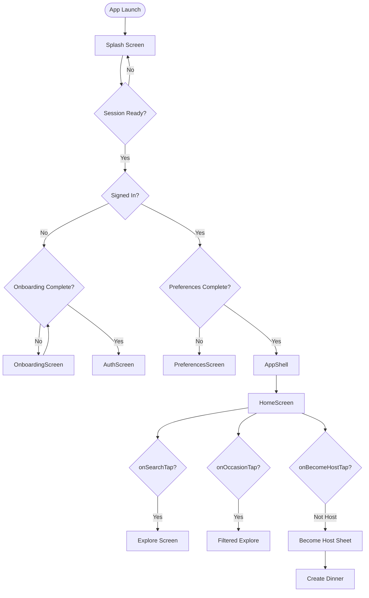
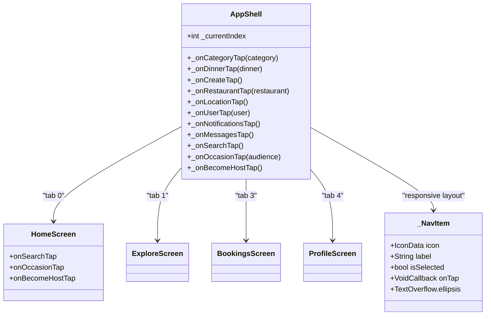
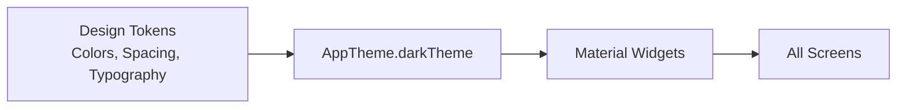
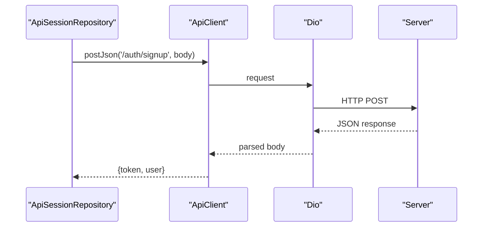
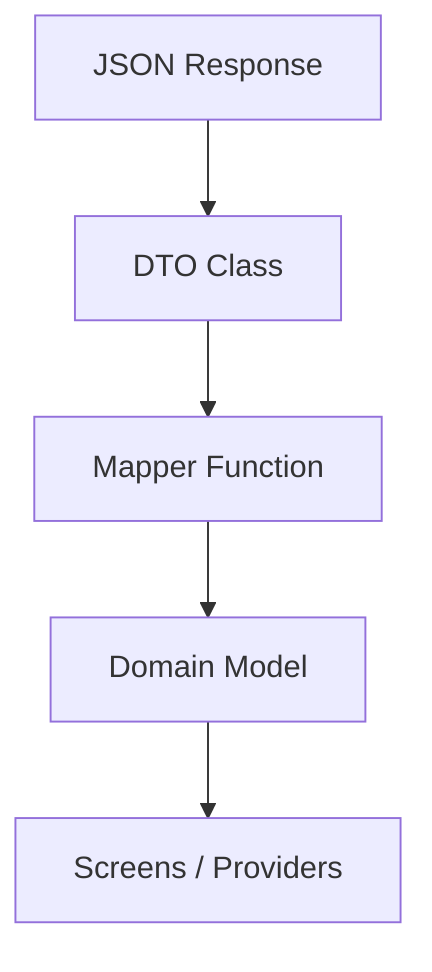
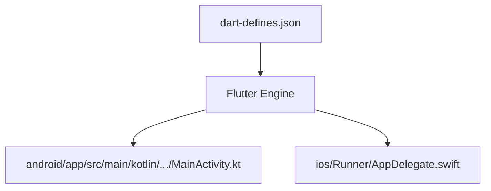
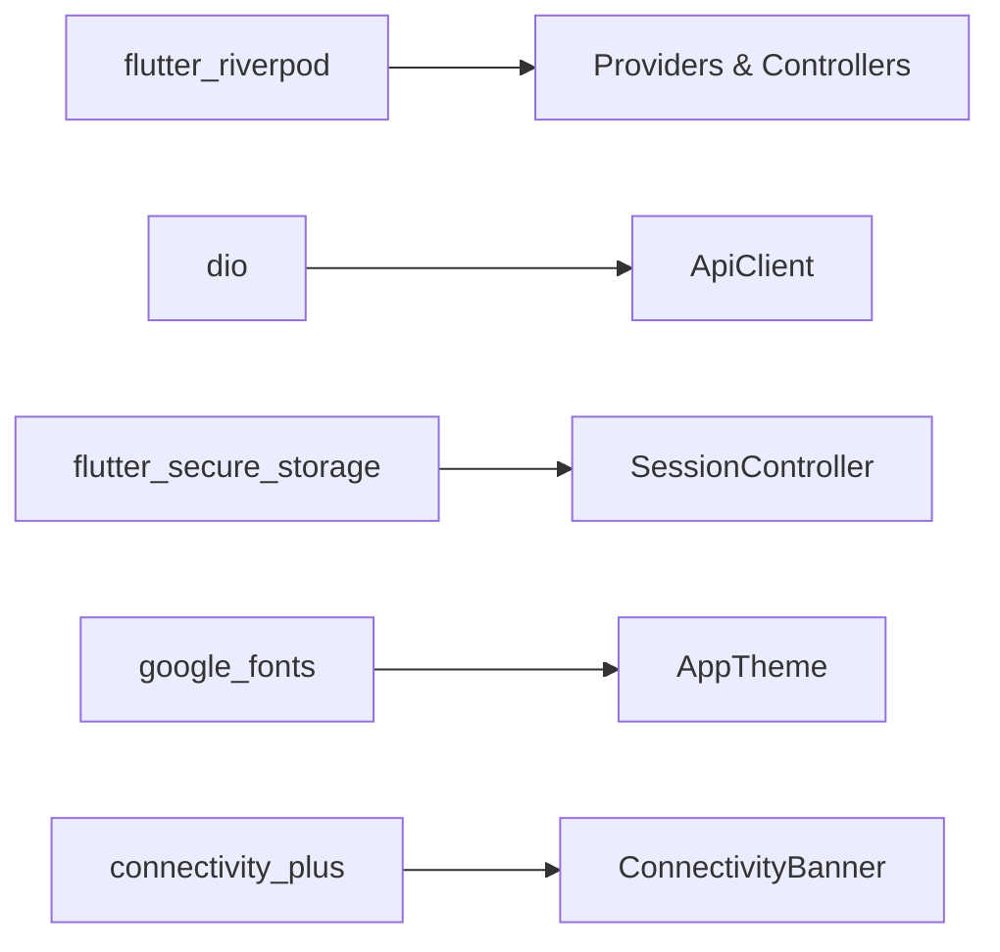

# App Architecture & Structure

<cite>
**Referenced Files in This Document**
- [README.md](file://README.md)
- [pubspec.yaml](file://pubspec.yaml)
- [lib/main.dart](file://lib/main.dart)
- [lib/app_shell.dart](file://lib/app_shell.dart)
- [lib/screens/home/home_screen.dart](file://lib/screens/home/home_screen.dart)
- [lib/providers/session_provider.dart](file://lib/providers/session_provider.dart)
- [lib/repositories/session_repository.dart](file://lib/repositories/session_repository.dart)
- [lib/theme/app_theme.dart](file://lib/theme/app_theme.dart)
</cite>

## Update Summary
**Changes Made**
- Updated Navigation and Routing Strategy section to document enhanced callback handlers
- Added detailed documentation for new navigation callbacks (onSearchTap, onOccasionTap, onBecomeHostTap)
- Updated Widget Hierarchy section to reflect improved bottom navigation bar with responsive layout
- Enhanced _NavItem widget documentation with flexible sizing and ellipsis overflow handling
- Updated diagrams to reflect the new navigation flow patterns

## Table of Contents
1. [Introduction](#introduction)
2. [Project Structure](#project-structure)
3. [Core Components](#core-components)
4. [Architecture Overview](#architecture-overview)
5. [Detailed Component Analysis](#detailed-component-analysis)
6. [Dependency Analysis](#dependency-analysis)
7. [Performance Considerations](#performance-considerations)
8. [Troubleshooting Guide](#troubleshooting-guide)
9. [Conclusion](#conclusion)

## Introduction
This document explains the Flutter mobile application architecture for DineCircle, focusing on clean architecture boundaries (presentation, business logic, data), Riverpod state management, navigation and routing strategy, widget composition principles, theme system, service-layer abstractions, model design, and platform-specific configuration for iOS and Android. The app is a monorepo with a Flutter client and an Express/PostgreSQL server; this document concentrates on the client while referencing server integration points where relevant.

## Project Structure
The Flutter app follows a layered structure:
- Presentation: screens and reusable widgets
- Business logic: Riverpod providers and controllers
- Data layer: repositories, DTOs, mappers, and API client
- Domain models: immutable domain types used by screens
- Theme: centralized design tokens and Material theme
- Platform roots: main entry point and app shell

```mermaid
graph TB
subgraph "Presentation"
Main["main.dart"]
Shell["app_shell.dart"]
Screens["screens/*"]
Widgets["widgets/*"]
end
subgraph "Business Logic"
Providers["providers/*"]
SessionProv["session_provider.dart"]
end
subgraph "Data Layer"
Repos["repositories/*"]
ApiClient["api/api_client.dart"]
DTOs["api/dto/*"]
Mappers["api/mappers/*"]
end
subgraph "Domain"
Models["models/*"]
end
subgraph "Theme"
Theme["theme/app_theme.dart"]
end
Main --> Shell
Shell --> Screens
Screens --> Providers
Providers --> Repos
Repos --> ApiClient
ApiClient --> DTOs
DTOs --> Mappers
Mappers --> Models
Shell --> Theme
```

**Diagram sources**
- [lib/main.dart:13-29](file://lib/main.dart#L13-L29)
- [lib/app_shell.dart:33-331](file://lib/app_shell.dart#L33-L331)
- [lib/providers/session_provider.dart:37-309](file://lib/providers/session_provider.dart#L37-L309)
- [lib/repositories/session_repository.dart:49-249](file://lib/repositories/session_repository.dart#L49-L249)
- [lib/theme/app_theme.dart:11-193](file://lib/theme/app_theme.dart#L11-L193)

**Section sources**
- [README.md:226-299](file://README.md#L226-L299)
- [pubspec.yaml:30-48](file://pubspec.yaml#L30-L48)

## Core Components
- Application bootstrap and root flow:
  - Entry point initializes Riverpod and sets the dark theme.
  - Root flow orchestrates splash → onboarding/auth → preferences → app shell based on session state.
- App shell:
  - Implements the 5-tab bottom navigation using IndexedStack.
  - Owns cross-tab navigation callbacks (e.g., dinner detail, checkout, bookings).
  - Enforces host-gated creation via a "become host" prompt.
- Session state:
  - Riverpod AsyncNotifier manages token lifecycle, profile hydration, role checks, and account operations.
- Repository abstraction:
  - Typed repository methods for auth and user operations, mapping API responses to DTOs.
- Theme system:
  - Centralized Material 3 dark theme composed from design tokens (colors, spacing, typography).

**Section sources**
- [lib/main.dart:13-81](file://lib/main.dart#L13-L81)
- [lib/app_shell.dart:33-331](file://lib/app_shell.dart#L33-L331)
- [lib/providers/session_provider.dart:37-309](file://lib/providers/session_provider.dart#L37-L309)
- [lib/repositories/session_repository.dart:49-249](file://lib/repositories/session_repository.dart#L49-L249)
- [lib/theme/app_theme.dart:11-193](file://lib/theme/app_theme.dart#L11-L193)

## Architecture Overview
DineCircle implements clean architecture with clear separation:
- Presentation layer:
  - Screens consume Riverpod providers and render UI.
  - Navigation is primarily Navigator.push with MaterialPageRoute for feature flows; tabbed areas use IndexedStack.
- Business logic layer:
  - Riverpod providers encapsulate state and side effects.
  - SessionController owns authentication, roles, and profile updates.
- Data layer:
  - Repositories expose typed APIs over Dio-based ApiClient.
  - DTOs represent server payloads; mappers convert DTOs to domain models.
- Domain models:
  - Immutable types consumed by screens and business logic.
- Theme:
  - Single source of truth for colors, typography, and component styles.



**Diagram sources**
- [README.md:226-299](file://README.md#L226-L299)
- [lib/providers/session_provider.dart:37-309](file://lib/providers/session_provider.dart#L37-L309)
- [lib/repositories/session_repository.dart:49-249](file://lib/repositories/session_repository.dart#L49-L249)

## Detailed Component Analysis

### Session Management and Authentication Flow
SessionController is an AsyncNotifier that:
- Bootstraps the session by restoring a secure token and validating it via /auth/me.
- Persists tokens securely and applies them to the ApiClient.
- Exposes sign-up, login, refresh, promote-to-host, influencer promotion, profile updates, settings patches, password change, email change workflow, logout-all, delete-account, and sign-out.
- Provides derived providers for current user ID, auth readiness, current role, and canHost capability.



**Diagram sources**
- [lib/providers/session_provider.dart:37-105](file://lib/providers/session_provider.dart#L37-L105)
- [lib/repositories/session_repository.dart:112-134](file://lib/repositories/session_repository.dart#L112-L134)

**Section sources**
- [lib/providers/session_provider.dart:37-309](file://lib/providers/session_provider.dart#L37-L309)
- [lib/repositories/session_repository.dart:49-249](file://lib/repositories/session_repository.dart#L49-L249)

### Navigation and Routing Strategy
**Updated** Enhanced navigation system with new callback handlers for improved user experience and responsive design.

- Root flow:
  - Splash screen waits for user interaction and session loading.
  - Onboarding or Auth shown when not signed in.
  - Preferences shown once after first sign-in.
  - AppShell rendered when all prerequisites are met.
- Tabbed navigation:
  - Home, Explore, Create placeholder, Bookings, Profile managed via IndexedStack.
  - Category selection from Home carries into Explore without recreating tabs.
- Feature navigation:
  - DinnerDetail → Checkout → BookingConfirmed uses nested Navigator.push calls.
  - Host promotion is gated; non-host users see a bottom sheet to become a host before creating dinners.
- Enhanced callback handlers:
  - `onSearchTap`: Triggers search functionality and navigates to Explore tab
  - `onOccasionTap`: Handles occasion-based filtering (date night, friends, celebration, networking)
  - `onBecomeHostTap`: Manages host promotion flow with proper gating



**Diagram sources**
- [lib/main.dart:31-81](file://lib/main.dart#L31-L81)
- [lib/app_shell.dart:33-331](file://lib/app_shell.dart#L33-L331)
- [lib/screens/home/home_screen.dart:42-44](file://lib/screens/home/home_screen.dart#L42-L44)

**Section sources**
- [lib/main.dart:13-81](file://lib/main.dart#L13-L81)
- [lib/app_shell.dart:33-331](file://lib/app_shell.dart#L33-L331)
- [lib/screens/home/home_screen.dart:42-44](file://lib/screens/home/home_screen.dart#L42-L44)

### Widget Hierarchy and Composition Principles
**Updated** Improved bottom navigation bar with responsive layout using Expanded widgets and enhanced _NavItem component.

- AppShell composes top-level layout:
  - Connectivity banner at the top.
  - IndexedStack holds persistent tab content.
  - Bottom navigation bar with custom items and a prominent create button.
- Event-driven navigation:
  - Callbacks passed down to HomeScreen for actions like opening dinner details, restaurants, notifications, messages, and saved list.
  - New callback handlers: `onSearchTap`, `onOccasionTap`, `onBecomeHostTap` for enhanced user interactions.
- Responsive bottom navigation:
  - Uses `Expanded` widgets for flexible sizing across different screen sizes.
  - Centered create button with gradient styling.
  - Custom `_NavItem` component with ellipsis overflow handling for long labels.
- Reusable components:
  - Buttons, connectivity banner, cards, skeletons, and DataView patterns are defined under widgets and theme.



**Diagram sources**
- [lib/app_shell.dart:33-331](file://lib/app_shell.dart#L33-L331)
- [lib/screens/home/home_screen.dart:42-44](file://lib/screens/home/home_screen.dart#L42-L44)
- [lib/app_shell.dart:468-512](file://lib/app_shell.dart#L468-L512)

**Section sources**
- [lib/app_shell.dart:33-331](file://lib/app_shell.dart#L33-L331)
- [lib/screens/home/home_screen.dart:42-44](file://lib/screens/home/home_screen.dart#L42-L44)
- [lib/app_shell.dart:468-512](file://lib/app_shell.dart#L468-L512)

### Theme System Implementation
- Centralized dark theme built with Material 3.
- Composed from design tokens:
  - Colors: primary, surface, border, danger, text variants.
  - Typography: display, headline, title, body, label scales.
  - Component themes: AppBar, BottomNavigationBar, Card, Buttons, InputDecoration, Chips, Divider, BottomSheet, Dialog, SnackBar, Switch, Slider, TabBar, Icon, ListTile, PopupMenu.
- Consistent styling across screens ensures uniform look and feel.



**Diagram sources**
- [lib/theme/app_theme.dart:11-193](file://lib/theme/app_theme.dart#L11-L193)

**Section sources**
- [lib/theme/app_theme.dart:11-193](file://lib/theme/app_theme.dart#L11-L193)

### Service Layer Abstraction (API Calls and Local Storage)
- ApiClient:
  - Dio wrapper configured with base URL, bearer interceptor, error mapping, GET retry-once, and 401 hook.
- Repositories:
  - Encapsulate HTTP calls and map raw JSON to DTOs.
  - Example: ApiSessionRepository handles auth endpoints and returns typed results.
- Secure storage:
  - Token persisted via flutter_secure_storage; cleared on unauthorized or explicit logout.



**Diagram sources**
- [lib/repositories/session_repository.dart:112-134](file://lib/repositories/session_repository.dart#L112-L134)

**Section sources**
- [README.md:207-223](file://README.md#L207-L223)
- [lib/repositories/session_repository.dart:49-249](file://lib/repositories/session_repository.dart#L49-L249)

### Model Layer Design (Transformation and Validation)
- DTOs:
  - Represent server payloads (e.g., UserDto, TierDto).
- Mappers:
  - Convert DTOs to domain models (e.g., UserProfile).
- Domain models:
  - Immutable types used throughout the app (e.g., Dinner, Restaurant, Booking, Safety).
- Validation:
  - Primarily server-side; client relies on typed DTOs and mappers to ensure consistent shapes.



**Diagram sources**
- [lib/repositories/session_repository.dart:168-181](file://lib/repositories/session_repository.dart#L168-L181)

**Section sources**
- [README.md:270-299](file://README.md#L270-L299)

### Platform-Specific Implementations and Configuration
- Android:
  - MainActivity and generated plugin registrant.
  - Build configuration and debug signing noted in README.
- iOS:
  - AppDelegate and SceneDelegate present; assets and storyboards included.
- Dart defines:
  - API_BASE_URL passed at runtime for emulator/host resolution.
  - Optional dart-defines.json for Stripe keys and other build-time constants.



**Diagram sources**
- [README.md:474-491](file://README.md#L474-L491)

**Section sources**
- [README.md:440-509](file://README.md#L440-L509)

## Dependency Analysis
Key dependencies and their roles:
- flutter_riverpod: state management and dependency injection.
- dio: HTTP client with interceptors and error handling.
- flutter_secure_storage: secure token persistence.
- google_fonts and Material theme: consistent UI styling.
- Connectivity plus: offline banner and connectivity awareness.



**Diagram sources**
- [pubspec.yaml:30-48](file://pubspec.yaml#L30-L48)
- [lib/providers/session_provider.dart:37-309](file://lib/providers/session_provider.dart#L37-L309)

**Section sources**
- [pubspec.yaml:30-48](file://pubspec.yaml#L30-L48)
- [README.md:207-223](file://README.md#L207-L223)

## Performance Considerations
- Use IndexedStack to keep tab content alive and avoid reinitialization costs.
- Prefer provider-scoped data fetching to minimize redundant network calls.
- Leverage Dio's retry-once for GET requests to improve resilience.
- Keep large screens modular; split god files as recommended in project notes.
- **New**: Responsive bottom navigation with Expanded widgets improves performance on various screen sizes.
- **New**: Debounced search functionality reduces unnecessary API calls during typing.

[No sources needed since this section provides general guidance]

## Troubleshooting Guide
Common issues and resolutions:
- Unauthorized errors:
  - SessionController.handleUnauthorized clears token and resets state; verify secure storage and ApiClient token assignment.
- Network failures:
  - Connectivity banner indicates offline state; ensure API_BASE_URL is correct for the device/emulator.
- Host gating:
  - If create dinner is blocked, use the "Become a host" flow to call POST /users/me/host.
- **New**: Navigation callback issues:
  - Ensure all required callbacks (onSearchTap, onOccasionTap, onBecomeHostTap) are properly implemented in parent components.
  - Verify that Expanded widgets are correctly wrapping navigation items for responsive behavior.

**Section sources**
- [lib/providers/session_provider.dart:265-270](file://lib/providers/session_provider.dart#L265-L270)
- [lib/app_shell.dart:99-127](file://lib/app_shell.dart#L99-L127)
- [lib/screens/home/home_screen.dart:42-44](file://lib/screens/home/home_screen.dart#L42-L44)

## Conclusion
DineCircle's Flutter client adheres to clean architecture with clear separation between presentation, business logic, and data layers. Riverpod powers state and side effects, repositories abstract API interactions, and a centralized theme ensures consistent UI. Navigation is driven by Navigator and IndexedStack, with robust session management and secure storage. The enhanced navigation system with new callback handlers (onSearchTap, onOccasionTap, onBecomeHostTap) and responsive bottom navigation bar with Expanded widgets provides improved user experience across devices. The app integrates end-to-end with the server for core features, leaving only specific integrations (payments, push, maps, QR) for future phases.