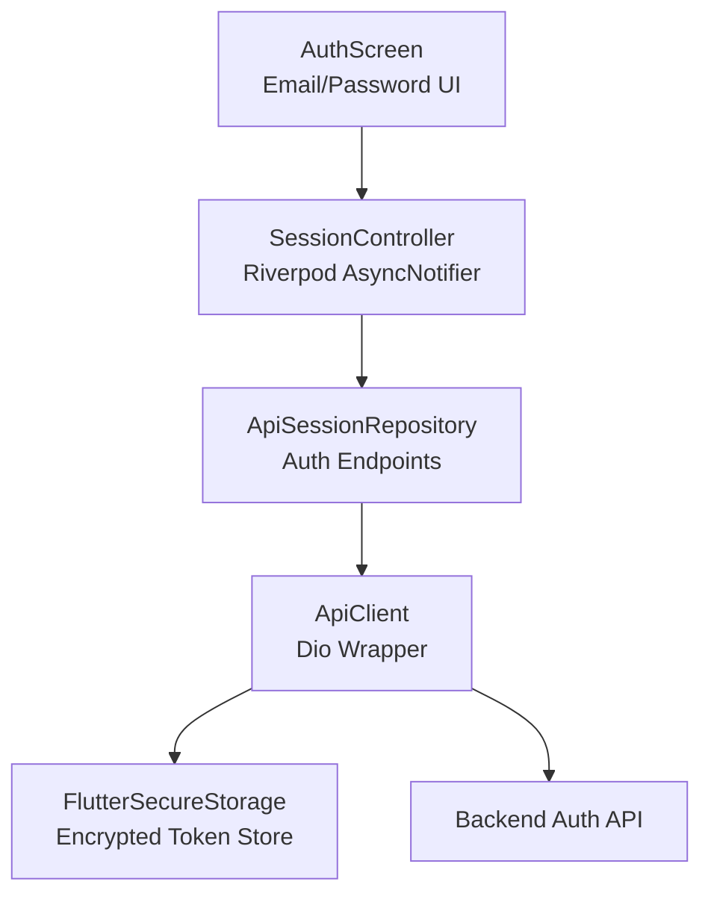
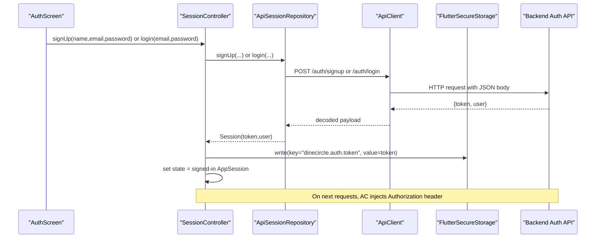
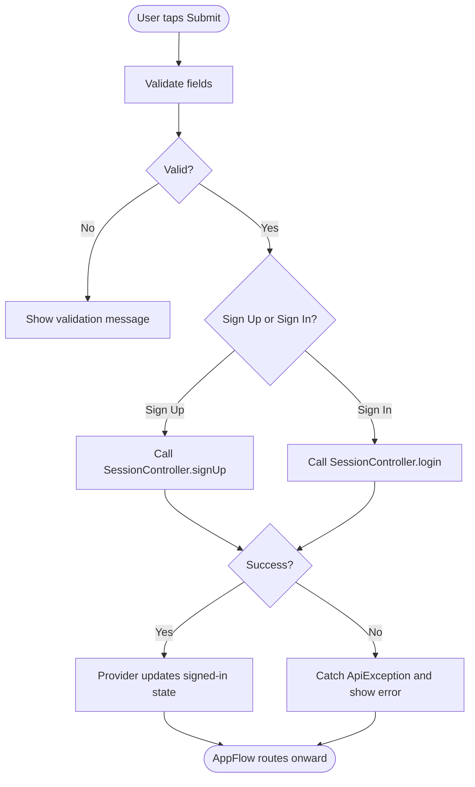
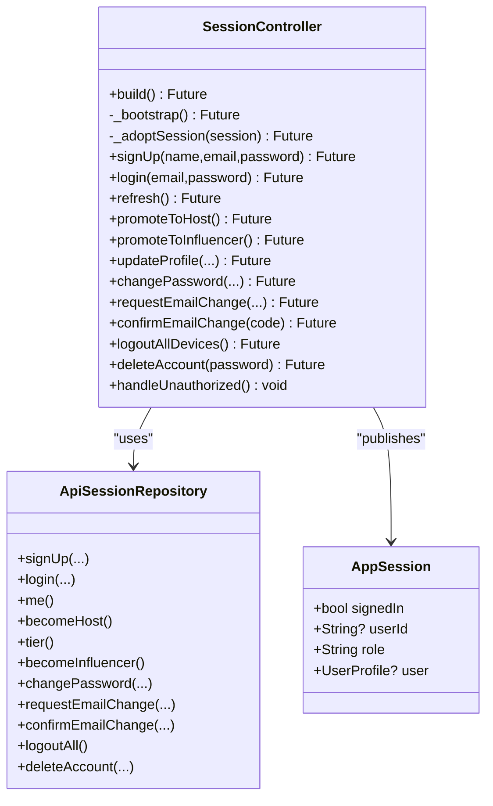
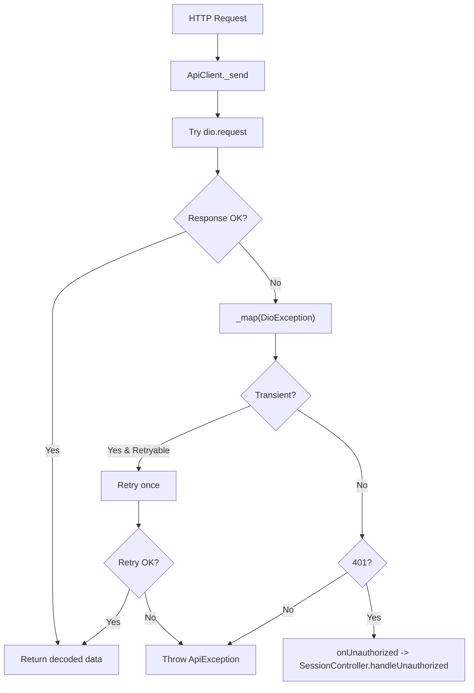
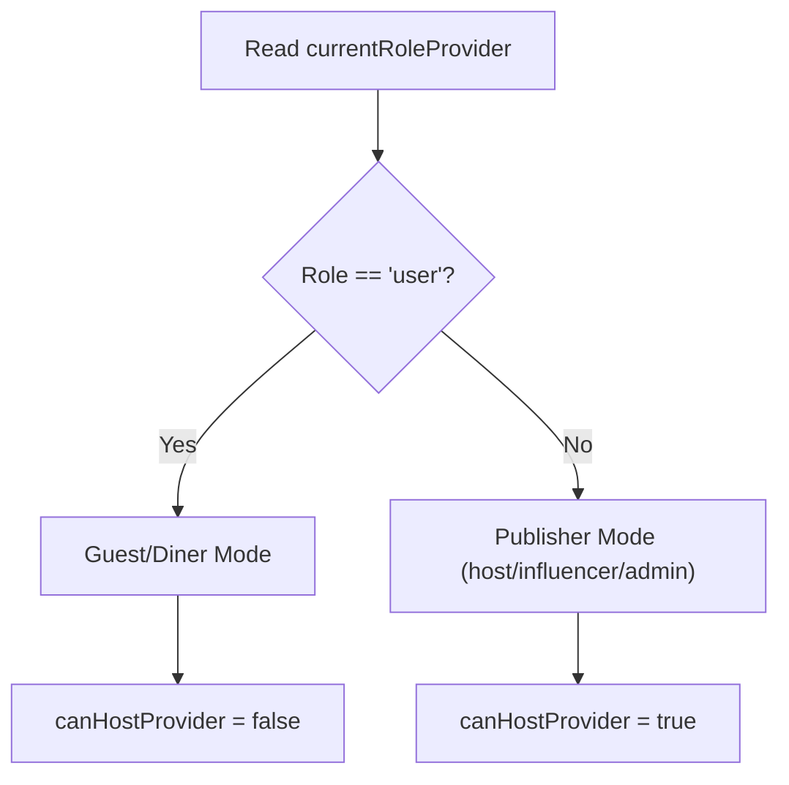
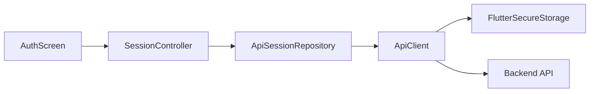

# Authentication System

<cite>
**Referenced Files in This Document**
- [auth_screen.dart](file://lib/screens/auth/auth_screen.dart)
- [session_provider.dart](file://lib/providers/session_provider.dart)
- [session_repository.dart](file://lib/repositories/session_repository.dart)
- [api_client.dart](file://lib/api/api_client.dart)
- [api_exception.dart](file://lib/api/api_exception.dart)
- [api_client_provider.dart](file://lib/providers/api_client_provider.dart)
</cite>

## Table of Contents
1. [Introduction](#introduction)
2. [Project Structure](#project-structure)
3. [Core Components](#core-components)
4. [Architecture Overview](#architecture-overview)
5. [Detailed Component Analysis](#detailed-component-analysis)
6. [Dependency Analysis](#dependency-analysis)
7. [Performance Considerations](#performance-considerations)
8. [Troubleshooting Guide](#troubleshooting-guide)
9. [Conclusion](#conclusion)

## Introduction
This document explains the authentication system for DinCircle, focusing on email/password registration and login, secure token storage, automatic session refresh, role-based access control (guests, hosts, admins), error handling for network failures and invalid credentials, Riverpod-based state management, and examples of protected routes and permission checks.

## Project Structure
The authentication implementation spans UI, state, repository, HTTP client, and security layers:
- UI: Email/password sign-in and sign-up screen.
- State: Riverpod provider that owns the signed-in session and persists tokens securely.
- Repository: API surface for auth endpoints and user profile operations.
- HTTP Client: Dio wrapper with bearer token injection, retry logic, and 401 handling.
- Security: Secure storage provider for Android encrypted preferences.

**Diagram sources**
- [auth_screen.dart:1-281](file://lib/screens/auth/auth_screen.dart#L1-L281)
- [session_provider.dart:1-309](file://lib/providers/session_provider.dart#L1-L309)
- [session_repository.dart:1-250](file://lib/repositories/session_repository.dart#L1-L250)
- [api_client.dart:1-162](file://lib/api/api_client.dart#L1-L162)
- [api_client_provider.dart:1-74](file://lib/providers/api_client_provider.dart#L1-L74)

**Section sources**
- [auth_screen.dart:1-281](file://lib/screens/auth/auth_screen.dart#L1-L281)
- [session_provider.dart:1-309](file://lib/providers/session_provider.dart#L1-L309)
- [session_repository.dart:1-250](file://lib/repositories/session_repository.dart#L1-L250)
- [api_client.dart:1-162](file://lib/api/api_client.dart#L1-L162)
- [api_client_provider.dart:1-74](file://lib/providers/api_client_provider.dart#L1-L74)

## Core Components
- AuthScreen: User-facing form for sign-in and sign-up with validation and error display.
- SessionController: Riverpod AsyncNotifier managing AppSession, token persistence, and lifecycle methods (login, signUp, logout, promote roles).
- ApiSessionRepository: Thin layer mapping repository calls to backend endpoints (/auth/*, /users/me/*).
- ApiClient: Dio wrapper attaching Authorization headers, retrying transient GET errors, and triggering unauthorized flow.
- ApiException: Unified error model with categories like network, timeout, unauthorized, forbidden, validation, conflict, server.

Key responsibilities:
- Secure token storage using FlutterSecureStorage with Android encrypted preferences.
- Automatic bootstrap of session from stored token and validation via /auth/me.
- Centralized error mapping and propagation to UI.
- Role-aware providers for authorization decisions.

**Section sources**
- [auth_screen.dart:1-281](file://lib/screens/auth/auth_screen.dart#L1-L281)
- [session_provider.dart:1-309](file://lib/providers/session_provider.dart#L1-L309)
- [session_repository.dart:1-250](file://lib/repositories/session_repository.dart#L1-L250)
- [api_client.dart:1-162](file://lib/api/api_client.dart#L1-L162)
- [api_exception.dart:1-42](file://lib/api/api_exception.dart#L1-L42)

## Architecture Overview
The authentication architecture follows a layered approach:
- UI triggers actions on SessionController.
- SessionController delegates to ApiSessionRepository.
- ApiSessionRepository uses ApiClient to call backend endpoints.
- ApiClient attaches bearer tokens and handles 401 by notifying SessionController.
- SessionController persists tokens to secure storage and updates app-wide state.

**Diagram sources**
- [auth_screen.dart:57-95](file://lib/screens/auth/auth_screen.dart#L57-L95)
- [session_provider.dart:76-97](file://lib/providers/session_provider.dart#L76-L97)
- [session_repository.dart:112-134](file://lib/repositories/session_repository.dart#L112-L134)
- [api_client.dart:24-37](file://lib/api/api_client.dart#L24-L37)
- [api_client_provider.dart:18-22](file://lib/providers/api_client_provider.dart#L18-L22)

## Detailed Component Analysis

### Authentication Screen (Email/Password)
- Provides segmented controls to switch between sign-in and sign-up.
- Validates email format, password length (for sign-up), and name presence (for sign-up).
- Calls SessionController.signUp or SessionController.login based on intent.
- Displays ApiException messages or generic network error messages.

**Diagram sources**
- [auth_screen.dart:57-95](file://lib/screens/auth/auth_screen.dart#L57-L95)
- [auth_screen.dart:97-117](file://lib/screens/auth/auth_screen.dart#L97-L117)

**Section sources**
- [auth_screen.dart:1-281](file://lib/screens/auth/auth_screen.dart#L1-L281)

### Session Management and Secure Token Storage
- Bootstrap: On build, reads stored token from secure storage; if present, sets it on ApiClient and validates via /auth/me. Failure clears token and signs out.
- Adoption: After successful login/sign-up, writes token to secure storage and publishes signed-in AppSession.
- Refresh: Re-fetches /auth/me to update profile/role changes without re-auth.
- Logout/Delete: Clears local token and state; optionally revokes sessions on server.

**Diagram sources**
- [session_provider.dart:11-33](file://lib/providers/session_provider.dart#L11-L33)
- [session_provider.dart:37-271](file://lib/providers/session_provider.dart#L37-L271)
- [session_repository.dart:49-104](file://lib/repositories/session_repository.dart#L49-L104)
- [session_repository.dart:106-249](file://lib/repositories/session_repository.dart#L106-L249)

**Section sources**
- [session_provider.dart:1-309](file://lib/providers/session_provider.dart#L1-L309)
- [session_repository.dart:1-250](file://lib/repositories/session_repository.dart#L1-L250)

### HTTP Client and Error Handling
- Attaches Authorization header with bearer token on every request.
- Maps Dio exceptions to ApiException with clear categories (network, timeout, unauthorized, etc.).
- Retries idempotent GET requests once on transient failures.
- Invokes onUnauthorized callback when receiving 401, which clears token and signs out.

**Diagram sources**
- [api_client.dart:24-37](file://lib/api/api_client.dart#L24-L37)
- [api_client.dart:77-111](file://lib/api/api_client.dart#L77-L111)
- [api_client.dart:113-151](file://lib/api/api_client.dart#L113-L151)
- [api_exception.dart:1-42](file://lib/api/api_exception.dart#L1-L42)

**Section sources**
- [api_client.dart:1-162](file://lib/api/api_client.dart#L1-L162)
- [api_exception.dart:1-42](file://lib/api/api_exception.dart#L1-L42)

### Role-Based Access Control (RBAC)
- Roles include user, host, influencer, partner_admin, super_admin.
- Providers expose currentRoleProvider and canHostProvider to gate features.
- Promotion flows:
  - Host promotion via SessionController.promoteToHost calling /users/me/host.
  - Influencer promotion via SessionController.promoteToInfluencer calling /users/me/influencer.
- Tier information is fetched conditionally for hosts only.

**Diagram sources**
- [session_provider.dart:289-299](file://lib/providers/session_provider.dart#L289-L299)
- [session_provider.dart:107-125](file://lib/providers/session_provider.dart#L107-L125)

**Section sources**
- [session_provider.dart:289-309](file://lib/providers/session_provider.dart#L289-L309)
- [session_repository.dart:62-74](file://lib/repositories/session_repository.dart#L62-L74)

### Protected Routes and Permission Checks
- Use authReadyProvider to short-circuit data loading until session is bootstrapped.
- Gate screens/features with currentRoleProvider and canHostProvider.
- Example patterns:
  - Hide host-only features when currentRoleProvider equals 'user'.
  - Disable publishing actions unless canHostProvider is true.
  - Redirect unauthenticated users to AuthScreen when authReadyProvider is false.

[No sources needed since this section provides general guidance]

## Dependency Analysis
The authentication components are organized into clear layers with minimal coupling:
- UI depends on SessionController via Riverpod.
- SessionController depends on ApiSessionRepository and secure storage.
- ApiSessionRepository depends on ApiClient.
- ApiClient depends on Dio and config, and notifies SessionController on 401.

**Diagram sources**
- [auth_screen.dart:1-281](file://lib/screens/auth/auth_screen.dart#L1-L281)
- [session_provider.dart:1-309](file://lib/providers/session_provider.dart#L1-L309)
- [session_repository.dart:1-250](file://lib/repositories/session_repository.dart#L1-L250)
- [api_client.dart:1-162](file://lib/api/api_client.dart#L1-L162)
- [api_client_provider.dart:18-22](file://lib/providers/api_client_provider.dart#L18-L22)

**Section sources**
- [api_client_provider.dart:1-74](file://lib/providers/api_client_provider.dart#L1-L74)

## Performance Considerations
- Token bootstrap avoids unnecessary network calls by checking secure storage first.
- GET retries improve resilience against transient network issues.
- Conditional tier fetching reduces overhead for non-host users.
- Avoid exposing PII in settings updates; SessionController preserves email where needed.

[No sources needed since this section provides general guidance]

## Troubleshooting Guide
Common issues and resolutions:
- Network failures: ApiException maps connection errors and timeouts; UI should prompt users to check connectivity.
- Invalid credentials: ApiException with validation or unauthorized kind surfaces appropriate messages.
- Expired tokens: ApiClient triggers handleUnauthorized, clearing local token and signing out; user must re-authenticate.
- Rotation/restore: Ensure secure storage is available; tests override secureStorageProvider with in-memory storage.

Recommended checks:
- Verify AppConfig.apiUrl points to correct backend.
- Confirm AndroidOptions(encryptedSharedPreferences: true) is configured for secure storage.
- Inspect ApiException.kind and statusCode to tailor user feedback.

**Section sources**
- [api_client.dart:113-151](file://lib/api/api_client.dart#L113-L151)
- [api_exception.dart:1-42](file://lib/api/api_exception.dart#L1-L42)
- [api_client_provider.dart:18-22](file://lib/providers/api_client_provider.dart#L18-L22)

## Conclusion
The DinCircle authentication system provides a robust, layered implementation:
- Clear separation of concerns across UI, state, repository, and HTTP client.
- Secure token storage with automatic bootstrap and refresh.
- Comprehensive error handling and retry strategies.
- Role-based access control enabling guest, host, and admin modes.
- Riverpod-driven state management simplifies UI reactions and feature gating.

Adhering to these patterns ensures maintainability, security, and a smooth user experience across sign-in, sign-up, and protected features.