# Booking & Checkout System

<cite>
**Referenced Files in This Document**
- [README.md](file://README.md)
- [lib/models/booking.dart](file://lib/models/booking.dart)
- [lib/screens/checkout/checkout_screen.dart](file://lib/screens/checkout/checkout_screen.dart)
- [lib/screens/bookings/bookings_screen.dart](file://lib/screens/bookings/bookings_screen.dart)
- [lib/screens/booking_confirmed/booking_confirmed_screen.dart](file://lib/screens/booking_confirmed/booking_confirmed_screen.dart)
- [lib/widgets/payment_ledger.dart](file://lib/widgets/payment_ledger.dart)
- [lib/widgets/booking_receipt_sheet.dart](file://lib/widgets/booking_receipt_sheet.dart)
- [lib/widgets/booking_check_in_sheet.dart](file://lib/widgets/booking_check_in_sheet.dart)
- [lib/theme/app_text_styles.dart](file://lib/theme/app_text_styles.dart)
- [server/src/routes/bookings.ts](file://server/src/routes/bookings.ts)
- [test/layout_overflow_extended_test.dart](file://test/layout_overflow_extended_test.dart)
</cite>

## Update Summary
**Changes Made**
- Updated Payment Ledger Interface section with enhanced unsigned amount display methods
- Enhanced Methods Section presentation for better readability and security
- Improved payment tracking visualization with clearer status indicators
- Added comprehensive transaction details screen functionality
- Updated booking state management with improved payment state mapping
- **Enhanced booking confirmation screen with improved text scaling, narrow screen compatibility, and flexible layout handling for pass badges and booking details**
- **Added robust layout management using Expanded, Align, and Flexible widgets to handle various text scaling scenarios**

## Table of Contents
1. [Introduction](#introduction)
2. [Project Structure](#project-structure)
3. [Core Components](#core-components)
4. [Architecture Overview](#architecture-overview)
5. [Detailed Component Analysis](#detailed-component-analysis)
6. [Dependency Analysis](#dependency-analysis)
7. [Performance Considerations](#performance-considerations)
8. [Troubleshooting Guide](#troubleshooting-guide)
9. [Conclusion](#conclusion)

## Introduction
This document explains the booking and checkout system end-to-end: seat selection, capacity management, payment processing with Stripe integration, booking confirmation and ticket generation, bookings management, cancellation and refund workflows, booking state management, real-time updates, error handling, and a complete lifecycle example from selection to confirmation.

The system is part of DineCircle, a Flutter consumer app backed by an Express + PostgreSQL API. At this stage, payments are simulated on the client side but the server supports a deferred Stripe flow where seats can be held while payment is completed through Stripe's PaymentSheet; webhooks settle the final payment state.

**Section sources**
- [README.md:12-32](file://README.md#L12-L32)
- [README.md:143-155](file://README.md#L143-L155)
- [README.md:178-190](file://README.md#L178-L190)
- [README.md:405-416](file://README.md#L405-L416)

## Project Structure
The booking and checkout feature spans both the Flutter app and the server:

- Flutter app
  - Models define booking status, check-in status, and payment-related fields.
  - Screens implement the user journey: seat selection, guest info, review, payment, confirmation, and bookings management.
  - Enhanced payment ledger interface with improved visualization and security.
  - Responsive booking confirmation screen with improved text scaling and narrow screen compatibility.
- Server
  - The bookings route implements transactional seat locking, audience gating, duplicate checks, promo validation, payment intent creation, cancellation/refund bookkeeping, host approval/decline, check-in, and payment refresh.

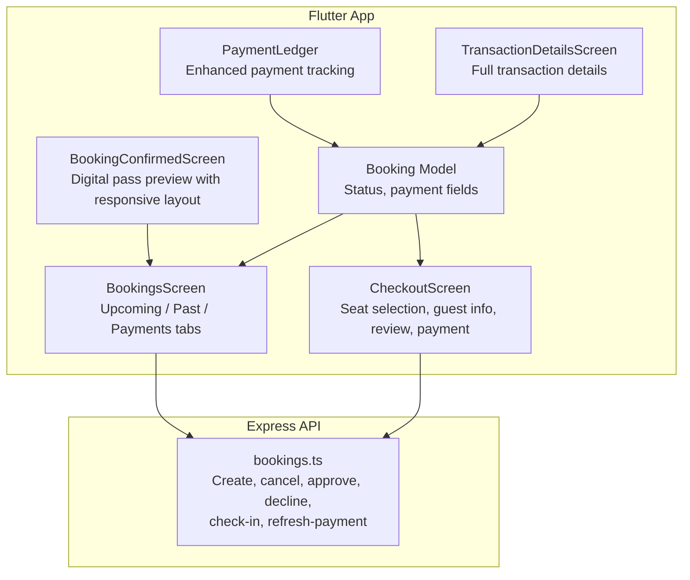

**Diagram sources**
- [lib/screens/checkout/checkout_screen.dart:16-31](file://lib/screens/checkout/checkout_screen.dart#L16-L31)
- [lib/screens/bookings/bookings_screen.dart:20-26](file://lib/screens/bookings/bookings_screen.dart#L20-L26)
- [lib/screens/booking_confirmed/booking_confirmed_screen.dart:11-22](file://lib/screens/booking_confirmed/booking_confirmed_screen.dart#L11-L22)
- [lib/widgets/payment_ledger.dart:104-121](file://lib/widgets/payment_ledger.dart#L104-L121)
- [lib/widgets/payment_ledger.dart:796-800](file://lib/widgets/payment_ledger.dart#L796-L800)
- [lib/models/booking.dart:4-47](file://lib/models/booking.dart#L4-L47)
- [server/src/routes/bookings.ts:153-156](file://server/src/routes/bookings.ts#L153-L156)

**Section sources**
- [README.md:226-252](file://README.md#L226-L252)
- [README.md:270-299](file://README.md#L270-L299)

## Core Components
- Booking model
  - Defines booking statuses (pending, confirmed, cancelled, completed, noShow, refunded).
  - Tracks payment method label, payment status, optional Stripe client secret for deferred checkout, and check-in state.
  - Enhanced payment state mapping with improved fallback logic for legacy rows.
- Checkout screen
  - Three-step flow: select seats, enter guest info, review and pay.
  - Supports promo code entry and local card entry that produces a masked label.
  - Integrates with Stripe when enabled; otherwise uses historical simulated confirmation.
- Bookings screen
  - Central hub for upcoming and past reservations.
  - Provides cancel, check-in, directions, contact host, and retry payment actions.
  - Filters by booking status and separates upcoming vs past lists.
- Booking confirmed screen
  - Shows digital event pass preview and booking details.
  - Opens the check-in sheet for QR/code display.
  - **Enhanced with improved text scaling using FittedBox, narrow screen compatibility with Flexible widgets, and flexible layout handling for pass badges and booking details.**
- Enhanced Payment Ledger
  - Aggregated payment figures with per-currency breakdowns.
  - Unsigned amount display using clear "Paid" / "Refunded" labels instead of signed +/- notation.
  - Enhanced methods section presentation with usage counts and security messaging.
  - Transaction details screen with comprehensive payment information.
- Server bookings route
  - Transactional booking creation with FOR UPDATE seat locking.
  - Audience gating, sold-out/duplicate checks, promo validation, and server-side totals.
  - Deferred payment via Stripe PaymentIntent when configured.
  - Cancellation with refund ledger entries and seat release.
  - Host approve/decline flows for pending requests.
  - Check-in that captures authorized payments and accrues host payouts.
  - Refresh-payment endpoint to re-issue a client secret for abandoned holds.

**Section sources**
- [lib/models/booking.dart:4-47](file://lib/models/booking.dart#L4-L47)
- [lib/models/booking.dart:94-118](file://lib/models/booking.dart#L94-L118)
- [lib/screens/checkout/checkout_screen.dart:16-31](file://lib/screens/checkout/checkout_screen.dart#L16-L31)
- [lib/screens/bookings/bookings_screen.dart:20-26](file://lib/screens/bookings/bookings_screen.dart#L20-L26)
- [lib/screens/booking_confirmed/booking_confirmed_screen.dart:11-22](file://lib/screens/booking_confirmed/booking_confirmed_screen.dart#L11-L22)
- [lib/widgets/payment_ledger.dart:104-121](file://lib/widgets/payment_ledger.dart#L104-L121)
- [lib/widgets/payment_ledger.dart:500-501](file://lib/widgets/payment_ledger.dart#L500-L501)
- [lib/widgets/payment_ledger.dart:677-681](file://lib/widgets/payment_ledger.dart#L677-L681)
- [lib/widgets/payment_ledger.dart:796-800](file://lib/widgets/payment_ledger.dart#L796-L800)
- [server/src/routes/bookings.ts:153-156](file://server/src/routes/bookings.ts#L153-L156)

## Architecture Overview
The booking architecture enforces authoritative business rules on the server while providing a responsive UI on the client.

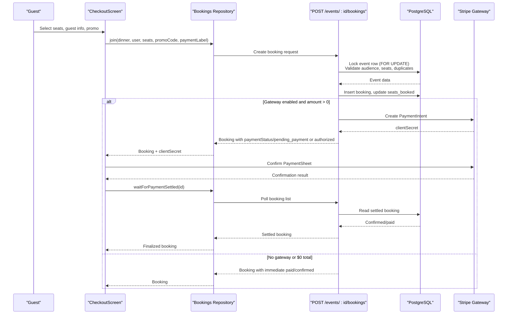

**Diagram sources**
- [lib/screens/checkout/checkout_screen.dart:701-792](file://lib/screens/checkout/checkout_screen.dart#L701-L792)
- [server/src/routes/bookings.ts:153-405](file://server/src/routes/bookings.ts#L153-L405)

## Detailed Component Analysis

### Seat Selection Interface and Capacity Management
- The checkout screen presents a step-based interface:
  - Step 0: Select number of seats up to the event's available seats.
  - Step 1: Enter primary guest information and optionally apply a promo code.
  - Step 2: Review summary, price breakdown, and selected payment method.
- Capacity management is enforced server-side:
  - The server locks the event row during booking creation to prevent overselling.
  - It validates remaining seats, rejects already-started events, and prevents duplicate active bookings for the same user/event pair.
  - Promo codes are validated server-side; unknown or inactive codes are rejected.

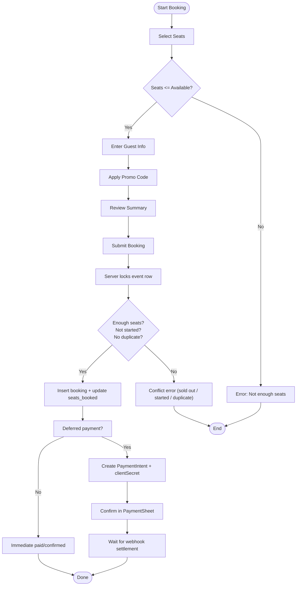

**Diagram sources**
- [lib/screens/checkout/checkout_screen.dart:180-263](file://lib/screens/checkout/checkout_screen.dart#L180-L263)
- [lib/screens/checkout/checkout_screen.dart:660-675](file://lib/screens/checkout/checkout_screen.dart#L660-L675)
- [server/src/routes/bookings.ts:180-233](file://server/src/routes/bookings.ts#L180-L233)
- [server/src/routes/bookings.ts:234-252](file://server/src/routes/bookings.ts#L234-L252)

**Section sources**
- [lib/screens/checkout/checkout_screen.dart:180-263](file://lib/screens/checkout/checkout_screen.dart#L180-L263)
- [lib/screens/checkout/checkout_screen.dart:660-675](file://lib/screens/checkout/checkout_screen.dart#L660-L675)
- [server/src/routes/bookings.ts:180-233](file://server/src/routes/bookings.ts#L180-L233)
- [server/src/routes/bookings.ts:234-252](file://server/src/routes/bookings.ts#L234-L252)

### Payment Processing Flow and Stripe Integration
- Client behavior:
  - If Stripe is enabled and the booking requires deferred payment, the client calls Stripe's confirmPayment with the provided clientSecret.
  - After confirmation, it polls until the server reports the booking has settled.
  - If keyless builds are used, the historical simulated confirmation path is taken.
- Server behavior:
  - When a gateway is configured and the final amount is greater than zero, the server creates a PaymentIntent outside the seat-lock transaction.
  - The booking is inserted with payment_status pending_payment (or authorized for approval-gated events), and seats are held.
  - Webhooks (not shown here) are responsible for flipping the booking to paid/confirmed once the gateway confirms.
- Payment methods:
  - The UI allows selecting saved cards, Apple Pay, Google Pay, or adding a new card locally.
  - In the current implementation, these options produce a masked label stored with the booking; actual charges are handled by Stripe only when enabled.

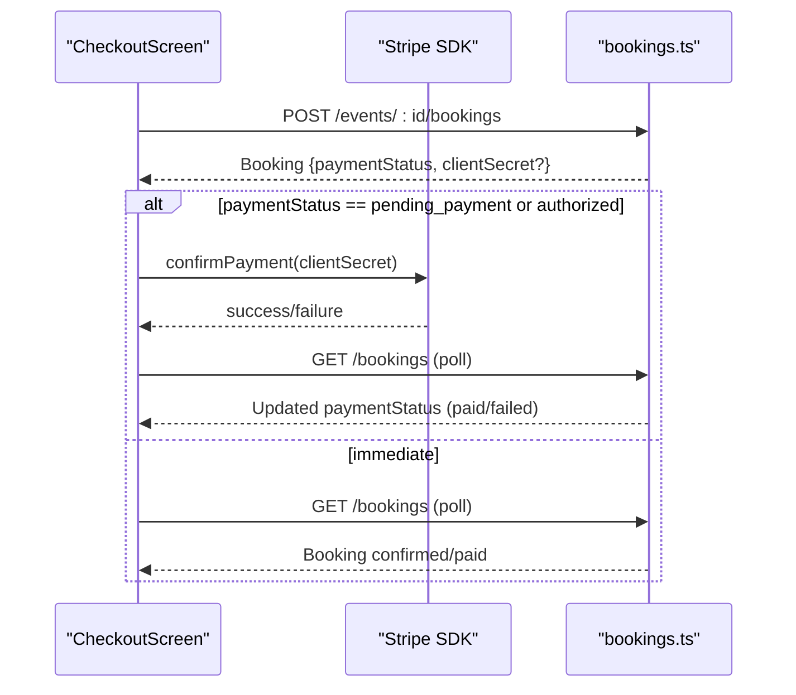

**Diagram sources**
- [lib/screens/checkout/checkout_screen.dart:726-771](file://lib/screens/checkout/checkout_screen.dart#L726-L771)
- [server/src/routes/bookings.ts:337-379](file://server/src/routes/bookings.ts#L337-L379)

**Section sources**
- [lib/screens/checkout/checkout_screen.dart:701-792](file://lib/screens/checkout/checkout_screen.dart#L701-L792)
- [server/src/routes/bookings.ts:337-379](file://server/src/routes/bookings.ts#L337-L379)

### Enhanced Payment Ledger Interface
**Updated** Significant improvements to the payment ledger interface with enhanced unsigned amount display methods, improved methods section presentation, and better readability for payment tracking visualization.

- **Unsigned Amount Display**: The ledger now uses clear "Paid" / "Refunded" labels instead of signed +/- notation, making financial data more intuitive and accessible.
- **Enhanced Methods Section**: The payment methods section provides better readability with usage counts and security messaging explaining that card details are handled by the payment provider.
- **Improved Visualization**: Each booking tile displays amounts without signs, with separate status labels indicating the nature of the transaction.
- **Transaction Details Screen**: Comprehensive transaction details screen showing full payment information including event details, payment method, currency, and refund information when applicable.

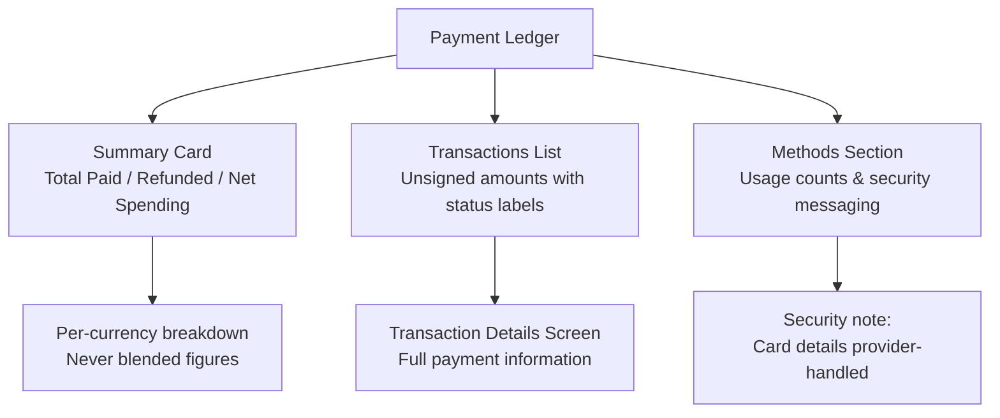

**Diagram sources**
- [lib/widgets/payment_ledger.dart:104-121](file://lib/widgets/payment_ledger.dart#L104-L121)
- [lib/widgets/payment_ledger.dart:255-359](file://lib/widgets/payment_ledger.dart#L255-L359)
- [lib/widgets/payment_ledger.dart:500-501](file://lib/widgets/payment_ledger.dart#L500-L501)
- [lib/widgets/payment_ledger.dart:677-779](file://lib/widgets/payment_ledger.dart#L677-L779)
- [lib/widgets/payment_ledger.dart:796-984](file://lib/widgets/payment_ledger.dart#L796-L984)

**Section sources**
- [lib/widgets/payment_ledger.dart:104-121](file://lib/widgets/payment_ledger.dart#L104-L121)
- [lib/widgets/payment_ledger.dart:255-359](file://lib/widgets/payment_ledger.dart#L255-L359)
- [lib/widgets/payment_ledger.dart:500-501](file://lib/widgets/payment_ledger.dart#L500-L501)
- [lib/widgets/payment_ledger.dart:677-779](file://lib/widgets/payment_ledger.dart#L677-L779)
- [lib/widgets/payment_ledger.dart:796-984](file://lib/widgets/payment_ledger.dart#L796-L984)

### Enhanced Booking Confirmation Screen and Ticket Generation
**Updated** The booking confirmation screen has been significantly enhanced with improved text scaling, narrow screen compatibility, and flexible layout handling for pass badges and booking details.

- **Responsive Text Scaling**: Uses `FittedBox` with `BoxFit.scaleDown` for the app bar title to ensure proper scaling across different screen sizes and text scale settings.
- **Narrow Screen Compatibility**: Implements `Flexible` widgets throughout the layout to ensure content adapts properly on narrow devices, preventing overflow issues.
- **Flexible Layout Handling**: Pass badges and booking details use flexible layouts with proper ellipsis handling for long text content.
- **Robust Layout Management**: Utilizes `Expanded` and `Align` widgets to maintain proper spacing and alignment while allowing text to truncate gracefully.
- **Digital Event Pass Preview**: Shows event details, booking information, and interactive elements for check-in access.
- **Booking Details Display**: Presents comprehensive booking information including subtotal, service fee, discount, total paid, payment method, and status with proper text wrapping and overflow handling.
- **Interactive Elements**: Includes actions to view My Bookings and open the check-in sheet for QR/code display.

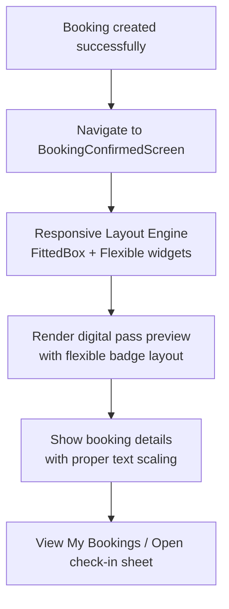

**Diagram sources**
- [lib/screens/booking_confirmed/booking_confirmed_screen.dart:36-40](file://lib/screens/booking_confirmed/booking_confirmed_screen.dart#L36-L40)
- [lib/screens/booking_confirmed/booking_confirmed_screen.dart:102-137](file://lib/screens/booking_confirmed/booking_confirmed_screen.dart#L102-L137)
- [lib/screens/booking_confirmed/booking_confirmed_screen.dart:200-233](file://lib/screens/booking_confirmed/booking_confirmed_screen.dart#L200-L233)
- [lib/screens/booking_confirmed/booking_confirmed_screen.dart:348-475](file://lib/screens/booking_confirmed/booking_confirmed_screen.dart#L348-L475)

**Section sources**
- [lib/screens/booking_confirmed/booking_confirmed_screen.dart:36-40](file://lib/screens/booking_confirmed/booking_confirmed_screen.dart#L36-L40)
- [lib/screens/booking_confirmed/booking_confirmed_screen.dart:102-137](file://lib/screens/booking_confirmed/booking_confirmed_screen.dart#L102-L137)
- [lib/screens/booking_confirmed/booking_confirmed_screen.dart:200-233](file://lib/screens/booking_confirmed/booking_confirmed_screen.dart#L200-L233)
- [lib/screens/booking_confirmed/booking_confirmed_screen.dart:348-475](file://lib/screens/booking_confirmed/booking_confirmed_screen.dart#L348-L475)
- [server/src/routes/bookings.ts:19-26](file://server/src/routes/bookings.ts#L19-L26)

### Bookings Management Screen
- The Bookings screen provides:
  - Upcoming tab: shows confirmed or pending bookings with status chips, event details, and actions such as check-in, directions, contact host, cancel, and complete payment.
  - Past tab: shows completed, cancelled, no-show, and refunded bookings.
  - Payments tab: aggregates payment-related views across all bookings.
- Status filtering allows users to focus on specific states.
- Cancel action triggers server-side cancellation and shows feedback.
- Complete payment action refreshes the client secret and retries Stripe confirmation.

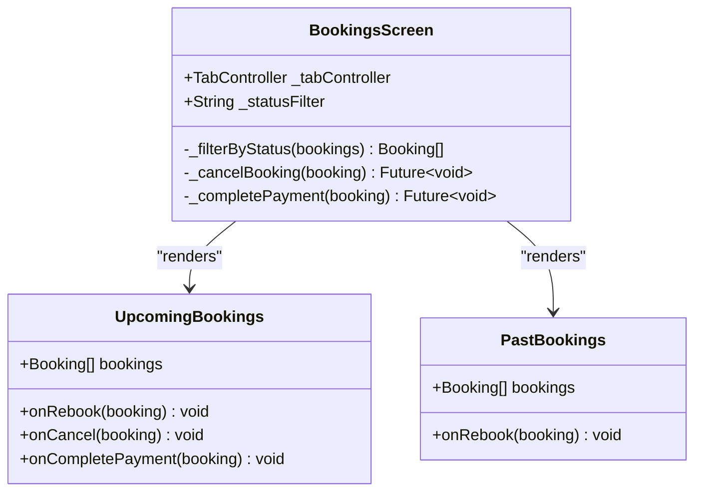

**Diagram sources**
- [lib/screens/bookings/bookings_screen.dart:20-26](file://lib/screens/bookings/bookings_screen.dart#L20-L26)
- [lib/screens/bookings/bookings_screen.dart:60-93](file://lib/screens/bookings/bookings_screen.dart#L60-L93)
- [lib/screens/bookings/bookings_screen.dart:140-249](file://lib/screens/bookings/bookings_screen.dart#L140-L249)

**Section sources**
- [lib/screens/bookings/bookings_screen.dart:20-26](file://lib/screens/bookings/bookings_screen.dart#L20-L26)
- [lib/screens/bookings/bookings_screen.dart:60-93](file://lib/screens/bookings/bookings_screen.dart#L60-L93)
- [lib/screens/bookings/bookings_screen.dart:140-249](file://lib/screens/bookings/bookings_screen.dart#L140-L249)

### Cancellation and Refund Workflows
- Cancellation:
  - The client calls the cancel endpoint and displays success or error feedback.
  - The server marks the booking as cancelled, flips payment_status to refunded if previously paid or authorized, records a refund ledger entry, releases seats, and syncs host payouts idempotently.
  - If a real gateway is configured, the server attempts a refund or void operation after committing the ledger.
- Host decline:
  - For pending requests, the host can decline, which cancels the booking, records a refund ledger entry, releases seats, removes the guest from attendees if no other active booking exists, and notifies the guest.

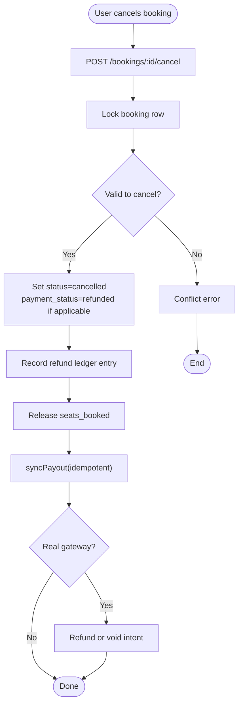

**Diagram sources**
- [lib/screens/bookings/bookings_screen.dart:74-93](file://lib/screens/bookings/bookings_screen.dart#L74-L93)
- [server/src/routes/bookings.ts:420-564](file://server/src/routes/bookings.ts#L420-L564)
- [server/src/routes/bookings.ts:686-761](file://server/src/routes/bookings.ts#L686-L761)

**Section sources**
- [lib/screens/bookings/bookings_screen.dart:74-93](file://lib/screens/bookings/bookings_screen.dart#L74-L93)
- [server/src/routes/bookings.ts:420-564](file://server/src/routes/bookings.ts#L420-L564)
- [server/src/routes/bookings.ts:686-761](file://server/src/routes/bookings.ts#L686-L761)

### Enhanced Booking State Management and Real-Time Updates
**Updated** Improved booking state management with enhanced payment state mapping and better fallback logic for legacy rows.

- States:
  - Booking status: pending, confirmed, cancelled, completed, noShow, refunded.
  - Payment status: empty, pending_payment, authorized, paid, failed.
  - Check-in status: notCheckedIn, checkedIn, expired.
  - Normalized payment state: paid, pending, failed, refunded, notCharged.
- Enhanced state mapping:
  - Server-side `payment_status` takes precedence over booking lifecycle status.
  - Legacy rows without gateway status fall back to booking lifecycle mapping.
  - Clear distinction between payment state and booking status for accurate financial reporting.
- Real-time updates:
  - The client polls the bookings list after payment confirmation to wait for the server to reflect the settled state.
  - The server performs an opportunistic sweep of abandoned pending payments on list reads to keep the UI truthful without relying on background jobs.
  - Check-in finalizes attendance and accrues host payouts; repeated check-ins are idempotent.

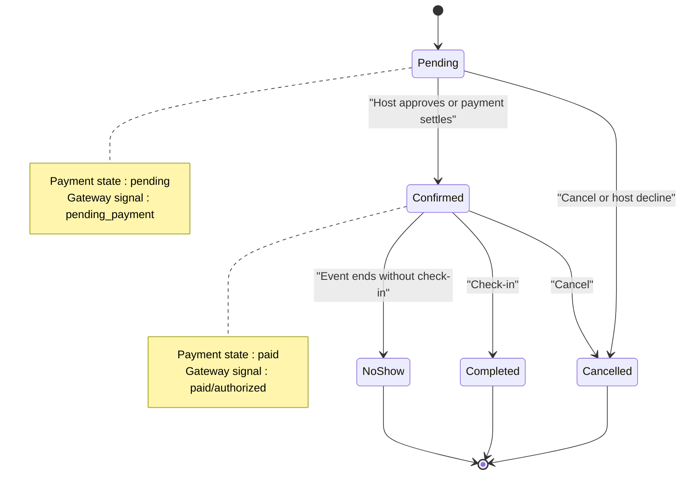

**Diagram sources**
- [lib/models/booking.dart:4-12](file://lib/models/booking.dart#L4-L12)
- [lib/models/booking.dart:94-118](file://lib/models/booking.dart#L94-L118)
- [server/src/routes/bookings.ts:82-131](file://server/src/routes/bookings.ts#L82-L131)
- [server/src/routes/bookings.ts:770-848](file://server/src/routes/bookings.ts#L770-L848)

**Section sources**
- [lib/models/booking.dart:4-12](file://lib/models/booking.dart#L4-L12)
- [lib/models/booking.dart:94-118](file://lib/models/booking.dart#L94-L118)
- [server/src/routes/bookings.ts:82-131](file://server/src/routes/bookings.ts#L82-L131)
- [server/src/routes/bookings.ts:770-848](file://server/src/routes/bookings.ts#L770-L848)

### Error Handling for Payment Failures and Booking Conflicts
- Payment failures:
  - If Stripe confirmation fails, the client informs the user that the seat remains held and suggests completing payment later from My Bookings.
  - If the server cannot create a PaymentIntent, it releases the hold and returns a clean error.
  - Abandoned pending payments are swept either opportunistically on list reads or via scheduled processes.
- Booking conflicts:
  - Sold-out events return a conflict error.
  - Already-started events return a conflict error.
  - Duplicate active bookings for the same user/event pair return a conflict error.
  - Authorization errors (e.g., blocked pairs, invite-only, followers-only) return forbidden responses.

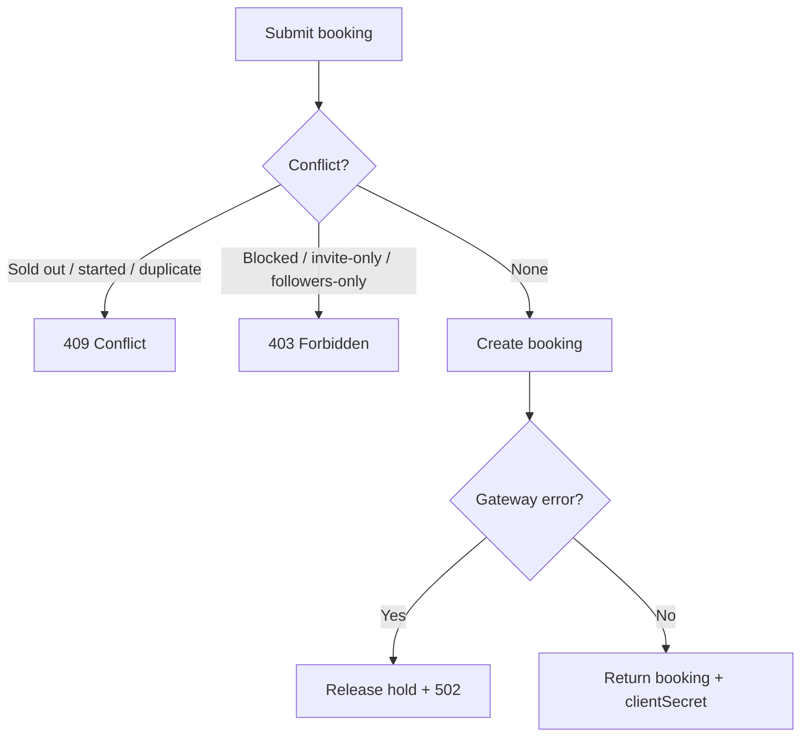

**Diagram sources**
- [lib/screens/checkout/checkout_screen.dart:773-791](file://lib/screens/checkout/checkout_screen.dart#L773-L791)
- [server/src/routes/bookings.ts:208-233](file://server/src/routes/bookings.ts#L208-L233)
- [server/src/routes/bookings.ts:361-378](file://server/src/routes/bookings.ts#L361-L378)

**Section sources**
- [lib/screens/checkout/checkout_screen.dart:773-791](file://lib/screens/checkout/checkout_screen.dart#L773-L791)
- [server/src/routes/bookings.ts:208-233](file://server/src/routes/bookings.ts#L208-L233)
- [server/src/routes/bookings.ts:361-378](file://server/src/routes/bookings.ts#L361-L378)

### Complete Booking Lifecycle Example
End-to-end flow from selection to confirmation:

1. Guest selects seats and enters guest info.
2. Guest applies a promo code; the server validates and computes the final amount.
3. Server locks the event row, checks capacity and eligibility, inserts the booking, and updates seats booked.
4. If a gateway is enabled and the amount is positive, the server creates a PaymentIntent and returns a clientSecret.
5. The client opens Stripe's PaymentSheet; upon success, it polls until the server reflects the settled state.
6. The app navigates to the enhanced confirmation screen showing the digital pass with responsive layout and booking details.
7. Later, the guest can manage the reservation from My Bookings: check-in, cancel, or retry payment.
8. Enhanced payment ledger provides detailed transaction history with unsigned amounts and clear status labels.

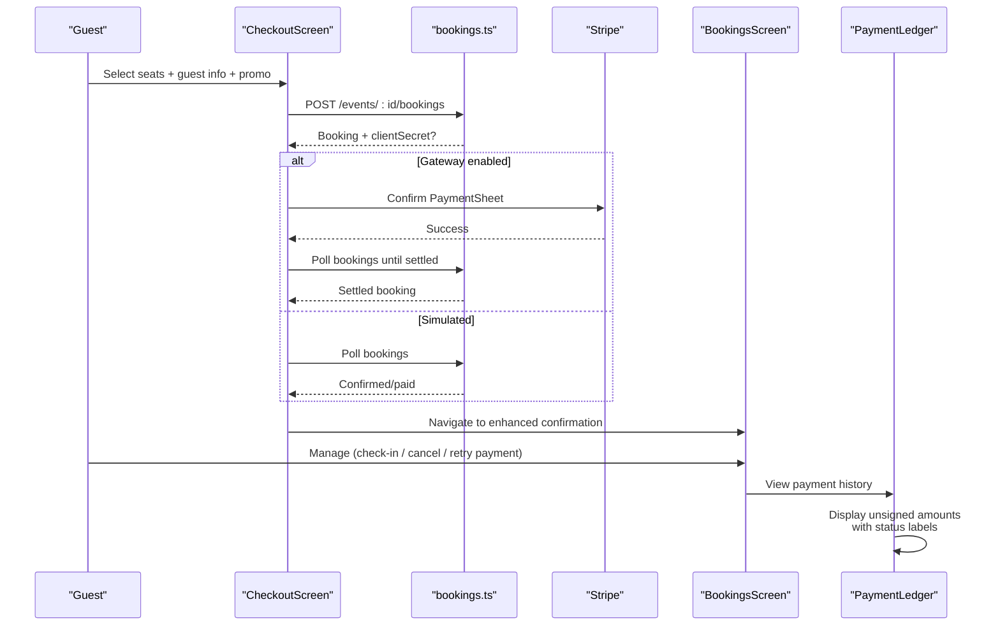

**Diagram sources**
- [lib/screens/checkout/checkout_screen.dart:701-792](file://lib/screens/checkout/checkout_screen.dart#L701-L792)
- [server/src/routes/bookings.ts:153-405](file://server/src/routes/bookings.ts#L153-L405)
- [lib/screens/bookings/bookings_screen.dart:95-137](file://lib/screens/bookings/bookings_screen.dart#L95-L137)
- [lib/widgets/payment_ledger.dart:500-501](file://lib/widgets/payment_ledger.dart#L500-L501)

**Section sources**
- [lib/screens/checkout/checkout_screen.dart:701-792](file://lib/screens/checkout/checkout_screen.dart#L701-L792)
- [server/src/routes/bookings.ts:153-405](file://server/src/routes/bookings.ts#L153-L405)
- [lib/screens/bookings/bookings_screen.dart:95-137](file://lib/screens/bookings/bookings_screen.dart#L95-L137)
- [lib/widgets/payment_ledger.dart:500-501](file://lib/widgets/payment_ledger.dart#L500-L501)

## Dependency Analysis
Key dependencies between components:

- CheckoutScreen depends on:
  - Booking model for default payment method label and status helpers.
  - StripePayments service for confirming payments when enabled.
  - Bookings repository/controller for joining and waiting for settlement.
- BookingsScreen depends on:
  - Booking model for status labels and formatting.
  - StripePayments for retrying payment completion.
  - Bookings repository/controller for cancel and refresh-payment.
- Enhanced PaymentLedger depends on:
  - Booking model for normalized payment state mapping.
  - Payment state color and icon utilities for consistent visual representation.
  - Money formatting utilities for proper currency display.
- Enhanced BookingConfirmedScreen depends on:
  - Booking model for formatted values and status labels.
  - BookingCheckInSheet for QR code display and check-in functionality.
  - AppTextStyles for responsive typography and text scaling.
- Server bookings route depends on:
  - Database transactions and queries for seat locking and state transitions.
  - Pricing utilities for payout synchronization and refund recording.
  - Payments utilities for gateway abstraction, amount conversion, and sweep logic.

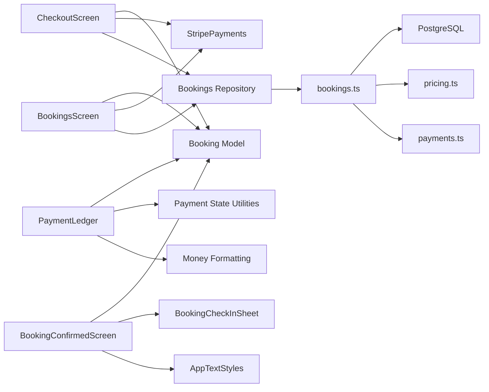

**Diagram sources**
- [lib/screens/checkout/checkout_screen.dart:1-15](file://lib/screens/checkout/checkout_screen.dart#L1-L15)
- [lib/screens/bookings/bookings_screen.dart:1-19](file://lib/screens/bookings/bookings_screen.dart#L1-L19)
- [lib/widgets/payment_ledger.dart:1-10](file://lib/widgets/payment_ledger.dart#L1-L10)
- [lib/widgets/booking_receipt_sheet.dart:264-293](file://lib/widgets/booking_receipt_sheet.dart#L264-L293)
- [lib/screens/booking_confirmed/booking_confirmed_screen.dart:1-9](file://lib/screens/booking_confirmed/booking_confirmed_screen.dart#L1-L9)
- [lib/theme/app_text_styles.dart:1-162](file://lib/theme/app_text_styles.dart#L1-L162)
- [server/src/routes/bookings.ts:1-13](file://server/src/routes/bookings.ts#L1-L13)

**Section sources**
- [lib/screens/checkout/checkout_screen.dart:1-15](file://lib/screens/checkout/checkout_screen.dart#L1-L15)
- [lib/screens/bookings/bookings_screen.dart:1-19](file://lib/screens/bookings/bookings_screen.dart#L1-L19)
- [lib/widgets/payment_ledger.dart:1-10](file://lib/widgets/payment_ledger.dart#L1-L10)
- [lib/widgets/booking_receipt_sheet.dart:264-293](file://lib/widgets/booking_receipt_sheet.dart#L264-L293)
- [lib/screens/booking_confirmed/booking_confirmed_screen.dart:1-9](file://lib/screens/booking_confirmed/booking_confirmed_screen.dart#L1-L9)
- [lib/theme/app_text_styles.dart:1-162](file://lib/theme/app_text_styles.dart#L1-L162)
- [server/src/routes/bookings.ts:1-13](file://server/src/routes/bookings.ts#L1-L13)

## Performance Considerations
- Seat locking uses FOR UPDATE within a single transaction to avoid overselling and reduce contention.
- Payment intent creation occurs outside the seat-lock transaction to avoid holding database locks during external HTTP calls.
- Abandoned pending payments are swept opportunistically on list reads to minimize background work and keep UI state accurate.
- Payout accrual is idempotent and recomputed from captured seats to prevent double-counting.
- Enhanced payment ledger uses efficient aggregation with per-currency breakdowns to avoid blending different currencies.
- Unsigned amount display reduces computational overhead by avoiding sign calculations in the UI layer.
- **Responsive layout optimizations**: The booking confirmation screen uses efficient widget composition with Flexible and FittedBox to minimize layout recalculations and improve rendering performance on various screen sizes.

[No sources needed since this section provides general guidance]

## Troubleshooting Guide
Common issues and resolutions:

- Payment not completed
  - Symptom: The seat remains held; the user sees a message to finish payment from My Bookings.
  - Resolution: Use the "Complete payment" action in My Bookings to refresh the client secret and retry Stripe confirmation.
- Payment setup failed
  - Symptom: Server returns a 502 indicating payment setup failed.
  - Resolution: The server releases the hold automatically; ask the user to try again.
- Sold out or already started
  - Symptom: 409 conflict error during booking.
  - Resolution: Choose another event or time slot.
- Duplicate booking attempt
  - Symptom: 409 conflict indicating an existing active booking for the same event.
  - Resolution: Use the existing booking or wait for it to resolve before trying again.
- Cancellation errors
  - Symptom: Already cancelled or completed bookings cannot be cancelled.
  - Resolution: Verify the booking status; completed bookings require support intervention.
- Payment ledger confusion
  - Symptom: Users confused by signed amounts or unclear payment status.
  - Resolution: The enhanced ledger now uses unsigned amounts with clear "Paid" / "Refunded" labels and detailed transaction screens.
- **Booking confirmation layout issues**
  - Symptom: Text overflow or layout problems on narrow screens or with large text scaling.
  - Resolution: The enhanced booking confirmation screen now uses FittedBox for proper text scaling and Flexible widgets for responsive layout handling. The pass card component includes robust layout management using Expanded, Align, and Flexible widgets to handle various text scaling scenarios.

**Section sources**
- [lib/screens/checkout/checkout_screen.dart:741-791](file://lib/screens/checkout/checkout_screen.dart#L741-L791)
- [server/src/routes/bookings.ts:361-378](file://server/src/routes/bookings.ts#L361-L378)
- [server/src/routes/bookings.ts:208-233](file://server/src/routes/bookings.ts#L208-L233)
- [lib/screens/bookings/bookings_screen.dart:74-93](file://lib/screens/bookings/bookings_screen.dart#L74-L93)
- [lib/widgets/payment_ledger.dart:500-501](file://lib/widgets/payment_ledger.dart#L500-L501)
- [lib/screens/booking_confirmed/booking_confirmed_screen.dart:36-40](file://lib/screens/booking_confirmed/booking_confirmed_screen.dart#L36-L40)

## Conclusion
The booking and checkout system combines a clear, guided UI with robust server-side enforcement. Seat capacity, pricing, and eligibility are authoritative on the server, while the client provides responsive interactions and integrates with Stripe when enabled. The system supports deferred payments, cancellations with proper refund bookkeeping, host approval workflows, check-in-driven settlement, and comprehensive error handling. With Stripe webhooks, the platform can transition from simulated payments to real financial operations while preserving auditability and consistency.

The recent enhancements significantly improve the user experience across multiple areas: the payment ledger interface now features unsigned amount display, enhanced methods section presentation, and comprehensive transaction details. Most notably, the booking confirmation screen has been substantially improved with responsive text scaling using FittedBox, narrow screen compatibility through Flexible widgets, and flexible layout handling for pass badges and booking details. The pass card component now includes robust layout management using Expanded, Align, and Flexible widgets to handle various text scaling scenarios, ensuring that text truncates gracefully and maintains proper spacing across all device types and accessibility settings. These improvements ensure that users receive a consistent, accessible experience across all device types and accessibility settings, while maintaining the system's robust backend architecture.

[No sources needed since this section summarizes without analyzing specific files]