# Event Discovery & Management

<cite>
**Referenced Files in This Document**
- [events_provider.dart](file://lib/providers/events_provider.dart)
- [dinner.dart](file://lib/models/dinner.dart)
- [explore_screen.dart](file://lib/screens/explore/explore_screen.dart)
- [map_screen.dart](file://lib/screens/map/map_screen.dart)
- [bookings_screen.dart](file://lib/screens/bookings/bookings_screen.dart)
- [payment_ledger.dart](file://lib/widgets/payment_ledger.dart)
- [booking_confirmed_screen.dart](file://lib/screens/booking_confirmed/booking_confirmed_screen.dart)
- [create_dinner_screen.dart](file://lib/screens/create/create_dinner_screen.dart)
- [host_dashboard_screen.dart](file://lib/screens/host/host_dashboard_screen.dart)
- [my_tables_screen.dart](file://lib/screens/tables/my_tables_screen.dart)
- [booking.dart](file://lib/models/booking.dart)
</cite>

## Update Summary
**Changes Made**
- Enhanced the Bookings screen with improved UI patterns including status-driven primary actions, overflow menus, and contextual action flows
- Added comprehensive directions integration with interactive Google Maps and transport options
- Improved host communication flow with quick message templates and custom messaging
- Enhanced payment ledger with clearer state visualization and transaction details
- Updated wizard flow for creating dining experiences with better validation and step management
- Integrated booking confirmation screen with digital event pass functionality
- **Improved My Tables screen with better date/time/price row layout, status badge handling, and responsive design for narrow screens**

## Table of Contents
1. [Introduction](#introduction)
2. [Project Structure](#project-structure)
3. [Core Components](#core-components)
4. [Architecture Overview](#architecture-overview)
5. [Detailed Component Analysis](#detailed-component-analysis)
6. [Enhanced Bookings System](#enhanced-bookings-system)
7. [My Tables Screen Improvements](#my-tables-screen-improvements)
8. [Wizard Flow Integration](#wizard-flow-integration)
9. [Dependency Analysis](#dependency-analysis)
10. [Performance Considerations](#performance-considerations)
11. [Troubleshooting Guide](#troubleshooting-guide)
12. [Conclusion](#conclusion)

## Introduction
This document explains the event discovery and management system, focusing on:
- Event listing with filtering, searching, and sorting
- Event detail presentation (host details, booking options)
- Map integration for location-based discovery and venue visualization
- Home screen layout and featured events
- Search functionality with location-based queries and category filters
- Event data models and their transformation for display
- Performance optimization strategies for large lists and image loading
- **Enhanced bookings management with improved UI patterns and wizard flow integration**
- **Improved My Tables screen with responsive design and better layout handling**

The implementation uses a Riverpod-based provider layer to fetch and cache events, a domain model for dinners, and Flutter screens for Explore and Map discovery, now complemented by an enhanced bookings system, streamlined wizard flow, and improved My Tables interface.

## Project Structure
The event discovery flow spans providers, models, and screens:
- Providers manage event feeds, detail retrieval, host events, reviews, and write operations
- Models define the Dinner entity and related structures
- Screens implement user-facing discovery experiences (Explore list and Map view)
- **Enhanced bookings system with comprehensive management capabilities**
- **Streamlined wizard flow for creating dining experiences**
- **Improved My Tables screen with responsive design and better layout handling**

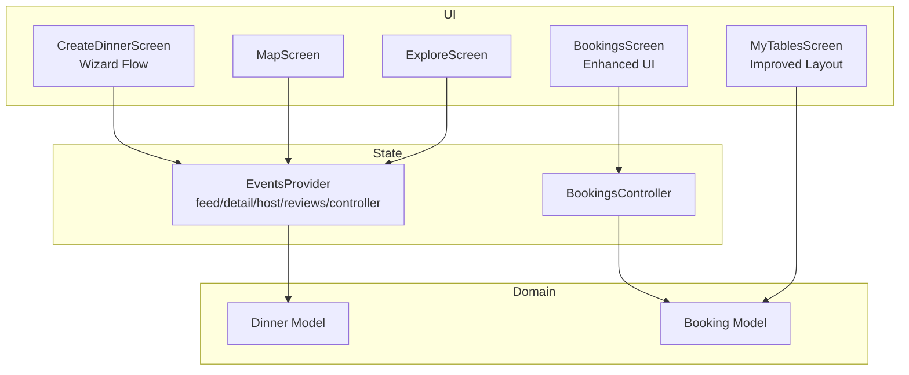

**Diagram sources**
- [explore_screen.dart:10-26](file://lib/screens/explore/explore_screen.dart#L10-L26)
- [map_screen.dart:10-16](file://lib/screens/map/map_screen.dart#L10-L16)
- [bookings_screen.dart:23-34](file://lib/screens/bookings/bookings_screen.dart#L23-L34)
- [my_tables_screen.dart:10-16](file://lib/screens/tables/my_tables_screen.dart#L10-L16)
- [create_dinner_screen.dart:20-29](file://lib/screens/create/create_dinner_screen.dart#L20-L29)
- [events_provider.dart:91-131](file://lib/providers/events_provider.dart#L91-L131)
- [dinner.dart:24-70](file://lib/models/dinner.dart#L24-L70)

**Section sources**
- [events_provider.dart:91-131](file://lib/providers/events_provider.dart#L91-L131)
- [explore_screen.dart:28-50](file://lib/screens/explore/explore_screen.dart#L28-L50)
- [map_screen.dart:18-28](file://lib/screens/map/map_screen.dart#L18-L28)
- [bookings_screen.dart:23-34](file://lib/screens/bookings/bookings_screen.dart#L23-L34)
- [my_tables_screen.dart:10-16](file://lib/screens/tables/my_tables_screen.dart#L10-L16)
- [create_dinner_screen.dart:20-29](file://lib/screens/create/create_dinner_screen.dart#L20-L29)
- [dinner.dart:24-70](file://lib/models/dinner.dart#L24-L70)

## Core Components
- Event filter and feed provider: Encapsulates query parameters (type, audience, featured, search query, city, date window, max price) and exposes a FutureProvider family that returns a list of Dinner objects.
- Detail and host-scoped providers: Fetch a single dinner by id and other upcoming events by host id.
- Host-only providers: Retrieve signed-in host's own events (including drafts).
- Reviews provider: Load reviews for a specific event.
- EventsController: Publishes, edits, cancels events, and submits reviews; invalidates relevant providers after writes.
- **Enhanced BookingsController**: Manages booking lifecycle, payment processing, and status updates with improved UI feedback.
- **Improved My Tables screen**: Provides responsive booking management with better layout handling for narrow screens.

Key responsibilities:
- Centralize event data access and caching via Riverpod families
- Keep UI state minimal and driven by providers
- Provide write actions with automatic cache invalidation
- **Handle complex booking workflows with real-time status updates and payment integration**
- **Ensure responsive design across different screen sizes and orientations**

**Section sources**
- [events_provider.dart:11-88](file://lib/providers/events_provider.dart#L11-L88)
- [events_provider.dart:91-131](file://lib/providers/events_provider.dart#L91-L131)
- [events_provider.dart:143-197](file://lib/providers/events_provider.dart#L143-L197)
- [bookings_screen.dart:82-145](file://lib/screens/bookings/bookings_screen.dart#L82-L145)
- [my_tables_screen.dart:78-228](file://lib/screens/tables/my_tables_screen.dart#L78-L228)

## Architecture Overview
The system composes UI screens with providers that read from repositories (not shown here) and transform server responses into domain models. The Explore screen drives the event feed using an EventFilter composed from user interactions (search, categories, filters). The Map screen overlays venues and events on Google Maps and opens directions or details. **The enhanced Bookings screen provides comprehensive reservation management with improved UX patterns. The My Tables screen offers responsive booking management with optimized layout handling.**

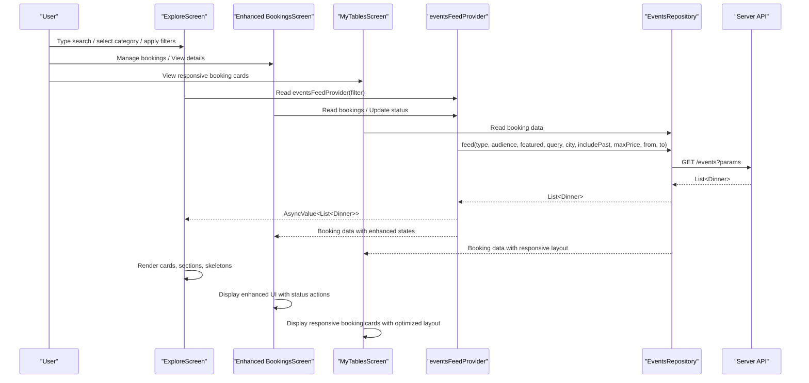

**Diagram sources**
- [explore_screen.dart:169-184](file://lib/screens/explore/explore_screen.dart#L169-L184)
- [explore_screen.dart:391-404](file://lib/screens/explore/explore_screen.dart#L391-L404)
- [bookings_screen.dart:148-262](file://lib/screens/bookings/bookings_screen.dart#L148-L262)
- [my_tables_screen.dart:35-75](file://lib/screens/tables/my_tables_screen.dart#L35-L75)
- [events_provider.dart:91-109](file://lib/providers/events_provider.dart#L91-L109)

## Detailed Component Analysis

### Event Listing Interface (Explore Screen)
Capabilities:
- Debounced free-text search across dinners, restaurants, and hosts
- Category chips (e.g., Dinners, Food Experiences, Influencer Events, Restaurant Events, Private/Public Dinners, Group Dining, Tastings, Special Menus, Limited-Time, Deals & Discounts)
- Top-level filters (All, Dinners, Experiences, Influencer, Restaurants, Deals)
- Filter sheet for audience, type, max price, and date window
- Venue search section when querying or tagging venues
- Sections for deals/offers and dining companions depending on active category
- Live results grid/list with skeleton placeholders and error states

Search and filtering flow:
- Input is debounced to avoid excessive network calls
- Computed EventFilter combines query, effective audience/type from category, and optional date/price filters
- The feed provider returns data used to build multiple sections (Featured, Trending, Popular This Week, Filtered Results)

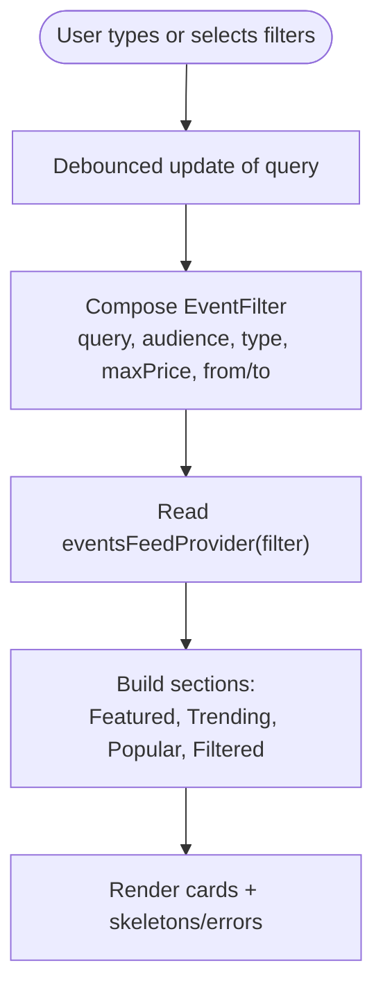

**Diagram sources**
- [explore_screen.dart:131-138](file://lib/screens/explore/explore_screen.dart#L131-L138)
- [explore_screen.dart:169-184](file://lib/screens/explore/explore_screen.dart#L169-L184)
- [explore_screen.dart:391-404](file://lib/screens/explore/explore_screen.dart#L391-L404)

**Section sources**
- [explore_screen.dart:52-88](file://lib/screens/explore/explore_screen.dart#L52-L88)
- [explore_screen.dart:131-184](file://lib/screens/explore/explore_screen.dart#L131-L184)
- [explore_screen.dart:336-388](file://lib/screens/explore/explore_screen.dart#L336-L388)
- [explore_screen.dart:391-613](file://lib/screens/explore/explore_screen.dart#L391-L613)
- [explore_screen.dart:615-800](file://lib/screens/explore/explore_screen.dart#L615-L800)

### Event Detail Screen
Responsibilities:
- Display comprehensive event information including title, description, restaurant, host profile, date/time, seats, price, menu, tags, policies, and attendee count
- Show host details and whether the current user is the host
- Surface booking options (via navigation to checkout/booking flows)
- Present reviews for the event

Data sources:
- Single dinner detail via dinnerDetailProvider
- Host's other events via hostEventsProvider
- Reviews via reviewsForEventProvider
- Host identity check via isHostedByMeProvider

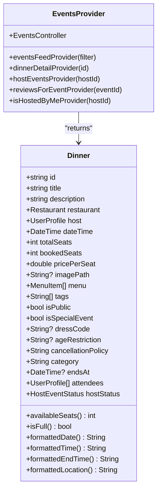

**Diagram sources**
- [dinner.dart:24-167](file://lib/models/dinner.dart#L24-L167)
- [events_provider.dart:111-139](file://lib/providers/events_provider.dart#L111-L139)

**Section sources**
- [events_provider.dart:111-139](file://lib/providers/events_provider.dart#L111-L139)
- [dinner.dart:24-167](file://lib/models/dinner.dart#L24-L167)

### Map Integration for Location-Based Discovery
Features:
- Real Google Map with markers for venues and events
- Layer filter chips to toggle visibility of dinners vs restaurants
- Camera auto-centers on live GPS fix if available; otherwise centers on venue cluster or default city
- Marker taps open bottom sheets with quick info and actions (Directions, View Details)
- Directions deep-link to Google Maps app/web with travel mode support

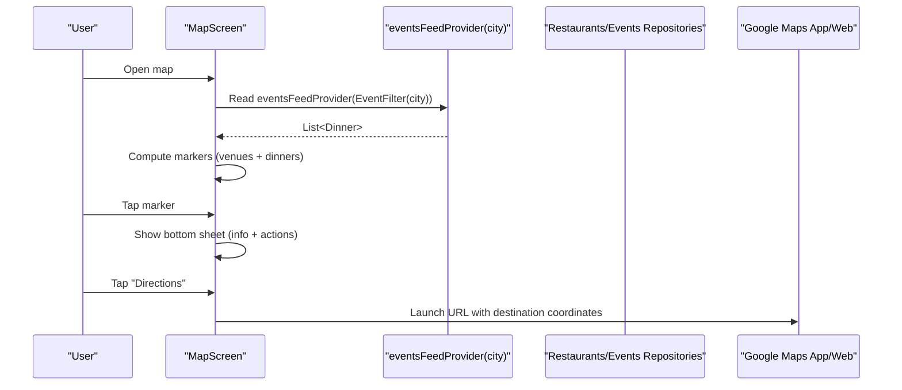

**Diagram sources**
- [map_screen.dart:102-128](file://lib/screens/map/map_screen.dart#L102-L128)
- [map_screen.dart:130-154](file://lib/screens/map/map_screen.dart#L130-L154)
- [map_screen.dart:397-585](file://lib/screens/map/map_screen.dart#L397-L585)
- [map_screen.dart:587-717](file://lib/screens/map/map_screen.dart#L587-L717)

**Section sources**
- [map_screen.dart:18-28](file://lib/screens/map/map_screen.dart#L18-L28)
- [map_screen.dart:57-128](file://lib/screens/map/map_screen.dart#L57-L128)
- [map_screen.dart:130-154](file://lib/screens/map/map_screen.dart#L130-L154)
- [map_screen.dart:156-394](file://lib/screens/map/map_screen.dart#L156-L394)
- [map_screen.dart:397-717](file://lib/screens/map/map_screen.dart#L397-L717)

### Home Screen Layout and Featured Events
- The Explore screen surfaces "Featured Dinners," "Featured Restaurants," "Trending Experiences," and "Popular This Week" sections built from the same live event feed
- These sections are constructed from the first N items or filtered subsets (special events, recent dates)
- Navigation callbacks allow tapping cards to go to detail screens

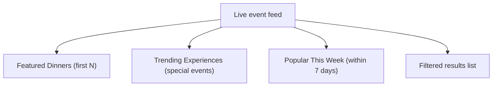

**Diagram sources**
- [explore_screen.dart:615-745](file://lib/screens/explore/explore_screen.dart#L615-L745)

**Section sources**
- [explore_screen.dart:615-745](file://lib/screens/explore/explore_screen.dart#L615-L745)

### Search Functionality with Location-Based Queries and Category Filtering
- Free-text search is debounced and sent to the events feed as EventFilter.query
- Category chips set effective audience/type which translate to server-side filters
- Venue tag chips drive a parallel venue search endpoint
- Date window and max price are applied via the filter sheet and included in EventFilter

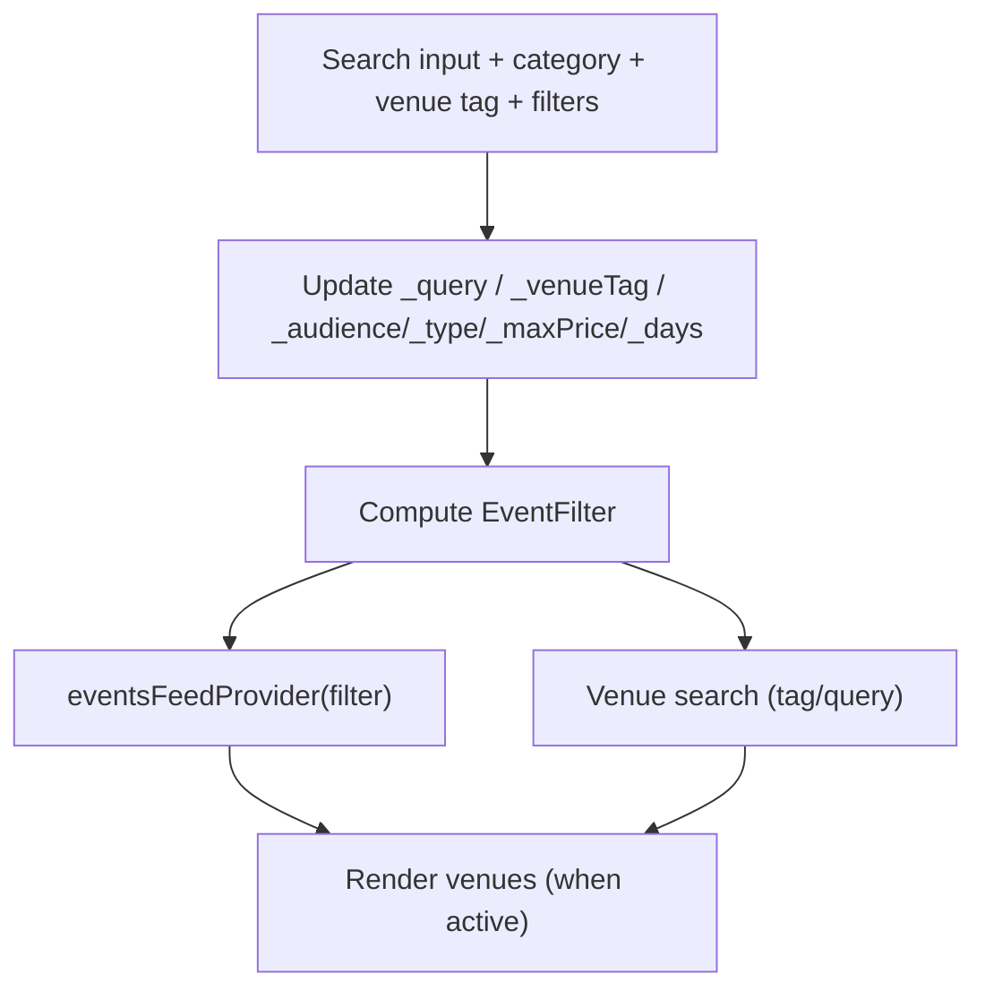

**Diagram sources**
- [explore_screen.dart:131-184](file://lib/screens/explore/explore_screen.dart#L131-L184)
- [explore_screen.dart:391-404](file://lib/screens/explore/explore_screen.dart#L391-L404)

**Section sources**
- [explore_screen.dart:131-184](file://lib/screens/explore/explore_screen.dart#L131-L184)
- [explore_screen.dart:391-404](file://lib/screens/explore/explore_screen.dart#L391-L404)

### Event Data Models and Transformation
- Dinner model encapsulates all display-relevant fields, including nested Restaurant and UserProfile, plus derived properties like formattedDate/formattedTime/formattedLocation and availability helpers
- Menu items and tags enrich the detail view
- Host status and event flags control badges and visibility

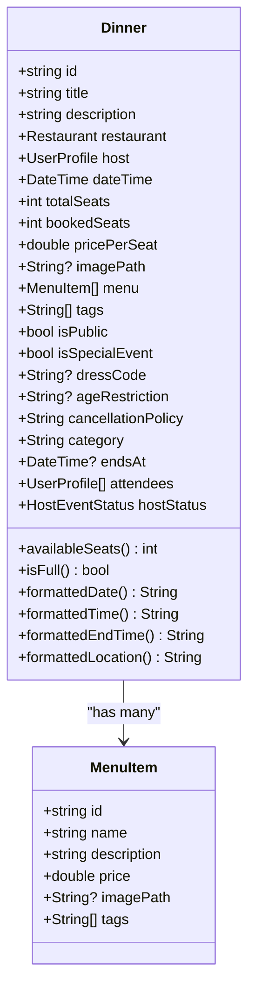

**Diagram sources**
- [dinner.dart:6-22](file://lib/models/dinner.dart#L6-L22)
- [dinner.dart:24-167](file://lib/models/dinner.dart#L24-L167)

**Section sources**
- [dinner.dart:6-22](file://lib/models/dinner.dart#L6-L22)
- [dinner.dart:24-167](file://lib/models/dinner.dart#L24-L167)

## Enhanced Bookings System

### Bookings Screen Architecture
The enhanced Bookings screen serves as a central hub for managing all reservations with three main tabs: Upcoming, Past, and Payments. Each tab provides specialized functionality with improved UI patterns and contextual actions.

**Key Features:**
- **Status-driven primary actions**: Confirmed bookings show QR ticket as primary action, while pending bookings display cancel options
- **Overflow menu system**: Additional actions (directions, contact host, cancel) are accessible through intuitive menus
- **Contextual payment handling**: Stripe hold management with retry functionality for abandoned checkouts
- **Enhanced visual design**: Status indicators with appropriate colors and icons for each booking state

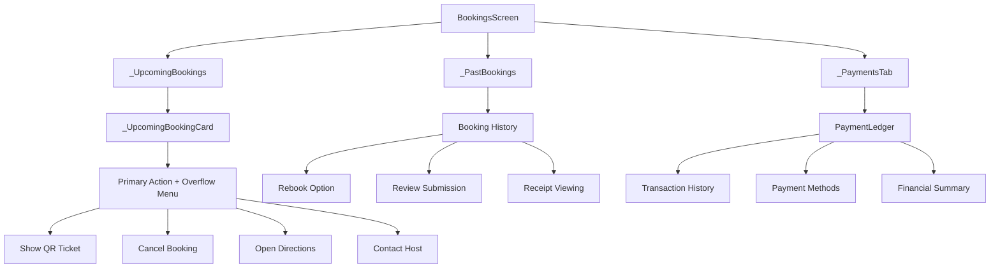

**Diagram sources**
- [bookings_screen.dart:148-262](file://lib/screens/bookings/bookings_screen.dart#L148-L262)
- [bookings_screen.dart:269-305](file://lib/screens/bookings/bookings_screen.dart#L269-L305)
- [bookings_screen.dart:308-686](file://lib/screens/bookings/bookings_screen.dart#L308-L686)
- [bookings_screen.dart:1321-1345](file://lib/screens/bookings/bookings_screen.dart#L1321-L1345)
- [bookings_screen.dart:2043-2056](file://lib/screens/bookings/bookings_screen.dart#L2043-L2056)

### Enhanced UI Patterns and Interactions

#### Status-Driven Primary Actions
The booking cards implement intelligent primary action buttons based on booking status:
- **Confirmed bookings**: QR ticket display as primary action
- **Pending bookings**: Cancel booking as primary action  
- **Awaiting payment**: Complete payment button with Stripe integration
- **Past bookings**: Contextual actions like rebook, review, or receipt viewing

#### Interactive Directions Integration
Enhanced directions functionality includes:
- **Interactive Google Maps**: Dark-themed map with venue markers
- **Transport options**: Drive, transit, walk, copy address, and full map options
- **Deep linking**: Direct integration with Google Maps app/web
- **Address validation**: Fallback handling for missing coordinates

#### Host Communication System
Improved host communication features:
- **Quick message templates**: Pre-defined messages for common scenarios
- **Custom messaging**: Text input for personalized communication
- **Host profile display**: Rating, followers, and contact information
- **Message sending**: Simulated message delivery with user feedback

**Section sources**
- [bookings_screen.dart:148-262](file://lib/screens/bookings/bookings_screen.dart#L148-L262)
- [bookings_screen.dart:308-686](file://lib/screens/bookings/bookings_screen.dart#L308-L686)
- [bookings_screen.dart:746-1010](file://lib/screens/bookings/bookings_screen.dart#L746-L1010)
- [bookings_screen.dart:1072-1271](file://lib/screens/bookings/bookings_screen.dart#L1072-L1271)

### Payment Ledger Enhancements
The payment ledger provides comprehensive financial tracking with improved visualization:
- **Clear state labels**: "Paid", "Refunded", "Pending", "Failed" instead of signed amounts
- **Currency-aware aggregation**: Multi-currency support with proper grouping
- **Transaction details**: Clickable rows opening detailed transaction views
- **Method usage tracking**: Shows masked payment methods with usage counts

**Section sources**
- [payment_ledger.dart:104-200](file://lib/widgets/payment_ledger.dart#L104-L200)
- [payment_ledger.dart:494-516](file://lib/widgets/payment_ledger.dart#L494-L516)
- [payment_ledger.dart:819-863](file://lib/widgets/payment_ledger.dart#L819-L863)

## My Tables Screen Improvements

### Responsive Layout Architecture
The My Tables screen has been significantly improved with better responsive design and layout handling for narrow screens. The implementation focuses on three key areas:

**Key Improvements:**
- **Flexible date/time/price row layout**: Uses flex ratios (3:1) to ensure date/time information gets priority space while price scales appropriately
- **Enhanced status badge handling**: Improved visual indicators with proper color coding and background styling for different booking statuses
- **Responsive design for narrow screens**: Optimized layout that adapts to various screen widths without overflow issues

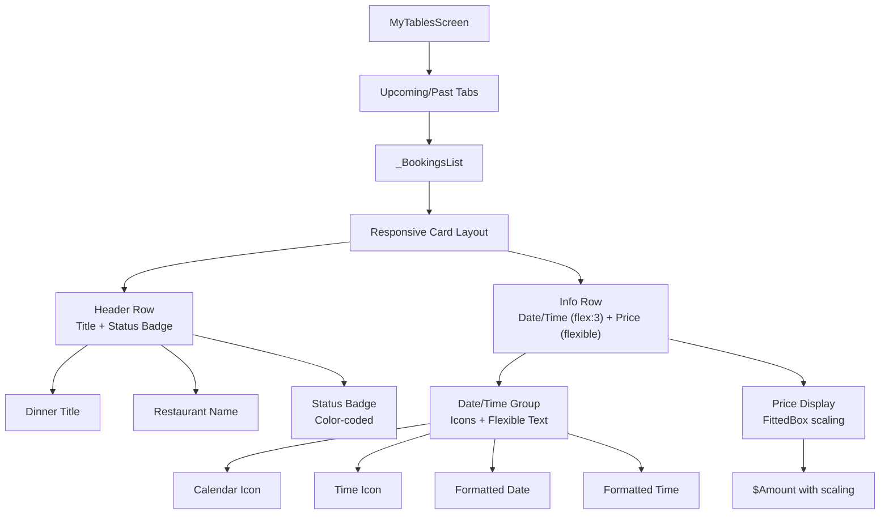

**Diagram sources**
- [my_tables_screen.dart:35-75](file://lib/screens/tables/my_tables_screen.dart#L35-L75)
- [my_tables_screen.dart:78-228](file://lib/screens/tables/my_tables_screen.dart#L78-L228)

### Enhanced Date/Time/Price Row Layout
The improved layout addresses previous overflow issues by implementing a flexible layout system:

**Layout Strategy:**
- **Flex ratio approach**: Date/time group gets `Expanded(flex: 3)` while price uses `Flexible` to scale down
- **Proper spacing**: Strategic use of `SizedBox` gaps between elements
- **Text overflow handling**: Both date and time text use `Flexible` with `overflow: TextOverflow.ellipsis`
- **Price scaling**: Price amount wrapped in `FittedBox` with `BoxFit.scaleDown` to prevent truncation

**Technical Implementation:**
```dart
// Date/time group with flex:3
Expanded(
  flex: 3,
  child: Row(
    children: [
      // Calendar icon + date text
      // Time icon + time text
    ],
  ),
),
// Price with flexible scaling
Flexible(
  child: Align(
    alignment: Alignment.centerRight,
    child: FittedBox(
      fit: BoxFit.scaleDown,
      child: Text('\$${booking.totalAmount.toStringAsFixed(2)}'),
    ),
  ),
),
```

### Improved Status Badge Handling
The status badge system has been enhanced with better visual hierarchy and accessibility:

**Status Badge Features:**
- **Color-coded backgrounds**: Different semi-transparent backgrounds for confirmed (success), pending (warning), and cancelled (danger) statuses
- **Consistent styling**: Proper border radius, padding, and typography
- **Accessible colors**: High contrast text colors matching the status meaning
- **Responsive sizing**: Badge adapts to content width while maintaining readability

**Section sources**
- [my_tables_screen.dart:78-228](file://lib/screens/tables/my_tables_screen.dart#L78-L228)
- [booking.dart:151-166](file://lib/models/booking.dart#L151-L166)

### Responsive Design Optimization
The screen handles various screen sizes and text scaling factors effectively:

**Responsive Features:**
- **Adaptive spacing**: Uses consistent spacing tokens throughout
- **Text scaling support**: Works with different text scale factors (1.0x, 1.3x, 2.0x)
- **Narrow screen optimization**: Prevents overflow on screens as narrow as 320px
- **Accessibility compliance**: Proper contrast ratios and readable font sizes

**Testing Coverage:**
- Comprehensive overflow testing across multiple screen widths (320px, 360px, 390px, 430px, 600px)
- Text scaling validation at different accessibility levels
- Layout stability verification under various conditions

**Section sources**
- [layout_overflow_extended_test.dart:144](file://test/layout_overflow_extended_test.dart#L144)
- [layout_overflow_extended_test.dart:108-134](file://test/layout_overflow_extended_test.dart#L108-L134)

## Wizard Flow Integration

### Create Dinner Screen Architecture
The enhanced Create Dinner screen implements a streamlined 6-step wizard for creating dining experiences with improved validation and user guidance.

**Wizard Steps:**
1. **Experience Details**: Title, description, cover image, category selection
2. **Restaurant & Venue**: Partner venue selection with verification
3. **Date & Schedule**: Event timing, capacity, and accessibility settings
4. **Guests & Dining**: Access controls, dietary requirements, and experience customization
5. **Menu & Pricing**: Course configuration, pricing strategy, and host contribution
6. **Review & Submit**: Final validation, terms acceptance, and publication

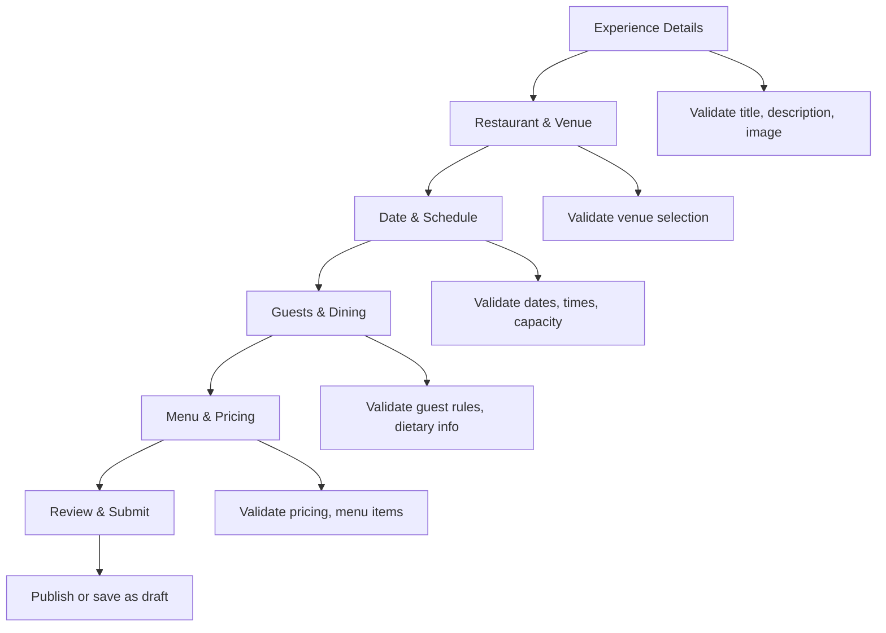

**Diagram sources**
- [create_dinner_screen.dart:20-29](file://lib/screens/create/create_dinner_screen.dart#L20-L29)
- [create_dinner_screen.dart:131-184](file://lib/screens/create/create_dinner_screen.dart#L131-L184)
- [create_dinner_screen.dart:1381-1420](file://lib/screens/create/create_dinner_screen.dart#L1381-L1420)

### Enhanced Validation and User Experience
The wizard includes sophisticated validation and user experience improvements:
- **Real-time validation**: Field-by-field validation with inline error messages
- **Progressive disclosure**: Step-by-step form progression with clear navigation
- **Draft saving**: Ability to save incomplete experiences as drafts
- **Integration with Host Dashboard**: Seamless transition to event management after creation

### Guest & Dining Configuration
The Guests & Dining step provides comprehensive experience customization:
- **Access controls**: Public/private settings, approval requirements, guest limits
- **Dietary accommodations**: Dietary preference toggles and special menu options
- **Event rules**: Customizable rules and policies for attendees
- **Cultural considerations**: Dress code, age restrictions, and cultural sensitivity settings

**Section sources**
- [create_dinner_screen.dart:20-29](file://lib/screens/create/create_dinner_screen.dart#L20-L29)
- [create_dinner_screen.dart:131-184](file://lib/screens/create/create_dinner_screen.dart#L131-L184)
- [create_dinner_screen.dart:1381-1420](file://lib/screens/create/create_dinner_screen.dart#L1381-L1420)
- [host_dashboard_screen.dart:78-95](file://lib/screens/host/host_dashboard_screen.dart#L78-L95)

## Dependency Analysis
High-level dependencies between components:

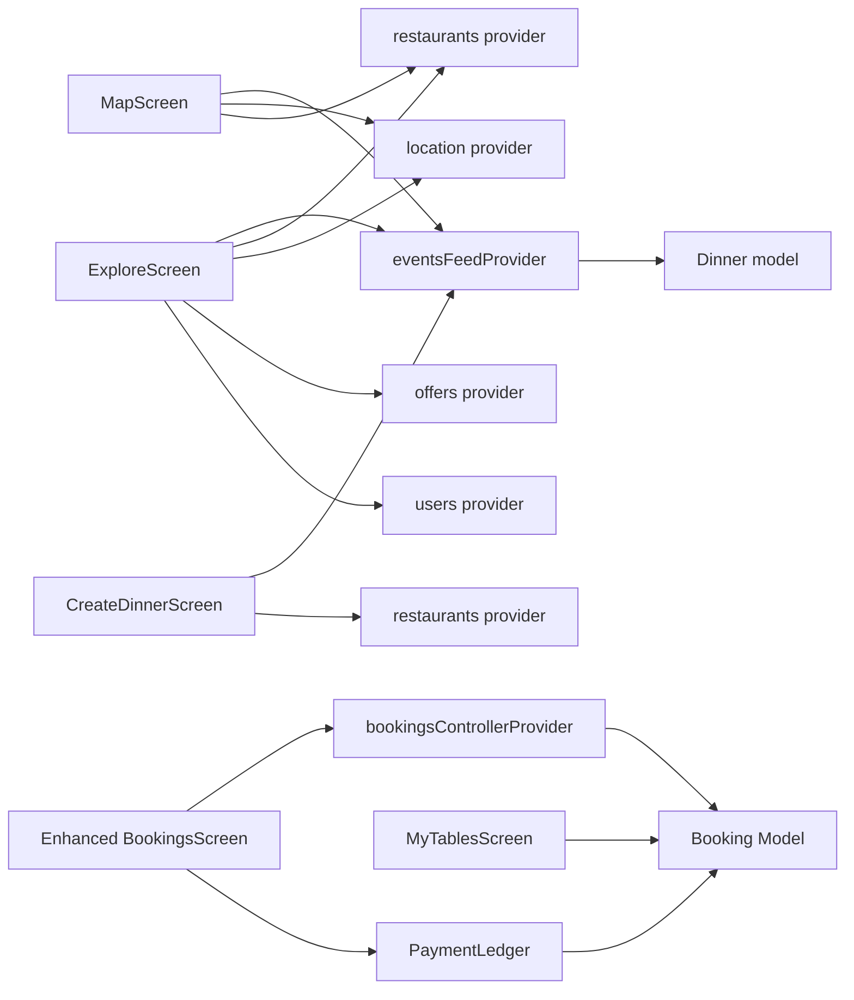

**Diagram sources**
- [explore_screen.dart:10-26](file://lib/screens/explore/explore_screen.dart#L10-L26)
- [map_screen.dart:10-16](file://lib/screens/map/map_screen.dart#L10-L16)
- [bookings_screen.dart:148-262](file://lib/screens/bookings/bookings_screen.dart#L148-L262)
- [my_tables_screen.dart:10-16](file://lib/screens/tables/my_tables_screen.dart#L10-L16)
- [create_dinner_screen.dart:12-18](file://lib/screens/create/create_dinner_screen.dart#L12-L18)
- [events_provider.dart:91-131](file://lib/providers/events_provider.dart#L91-L131)
- [dinner.dart:24-70](file://lib/models/dinner.dart#L24-L70)

**Section sources**
- [explore_screen.dart:10-26](file://lib/screens/explore/explore_screen.dart#L10-L26)
- [map_screen.dart:10-16](file://lib/screens/map/map_screen.dart#L10-L16)
- [bookings_screen.dart:148-262](file://lib/screens/bookings/bookings_screen.dart#L148-L262)
- [my_tables_screen.dart:10-16](file://lib/screens/tables/my_tables_screen.dart#L10-L16)
- [create_dinner_screen.dart:12-18](file://lib/screens/create/create_dinner_screen.dart#L12-L18)
- [events_provider.dart:91-131](file://lib/providers/events_provider.dart#L91-L131)

## Performance Considerations
- Debounced search: Reduces network requests during typing by batching updates (500 ms debounce).
- Stable filter keys: The EventFilter composition snaps date windows to the start of the day to prevent provider families from recomputing every frame.
- Skeletons and empty/error states: Prevent layout thrash and improve perceived performance while loading.
- Image handling: Cards use fixed-size images with fallback assets; consider adding image caching and placeholder strategies at the widget level for large lists.
- Provider families: Use scoped providers (by filter/id) to isolate recomputation and leverage Riverpod's caching.
- Map markers: Only render markers for venues/events with valid coordinates; limit visible layers via filter chips.
- **Enhanced bookings optimization**: Lazy loading of booking details, efficient status filtering, and optimized payment ledger rendering.
- **My Tables screen optimization**: Efficient layout calculations, proper widget reuse, and responsive design that minimizes rebuild overhead.
- **Wizard flow efficiency**: Progressive validation to reduce computational overhead and smooth step transitions.

## Troubleshooting Guide
Common issues and resolutions:
- No events show up:
  - Verify authentication readiness before reading the feed; the provider guards against unauthenticated reads.
  - Check that the EventFilter includes the correct city and date window.
- Empty venue results:
  - Ensure location permissions are granted and a live position is available; otherwise the map falls back to venue cluster center.
- Directions not opening:
  - Confirm the venue has coordinates; the Directions action is disabled otherwise.
- Stale data after writes:
  - Use EventsController methods to publish/edit/cancel events; they invalidate relevant providers automatically.
- **Enhanced bookings issues**:
  - QR codes not displaying: Verify booking status is confirmed and QR code exists in booking data.
  - Payment completion failures: Check Stripe integration and client secret refresh functionality.
  - Wizard validation errors: Ensure all required fields are properly validated and error messages are displayed.
- **My Tables screen issues**:
  - Layout overflow on narrow screens: Verify flex ratios are properly configured and FittedBox is used for price scaling.
  - Status badge display problems: Check color contrast and ensure proper status mapping from BookingStatus enum.
  - Responsive design issues: Test across different screen sizes and text scale factors.
- **Wizard flow problems**:
  - Draft saving issues: Verify restaurant selection and basic event details are provided.
  - Publishing failures: Check server validation and ensure all required fields meet business rules.

**Section sources**
- [events_provider.dart:91-109](file://lib/providers/events_provider.dart#L91-L109)
- [events_provider.dart:143-197](file://lib/providers/events_provider.dart#L143-L197)
- [map_screen.dart:102-128](file://lib/screens/map/map_screen.dart#L102-L128)
- [map_screen.dart:537-545](file://lib/screens/map/map_screen.dart#L537-L545)
- [bookings_screen.dart:82-145](file://lib/screens/bookings/bookings_screen.dart#L82-L145)
- [my_tables_screen.dart:78-228](file://lib/screens/tables/my_tables_screen.dart#L78-L228)
- [create_dinner_screen.dart:131-184](file://lib/screens/create/create_dinner_screen.dart#L131-L184)

## Conclusion
The event discovery and management system integrates a robust provider layer with rich UI screens to deliver searchable, filterable, and location-aware event experiences. The Explore screen orchestrates complex filtering and categorization, while the Map screen visualizes venues and events geographically. **The enhanced Bookings system provides comprehensive reservation management with improved UI patterns, contextual actions, and seamless payment integration. The My Tables screen offers responsive booking management with optimized layout handling that works seamlessly across different screen sizes and orientations.** The Dinner model centralizes display logic, and the EventsController ensures consistent state after mutations. **The streamlined wizard flow simplifies dining experience creation with progressive validation and draft management.** With debounced search, stable filter keys, provider-family caching, and responsive design principles, the system scales well for large datasets and offers clear paths for further performance enhancements such as image caching and pagination.