# Flutter Mobile Application

<cite>
**Referenced Files in This Document**
- [README.md](file://README.md)
- [pubspec.yaml](file://pubspec.yaml)
- [lib/main.dart](file://lib/main.dart)
- [lib/app_shell.dart](file://lib/app_shell.dart)
- [lib/screens/home/home_screen.dart](file://lib/screens/home/home_screen.dart)
- [lib/widgets/common_widgets.dart](file://lib/widgets/common_widgets.dart)
- [lib/models/discovery_category.dart](file://lib/models/discovery_category.dart)
- [lib/providers/session_provider.dart](file://lib/providers/session_provider.dart)
- [lib/repositories/session_repository.dart](file://lib/repositories/session_repository.dart)
- [lib/api/api_client.dart](file://lib/api/api_client.dart)
- [lib/screens/bookings/bookings_screen.dart](file://lib/screens/bookings/bookings_screen.dart)
- [lib/screens/checkout/checkout_screen.dart](file://lib/screens/checkout/checkout_screen.dart)
- [lib/screens/detail/dinner_detail_screen.dart](file://lib/screens/detail/dinner_detail_screen.dart)
- [lib/screens/explore/explore_screen.dart](file://lib/screens/explore/explore_screen.dart)
- [lib/screens/profile/profile_screen.dart](file://lib/screens/profile/profile_screen.dart)
- [lib/screens/settings/settings_screen.dart](file://lib/screens/settings/settings_screen.dart)
</cite>

## Update Summary
**Changes Made**
- Updated Home Screen Architecture section to document complete redesign from 12-section to 9-section priority-ordered layout
- Added detailed documentation for new 'Your Next Table' positioning with conditional booking display
- Enhanced 'Featured Experiences' section with sophisticated date filtering and tiered content prioritization
- Documented multi-stop gradient category banners with photographic backgrounds
- Removed documentation for deprecated 'Dine with Creators' and 'Exclusive Offers' sections
- Updated Profile Screen section to document comprehensive premium redesign with four distinct vertical zones
- Added diner statistics grid and interactive dining preferences system
- Enhanced component composition patterns with new reusable widgets and improved responsive design

## Table of Contents
1. [Introduction](#introduction)
2. [Project Structure](#project-structure)
3. [Core Components](#core-components)
4. [Architecture Overview](#architecture-overview)
5. [Detailed Component Analysis](#detailed-component-analysis)
6. [Home Screen Priority-Ordered Layout System](#home-screen-priority-ordered-layout-system)
7. [Profile Screen Premium Redesign](#profile-screen-premium-redesign)
8. [UI Responsiveness and Layout Optimization](#ui-responsiveness-and-layout-optimization)
9. [Dependency Analysis](#dependency-analysis)
10. [Performance Considerations](#performance-considerations)
11. [Troubleshooting Guide](#troubleshooting-guide)
12. [Conclusion](#conclusion)

## Introduction
This document describes the Flutter mobile application component of DineCircle, a social dining platform with a unified diner/host/influencer experience. The app follows clean architecture principles with clear separation between presentation (screens/widgets), business logic (Riverpod providers and controllers), and data layers (repositories and API client). It uses Riverpod for state management, Dio for networking, secure storage for tokens, and a custom theme system for consistent UI styling. Navigation is implemented via Flutter's Navigator 2.x-style routing through an app shell and screen widgets rather than a third-party router package.

The backend is an Express/TypeScript API backed by PostgreSQL; this document focuses on the Flutter client while referencing server integration points where relevant to explain end-to-end flows.

**Section sources**
- [README.md:207-252](file://README.md#L207-L252)

## Project Structure
At a high level, the Flutter codebase under `lib/` is organized into feature-oriented directories aligned with clean architecture:
- `api/`: HTTP client configuration, DTOs, JSON helpers, mappers, and exception types.
- `repositories/`: Typed read/write interfaces and implementations that call the API.
- `providers/`: Riverpod providers and controllers that encapsulate business logic and state.
- `models/`: Immutable domain models used across screens and providers.
- `screens/`: Feature-specific screen widgets composing reusable UI components.
- `theme/`: Design tokens, colors, spacing, typography, and the Material theme entry point.
- `widgets/`: Reusable UI building blocks such as buttons, cards, skeletons, and connectivity banner.

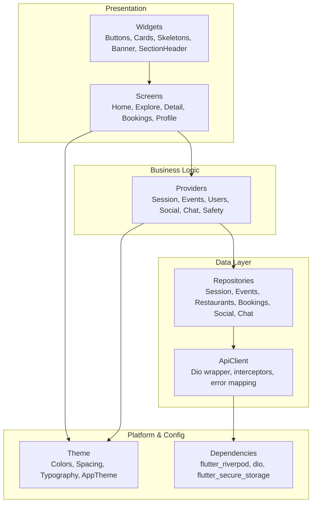

**Diagram sources**
- [README.md:228-241](file://README.md#L228-L241)
- [pubspec.yaml:30-48](file://pubspec.yaml#L30-L48)

**Section sources**
- [README.md:228-241](file://README.md#L228-L241)
- [pubspec.yaml:30-48](file://pubspec.yaml#L30-L48)

## Core Components
- App bootstrap and flow:
  - `main.dart` initializes the provider scope and renders the root app widget with the dark theme.
  - `AppFlow` orchestrates splash → onboarding → auth → preferences → shell based on session and preferences state.
- App shell and navigation:
  - `app_shell.dart` implements the main 5-tab shell using `IndexedStack`, bottom navigation, and `Navigator.push` for detail routes.
- State management:
  - `session_provider.dart` defines `AppSession` and `SessionController` (`AsyncNotifier`) managing token lifecycle, profile hydration, role checks, and account operations.
- Data access:
  - `session_repository.dart` exposes typed repository methods for authentication, profile updates, and account lifecycle endpoints.
- Networking:
  - `api_client.dart` wraps Dio with bearer token injection, transient retry for GETs, and unified error mapping to `ApiException`.

**Section sources**
- [lib/main.dart:13-29](file://lib/main.dart#L13-L29)
- [lib/main.dart:31-80](file://lib/main.dart#L31-L80)
- [lib/app_shell.dart:33-331](file://lib/app_shell.dart#L33-L331)
- [lib/providers/session_provider.dart:11-33](file://lib/providers/session_provider.dart#L11-L33)
- [lib/providers/session_provider.dart:37-270](file://lib/providers/session_provider.dart#L37-L270)
- [lib/repositories/session_repository.dart:46-104](file://lib/repositories/session_repository.dart#L46-L104)
- [lib/api/api_client.dart:17-45](file://lib/api/api_client.dart#L17-L45)

## Architecture Overview
The app follows a layered approach:
- Presentation layer: Screen widgets compose reusable widgets and consume providers.
- Business logic layer: Riverpod providers/controllers orchestrate use cases, handle side effects, and expose reactive state.
- Data layer: Repositories implement typed APIs over the network; the API client centralizes transport concerns.

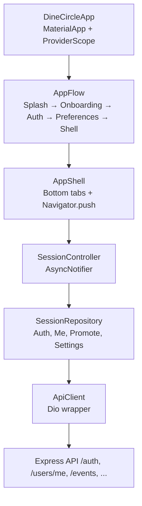

**Diagram sources**
- [lib/main.dart:13-29](file://lib/main.dart#L13-L29)
- [lib/main.dart:31-80](file://lib/main.dart#L31-L80)
- [lib/app_shell.dart:33-331](file://lib/app_shell.dart#L33-L331)
- [lib/providers/session_provider.dart:37-270](file://lib/providers/session_provider.dart#L37-L270)
- [lib/repositories/session_repository.dart:46-104](file://lib/repositories/session_repository.dart#L46-L104)
- [lib/api/api_client.dart:17-45](file://lib/api/api_client.dart#L17-L45)

## Detailed Component Analysis

### App Bootstrap and Root Flow
- `DineCircleApp` configures `MaterialApp` with a dark theme and sets `AppFlow` as home.
- `AppFlow` manages first-run flow:
  - Shows splash until user taps Get Started.
  - Watches session loading; keeps splash during token validation.
  - Routes unauthenticated users to Onboarding or Auth depending on onboarding completion.
  - Routes authenticated users to Preferences if not completed, otherwise to `AppShell`.

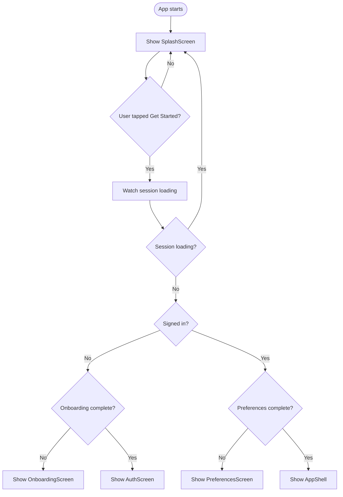

**Diagram sources**
- [lib/main.dart:13-29](file://lib/main.dart#L13-L29)
- [lib/main.dart:31-80](file://lib/main.dart#L31-L80)

**Section sources**
- [lib/main.dart:13-29](file://lib/main.dart#L13-L29)
- [lib/main.dart:31-80](file://lib/main.dart#L31-L80)

### Navigation Architecture
- The app uses Flutter's built-in `Navigator.push` for modal and page transitions from the shell.
- `AppShell` maintains the active tab index and uses `IndexedStack` to keep tab content alive.
- Key navigations:
  - Dinner details, checkout, booking confirmation.
  - Restaurant detail, user profile, notifications, messages, chat detail.
  - Create dinner route guarded by host capability.
  - Location selection and saving location via profile update.

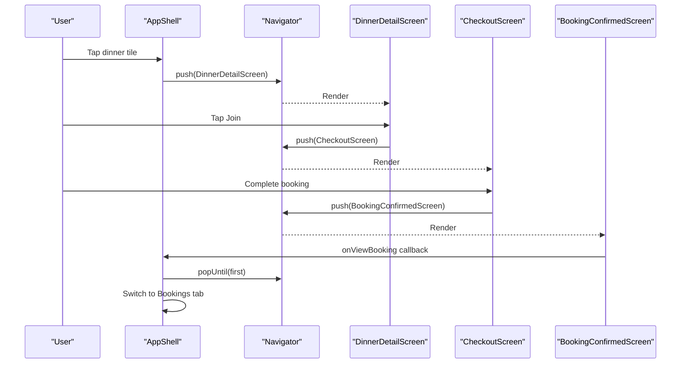

**Diagram sources**
- [lib/app_shell.dart:56-95](file://lib/app_shell.dart#L56-L95)
- [lib/app_shell.dart:227-331](file://lib/app_shell.dart#L227-L331)

**Section sources**
- [lib/app_shell.dart:56-95](file://lib/app_shell.dart#L56-L95)
- [lib/app_shell.dart:227-331](file://lib/app_shell.dart#L227-L331)

### Riverpod State Management Pattern
- `AppSession` represents resolved sign-in state including user id, role, and profile.
- `SessionController` extends `AsyncNotifier<AppSession>`:
  - Bootstraps session by restoring token from secure storage and validating via `/auth/me`.
  - Persists new tokens and publishes updated session state.
  - Exposes methods for sign up, login, refresh, promote to host/influencer, profile updates, settings patches, password change, email change challenge/confirmation, logout-all, delete account, sign out, and unauthorized handling.
- Convenience providers:
  - `currentUserIdProvider`, `authReadyProvider`, `currentRoleProvider`, `canHostProvider`, `tierProvider`.

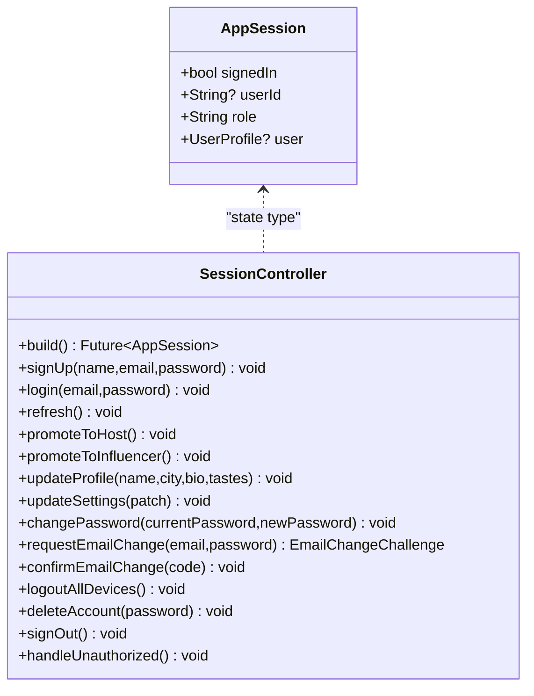

**Diagram sources**
- [lib/providers/session_provider.dart:11-33](file://lib/providers/session_provider.dart#L11-L33)
- [lib/providers/session_provider.dart:37-270](file://lib/providers/session_provider.dart#L37-L270)

**Section sources**
- [lib/providers/session_provider.dart:11-33](file://lib/providers/session_provider.dart#L11-L33)
- [lib/providers/session_provider.dart:37-270](file://lib/providers/session_provider.dart#L37-L270)
- [lib/providers/session_provider.dart:273-308](file://lib/providers/session_provider.dart#L273-L308)

### Service Layer Abstraction (API Calls and Local Storage)
- `ApiClient` wraps Dio:
  - Injects bearer token header.
  - Maps Dio exceptions to `ApiException` with categorized kinds (timeout, network, unauthorized, forbidden, not found, conflict, validation, server, unknown).
  - Retries GET requests once on transient failures.
  - Notifies session controller on 401 to clear local state.
- `SessionRepository` abstracts auth and account endpoints:
  - Sign up, login, OTP helpers (dormant), me, sign out, become host, tier, become influencer, change password, email change challenge/confirmation, logout all, delete account.
- Local storage:
  - Token persisted securely and cleared on sign out, logout-all, delete account, or unauthorized responses.

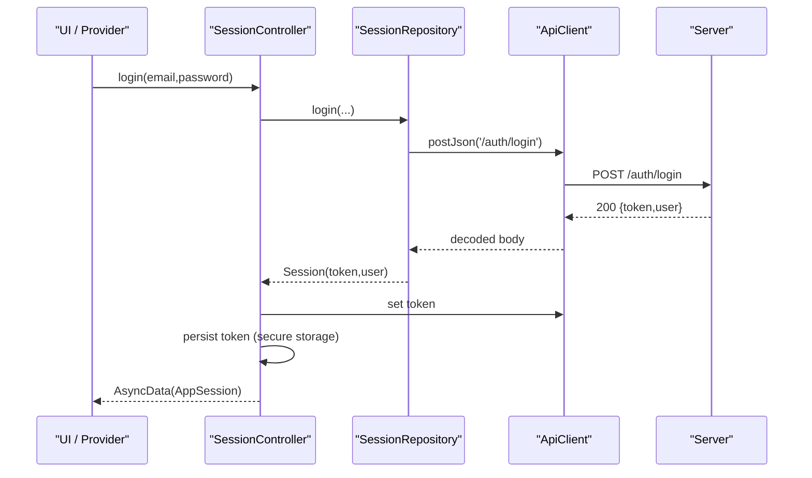

**Diagram sources**
- [lib/providers/session_provider.dart:92-97](file://lib/providers/session_provider.dart#L92-L97)
- [lib/repositories/session_repository.dart:124-134](file://lib/repositories/session_repository.dart#L124-L134)
- [lib/api/api_client.dart:61-75](file://lib/api/api_client.dart#L61-L75)

**Section sources**
- [lib/api/api_client.dart:17-45](file://lib/api/api_client.dart#L17-L45)
- [lib/api/api_client.dart:77-111](file://lib/api/api_client.dart#L77-L111)
- [lib/api/api_client.dart:113-161](file://lib/api/api_client.dart#L113-L161)
- [lib/repositories/session_repository.dart:46-104](file://lib/repositories/session_repository.dart#L46-L104)
- [lib/repositories/session_repository.dart:106-249](file://lib/repositories/session_repository.dart#L106-L249)

### Model Layer Design
- Domain models are defined under `lib/models/` and consumed by screens and providers. Examples include booking, dinner, restaurant, review, message, notification, safety, and user profile.
- Mappers convert API DTOs to domain models; the session controller uses mappers when hydrating the current user.

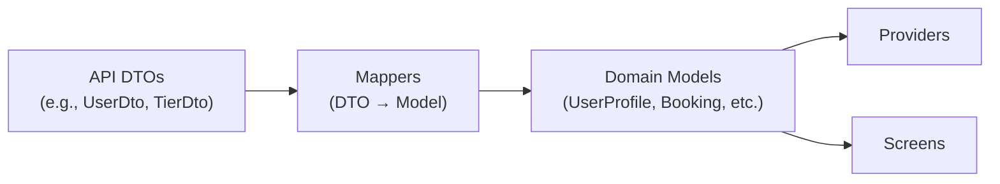

**Diagram sources**
- [lib/providers/session_provider.dart:3-6](file://lib/providers/session_provider.dart#L3-L6)
- [lib/repositories/session_repository.dart:1-4](file://lib/repositories/session_repository.dart#L1-L4)

**Section sources**
- [lib/providers/session_provider.dart:3-6](file://lib/providers/session_provider.dart#L3-L6)
- [lib/repositories/session_repository.dart:1-4](file://lib/repositories/session_repository.dart#L1-L4)

### Theme System Implementation
- The app applies a dark theme via `AppTheme.darkTheme` in `MaterialApp`.
- Theme assets include colors, spacing, and text styles under `lib/theme/`.
- Widgets and screens consistently reference these design tokens for visual consistency.

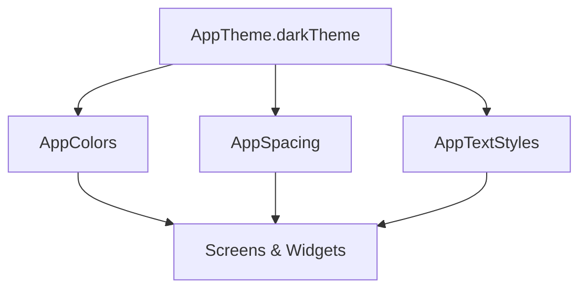

**Diagram sources**
- [lib/main.dart:22-27](file://lib/main.dart#L22-L27)
- [lib/app_shell.dart:4-11](file://lib/app_shell.dart#L4-L11)

**Section sources**
- [lib/main.dart:22-27](file://lib/main.dart#L22-L27)
- [lib/app_shell.dart:4-11](file://lib/app_shell.dart#L4-L11)

### Platform-Specific Implementations
- Dependencies include platform integrations such as Google Maps, geolocation, Stripe, QR generation, and URL launching.
- The README notes placeholder maps and decorative QR patterns; real SDK wiring is deferred.

**Section sources**
- [pubspec.yaml:42-48](file://pubspec.yaml#L42-L48)
- [README.md:196-199](file://README.md#L196-L199)

## Home Screen Priority-Ordered Layout System

**Updated** The home screen has been completely redesigned to implement a sophisticated 9-section priority-ordered layout system that provides a refined, personalized user experience. This new architecture replaces the previous 12-section approach with a streamlined editorial layout focused on guest priority and engagement optimization.

### Personalized Greeting System
The home screen implements a dynamic greeting system that adapts based on the time of day and user context:

#### Time-Based Greetings
- **Morning**: "Good Morning" (before 12 PM)
- **Afternoon**: "Good Afternoon" (12 PM - 5 PM)  
- **Evening**: "Good Evening" (after 5 PM)

#### Personalized Welcome Messages
- Uses the user's first name for personalized greetings
- Falls back to generic welcome messages for new users
- Integrates with the current user session state

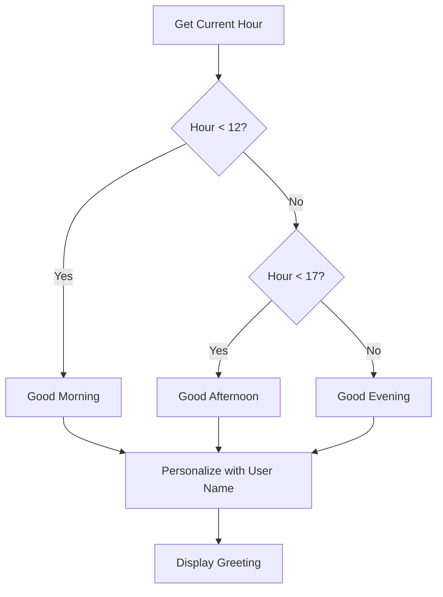

**Diagram sources**
- [lib/screens/home/home_screen.dart:77-83](file://lib/screens/home/home_screen.dart#L77-L83)
- [lib/screens/home/home_screen.dart:172-186](file://lib/screens/home/home_screen.dart#L172-L186)

**Section sources**
- [lib/screens/home/home_screen.dart:77-83](file://lib/screens/home/home_screen.dart#L77-L83)
- [lib/screens/home/home_screen.dart:172-186](file://lib/screens/home/home_screen.dart#L172-L186)

### Smart Search Integration
The search functionality provides intelligent discovery capabilities:

#### Search Interface Design
- Full-width search bar with rounded corners
- Placeholder text guiding users on search capabilities
- Integrated with explore screen navigation
- Supports both direct search and category exploration

#### Search Capabilities
- Restaurant name and cuisine search
- Event title and description matching
- Host name and profile search
- Category-based filtering

**Section sources**
- [lib/screens/home/home_screen.dart:239-276](file://lib/screens/home/home_screen.dart#L239-L276)

### Quick Action Categories
Three primary quick actions provide immediate access to core features:

#### Action Categories
1. **Book a Table** - Direct table reservation functionality
2. **Join a Gathering** - Social dining event participation  
3. **Explore Deals** - Exclusive offers and promotions

#### Interaction Patterns
- Color-coded actions with distinct visual hierarchy
- Consistent tap handling with category routing
- Responsive layout adapting to screen sizes
- Accessibility support with proper semantic labeling

**Section sources**
- [lib/screens/home/home_screen.dart:278-320](file://lib/screens/home/home_screen.dart#L278-L320)

### Content Sections Architecture

#### Your Next Table (Section 4 - Conditional)
A new priority section that displays the user's next confirmed booking when available:

- **Conditional Display**: Only shows when confirmed upcoming bookings exist
- **Priority Positioning**: Positioned prominently after quick actions
- **Interactive Card**: Displays venue, date, time, party size, and status badge
- **Direct Navigation**: Tapping opens the dinner detail screen

#### Featured Experiences (Section 5 - Enhanced)
Sophisticated cinematic card carousel with advanced date filtering:

- **Tiered Content Prioritization**: 
  - Tier 1: Dinners happening today or tomorrow
  - Tier 2: Special-event dinners not already shown
  - Tier 3: Influencer-hosted dinners not already featured
- **Date Filtering**: Real-time filtering based on current time and future dates
- **Content Deduplication**: Prevents repetitive content across sections
- **Cinematic Presentation**: Horizontal scrolling card layout with rich visuals

#### Gather Around a Table (Section 6 - Enhanced)
Photographic category banners with sophisticated visual design:

- **Multi-Stop Gradient Overlays**: Three-stop gradients for optimal text readability
- **Image Backgrounds**: High-quality photographic backgrounds with color fallbacks
- **Category Variety**: Social Dining, Singles Nights, Networking, Creator Dinners, Culinary Experiences
- **Interactive Cards**: Touch-responsive with smooth animations

#### Tables Worth Booking (Section 7)
Top-rated restaurant recommendations with horizontal showcase:

- **Restaurant Cards**: Compact cards with ratings and pricing information
- **Direct Booking Integration**: Seamless transition to booking flow
- **Responsive Layout**: Adapts to different screen sizes

#### This Week on DineCircle (Section 8)
Chronological event listings with smart content filtering:

- **Exclusion Logic**: Removes events already featured in other sections
- **Week-Based Filtering**: Shows events within the next 7 days
- **Fallback Mechanism**: Ensures content availability even when most events are featured

#### Find Your Kind of Evening (Section 9)
Occasion-based mood categorization with visual appeal:

- **Six Occasion Types**: Date Night, Friends & Family, Celebrations, Business Dining, Casual & Cozy, Something Special
- **Visual Cards**: Each occasion has unique imagery and color coding
- **Audience Targeting**: Filters content based on selected occasion type

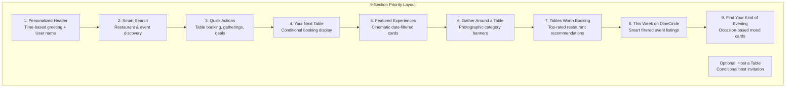

**Diagram sources**
- [lib/screens/home/home_screen.dart:23-39](file://lib/screens/home/home_screen.dart#L23-L39)
- [lib/screens/home/home_screen.dart:94-363](file://lib/screens/home/home_screen.dart#L94-L363)

**Section sources**
- [lib/screens/home/home_screen.dart:323-343](file://lib/screens/home/home_screen.dart#L323-L343)

### Component Composition Patterns

#### SectionHeader Widget
A reusable component providing consistent section headers throughout the editorial layout:

```dart
class SectionHeader extends StatelessWidget {
  final String title;
  final String? actionText;
  final VoidCallback? onAction;
  
  // Provides consistent styling with optional "See all" action links
}
```

#### QuickAction Component
Specialized button component for primary actions:

```dart
class _QuickAction extends StatelessWidget {
  final IconData icon;
  final String label;
  final Color color;
  final VoidCallback? onTap;
  
  // Color-coded action buttons with consistent styling
}
```

#### SocialCategoryCard Component
Interactive category cards with sophisticated visual design:

```dart
class _SocialCategoryCard extends StatelessWidget {
  final _SocialCategory category;
  final VoidCallback? onTap;
  
  // Multi-stop gradient overlays with photographic backgrounds
}
```

**Section sources**
- [lib/widgets/common_widgets.dart:7-55](file://lib/widgets/common_widgets.dart#L7-L55)
- [lib/screens/home/home_screen.dart:893-933](file://lib/screens/home/home_screen.dart#L893-L933)
- [lib/screens/home/home_screen.dart:937-1021](file://lib/screens/home/home_screen.dart#L937-L1021)

### Data Integration Patterns

#### Provider Integration
The home screen integrates multiple Riverpod providers for dynamic content:

- **eventsFeedProvider**: Real-time dinner and event data
- **nearbyRestaurantsProvider**: Location-based restaurant recommendations
- **myBookingsProvider**: User's upcoming reservations
- **currentUserProvider**: Personalized user information
- **canHostProvider**: Role-based feature availability

#### State Management Architecture
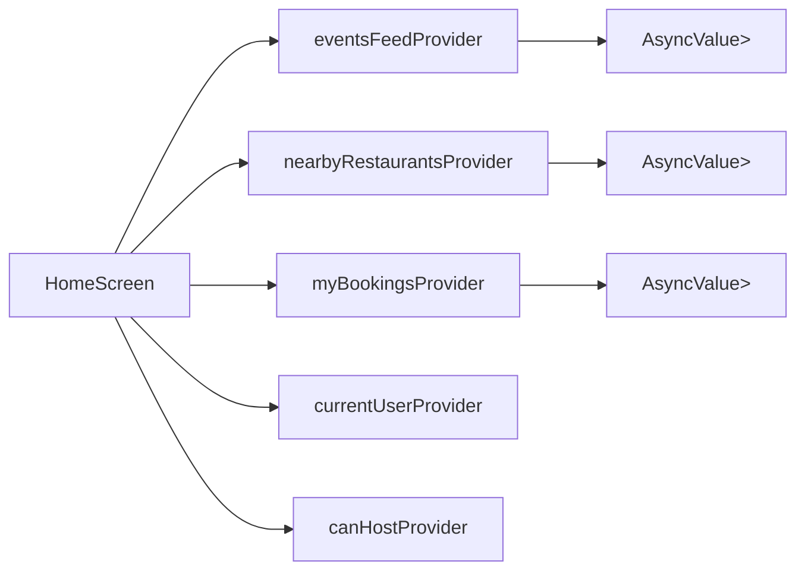

**Diagram sources**
- [lib/screens/home/home_screen.dart:87-92](file://lib/screens/home/home_screen.dart#L87-L92)

**Section sources**
- [lib/screens/home/home_screen.dart:87-92](file://lib/screens/home/home_screen.dart#L87-L92)

## Profile Screen Premium Redesign

**Updated** The profile screen has received a comprehensive premium redesign implementing a sophisticated four-zone vertical layout system that serves as a dining identity and account hub.

### Four Vertical Zones Architecture

#### Zone 1: Compact Header
- **Avatar Display**: Large avatar with initials fallback
- **User Identity**: Name, username, and verification badge
- **Bio Section**: Expandable bio with overflow handling
- **Edit Profile Action**: Primary action button for profile editing

#### Zone 2: Diner Statistics Grid
- **Real-Time Metrics**: Live counts from backend providers
- **Statistics Display**: 
  - Experiences attended (from user model)
  - Tables booked (dynamic count from bookings)
  - Saved places (dynamic count from saved events)
- **Visual Design**: Card-based layout with separator lines

#### Zone 3: Interactive Dining Preferences
- **Preference Tags**: Visual tags for cuisines, dietary restrictions, allergies
- **Location Tag**: City/location preference display
- **Empty State Handling**: Guided setup for new users
- **Editable Interface**: Direct navigation to preferences screen

#### Zone 4: Grouped Navigation Menu
- **My Dining Section**: Bookings, saved places, locations, reviews, connections
- **Hosting & Experiences Section**: Host studio, analytics, earnings, growth tier
- **Account & Support Section**: Payments, notifications, privacy, help
- **Conditional Rendering**: Role-based menu items for hosts vs. diners

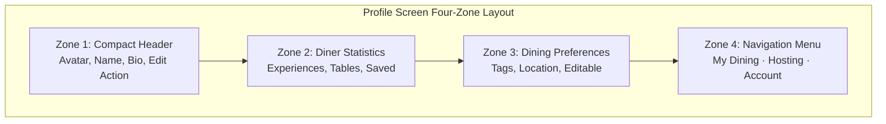

**Diagram sources**
- [lib/screens/profile/profile_screen.dart:30-37](file://lib/screens/profile/profile_screen.dart#L30-L37)
- [lib/screens/profile/profile_screen.dart:84-308](file://lib/screens/profile/profile_screen.dart#L84-L308)

**Section sources**
- [lib/screens/profile/profile_screen.dart:30-37](file://lib/screens/profile/profile_screen.dart#L30-L37)
- [lib/screens/profile/profile_screen.dart:84-308](file://lib/screens/profile/profile_screen.dart#L84-L308)

### Advanced Features

#### Growth Tier System (Hosts Only)
- **Progress Tracking**: Real-time progress toward influencer thresholds
- **Eligibility Checking**: Automatic detection of qualification criteria
- **Claim Functionality**: One-click promotion to influencer status
- **Visual Progress Indicators**: Met/unmet criterion indicators

#### Reviews Management
- **Received Reviews Display**: Modal sheet showing user's received reviews
- **Reviewer Information**: Avatar, name, rating, and comment display
- **Aggregate Statistics**: Total review count and average rating

#### Interactive Preference System
- **Tag-Based Interface**: Visual representation of user preferences
- **Color-Coded Categories**: Different colors for cuisines, dietary, allergies
- **Dynamic Updates**: Real-time reflection of preference changes

**Section sources**
- [lib/screens/profile/profile_screen.dart:531-696](file://lib/screens/profile/profile_screen.dart#L531-L696)
- [lib/screens/profile/profile_screen.dart:403-521](file://lib/screens/profile/profile_screen.dart#L403-L521)
- [lib/screens/profile/profile_screen.dart:313-380](file://lib/screens/profile/profile_screen.dart#L313-L380)

## UI Responsiveness and Layout Optimization

**Updated** Comprehensive RenderFlex overflow fixes have been applied across multiple Flutter screens to ensure responsive design and prevent layout issues on various screen sizes and orientations. The new home screen implementation demonstrates best practices for responsive design with the 9-section priority-ordered layout.

### Text Overflow Protection Patterns
The codebase now consistently implements text overflow protection using three key strategies:

#### 1. MaxLines Constraints with Ellipsis
```dart
Text(
  'Long dynamic content',
  style: AppTextStyles.bodyMedium,
  maxLines: 1,
  overflow: TextOverflow.ellipsis,
)
```

This pattern is applied throughout the application in:
- **Home Screen**: All section titles, event names, restaurant names, and promotional content
- **Profile Screen**: User names, bios, stat labels, and navigation items
- **Bookings Screen**: Status labels, booking titles, restaurant names, and promotional codes
- **Checkout Screen**: Seat counts, price displays, and form field labels  
- **Dinner Detail Screen**: Event titles, restaurant names, menu items, and descriptions
- **Explore Screen**: Search results, category labels, and venue information
- **Settings Screen**: Section headers and setting descriptions

#### 2. Flexible Widget Wrapping
```dart
Flexible(
  child: Text(
    'Dynamic content that may wrap',
    style: AppTextStyles.labelSmall,
    maxLines: 1,
    overflow: TextOverflow.ellipsis,
  ),
)
```

The `Flexible` widget is strategically used in:
- **Home Screen**: Quick action labels, social category descriptions, and occasion cards
- **Profile Screen**: Stat labels, preference tags, and navigation items
- Horizontal layouts where text needs to adapt to available space
- Chip components and status indicators
- Row-based layouts with icons and text
- Card components with variable-length content

#### 3. Responsive Container Structures
```dart
Row(
  children: [
    Icon(Icons.calendar_today_rounded, size: 14),
    const SizedBox(width: 6),
    Flexible(
      child: Text(
        label,
        style: AppTextStyles.labelSmall,
        maxLines: 1,
        overflow: TextOverflow.ellipsis,
      ),
    ),
  ],
)
```

### Screen-Specific Improvements

#### Home Screen Enhancements
- **Personalized Header**: Time-based greetings with proper text truncation
- **Smart Search**: Responsive search bar with adaptive placeholder text
- **Quick Actions**: Three-column layout with flexible spacing and overflow protection
- **Content Sections**: All 9 sections implement consistent responsive patterns
- **Horizontal Scrolling**: Proper padding and spacing for carousel-style content
- **Empty States**: Graceful fallbacks when content is unavailable

#### Profile Screen Optimizations
- **Compact Header**: Proper text truncation for long names and bios
- **Statistics Grid**: Responsive stat chips with overflow protection
- **Preference Tags**: Wrap-based layout for dynamic preference lists
- **Navigation Menu**: Proper subtitle handling and overflow management
- **Modal Sheets**: Scrollable content with proper constraints

#### Performance Benefits
These overflow fixes provide several performance advantages:
- **Reduced Layout Recalculations**: Proper text constraints minimize expensive layout passes
- **Improved Scrolling Performance**: Predictable text sizing reduces scroll jank
- **Better Memory Usage**: Consistent widget sizing allows for better memory allocation
- **Enhanced User Experience**: Smooth interactions across all device configurations
- **Editorial Layout Optimization**: The 9-section home screen maintains smooth scrolling performance despite complex content structure

**Section sources**
- [lib/screens/home/home_screen.dart:117-124](file://lib/screens/home/home_screen.dart#L117-L124)
- [lib/screens/home/home_screen.dart:180-186](file://lib/screens/home/home_screen.dart#L180-L186)
- [lib/screens/home/home_screen.dart:921-927](file://lib/screens/home/home_screen.dart#L921-L927)
- [lib/screens/home/home_screen.dart:1000-1011](file://lib/screens/home/home_screen.dart#L1000-L1011)
- [lib/screens/profile/profile_screen.dart:115-147](file://lib/screens/profile/profile_screen.dart#L115-L147)
- [lib/screens/profile/profile_screen.dart:831-841](file://lib/screens/profile/profile_screen.dart#L831-L841)

## Dependency Analysis
Key runtime dependencies and their roles:
- `flutter_riverpod`: Reactive state management and dependency injection.
- `dio`: HTTP client with interceptors and timeouts.
- `flutter_secure_storage`: Secure persistence of auth tokens.
- `connectivity_plus`: Connectivity status for offline banners.
- `google_fonts`: Custom fonts.
- Platform features: maps, geolocation, Stripe, QR, URL launcher.

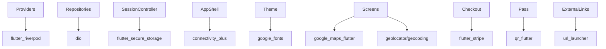

**Diagram sources**
- [pubspec.yaml:30-48](file://pubspec.yaml#L30-L48)

**Section sources**
- [pubspec.yaml:30-48](file://pubspec.yaml#L30-L48)

## Performance Considerations
- Network efficiency:
  - Single retry for transient GET failures reduces flaky request failures without excessive retries.
  - Centralized error mapping avoids duplicated error handling across repositories.
- State reactivity:
  - `AsyncNotifier` provides efficient streaming of async state; consumers rebuild only when needed.
- UI composition:
  - `IndexedStack` keeps tab contents alive to avoid repeated initialization costs.
  - **Layout optimization**: Comprehensive overflow prevention reduces layout recalculations and improves rendering performance.
  - **Editorial Layout Performance**: The 9-section home screen uses efficient sliver-based scrolling for optimal performance.
  - **Conditional Rendering**: Smart section visibility prevents unnecessary widget tree construction.
- Security and stability:
  - Token stored securely; automatic logout on 401 prevents stale sessions.
- Observability:
  - Connectivity banner informs users of offline states; consider adding analytics/crash reporting later.
- **Responsive design**: Consistent text handling and flexible layouts ensure smooth performance across all device sizes and orientations.
- **Content Loading**: Lazy loading of home screen sections improves initial render performance.

[No sources needed since this section provides general guidance]

## Troubleshooting Guide
Common issues and resolutions:
- Authentication failures:
  - 401 triggers session cleanup; verify token persistence and server health.
- Network errors:
  - Timeout/connection errors map to user-friendly messages; check device connectivity and API base URL.
- Validation errors:
  - 400/422 return validation kind; surface server messages to the UI.
- Unauthorized actions:
  - 403 indicates permission issues; ensure correct role (host/influencer) before publishing events.
- **Layout issues**:
  - If experiencing RenderFlex overflow errors, ensure proper use of `Flexible` widgets and `maxLines` constraints.
  - Verify that text widgets have appropriate overflow handling with `TextOverflow.ellipsis`.
  - Check that container layouts properly constrain their children's available space.
- **Home Screen Issues**:
  - Empty sections: Verify provider data loading and error handling
  - Greeting not displaying: Check user session state and name property
  - Search not working: Verify explore screen integration and navigation callbacks
  - Quick actions not responding: Ensure category routing is properly configured
  - Your Next Table not showing: Confirm booking data exists and is confirmed
  - Featured Experiences empty: Check date filtering logic and event availability
- **Profile Screen Issues**:
  - Statistics not updating: Verify provider subscriptions and data loading
  - Preferences not displaying: Check user model data and preference arrays
  - Growth tier card not showing: Verify host role and tier provider data

**Section sources**
- [lib/api/api_client.dart:113-161](file://lib/api/api_client.dart#L113-L161)
- [lib/providers/session_provider.dart:265-270](file://lib/providers/session_provider.dart#L265-L270)

## Conclusion
The Flutter client adheres to clean architecture with clear separation of concerns: presentation via screens/widgets, business logic via Riverpod providers/controllers, and data access via repositories and a centralized API client. Navigation is handled through Flutter's Navigator within a tabbed shell. The theme system ensures consistent styling, and platform integrations are present but partially simulated. End-to-end flows are wired against the Express/PostgreSQL backend, with robust error handling and security measures in place. 

The comprehensive home screen redesign represents a significant architectural advancement, implementing a sophisticated 9-section priority-ordered layout system that provides personalized user experiences through time-based greetings, smart search integration, quick action categories, and diverse content sections. The new 'Your Next Table' positioning and enhanced 'Featured Experiences' with sophisticated date filtering demonstrate advanced content prioritization strategies. The removal of redundant sections like 'Dine with Creators' and 'Exclusive Offers' streamlines the user experience while maintaining essential functionality.

The profile screen's premium redesign introduces a four-zone vertical layout system that serves as a comprehensive dining identity hub, featuring real-time statistics, interactive preferences, and role-based navigation. Recent improvements to UI responsiveness and layout optimization ensure smooth performance across all device configurations, with proper text overflow handling and flexible widget usage throughout the application. The new component composition patterns establish reusable building blocks that enhance maintainability and consistency across the entire codebase. Future phases will expand realtime chat, payments, push notifications, and platform completeness.

[No sources needed since this section summarizes without analyzing specific files]