# Host Studio

<cite>
**Referenced Files in This Document**
- [host_dashboard_screen.dart](file://lib/screens/host/host_dashboard_screen.dart)
- [analytics_screen.dart](file://lib/screens/host/analytics_screen.dart)
- [event_manage_screen.dart](file://lib/screens/host/event_manage_screen.dart)
- [create_dinner_screen.dart](file://lib/screens/create/create_dinner_screen.dart)
- [profile_screen.dart](file://lib/screens/profile/profile_screen.dart)
- [host_studio_controller.dart](file://lib/providers/host_studio_controller.dart)
- [hosts_provider.dart](file://lib/providers/hosts_provider.dart)
- [host_models.dart](file://lib/models/host_models.dart)
- [dinner.dart](file://lib/models/dinner.dart)
- [tier_dto.dart](file://lib/api/dto/tier_dto.dart)
</cite>

## Update Summary
**Changes Made**
- Updated Event Creation Interface section to document the new 6-step wizard interface with enhanced experience details, restaurant & venue selection, date & schedule configuration, guests & dining preferences, menu & pricing setup, and review & submit functionality with terms acknowledgment
- Enhanced the wizard flow documentation to include step-by-step validation, progress tracking, and comprehensive field management
- Added detailed documentation for the terms acknowledgment requirement in the final review step
- Updated validation rules and user interaction patterns throughout the creation process

## Table of Contents
1. [Introduction](#introduction)
2. [Project Structure](#project-structure)
3. [Core Components](#core-components)
4. [Architecture Overview](#architecture-overview)
5. [Detailed Component Analysis](#detailed-component-analysis)
6. [Dependency Analysis](#dependency-analysis)
7. [Performance Considerations](#performance-considerations)
8. [Troubleshooting Guide](#troubleshooting-guide)
9. [Conclusion](#conclusion)

## Introduction
Host Studio is the consolidated host-facing experience for creating, managing, and analyzing dining events. It serves as the single entry point for all hosting features, replacing the previous separate menu items like 'Host Analytics' and 'Earnings & Payouts' from the profile screen. The feature includes:
- A unified dashboard with four tabs: Overview, Events, Earnings, and Collabs
- **Enhanced event creation with a sophisticated 6-step wizard interface** including experience details, restaurant & venue selection, date & schedule configuration, guests & dining preferences, menu & pricing setup, and review & submit functionality with terms acknowledgment
- Comprehensive analytics with performance metrics, revenue trends, conversion funnels, and guest insights
- Complete event management for editing details, scheduling, capacity control, guest approvals, announcements, attendance, and cancellation
- Integrated payout system and withdrawal flow backed by a simulated wallet ledger
- Growth tier progression system for influencer status advancement
- Host-specific permissions and access controls enforced through providers and controllers

## Project Structure
The Host Studio feature spans screens, providers, models, and controllers, with the profile screen serving as the entry point:
- Screens: Profile (entry point), Host Dashboard (unified interface), Analytics, Event Management, Create Dinner (enhanced 6-step wizard)
- Providers: Host summary, payouts, trends, partners, invites, wallet, event guests
- Models: Host lifecycle states, guest requests, payouts, wallet, trend points, dinner model, tier progression
- Controllers: Invites, wallet withdrawals, guest request approvals

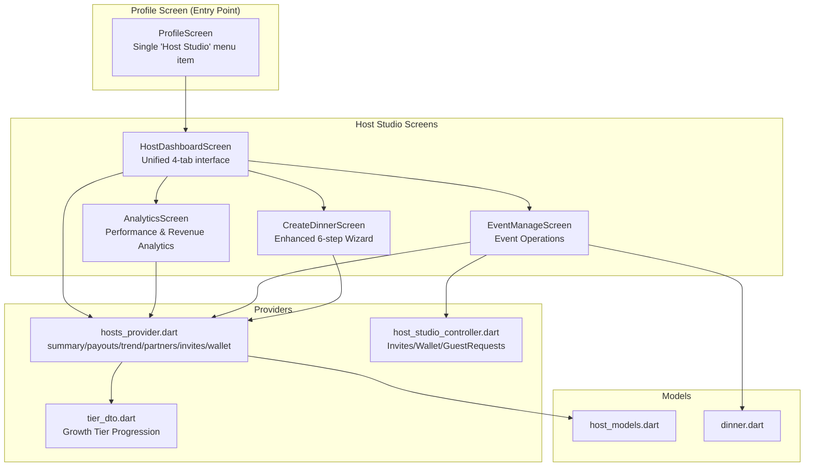

**Diagram sources**
- [profile_screen.dart:306-320](file://lib/screens/profile/profile_screen.dart#L306-L320)
- [host_dashboard_screen.dart:21-287](file://lib/screens/host/host_dashboard_screen.dart#L21-L287)
- [analytics_screen.dart:11-125](file://lib/screens/host/analytics_screen.dart#L11-L125)
- [event_manage_screen.dart:18-760](file://lib/screens/host/event_manage_screen.dart#L18-L760)
- [create_dinner_screen.dart:21-509](file://lib/screens/create/create_dinner_screen.dart#L21-L509)
- [hosts_provider.dart:9-118](file://lib/providers/hosts_provider.dart#L9-L118)
- [host_studio_controller.dart:9-112](file://lib/providers/host_studio_controller.dart#L9-L112)
- [tier_dto.dart:1-39](file://lib/api/dto/tier_dto.dart#L1-L39)

**Section sources**
- [profile_screen.dart:306-320](file://lib/screens/profile/profile_screen.dart#L306-L320)
- [host_dashboard_screen.dart:21-287](file://lib/screens/host/host_dashboard_screen.dart#L21-L287)
- [hosts_provider.dart:9-118](file://lib/providers/hosts_provider.dart#L9-L118)

## Core Components
- **Profile Screen Entry Point**: Simplified hosting section with single "Host Studio" menu item that navigates to the unified dashboard
- **Host Dashboard**: Unified tabbed interface (Overview, Events, Earnings, Collabs) showing available balance, pending amounts, performance stats, upcoming events, drafts, filters, and quick actions
- **Analytics Screen**: Period selector (7D/30D/90D/All), summary tiles (views, bookings, revenue, attendance, conversion, engagement), revenue trend chart, booking funnel, per-event performance rows, and follower engagement metrics
- **Event Management Screen**: Header with status badge, stats, action grid, guest tabs (Confirmed, Requests, Attended), approve/decline requests, announcements, attendance marking, capacity management, and cancellation flow
- **Enhanced Create Dinner Screen**: Sophisticated six-step wizard covering experience details, restaurant & venue selection, date & schedule configuration, guests & dining preferences, menu & pricing setup, and review & publish with terms acknowledgment. Supports preview, save draft, publish, pause/resume bookings, and cancel event
- **Growth Tier Progression System**: Influencer status advancement tracking with progress indicators for followers, events hosted, and rating thresholds
- **Host Studio Controllers**: Write operations for collaboration invites, wallet withdrawals, and guest request approvals; they invalidate relevant providers to keep UI consistent
- **Host Providers**: Read-only data streams for summary, payouts, trends, partners, invites, wallet, and event guests

**Section sources**
- [profile_screen.dart:306-320](file://lib/screens/profile/profile_screen.dart#L306-L320)
- [host_dashboard_screen.dart:21-800](file://lib/screens/host/host_dashboard_screen.dart#L21-L800)
- [analytics_screen.dart:11-682](file://lib/screens/host/analytics_screen.dart#L11-L682)
- [event_manage_screen.dart:18-800](file://lib/screens/host/event_manage_screen.dart#L18-L800)
- [create_dinner_screen.dart:21-649](file://lib/screens/create/create_dinner_screen.dart#L21-L649)
- [tier_dto.dart:1-39](file://lib/api/dto/tier_dto.dart#L1-L39)
- [host_studio_controller.dart:9-112](file://lib/providers/host_studio_controller.dart#L9-L112)
- [hosts_provider.dart:9-118](file://lib/providers/hosts_provider.dart#L9-L118)

## Architecture Overview
Host Studio follows a provider-driven architecture with the profile screen as the consolidated entry point:
- Profile screen provides single entry point to Host Studio
- Host Dashboard manages four main tabs with Riverpod providers for live data
- Controllers encapsulate write operations and trigger provider invalidation
- Models define domain types for hosts, events, payouts, wallets, and tier progression

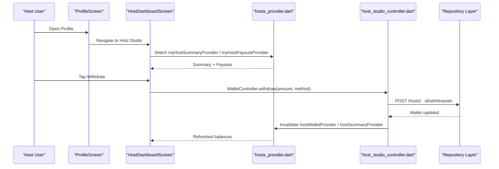

**Diagram sources**
- [profile_screen.dart:306-320](file://lib/screens/profile/profile_screen.dart#L306-L320)
- [host_dashboard_screen.dart:516-672](file://lib/screens/host/host_dashboard_screen.dart#L516-L672)
- [host_studio_controller.dart:46-79](file://lib/providers/host_studio_controller.dart#L46-L79)
- [hosts_provider.dart:105-118](file://lib/providers/hosts_provider.dart#L105-L118)

## Detailed Component Analysis

### Profile Screen Entry Point
The profile screen now provides a simplified hosting section with a single entry point:
- **For Hosts**: Shows "Host Studio" menu item with subtitle "Manage events, analytics, earnings & collaborations"
- **For Non-Hosts**: Shows "Become a Host" invitation card that navigates to Host Studio
- **Removed**: Separate menu items for 'Host Analytics' and 'Earnings & Payouts' are no longer present

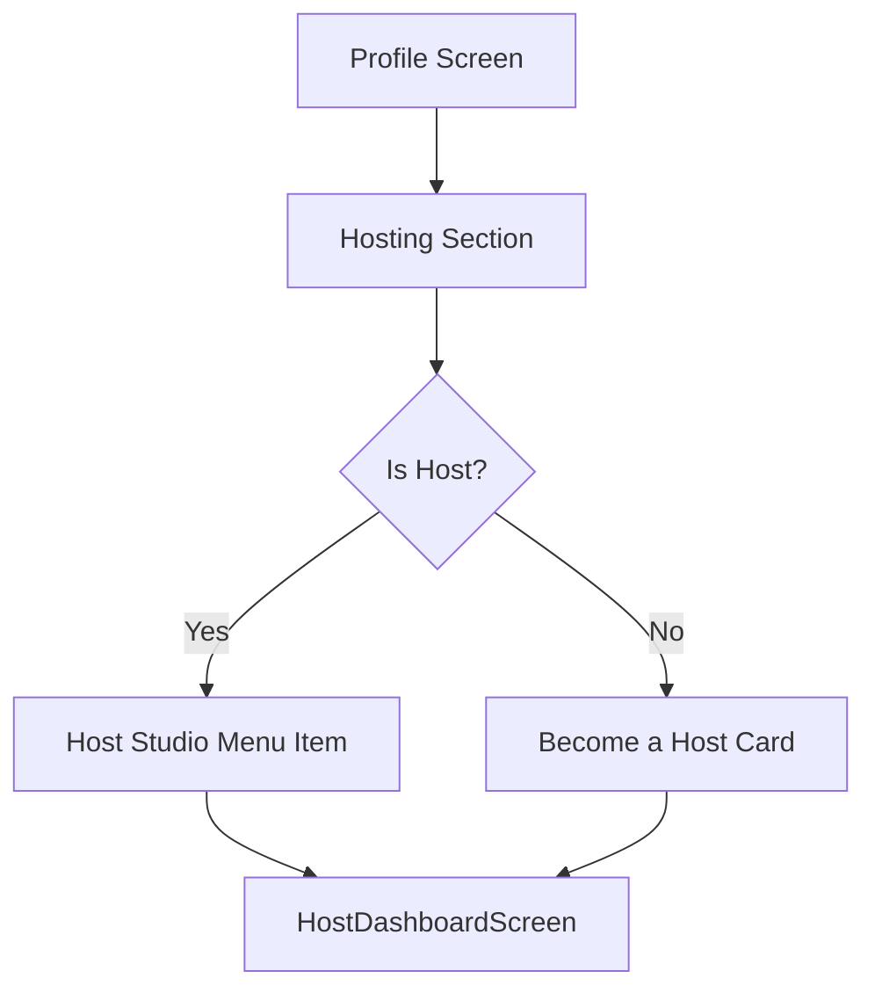

**Diagram sources**
- [profile_screen.dart:306-320](file://lib/screens/profile/profile_screen.dart#L306-L320)

**Section sources**
- [profile_screen.dart:306-320](file://lib/screens/profile/profile_screen.dart#L306-L320)

### Host Dashboard (Unified Interface)
The Host Dashboard serves as the central hub with four main tabs:
- **Overview**: Host header, balance strip (available, pending), performance stats (hosted count, seats sold, upcoming, fill rate, revenue, average rating), upcoming events list, and create CTA
- **Events**: Drafts section with inline edit/publish/delete, filter chips (All/Published/Paused/Completed/Cancelled), and event cards
- **Earnings**: Available balance card, breakdown (event revenue, commission, net), per-event revenue lines, and payout history
- **Collabs**: Partner venues, collaboration invitations with pending badges, promote to followers for published events

Permissions and access:
- Reads signed-in user's own events via `myEventsProvider` so drafts surface privately
- Filters events by host status labels
- Opens analytics and event management screens

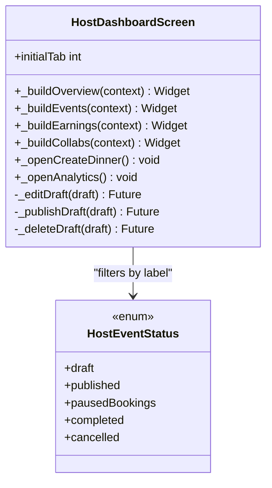

**Diagram sources**
- [host_dashboard_screen.dart:21-287](file://lib/screens/host/host_dashboard_screen.dart#L21-L287)
- [host_models.dart:6-24](file://lib/models/host_models.dart#L6-L24)

**Section sources**
- [host_dashboard_screen.dart:21-800](file://lib/screens/host/host_dashboard_screen.dart#L21-L800)

### Growth Tier Progression System
The growth tier progression system tracks host advancement toward influencer status:
- **Progress Tracking**: Monitors followers, events hosted, and rating thresholds
- **Eligibility Check**: Determines when a host meets all requirements for influencer status
- **Claim Process**: Allows eligible hosts to claim influencer status with confirmation
- **Status Display**: Shows verified influencer status or progress indicators

Key components:
- TierDto model for API responses containing current tier, eligibility, progress, and thresholds
- Progress bars showing completion status for each requirement
- Claim button that becomes active when all thresholds are met
- Verified status display for existing influencers

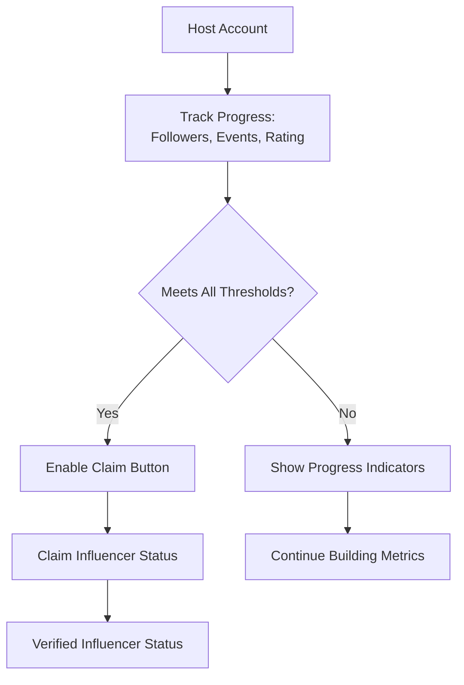

**Diagram sources**
- [tier_dto.dart:1-39](file://lib/api/dto/tier_dto.dart#L1-L39)
- [profile_screen.dart:637-818](file://lib/screens/profile/profile_screen.dart#L637-L818)

**Section sources**
- [tier_dto.dart:1-39](file://lib/api/dto/tier_dto.dart#L1-L39)
- [profile_screen.dart:637-818](file://lib/screens/profile/profile_screen.dart#L637-L818)

### Enhanced Event Creation Interface (Create Dinner Screen)
The Create Dinner screen implements a sophisticated six-step wizard with comprehensive validation and user guidance:

#### Step 1 — Experience Details
- **Event Name**: Required field with minimum 3-character validation
- **Description**: Text area for event description with validation
- **Experience Category**: Selection from predefined categories using chip interface
- **Cover Image**: Visual selection from curated image gallery with border highlighting

#### Step 2 — Restaurant & Venue
- **Venue Selection**: Interactive list of verified partner venues with detailed information
- **Venue Details**: Displays selected venue name, address, cuisine type, and verification status
- **Validation**: Requires selection of a verified partner venue before proceeding

#### Step 3 — Date & Schedule
- **Event Date**: Calendar picker with future date validation
- **Time Selection**: Start and end time pickers with duration validation (minimum 30 minutes, maximum 10 hours)
- **Capacity Management**: Total seats, minimum attendees, and maximum attendees with constraint validation
- **Event Visibility**: Public/private toggle with visual segment buttons

#### Step 4 — Guests & Dining
- **Guest Access**: Three-tier access control (Everyone, Followers, Invite Only)
- **Approval System**: Optional approval workflow with guest limit configuration
- **Cancellation Policy**: Predefined policy options with clear descriptions
- **Waitlist Management**: Toggle for waitlist functionality when events are full
- **Dining Preferences**: Cuisine type, dress code, age restrictions, dietary accommodations, and event rules
- **Special Menu**: Toggle for curated multi-course menu experiences

#### Step 5 — Menu & Pricing
- **Menu Items**: Dynamic add/remove functionality with name, description, and price fields
- **Pricing Model**: Free vs paid event toggle with real-time financial calculations
- **Financial Breakdown**: Real-time calculation of platform fees (10%) and estimated host payouts
- **Validation**: Price validation requiring positive values for paid events

#### Step 6 — Review & Submit
- **Comprehensive Preview**: Full event summary organized by sections with edit capabilities
- **Terms Acknowledgment**: Mandatory checkbox confirming accuracy and agreement to host terms and cancellation policy
- **Action Options**: Save draft, preview event, and publish functionality
- **Navigation**: Tappable progress bar allowing backward navigation to any completed step

Key behaviors:
- **Step-level Validation**: Each step validates required fields before allowing forward navigation
- **Real-time Feedback**: Inline error messages and visual indicators for validation failures
- **Draft Management**: Save partial work as drafts with relaxed schema validation
- **Publishing Workflow**: Full validation across all steps before server submission
- **Post-publish Actions**: Edit event, pause/resume bookings, and cancel event capabilities

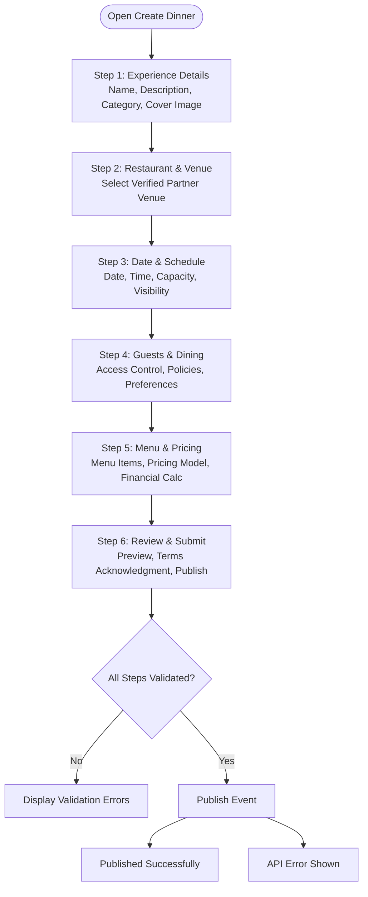

**Diagram sources**
- [create_dinner_screen.dart:116-213](file://lib/screens/create/create_dinner_screen.dart#L116-L213)
- [create_dinner_screen.dart:242-296](file://lib/screens/create/create_dinner_screen.dart#L242-L296)
- [create_dinner_screen.dart:301-344](file://lib/screens/create/create_dinner_screen.dart#L301-L344)
- [create_dinner_screen.dart:370-509](file://lib/screens/create/create_dinner_screen.dart#L370-L509)

**Section sources**
- [create_dinner_screen.dart:21-649](file://lib/screens/create/create_dinner_screen.dart#L21-L649)

### Analytics Screen
Analytics displays:
- Period selector (7D/30D/90D/All) that scales view/booking totals
- Summary tiles: views, bookings, revenue, attendance, conversion, engagement
- Revenue trend chart over last 6 months
- Booking funnel: views → bookings → checked-in with conversion percentages
- Event performance rows: per-event views, bookings, conversion, gross revenue
- Follower engagement: new followers, reach, avg engagement rate, top event

Data sources:
- Performance rows from `myHostPerformanceProvider`
- Trend points from `myHostTrendProvider`
- Summary values merged with `myHostSummaryProvider`

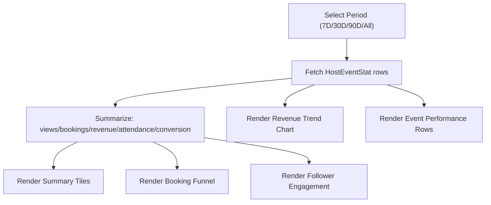

**Diagram sources**
- [analytics_screen.dart:21-125](file://lib/screens/host/analytics_screen.dart#L21-L125)
- [analytics_screen.dart:127-321](file://lib/screens/host/analytics_screen.dart#L127-L321)
- [analytics_screen.dart:323-491](file://lib/screens/host/analytics_screen.dart#L323-L491)
- [hosts_provider.dart:55-67](file://lib/providers/hosts_provider.dart#L55-L67)

**Section sources**
- [analytics_screen.dart:11-682](file://lib/screens/host/analytics_screen.dart#L11-L682)

### Event Management Screen
Capabilities:
- Header with event image, status badge, and key details
- Stats panel and action grid
- Guest tabs: Confirmed, Requests, Attended
- Approve/decline guest requests via controller
- Announcements targeting All Guests, Confirmed Only, Pending Requests
- Attendance marking with bulk actions and check-in persistence
- Capacity management with minimum constraints
- Cancellation flow with refund calculation and confirmation

Data and permissions:
- Loads real guest list from `GET /bookings?eventId=` scoped to the event host
- Uses `guestRequestsControllerProvider` for approve/decline
- Uses `bookingsRepositoryProvider.checkIn` for attendance

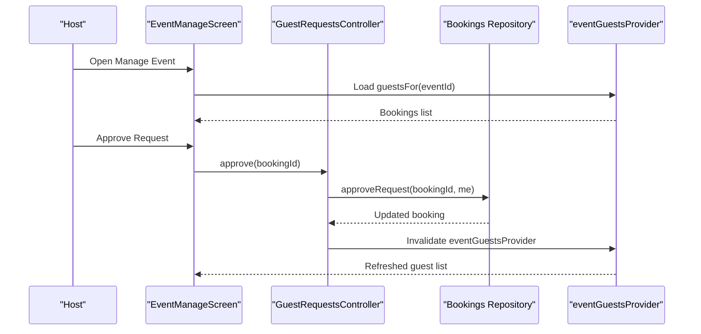

**Diagram sources**
- [event_manage_screen.dart:44-83](file://lib/screens/host/event_manage_screen.dart#L44-L83)
- [event_manage_screen.dart:110-143](file://lib/screens/host/event_manage_screen.dart#L110-L143)
- [host_studio_controller.dart:81-112](file://lib/providers/host_studio_controller.dart#L81-L112)
- [hosts_provider.dart:43-53](file://lib/providers/hosts_provider.dart#L43-L53)

**Section sources**
- [event_manage_screen.dart:18-800](file://lib/screens/host/event_manage_screen.dart#L18-L800)

### Payout System and Earnings Withdrawal
Features:
- Available balance, pending amounts, net earnings
- Breakdown of event revenue, platform commission, and net earnings
- Payout history listing
- Withdrawal sheet with bank transfer method and amount input
- Server-side validation prevents over-balance withdrawals

Flow:
- User taps Withdraw → enters amount and method
- Controller posts withdrawal request and invalidates wallet and summary providers
- UI refreshes to reflect new available balance and withdrawal record

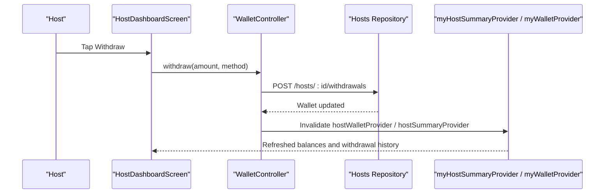

**Diagram sources**
- [host_dashboard_screen.dart:516-672](file://lib/screens/host/host_dashboard_screen.dart#L516-L672)
- [host_studio_controller.dart:46-79](file://lib/providers/host_studio_controller.dart#L46-L79)
- [hosts_provider.dart:105-118](file://lib/providers/hosts_provider.dart#L105-L118)

**Section sources**
- [host_models.dart:128-250](file://lib/models/host_models.dart#L128-L250)
- [host_studio_controller.dart:46-79](file://lib/providers/host_studio_controller.dart#L46-L79)
- [host_dashboard_screen.dart:516-672](file://lib/screens/host/host_dashboard_screen.dart#L516-L672)

### Host-Specific Permissions and Access Controls
- Event ownership: `Dinner.hostedBy(userId)` checks if current user is the event host
- Guest list access: `eventGuestsProvider` scopes bookings to the event host; non-owners receive errors surfaced by callers
- Collaboration invites: Responding requires signed-in host; controllers invalidate invite providers on success
- Wallet operations: Withdrawals require signed-in host; over-balance requests are rejected server-side

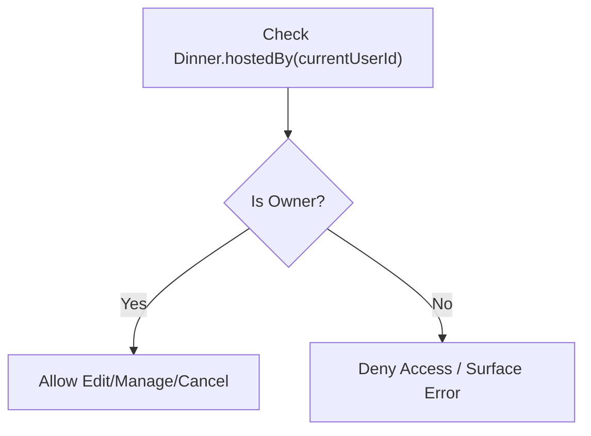

**Diagram sources**
- [dinner.dart:72-79](file://lib/models/dinner.dart#L72-L79)
- [hosts_provider.dart:43-53](file://lib/providers/hosts_provider.dart#L43-L53)
- [host_studio_controller.dart:20-33](file://lib/providers/host_studio_controller.dart#L20-L33)

**Section sources**
- [dinner.dart:72-79](file://lib/models/dinner.dart#L72-L79)
- [hosts_provider.dart:43-53](file://lib/providers/hosts_provider.dart#L43-L53)
- [host_studio_controller.dart:20-33](file://lib/providers/host_studio_controller.dart#L20-L33)

## Dependency Analysis
Host Studio components depend on providers and models with the profile screen as the entry point:
- Profile screen depends on Host Dashboard for hosting navigation
- Screens depend on providers for data and controllers for writes
- Controllers depend on repositories and invalidate providers
- Models define shared structures across screens and providers

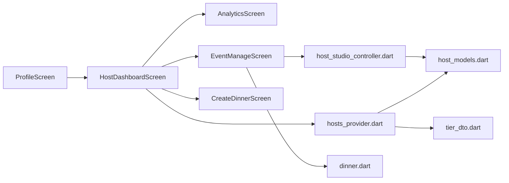

**Diagram sources**
- [profile_screen.dart:306-320](file://lib/screens/profile/profile_screen.dart#L306-L320)
- [host_dashboard_screen.dart:21-800](file://lib/screens/host/host_dashboard_screen.dart#L21-L800)
- [analytics_screen.dart:11-682](file://lib/screens/host/analytics_screen.dart#L11-L682)
- [event_manage_screen.dart:18-800](file://lib/screens/host/event_manage_screen.dart#L18-L800)
- [create_dinner_screen.dart:21-649](file://lib/screens/create/create_dinner_screen.dart#L21-L649)
- [host_studio_controller.dart:9-112](file://lib/providers/host_studio_controller.dart#L9-L112)
- [hosts_provider.dart:9-118](file://lib/providers/hosts_provider.dart#L9-L118)
- [host_models.dart:6-300](file://lib/models/host_models.dart#L6-L300)
- [dinner.dart:24-167](file://lib/models/dinner.dart#L24-L167)
- [tier_dto.dart:1-39](file://lib/api/dto/tier_dto.dart#L1-L39)

**Section sources**
- [profile_screen.dart:306-320](file://lib/screens/profile/profile_screen.dart#L306-L320)
- [hosts_provider.dart:9-118](file://lib/providers/hosts_provider.dart#L9-L118)
- [host_studio_controller.dart:9-112](file://lib/providers/host_studio_controller.dart#L9-L112)

## Performance Considerations
- Provider invalidation: Controllers invalidate specific family providers after writes to avoid unnecessary rebuilds and ensure consistency
- Data scoping: Event guests and performance data are scoped to the signed-in host to minimize payload size and enforce security
- Local previews: Draft previews are local-only to reduce network calls during creation
- Filtering and summarization: Dashboard and analytics compute summaries client-side using factors for period selection to improve responsiveness
- Consolidated navigation: Single entry point reduces memory overhead compared to multiple separate screens
- **Wizard optimization**: Step-based rendering with AnimatedSwitcher for smooth transitions between wizard steps

## Troubleshooting Guide
Common issues and resolutions:
- Navigation issues: Ensure profile screen correctly routes to Host Studio instead of separate analytics/earnings screens
- **Wizard validation failures**: Ensure title meets minimum length (3 characters), select a verified restaurant venue, validate date/time ranges, and confirm terms acknowledgment before publishing
- **Restaurant selection errors**: Verify that selected venues have partnership status set to 'verified' and are available for booking
- **Over-balance withdrawal**: The server rejects requests exceeding available balance; adjust amount accordingly
- **Guest request updates not reflecting**: Controllers invalidate `eventGuestsProvider`; verify network connectivity and that the host is the event owner
- **Missing analytics data**: Ensure the host has events with views/bookings; empty states display appropriate messages
- **Growth tier progression not updating**: Verify tier provider is properly invalidated after claiming influencer status
- **Wizard navigation issues**: Use tappable progress bar to navigate between steps; validation errors prevent forward movement until resolved

**Section sources**
- [profile_screen.dart:306-320](file://lib/screens/profile/profile_screen.dart#L306-L320)
- [create_dinner_screen.dart:143-213](file://lib/screens/create/create_dinner_screen.dart#L143-L213)
- [create_dinner_screen.dart:242-296](file://lib/screens/create/create_dinner_screen.dart#L242-L296)
- [create_dinner_screen.dart:814-1200](file://lib/screens/create/create_dinner_screen.dart#L814-L1200)
- [create_dinner_screen.dart:1916-2170](file://lib/screens/create/create_dinner_screen.dart#L1916-L2170)
- [host_studio_controller.dart:46-79](file://lib/providers/host_studio_controller.dart#L46-L79)
- [event_manage_screen.dart:110-143](file://lib/screens/host/event_manage_screen.dart#L110-L143)

## Conclusion
Host Studio provides a comprehensive, consolidated suite for hosts to create events, manage operations, analyze performance, handle payouts, and track their growth toward influencer status. The architecture leverages the profile screen as a single entry point, with the Host Dashboard providing a unified tabbed interface that replaces the previous separate menu items. **The enhanced 6-step wizard interface transforms event creation into an intuitive, guided experience with comprehensive validation, real-time feedback, and mandatory terms acknowledgment.** The system uses Riverpod providers for reactive data and controllers for write operations with proper invalidation. Permissions are enforced at both model and provider levels to ensure hosts only access their own data. The consolidation improves user experience by providing a streamlined workflow while maintaining robust functionality including drafting, publishing, guest management, announcements, attendance tracking, financial reconciliation, and influencer status progression. The sophisticated wizard ensures hosts provide complete and accurate event information through structured data collection, validation, and review processes.