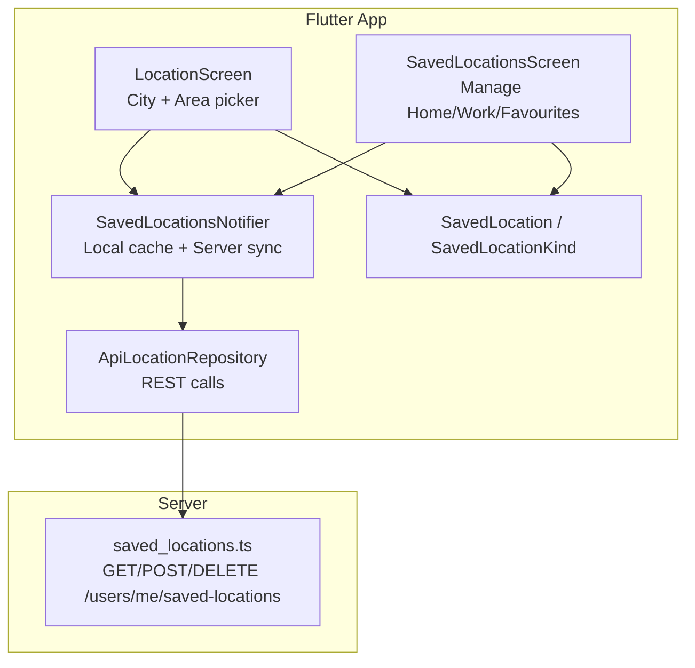
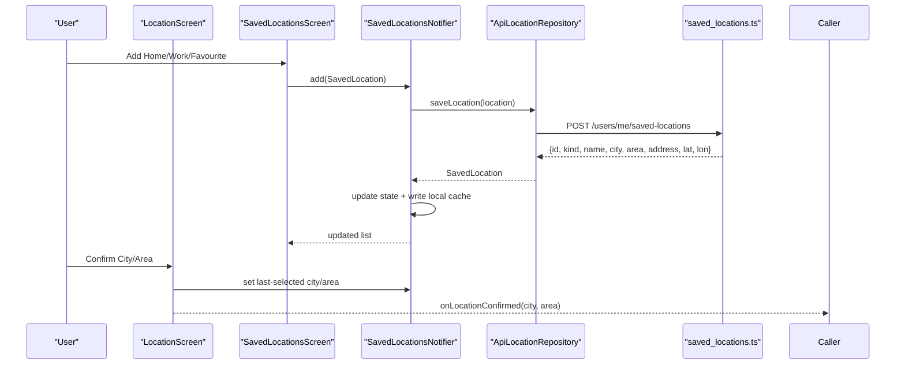
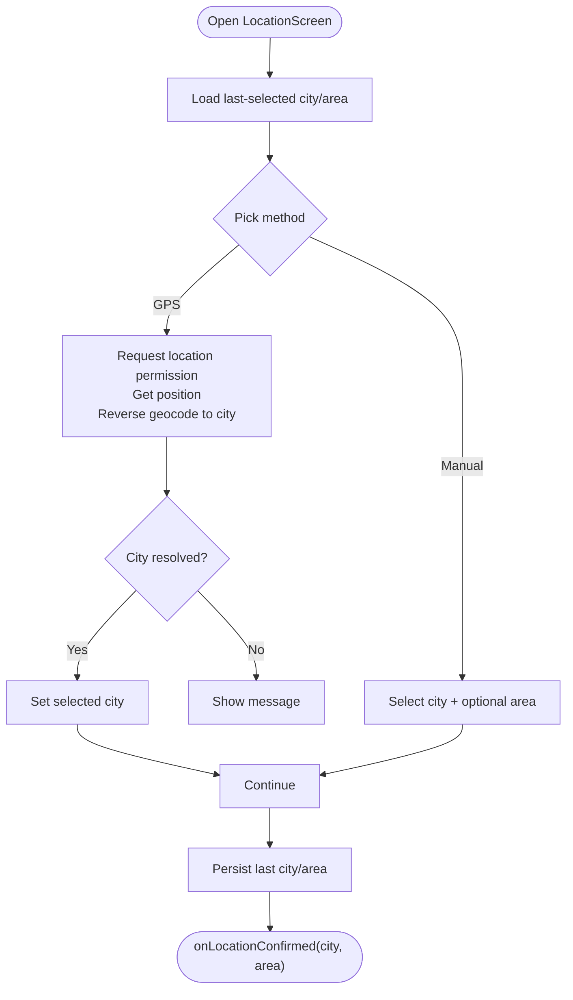
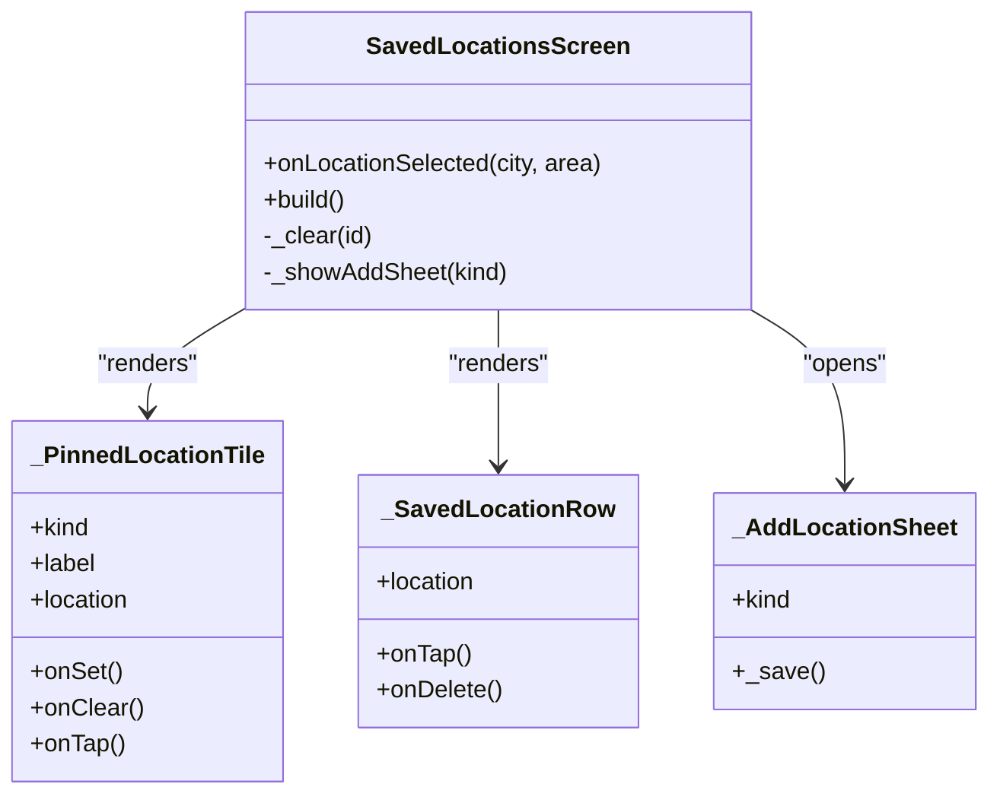
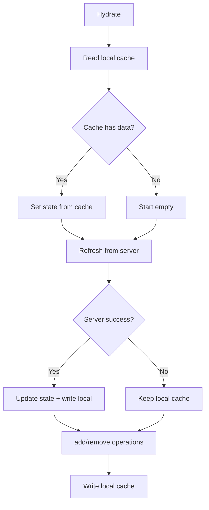
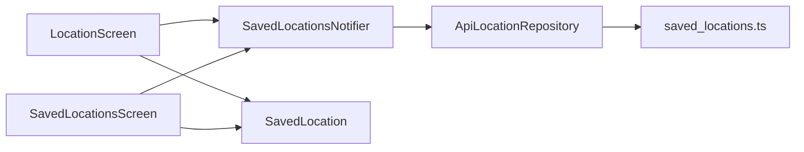

# Location Management System

<cite>
**Referenced Files in This Document**
- [README.md](file://README.md)
- [app_shell.dart](file://lib/app_shell.dart)
- [location_screen.dart](file://lib/screens/location/location_screen.dart)
- [saved_locations_screen.dart](file://lib/screens/location/saved_locations_screen.dart)
- [saved_location.dart](file://lib/models/saved_location.dart)
- [location_repository.dart](file://lib/repositories/location_repository.dart)
- [saved_locations_provider.dart](file://lib/providers/saved_locations_provider.dart)
- [saved_locations.ts](file://server/src/routes/saved_locations.ts)
</cite>

## Table of Contents
1. [Introduction](#introduction)
2. [Project Structure](#project-structure)
3. [Core Components](#core-components)
4. [Architecture Overview](#architecture-overview)
5. [Detailed Component Analysis](#detailed-component-analysis)
6. [Dependency Analysis](#dependency-analysis)
7. [Performance Considerations](#performance-considerations)
8. [Troubleshooting Guide](#troubleshooting-guide)
9. [Conclusion](#conclusion)

## Introduction
This document explains the Location Management System within DineCircle, covering how users select a city and area, manage saved locations (Home, Work, favourites), and how those choices persist locally and synchronise with the backend. It also clarifies current status: location selection is wired to local state and UI flows, while saved-location persistence is backed by a real API endpoint; geocoding and map SDKs are not yet integrated.

## Project Structure
The location feature spans Flutter screens, providers, repositories, models, and a server route:

**Diagram sources**
- [location_screen.dart:17-30](file://lib/screens/location/location_screen.dart#L17-L30)
- [saved_locations_screen.dart:10-21](file://lib/screens/location/saved_locations_screen.dart#L10-L21)
- [saved_locations_provider.dart:50-144](file://lib/providers/saved_locations_provider.dart#L50-L144)
- [location_repository.dart:26-75](file://lib/repositories/location_repository.dart#L26-L75)
- [saved_locations.ts:45-101](file://server/src/routes/saved_locations.ts#L45-L101)

**Section sources**
- [README.md:226-252](file://README.md#L226-L252)
- [README.md:347-363](file://README.md#L347-L363)

## Core Components
- LocationScreen: lets users pick a supported city and optional area, optionally detect current location via GPS, and confirm their choice.
- SavedLocationsScreen: manages Home, Work, and favourite/custom locations; supports add, clear, delete, and selection callbacks.
- SavedLocationsNotifier: hydrates from secure storage, refreshes from the server, updates local cache, and handles optimistic updates on network failure.
- ApiLocationRepository: typed repository for supported cities and saved locations endpoints.
- SavedLocation model: immutable domain object with JSON serialization and kind enum.
- Server route: validates and persists saved locations, enforcing single Home/Work per user.

**Section sources**
- [location_screen.dart:17-30](file://lib/screens/location/location_screen.dart#L17-L30)
- [saved_locations_screen.dart:10-21](file://lib/screens/location/saved_locations_screen.dart#L10-L21)
- [saved_locations_provider.dart:50-144](file://lib/providers/saved_locations_provider.dart#L50-L144)
- [location_repository.dart:26-75](file://lib/repositories/location_repository.dart#L26-L75)
- [saved_location.dart:1-118](file://lib/models/saved_location.dart#L1-L118)
- [saved_locations.ts:35-101](file://server/src/routes/saved_locations.ts#L35-L101)

## Architecture Overview
End-to-end flow for saving and using locations:

**Diagram sources**
- [saved_locations_screen.dart:174-181](file://lib/screens/location/saved_locations_screen.dart#L174-L181)
- [saved_locations_provider.dart:84-111](file://lib/providers/saved_locations_provider.dart#L84-L111)
- [location_repository.dart:62-74](file://lib/repositories/location_repository.dart#L62-L74)
- [saved_locations.ts:56-90](file://server/src/routes/saved_locations.ts#L56-L90)
- [location_screen.dart:156-164](file://lib/screens/location/location_screen.dart#L156-L164)

## Detailed Component Analysis

### LocationScreen
Responsibilities:
- Display supported cities and areas (from provider or fallback).
- Offer “Current Location” detection via GPS and reverse geocode to infer city.
- Persist last-selected city/area across app restarts.
- Return confirmed city and area to the caller.

Key behaviors:
- GPS permission checks and error messaging.
- Search filtering over cities and areas.
- Quick actions row for “Choose City” and “Current Location”.
- Confirmation writes last-selected preferences and invokes callback.

**Diagram sources**
- [location_screen.dart:66-131](file://lib/screens/location/location_screen.dart#L66-L131)
- [location_screen.dart:139-164](file://lib/screens/location/location_screen.dart#L139-L164)

**Section sources**
- [location_screen.dart:17-30](file://lib/screens/location/location_screen.dart#L17-L30)
- [location_screen.dart:66-131](file://lib/screens/location/location_screen.dart#L66-L131)
- [location_screen.dart:139-164](file://lib/screens/location/location_screen.dart#L139-L164)

### SavedLocationsScreen
Responsibilities:
- Show pinned tiles for Home and Work.
- List Favourites and Other saved locations.
- Provide add/clear/delete interactions.
- Emit selected city/area back to callers.

Key behaviors:
- Grouping by kind (home/work/favourite/custom).
- Bottom sheet form to add a new location.
- Swipe-to-delete and explicit delete icon.

**Diagram sources**
- [saved_locations_screen.dart:17-26](file://lib/screens/location/saved_locations_screen.dart#L17-L26)
- [saved_locations_screen.dart:184-286](file://lib/screens/location/saved_locations_screen.dart#L184-L286)
- [saved_locations_screen.dart:288-377](file://lib/screens/location/saved_locations_screen.dart#L288-L377)
- [saved_locations_screen.dart:379-529](file://lib/screens/location/saved_locations_screen.dart#L379-L529)

**Section sources**
- [saved_locations_screen.dart:10-21](file://lib/screens/location/saved_locations_screen.dart#L10-L21)
- [saved_locations_screen.dart:161-181](file://lib/screens/location/saved_locations_screen.dart#L161-L181)
- [saved_locations_screen.dart:379-529](file://lib/screens/location/saved_locations_screen.dart#L379-L529)

### SavedLocationsNotifier (Provider)
Responsibilities:
- Hydrate from secure storage immediately.
- Refresh from server in background.
- Optimistically update local state on network errors.
- Persist changes to secure storage.
- Expose helpers like `ofKind`.

**Diagram sources**
- [saved_locations_provider.dart:57-144](file://lib/providers/saved_locations_provider.dart#L57-L144)

**Section sources**
- [saved_locations_provider.dart:50-144](file://lib/providers/saved_locations_provider.dart#L50-L144)

### ApiLocationRepository
Responsibilities:
- Fetch supported cities.
- CRUD for saved locations under `/users/me/saved-locations`.

Endpoints used:
- GET `/cities`
- GET `/users/me/saved-locations`
- POST `/users/me/saved-locations`
- DELETE `/users/me/saved-locations/:id`

**Section sources**
- [location_repository.dart:26-75](file://lib/repositories/location_repository.dart#L26-L75)

### SavedLocation Model
Responsibilities:
- Represent a saved place with id, kind, name, city, area, address, and optional coordinates.
- Provide JSON serialization/deserialization and equality semantics.
- Enum for built-in kinds plus custom.

**Section sources**
- [saved_location.dart:1-118](file://lib/models/saved_location.dart#L1-L118)

### Server Route: saved_locations.ts
Responsibilities:
- Validate payloads with Zod.
- Enforce single Home/Work per user by deleting previous entry before insert.
- Serialize rows to client shape.
- Handle GET list, POST create/upsert, DELETE by id.

Validation rules:
- kind: one of home, work, favourite, custom.
- name: required string up to 120 chars.
- city: required string up to 80 chars.
- area/address: optional strings with max lengths.
- latitude/longitude: optional numbers within valid ranges.

**Section sources**
- [saved_locations.ts:35-43](file://server/src/routes/saved_locations.ts#L35-L43)
- [saved_locations.ts:45-101](file://server/src/routes/saved_locations.ts#L45-L101)

## Dependency Analysis

**Diagram sources**
- [location_screen.dart:1-15](file://lib/screens/location/location_screen.dart#L1-L15)
- [saved_locations_screen.dart:1-9](file://lib/screens/location/saved_locations_screen.dart#L1-L9)
- [saved_locations_provider.dart:1-8](file://lib/providers/saved_locations_provider.dart#L1-L8)
- [location_repository.dart:1-4](file://lib/repositories/location_repository.dart#L1-L4)
- [saved_locations.ts:1-4](file://server/src/routes/saved_locations.ts#L1-L4)

**Section sources**
- [location_screen.dart:1-15](file://lib/screens/location/location_screen.dart#L1-L15)
- [saved_locations_screen.dart:1-9](file://lib/screens/location/saved_locations_screen.dart#L1-L9)
- [saved_locations_provider.dart:1-8](file://lib/providers/saved_locations_provider.dart#L1-L8)
- [location_repository.dart:1-4](file://lib/repositories/location_repository.dart#L1-L4)
- [saved_locations.ts:1-4](file://server/src/routes/saved_locations.ts#L1-L4)

## Performance Considerations
- Local-first hydration: SavedLocationsNotifier reads secure storage immediately to avoid UI blank states, then refreshes from the server in the background.
- Optimistic updates: add/remove operations update local state even if the server call fails, improving perceived responsiveness.
- Fallback city list: when the cities endpoint is unreachable, the provider falls back to a hard-coded list so the picker remains usable.
- Minimal payload: only necessary fields are sent to the server; coordinates are optional.

[No sources needed since this section provides general guidance]

## Troubleshooting Guide
Common issues and resolutions:
- GPS permission denied: The screen requests permission and shows an informative message; users should enable location services and retry.
- Reverse geocoding fails: If city cannot be inferred from coordinates, the user is prompted to choose a city manually.
- Network unavailable during save: Local cache still updates; the next successful refresh will reconcile with the server.
- Duplicate Home/Work: The server enforces a single Home and Work per user; subsequent saves replace the previous entry.
- Missing saved locations after reinstall: Secure storage may be cleared; the notifier will repopulate from the server on next refresh.

**Section sources**
- [location_screen.dart:66-131](file://lib/screens/location/location_screen.dart#L66-L131)
- [saved_locations_provider.dart:73-111](file://lib/providers/saved_locations_provider.dart#L73-L111)
- [saved_locations.ts:62-90](file://server/src/routes/saved_locations.ts#L62-L90)

## Conclusion
The Location Management System provides a robust city/area picker with local preference persistence and a fully wired saved-locations backend. While geocoding and maps are placeholders today, the core flows—selecting, saving, and managing locations—are production-ready and consistent with the broader DineCircle architecture. Future enhancements can integrate real-time maps, geocoding, and richer location discovery without changing the existing repository/provider contracts.