# New Widget Components

<cite>
**Referenced Files in This Document**
- [README.md](file://README.md)
- [lib/widgets/buttons.dart](file://lib/widgets/buttons.dart)
- [lib/widgets/common_widgets.dart](file://lib/widgets/common_widgets.dart)
- [lib/widgets/data_view.dart](file://lib/widgets/data_view.dart)
- [lib/widgets/skeleton_placeholder.dart](file://lib/widgets/skeleton_placeholder.dart)
- [lib/widgets/avatar_widget.dart](file://lib/widgets/avatar_widget.dart)
- [lib/widgets/connectivity_banner.dart](file://lib/widgets/connectivity_banner.dart)
- [lib/widgets/dinner_card.dart](file://lib/widgets/dinner_card.dart)
- [lib/widgets/experience_card.dart](file://lib/widgets/experience_card.dart)
- [lib/widgets/deal_card.dart](file://lib/widgets/deal_card.dart)
- [lib/widgets/occasion_card.dart](file://lib/widgets/occasion_card.dart)
- [lib/widgets/offer_card.dart](file://lib/widgets/offer_card.dart)
- [lib/widgets/restaurant_card.dart](file://lib/widgets/restaurant_card.dart)
- [lib/widgets/booking_check_in_sheet.dart](file://lib/widgets/booking_check_in_sheet.dart)
- [lib/widgets/edit_profile_sheet.dart](file://lib/widgets/edit_profile_sheet.dart)
- [test/layout_overflow_sheets_test.dart](file://test/layout_overflow_sheets_test.dart)
- [test/support/overflow_harness.dart](file://test/support/overflow_harness.dart)
</cite>

## Update Summary
**Changes Made**
- Added new section documenting accessibility improvements to booking check-in and edit profile sheets
- Updated widget architecture overview to include sheet components
- Enhanced detailed component analysis with scrollable sheet implementations
- Added comprehensive testing coverage for accessibility scenarios

## Table of Contents
1. [Introduction](#introduction)
2. [Project Structure](#project-structure)
3. [Core Components](#core-components)
4. [Architecture Overview](#architecture-overview)
5. [Detailed Component Analysis](#detailed-component-analysis)
6. [Accessibility Improvements](#accessibility-improvements)
7. [Dependency Analysis](#dependency-analysis)
8. [Performance Considerations](#performance-considerations)
9. [Troubleshooting Guide](#troubleshooting-guide)
10. [Conclusion](#conclusion)

## Introduction
This document describes the new widget components under `lib/widgets` for DineCircle, a Flutter consumer app that connects to a Node/Express + PostgreSQL API. The widgets provide reusable UI primitives (buttons, headers, chips, cards), data presentation wrappers, connectivity feedback, and **critical accessibility-compliant modal sheets**. They are designed to be theme-driven, accessible where possible, and consistent across screens such as Home, Explore, Dinner Detail, Restaurant Detail, Bookings, Saved, Notifications, Messages, Chat, Settings, Host Dashboard, Analytics, Event Manage, and Create Dinner.

The repository is a monorepo with a Flutter client and a server; this document focuses on the client-side widget layer and how these components compose into screen-level experiences.

**Section sources**
- [README.md:1-33](file://README.md#L1-L33)

## Project Structure
The widget layer lives under `lib/widgets`. It contains:
- Shared primitives: buttons, section header, rating pill, tag chip, glass card, stat tile, empty state, progress steps.
- Data presentation: error/empty views, skeleton placeholders, and a generic `DataView` wrapper around Riverpod's `AsyncValue`.
- Connectivity banner backed by `connectivity_plus`.
- Domain cards: dinner, experience, restaurant, deal, offer, occasion.
- Utility visuals: avatar, QR code view, payment ledger, **scrollable modal sheets for booking check-in and profile editing**.

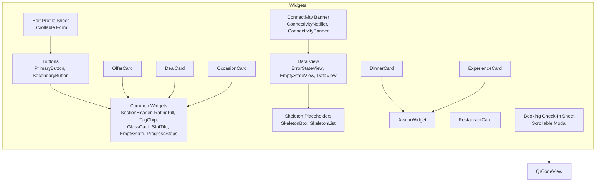

**Diagram sources**
- [lib/widgets/buttons.dart:8-115](file://lib/widgets/buttons.dart#L8-L115)
- [lib/widgets/common_widgets.dart:8-285](file://lib/widgets/common_widgets.dart#L8-L285)
- [lib/widgets/data_view.dart:8-125](file://lib/widgets/data_view.dart#L8-L125)
- [lib/widgets/skeleton_placeholder.dart:8-65](file://lib/widgets/skeleton_placeholder.dart#L8-L65)
- [lib/widgets/avatar_widget.dart:8-59](file://lib/widgets/avatar_widget.dart#L8-L59)
- [lib/widgets/connectivity_banner.dart:12-82](file://lib/widgets/connectivity_banner.dart#L12-L82)
- [lib/widgets/dinner_card.dart:12-246](file://lib/widgets/dinner_card.dart#L12-L246)
- [lib/widgets/experience_card.dart:14-196](file://lib/widgets/experience_card.dart#L14-L196)
- [lib/widgets/restaurant_card.dart:9-157](file://lib/widgets/restaurant_card.dart#L9-L157)
- [lib/widgets/deal_card.dart:12-164](file://lib/widgets/deal_card.dart#L12-L164)
- [lib/widgets/offer_card.dart:9-196](file://lib/widgets/offer_card.dart#L9-L196)
- [lib/widgets/occasion_card.dart:11-104](file://lib/widgets/occasion_card.dart#L11-L104)
- [lib/widgets/booking_check_in_sheet.dart:17-174](file://lib/widgets/booking_check_in_sheet.dart#L17-L174)
- [lib/widgets/edit_profile_sheet.dart:15-157](file://lib/widgets/edit_profile_sheet.dart#L15-L157)

**Section sources**
- [README.md:270-299](file://README.md#L270-L299)

## Core Components
This section summarizes the responsibilities and key behaviors of each widget group.

- Buttons
  - PrimaryButton: filled action button with optional loading indicator, icon, and full-width mode.
  - SecondaryButton: outlined action button with optional icon and full-width mode.
  - Both use theme tokens for colors, spacing, and typography.

- Common Widgets
  - SectionHeader: title with optional tappable action text.
  - RatingPill: star rating with optional review count badge.
  - TagChip: selectable filter chip with selected/unselected states.
  - GlassCard: translucent container with border and rounded corners.
  - StatTile: metric display with label, value, optional icon, and color override.
  - EmptyState: centered illustration-like state with title, message, and optional action.
  - ProgressSteps: horizontal step indicator for multi-step flows.

- Data Presentation
  - ErrorStateView: displays user-friendly errors, mapping API exceptions to messages; supports retry.
  - EmptyStateView: consistent "nothing here yet" panel.
  - DataView<T>: wraps an `AsyncValue`, rendering skeletons while loading, error state with optional retry, empty state when data is empty, or delegates to a builder for actual content.

- Skeleton Placeholders
  - SkeletonBox: static shimmer-like block for loading UI without animations that would complicate tests.
  - SkeletonList: vertical list of skeleton rows sized to content for safe nesting.

- Connectivity Feedback
  - ConnectivityNotifier: tracks device connectivity via `connectivity_plus`, seeds initial state asynchronously, and exposes a boolean provider.
  - ConnectivityBanner: zero-height when online; shows a warning strip when offline.

- Domain Cards
  - DinnerCard: horizontal event card with image, tags, host avatar, price, seats left, and save toggle wired to social controller.
  - ExperienceCard: vertical curated card with cover image, host, venue/date, price, seats left, and reserve CTA.
  - RestaurantCard: restaurant listing card with partner badge, cuisine, city, rating, reviews, and price range.
  - DealCard: offer/deal card with restaurant name, kind badge, description, conditions, tags, and redeem CTA.
  - OfferCard: compact partner offer card with type badge, discount or special price, validity date, and restaurant info.
  - OccasionCard: discovery occasion card with background image, overlay, icon, title, and subtitle.

**Section sources**
- [lib/widgets/buttons.dart:8-115](file://lib/widgets/buttons.dart#L8-L115)
- [lib/widgets/common_widgets.dart:8-285](file://lib/widgets/common_widgets.dart#L8-L285)
- [lib/widgets/data_view.dart:8-125](file://lib/widgets/data_view.dart#L8-L125)
- [lib/widgets/skeleton_placeholder.dart:8-65](file://lib/widgets/skeleton_placeholder.dart#L8-L65)
- [lib/widgets/connectivity_banner.dart:12-82](file://lib/widgets/connectivity_banner.dart#L12-L82)
- [lib/widgets/dinner_card.dart:12-246](file://lib/widgets/dinner_card.dart#L12-L246)
- [lib/widgets/experience_card.dart:14-196](file://lib/widgets/experience_card.dart#L14-L196)
- [lib/widgets/restaurant_card.dart:9-157](file://lib/widgets/restaurant_card.dart#L9-L157)
- [lib/widgets/deal_card.dart:12-164](file://lib/widgets/deal_card.dart#L12-L164)
- [lib/widgets/offer_card.dart:9-196](file://lib/widgets/offer_card.dart#L9-L196)
- [lib/widgets/occasion_card.dart:11-104](file://lib/widgets/occasion_card.dart#L11-L104)

## Architecture Overview
At runtime, screens consume providers (Riverpod) and render widgets from this layer. Data flow typically follows:
- Provider fetches data → AsyncValue updates → DataView renders Skeleton/List/Error/Empty or delegates to a builder.
- User interactions trigger actions (e.g., save/unsave, reserve, redeem) which call controllers or repositories.
- Connectivity changes update ConnectivityBanner automatically.
- **Modal sheets provide accessible, scrollable interfaces for critical user workflows like check-in and profile editing.**

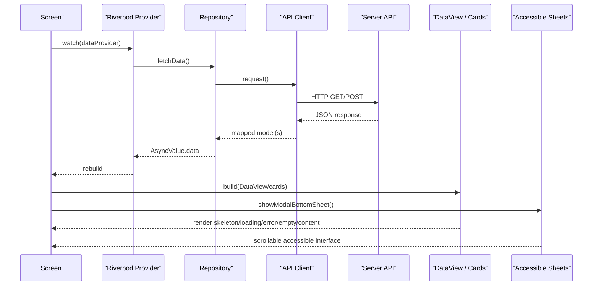

**Diagram sources**
- [lib/widgets/data_view.dart:85-125](file://lib/widgets/data_view.dart#L85-L125)
- [lib/widgets/dinner_card.dart:207-246](file://lib/widgets/dinner_card.dart#L207-L246)
- [lib/widgets/connectivity_banner.dart:12-82](file://lib/widgets/connectivity_banner.dart#L12-L82)
- [lib/widgets/booking_check_in_sheet.dart:17-24](file://lib/widgets/booking_check_in_sheet.dart#L17-L24)
- [lib/widgets/edit_profile_sheet.dart:15-32](file://lib/widgets/edit_profile_sheet.dart#L15-L32)

## Detailed Component Analysis

### Buttons
- Purpose: Consistent primary and secondary actions across the app.
- Key behaviors:
  - PrimaryButton disables itself while loading and shows a spinner.
  - Both support optional icons and full-width layout.
  - Uses theme tokens for colors, spacing, and typography.

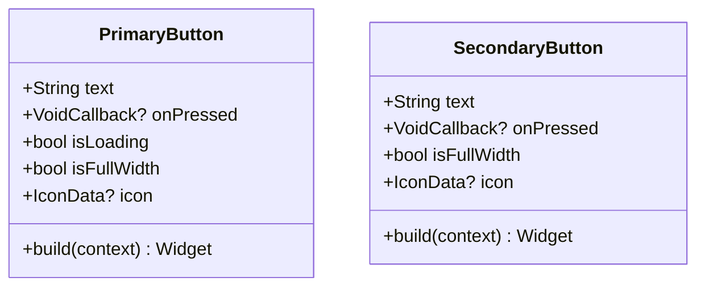

**Diagram sources**
- [lib/widgets/buttons.dart:8-65](file://lib/widgets/buttons.dart#L8-L65)
- [lib/widgets/buttons.dart:69-115](file://lib/widgets/buttons.dart#L69-L115)

**Section sources**
- [lib/widgets/buttons.dart:8-115](file://lib/widgets/buttons.dart#L8-L115)

### Common Widgets
- Purpose: Reusable building blocks for sections, ratings, filters, containers, metrics, empty states, and progress indicators.
- Notable patterns:
  - Semantics annotations for accessibility on interactive elements.
  - Theme-driven styling via shared color, spacing, and text style modules.
  - Flexible layouts using Row/Column/Flexible/Wrap.

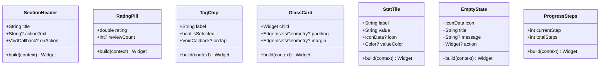

**Diagram sources**
- [lib/widgets/common_widgets.dart:8-55](file://lib/widgets/common_widgets.dart#L8-L55)
- [lib/widgets/common_widgets.dart:58-98](file://lib/widgets/common_widgets.dart#L58-L98)
- [lib/widgets/common_widgets.dart:101-145](file://lib/widgets/common_widgets.dart#L101-L145)
- [lib/widgets/common_widgets.dart:148-168](file://lib/widgets/common_widgets.dart#L148-L168)
- [lib/widgets/common_widgets.dart:171-203](file://lib/widgets/common_widgets.dart#L171-L203)
- [lib/widgets/common_widgets.dart:206-252](file://lib/widgets/common_widgets.dart#L206-L252)
- [lib/widgets/common_widgets.dart:255-285](file://lib/widgets/common_widgets.dart#L255-L285)

**Section sources**
- [lib/widgets/common_widgets.dart:8-285](file://lib/widgets/common_widgets.dart#L8-L285)

### Data Presentation Layer
- Purpose: Standardize loading, empty, error, and success states across screens.
- Behavior:
  - ErrorStateView maps API exceptions to readable messages and optionally provides a retry action.
  - EmptyStateView renders a friendly empty state.
  - DataView<T> centralizes AsyncValue handling: skeleton while loading, error with retry, empty state, or custom builder for data.

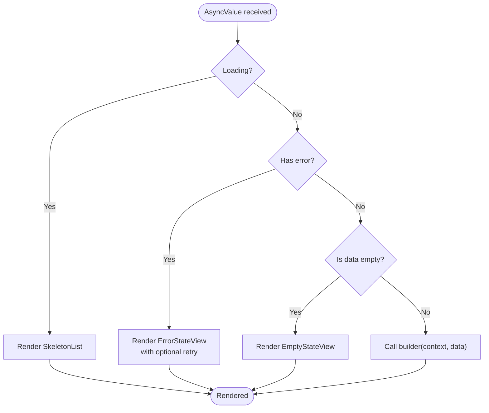

**Diagram sources**
- [lib/widgets/data_view.dart:8-48](file://lib/widgets/data_view.dart#L8-L48)
- [lib/widgets/data_view.dart:51-83](file://lib/widgets/data_view.dart#L51-L83)
- [lib/widgets/data_view.dart:85-125](file://lib/widgets/data_view.dart#L85-L125)
- [lib/widgets/skeleton_placeholder.dart:34-65](file://lib/widgets/skeleton_placeholder.dart#L34-L65)

**Section sources**
- [lib/widgets/data_view.dart:8-125](file://lib/widgets/data_view.dart#L8-L125)
- [lib/widgets/skeleton_placeholder.dart:8-65](file://lib/widgets/skeleton_placeholder.dart#L8-L65)

### Connectivity Banner
- Purpose: Inform users when offline and keep the banner out of the way when online.
- Implementation highlights:
  - ConnectivityNotifier seeds initial state asynchronously and listens to connectivity changes.
  - ConnectivityBanner consumes the boolean provider and renders a Material banner only when offline.

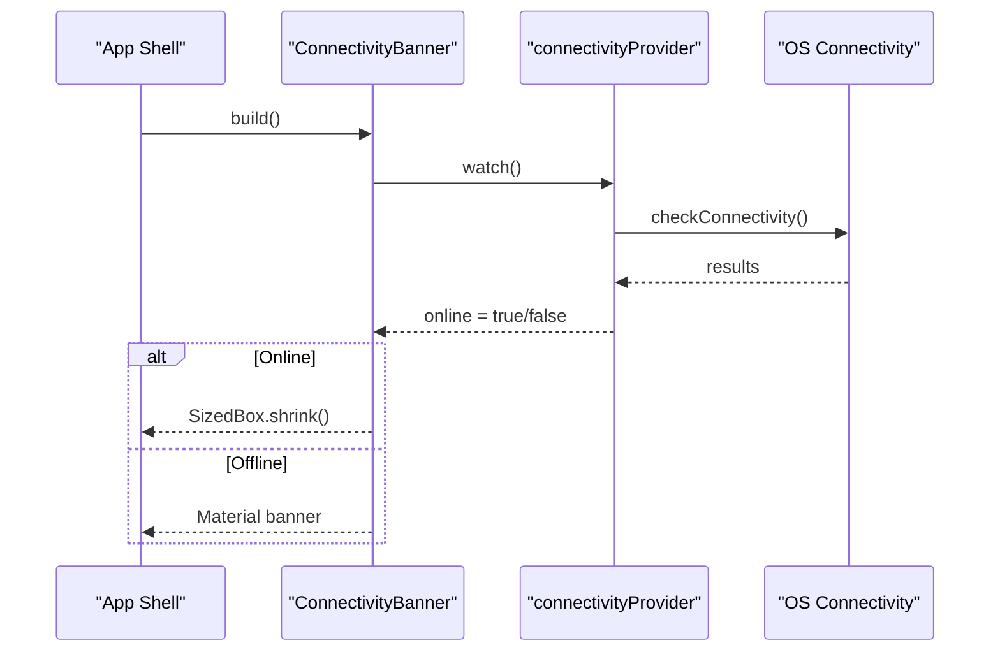

**Diagram sources**
- [lib/widgets/connectivity_banner.dart:12-40](file://lib/widgets/connectivity_banner.dart#L12-L40)
- [lib/widgets/connectivity_banner.dart:47-82](file://lib/widgets/connectivity_banner.dart#L47-L82)

**Section sources**
- [lib/widgets/connectivity_banner.dart:12-82](file://lib/widgets/connectivity_banner.dart#L12-L82)

### Domain Cards

#### DinnerCard
- Purpose: Horizontal card for events in feeds and carousels.
- Features:
  - Image with gradient overlay, special event tag, date badge, and save toggle.
  - Host avatar, name, price per seat, and seats-left badge with low-seats highlighting.
  - Save toggle integrates with the social controller to update saved state and show snackbar on failure.

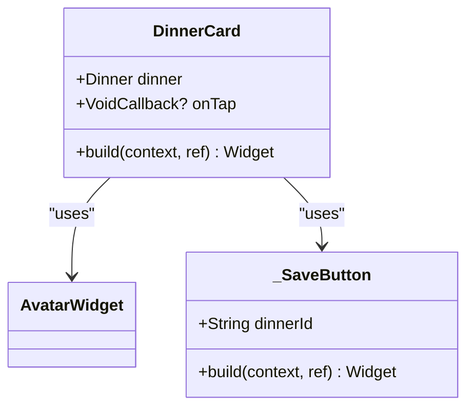

**Diagram sources**
- [lib/widgets/dinner_card.dart:12-205](file://lib/widgets/dinner_card.dart#L12-L205)
- [lib/widgets/dinner_card.dart:207-246](file://lib/widgets/dinner_card.dart#L207-L246)
- [lib/widgets/avatar_widget.dart:8-59](file://lib/widgets/avatar_widget.dart#L8-L59)

**Section sources**
- [lib/widgets/dinner_card.dart:12-246](file://lib/widgets/dinner_card.dart#L12-L246)

#### ExperienceCard
- Purpose: Vertical curated card replacing repetitive horizontal scrollers in Explore.
- Features:
  - Cover image, host row, venue + date, price, seats-left badge, and reserve CTA.
  - Reserve button disabled when full.

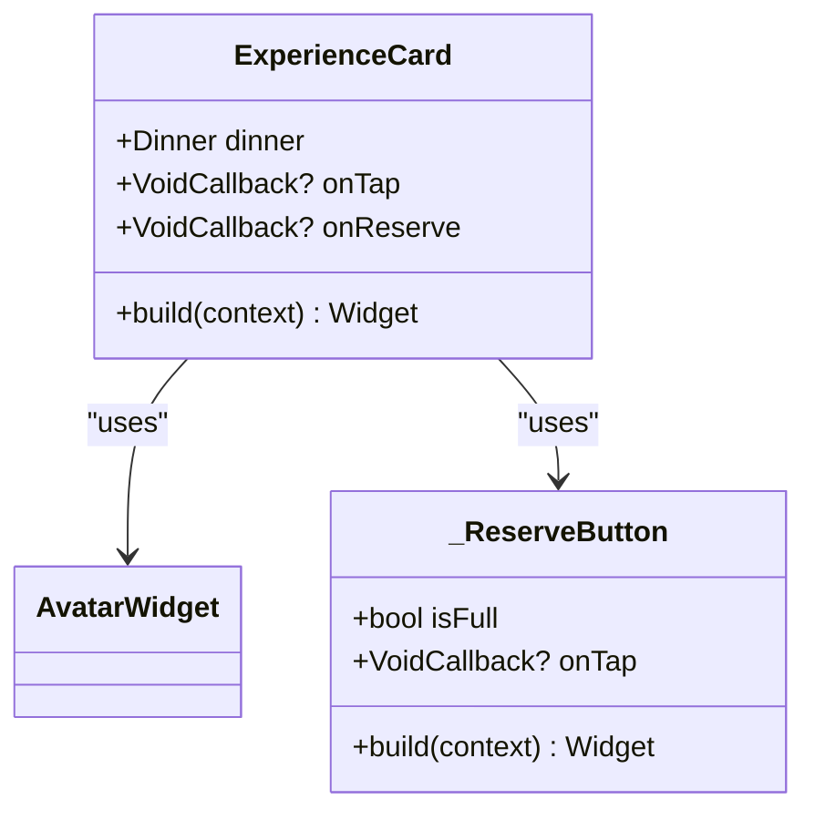

**Diagram sources**
- [lib/widgets/experience_card.dart:14-160](file://lib/widgets/experience_card.dart#L14-L160)
- [lib/widgets/experience_card.dart:163-196](file://lib/widgets/experience_card.dart#L163-L196)
- [lib/widgets/avatar_widget.dart:8-59](file://lib/widgets/avatar_widget.dart#L8-L59)

**Section sources**
- [lib/widgets/experience_card.dart:14-196](file://lib/widgets/experience_card.dart#L14-L196)

#### RestaurantCard
- Purpose: Restaurant listing card with partner badge, cuisine, city, rating, review count, and price range.
- Notes:
  - Partner badge shown conditionally.
  - City displayed when available.

**Section sources**
- [lib/widgets/restaurant_card.dart:9-157](file://lib/widgets/restaurant_card.dart#L9-L157)

#### DealCard
- Purpose: Deal/offer card used in Offers tab and Deals highlight section.
- Features:
  - Restaurant name, kind badge, description, conditions, tags, and redeem CTA.

**Section sources**
- [lib/widgets/deal_card.dart:12-164](file://lib/widgets/deal_card.dart#L12-L164)

#### OfferCard
- Purpose: Compact horizontal card for partner offers (exclusive menus, discounts).
- Features:
  - Type badge (discount vs special price), discount percentage or fixed price, validity date, and restaurant info.

**Section sources**
- [lib/widgets/offer_card.dart:9-196](file://lib/widgets/offer_card.dart#L9-L196)

#### OccasionCard
- Purpose: Discovery occasion card for horizontal scroll on Discover "All".
- Features:
  - Background image with gradient overlay, accent icon, title, and subtitle.

**Section sources**
- [lib/widgets/occasion_card.dart:11-104](file://lib/widgets/occasion_card.dart#L11-L104)

## Accessibility Improvements

### Critical Accessibility Enhancements
Recent updates have implemented **critical accessibility improvements** to ensure all modal sheets remain fully usable across different text scales and keyboard scenarios. These enhancements address overflow issues and ensure proper keyboard navigation.

### Booking Check-In Sheet
The booking check-in sheet has been enhanced with scrollable content to handle text scaling and maintain accessibility compliance.

**Key Features:**
- **Scrollable Container**: Wrapped in `SingleChildScrollView` to prevent overflow at high text scales
- **Safe Area Integration**: Maintains proper spacing with system UI elements
- **QR Code Display**: Decorative QR code remains accessible and properly sized
- **Check-in Action**: Full-width button remains reachable even with large text scaling
- **Status Indicators**: Visual feedback for checked-in status with appropriate contrast

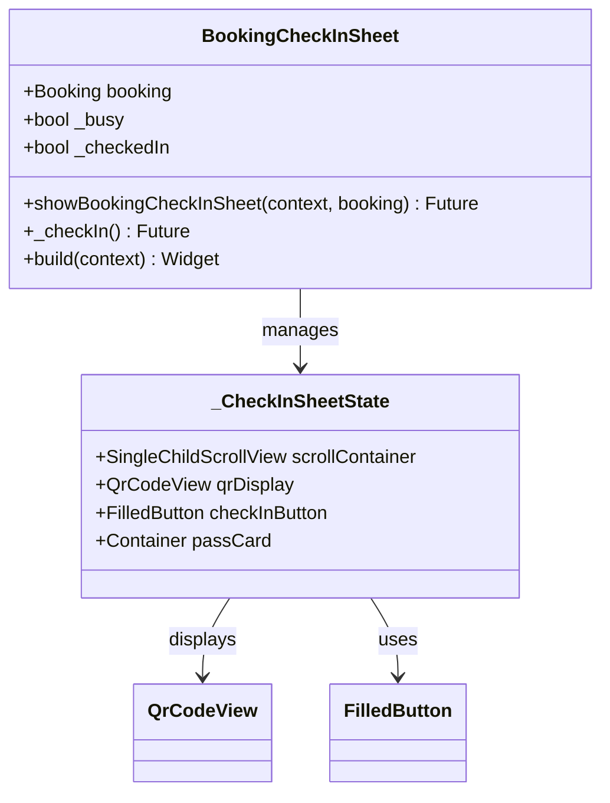

**Diagram sources**
- [lib/widgets/booking_check_in_sheet.dart:17-24](file://lib/widgets/booking_check_in_sheet.dart#L17-L24)
- [lib/widgets/booking_check_in_sheet.dart:26-33](file://lib/widgets/booking_check_in_sheet.dart#L26-L33)
- [lib/widgets/booking_check_in_sheet.dart:35-64](file://lib/widgets/booking_check_in_sheet.dart#L35-L64)
- [lib/widgets/booking_check_in_sheet.dart:66-174](file://lib/widgets/booking_check_in_sheet.dart#L66-L174)

**Section sources**
- [lib/widgets/booking_check_in_sheet.dart:17-174](file://lib/widgets/booking_check_in_sheet.dart#L17-L174)

### Edit Profile Sheet
The edit profile sheet now features a fully scrollable form interface that maintains usability with keyboard input and text scaling.

**Key Features:**
- **Form Scrolling**: All form fields remain accessible when keyboard is displayed
- **Keyboard Integration**: Proper handling of `viewInsets` for keyboard avoidance
- **Field Validation**: Real-time validation with accessible error messaging
- **Progressive Disclosure**: Error messages appear within scrollable content
- **Touch Targets**: Adequate sizing for all interactive elements

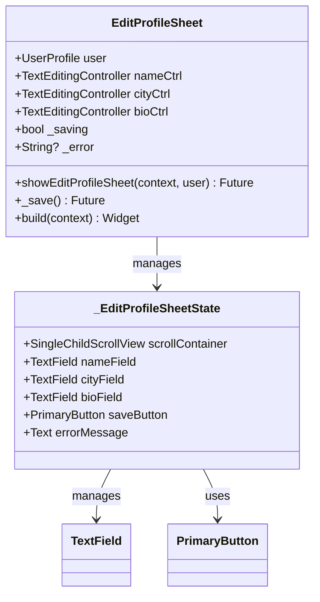

**Diagram sources**
- [lib/widgets/edit_profile_sheet.dart:15-32](file://lib/widgets/edit_profile_sheet.dart#L15-L32)
- [lib/widgets/edit_profile_sheet.dart:36-43](file://lib/widgets/edit_profile_sheet.dart#L36-L43)
- [lib/widgets/edit_profile_sheet.dart:45-105](file://lib/widgets/edit_profile_sheet.dart#L45-L105)
- [lib/widgets/edit_profile_sheet.dart:107-157](file://lib/widgets/edit_profile_sheet.dart#L107-L157)

**Section sources**
- [lib/widgets/edit_profile_sheet.dart:15-157](file://lib/widgets/edit_profile_sheet.dart#L15-L157)

### Comprehensive Testing Framework
A robust testing framework ensures accessibility compliance across multiple scenarios:

**Test Coverage:**
- **Viewport Variations**: Tests across widths 320px, 360px, 390px, 430px, 600px
- **Text Scaling**: Validates functionality at 1.0x, 1.3x, and 2.0x text scales
- **Keyboard Scenarios**: Ensures forms remain usable with software keyboard
- **Overflow Detection**: Automated detection of RenderFlex overflow issues

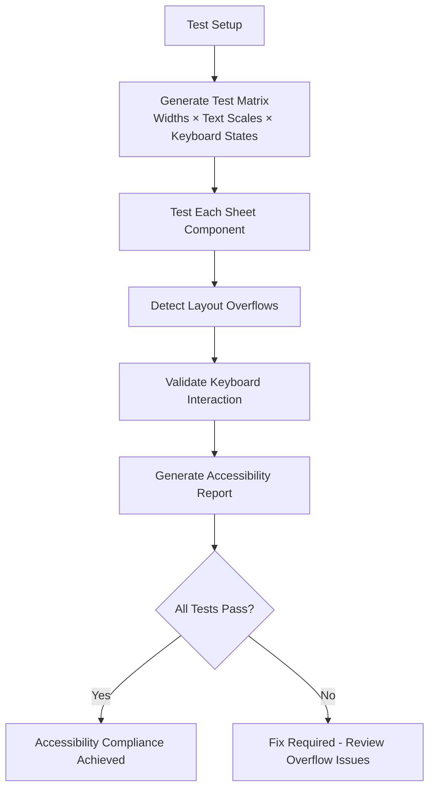

**Diagram sources**
- [test/layout_overflow_sheets_test.dart:81-101](file://test/layout_overflow_sheets_test.dart#L81-L101)
- [test/layout_overflow_sheets_test.dart:113-136](file://test/layout_overflow_sheets_test.dart#L113-L136)
- [test/support/overflow_harness.dart:15-19](file://test/support/overflow_harness.dart#L15-L19)

**Section sources**
- [test/layout_overflow_sheets_test.dart:1-167](file://test/layout_overflow_sheets_test.dart#L1-L167)
- [test/support/overflow_harness.dart:1-93](file://test/support/overflow_harness.dart#L1-L93)

### Conceptual Overview
These widgets follow a consistent design system with enhanced accessibility:
- Theme tokens for colors, spacing, and typography.
- Stateless widgets for pure presentation; minimal state kept local.
- Consumer widgets where integration with Riverpod is required (e.g., saving items).
- Accessible labels and semantics for interactive elements.
- **Scrollable containers for content that may exceed viewport constraints.**
- **Comprehensive testing matrix for accessibility compliance.**

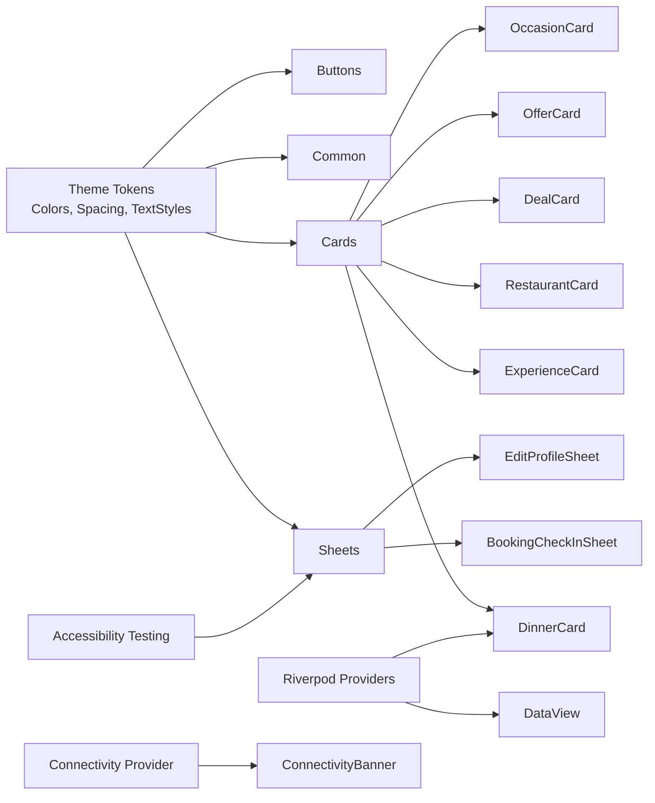

[No sources needed since this diagram shows conceptual workflow, not actual code structure]

## Dependency Analysis
Key dependencies among widgets:
- Cards depend on AvatarWidget for host avatars.
- DinnerCard depends on Social provider/controller for save/unsave operations.
- DataView composes SkeletonList and ErrorStateView/EmptyStateView.
- ConnectivityBanner depends on ConnectivityNotifier provider.
- **BookingCheckInSheet depends on QrCodeView and bookings controller.**
- **EditProfileSheet depends on session controller and PrimaryButton.**

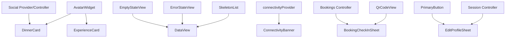

**Diagram sources**
- [lib/widgets/avatar_widget.dart:8-59](file://lib/widgets/avatar_widget.dart#L8-L59)
- [lib/widgets/dinner_card.dart:12-246](file://lib/widgets/dinner_card.dart#L12-L246)
- [lib/widgets/experience_card.dart:14-196](file://lib/widgets/experience_card.dart#L14-L196)
- [lib/widgets/data_view.dart:8-125](file://lib/widgets/data_view.dart#L8-L125)
- [lib/widgets/skeleton_placeholder.dart:34-65](file://lib/widgets/skeleton_placeholder.dart#L34-L65)
- [lib/widgets/connectivity_banner.dart:12-82](file://lib/widgets/connectivity_banner.dart#L12-L82)
- [lib/widgets/booking_check_in_sheet.dart:4-10](file://lib/widgets/booking_check_in_sheet.dart#L4-L10)
- [lib/widgets/edit_profile_sheet.dart:4-10](file://lib/widgets/edit_profile_sheet.dart#L4-L10)

**Section sources**
- [lib/widgets/dinner_card.dart:12-246](file://lib/widgets/dinner_card.dart#L12-L246)
- [lib/widgets/data_view.dart:8-125](file://lib/widgets/data_view.dart#L8-L125)
- [lib/widgets/connectivity_banner.dart:12-82](file://lib/widgets/connectivity_banner.dart#L12-L82)
- [lib/widgets/booking_check_in_sheet.dart:17-174](file://lib/widgets/booking_check_in_sheet.dart#L17-L174)
- [lib/widgets/edit_profile_sheet.dart:15-157](file://lib/widgets/edit_profile_sheet.dart#L15-L157)

## Performance Considerations
- Avoid heavy computations inside build methods; delegate to providers/repositories.
- Use StatelessWidget where possible to reduce rebuild cost.
- SkeletonList uses shrinkWrap to safely nest in unbounded parents; avoid unnecessary animations to keep tests stable.
- ConnectivityBanner renders nothing when online to minimize layout work.
- Cards should avoid excessive nested stacks; prefer simple hierarchies for better paint performance.
- **Sheet components use SingleChildScrollView efficiently to avoid unnecessary re-renders during scrolling.**
- **Test harness minimizes overhead by capturing only overflow errors rather than all Flutter errors.**

[No sources needed since this section provides general guidance]

## Troubleshooting Guide
- Errors in data loading
  - DataView surfaces ErrorStateView with a retry action when available. Ensure the calling screen passes onRetry to refresh the provider.
  - Check network connectivity; ConnectivityBanner indicates offline state.

- Save/unsave failures
  - DinnerCard's save button catches errors and shows a snackbar. Verify the social controller/provider wiring and API availability.

- Connectivity issues
  - If ConnectivityBanner does not appear, confirm the provider is watched at the shell level and that the plugin is available on the platform.

- Layout issues with skeletons
  - SkeletonList is designed to be nested safely; if you see overflow, ensure it is placed within a scrollable parent or adjust item heights.

- **Sheet accessibility issues**
  - If sheets overflow at high text scales, ensure they're wrapped in SingleChildScrollView with proper SafeArea integration.
  - For form sheets, verify keyboard interaction works correctly by testing with simulated keyboard insets.
  - Use the overflow detection test harness to identify and fix accessibility violations.

**Section sources**
- [lib/widgets/data_view.dart:8-48](file://lib/widgets/data_view.dart#L8-L48)
- [lib/widgets/dinner_card.dart:207-246](file://lib/widgets/dinner_card.dart#L207-L246)
- [lib/widgets/connectivity_banner.dart:47-82](file://lib/widgets/connectivity_banner.dart#L47-L82)
- [lib/widgets/skeleton_placeholder.dart:34-65](file://lib/widgets/skeleton_placeholder.dart#L34-L65)
- [test/layout_overflow_sheets_test.dart:81-101](file://test/layout_overflow_sheets_test.dart#L81-L101)

## Conclusion
The new widget components provide a cohesive, theme-driven foundation for DineCircle's UI. They standardize data presentation, improve accessibility, and integrate cleanly with Riverpod providers and the app's connectivity feedback. Domain cards encapsulate common event, restaurant, and offer presentations, while shared primitives like buttons, headers, chips, and skeletons promote consistency across screens.

**Critical accessibility improvements** have been implemented to ensure all modal sheets remain fully functional across different text scales and keyboard scenarios. The booking check-in and edit profile sheets now feature scrollable content that prevents overflow and maintains usability for all users, including those with accessibility needs. A comprehensive testing framework ensures ongoing compliance with accessibility standards.

As the app evolves, these widgets will continue to serve as the building blocks for new features and refinements, with accessibility remaining a core design principle.

[No sources needed since this section summarizes without analyzing specific files]