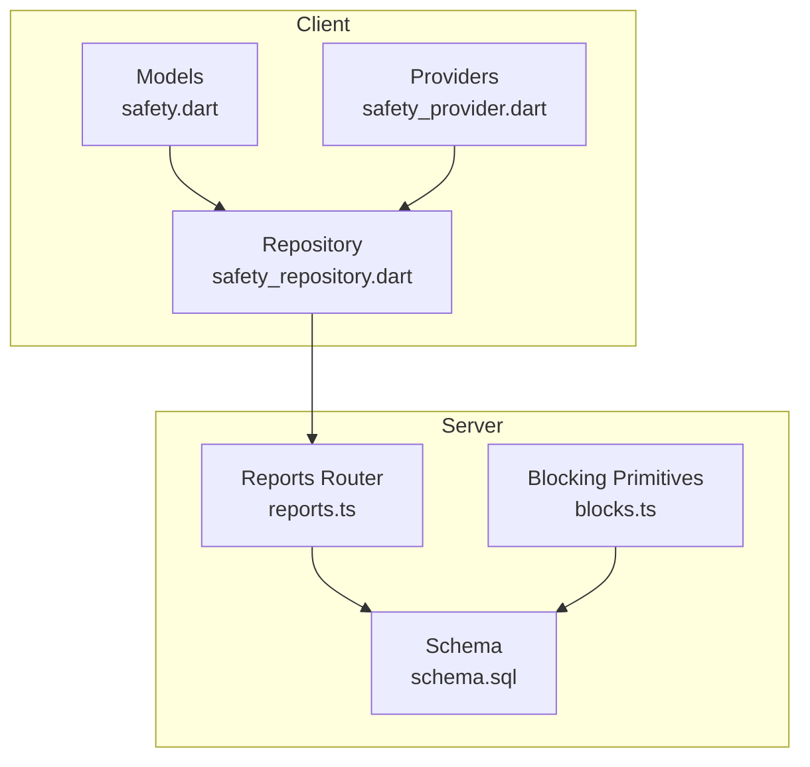
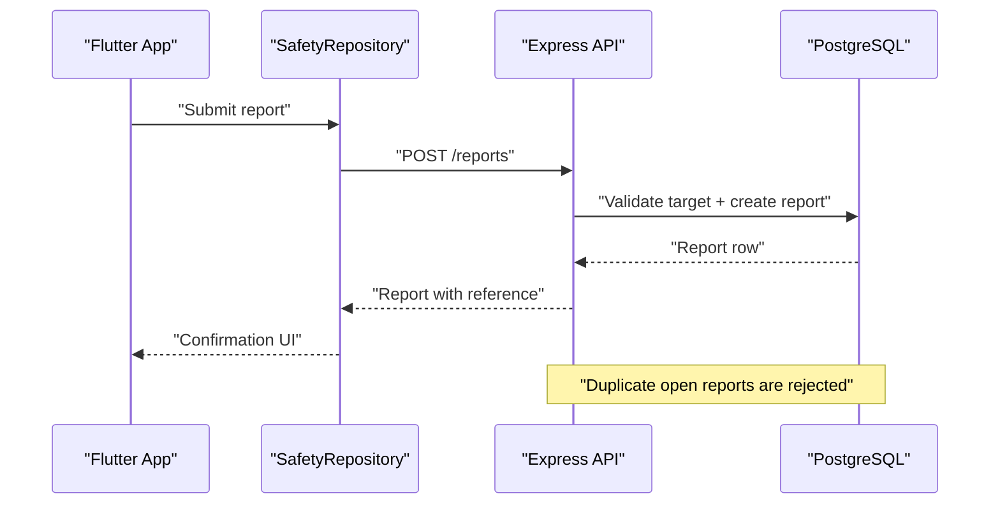
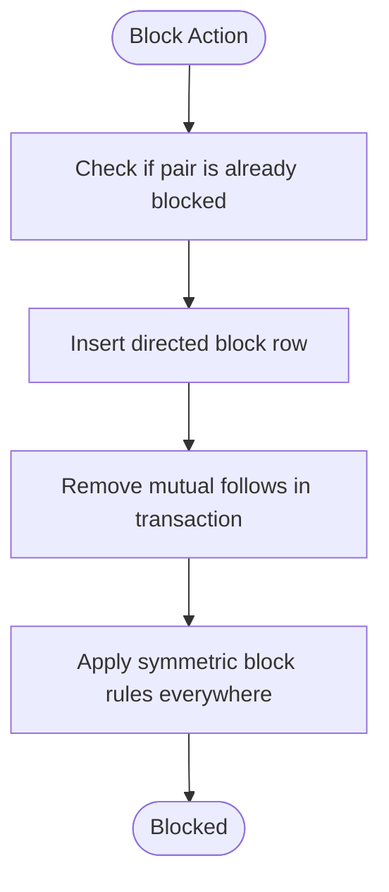
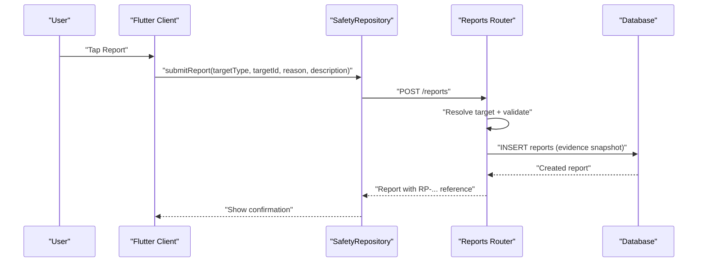
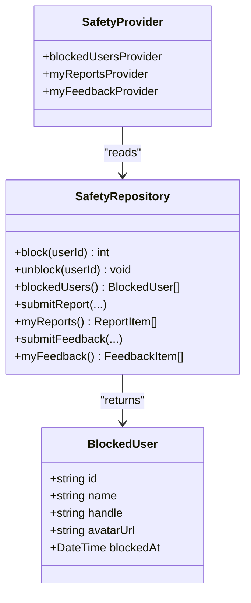
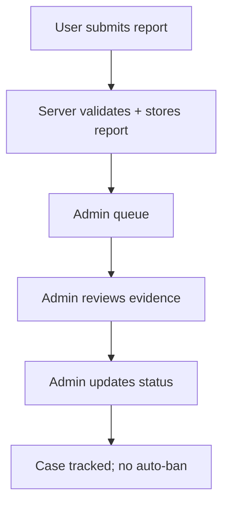
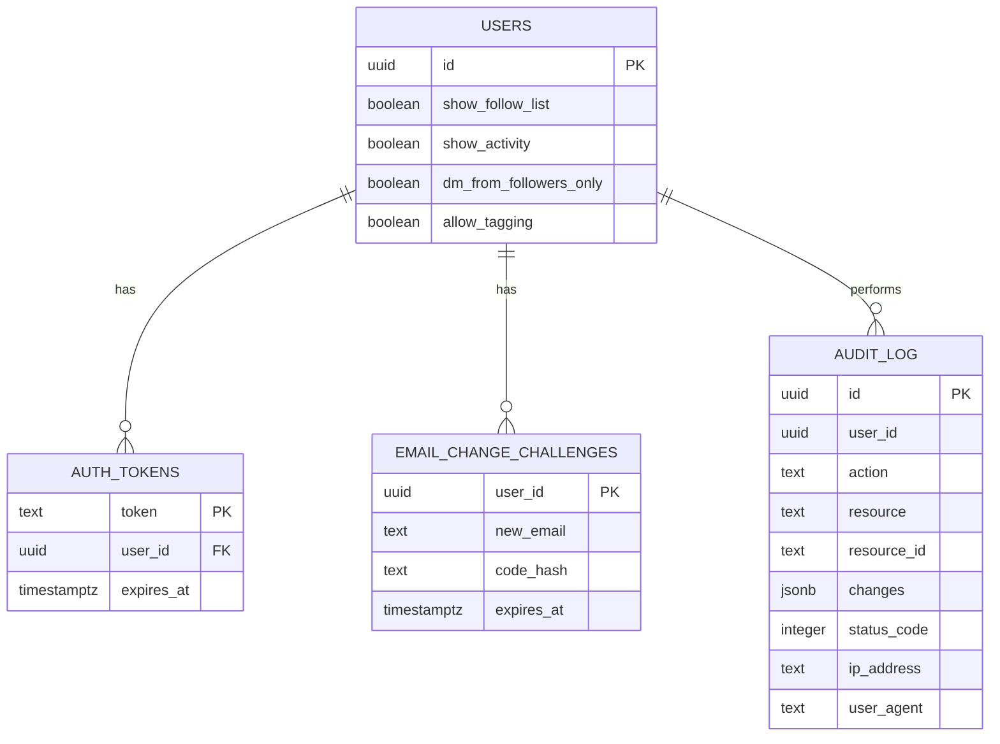
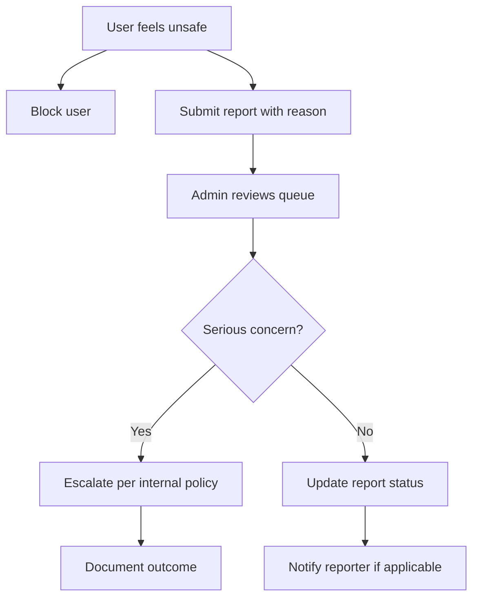
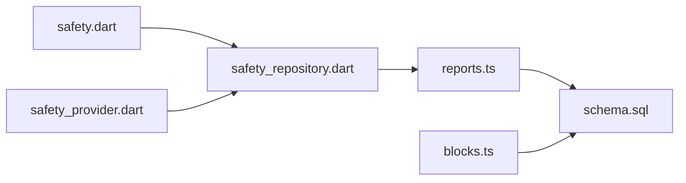

# Safety & Moderation

<cite>
**Referenced Files in This Document**
- [blocks.ts](file://server/src/blocks.ts)
- [reports.ts](file://server/src/routes/reports.ts)
- [schema.sql](file://server/src/schema.sql)
- [safety.dart](file://lib/models/safety.dart)
- [safety_provider.dart](file://lib/providers/safety_provider.dart)
- [safety_repository.dart](file://lib/repositories/safety_repository.dart)
</cite>

## Table of Contents
1. [Introduction](#introduction)
2. [Project Structure](#project-structure)
3. [Core Components](#core-components)
4. [Architecture Overview](#architecture-overview)
5. [Detailed Component Analysis](#detailed-component-analysis)
6. [Dependency Analysis](#dependency-analysis)
7. [Performance Considerations](#performance-considerations)
8. [Troubleshooting Guide](#troubleshooting-guide)
9. [Conclusion](#conclusion)
10. [Appendices](#appendices)

## Introduction
This document explains the safety and moderation system for DinCircle. It covers how users can protect themselves by blocking other users, how to report inappropriate content, how blocked users are managed, and what tools are available to moderators and administrators. It also documents privacy-related settings, data protection measures, escalation paths for serious concerns, and common safety scenarios with their resolution workflows.

The system is split into:
- Server-side enforcement for blocking and reporting.
- Client-side models, providers, and repository methods that surface these capabilities to users.
- A database schema that defines the authoritative structure for blocks, reports, and feedback tickets.

## Project Structure
Safety and moderation spans both the Flutter client and the Express server:

- Server
  - Blocking enforcement primitives and SQL predicates live in a shared module.
  - Report submission, listing, and admin moderation endpoints are implemented as an API router.
  - The database schema defines tables for user blocks, reports, and feedback.

- Client (Flutter)
  - Models define report targets, reasons, statuses, blocked users, and feedback items.
  - Providers expose read-only lists such as blocked users and my reports.
  - A repository abstracts all safety-related API calls.

**Diagram sources**
- [safety.dart:1-202](file://lib/models/safety.dart#L1-L202)
- [safety_provider.dart:1-30](file://lib/providers/safety_provider.dart#L1-L30)
- [safety_repository.dart:1-111](file://lib/repositories/safety_repository.dart#L1-L111)
- [blocks.ts:1-42](file://server/src/blocks.ts#L1-L42)
- [reports.ts:1-283](file://server/src/routes/reports.ts#L1-L283)
- [schema.sql:426-474](file://server/src/schema.sql#L426-L474)

**Section sources**
- [blocks.ts:1-42](file://server/src/blocks.ts#L1-L42)
- [reports.ts:1-283](file://server/src/routes/reports.ts#L1-L283)
- [schema.sql:426-474](file://server/src/schema.sql#L426-L474)
- [safety.dart:1-202](file://lib/models/safety.dart#L1-L202)
- [safety_provider.dart:1-30](file://lib/providers/safety_provider.dart#L1-L30)
- [safety_repository.dart:1-111](file://lib/repositories/safety_repository.dart#L1-L111)

## Core Components
- Blocking
  - Symmetric block semantics: once either user has blocked the other, they cannot follow, discover, view profiles, chat, or book each other.
  - Enforcement uses a single directed row per block but checks both directions at runtime.
  - Blocking removes mutual follows in one transaction on the server.

- Reporting
  - Users can report profiles, events, reviews, and messages.
  - Reports include a human-readable reference code for tracking.
  - Duplicate open reports for the same reporter and target are rejected.
  - Only the reporter and platform admins can see report details; the reported party never sees the reporter’s identity.

- Admin Moderation
  - Platform admins can list reports and advance their status.
  - Status transitions are manual; no automatic bans occur through reporting.

- Privacy Settings
  - User-level toggles control visibility of followers, activity, direct messages, and tagging.

- Data Protection
  - Tokens and verification codes are stored as hashes.
  - Audit logging captures sensitive actions.

**Section sources**
- [blocks.ts:1-42](file://server/src/blocks.ts#L1-L42)
- [reports.ts:10-22](file://server/src/routes/reports.ts#L10-L22)
- [schema.sql:62-72](file://server/src/schema.sql#L62-L72)
- [schema.sql:417-424](file://server/src/schema.sql#L417-L424)
- [schema.sql:498-511](file://server/src/schema.sql#L498-L511)

## Architecture Overview
The safety flow combines client requests, server validation, and database constraints:

**Diagram sources**
- [safety_repository.dart:61-78](file://lib/repositories/safety_repository.dart#L61-L78)
- [reports.ts:150-198](file://server/src/routes/reports.ts#L150-L198)
- [schema.sql:443-474](file://server/src/schema.sql#L443-L474)

## Detailed Component Analysis

### Blocking System
Blocking is enforced centrally so safety rules do not drift route-by-route.

Key behaviors:
- Symmetric block: if A blocks B, then A and B cannot interact in any safety-sensitive way.
- Single-direction storage: only one directed row is stored, but checks consider both directions.
- Discovery filtering: queries can exclude blocked pairs using a reusable predicate.

**Diagram sources**
- [blocks.ts:13-41](file://server/src/blocks.ts#L13-L41)
- [schema.sql:426-441](file://server/src/schema.sql#L426-L441)

**Section sources**
- [blocks.ts:1-42](file://server/src/blocks.ts#L1-L42)
- [schema.sql:426-441](file://server/src/schema.sql#L426-L441)

### Report Submission Workflow
Users submit reports for profiles, events, reviews, or messages. The server validates the target, prevents self-reports, guards against duplicate open reports, and returns a reference code.

**Diagram sources**
- [safety_repository.dart:61-78](file://lib/repositories/safety_repository.dart#L61-L78)
- [reports.ts:117-198](file://server/src/routes/reports.ts#L117-L198)
- [schema.sql:443-474](file://server/src/schema.sql#L443-L474)

**Section sources**
- [reports.ts:10-22](file://server/src/routes/reports.ts#L10-L22)
- [reports.ts:54-115](file://server/src/routes/reports.ts#L54-L115)
- [reports.ts:117-198](file://server/src/routes/reports.ts#L117-L198)
- [schema.sql:443-474](file://server/src/schema.sql#L443-L474)

### Blocked Users Management Interface
On the client side, blocked users are loaded from the server and displayed for management.

- Provider exposes a future list of blocked users.
- Repository calls the endpoint to fetch the current list.
- After successful block/unblock operations, screens should invalidate the provider to refresh the list.

**Diagram sources**
- [safety.dart:97-131](file://lib/models/safety.dart#L97-L131)
- [safety_provider.dart:13-17](file://lib/providers/safety_provider.dart#L13-L17)
- [safety_repository.dart:10-59](file://lib/repositories/safety_repository.dart#L10-L59)

**Section sources**
- [safety_provider.dart:1-30](file://lib/providers/safety_provider.dart#L1-L30)
- [safety_repository.dart:10-59](file://lib/repositories/safety_repository.dart#L10-L59)
- [safety.dart:97-131](file://lib/models/safety.dart#L97-L131)

### Content Moderation Tools for Users and Administrators
- For users
  - Block/unblock other users.
  - Submit reports with a reason and optional description.
  - View own submitted reports and support tickets.

- For administrators
  - Access a moderated queue of reports with evidence and reporter identity.
  - Advance report status between pending, reviewing, resolved, and dismissed.
  - No automatic enforcement occurs via reporting; moderation decisions are manual.

**Diagram sources**
- [reports.ts:215-280](file://server/src/routes/reports.ts#L215-L280)
- [schema.sql:443-474](file://server/src/schema.sql#L443-L474)

**Section sources**
- [reports.ts:215-280](file://server/src/routes/reports.ts#L215-L280)

### Safety Guidelines and Community Standards Enforcement
While specific policy text is not present in the analyzed files, the system enforces behavioral boundaries through:
- Symmetric blocking to prevent unwanted interactions.
- Report categories aligned with community standards (harassment, spam, inappropriate content, impersonation, unsafe experience, misleading event info).
- Manual moderation workflow where admins decide outcomes without automated penalties.

These mechanisms collectively support safe dining experiences and respectful interactions.

[No sources needed since this section summarizes general principles]

### Privacy Settings and Data Protection Measures
- Privacy toggles
  - Control whether followers are visible.
  - Control whether activity is visible.
  - Restrict direct messages to followers only.
  - Control whether tagging is allowed.

- Data protection
  - Authentication tokens are stored as hashed digests with expiration.
  - Email change challenges store only a hash of the verification code.
  - Audit logs record sensitive actions for accountability.

**Diagram sources**
- [schema.sql:62-72](file://server/src/schema.sql#L62-L72)
- [schema.sql:397-407](file://server/src/schema.sql#L397-L407)
- [schema.sql:417-424](file://server/src/schema.sql#L417-L424)
- [schema.sql:498-511](file://server/src/schema.sql#L498-L511)

**Section sources**
- [schema.sql:62-72](file://server/src/schema.sql#L62-L72)
- [schema.sql:397-407](file://server/src/schema.sql#L397-L407)
- [schema.sql:417-424](file://server/src/schema.sql#L417-L424)
- [schema.sql:498-511](file://server/src/schema.sql#L498-L511)

### Escalation Process for Serious Safety Concerns
- Immediate user action
  - Block the offending user to stop further interaction.
  - Submit a report with the most relevant reason and a concise description.

- Administrative review
  - Moderators access the report queue, review evidence snapshots, and update the case status.
  - If necessary, escalate internally based on organizational procedures; the system itself does not auto-enforce penalties.

- Follow-up
  - The reporter can monitor the status of their report.
  - Support tickets can be used for non-safety issues or when additional context is needed.

[No sources needed since this diagram shows conceptual workflow, not actual code structure]

### Examples of Common Safety Scenarios and Resolution Workflows

- Harassment in chat
  - User blocks the harasser.
  - User reports the message with reason “harassment.”
  - Admin reviews evidence and updates status.

- Inappropriate profile content
  - User reports the profile with reason “inappropriate_content.”
  - Admin reviews and may take action outside the reporting system.

- Misleading event information
  - User reports the event with reason “misleading_event_info.”
  - Admin reviews and updates status.

- Unsafe dining experience
  - User reports the event or host with reason “unsafe_experience.”
  - Admin reviews and escalates if warranted.

[No sources needed since this section provides scenario examples]

## Dependency Analysis
The safety subsystem connects client models and providers to a repository, which calls the server routes backed by the database schema.

**Diagram sources**
- [safety.dart:1-202](file://lib/models/safety.dart#L1-L202)
- [safety_repository.dart:1-111](file://lib/repositories/safety_repository.dart#L1-L111)
- [safety_provider.dart:1-30](file://lib/providers/safety_provider.dart#L1-L30)
- [reports.ts:1-283](file://server/src/routes/reports.ts#L1-L283)
- [blocks.ts:1-42](file://server/src/blocks.ts#L1-L42)
- [schema.sql:426-474](file://server/src/schema.sql#L426-L474)

**Section sources**
- [safety_repository.dart:1-111](file://lib/repositories/safety_repository.dart#L1-L111)
- [reports.ts:1-283](file://server/src/routes/reports.ts#L1-L283)
- [blocks.ts:1-42](file://server/src/blocks.ts#L1-L42)
- [schema.sql:426-474](file://server/src/schema.sql#L426-L474)

## Performance Considerations
- Blocking checks use efficient SQL predicates to avoid secondary queries across discovery and feeds.
- Report submission includes rate limiting and duplicate prevention to reduce queue pollution.
- Database indexes support fast lookups for reports by reporter, target, and status.

[No sources needed since this section provides general guidance]

## Troubleshooting Guide
- Cannot report your own content
  - The server rejects self-reports. Use another channel to flag issues you created.

- Duplicate report error
  - An open report already exists for the same target. Wait for the existing case to resolve or dismiss before re-reporting.

- Target not found
  - The reported item may have been removed. The server returns a not-found response.

- Admin queue not updating
  - Ensure you have the required role to access the moderation endpoints.

**Section sources**
- [reports.ts:170-198](file://server/src/routes/reports.ts#L170-L198)
- [reports.ts:220-259](file://server/src/routes/reports.ts#L220-L259)

## Conclusion
DinCircle’s safety and moderation system centers on strong user controls (blocking and reporting), clear administrative workflows, and robust data protection. Blocking is enforced symmetrically across the platform, while reports provide a structured path for moderation without automatic penalties. Privacy settings give users granular control over visibility, and hashing plus audit logging help protect sensitive data. Together, these components create a safer environment for dining and social interactions.

[No sources needed since this section summarizes without analyzing specific files]

## Appendices

### API Surface Summary
- Report submission
  - POST /reports
  - Body fields: targetType, targetId, reason, description
  - Returns: report object with RP-... reference

- My reports
  - GET /users/me/reports
  - Returns: list of reports owned by the signed-in user

- Admin report queue
  - GET /reports?status=...
  - Requires super_admin role
  - Returns: reports including evidence and reporter identity

- Admin report status update
  - PATCH /reports/:id
  - Requires super_admin role
  - Body field: status

**Section sources**
- [reports.ts:150-198](file://server/src/routes/reports.ts#L150-L198)
- [reports.ts:200-213](file://server/src/routes/reports.ts#L200-L213)
- [reports.ts:220-280](file://server/src/routes/reports.ts#L220-L280)