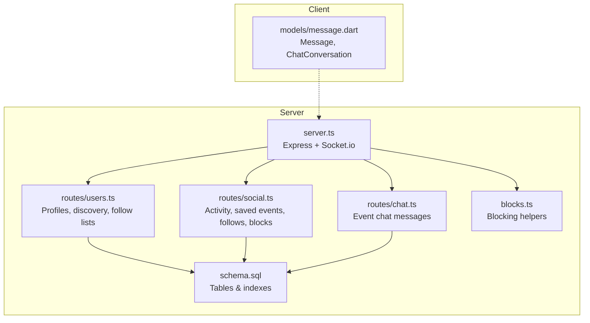
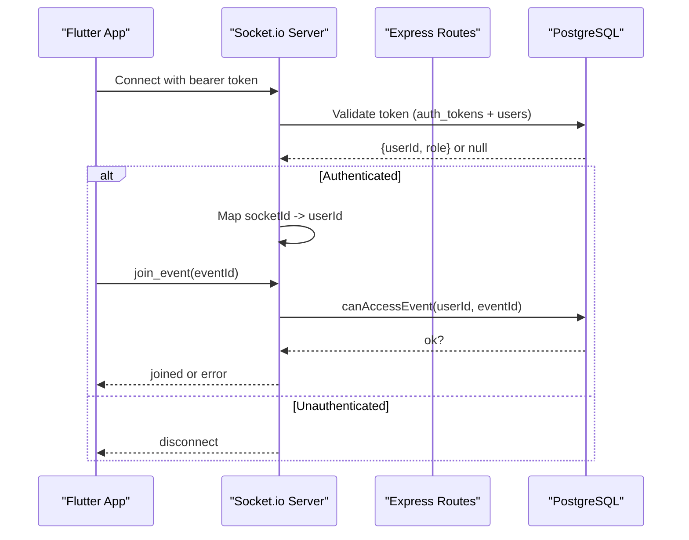
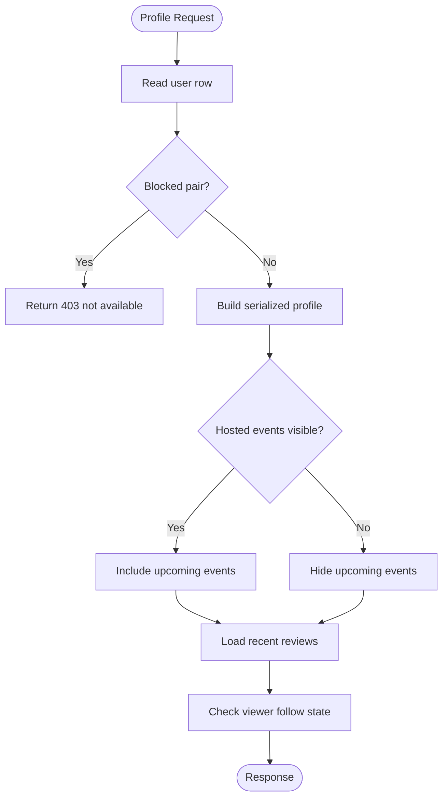
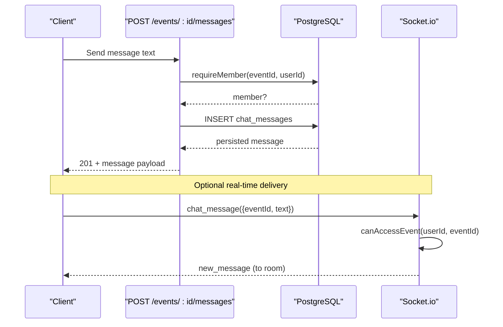
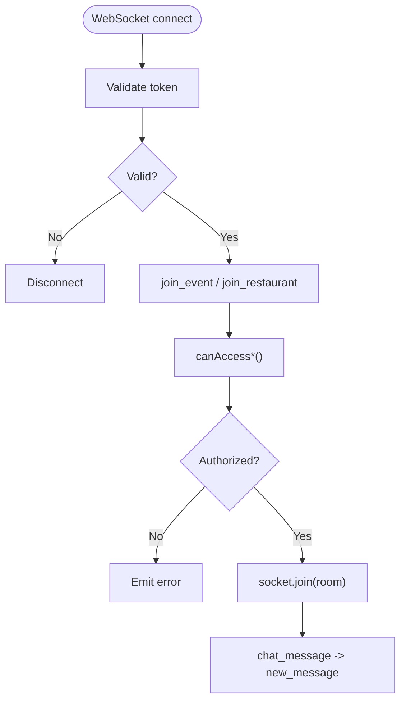
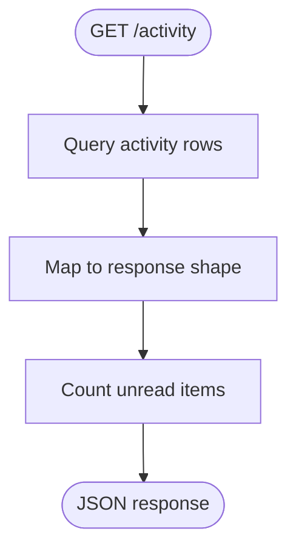
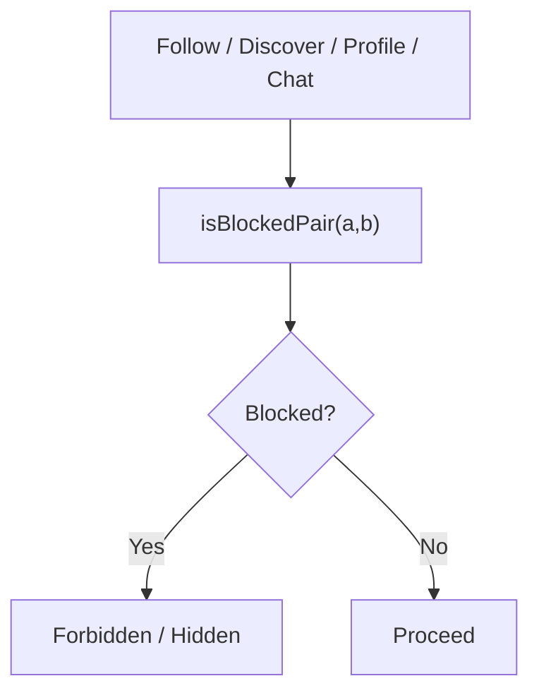
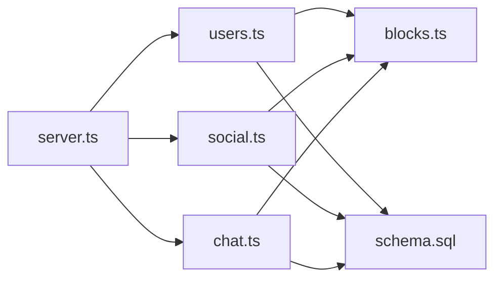

# Social Features

<cite>
**Referenced Files in This Document**
- [server.ts](file://server/src/server.ts)
- [social.ts](file://server/src/routes/social.ts)
- [chat.ts](file://server/src/routes/chat.ts)
- [users.ts](file://server/src/routes/users.ts)
- [blocks.ts](file://server/src/blocks.ts)
- [schema.sql](file://server/src/schema.sql)
- [message.dart](file://lib/models/message.dart)
</cite>

## Table of Contents
1. [Introduction](#introduction)
2. [Project Structure](#project-structure)
3. [Core Components](#core-components)
4. [Architecture Overview](#architecture-overview)
5. [Detailed Component Analysis](#detailed-component-analysis)
6. [Dependency Analysis](#dependency-analysis)
7. [Performance Considerations](#performance-considerations)
8. [Troubleshooting Guide](#troubleshooting-guide)
9. [Conclusion](#conclusion)

## Introduction
This document explains the social features system: user profile management, following and discovery, event-based messaging, real-time communication via WebSocket, notifications and activity, and safety tools such as blocking and reporting. It maps server routes, database schema, and client models to show how data flows end-to-end.

## Project Structure
The social subsystem spans server routes, shared safety helpers, database schema, and a small set of Flutter models used by the app UI.



**Diagram sources**
- [server.ts:91-202](file://server/src/server.ts#L91-L202)
- [users.ts:420-736](file://server/src/routes/users.ts#L420-L736)
- [social.ts:29-354](file://server/src/routes/social.ts#L29-L354)
- [chat.ts:55-131](file://server/src/routes/chat.ts#L55-L131)
- [blocks.ts:1-42](file://server/src/blocks.ts#L1-L42)
- [schema.sql:14-73](file://server/src/schema.sql#L14-L73)
- [schema.sql:306-474](file://server/src/schema.sql#L306-L474)
- [message.dart:1-67](file://lib/models/message.dart#L1-L67)

**Section sources**
- [server.ts:91-202](file://server/src/server.ts#L91-L202)
- [schema.sql:14-73](file://server/src/schema.sql#L14-L73)
- [schema.sql:306-474](file://server/src/schema.sql#L306-L474)
- [message.dart:1-67](file://lib/models/message.dart#L1-L67)

## Core Components
- User profiles and settings: name, handle, bio, avatar URL, city, role, badges, tastes, privacy toggles, dietary/allergies, home area.
- Following graph: bidirectional visibility with block enforcement; follower/following counts maintained on users.
- Activity feed: per-user notification-like stream for social actions (e.g., new followers).
- Saved events: bookmark/unbookmark endpoints returning event summaries.
- Event chat: read-only history plus posting with membership checks and block enforcement.
- Blocking: symmetric pair-level enforcement across discovery, profiles, chat, and follows.
- Real-time channels: Socket.io rooms per event/restaurant with token-based auth and authorization checks.

**Section sources**
- [users.ts:13-72](file://server/src/routes/users.ts#L13-L72)
- [users.ts:121-153](file://server/src/routes/users.ts#L121-L153)
- [users.ts:420-454](file://server/src/routes/users.ts#L420-L454)
- [social.ts:29-67](file://server/src/routes/social.ts#L29-L67)
- [social.ts:69-138](file://server/src/routes/social.ts#L69-L138)
- [social.ts:140-257](file://server/src/routes/social.ts#L140-L257)
- [social.ts:259-354](file://server/src/routes/social.ts#L259-L354)
- [chat.ts:55-131](file://server/src/routes/chat.ts#L55-L131)
- [blocks.ts:1-42](file://server/src/blocks.ts#L1-L42)
- [schema.sql:14-73](file://server/src/schema.sql#L14-L73)
- [schema.sql:306-474](file://server/src/schema.sql#L306-L474)

## Architecture Overview
The API is Express-based with Socket.io for real-time. Routes are grouped under /api. Authentication is required for most endpoints. Blocking is enforced centrally so that blocked pairs cannot interact across discovery, profiles, follows, and chat.



**Diagram sources**
- [server.ts:99-113](file://server/src/server.ts#L99-L113)
- [server.ts:115-129](file://server/src/server.ts#L115-L129)
- [server.ts:146-169](file://server/src/server.ts#L146-L169)

**Section sources**
- [server.ts:91-202](file://server/src/server.ts#L91-L202)

## Detailed Component Analysis

### User Profile Management
- Profile fields include name, handle, bio, avatar_url, city, role, badges, tastes, accent_hex, joined_year, and privacy toggles (show_follow_list, show_activity, dm_from_followers_only, allow_tagging), plus dietary/allergies and home_area.
- PATCH /api/users/me updates only provided fields, protecting anonymized accounts.
- GET /api/users/:id returns profile, upcoming hosted events (if visible), reviews, and viewer follow state.
- Followers/following lists are paginated and gated by privacy toggles.



**Diagram sources**
- [users.ts:648-736](file://server/src/routes/users.ts#L648-L736)
- [users.ts:599-615](file://server/src/routes/users.ts#L599-L615)

**Section sources**
- [users.ts:13-72](file://server/src/routes/users.ts#L13-L72)
- [users.ts:155-186](file://server/src/routes/users.ts#L155-L186)
- [users.ts:648-736](file://server/src/routes/users.ts#L648-L736)
- [users.ts:541-597](file://server/src/routes/users.ts#L541-L597)
- [schema.sql:14-73](file://server/src/schema.sql#L14-L73)

### People Discovery and Following System
- Discovery list supports search by name/handle/bio and hides blocked users using a SQL predicate.
- Batch follow-status endpoint returns a map of whether the viewer follows each requested user.
- Follow/unfollow endpoints update counts and insert activity entries when a new follow occurs.
- Block removes mutual follows atomically and prevents re-following while blocked.

```mermaid
classDiagram
class Users {
+string id
+string name
+string handle
+string bio
+string avatar_url
+int followers_count
+int following_count
+boolean show_follow_list
+boolean show_activity
}
class Follows {
+string follower_id
+string followee_id
+datetime created_at
}
class Activity {
+string id
+string kind
+string title
+string body
+uuid actor_id
+boolean is_unread
+datetime created_at
}
Users ||--o{ Follows : "follower_id"
Users ||--o{ Follows : "followee_id"
Users ||--o{ Activity : "actor_id"
```

**Diagram sources**
- [schema.sql:14-73](file://server/src/schema.sql#L14-L73)
- [schema.sql:306-347](file://server/src/schema.sql#L306-L347)

**Section sources**
- [users.ts:420-454](file://server/src/routes/users.ts#L420-L454)
- [social.ts:140-257](file://server/src/routes/social.ts#L140-L257)
- [social.ts:259-318](file://server/src/routes/social.ts#L259-L318)
- [blocks.ts:13-41](file://server/src/blocks.ts#L13-L41)
- [schema.sql:306-347](file://server/src/schema.sql#L306-L347)

### Messaging System and Conversation Management
- Event chat is restricted to hosts, booked guests, or attendees listed on the event.
- Message history is returned oldest-first with author details.
- Posting validates membership and block status against the host; history remains readable after a block.
- Real-time chat uses Socket.io rooms per event; clients join/leave rooms and broadcast new messages to other participants.



**Diagram sources**
- [chat.ts:13-35](file://server/src/routes/chat.ts#L13-L35)
- [chat.ts:55-131](file://server/src/routes/chat.ts#L55-L131)
- [server.ts:184-197](file://server/src/server.ts#L184-L197)

**Section sources**
- [chat.ts:55-131](file://server/src/routes/chat.ts#L55-L131)
- [server.ts:184-197](file://server/src/server.ts#L184-L197)
- [schema.sql:349-357](file://server/src/schema.sql#L349-L357)

### Real-Time Communication Infrastructure
- Connections require a valid bearer token; invalid tokens are disconnected.
- Clients join rooms per event or restaurant; authorization is checked both at join time and before broadcasting messages.
- Utility functions emit booking/event updates and restaurant notifications to relevant rooms.



**Diagram sources**
- [server.ts:99-113](file://server/src/server.ts#L99-L113)
- [server.ts:115-129](file://server/src/server.ts#L115-L129)
- [server.ts:146-197](file://server/src/server.ts#L146-L197)

**Section sources**
- [server.ts:91-202](file://server/src/server.ts#L91-L202)

### Notifications and Activity
- The activity feed returns the signed-in user’s activities newest-first with an unread count.
- Marking all as read clears unread flags for the current user.
- New followers generate activity entries for the target user.



**Diagram sources**
- [social.ts:29-67](file://server/src/routes/social.ts#L29-L67)
- [social.ts:193-216](file://server/src/routes/social.ts#L193-L216)

**Section sources**
- [social.ts:29-67](file://server/src/routes/social.ts#L29-L67)
- [social.ts:193-216](file://server/src/routes/social.ts#L193-L216)
- [schema.sql:333-347](file://server/src/schema.sql#L333-L347)

### Safety Features: Blocking and Moderation
- Blocking is symmetric: either direction blocks interaction.
- Blocked users are hidden from discovery, cannot view each other’s profiles, cannot follow each other, and cannot post in event chats.
- Reports table supports moderation workflows with constraints preventing duplicate open reports.



**Diagram sources**
- [blocks.ts:13-41](file://server/src/blocks.ts#L13-L41)
- [users.ts:420-454](file://server/src/routes/users.ts#L420-L454)
- [users.ts:599-615](file://server/src/routes/users.ts#L599-L615)
- [social.ts:170-184](file://server/src/routes/social.ts#L170-L184)
- [chat.ts:91-98](file://server/src/routes/chat.ts#L91-L98)

**Section sources**
- [blocks.ts:1-42](file://server/src/blocks.ts#L1-L42)
- [users.ts:420-454](file://server/src/routes/users.ts#L420-L454)
- [users.ts:599-615](file://server/src/routes/users.ts#L599-L615)
- [social.ts:170-184](file://server/src/routes/social.ts#L170-L184)
- [social.ts:259-318](file://server/src/routes/social.ts#L259-L318)
- [chat.ts:91-98](file://server/src/routes/chat.ts#L91-L98)
- [schema.sql:426-474](file://server/src/schema.sql#L426-L474)

## Dependency Analysis
Key dependencies and relationships:
- server.ts wires routes and WebSocket logic.
- users.ts depends on blocks.ts for profile access and discovery filtering.
- social.ts depends on blocks.ts for follow/block enforcement and activity insertion.
- chat.ts depends on blocks.ts for chat permission checks.
- All routes depend on schema.sql for data structures and indexes.



**Diagram sources**
- [server.ts:11-24](file://server/src/server.ts#L11-L24)
- [users.ts:1-7](file://server/src/routes/users.ts#L1-L7)
- [social.ts:1-5](file://server/src/routes/social.ts#L1-L5)
- [chat.ts:1-5](file://server/src/routes/chat.ts#L1-L5)
- [blocks.ts:1-42](file://server/src/blocks.ts#L1-L42)
- [schema.sql:14-73](file://server/src/schema.sql#L14-L73)
- [schema.sql:306-474](file://server/src/schema.sql#L306-L474)

**Section sources**
- [server.ts:11-24](file://server/src/server.ts#L11-L24)
- [users.ts:1-7](file://server/src/routes/users.ts#L1-L7)
- [social.ts:1-5](file://server/src/routes/social.ts#L1-L5)
- [chat.ts:1-5](file://server/src/routes/chat.ts#L1-L5)
- [blocks.ts:1-42](file://server/src/blocks.ts#L1-L42)

## Performance Considerations
- Use batched follow-status queries to avoid N+1 lookups in list screens.
- Keep pagination limits reasonable (default 20, max 50) and leverage existing indexes on activity, chat, and saved_events.
- Prefer server-side filtering for blocked users to maintain consistent pagination and reduce client complexity.
- For real-time chat, ensure clients join rooms once and debounce heavy UI updates on incoming messages.

[No sources needed since this section provides general guidance]

## Troubleshooting Guide
- Profile returns 403 “not available”: likely due to a block between viewer and target.
- Discovery list missing expected users: verify block predicates and search terms; check that blocked users are filtered out.
- Cannot follow a user: confirm they are not self, and that neither party has blocked the other.
- Event chat message rejected: verify membership (host/booked guest/attendee) and that the poster is not blocked relative to the host.
- WebSocket join fails: ensure token is valid and the user is authorized for the event; check server logs for authorization errors.

**Section sources**
- [users.ts:599-615](file://server/src/routes/users.ts#L599-L615)
- [users.ts:420-454](file://server/src/routes/users.ts#L420-L454)
- [social.ts:170-184](file://server/src/routes/social.ts#L170-L184)
- [chat.ts:13-35](file://server/src/routes/chat.ts#L13-L35)
- [chat.ts:91-98](file://server/src/routes/chat.ts#L91-L98)
- [server.ts:146-197](file://server/src/server.ts#L146-L197)

## Conclusion
The social features provide a robust foundation for profiles, discovery, following, event chat, and real-time updates, with strong safety controls through symmetric blocking and centralized enforcement. The design balances usability with security, leveraging server-side checks and indexed queries to keep interactions safe and performant.

[No sources needed since this section summarizes without analyzing specific files]