# User Settings & Profile

<cite>
**Referenced Files in This Document**
- [profile_screen.dart](file://lib/screens/profile/profile_screen.dart)
- [user_profile_screen.dart](file://lib/screens/user_profile/user_profile_screen.dart)
- [settings_screen.dart](file://lib/screens/settings/settings_screen.dart)
- [privacy_settings_screen.dart](file://lib/screens/settings/privacy_settings_screen.dart)
- [food_preferences_screen.dart](file://lib/screens/preferences/food_preferences_screen.dart)
- [location_settings_screen.dart](file://lib/screens/location/location_settings_screen.dart)
- [edit_profile_sheet.dart](file://lib/widgets/edit_profile_sheet.dart)
- [user_profile.dart](file://lib/models/user_profile.dart)
- [users_provider.dart](file://lib/providers/users_provider.dart)
- [host_dashboard_screen.dart](file://lib/screens/host/host_dashboard_screen.dart)
- [app_colors.dart](file://lib/theme/app_colors.dart)
- [app_text_styles.dart](file://lib/theme/app_text_styles.dart)
</cite>

## Update Summary
**Changes Made**
- Updated Profile Screen section with comprehensive redesign including compact header, overflow-safe layouts, and enhanced UX
- Added new User Profile Screen documentation for public host profiles with experience-first design
- Enhanced Interactive Stats Bar Navigation documentation with improved navigation patterns
- Added explicit color usage and improved text contrast details throughout
- Documented functional dining preferences button improvements
- Added consolidated hosting experience with 'Host Studio' entry point
- Included new account management features (Account Settings, Delete Account)
- Updated UX improvements throughout the seven-phase production audit
- Added follow loading state management for social interactions
- Enhanced hosted experiences display with detailed event information
- Improved ratings & trust section with gold accent backgrounds

## Table of Contents
1. [Introduction](#introduction)
2. [Project Structure](#project-structure)
3. [Core Components](#core-components)
4. [Architecture Overview](#architecture-overview)
5. [Detailed Component Analysis](#detailed-component-analysis)
6. [Dependency Analysis](#dependency-analysis)
7. [Performance Considerations](#performance-considerations)
8. [Troubleshooting Guide](#troubleshooting-guide)
9. [Conclusion](#conclusion)

## Introduction
This document explains the user settings and profile management features in the application. It covers:
- **Enhanced Profile Screen**: Major UI improvements including camera overlay for avatar editing, interactive stats bar navigation, and improved text contrast with explicit color usage.
- **New User Profile Screen**: Comprehensive redesign with experience-first approach, compact header, overflow-safe layouts, follow loading state management, enhanced hosted experiences display, and improved ratings & trust section with gold accent backgrounds.
- Account preferences, including personal information editing, email and password changes, and account deletion.
- Notification and privacy controls for visibility, messaging, and blocking.
- Food preferences for personalized recommendations (cuisines, dietary needs, allergies).
- Profile editing capabilities (name, city, bio) and avatar management.
- Location settings (city and preferred dining area).
- Security actions (logout, logout all devices, delete account).
- Theme customization and accessibility options available through the app's theme system.
- Consolidated hosting experience with 'Host Studio' entry point.
- Common configuration examples to help users set up their profiles effectively.

## Project Structure
The settings and profile flows are implemented as Flutter screens and widgets that read and update the current user via providers and repositories. The key files involved are:
- **Enhanced Profile Screen**: Central hub with camera overlay, interactive stats, and improved UX
- **New User Profile Screen**: Public host profile with experience-first design and compact header
- Settings hub and security actions: settings screen
- Privacy toggles: privacy settings screen
- Food preferences: food preferences screen
- Location: location settings screen
- Profile view and edit entry points: profile screen and edit profile sheet
- Data model for user profile and settings fields: user profile model
- Provider wiring for current user and related data: users provider
- Host dashboard: consolidated hosting experience

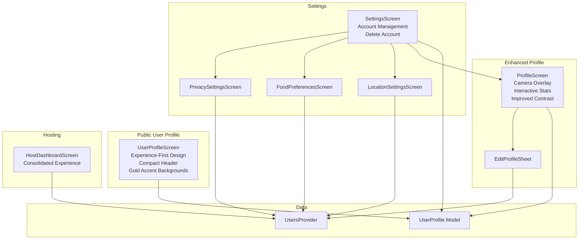

**Diagram sources**
- [profile_screen.dart:28-515](file://lib/screens/profile/profile_screen.dart#L28-L515)
- [user_profile_screen.dart:21-842](file://lib/screens/user_profile/user_profile_screen.dart#L21-L842)
- [settings_screen.dart:20-264](file://lib/screens/settings/settings_screen.dart#L20-L264)
- [host_dashboard_screen.dart:268-292](file://lib/screens/host/host_dashboard_screen.dart#L268-L292)

**Section sources**
- [profile_screen.dart:28-515](file://lib/screens/profile/profile_screen.dart#L28-L515)
- [user_profile_screen.dart:21-842](file://lib/screens/user_profile/user_profile_screen.dart#L21-L842)
- [settings_screen.dart:20-264](file://lib/screens/settings/settings_screen.dart#L20-L264)
- [user_profile.dart:42-113](file://lib/models/user_profile.dart#L42-L113)
- [users_provider.dart:10-13](file://lib/providers/users_provider.dart#L10-L13)

## Core Components
- **Enhanced Profile Hub**: Central entry point with camera overlay for avatar editing, interactive stats bar navigation, and improved text contrast using explicit colors.
- **New User Profile Screen**: Experience-first design for public host profiles with compact header, overflow-safe layouts, follow loading state management, enhanced hosted experiences display, and improved ratings & trust section with gold accent backgrounds.
- **Account Management**: Comprehensive account settings including Personal Information, Change Email, Change Password, and Delete Account functionality.
- Privacy & Security: Server-backed toggles for profile visibility, activity, tagging, and DM restrictions.
- Food Preferences: Cuisines/interests, dietary preferences, and allergies with server caps and validation.
- Location: City selection and preferred dining area; persisted to the account.
- **Consolidated Hosting Experience**: Unified 'Host Studio' entry point for managing events, analytics, earnings & collaborations.
- Edit Profile Sheet: Bottom-sheet editor for name, city, and bio; preserves tastes from preferences.
- UserProfile Model: Defines profile fields, role, and account settings mirrored from the server.
- Users Provider: Provides current user and related data streams used by screens.

**Section sources**
- [profile_screen.dart:28-515](file://lib/screens/profile/profile_screen.dart#L28-L515)
- [user_profile_screen.dart:21-842](file://lib/screens/user_profile/user_profile_screen.dart#L21-L842)
- [settings_screen.dart:20-264](file://lib/screens/settings/settings_screen.dart#L20-L264)
- [host_dashboard_screen.dart:268-292](file://lib/screens/host/host_dashboard_screen.dart#L268-L292)

## Architecture Overview
The settings and profile features follow a consistent pattern with enhanced UX improvements:
- UI screens read the current user from the provider.
- Changes are written via the session controller using PATCH endpoints.
- Successful updates republish the session so dependent screens refresh automatically.
- Errors are surfaced via snack bars or inline feedback.
- **New**: Camera overlay integration for avatar editing with gallery picker support.
- **New**: Interactive stats bar navigation for better user engagement.
- **New**: Explicit color usage throughout for improved accessibility and contrast.
- **New**: Follow loading state management for social interactions.
- **New**: Enhanced hosted experiences display with detailed event information.
- **New**: Improved ratings & trust section with gold accent backgrounds.

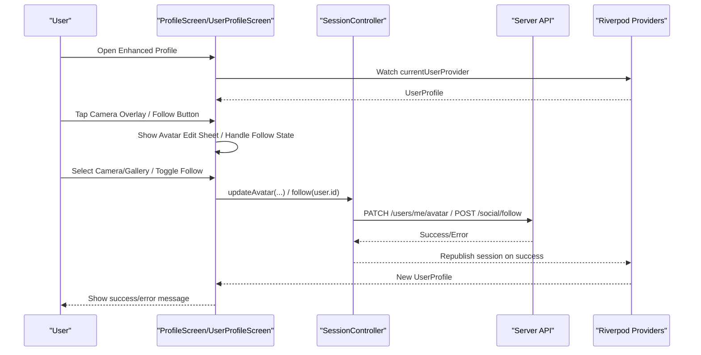

**Diagram sources**
- [profile_screen.dart:471-514](file://lib/screens/profile/profile_screen.dart#L471-L514)
- [user_profile_screen.dart:265-330](file://lib/screens/user_profile/user_profile_screen.dart#L265-L330)
- [settings_screen.dart:76-108](file://lib/screens/settings/settings_screen.dart#L76-L108)

## Detailed Component Analysis

### Enhanced Profile Screen (Camera Overlay, Interactive Stats, Improved UX)
**Updated** Major enhancements include camera overlay for avatar editing, interactive stats bar navigation, and improved text contrast with explicit color usage.

Key features:
- **Camera Overlay**: Circular camera button overlaid on avatar with gradient background
- **Interactive Stats Bar**: Clickable statistics showing experiences attended, tables booked, and saved places
- **Improved Text Contrast**: Explicit use of AppColors.textPrimary, AppColors.textSecondary, and AppColors.textTertiary
- **Functional Dining Preferences**: Editable preferences with visual tags and setup prompts
- **Consolidated Navigation**: Organized sections for My Dining, Hosting, and Account & Support

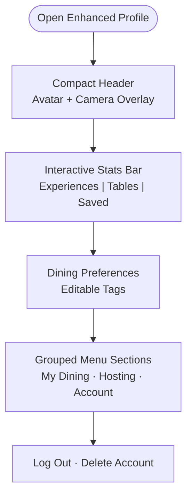

**Diagram sources**
- [profile_screen.dart:134-377](file://lib/screens/profile/profile_screen.dart#L134-L377)

**Section sources**
- [profile_screen.dart:28-515](file://lib/screens/profile/profile_screen.dart#L28-L515)

### New User Profile Screen (Experience-First Design, Compact Header, Gold Accents)
**New** The public user profile screen provides an experience-first design focused on three key questions: Who is hosting? Why should I trust them? What dining experiences can I join?

Key features:
- **Compact Header**: Optimized header with avatar, name, verified badge, bio, and host badges
- **Overflow-Safe Layouts**: Proper text overflow handling and responsive design
- **Follow Loading State Management**: Enhanced follow/unfollow functionality with loading indicators
- **Enhanced Hosted Experiences Display**: Detailed event cards with images, venue info, dates, prices, and availability
- **Improved Ratings & Trust Section**: Gold accent backgrounds with star displays and verification status
- **Social Links Integration**: Display of external social media profiles
- **Safety Controls**: Report, block, and share functionality

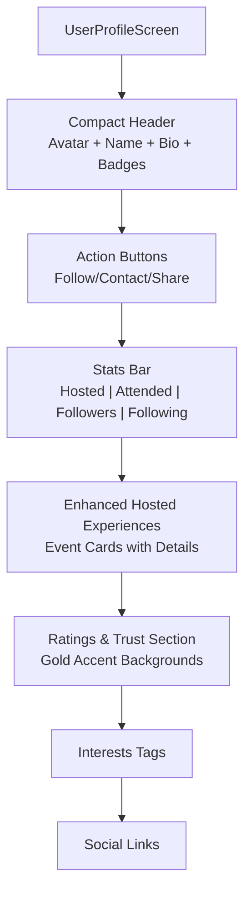

**Diagram sources**
- [user_profile_screen.dart:192-261](file://lib/screens/user_profile/user_profile_screen.dart#L192-L261)
- [user_profile_screen.dart:265-330](file://lib/screens/user_profile/user_profile_screen.dart#L265-L330)
- [user_profile_screen.dart:334-371](file://lib/screens/user_profile/user_profile_screen.dart#L334-L371)
- [user_profile_screen.dart:377-418](file://lib/screens/user_profile/user_profile_screen.dart#L377-L418)
- [user_profile_screen.dart:422-500](file://lib/screens/user_profile/user_profile_screen.dart#L422-L500)

**Section sources**
- [user_profile_screen.dart:21-842](file://lib/screens/user_profile/user_profile_screen.dart#L21-L842)

### Camera Overlay for Avatar Editing
**New** The profile screen now includes a sophisticated camera overlay system for avatar management.

Features:
- Circular camera button positioned at bottom-right of avatar
- Gradient background using AppColors.primary with white border
- Modal bottom sheet with camera and gallery options
- Placeholder implementation ready for camera integration

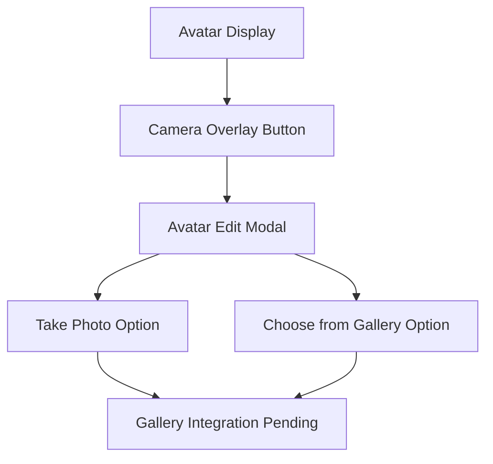

**Diagram sources**
- [profile_screen.dart:144-164](file://lib/screens/profile/profile_screen.dart#L144-L164)
- [profile_screen.dart:471-514](file://lib/screens/profile/profile_screen.dart#L471-L514)

**Section sources**
- [profile_screen.dart:144-164](file://lib/screens/profile/profile_screen.dart#L144-L164)
- [profile_screen.dart:471-514](file://lib/screens/profile/profile_screen.dart#L471-L514)

### Follow Loading State Management
**New** The user profile screen implements robust follow/unfollow functionality with proper loading state management.

Functionality:
- Primary button for follow/unfollow actions with loading indicator
- Proper error handling with user feedback
- State management for loading states during API calls
- Integration with social provider for follow operations

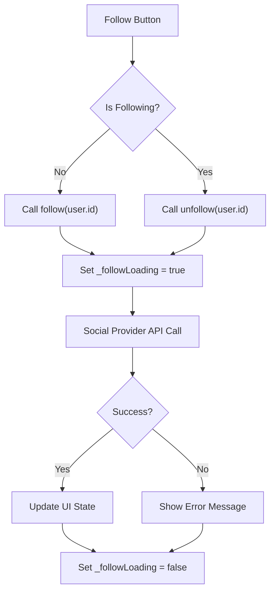

**Diagram sources**
- [user_profile_screen.dart:265-330](file://lib/screens/user_profile/user_profile_screen.dart#L265-L330)

**Section sources**
- [user_profile_screen.dart:265-330](file://lib/screens/user_profile/user_profile_screen.dart#L265-L330)

### Enhanced Hosted Experiences Display
**New** The user profile screen provides enhanced display of hosted experiences with detailed event information.

Features:
- Event cards with cover images, titles, venue information, dates, and pricing
- Availability indicators showing remaining seats
- Join buttons with proper disabled states for full events
- Responsive layout with proper overflow handling

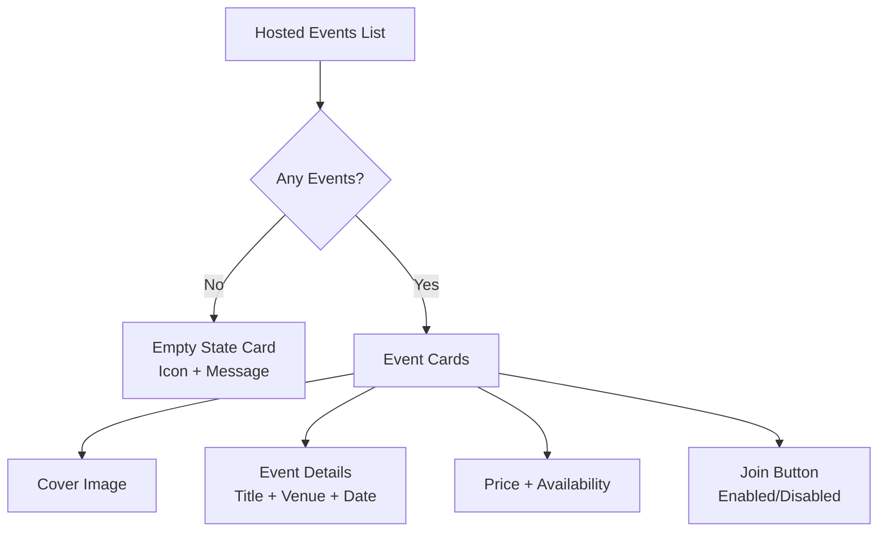

**Diagram sources**
- [user_profile_screen.dart:377-418](file://lib/screens/user_profile/user_profile_screen.dart#L377-L418)
- [user_profile_screen.dart:657-766](file://lib/screens/user_profile/user_profile_screen.dart#L657-L766)

**Section sources**
- [user_profile_screen.dart:377-418](file://lib/screens/user_profile/user_profile_screen.dart#L377-L418)
- [user_profile_screen.dart:657-766](file://lib/screens/user_profile/user_profile_screen.dart#L657-L766)

### Improved Ratings & Trust Section with Gold Accent Backgrounds
**New** The ratings & trust section features gold accent backgrounds and comprehensive trust indicators.

Features:
- Gold accent background container with subtle transparency
- Star rating display with numerical value
- Review count and average rating information
- Star visualization for rating breakdown
- Verification status indicators
- Fallback messaging for users without reviews

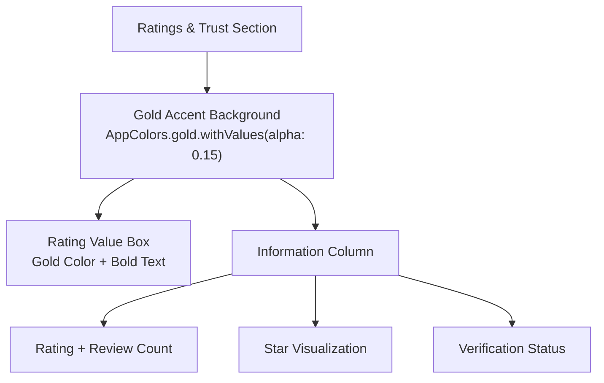

**Diagram sources**
- [user_profile_screen.dart:422-500](file://lib/screens/user_profile/user_profile_screen.dart#L422-L500)

**Section sources**
- [user_profile_screen.dart:422-500](file://lib/screens/user_profile/user_profile_screen.dart#L422-L500)

### Interactive Stats Bar Navigation
**Enhanced** The stats bar is now fully interactive, allowing users to navigate directly to relevant sections.

Functionality:
- Experiences count navigates to BookingsScreen
- Tables Booked count shows real-time booking data
- Saved count displays saved events and experiences
- Each stat chip is clickable with visual feedback

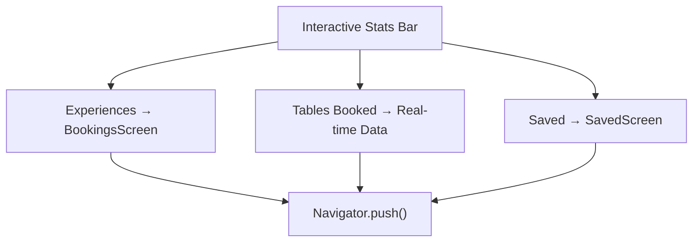

**Diagram sources**
- [profile_screen.dart:229-264](file://lib/screens/profile/profile_screen.dart#L229-L264)

**Section sources**
- [profile_screen.dart:229-264](file://lib/screens/profile/profile_screen.dart#L229-L264)

### Improved Text Contrast and Color Usage
**Enhanced** All text elements now use explicit color tokens for better accessibility and consistency.

Color system:
- AppColors.textPrimary for main headings and important text
- AppColors.textSecondary for secondary information
- AppColors.textTertiary for subtle labels and captions
- Consistent usage across all profile elements
- Gold accents for premium features and ratings

**Section sources**
- [profile_screen.dart:175-210](file://lib/screens/profile/profile_screen.dart#L175-L210)
- [user_profile_screen.dart:192-261](file://lib/screens/user_profile/user_profile_screen.dart#L192-L261)
- [app_colors.dart:1-99](file://lib/theme/app_colors.dart#L1-L99)
- [app_text_styles.dart:1-162](file://lib/theme/app_text_styles.dart#L1-L162)

### Functional Dining Preferences Button
**Enhanced** The dining preferences section now provides a fully functional interface for managing food preferences.

Capabilities:
- Visual display of current preferences as colored tags
- Edit button to navigate to FoodPreferencesScreen
- Setup prompt for users without preferences
- Color-coded tags for different preference types (cuisines, dietary, allergies)

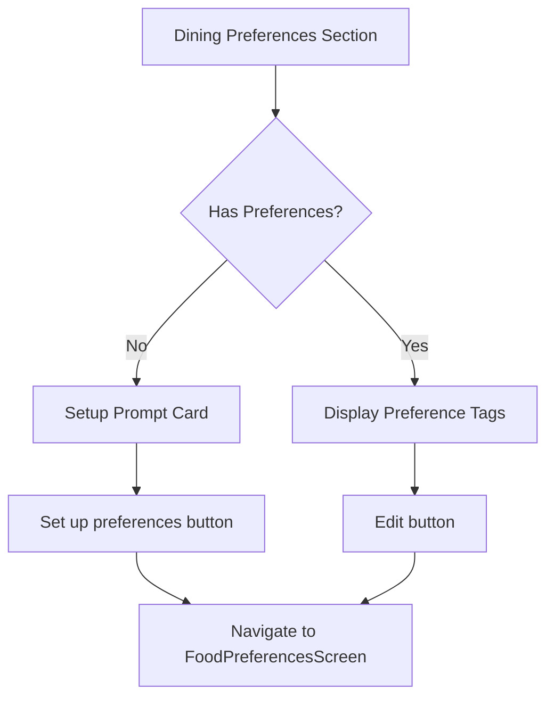

**Diagram sources**
- [profile_screen.dart:385-449](file://lib/screens/profile/profile_screen.dart#L385-L449)

**Section sources**
- [profile_screen.dart:385-449](file://lib/screens/profile/profile_screen.dart#L385-L449)

### Consolidated Hosting Experience with 'Host Studio' Entry Point
**New** The hosting experience has been consolidated into a unified 'Host Studio' entry point.

Features:
- Conditional display based on user role (host/influencer vs diner)
- For hosts: Direct access to HostDashboardScreen with full management capabilities
- For non-hosts: Attractive 'Become a Host' card with gradient design
- Subtitle description explaining hosting benefits

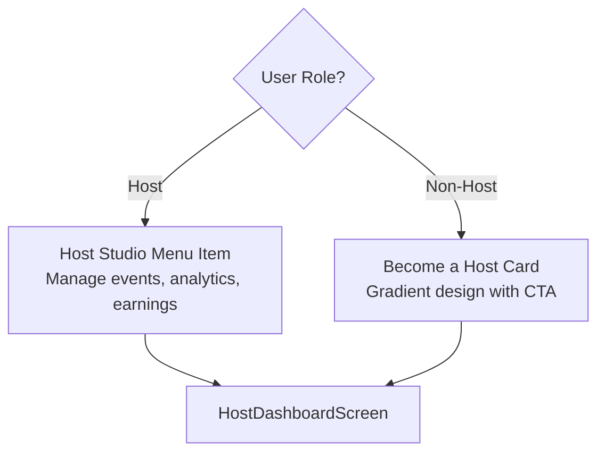

**Diagram sources**
- [profile_screen.dart:306-320](file://lib/screens/profile/profile_screen.dart#L306-L320)
- [host_dashboard_screen.dart:268-292](file://lib/screens/host/host_dashboard_screen.dart#L268-L292)

**Section sources**
- [profile_screen.dart:306-320](file://lib/screens/profile/profile_screen.dart#L306-L320)
- [host_dashboard_screen.dart:268-292](file://lib/screens/host/host_dashboard_screen.dart#L268-L292)

### New Account Management Features
**New** Enhanced account management capabilities including comprehensive settings and account deletion.

Account Management Features:
- Personal Information editing via bottom sheet
- Change Email with verification code workflow
- Change Password with secure update process
- Delete Account with password confirmation and safety measures
- Session management (Log Out, Logout All Devices)

Security Enhancements:
- Password confirmation required for account deletion
- Server-side cancellation/refund of bookings during deletion
- Session revocation across all devices
- Clear error handling and user feedback

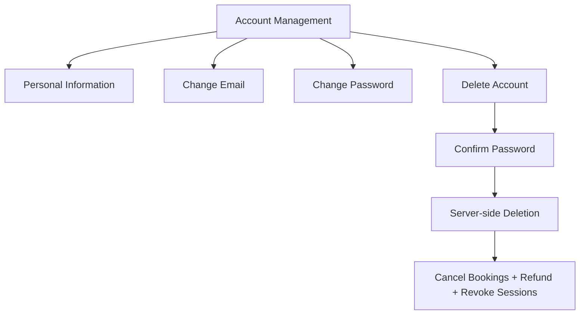

**Diagram sources**
- [settings_screen.dart:122-254](file://lib/screens/settings/settings_screen.dart#L122-L254)
- [settings_screen.dart:76-108](file://lib/screens/settings/settings_screen.dart#L76-L108)

**Section sources**
- [settings_screen.dart:122-254](file://lib/screens/settings/settings_screen.dart#L122-L254)
- [settings_screen.dart:76-108](file://lib/screens/settings/settings_screen.dart#L76-L108)

### Enhanced UX Improvements Throughout Seven-Phase Production Audit
**Enhanced** Comprehensive UX improvements implemented across the entire profile and settings system.

Improvements include:
- Consistent spacing and layout using AppSpacing tokens
- Improved visual hierarchy with proper typography scaling
- Better error handling and user feedback mechanisms
- Enhanced accessibility with semantic labels and sufficient contrast
- Responsive design considerations for various screen sizes
- Smooth animations and transitions between states
- Overflow-safe layouts with proper text truncation
- Gold accent backgrounds for premium features

**Section sources**
- [profile_screen.dart:1-1035](file://lib/screens/profile/profile_screen.dart#L1-L1035)
- [user_profile_screen.dart:1-842](file://lib/screens/user_profile/user_profile_screen.dart#L1-L842)
- [settings_screen.dart:1-369](file://lib/screens/settings/settings_screen.dart#L1-L369)

### Settings Hub (Account, Preferences, Privacy, Session)
- Account section: Personal Information (opens edit profile), Change Email, Change Password.
- Preferences section: Food Preferences, Location.
- Privacy section: Privacy & Security, Blocked Users.
- Support section: Help & Feedback, My Reports.
- Session section: Log Out, Logout All Devices, Delete Account (password confirmation).

Key behaviors:
- Deletion requires password confirmation and calls the server to cancel/refund bookings and revoke sessions.
- Logging out clears the session and routes back to authentication.

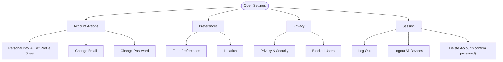

**Diagram sources**
- [settings_screen.dart:113-240](file://lib/screens/settings/settings_screen.dart#L113-L240)

**Section sources**
- [settings_screen.dart:26-108](file://lib/screens/settings/settings_screen.dart#L26-L108)
- [settings_screen.dart:113-240](file://lib/screens/settings/settings_screen.dart#L113-L240)

### Privacy & Security Controls
Controls:
- Show followers & following
- Show my activity
- Allow tagging
- Messages from followers only

Behavior:
- Each toggle writes immediately to the server via PATCH.
- On failure, the switch is rolled back and an error is shown.
- Success triggers a session republish so the UI reflects authoritative state.

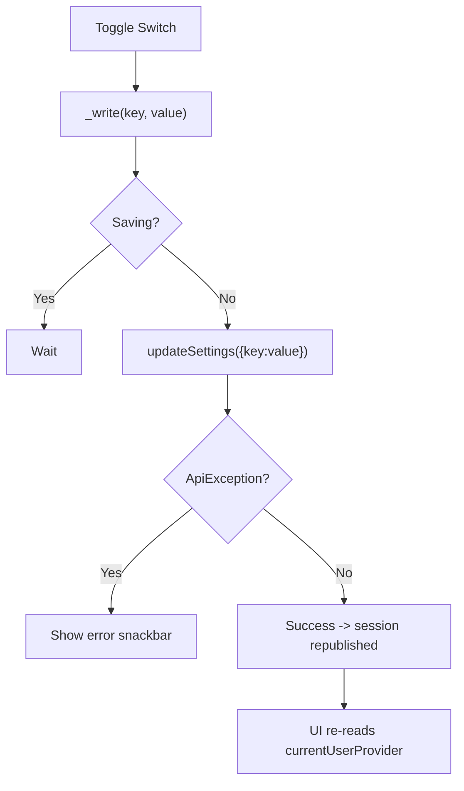

**Diagram sources**
- [privacy_settings_screen.dart:28-51](file://lib/screens/settings/privacy_settings_screen.dart#L28-L51)

**Section sources**
- [privacy_settings_screen.dart:53-133](file://lib/screens/settings/privacy_settings_screen.dart#L53-L133)

### Food Preferences System
Fields:
- Cuisines & interests (tastes)
- Dietary preferences
- Allergies (with suggestions and free-text input)

Constraints:
- Tastes capped at 8.
- Label lists (dietary/allergies) capped at 12.
- Validation enforced in UI to avoid server 422 errors.

Persistence:
- Saves via PATCH /users/me with keys tastes, dietary, allergies.
- Shows success/error messages and navigates back on success.

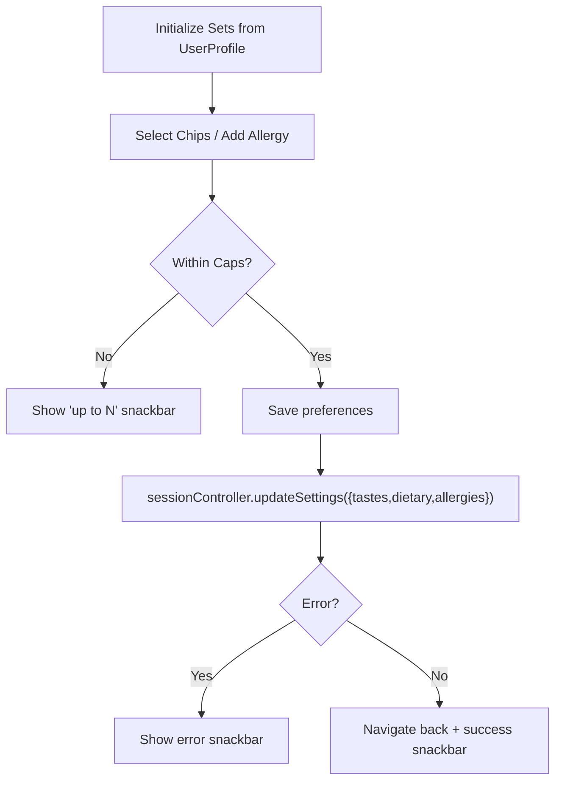

**Diagram sources**
- [food_preferences_screen.dart:50-115](file://lib/screens/preferences/food_preferences_screen.dart#L50-L115)

**Section sources**
- [food_preferences_screen.dart:117-208](file://lib/screens/preferences/food_preferences_screen.dart#L117-L208)

### Location Settings
Fields:
- City (searchable list with fallback to custom input)
- Preferred dining area (optional neighborhood/district)

Validation:
- Area limited to 80 characters.

Persistence:
- Saves city and homeArea via PATCH /users/me.
- Updates session and shows contextual success message.

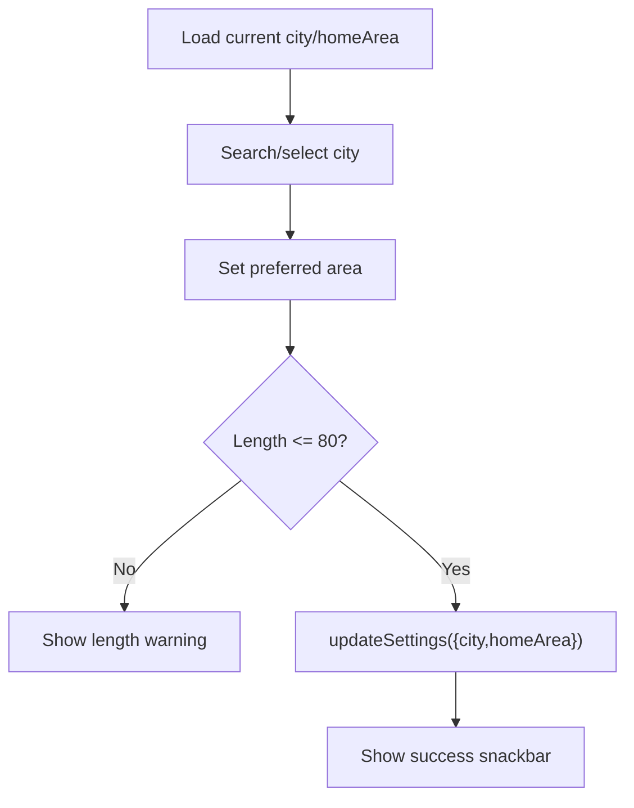

**Diagram sources**
- [location_settings_screen.dart:56-97](file://lib/screens/location/location_settings_screen.dart#L56-L97)

**Section sources**
- [location_settings_screen.dart:99-180](file://lib/screens/location/location_settings_screen.dart#L99-L180)

### Profile Editing Capabilities
Capabilities:
- Edit name, city, and bio via bottom sheet.
- Tastes are preserved here and managed in the preferences screen.
- Validates minimum length for name and city.

Avatar Management:
- Avatar is displayed on the profile screen using the avatar path from the user model.
- The edit sheet does not change the avatar; avatar management is handled elsewhere in the app.

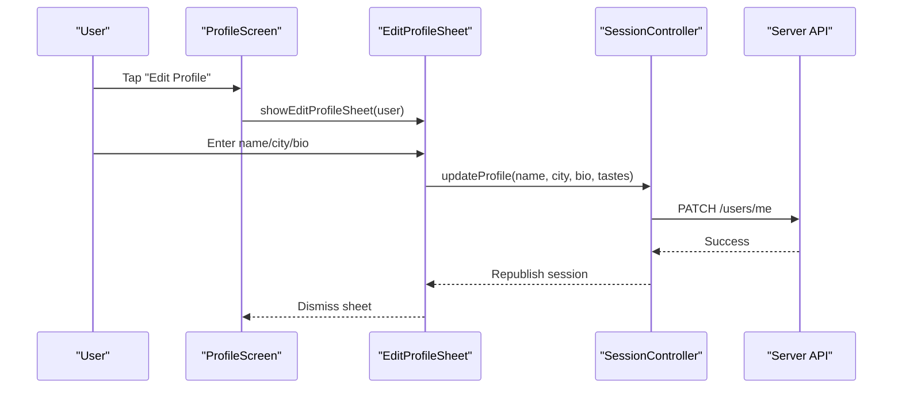

**Diagram sources**
- [profile_screen.dart:382-385](file://lib/screens/profile/profile_screen.dart#L382-L385)
- [edit_profile_sheet.dart:15-32](file://lib/widgets/edit_profile_sheet.dart#L15-L32)
- [edit_profile_sheet.dart:66-105](file://lib/widgets/edit_profile_sheet.dart#L66-L105)

**Section sources**
- [profile_screen.dart:51-380](file://lib/screens/profile/profile_screen.dart#L51-L380)
- [edit_profile_sheet.dart:15-32](file://lib/widgets/edit_profile_sheet.dart#L15-L32)
- [edit_profile_sheet.dart:66-105](file://lib/widgets/edit_profile_sheet.dart#L66-L105)

### Account Security Settings
Actions:
- Change Email: Verify new address with a code (sheet provided).
- Change Password: Securely update password (sheet provided).
- Log Out: Clears session.
- Logout All Devices: Signs out every device for the account.
- Delete Account: Requires password confirmation; cancels/refunds bookings and revokes sessions.

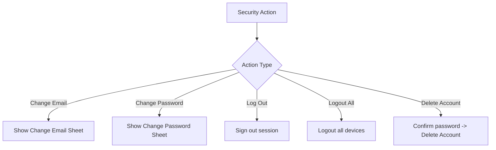

**Diagram sources**
- [settings_screen.dart:26-108](file://lib/screens/settings/settings_screen.dart#L26-L108)
- [settings_screen.dart:135-147](file://lib/screens/settings/settings_screen.dart#L135-L147)

**Section sources**
- [settings_screen.dart:26-108](file://lib/screens/settings/settings_screen.dart#L26-L108)
- [settings_screen.dart:135-147](file://lib/screens/settings/settings_screen.dart#L135-L147)

### Theme Customization and Accessibility Options
Theme system:
- Colors, spacing, and text styles are centralized under the theme directory.
- Screens use these tokens for consistent appearance across the app.

Accessibility considerations:
- Use semantic labels and sufficient contrast via theme colors.
- Provide clear error messages and confirmations for destructive actions.
- Gold accent backgrounds for premium features enhance visual hierarchy.

Note:
- There is no dedicated "theme settings" screen in the analyzed files; theme customization is applied globally through the theme layer.

**Section sources**
- [settings_screen.dart:113-240](file://lib/screens/settings/settings_screen.dart#L113-L240)
- [profile_screen.dart:51-380](file://lib/screens/profile/profile_screen.dart#L51-L380)
- [user_profile_screen.dart:192-261](file://lib/screens/user_profile/user_profile_screen.dart#L192-L261)

### Common User Preference Configurations
Examples:
- Personalized feed: Select up to 8 cuisines/interests; add dietary preferences and allergies to tailor recommendations.
- Location: Set your city and optional neighborhood to prioritize nearby dinners.
- Privacy: Hide followers/following and activity if you prefer discretion; restrict direct messages to followers only.
- Security: Keep email and password updated; log out all devices when switching phones or after travel.
- **New**: Use the enhanced profile screen to manage your avatar, view your stats, and access all account settings in one place.
- **New**: Explore the new user profile screen for public host profiles with experience-first design and gold accent backgrounds.

These configurations are saved to the server and reflected across devices.

[No sources needed since this section provides general guidance]

## Dependency Analysis
The settings and profile components depend on:
- UserProfile model for field definitions and defaults.
- UsersProvider for current user and related data streams.
- SessionController (via providers) for writing settings and triggering session republish.

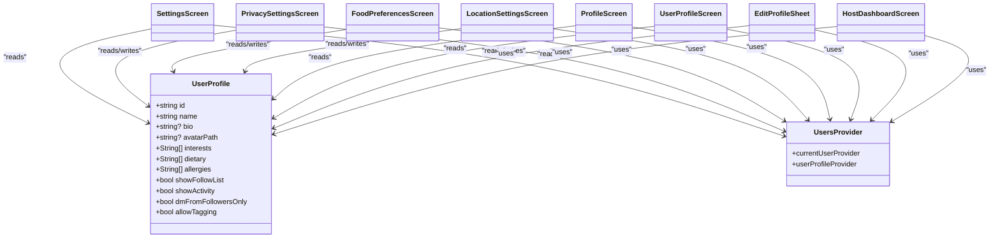

**Diagram sources**
- [user_profile.dart:42-113](file://lib/models/user_profile.dart#L42-L113)
- [users_provider.dart:10-13](file://lib/providers/users_provider.dart#L10-L13)
- [settings_screen.dart:113-240](file://lib/screens/settings/settings_screen.dart#L113-L240)
- [privacy_settings_screen.dart:53-133](file://lib/screens/settings/privacy_settings_screen.dart#L53-L133)
- [food_preferences_screen.dart:117-208](file://lib/screens/preferences/food_preferences_screen.dart#L117-L208)
- [location_settings_screen.dart:99-180](file://lib/screens/location/location_settings_screen.dart#L99-L180)
- [profile_screen.dart:51-380](file://lib/screens/profile/profile_screen.dart#L51-L380)
- [user_profile_screen.dart:21-842](file://lib/screens/user_profile/user_profile_screen.dart#L21-L842)
- [edit_profile_sheet.dart:15-32](file://lib/widgets/edit_profile_sheet.dart#L15-L32)
- [host_dashboard_screen.dart:268-292](file://lib/screens/host/host_dashboard_screen.dart#L268-L292)

**Section sources**
- [user_profile.dart:42-113](file://lib/models/user_profile.dart#L42-L113)
- [users_provider.dart:10-13](file://lib/providers/users_provider.dart#L10-L13)

## Performance Considerations
- Immediate writes for privacy toggles ensure responsive UI but should be rate-limited on the server side to prevent excessive requests.
- Capping selections in food preferences avoids large payloads and reduces validation overhead.
- Using Riverpod providers ensures efficient recomputation only when underlying data changes.
- **New**: Camera overlay and modal interactions are optimized for smooth performance with minimal re-renders.
- **New**: Interactive stats bar uses lazy loading for real-time data to minimize network requests.
- **New**: Follow loading state management prevents multiple simultaneous API calls.
- **New**: Enhanced hosted experiences display uses efficient list rendering with proper overflow handling.
- **New**: Gold accent backgrounds and visual elements are optimized for performance with minimal repaint areas.

[No sources needed since this section provides general guidance]

## Troubleshooting Guide
Common issues and resolutions:
- Cannot save food preferences: Check selection caps (max 8 tastes, max 12 labels) and network connectivity.
- Privacy toggle reverts: Indicates server rejected the write; check error message and retry.
- Location save fails: Ensure preferred area is within character limit and city is selected.
- Profile edit fails: Validate name and city lengths; ensure required fields are filled.
- Account deletion blocked: Confirm password is correct; verify no active sessions or pending operations.
- **New**: Camera overlay not responding: Check device permissions for camera and storage access.
- **New**: Stats bar navigation not working: Ensure user has valid data loaded from providers.
- **New**: Poor text contrast: Verify theme colors are properly configured and not overridden.
- **New**: Follow button not updating: Check network connectivity and social provider status.
- **New**: Hosted experiences not displaying: Verify user has hosted events and network connection is stable.
- **New**: Gold accent backgrounds not appearing: Ensure theme colors are properly configured and gradients are supported.

**Section sources**
- [food_preferences_screen.dart:86-115](file://lib/screens/preferences/food_preferences_screen.dart#L86-L115)
- [privacy_settings_screen.dart:28-51](file://lib/screens/settings/privacy_settings_screen.dart#L28-L51)
- [location_settings_screen.dart:56-97](file://lib/screens/location/location_settings_screen.dart#L56-L97)
- [edit_profile_sheet.dart:66-105](file://lib/widgets/edit_profile_sheet.dart#L66-L105)
- [settings_screen.dart:81-108](file://lib/screens/settings/settings_screen.dart#L81-L108)
- [profile_screen.dart:471-514](file://lib/screens/profile/profile_screen.dart#L471-L514)
- [user_profile_screen.dart:265-330](file://lib/screens/user_profile/user_profile_screen.dart#L265-L330)

## Conclusion
The settings and profile system provides a cohesive experience for managing account details, preferences, privacy, and security. With the recent enhancements including the camera overlay for avatar editing, interactive stats bar navigation, improved text contrast, consolidated hosting experience, and comprehensive account management features, users now have a more intuitive and powerful interface for managing their DineCircle presence. The addition of the new user profile screen with experience-first design, compact header, overflow-safe layouts, follow loading state management, enhanced hosted experiences display, and improved ratings & trust section with gold accent backgrounds further elevates the user experience. By leveraging a shared model and provider architecture, changes propagate consistently across the app. Users can personalize their experience through food preferences and location, control their visibility and messaging, maintain secure accounts with robust safety actions, and enjoy an enhanced user experience throughout the seven-phase production audit improvements.

[No sources needed since this section summarizes without analyzing specific files]