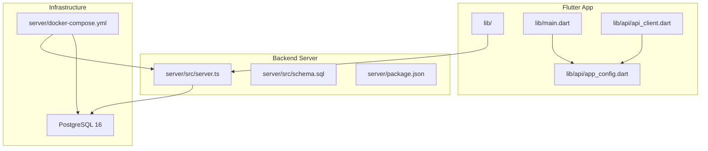
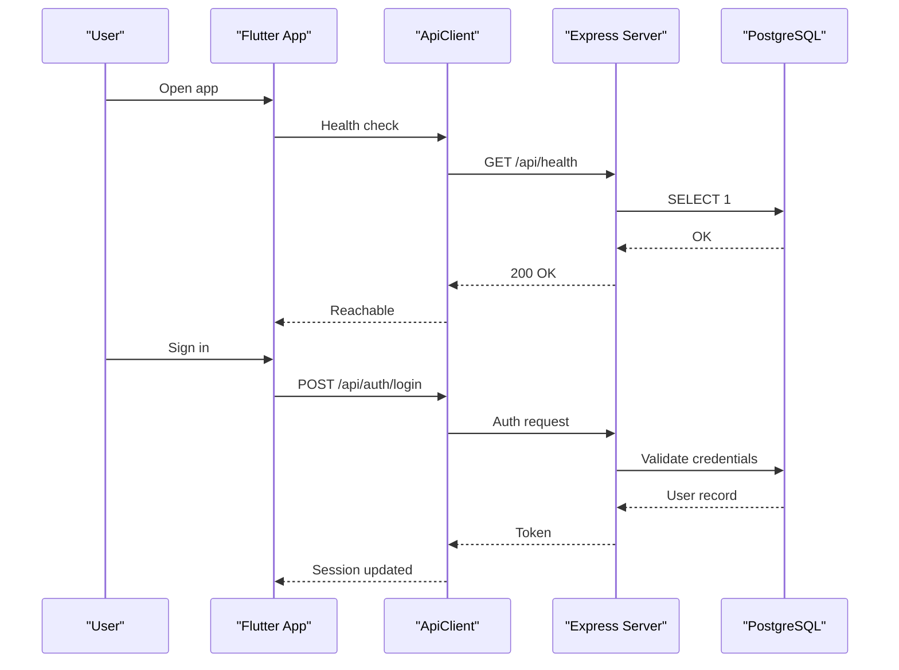

# Getting Started

<cite>
**Referenced Files in This Document**
- [README.md](file://README.md)
- [server/package.json](file://server/package.json)
- [pubspec.yaml](file://pubspec.yaml)
- [dart-defines.example.json](file://dart-defines.example.json)
- [server/src/schema.sql](file://server/src/schema.sql)
- [server/docker-compose.yml](file://server/docker-compose.yml)
- [lib/main.dart](file://lib/main.dart)
- [lib/api/app_config.dart](file://lib/api/app_config.dart)
- [lib/api/api_client.dart](file://lib/api/api_client.dart)
- [server/src/server.ts](file://server/src/server.ts)
</cite>

## Table of Contents
1. [Introduction](#introduction)
2. [Prerequisites](#prerequisites)
3. [Project Structure Overview](#project-structure-overview)
4. [Environment Configuration](#environment-configuration)
5. [Database Initialization and Migration](#database-initialization-and-migration)
6. [Installing and Running the Backend](#installing-and-running-the-backend)
7. [Installing and Running the Flutter App](#installing-and-running-the-flutter-app)
8. [Development Workflow](#development-workflow)
9. [Testing Procedures](#testing-procedures)
10. [Troubleshooting Guide](#troubleshooting-guide)
11. [Architecture Overview](#architecture-overview)
12. [Conclusion](#conclusion)

## Introduction
DineCircle is a monorepo containing:
- A Flutter consumer app for Android, iOS, and Web.
- A Node/Express + TypeScript API backed by PostgreSQL.
- Docker Compose configuration to run Postgres and the API together.

The repository includes end-to-end authentication, booking, event publishing, social features, chat polling, settings, safety tools, and a simulated money ledger. Payments are not yet connected to a real gateway; Stripe keys are placeholders for future integration.

This guide walks you through environment setup, installation, configuration, database initialization, running both backend and frontend, development workflow, testing, and troubleshooting.

**Section sources**
- [README.md:1-33](file://README.md#L1-L33)
- [README.md:207-223](file://README.md#L207-L223)

## Prerequisites
Install these tools before starting:

- **Flutter 3.47.5+ (Dart 3.13.4+)**  
  Required for building and running the mobile/web app.
- **Node.js 24 with npm**  
  Required for the Express/TypeScript server.
- **PostgreSQL 16 or Docker/Podman**  
  You can either install Postgres locally or use Docker Compose to run Postgres alongside the API.

Optional but recommended:
- Android Studio or Xcode if you plan to build APKs or run on iOS.
- A terminal that supports `docker compose` or `podman compose`.

**Section sources**
- [README.md:442-444](file://README.md#L442-L444)
- [pubspec.yaml:21-22](file://pubspec.yaml#L21-L22)
- [server/package.json:1-16](file://server/package.json#L1-L16)

## Project Structure Overview
At a high level:
- `lib/` contains the Flutter app code.
- `server/` contains the Express API, schema, seed, security, and runtime entry point.
- `android/`, `ios/`, and `web/` contain platform-specific Flutter configurations.
- `test/` contains Flutter tests.
- `server/src/tests/` contains server integration tests.
- `server/database/security_hardening.sql` contains database hardening SQL.
- `server/docker-compose.yml` runs Postgres and the API together.



**Diagram sources**
- [lib/main.dart:13-28](file://lib/main.dart#L13-L28)
- [lib/api/app_config.dart:11-18](file://lib/api/app_config.dart#L11-L18)
- [lib/api/api_client.dart:6-15](file://lib/api/api_client.dart#L6-L15)
- [server/src/server.ts:27-28](file://server/src/server.ts#L27-L28)
- [server/src/schema.sql:1-12](file://server/src/schema.sql#L1-L12)
- [server/docker-compose.yml:1-5](file://server/docker-compose.yml#L1-L5)

**Section sources**
- [README.md:270-299](file://README.md#L270-L299)

## Environment Configuration
You need two kinds of configuration:

### Backend environment variables
The backend reads environment variables from `.env` or Docker Compose. The default local setup uses Docker Compose, which sets:
- `DATABASE_URL`: connection string for Postgres.
- `PORT`: API port, default `4000`.
- `NODE_ENV`: set to `development`.
- `STRIPE_SECRET_KEY`, `STRIPE_WEBHOOK_SECRET`, `STRIPE_CURRENCY`, `PAYMENTS_MODE`: payment-related variables. These are optional and empty by default; when empty, payments remain simulated.

For local development without Docker, create `server/.env` with at least:
- `DATABASE_URL`
- `PORT`
- `NODE_ENV`

If you want to test Stripe later, add:
- `STRIPE_SECRET_KEY`
- `STRIPE_WEBHOOK_SECRET`
- `STRIPE_CURRENCY`
- `PAYMENTS_MODE`

Important: Never put secret keys into the Flutter app. Only public keys like `STRIPE_PUBLISHABLE_KEY` belong in client-side configuration.

**Section sources**
- [server/docker-compose.yml:23-43](file://server/docker-compose.yml#L23-L43)
- [server/src/server.ts:279-300](file://server/src/server.ts#L279-L300)

### Frontend environment variables
The Flutter app uses build-time defines:
- `API_BASE_URL`: base URL for the backend API. Default targets the Android emulator loopback.
- `GOOGLE_MAPS_API_KEY`: Google Maps SDK key.
- `STRIPE_PUBLISHABLE_KEY`: Stripe publishable key for client-side checkout.

You can pass them directly:
- `flutter run --dart-define=API_BASE_URL=http://10.0.2.2:4000`
- `flutter run --dart-define=API_BASE_URL=http://localhost:4000` for Chrome or other hosts.

Or use a file:
- Copy `dart-defines.example.json` to `dart-defines.json`.
- Fill in `STRIPE_PUBLISHABLE_KEY` and `GOOGLE_MAPS_API_KEY`.
- Run with `--dart-define-from-file=dart-defines.json`.

When no Stripe key is provided, the app keeps the historical simulated confirmation path. When no Maps key is provided, map features remain placeholder-only.

**Section sources**
- [lib/api/app_config.dart:1-39](file://lib/api/app_config.dart#L1-L39)
- [dart-defines.example.json:1-5](file://dart-defines.example.json#L1-L5)
- [README.md:474-491](file://README.md#L474-L491)

## Database Initialization and Migration
The database schema is defined in `server/src/schema.sql`. It is idempotent and re-runnable. The schema includes tables for users, restaurants, events, bookings, refunds, payouts, withdrawals, reviews, follows, saved events, activity, chat messages, reports, feedback, auth tokens, and more.

Recommended approaches:

### Using Docker Compose
When you run `docker compose up --build`, the API container applies the schema and seeds data automatically before starting the server.

### Manual setup with local Postgres
If you prefer a local Postgres instance:
1. Create a database user and database matching your `DATABASE_URL`.
2. Install dependencies: `cd server && npm install`.
3. Apply schema and seed: `npm run db:setup`.
   - This runs `db:schema` then `db:seed`.
4. Start the dev server: `npm run dev`.

The seed creates demo users, restaurants, events, bookings, reviews, chats, and payout rows so you can explore the app immediately.

**Section sources**
- [server/src/schema.sql:1-12](file://server/src/schema.sql#L1-L12)
- [server/package.json:6-16](file://server/package.json#L6-L16)
- [server/docker-compose.yml:42-43](file://server/docker-compose.yml#L42-L43)
- [README.md:445-459](file://README.md#L445-L459)

## Installing and Running the Backend
Steps:

1. Enter the server directory:
   ```bash
   cd server
   ```

2. Install dependencies:
   ```bash
   npm install
   ```

3. Choose one startup method:

   - **With Docker Compose:**
     ```bash
     docker compose up --build
     ```
     This starts Postgres and the API. The API waits for Postgres, applies the schema, seeds data, and listens on port `4000`.

   - **Without Docker:**
     ```bash
     npm run db:setup
     npm run dev
     ```
     This applies the schema, seeds data, and starts the development server with hot reload via `tsx watch`.

4. Verify the API:
   ```bash
   curl http://localhost:4000/api/health
   ```

Expected behavior:
- The health endpoint returns a JSON object with status, database name, latency, and timestamp.
- If Postgres is unavailable, the server retries until it connects or fails after configured attempts.

**Section sources**
- [README.md:445-454](file://README.md#L445-L454)
- [server/package.json:6-16](file://server/package.json#L6-L16)
- [server/docker-compose.yml:6-43](file://server/docker-compose.yml#L6-L43)
- [server/src/server.ts:43-59](file://server/src/server.ts#L43-L59)
- [server/src/server.ts:224-233](file://server/src/server.ts#L224-L233)

## Installing and Running the Flutter App
Steps:

1. From the repository root, get dependencies:
   ```bash
   flutter pub get
   ```

2. Run the app against the backend:

   - **Android emulator:**
     ```bash
     flutter run --dart-define=API_BASE_URL=http://10.0.2.2:4000
     ```

   - **Chrome web:**
     ```bash
     flutter run -d chrome --dart-define=API_BASE_URL=http://localhost:4000
     ```

3. Optional: include Stripe and Maps keys via a file:
   ```bash
   flutter run --dart-define=API_BASE_URL=http://10.0.2.2:4000 \
     --dart-define-from-file=dart-defines.json
   ```

Notes:
- The app requires the backend to be running. There is no offline fallback.
- The default `API_BASE_URL` targets the Android emulator loopback. Use `http://localhost:4000` for Chrome or another host.
- Without `STRIPE_PUBLISHABLE_KEY`, checkout remains simulated.
- Without `GOOGLE_MAPS_API_KEY`, maps remain placeholder-only.

**Section sources**
- [README.md:461-491](file://README.md#L461-L491)
- [lib/api/app_config.dart:11-18](file://lib/api/app_config.dart#L11-L18)
- [lib/api/app_config.dart:20-38](file://lib/api/app_config.dart#L20-L38)

## Development Workflow
### Hot Reload
- **Backend:** `npm run dev` uses `tsx watch src/server.ts`, so changes to TypeScript files reload automatically.
- **Frontend:** `flutter run` supports Flutter hot reload during development.

### Debugging
- **Backend:**
  - Check logs for request logging, database readiness, and startup errors.
  - Use the `/api/health` endpoint to verify connectivity.
  - Inspect error responses from the global error handler for validation and internal errors.
- **Frontend:**
  - Use Flutter DevTools.
  - Check network calls through `ApiClient`, which attaches bearer tokens and maps Dio exceptions to typed API errors.
  - Confirm `AppConfig.apiUrl` points to the correct backend.

### Building an APK
To build a debug-signed test APK:
```bash
flutter build apk --release --split-per-abi
```
Release builds in this repository are debug-signed and suitable for internal testing, not Play Store distribution.

**Section sources**
- [server/package.json:6-16](file://server/package.json#L6-L16)
- [server/src/server.ts:34-41](file://server/src/server.ts#L34-L41)
- [server/src/server.ts:263-277](file://server/src/server.ts#L263-L277)
- [lib/api/api_client.dart:17-24](file://lib/api/api_client.dart#L17-L24)
- [lib/api/api_client.dart:113-150](file://lib/api/api_client.dart#L113-L150)
- [README.md:493-500](file://README.md#L493-L500)

## Testing Procedures
### Flutter Tests
Run offline tests:
```bash
flutter analyze
flutter test
```
Expected results:
- `flutter analyze` should report no issues.
- `flutter test` should pass all widget, session, mapper, screen, booking flow, social wiring, and settings tests.

### Backend Typecheck
```bash
cd server && npm run typecheck
```
Expected result: clean TypeScript check.

### Backend Integration Tests
```bash
cd server && npm run test:integration
```
Expected result: integration suite runs against a freshly created and seeded Postgres database.

**Section sources**
- [README.md:502-509](file://README.md#L502-L509)
- [README.md:593-624](file://README.md#L593-L624)
- [server/package.json:6-16](file://server/package.json#L6-L16)

## Troubleshooting Guide
### Port Conflicts
- **Backend port 4000 already in use:**
  - Change `PORT` in your environment or Docker Compose.
  - Update `API_BASE_URL` in the Flutter app to match the new port.
- **Postgres port 5432 conflict:**
  - Stop the existing Postgres service or change the exposed port in Docker Compose.
  - Update `DATABASE_URL` accordingly.

### Dependency Resolution
- **Flutter dependency issues:**
  - Run `flutter pub get`.
  - If needed, clear Flutter cache and try again.
- **Node dependency issues:**
  - Delete `server/node_modules` and `server/package-lock.json`, then run `npm install`.

### Platform-Specific Configuration
- **Android emulator cannot reach localhost:**
  - Use `http://10.0.2.2:4000` as `API_BASE_URL`.
- **iOS simulator networking:**
  - Ensure the backend is reachable from the simulator host.
- **Maps not loading:**
  - Provide `GOOGLE_MAPS_API_KEY` in `dart-defines.json` or via `--dart-define`.
- **Stripe checkout not activating:**
  - Provide `STRIPE_PUBLISHABLE_KEY` in `dart-defines.json` or via `--dart-define`.
  - Remember that the backend still simulates payments unless Stripe secrets are configured.

### Database Connection Failures
- **Docker Compose Postgres not ready:**
  - Wait for the health check to pass.
  - Check container logs.
- **Local Postgres connection failed:**
  - Verify `DATABASE_URL` matches your Postgres user, password, host, and database.
  - Ensure the database exists and the user has permissions.

### Authentication and CORS
- **CORS errors from browser or web target:**
  - The backend allows several localhost origins in development.
  - Ensure your frontend origin is allowed or run within supported localhost addresses.
- **401 Unauthorized:**
  - Clear stored tokens and sign in again.
  - Confirm the token is being attached by `ApiClient`.

**Section sources**
- [server/docker-compose.yml:6-43](file://server/docker-compose.yml#L6-L43)
- [server/src/server.ts:61-78](file://server/src/server.ts#L61-L78)
- [lib/api/app_config.dart:11-18](file://lib/api/app_config.dart#L11-L18)
- [lib/api/api_client.dart:24-37](file://lib/api/api_client.dart#L24-L37)
- [README.md:469-491](file://README.md#L469-L491)

## Architecture Overview
The Flutter app communicates with the Express API over REST. The API connects to PostgreSQL and optionally integrates with Stripe for future payment flows. Socket.IO rooms exist server-side for authenticated event and restaurant channels, while the current Flutter client uses REST polling for chat.



**Diagram sources**
- [lib/api/api_client.dart:47-55](file://lib/api/api_client.dart#L47-L55)
- [server/src/server.ts:224-233](file://server/src/server.ts#L224-L233)

## Conclusion
You now have everything needed to set up DineCircle locally:
- Install Flutter, Node.js, and Postgres or Docker.
- Configure backend and frontend environment variables.
- Initialize the database using schema and seed.
- Run the backend and Flutter app.
- Use hot reload, debugging, and testing workflows.
- Resolve common setup issues such as ports, dependencies, platform configuration, and database connectivity.

When you are ready for payments, add Stripe keys to the backend environment and client-side publishable key, then follow the payment integration roadmap. For maps, add the Google Maps API key to the client configuration.