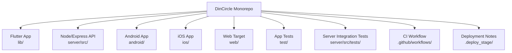
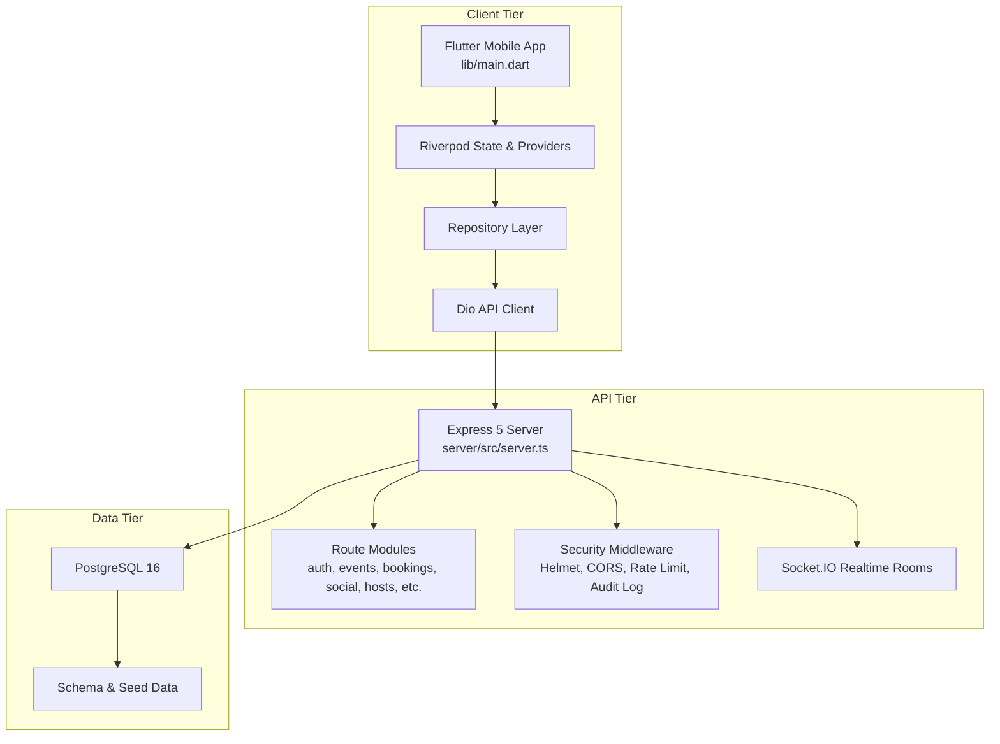
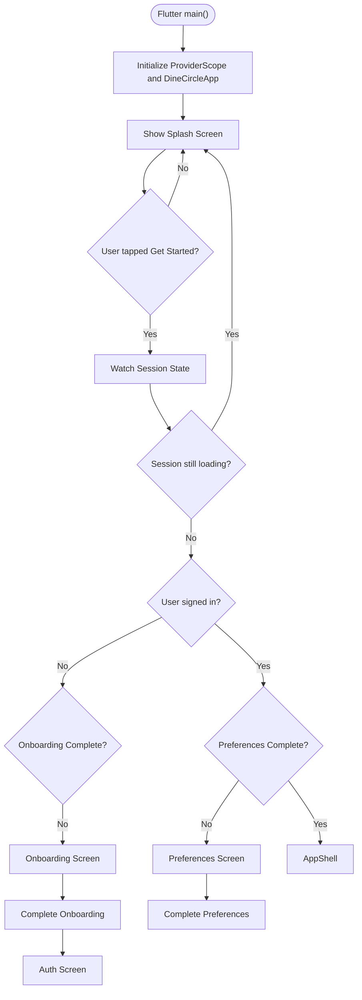
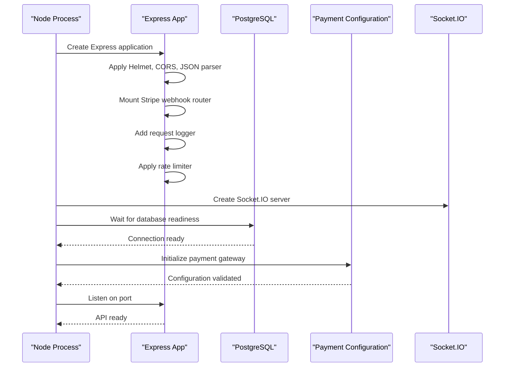
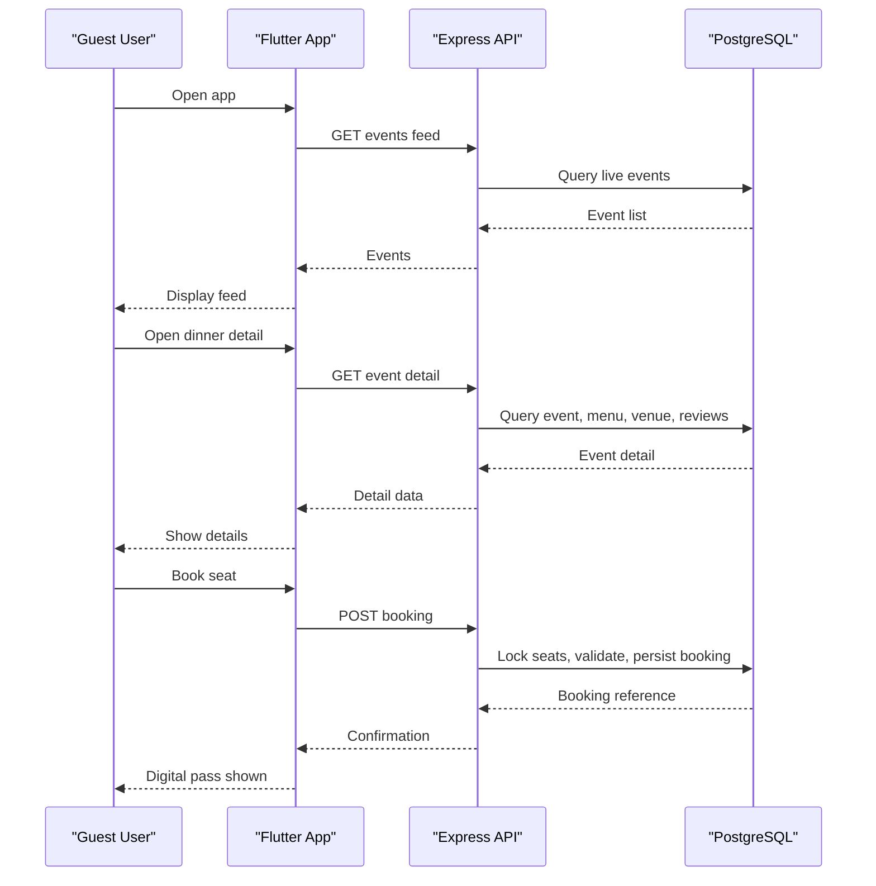
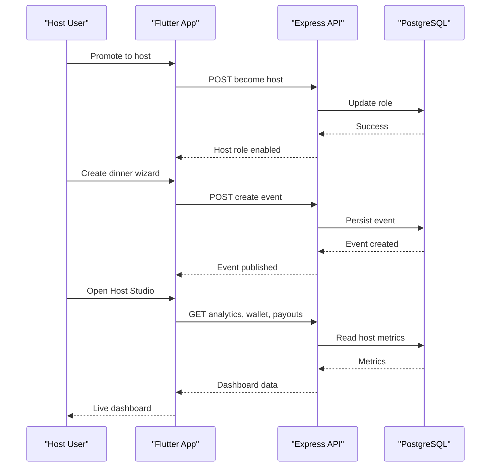
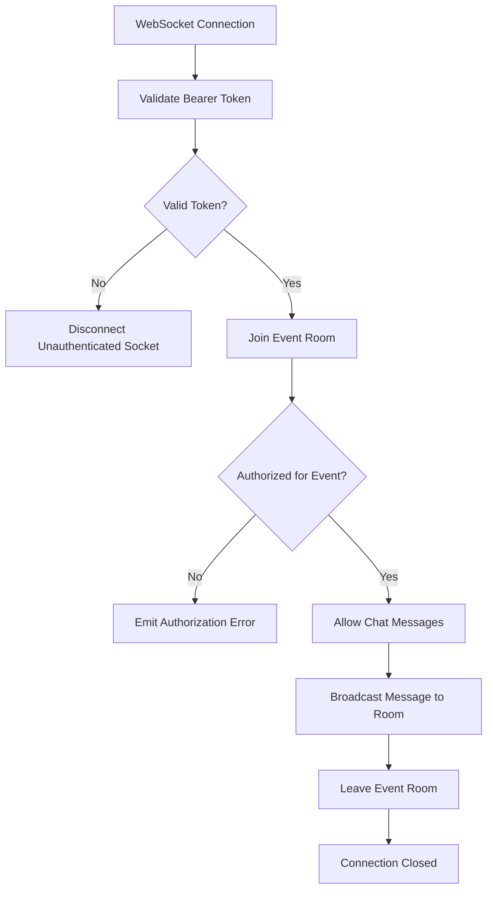
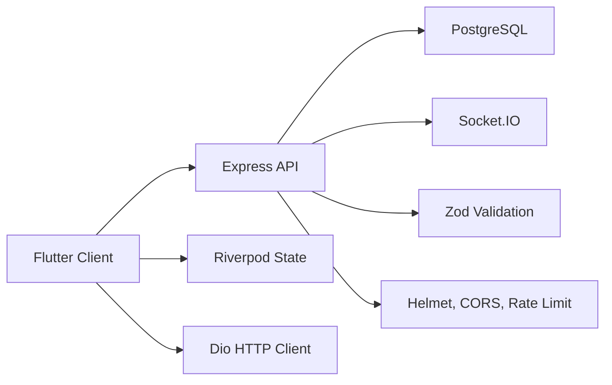

# Project Overview

<cite>
**Referenced Files in This Document**
- [README.md](file://README.md)
- [lib/main.dart](file://lib/main.dart)
- [pubspec.yaml](file://pubspec.yaml)
- [server/src/server.ts](file://server/src/server.ts)
- [server/package.json](file://server/package.json)
</cite>

## Table of Contents
1. [Introduction](#introduction)
2. [Project Structure](#project-structure)
3. [Core Components](#core-components)
4. [Architecture Overview](#architecture-overview)
5. [Detailed Component Analysis](#detailed-component-analysis)
6. [Dependency Analysis](#dependency-analysis)
7. [Performance Considerations](#performance-considerations)
8. [Troubleshooting Guide](#troubleshooting-guide)
9. [Conclusion](#conclusion)

## Introduction
DineCircle is a social dining marketplace that turns food influencers’ audiences into real-world dining communities. The platform connects three primary user groups:
- Food influencers and hosts who create, publish, and manage paid or exclusive dining experiences.
- Guests and diners who discover events, book seats, join tables, chat with other attendees, and review experiences.
- Restaurant partners and administrators who can operate partner-gated surfaces through the backend API.

The core value proposition is simple: transform an influencer’s online audience into a monetizable, engaged community that meets in person for curated dining events. Guests gain unique experiences; hosts earn revenue and build loyalty; restaurants gain exposure and new customers.

At this stage, DineCircle is a prototype monorepo with a working Flutter mobile app, a Node/Express + PostgreSQL API, and end-to-end wiring for authentication, discovery, booking, social features, safety tools, and Host Studio analytics. Payments are simulated, realtime chat is REST-polled, and some product surfaces remain incomplete.

**Section sources**
- [README.md:1-33](file://README.md#L1-L33)
- [README.md:56-85](file://README.md#L56-L85)

## Project Structure
DineCircle is organized as a monorepo containing:
- A Flutter client under `lib/`, including screens, providers, repositories, models, theme, widgets, and API integration.
- A Node.js backend under `server/src/`, including Express routes, database schema, security, payments, and Socket.IO handling.
- Platform-specific directories for Android, iOS, and web.
- Tests under `test/` for the Flutter app and `server/src/tests/` for server-side integration tests.
- CI configuration under `.github/workflows/`.
- Deployment scaffolding under `.deploy_stage/`.

**Diagram sources**
- [README.md:270-299](file://README.md#L270-L299)

**Section sources**
- [README.md:270-299](file://README.md#L270-L299)

## Core Components
DineCircle consists of three main layers:

| Layer | Responsibility | Key Implementation |
|---|---|---|
| Flutter Client | User interface, session management, navigation, data fetching, and state synchronization | `lib/main.dart`, Riverpod providers, Dio API client, repository layer |
| Express API Server | Authentication, authorization, event and booking logic, social features, safety tools, host analytics, and WebSocket rooms | `server/src/server.ts`, route modules, Zod validation, audit logging |
| PostgreSQL Database | Persistent storage for users, events, bookings, reviews, safety records, payouts, and tokens | Schema, seed data, connection pool, idempotent setup |

The client starts at `lib/main.dart`, which initializes the Flutter app, sets up Riverpod, applies the dark theme, and drives the root flow from splash to onboarding, authentication, preferences, and finally the main app shell.

The server starts at `server/src/server.ts`, which configures Express, security headers, CORS, rate limiting, Stripe webhook routing, request logging, Socket.IO, authenticated middleware, audit logging, all route modules, error handling, database readiness checks, payment initialization, graceful shutdown, and health endpoints.

**Section sources**
- [lib/main.dart:13-29](file://lib/main.dart#L13-L29)
- [lib/main.dart:31-80](file://lib/main.dart#L31-L80)
- [server/src/server.ts:27-100](file://server/src/server.ts#L27-L100)
- [server/src/server.ts:219-300](file://server/src/server.ts#L219-L300)

## Architecture Overview
DineCircle follows a three-tier architecture:

**Diagram sources**
- [lib/main.dart:13-29](file://lib/main.dart#L13-L29)
- [server/src/server.ts:27-100](file://server/src/server.ts#L27-L100)
- [server/src/server.ts:219-300](file://server/src/server.ts#L219-L300)
- [README.md:226-252](file://README.md#L226-L252)

### Technology Stack
| Area | Choice | Notes |
|---|---|---|
| Mobile App | Flutter 3.47.5 / Dart 3.13.4 | Supports Android, iOS, and Web targets |
| App State Management | flutter_riverpod | Session controller, providers, async state |
| Networking | Dio | Typed API client, bearer interceptor, retry, error mapping |
| Secure Storage | flutter_secure_storage | Stores auth token securely |
| Backend Framework | Express 5 (TypeScript ESM) | Runs on Node 24 via tsx |
| Database | PostgreSQL 16 | Connection pool, idempotent schema, seed data |
| Validation | Zod | Request body validation across routes |
| Realtime | Socket.IO 4 | Authenticated event and restaurant rooms |
| Security | Helmet, CORS allowlist, rate limiting, scrypt, audit log | Protects API and enforces safe defaults |
| Operations | Docker Compose, GitHub Actions CI | Database readiness retry, schema+seed boot, CI smoke tests |

**Section sources**
- [README.md:207-223](file://README.md#L207-L223)
- [pubspec.yaml:21-48](file://pubspec.yaml#L21-L48)
- [server/package.json:1-36](file://server/package.json#L1-L36)

## Detailed Component Analysis

### Flutter Client Entry Flow
The Flutter app entry point initializes the provider scope, applies the dark theme, and starts the root flow. The root flow shows a branded splash screen until the user proceeds, then gates access based on session state and onboarding preferences. If the user is not signed in, it shows onboarding or authentication. If preferences are incomplete, it shows the preferences screen. Otherwise, it renders the main app shell.

**Diagram sources**
- [lib/main.dart:13-29](file://lib/main.dart#L13-L29)
- [lib/main.dart:31-80](file://lib/main.dart#L31-L80)

**Section sources**
- [lib/main.dart:13-80](file://lib/main.dart#L13-L80)

### Express API Server Bootstrap
The server bootstrap performs several critical tasks before accepting requests:
- Disables default Express headers.
- Adds Helmet security headers.
- Configures CORS with an allowed origin list.
- Mounts Stripe webhook routing before JSON parsing.
- Parses JSON bodies with size limits.
- Adds request logging.
- Applies global rate limiting.
- Creates an HTTP server and attaches Socket.IO.
- Validates database connectivity with retries.
- Initializes payment configuration.
- Starts listening on the configured port.

**Diagram sources**
- [server/src/server.ts:27-100](file://server/src/server.ts#L27-L100)
- [server/src/server.ts:279-300](file://server/src/server.ts#L279-L300)

**Section sources**
- [server/src/server.ts:27-100](file://server/src/server.ts#L27-L100)
- [server/src/server.ts:279-300](file://server/src/server.ts#L279-L300)

### Guest User Flow
A guest discovers events, views details, books a seat, receives a digital pass, and optionally reviews the experience.

**Diagram sources**
- [README.md:139-150](file://README.md#L139-L150)
- [README.md:323-327](file://README.md#L323-L327)

### Host User Flow
A host creates a dinner, publishes it, manages guests, tracks earnings, and interacts with collaborators.

**Diagram sources**
- [README.md:147-173](file://README.md#L147-L173)
- [README.md:372-382](file://README.md#L372-L382)

### Realtime Communication Model
The backend supports Socket.IO rooms for authenticated event and restaurant communication. Although the Flutter client currently uses REST polling for chat, the server already implements:
- Token-based authentication for WebSocket connections.
- Event room membership checks.
- Restaurant room membership checks.
- Chat message broadcasting with authorization re-checks.
- Helper functions to emit booking updates, event updates, and restaurant notifications.

**Diagram sources**
- [server/src/server.ts:97-202](file://server/src/server.ts#L97-L202)

**Section sources**
- [server/src/server.ts:97-202](file://server/src/server.ts#L97-L202)

## Dependency Analysis
The project has clear separation between client, server, and database concerns, with minimal coupling:

**Diagram sources**
- [pubspec.yaml:30-48](file://pubspec.yaml#L30-L48)
- [server/package.json:17-26](file://server/package.json#L17-L26)
- [server/src/server.ts:61-90](file://server/src/server.ts#L61-L90)

Key dependency relationships:
- The Flutter app depends on Riverpod for state, Dio for networking, and secure storage for tokens.
- The Express server depends on Express, PostgreSQL, Socket.IO, Zod, Helmet, CORS, and rate limiting.
- Both sides share domain concepts such as users, events, bookings, and roles, but implementation is isolated by the API boundary.

**Section sources**
- [pubspec.yaml:30-48](file://pubspec.yaml#L30-L48)
- [server/package.json:17-26](file://server/package.json#L17-L26)
- [README.md:226-252](file://README.md#L226-L252)

## Performance Considerations
- The server waits for PostgreSQL before starting, reducing startup failures in containerized environments.
- Global rate limiting protects against abuse on both general API and authentication endpoints.
- Booking operations use transactional seat locking to prevent overbooking.
- Money calculations, discounts, and commissions are computed server-side, avoiding client-side trust issues.
- The Flutter app uses a single typed error surface, retry-once GETs, and offline connectivity banners.
- Chat is currently REST-polled every five seconds; moving to Socket.IO would reduce polling overhead and improve responsiveness.

[No sources needed since this section provides general guidance]

## Troubleshooting Guide
Common operational and development issues include:
- **Database not ready**: The server retries database connectivity during startup; ensure PostgreSQL is available before launching the API.
- **CORS errors**: Only allowed origins are accepted in production; verify the client origin matches the configured allowlist.
- **Stripe webhook signature verification**: The webhook router must receive the raw request body; do not place JSON parsing or authentication middleware before it.
- **Authentication failures**: Tokens are hashed and stored in the database; ensure the correct bearer token format is sent.
- **Missing client wiring**: Some server endpoints exist without Flutter integration; check the feature status legend to understand what is live versus simulated.
- **Simulated payments**: No real payment provider is integrated yet; refunds and payouts remain simulated and will not move actual money.

**Section sources**
- [server/src/server.ts:43-59](file://server/src/server.ts#L43-L59)
- [server/src/server.ts:61-85](file://server/src/server.ts#L61-L85)
- [README.md:178-204](file://README.md#L178-L204)
- [README.md:419-436](file://README.md#L419-L436)

## Conclusion
DineCircle is a purpose-built social dining marketplace that connects food influencers with their audiences through real-world dining experiences. Its three-tier architecture—Flutter client, Express API server, and PostgreSQL database—provides a solid foundation for discovery, booking, social interaction, safety, and host monetization. While payments, push notifications, maps, and some partner/admin clients remain future work, the current codebase demonstrates a genuine end-to-end write path, secure authentication, server-authoritative money math, and a realistic development workflow suitable for demos, integration testing, and further platform growth.

[No sources needed since this section summarizes without analyzing specific files]