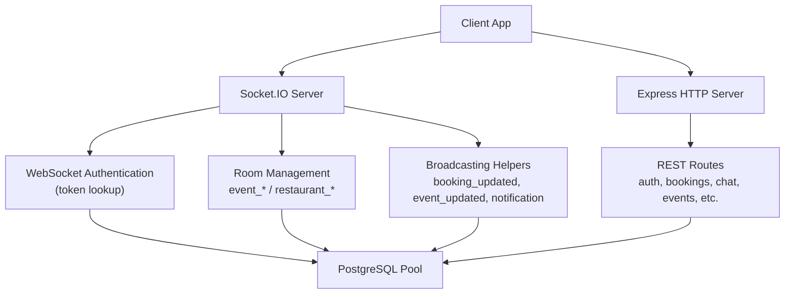
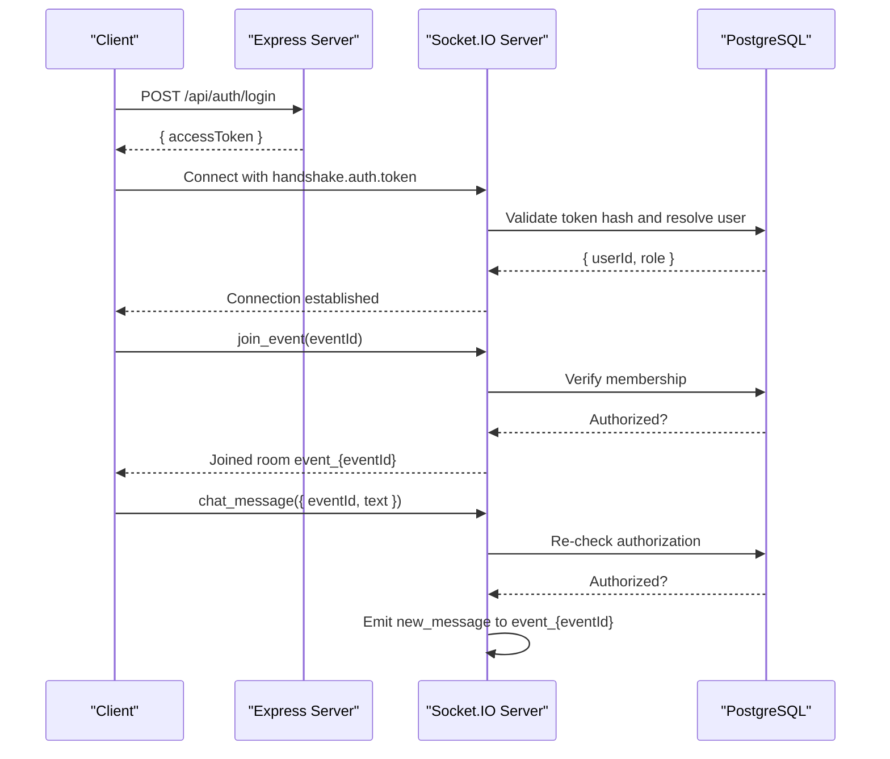
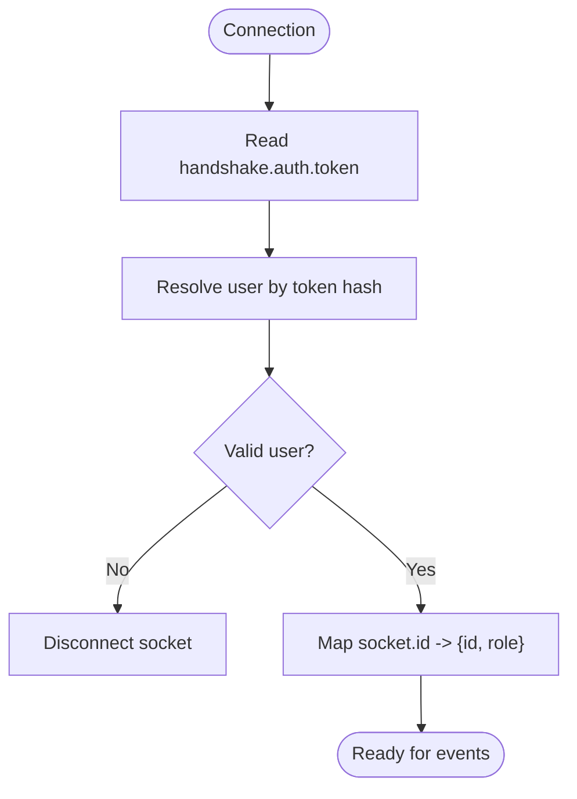
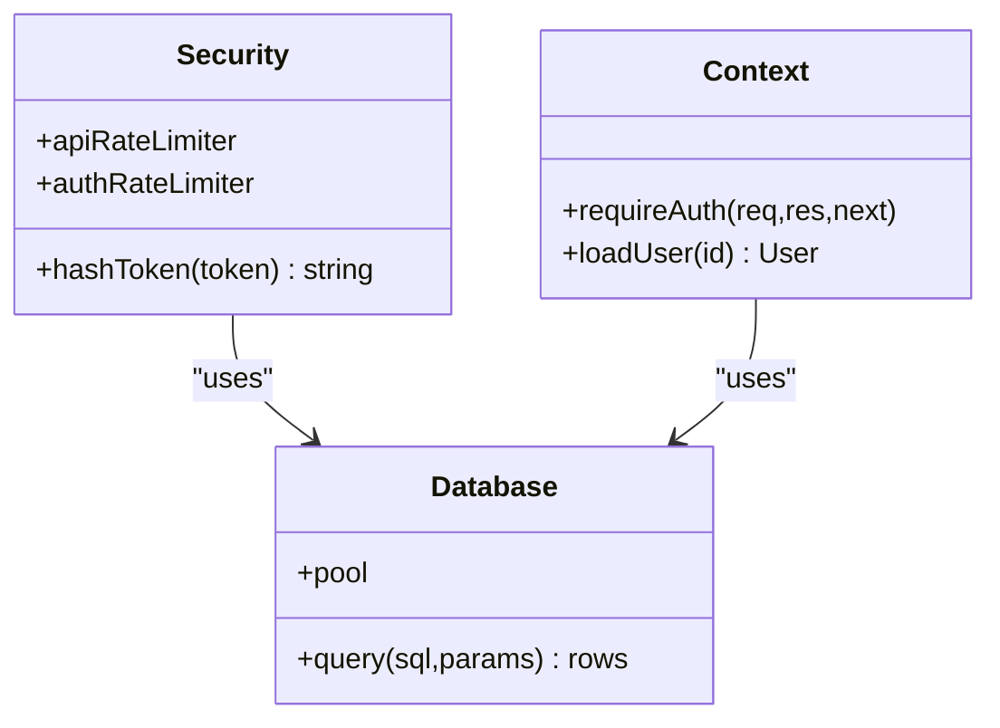
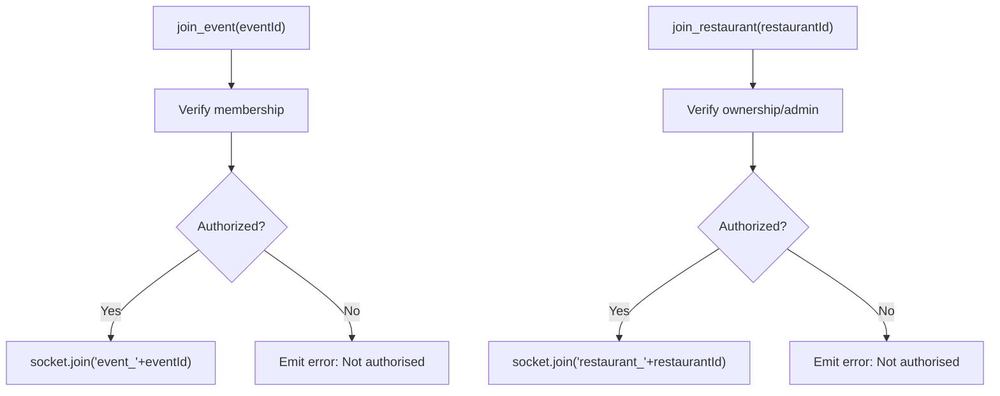
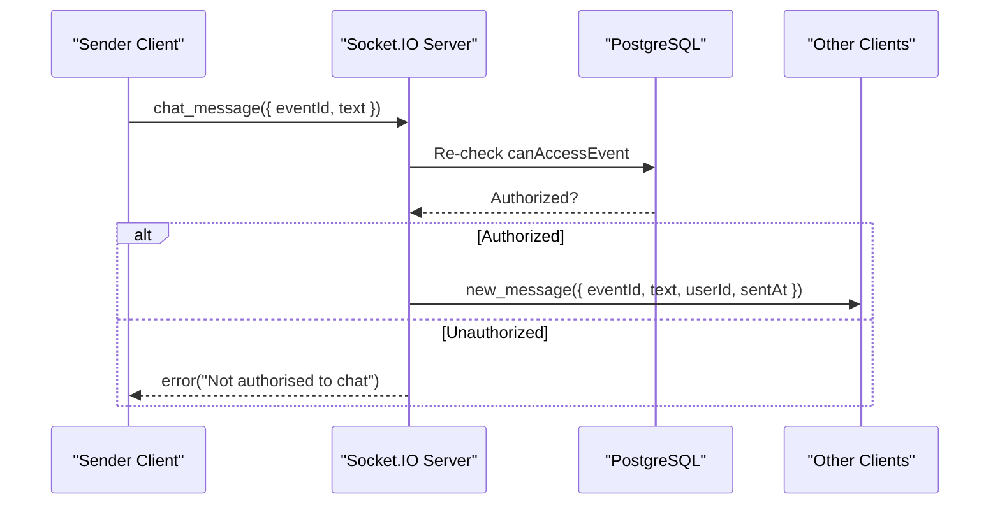
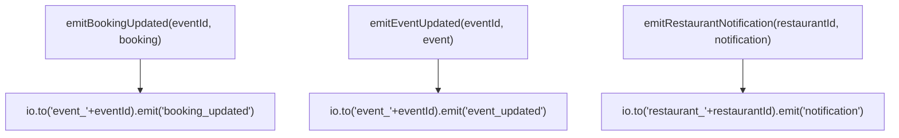
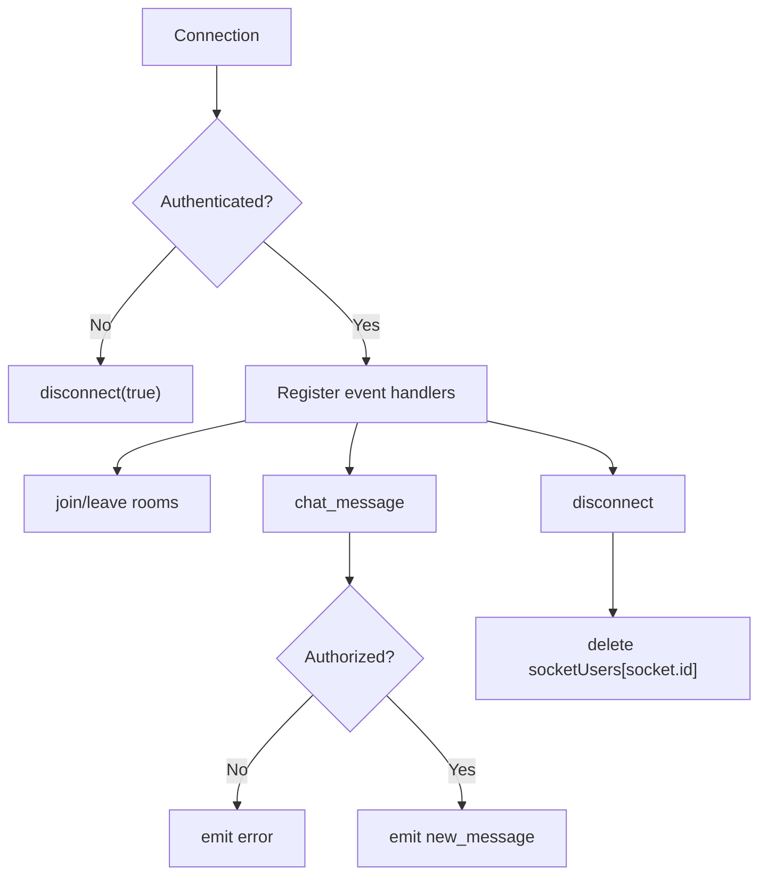
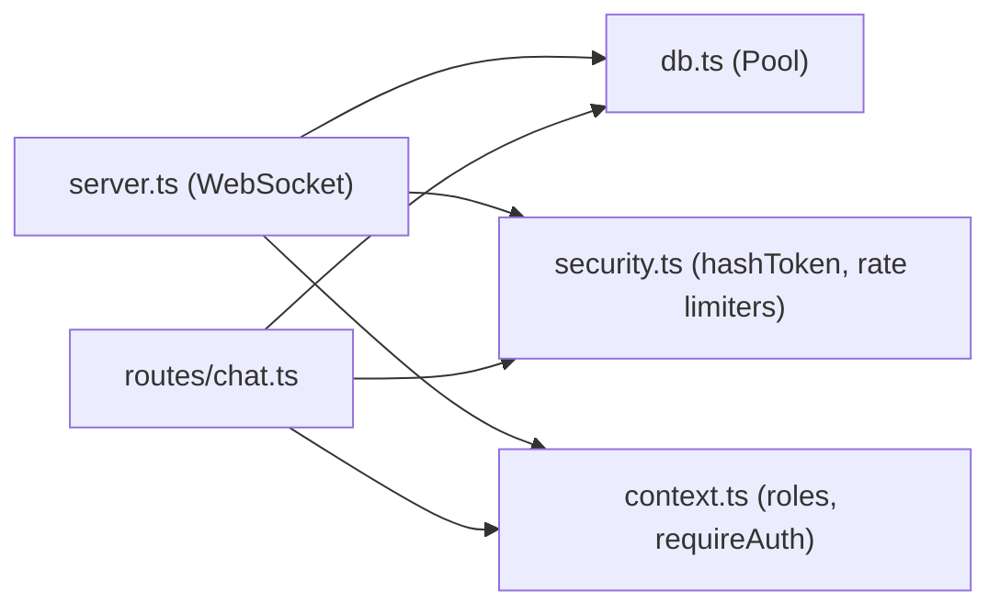

# Real-time Communication

<cite>
**Referenced Files in This Document**
- [server.ts](file://server/src/server.ts)
- [chat.ts](file://server/src/routes/chat.ts)
- [context.ts](file://server/src/context.ts)
- [security.ts](file://server/src/security.ts)
- [db.ts](file://server/src/db.ts)
</cite>

## Table of Contents
1. [Introduction](#introduction)
2. [Project Structure](#project-structure)
3. [Core Components](#core-components)
4. [Architecture Overview](#architecture-overview)
5. [Detailed Component Analysis](#detailed-component-analysis)
6. [Dependency Analysis](#dependency-analysis)
7. [Performance Considerations](#performance-considerations)
8. [Troubleshooting Guide](#troubleshooting-guide)
9. [Conclusion](#conclusion)

## Introduction
This document explains the real-time communication system built with Socket.IO in the DineCircle server. It covers the WebSocket connection lifecycle (handshake, authentication), room-based communication for events and restaurants, message broadcasting patterns for chat and live updates, event-driven architecture for user interactions and notifications, integration with token-based authentication, error handling, reconnection considerations, and performance guidance for scaling real-time features.

## Project Structure
The real-time layer is implemented on top of an Express HTTP server using a shared Node.js HTTP server instance. Socket.IO is configured to run alongside REST routes, sharing database access and security middleware. Chat persistence and authorization are handled by dedicated REST endpoints under the routes directory.

**Diagram sources**
- [server.ts:91-202](file://server/src/server.ts#L91-L202)
- [server.ts:204-217](file://server/src/server.ts#L204-L217)
- [routes/chat.ts:55-131](file://server/src/routes/chat.ts#L55-L131)
- [db.ts:4-18](file://server/src/db.ts#L4-L18)

**Section sources**
- [server.ts:27-95](file://server/src/server.ts#L27-L95)
- [server.ts:219-300](file://server/src/server.ts#L219-L300)

## Core Components
- WebSocket server initialization and CORS configuration
- Token-based authentication for WebSocket connections
- Room management for events and restaurants
- Event handlers for joining/leaving rooms and sending chat messages
- Broadcasting helpers for real-time updates (bookings, events, restaurant notifications)
- REST chat endpoints for persistence and history retrieval

Key responsibilities:
- Secure handshake via tokens stored as hashed values in the database
- Authorization checks before allowing room joins or message broadcasts
- Consistent room naming conventions for scalable targeting
- Separation of concerns between real-time messaging and persisted chat threads

**Section sources**
- [server.ts:91-202](file://server/src/server.ts#L91-L202)
- [server.ts:204-217](file://server/src/server.ts#L204-L217)
- [chat.ts:55-131](file://server/src/routes/chat.ts#L55-L131)

## Architecture Overview
The system uses a single HTTP server that serves both REST APIs and WebSocket connections. Clients authenticate over HTTP to obtain a bearer token, then connect via WebSocket including the token in the handshake. The server validates the token against the database and maps it to a user identity and role. After authentication, clients join rooms scoped to events or restaurants. Message broadcasting targets these rooms, ensuring only authorized participants receive updates.

**Diagram sources**
- [server.ts:99-113](file://server/src/server.ts#L99-L113)
- [server.ts:146-197](file://server/src/server.ts#L146-L197)
- [db.ts:12-18](file://server/src/db.ts#L12-L18)

## Detailed Component Analysis

### WebSocket Connection Lifecycle
- Handshake: The client connects to Socket.IO and includes a token in handshake.auth.
- Authentication: The server resolves the token from the auth_tokens table, verifying expiry and hashing the token before lookup. If invalid or missing, the connection is disconnected immediately.
- Session mapping: On successful authentication, the server stores the user’s id and role in an in-memory map keyed by socket.id for quick lookups during event processing.

**Diagram sources**
- [server.ts:99-113](file://server/src/server.ts#L99-L113)
- [server.ts:146-156](file://server/src/server.ts#L146-L156)

**Section sources**
- [server.ts:99-113](file://server/src/server.ts#L99-L113)
- [server.ts:146-156](file://server/src/server.ts#L146-L156)

### Authentication Integration
- Token storage: Tokens are stored as SHA-256 digests; clients send plaintext tokens which are hashed before DB lookup.
- Role resolution: The users table provides the role used for authorization decisions.
- REST vs WebSocket auth: REST routes use requireAuth middleware; WebSocket connections validate tokens directly in the connection handler.

**Diagram sources**
- [security.ts:12-14](file://server/src/security.ts#L12-L14)
- [context.ts:60-85](file://server/src/context.ts#L60-L85)
- [db.ts:4-18](file://server/src/db.ts#L4-L18)

**Section sources**
- [security.ts:12-14](file://server/src/security.ts#L12-L14)
- [context.ts:60-85](file://server/src/context.ts#L60-L85)
- [db.ts:4-18](file://server/src/db.ts#L4-L18)

### Room Management Model
- Events: Clients call join_event(eventId) to enter room event_{eventId}. Authorization is checked against host_id, active bookings, and attendee lists.
- Restaurants: Clients call join_restaurant(restaurantId) to enter room restaurant_{restaurantId}. Authorization ensures ownership or admin roles.
- Leaving rooms: leave_event and leave_restaurant remove the socket from respective rooms.

**Diagram sources**
- [server.ts:158-182](file://server/src/server.ts#L158-L182)

**Section sources**
- [server.ts:158-182](file://server/src/server.ts#L158-L182)

### Chat Messaging Patterns
- Real-time chat: Clients emit chat_message with eventId and text. The server re-verifies authorization before broadcasting new_message to all sockets in event_{eventId}, excluding the sender.
- Persisted chat thread: REST endpoints provide GET and POST for chat_messages per event, enforcing member-only access and blocked-pair restrictions.

**Diagram sources**
- [server.ts:184-197](file://server/src/server.ts#L184-L197)
- [chat.ts:88-131](file://server/src/routes/chat.ts#L88-L131)

**Section sources**
- [server.ts:184-197](file://server/src/server.ts#L184-L197)
- [chat.ts:55-131](file://server/src/routes/chat.ts#L55-L131)

### Real-time Updates and Notifications
- Booking updates: Helper emits booking_updated to event_{eventId}.
- Event status changes: Helper emits event_updated to event_{eventId}.
- Restaurant notifications: Helper emits notification to restaurant_{restaurantId}.

**Diagram sources**
- [server.ts:204-217](file://server/src/server.ts#L204-L217)

**Section sources**
- [server.ts:204-217](file://server/src/server.ts#L204-L217)

### Error Handling and Disconnections
- Unauthenticated connections are disconnected immediately.
- Authorization failures emit structured error objects to the client.
- Disconnect events clean up the in-memory socketUsers map.
- Global HTTP error handling distinguishes ApiError, ZodError, and unknown errors.

**Diagram sources**
- [server.ts:146-202](file://server/src/server.ts#L146-L202)
- [server.ts:263-277](file://server/src/server.ts#L263-L277)

**Section sources**
- [server.ts:146-202](file://server/src/server.ts#L146-L202)
- [server.ts:263-277](file://server/src/server.ts#L263-L277)

## Dependency Analysis
The WebSocket layer depends on:
- Database pool for token validation and authorization checks
- Security utilities for token hashing and rate limiting
- Context utilities for role definitions and REST auth middleware
- Express server for shared HTTP infrastructure

**Diagram sources**
- [server.ts:1-25](file://server/src/server.ts#L1-L25)
- [db.ts:1-18](file://server/src/db.ts#L1-L18)
- [security.ts:1-46](file://server/src/security.ts#L1-L46)
- [context.ts:1-37](file://server/src/context.ts#L1-L37)
- [chat.ts:1-6](file://server/src/routes/chat.ts#L1-L6)

**Section sources**
- [server.ts:1-25](file://server/src/server.ts#L1-L25)
- [db.ts:1-18](file://server/src/db.ts#L1-L18)
- [security.ts:1-46](file://server/src/security.ts#L1-L46)
- [context.ts:1-37](file://server/src/context.ts#L1-L37)
- [chat.ts:1-6](file://server/src/routes/chat.ts#L1-L6)

## Performance Considerations
- Connection scalability:
  - Use room names consistently (event_{id}, restaurant_{id}) to minimize fan-out complexity.
  - Avoid heavy synchronous operations inside event handlers; keep DB calls asynchronous and bounded.
- Authorization checks:
  - Re-check permissions before broadcasting to prevent race conditions and unauthorized access.
- Memory usage:
  - The in-memory socketUsers map grows with concurrent connections; ensure cleanup on disconnect.
- Database load:
  - Minimize repeated queries by caching short-lived authorization results where appropriate.
  - Use indexes on frequently queried columns (e.g., auth_tokens.token, dinner_events.host_id, bookings.event_id).
- Rate limiting:
  - Apply rate limiters to REST endpoints; consider adding throttling for high-frequency WebSocket events if needed.
- Scaling horizontally:
  - For multi-instance deployments, use a pub/sub backend (e.g., Redis adapter) so broadcasts reach clients across nodes.
- Backpressure and buffering:
  - Ensure clients handle reconnection and message ordering; avoid overwhelming clients with large payloads.

[No sources needed since this section provides general guidance]

## Troubleshooting Guide
- Connection rejected:
  - Cause: Missing or invalid token in handshake.auth.
  - Action: Verify token presence and validity; check auth_tokens expiry and hashing.
- Cannot join room:
  - Cause: Authorization failure (not host, not booked guest, not owner/admin).
  - Action: Confirm user role and relationship to event/restaurant; review canAccessEvent/canAccessRestaurant logic.
- Chat messages not received:
  - Cause: Sender not authorized or room mismatch.
  - Action: Re-check authorization before broadcast; ensure correct room name event_{eventId}.
- Errors emitted to client:
  - Look for structured error objects with message fields; inspect server logs for unhandled exceptions.
- Disconnections:
  - Ensure clients reconnect with valid tokens; verify cleanup of socketUsers map.

**Section sources**
- [server.ts:146-202](file://server/src/server.ts#L146-L202)
- [server.ts:263-277](file://server/src/server.ts#L263-L277)

## Conclusion
The DineCircle real-time system leverages Socket.IO for secure, room-based communication. Authentication is enforced at the WebSocket handshake using hashed tokens, and authorization is validated before room joins and message broadcasts. REST endpoints persist chat threads and enforce additional safety rules. Broadcasting helpers provide consistent real-time updates for bookings, events, and restaurant notifications. For production scale-out, adopt a pub/sub adapter, optimize database queries, and implement robust client-side reconnection strategies.

[No sources needed since this section summarizes without analyzing specific files]