# Security Considerations

<cite>
**Referenced Files in This Document**
- [README.md](file://README.md)
- [server/src/server.ts](file://server/src/server.ts)
- [server/src/security.ts](file://server/src/security.ts)
- [server/src/passwords.ts](file://server/src/passwords.ts)
- [server/src/context.ts](file://server/src/context.ts)
- [server/src/routes/auth.ts](file://server/src/routes/auth.ts)
- [server/database/security_hardening.sql](file://server/database/security_hardening.sql)
- [lib/api/api_client.dart](file://lib/api/api_client.dart)
</cite>

## Table of Contents
1. [Introduction](#introduction)
2. [Project Structure](#project-structure)
3. [Core Components](#core-components)
4. [Architecture Overview](#architecture-overview)
5. [Detailed Component Analysis](#detailed-component-analysis)
6. [Dependency Analysis](#dependency-analysis)
7. [Performance Considerations](#performance-considerations)
8. [Troubleshooting Guide](#troubleshooting-guide)
9. [Conclusion](#conclusion)
10. [Appendices](#appendices)

## Introduction
This document provides a comprehensive security analysis of the DineCircle monorepo, covering both the Flutter frontend and the Node/Express + PostgreSQL backend. It documents authentication and authorization (JWT-like opaque bearer tokens, scrypt password hashing, role-based access control), input validation and sanitization strategies, security headers via Helmet and custom middleware, secure storage practices for sensitive data, audit logging, database hardening, privacy considerations, and monitoring/incident response guidance. The goal is to make the security model understandable for both technical and non-technical readers while remaining grounded in the actual codebase.

## Project Structure
DineCircle is a monorepo with:
- Flutter app under lib/ handling UI, networking, state, and secure token storage.
- Express API under server/src/ implementing auth, business routes, rate limiting, audit logging, and WebSocket authorization.
- PostgreSQL schema and seed scripts under server/src/, plus a dedicated database hardening script.

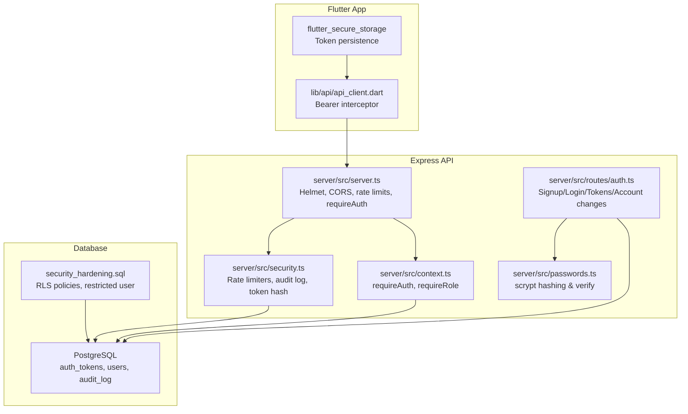

**Diagram sources**
- [lib/api/api_client.dart:20-31](file://lib/api/api_client.dart#L20-L31)
- [server/src/server.ts:61-90](file://server/src/server.ts#L61-L90)
- [server/src/security.ts:28-68](file://server/src/security.ts#L28-L68)
- [server/src/passwords.ts:15-41](file://server/src/passwords.ts#L15-L41)
- [server/src/context.ts:60-98](file://server/src/context.ts#L60-L98)
- [server/src/routes/auth.ts:186-280](file://server/src/routes/auth.ts#L186-L280)
- [server/database/security_hardening.sql:1-74](file://server/database/security_hardening.sql#L1-L74)

**Section sources**
- [README.md:207-252](file://README.md#L207-L252)
- [README.md:270-300](file://README.md#L270-L300)

## Core Components
- Authentication: Opaque bearer tokens stored as SHA-256 digests in the database; client stores plaintext tokens securely and sends them on each request. Tokens expire after 30 days.
- Password protection: scrypt-based hashing with per-password salt; timing-safe verification.
- Authorization: Middleware resolves the acting user from the token and enforces roles (user, host, influencer, partner_admin, super_admin).
- Input validation: Zod schemas validate all request bodies before processing.
- Rate limiting: Global, auth-specific, report, and feedback rate limiters.
- Audit logging: Mutating requests are recorded with redacted payloads.
- Database hardening: Restricted DB user and row-level security policies.
- Secure storage: flutter_secure_storage used by the client for tokens.

**Section sources**
- [server/src/security.ts:7-14](file://server/src/security.ts#L7-L14)
- [server/src/passwords.ts:6-41](file://server/src/passwords.ts#L6-L41)
- [server/src/context.ts:60-98](file://server/src/context.ts#L60-L98)
- [server/src/routes/auth.ts:160-280](file://server/src/routes/auth.ts#L160-L280)
- [server/src/security.ts:28-68](file://server/src/security.ts#L28-L68)
- [server/src/security.ts:103-147](file://server/src/security.ts#L103-L147)
- [server/database/security_hardening.sql:22-74](file://server/database/security_hardening.sql#L22-L74)
- [lib/api/api_client.dart:20-31](file://lib/api/api_client.dart#L20-L31)

## Architecture Overview
The security architecture spans three layers:
- Client layer: Secure token storage and automatic Authorization header injection.
- API layer: Helmet headers, CORS allowlist, global and endpoint-specific rate limiting, authentication/authorization middleware, Zod validation, audit logging.
- Data layer: Parameterized SQL, hashed secrets, restricted DB user, and row-level security policies.

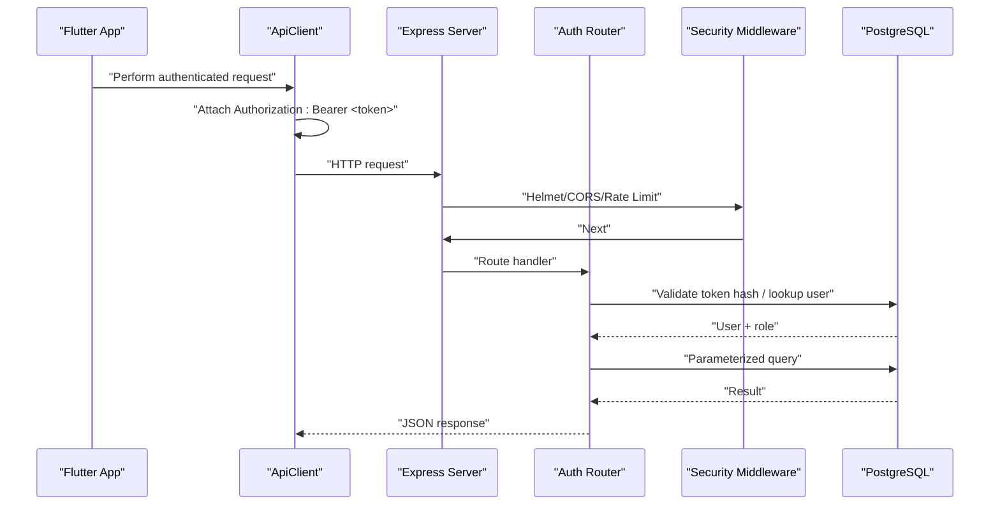

**Diagram sources**
- [lib/api/api_client.dart:20-31](file://lib/api/api_client.dart#L20-L31)
- [server/src/server.ts:61-90](file://server/src/server.ts#L61-L90)
- [server/src/context.ts:60-85](file://server/src/context.ts#L60-L85)
- [server/src/routes/auth.ts:186-280](file://server/src/routes/auth.ts#L186-L280)

## Detailed Component Analysis

### Authentication and Token Management
- Tokens are opaque strings prefixed with a constant, generated server-side, and stored only as SHA-256 digests in the database. Clients keep the plaintext secret and present it on every request.
- Token lookup hashes the incoming token before querying the database, preventing replay from a leaked table.
- Tokens have a 30-day TTL; signout deletes the current token; logout-all revokes all sessions for the user.
- On app start, the client calls GET /auth/me to restore session state; 401 triggers a session reset.

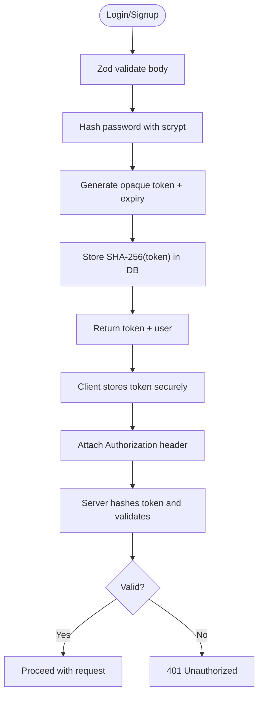

**Diagram sources**
- [server/src/routes/auth.ts:186-280](file://server/src/routes/auth.ts#L186-L280)
- [server/src/security.ts:7-14](file://server/src/security.ts#L7-L14)
- [server/src/context.ts:60-85](file://server/src/context.ts#L60-L85)
- [lib/api/api_client.dart:20-31](file://lib/api/api_client.dart#L20-L31)

**Section sources**
- [server/src/routes/auth.ts:186-280](file://server/src/routes/auth.ts#L186-L280)
- [server/src/security.ts:7-14](file://server/src/security.ts#L7-L14)
- [server/src/context.ts:60-85](file://server/src/context.ts#L60-L85)
- [README.md:125-138](file://README.md#L125-L138)

### Password Hashing and Verification
- Passwords are hashed using scrypt with a random salt; the scheme, salt, and digest are stored together.
- Verification uses timing-safe comparison to prevent timing attacks.
- Malformed or unknown schemes fail safely without leaking information.

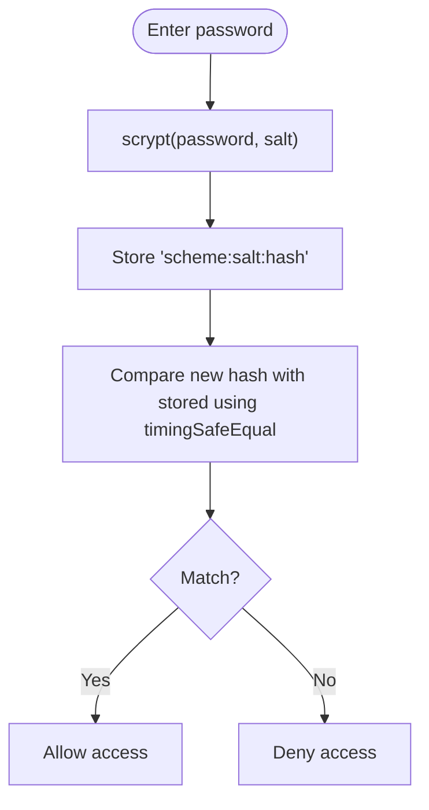

**Diagram sources**
- [server/src/passwords.ts:15-41](file://server/src/passwords.ts#L15-L41)

**Section sources**
- [server/src/passwords.ts:6-41](file://server/src/passwords.ts#L6-L41)

### Role-Based Access Control
- Roles include user, host, influencer, partner_admin, and super_admin.
- requireAuth resolves userId and userRole from the token; requireRole restricts endpoints to specific roles.
- Host/influencer capabilities are checked via hasHostCapabilities.

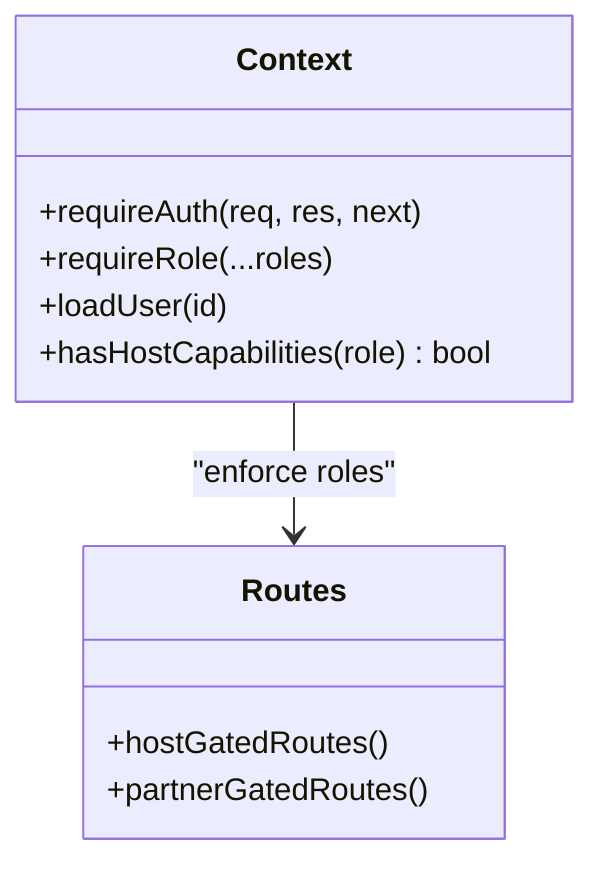

**Diagram sources**
- [server/src/context.ts:6-25](file://server/src/context.ts#L6-L25)
- [server/src/context.ts:60-98](file://server/src/context.ts#L60-L98)

**Section sources**
- [server/src/context.ts:6-25](file://server/src/context.ts#L6-L25)
- [server/src/context.ts:60-98](file://server/src/context.ts#L60-L98)

### Input Validation and Sanitization
- All request bodies are validated with Zod schemas before processing, reducing injection and malformed input risks.
- Email normalization and length constraints are enforced at the boundary.
- No raw string concatenation into SQL; parameterized queries are used throughout.

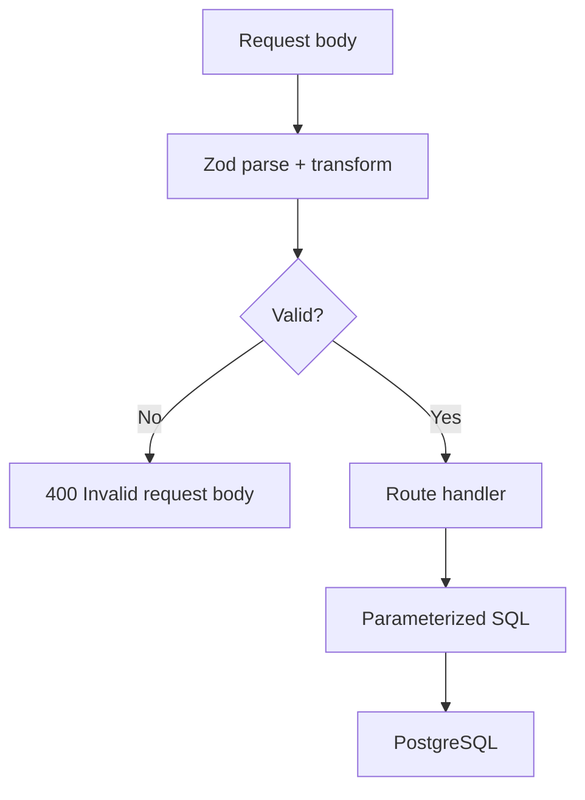

**Diagram sources**
- [server/src/routes/auth.ts:160-184](file://server/src/routes/auth.ts#L160-L184)
- [server/src/server.ts:263-277](file://server/src/server.ts#L263-L277)

**Section sources**
- [server/src/routes/auth.ts:160-184](file://server/src/routes/auth.ts#L160-L184)
- [server/src/server.ts:263-277](file://server/src/server.ts#L263-L277)

### Security Headers and Custom Middleware
- Helmet is applied globally to set secure HTTP headers.
- CORS is configured with an explicit origin allowlist; development allows additional local origins.
- Global and endpoint-specific rate limiters protect against brute force and abuse.
- Audit logging records mutating requests with redacted sensitive fields.

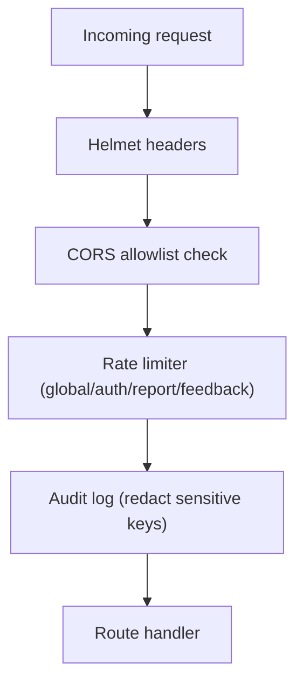

**Diagram sources**
- [server/src/server.ts:61-90](file://server/src/server.ts#L61-L90)
- [server/src/security.ts:28-68](file://server/src/security.ts#L28-L68)
- [server/src/security.ts:70-97](file://server/src/security.ts#L70-L97)
- [server/src/security.ts:103-147](file://server/src/security.ts#L103-L147)

**Section sources**
- [server/src/server.ts:61-90](file://server/src/server.ts#L61-L90)
- [server/src/security.ts:28-68](file://server/src/security.ts#L28-L68)
- [server/src/security.ts:70-97](file://server/src/security.ts#L70-L97)
- [server/src/security.ts:103-147](file://server/src/security.ts#L103-L147)

### Secure Storage Practices
- Backend:
  - Tokens stored as SHA-256 digests; never stored in plaintext in the database.
  - Passwords hashed with scrypt; no plaintext credentials persisted.
  - Audit logs redact sensitive keys like passwords, OTP codes, and tokens.
- Frontend:
  - Tokens are stored in flutter_secure_storage.
  - ApiClient attaches Authorization headers automatically.

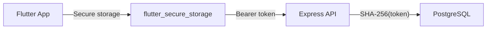

**Diagram sources**
- [lib/api/api_client.dart:20-31](file://lib/api/api_client.dart#L20-L31)
- [server/src/security.ts:7-14](file://server/src/security.ts#L7-L14)
- [server/src/security.ts:70-97](file://server/src/security.ts#L70-L97)

**Section sources**
- [lib/api/api_client.dart:20-31](file://lib/api/api_client.dart#L20-L31)
- [server/src/security.ts:7-14](file://server/src/security.ts#L7-L14)
- [server/src/security.ts:70-97](file://server/src/security.ts#L70-L97)

### Database Hardening and Privacy Controls
- A dedicated API user with minimal privileges is created.
- Row-Level Security policies restrict access to restaurants, bookings, and auth tokens based on the acting user.
- Audit log table captures mutations for compliance and incident response.

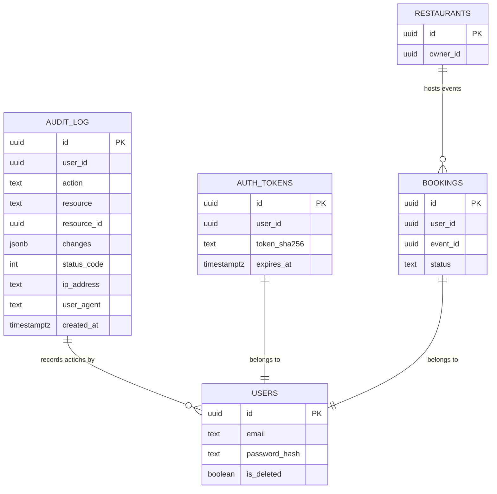

**Diagram sources**
- [server/database/security_hardening.sql:1-74](file://server/database/security_hardening.sql#L1-L74)

**Section sources**
- [server/database/security_hardening.sql:1-74](file://server/database/security_hardening.sql#L1-L74)

### Security Monitoring and Incident Response
- Audit logging captures mutating operations with redacted payloads, including IP and user agent.
- Centralized error handling returns safe messages and logs unhandled errors.
- Rate limiters mitigate brute-force and spam attempts across auth, reports, and feedback.

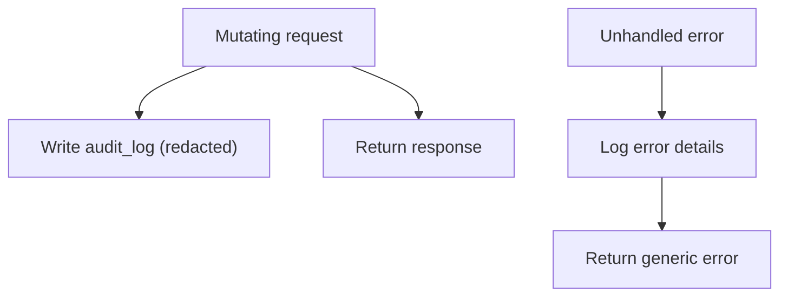

**Diagram sources**
- [server/src/security.ts:103-147](file://server/src/security.ts#L103-L147)
- [server/src/server.ts:263-277](file://server/src/server.ts#L263-L277)

**Section sources**
- [server/src/security.ts:103-147](file://server/src/security.ts#L103-L147)
- [server/src/server.ts:263-277](file://server/src/server.ts#L263-L277)

## Dependency Analysis
Key dependencies and their security responsibilities:
- server.ts wires Helmet, CORS, rate limiters, and requires authentication for protected routes.
- context.ts implements requireAuth and requireRole.
- security.ts provides rate limiters, audit logging, and token hashing.
- passwords.ts handles scrypt hashing and verification.
- routes/auth.ts orchestrates signup/login/token issuance and account changes.
- api_client.dart ensures the client attaches the Authorization header.

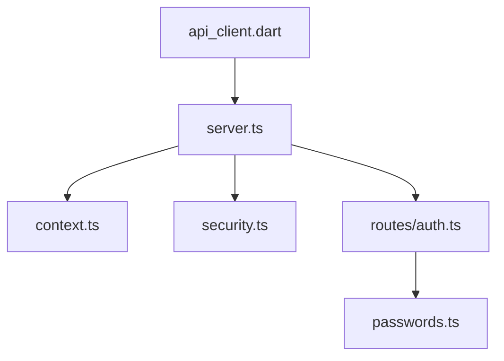

**Diagram sources**
- [server/src/server.ts:1-25](file://server/src/server.ts#L1-L25)
- [server/src/context.ts:1-10](file://server/src/context.ts#L1-L10)
- [server/src/security.ts:1-10](file://server/src/security.ts#L1-L10)
- [server/src/routes/auth.ts:1-10](file://server/src/routes/auth.ts#L1-L10)
- [server/src/passwords.ts:1-5](file://server/src/passwords.ts#L1-L5)
- [lib/api/api_client.dart:1-10](file://lib/api/api_client.dart#L1-L10)

**Section sources**
- [server/src/server.ts:1-25](file://server/src/server.ts#L1-L25)
- [server/src/context.ts:1-10](file://server/src/context.ts#L1-L10)
- [server/src/security.ts:1-10](file://server/src/security.ts#L1-L10)
- [server/src/routes/auth.ts:1-10](file://server/src/routes/auth.ts#L1-L10)
- [server/src/passwords.ts:1-5](file://server/src/passwords.ts#L1-L5)
- [lib/api/api_client.dart:1-10](file://lib/api/api_client.dart#L1-L10)

## Performance Considerations
- scrypt hashing is computationally intensive; ensure appropriate cost parameters and consider hardware limits when scaling.
- Audit logging is fire-and-forget to avoid blocking request paths; monitor insert failures.
- Rate limiters should be tuned per environment; integration tests can override limits safely.
- Parameterized SQL reduces parsing overhead and prevents injection.

[No sources needed since this section provides general guidance]

## Troubleshooting Guide
Common issues and mitigations:
- 401 Unauthorized: Check token presence, expiration, and correct Authorization header format.
- 403 Forbidden: Verify user role and required permissions.
- 400 Bad Request: Inspect Zod validation issues returned by the server.
- Rate limited: Reduce request frequency or adjust environment variables for testing.
- Audit log missing: Ensure mutating methods reach the audit middleware and that inserts succeed.

**Section sources**
- [server/src/server.ts:263-277](file://server/src/server.ts#L263-L277)
- [server/src/context.ts:60-98](file://server/src/context.ts#L60-L98)
- [server/src/security.ts:28-68](file://server/src/security.ts#L28-L68)

## Conclusion
DineCircle implements a robust security posture:
- Strong credential protection with scrypt hashing and timing-safe verification.
- Secure token lifecycle with hashed storage and strict TTL.
- Comprehensive input validation and parameterized SQL to mitigate injection.
- Helmet and CORS configuration with explicit allowlists.
- Multi-layered rate limiting and audit logging for abuse prevention and compliance.
- Database hardening with restricted user and row-level security policies.
- Secure client-side token storage and automatic header injection.

Future improvements should focus on refresh/rotation mechanisms, OTP attempt throttling, email verification flows, input-length limits for chat/reviews, and production-grade secret management.

[No sources needed since this section summarizes without analyzing specific files]

## Appendices

### Security Posture Summary
- In place (server): Helmet headers; CORS allowlist; global and auth rate limits; scrypt hashing; opaque DB-backed bearer tokens; ownership/role checks; audit logging; database hardening.
- In place (client): Token in flutter_secure_storage; single typed error surface; 401 → session reset; connectivity banner + retry-once GETs.
- Known gaps: No token refresh/rotation; OTP codes lack attempt throttling; no signup email verification or account lockout; no input-length limits on review/chat beyond Zod strings; secrets in compose are defaults.

**Section sources**
- [README.md:419-437](file://README.md#L419-L437)